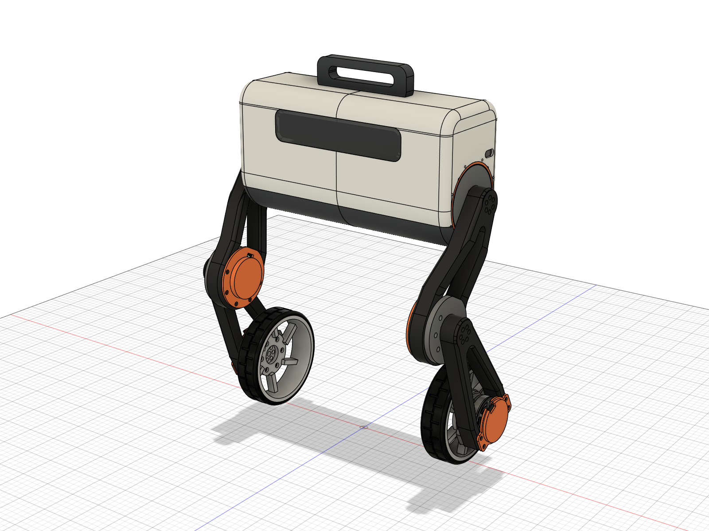
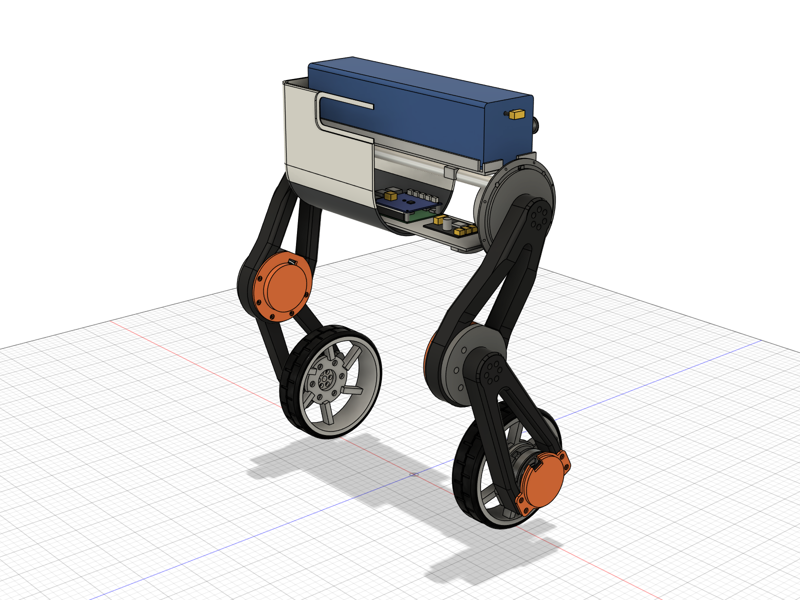
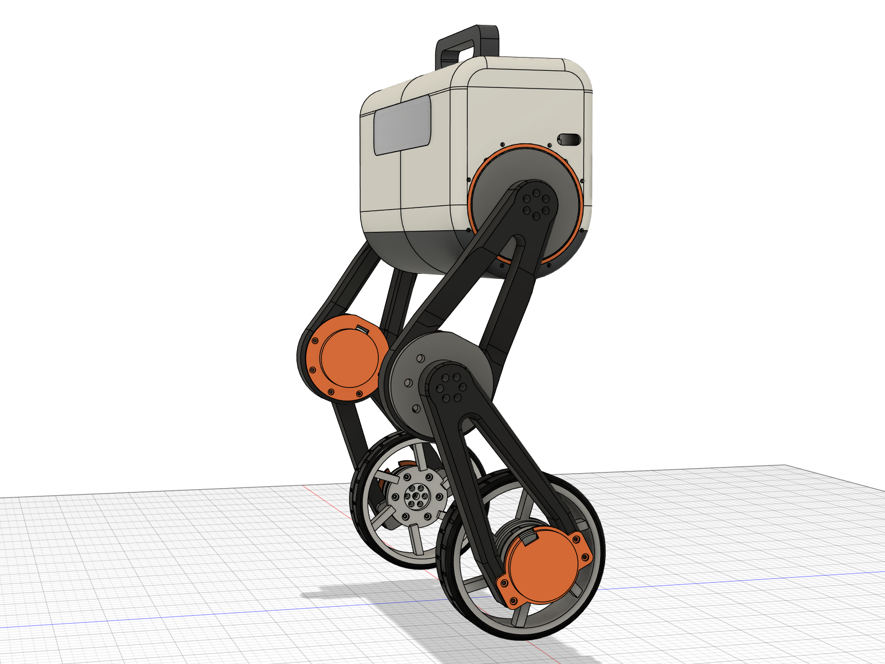
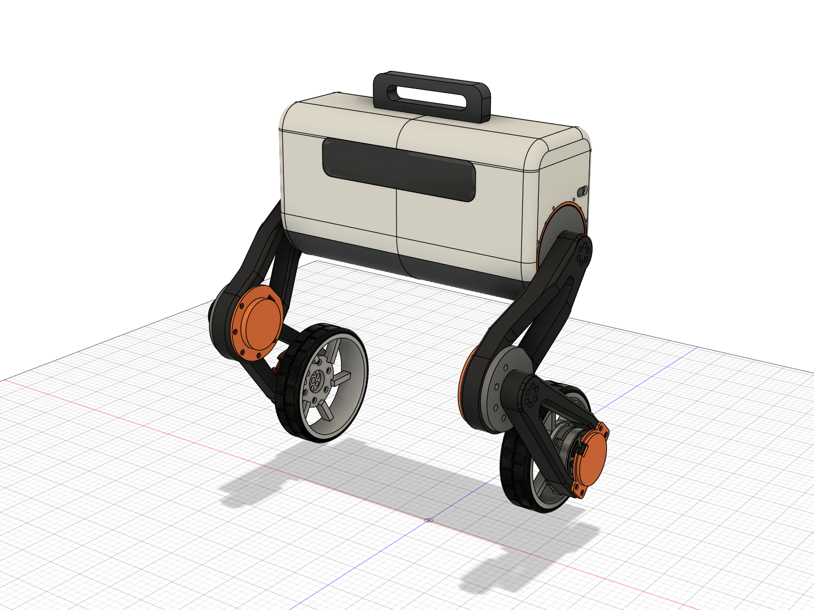

# 실제 로봇 3D 모델 (upkie 다리 + CubeMars AKE 모터)

작성 2026-10-26. Autodesk Fusion에서 스크립트로 만든 실제 제작용 모델입니다. hip·바퀴 = **AKE50-8 KV110**, 무릎 = **AKE60-8 KV80**, 바퀴 Ø150 mm, 배터리 24 V 15 Ah(75 × 310 × 75 mm, 1.8 kg), Raspberry Pi 4B + mjbots pi3hat를 넣었습니다.



## 0. 요약

| 항목 | 값 |
|---|---|
| 전체 질량 | **6.54 kg** (몸통 3.87 kg, 다리 한쪽 1.34 kg = 허벅지 링크 0.61 + 정강이 링크 0.44 + 바퀴 0.28) |
| **몸통 무게중심** | **hip 축 중점 바로 위 52.6 mm** (앞뒤 −0.005 mm, 좌우 +0.011 mm) — 배터리를 앞뒤 +0.27 mm, 좌우 −0.21 mm 옮겨 맞춤 |
| 로봇 전체 무게중심 | 바퀴축보다 앞 15.2 mm, 바닥 위 327 mm (무릎이 앞으로 나간 자세라서 앞쪽) |
| 크기 | 폭 456 mm (바퀴 간격 334 mm), 높이 556 mm (손잡이 포함, 몸통 윗면 515 mm), 몸통 132(앞뒤) × 356(폭) × 196(높이) mm |
| 다리 | 허벅지 175 mm (upkie 2.0 upper_leg 그대로), 정강이 175 mm, 서 있는 자세 L0 = 310 mm(무릎 앞), hip 높이 385 mm, 몸통 아래 바닥 틈 319 mm |
| 간섭 검사 | 서 있는 자세 0건. L0 200 / 240 / 335 mm, hip ±60°(L0 310·335), L0 240에서 hip ±30°, hip 뒤로 80° 모두 0건 |
| 알려진 한계 | hip을 **앞으로 80°**(바퀴가 hip 높이까지 올라감) 돌리거나 L0 180 mm에서 앞으로 45° 돌리면 허벅지의 꺾인 부분이 몸통 아래 덮개에 닿음(0.1 cm³ 정도) |

## 1. 파일

| 경로 | 내용 |
|---|---|
| `export/WheelBiped_AKE.f3d` | Fusion 아카이브(관절 6개 포함). Fusion에서 열기 → 업로드 |
| `export/WheelBiped_AKE_assembly.step` | 전체 조립 STEP (부품 이름 포함) |
| `export/parts_step/*.step`, `export/parts_stl/*.stl` | 새로 만들거나 고친 부품 15종 (STL은 출력용, 몸통 셸은 반쪽마다 따로) |
| `upkie_step/*.step` | upkie_parts 2.0.0 FCStd에서 뽑은 원본 STEP (upper_leg, lower_leg, wheel_hub, knee/hip_support) |
| `images/*.png` | 정면·측면·윗면·다리·몸통 내부·자세별 그림 |
| `fusion/*.py` | 모델을 처음부터 다시 만드는 스크립트 (6절) |
| `tools/fcstd_to_step.py` | FreeCAD 없이 FCStd → STEP 변환 (gmsh/OpenCASCADE) |

Fusion 문서 `WheelBiped_AKE`는 Fusion 허브의 "Default Project"에도 저장돼 있습니다(2026-10-26, 버전 1). 숨김 컴포넌트 `_library`는 지우면 안 됩니다(6절).

**다른 컴퓨터의 Fusion에서 열기**
- 같은 Autodesk 계정이면: Fusion 데이터 패널 → Default Project → `WheelBiped_AKE`를 바로 엽니다(파일 필요 없음).
- 다른 계정이거나 클라우드 없이: `export/WheelBiped_AKE.f3d` **하나만** 있으면 됩니다. 모터·upkie 부품·관절·재질이 모두 들어 있습니다. Fusion 데이터 패널의 업로드(또는 파일 → 열기 → 내 컴퓨터에서 열기)로 엽니다.
- Fusion이 아닌 CAD: `export/WheelBiped_AKE_assembly.step` (형상과 조립 구조만, 관절·재질 없음).
- 모델을 스크립트로 다시 만들려면 `fusion/`, `upkie_step/`와 CubeMars STEP 두 개(`build_setup.py`의 `AKE50_STEP`, `AKE60_STEP` 경로)가 필요합니다.

## 2. 핵심 설계: AKE 모터를 어떻게 다는가

AKE50/AKE60은 **앞면 하나에 고정부와 출력부가 같이** 있습니다. 뒷면은 엔코더 자석이 달린 로터 캡이라 고속으로 돌고, 아무것도 붙일 수 없습니다.

| | AKE50-8 | AKE60-8 |
|---|---|---|
| 고정링 | Ø42 h7 파일럿, M2.5 ×6 (PCD 36.5, 깊이 3) + Ø2.5 맞춤핀 ×3 | Ø42 h7 파일럿, M2.5 ×6 (PCD 36.5, 깊이 5), 맞춤핀 구멍 없음 |
| 출력판 | Ø27, M3 ×6 (PCD 20, 깊이 4.5) + Ø3 핀 ×3 | Ø27, M3 ×6 (PCD 20, 깊이 5) + Ø3 핀 ×3 |
| 출력면이 고정링보다 앞으로 나온 양 | 2.0 mm | 0.5 mm |

그래서 CubeMars가 함께 준 시험 하우징과 같은 방식으로 답니다: **벽(판)에 Ø42 파일럿 포켓 + Ø30 관통 구멍**, 고정링은 M2.5로 벽에 고정, 구동되는 링크는 **Ø26 보스**로 구멍 안에 들어가 출력판에 M3 + Ø3 핀으로 물립니다. 모든 구멍 위치는 STEP의 모터 형상에서 계산해 뚫었습니다.

upkie 다리에 맞춰 보니 잘 맞는 곳이 두 군데 있었습니다.
- **무릎**: upkie 허벅지의 무릎 고리 안지름이 Ø73인데 AKE60이 Ø69라서 모터가 허벅지 두께 안에 쏙 들어갑니다. 고정은 허벅지에 원래 있던 M3 구멍 5개(R40.5)에 새 **무릎 어댑터**(알루미늄 8 mm)를 달아서 합니다.
- **바퀴**: upkie 정강이 아래 포크 사이가 66 mm인데 AKE50이 Ø61.2라서 모터가 포크 안에 들어갑니다. 포크에 원래 있던 M3 구멍 4개에 새 **발목 플레이트**(알루미늄 8 mm)를 달고, 출력은 안쪽으로 나와 허브와 바퀴를 돌립니다.

upkie 링크에서 바꾼 곳은 qdd100용 **보스 두 개뿐**입니다(허벅지 hip 쪽, 정강이 무릎 쪽): 옛 보스와 나사 구멍을 메우고 Ø26 보스(허벅지 4.5 mm, 정강이 6.0 mm) + M3 카운터보어 6개 + Ø3 핀 구멍 3개를 새로 냈습니다.

### 2.1 좌우 방향 적층 (왼쪽 다리, 로봇 중심선에서 바깥쪽 거리 y)

| 부품 | y [mm] |
|---|---|
| hip 모터 AKE50 (몸통 안, 출력이 바깥을 향함) + 뒤쪽 moteus-c1 | 142 ~ 176 |
| hip 플레이트 (몸통 옆면과 같은 면) | 170 ~ 178 |
| upkie 허벅지 hip 쪽 | 179.5 ~ 204.5 |
| upkie 허벅지 무릎 고리 (안쪽으로 꺾임) / 그 안의 AKE60 | 161.8 ~ 186.8 / 164.8 ~ 189.8 |
| 무릎 어댑터 | 186.8 ~ 194.8 |
| upkie 정강이 (포크 안에 바퀴 모터 AKE50, 출력이 안쪽을 향함) | 195.8 ~ 220.8 |
| 발목 플레이트 (포크 안쪽 면) | 187.8 ~ 195.8 |
| 허브 → 림·타이어 (정강이 안쪽) | 148 ~ 191 (타이어 중심 167) |
| 바퀴 커버 (정강이 바깥쪽, c1 수납) | ~ 227.8 |

허벅지의 꺾인 부분은 hip 중심에서 76 mm 아래부터 몸통 옆면보다 안쪽으로 들어옵니다. 그래서 **몸통 아래쪽을 hip 축 중심의 반원(R66)**으로 만들어 hip이 거의 끝까지 돌아도 닿지 않게 했습니다.

## 3. 몸통

DIABLO/Ascento처럼 둥근 캡슐형으로, 아래는 hip 축을 감싸는 반원, 위는 R30 모서리의 상자입니다.

- **구조**: 알루미늄 hip 플레이트 2장(6061, 8 mm, 플랜지 Ø120 + 셸과 같은 면의 보스 Ø99)을 **알루미늄 관 2개(Ø16 × 1.5)**로 잇습니다. 로봇 무게는 모터 → hip 플레이트 → 관으로 전달되고, 프린트한 셸은 하중을 거의 받지 않습니다.
- **배터리**: 관 위 트레이에 가로로 눕힙니다(hip 축 위 49~124 mm). 양 끝에 선 정리 공간 20 mm, 벨크로 끈 구멍.
- **전장**: 배터리 아래 썰매(sled)에 Raspberry Pi 4B + pi3hat(11.5 mm 스페이서), 전원 분배 보드(XT60 입력, XT30 출력 4개). 썰매는 **떼어내는 아래 덮개**(진회색) 위에 있어 덮개를 열면 전장 전체가 나옵니다.
- **hip 드라이버**: hip 모터 뒤에 moteus-c1을 품는 컵(hip_cage_c1)을 hip 플레이트 안쪽에 고정.
- **셸**: PETG/ASA 3 mm, 출력 크기에 맞춰 아래 덮개 / 몸통 / 뚜껑을 각각 좌우 반쪽(모두 6조각)으로 나눔. 앞면에 짙은 아크릴 바이저(뒤에 LED 바, 나중에 카메라 창으로 사용), 뒷면에 통풍구·전원 버튼·충전 잭, 옆면에 다리 케이블 구멍과 주황 장식 링, 윗면에 손잡이.



### 3.1 몸통 무게중심

| 질량이 큰 순서 | g |
|---|---|
| 배터리 | 1800 |
| hip 모터 AKE50 × 2 | 380 |
| hip 플레이트 × 2 | 347 |
| 셸(몸통 반쪽 2 + 뚜껑 2 + 아래 덮개 2) | 810 |
| 배터리 트레이 / 썰매 / 손잡이 / 관 2개 | 96 / 69 / 67 / 125 |
| 나머지(라즈베리파이, pi3hat, 전원 보드, c1, 컵, 바이저 등) | 175 |
| **합계** | **3869** |

무게중심은 hip 두 축의 중점 바로 위 52.6 mm입니다. 셸은 앞뒤·좌우가 대칭이고, 남은 비대칭(앞면 바이저 창, 라즈베리파이를 y −25 mm, 전원 보드를 +70 mm에 둔 것 등)은 배터리 위치(`params.py`의 `BATTERY_X = 0.26`, `BATTERY_Y = −0.19` mm)로 맞췄습니다. 배터리 위치를 바꾸면 `build_all.suggest_battery_offset()`이 새 값을 알려 줍니다.

## 4. 다리와 바퀴



| 부품 | 재질·가공 | 질량 |
|---|---|---|
| upkie upper_leg (hip 보스 수정) | PA-CF 프린트 | 210 g |
| upkie lower_leg (무릎 보스 수정) | PA-CF 프린트 | 175 g |
| 무릎 어댑터 AKE60 | 6061 CNC, 8 mm | 116 g |
| 발목 플레이트 AKE50 | 6061 CNC, 8 mm | 59 g |
| 무릎 커버 / 바퀴 커버 (모터 뒤 c1 수납, 돌아가는 로터 캡 보호) | PA-CF 프린트 | 19 / 12 g |
| **바퀴 허브 AKE50** | 6061 선반 가공 | 44 g |
| **림 Ø134 (6개 경사 스포크)** | PA-CF 프린트 | 91 g |
| **타이어 Ø150 × 38 (두께 8 mm, 트레드 홈, 림 플랜지용 비드 홈)** | TPU 95A 프린트 또는 우레탄 주형 | 149 g |

- **허브**: Ø26 보스가 발목 플레이트 구멍으로 들어가 출력판에 M3 × 6 + Ø3 핀 × 3으로 물리고, Ø64 플랜지(M4 탭 6개, PCD 50)에 림을 답니다. 림만 바꾸면 다른 바퀴도 쓸 수 있습니다.
- **하중**: 정지 때 바퀴 하나 약 32 N, 착지·충돌 4 g를 잡아도 약 130 N입니다. 출력 토크 최대 7.5 N·m는 M3 6개(PCD 20)에 나사 하나당 약 125 N 전단으로 걸리고, 여기에 핀 3개가 더해집니다. 림의 M4는 나사 하나당 약 45 N입니다. 타이어 중심은 모터 출력면에서 24 mm 떨어져 있어 모터 출력 베어링에 굽힘 모멘트가 걸립니다(130 N이면 약 3 N·m). AKE50 베어링 허용 하중은 공개 자료가 없어 확인하지 못했습니다.
- 사용자 계산기의 가정(바퀴 0.5 kg, 몸통 4.0 kg)보다 실제가 가볍습니다(0.28 / 3.87 kg). `ake_sizing` 결과는 보수적인 쪽입니다. 허벅지가 168 → 175 mm로 바뀌었으니 다음에 `wbr.bench.ake_sizing`을 L1 = 175로 다시 돌리면 좋습니다.



## 5. 구매품과 체결 부품

**구매품**: AKE50-8 KV110 × 4(hip 2, 바퀴 2), AKE60-8 KV80 × 2(무릎), moteus-c1 × 6(38 × 38 × 9 mm), Raspberry Pi 4B, mjbots pi3hat r4.5(입력 8~54 V, Pi에 5 V 공급, CAN-FD 5포트), 전원 분배 보드(mjbots power_dist급, XT60 입력·XT30 출력), 24 V 15 Ah 배터리(XT60), 전원 버튼 Ø16, DC 잭 5.5/2.1, LED 바, 6061 관 Ø16 × 1.5 × 340 × 2(양 끝 M5 탭 플러그).

**체결 부품(한쪽 다리 + 몸통 절반 기준, 모델에는 나사를 그리지 않음)**

| 위치 | 나사 | 비고 |
|---|---|---|
| 허벅지 ↔ hip 출력 | M3 × 16 × 6, Ø3 × 8 핀 × 3 | 허벅지 바깥면에서 카운터보어 |
| 정강이 ↔ 무릎 출력 | M3 × 16 × 6, Ø3 × 8 핀 × 3 | |
| hip 플레이트 ↔ AKE50 고정링 | M2.5 × 5 × 6, Ø2.5 × 6 핀 × 3 | 링 나사 깊이 3 mm라 5 mm 길이 |
| 무릎 어댑터 ↔ AKE60 고정링 | M2.5 × 6 × 6 | AKE60 링에는 핀 구멍 없음 |
| 무릎 커버 + 허벅지 ↔ 무릎 어댑터 | M3 × 30 × 5 | 허벅지 원래 구멍(R40.5) 사용, 어댑터 M3 탭 |
| 발목 플레이트 ↔ AKE50 고정링 | M2.5 × 5 × 6, Ø2.5 핀 × 3 | |
| 바퀴 커버 + 정강이 ↔ 발목 플레이트 | M3 × 30 × 4 | 정강이 원래 구멍 4개 사용 |
| 허브 ↔ 바퀴 출력 | M3 × 8 × 6, Ø3 × 8 핀 × 3 | |
| 림 ↔ 허브 | M4 × 8 × 6 | |
| hip 컵 ↔ hip 플레이트 | M3 × 8 × 4 | |
| 셸 ↔ hip 플레이트 | M3 × 8 × 8 | 아래쪽 2개가 아래 덮개도 고정 |
| 관 ↔ hip 플레이트 | M5 × 16 × 2 | 셸 옆면을 지나 관 플러그로 |
| 손잡이 ↔ 뚜껑 | M3 × 12 × 2 | |

**배선 제안**: pi3hat JC1 → 왼쪽 다리 c1 3개(데이지 체인), JC2 → 오른쪽 다리 3개. 배터리 XT60 → 전원 분배 보드 → XT30으로 pi3hat, 왼쪽 다리, 오른쪽 다리. 모터 상선은 모터 앞쪽 r 24 mm에서 나오므로(AKE50은 고정링보다 3 mm 앞으로 튀어나옴) hip·발목 플레이트에 선 빼는 홈을 냈습니다.

## 6. 다시 만들기

Fusion을 켜고 빈 디자인을 연 뒤, Fusion 스크립트(또는 MCP)로 아래를 실행합니다. 처음부터 끝까지 약 1분 걸립니다.

```python
import sys; sys.path.insert(0, r'C:\Users\User\Desktop\myrobot\my_robot_project\robot_cad\fusion')
import build_all; build_all.main()          # 링크·모터 → upkie 수정·다리 부품 → 몸통 → 오른쪽 다리·관절
# 다음 스크립트에서(같은 스크립트에서 읽은 물성은 틀리게 나옴):
import check, build_all; print(check.report()[0]); print(build_all.suggest_battery_offset())
import pose_test; print(pose_test.sweep([(240, 0), (335, 0), (310, 60)]))
import finalize; finalize.set_part_numbers(); finalize.images(); finalize.exports()
```

치수는 모두 `fusion/params.py`에 있습니다(링크 길이, 서 있는 자세, 좌우 적층, 셸 크기, 배터리 위치).

Fusion API에서 겪은 함정(다음에 고칠 때 참고):
- 중첩 컴포넌트에 `addExistingComponent`로 인스턴스를 넣으면 위치가 '첫 인스턴스의 위치 × 부모 위치'와 합성됩니다. 그래서 모든 재사용 부품의 첫 인스턴스(마스터)를 원점의 숨김 컴포넌트 `_library`에 두고, 부모 링크를 잠시 원점에 놓은 채 인스턴스를 넣습니다. `_library`는 그 부품들의 소유자라 **지우면 인스턴스까지 전부 사라집니다**. 숨김 상태라 STEP에는 들어가지 않습니다.
- 관절은 파라메트릭 모드에서만 만들 수 있어 마지막 단계에서 전환합니다. 링크 안 부품들의 'Ground to Parent'가 꺼져 있으면 관절을 돌릴 때 부품이 제자리에 남으므로 전부 켭니다(컬렉션을 돌면서 바꾸면 순서가 바뀌므로 목록으로 먼저 모음).
- 오른쪽 다리는 왼쪽 링크를 수직축으로 180° 돌린 강체 복사본에 무릎이 앞을 향하도록 hip·무릎 각을 다시 준 것입니다. 그래서 **오른쪽 hip·무릎 모터 모델의 출력판 볼트 구멍이 링크 구멍과 어긋나 보입니다**(실물은 출력이 링크와 함께 도니 상관없음, 외관만의 문제).

## 7. 가정과 확인할 것

- moteus-c1의 장착 구멍은 ±15 mm 사각으로 가정했습니다(38 × 38 × 9 mm, 8.9 g만 확인). 실제 보드를 받으면 커버 컵의 보스 위치를 맞춰야 합니다. CubeMars 드라이버 등 다른 드라이버를 쓰면 커버 컵 크기를 바꿔야 합니다.
- 배터리 선이 나오는 면은 +y 끝면으로 가정했습니다(사진에는 공통선 15 cm만 나와 있음). 반대면이면 트레이 홈 위치만 바꾸면 됩니다.
- 프린트 부품 질량은 PA-CF 유효 밀도 0.9 g/cm³(벽 4겹 + 내부 채움 약 40 %), 셸은 PETG 1.27 g/cm³(3 mm 벽은 꽉 찬 벽)로 계산했습니다. 모터 질량은 데이터시트 값(190 / 260 g)을 모터 중심에 두었습니다.
- 몸통 무게중심은 배터리를 정확한 위치에 둘 때의 값입니다. 실물에서는 IMU/COM 영점 보정(Plan 4 HANDOFF 12단계)으로 남는 오차를 잡아야 합니다.
- 셸 반쪽끼리 잇는 탭·나사와 뚜껑 고정(자석이나 나사)은 모델에 없습니다.
- 타이어를 TPU로 프린트할 때는 비드 홈이 림 플랜지(Ø138)에 걸리도록 늘려 끼웁니다. 우레탄 주형이라면 림을 금형 심으로 씁니다.
