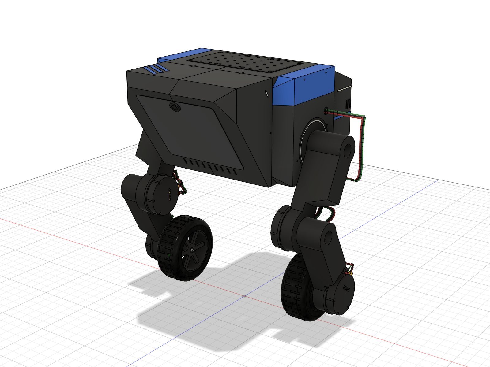
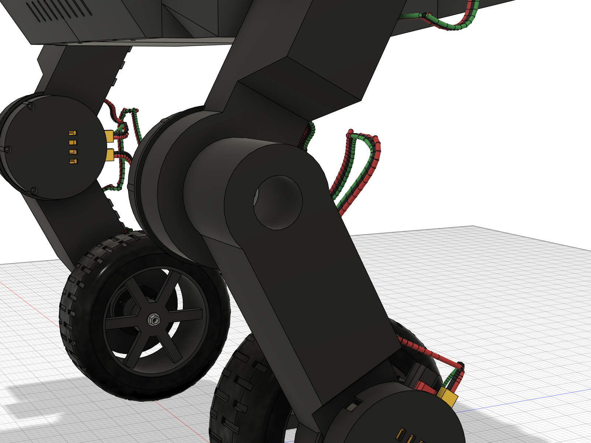
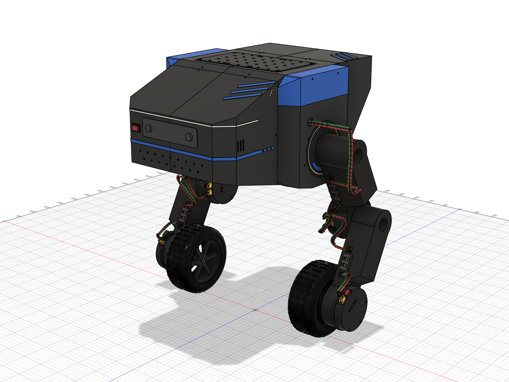
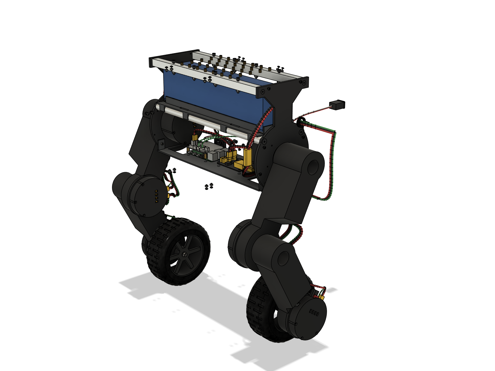
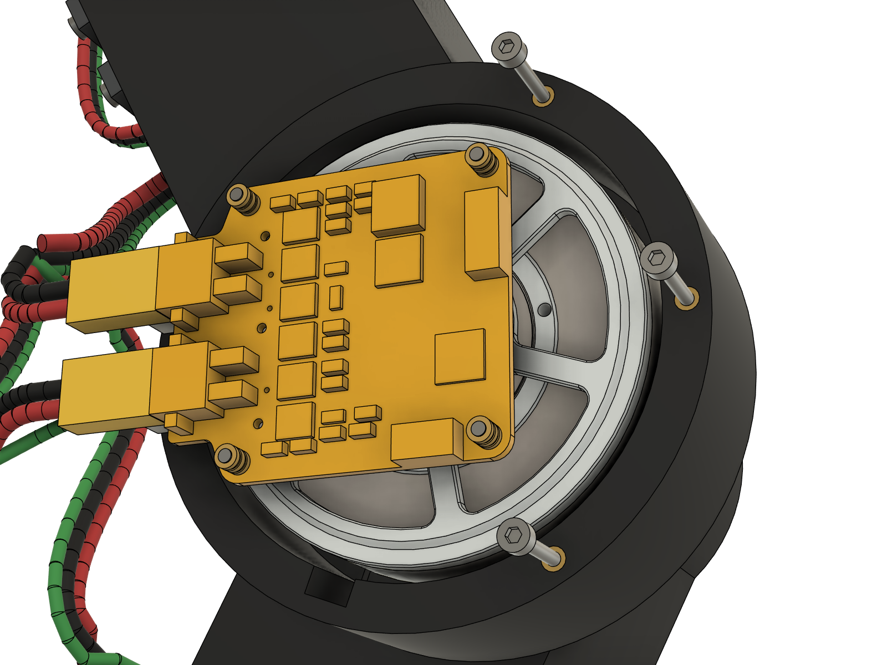
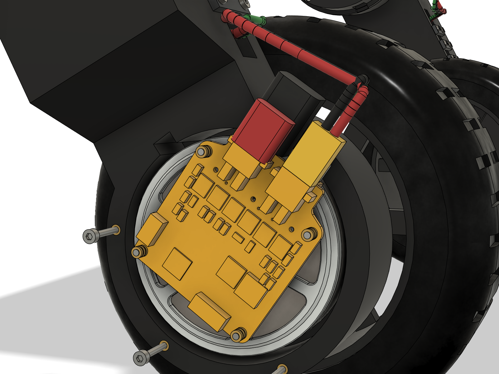
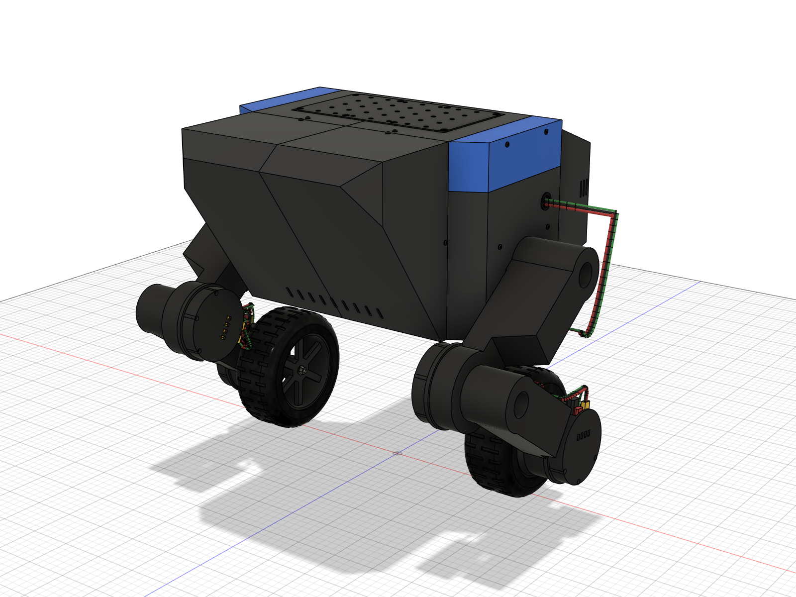

# WheelBiped v2 — AKE60-8 × 6 · moteus r4.11 · PETG 재설계 (Fusion)

`프로젝트/fushion 360설계.md`(이하 브리프)의 1~10번 항목과 재검증을 Fusion API 스크립트로 다시 설계한 모델이다.
기존 Fusion 문서 `WheelBiped_AKE`(v1, `../robot_cad`)는 건드리지 않았고, 새 문서 `WheelBiped_v2`에 만들었다.

2026-10-28 개정:
- 링크 옆 처짐을 **PETG만으로** 1 mm 이하로 맞추려고 허벅지·정강이를 다리 바깥쪽 빈 공간으로 넓혔다(6절).
- 몸통을 **TITA 비율과 디자인**(길이 ≈ 폭 × 1.4, 기울어진 앞 얼굴, hip 안장·드럼, 줄무늬)으로 다시 만들고 TITA의 노란 부분을
  파란색으로 바꿨다. 배터리는 좌우 방향 그대로다(5절).
- 뒤끝(무릎 오금이 향하는 −x 쪽)을 사용자 스케치대로 **위 경사면 → 짧은 수직면 → 아래 경사면**으로 깎았다(5절). 앞(+x, 무릎이
  튀어나온 쪽)과 다리 방향은 그대로다.

2026-10-29 개정(가공 부품 검토, `로봇_부품_검토사항.md`; 같은 날 Fusion에서 다시 빌드 — 아래 "10-29 재빌드"):
- hip 판: 완성 두께가 9.5 mm(8 mm 허브 + Ø80 × 1.5 등록 보스)라 소재는 10t 이상. Ø42 파일럿 포켓 Ø42.05 → H7 중앙값 Ø42.0125,
  M5·M4 접시 자리를 69~74° → 90°(ISO 10642 이론 머리 지름 Ø11.2 / Ø9.0), 위 경량 창 윗변 z 141 → 135.5(셸 M3 탭 구멍
  x ±40, z 140이 창 안에 있던 것). 관·레일 마개에 탭 기초 구멍, 사각 마개 긴 모서리 C1.0.
- hip 판 **경량 구멍 전부 제거**(사용자 결정: 가공비 최소): Ø22 구멍 5개, 가운데 창 30 × 58, 위 창 13 × 6.5 두 개는 나사·위치
  맞춤·배선 어디에도 쓰이지 않고 무게만 줄이던 형상이라 없앴다. 판 1장 85.0 → 104.0 cm³(229 → 281 g, +51 g), 로봇 +0.10 kg.
  가운데 기둥이 44 mm 그대로 남아 위 레일로 가는 판 두께 방향 굽힘 강도도 약 3배가 된다.
- stator 클램프 링 안지름 Ø31 → Ø30(레이저 안쪽 살 1.35 → 1.85 mm, 구동 보스 Ø28과 반경 1.0 mm).
- 클램프 링 판 두께 1.5 → 2 mm(SUS304 1.5t를 구할 수 없음, 1t는 링이 물러 나사 옆 PETG 압력이 몰림). 나사 길이는 그대로이고
  링 밑 PETG가 0.5 mm 얇아진다(knee·wheel 판 웹 3.3 → 2.8 mm, 구동 보스 바닥 9.7 → 9.2 mm).
- 척추 관·레일은 6061-T6를 구하지 못하면 6063-T5/T6 허용(검토 하중 87 MPa < KS 최소 항복 108 MPa, `calc/strength.md` 4절).
- 가공 견적용 단일 부품 STEP·DXF·2D 도면: `manufacturing/`.

10-29 재빌드(Fusion `v2run.build()`부터 2절 순서대로; 그림 24장은 10-28 그대로 — 바뀐 곳은 관절 안쪽·몸통 프레임이라 그림에 보이지 않는다):
- 질량 8.438 → **8.460 kg**(+21.5 g): 2 mm 링이 링크마다 +5.3 g(출력 링 6.2 g, stator 링 13.3 g, 링 밑 PETG는 조금 줄어듦),
  몸통 +0.3 g. 몸통 무게중심은 그대로(hip 축 위 53.8 mm, 앞뒤 −0.2 mm).
- 기준 자세 간섭 109건 모두 결합(실제 0건), 30자세 스윕 실제 간섭 0건이고 최소 간격은 10-28과 0.000 mm까지 같다.
- 고정 간격에서 무릎 고정 링–정강이, 바퀴 고정 링–허브 플랜지가 1.5 → **1.0 mm**: stator 링 안지름 Ø30과 그 안을 도는 Ø28
  구동 보스 사이 반경 간격(의도한 값, hip 판 Ø30 구멍과 같음). 나머지 47개 항목은 그대로.
- `manufacturing/step/`의 주문용 STEP과 다시 내보낸 부품의 부피·외곽 치수가 hip 판 L/R, 관, 레일, 링 2종, 마개 8개 합계에서
  모두 같다(자석 스페이서는 주문 파일에 자석 몸체 70.7 mm³가 없는 것만 다름). BOM은 모델에서 다시 만들어도 같은 문구다.
- 조인트 6개를 20° 돌렸다 되돌리면 0.000 mm로 복귀. 강도 계산(`calc/strength.py`)은 다시 돌려도 결과가 같다.
- 모터 재검증(MuJoCo)은 다시 돌리지 못했다(이 PC에서 mujoco.dll이 Windows 스마트 앱 컨트롤에 막힘). 질량 변화가 0.25 %라 7절
  결과(최대 토크 12.5 N·m의 81 % 이하)에 영향은 작다고 보지만, DLL이 풀리면 `python -m wbr.bench.ake_cad`로 확인할 것.

10-29 2차 재빌드(hip 판 경량 구멍 제거; `v2run.build()` → 출력 밀도 → 질량 → 기준 자세 간섭 → 부품번호·BOM → 조인트 → 복귀 확인
→ 내보내기):
- 질량 8.460 → **8.563 kg**(+103 g = hip 판 두 장), 몸통 4.634 → 4.737 kg, 몸통 무게중심 hip 축 위 53.8 → 53.6 mm(앞뒤 −0.2 mm).
- 기준 자세 실제 간섭 0건, 조인트 6개 20° 돌렸다 되돌리면 0.0 mm 복귀, BOM 문구는 그대로.
- 자세 스윕·고정 간격은 다시 돌리지 않았다: 메운 자리는 모두 hip 판 웹(y 164~169) 안이고 바깥은 셸이 덮고 있어, 움직이는
  부품(허벅지는 y 174 바깥)이 닿을 수 없다.
- 그림은 hip 판 웹이 보이는 10장(09·10, 17~24)만 다시 렌더했다. 나머지는 셸이 hip 판을 덮어 그대로다.
- 가공 견적 파일(`manufacturing/`)의 hip 판 STEP·도면과 설명 그림은 새 판으로 바꿨다. 이 PC는 OCP DLL이 스마트 앱 컨트롤에
  막혀(pip `cadquery-ocp` 8.0.1.x·novtk, conda-forge `ocp` 모두) gmsh(OCC 커널)로 `occ.py`와 같은 함수를 대신해 만들었다.
  견적 STEP은 새 Fusion 내보내기를 부품 좌표로 옮긴 것이고, 10-28 내보내기에 `make_parts.py`의 새 구멍 메움을 적용한 결과와
  부피(104 029.8 mm³)·외곽·구멍 21개가 같다.
- 모터 재검증(MuJoCo)은 이번에도 못 돌렸다(mujoco.dll 차단 그대로). 질량 +1.2 %이고 늘어난 곳이 hip 축 높이(몸통 무게중심 거의
  그대로)라, 토크가 질량에 비례한다고 보면 최대 hip 10.1 → 약 10.2 N·m(12.5의 82 %)다. DLL이 풀리면
  `python -m wbr.bench.ake_cad`로 확인할 것(`calc/mass_properties.json`은 이미 8.563 kg 값).

10-29 3차 재빌드(hip 판 얇은 살 보강; 순서는 2차와 같고 자세 스윕·고정 간격도 다시 돌림):
- 1.5 mm 미만 살 3종류를 없앴다(`manufacturing/wall_check.py`가 판 전체 표면에서 안쪽으로 광선을 쏴 잰다; 그림
  `manufacturing/explain/hip_plate_thin_walls.png`): Ø42 포켓 옆 리드선 홈 살 0.49 → 2.0 mm(홈 시작 반경 21.5 → 23,
  `params.HIP_GROOVE_R`), M2.5 카운터보어와 Ø30 구멍 사이 0.86 mm는 카운터보어를 Ø30 쪽으로 터서 없앰(`HIP_CBORE_OPEN`),
  M5 접시 자리와 판 테두리 사이 0.74 → 2.4 mm(척추 관 Ø16과 같은 R8 귀, `HIP_CSK_EAR_R`). 가장 얇은 살은 이제 1.85 mm
  (A 구멍 Ø2.8 ↔ Ø30, 원래 그대로).
- 판 1장 104 029.8 → 104 077.9 mm³(+0.13 g), 로봇 8.563 kg 그대로. 구멍 21개와 Z 방향 원통면(Ø42 H7, Ø30, Ø80, Ø52, 카운터보어
  Ø4.8)은 위치·지름이 모두 같고 새로 생긴 건 귀 원통 Ø16 두 개뿐이라 짝 부품의 조립 위치는 바뀌지 않는다.
- 기준 자세 실제 간섭 0건(hip 판이 걸린 결과 0건), 30자세 스윕 실제 간섭 0건이고 240개 최소 간격이 커밋된 10-29 스윕과 0.000 mm까지 같다.
  고정 간격 49개도 같다. hip 판과 주변 부품(24종) 최소 거리도 재빌드 전과 모두 같다: 전장 데크 0.5, 셸 0.6(허브 보스),
  허벅지 1.0(Ø30 구멍 – Ø28 보스), 파란 안장 1.6 mm. 귀는 척추 관 끝과 맞닿는 면(결합), 셸 1.6, 배선 4.5 mm.
  홈 끝(r 23)과 AKE 리드선 사이 1.25 mm. 조인트 6개 20° 돌렸다 되돌리면 0.0 mm 복귀, BOM 그대로.
- 그림 24장은 다시 렌더하지 않았다(귀가 1.7 mm라 보이지 않음). 견적 STEP·도면(형상 표 P3 귀, P4 카운터보어)·설명 그림
  3장은 새 판으로 바꿨다.

10-29 5차 재빌드(hip 판 리드선 홈 폭 7 → 12 mm, `params.HIP_GROOVE_W`; 그림 `manufacturing/explain/hip_plate_lead_groove.png`):
- AKE60의 3상 핀(Ø1.5 × 4, 반경 25, 간격 3 mm)은 끝이 Ø80 보스 면 높이까지 나와 있는데, 7 mm 홈(±3.5)이 핀 폭(±3.75)보다
  좁아 바깥 두 핀이 판 면에 닿아(0.0 mm) 납땜하고 선을 뺄 자리가 없었다. 12 mm로 넓혀 세 핀 모두 판과 1.25 mm 이상(옆벽까지
  2.25, 홈 안쪽 끝까지 1.25), 핀 아래 3.5 mm가 빈다. 드라이버 컵의 리드선 슬롯(폭 9)과 같은 방향이다.
- 판 1장 104 077.9 → 103 772.5 mm³(−0.8 g), 로봇 9.094 kg. 1.5 mm 미만 살 없음(wall_check), 구멍 21개 그대로, 기준 자세 실제
  간섭 0건. 재료를 덜어 내기만 해서 스윕·고정 간격은 다시 돌리지 않았다. knee·wheel PETG 판의 홈은 아직 7 mm다.



## 0. 결과 한눈에

| 항목 | 결과 |
|---|---|
| 크기(기준 자세 L0 310 mm) | 폭 529 × 높이 534 × 길이 485 mm(TITA 590 × 490 × 510), 바퀴 중심면 간격 341 mm |
| 질량(CAD, 출력 밀도 반영) | **8.56 kg** — 몸통 4.74 kg(무게중심 hip 축 중점 위 53.6 mm, 앞뒤·좌우 0.2 mm 이내), 허벅지 쪽 0.818, 정강이 쪽 0.770, 바퀴 0.325 kg(한쪽, 모터·드라이버 포함). 링크 보강 +0.78 kg, TITA형 몸통 +0.29 kg, 2 mm 클램프 링 +0.02 kg, hip 판 경량 구멍 제거 +0.10 kg |
| 모터 재검증(MuJoCo, 28개 시나리오) | 로봇만 8.5 kg·짐 5 kg 13.5 kg **모두 회복**. 최대 토크 hip 10.1 / knee 9.6 / 바퀴 8.6 N·m(12.5의 81 % 이하). 단, 짐 5 kg에 낮은 자세(L0 < 0.294 m)로 오래 서면 무릎이 정격 5 N·m 초과 → 6·7절 |
| 간섭(자세 30개 + 바퀴 회전) | L0 200~335 mm × hip −80~+60° 전부 **실제 간섭 0건**, 최소 간격 3.2 mm(무릎 고리 선–정강이 클립), 4.0 mm(허벅지 클립–셸), 4.9 mm(타이어–몸통 뒤 파란 띠) |
| 엔코더 | 칩–자석 **2.00 mm**(6개 모두), CAN 헤더–로터 캡 2.70, 종단 저항–로터 캡 1.76, 배선–로터 9.4 mm |
| 강도(손계산, `calc/strength.md`) | **링크 옆 처짐 0.91 / 0.94 mm(기준 1 mm) 통과**, 링크 응력·면내 처짐·토크 전달·몸통도 통과. **hip 출력 보스는 옆 하중 SF 2 검토에서 초과(설계 하중에선 SF 1.4)** → 6절 |
| 산출물 | `export/WheelBiped_v2.f3d`(회전 조인트 6개 포함), `export/WheelBiped_v2_assembly.step`, 설계 부품 STEP·STL(`export/parts_*`), `BOM.md`/`BOM.csv`(체결 부품 포함), 그림 24장 |

## 1. 폴더

| 경로 | 내용 |
|---|---|
| `fusion/` | 모델을 만드는 스크립트. 치수는 모두 `params.py` |
| `fusion/params.py` | 치수·하중·출력 설정 |
| `fusion/cadlib.py` | 임시 B-rep 빌더(좌우 대칭 `Builder(side)`), 프레임 수학, 재질·외관, 라이브러리 마스터 |
| `fusion/vendor.py` | 구매품: AKE60-8(STEP), moteus(r4.5 STEP), pi3hat(STEP), 라즈베리파이·mjpower-ss·배터리·커넥터·RC 휠 등(치수로 모델링), 자석 스페이서, SUS 클램프 링 |
| `fusion/layout.py` | 관절별 모터·보드 프레임(엔코더 정렬, 커넥터 방향) |
| `fusion/legs.py` | 허벅지, 정강이(바깥쪽 보강 `_wide`), 두 조각 허브, 드라이버 컵 |
| `fusion/torso.py`, `shell.py` | hip 판, 척추 관, 위 레일, 윗판, 배터리 트레이, 전장 데크 / TITA형 셸·장식(파란 안장·줄무늬, 흰 선, 얼굴 패널, 카메라, 뒷면 패널, hip 드럼) |
| `fusion/harness.py`, `assembly.py` | 배선(16 AWG·PH-3 실제 묶음, 관절 고리) / 조립 트리 |
| `fusion/check.py`, `poses.py`, `gaps.py` | 질량·관성(출력 방향별 벽·스킨), 간섭 / 자세 스윕 / 고정 간격 측정 |
| `fusion/finalize.py` | 부품번호, 그림, BOM, 조인트, 내보내기 |
| `calc/` | `strength.py`→`strength.md`(손계산), `mass_properties.json`, `sweep_part1/2.json`, `gaps.json` |
| `manufacturing/` | 가공 부품 견적용 단일 부품 STEP·링 DXF·2D 도면 PDF (`make_parts.py`, `drawings.py`, Fusion 없이 OCP로), 살 두께 검사 `wall_check.py`(gmsh) |
| `로봇_부품_검토사항.md` | BOM "가공" 품목의 판금·CNC 판정, MakeIT 공정 매핑, 주문 전 확인 사항 |
| `export/` | f3d, 조립 STEP, `parts_step/`, `parts_stl/` |
| `images/` | 그림 24장(외관 16 + 내부 8) |
| `BOM.md`, `BOM.csv` | 부품표 |

## 2. 다시 만들기

Fusion을 먼저 켜고 Claude 세션을 시작하면 Fusion MCP 스크립트로 실행할 수 있다(각 줄을 **따로** 실행: 실패한 스크립트는 통째로
되돌려지고, 물성치는 만든 스크립트 안에서 읽으면 옛 값이 나온다).

```python
import sys; sys.path.insert(0, r'...\robot_cad_v2\fusion'); import v2run
v2run.build()                                   # 빈 문서 또는 WheelBiped_v2 (조인트가 있으면 직접 설계로 되돌림)
v2run.load()['check'].apply_print_mass()        # 출력 밀도(벽·스킨·채움)와 RC 휠 250 g
v2run.load()['check'].save_mass_json(r'...\calc\mass_properties.json')
K = v2run.load()['check']; K.classify(K.interference())        # 기준 자세 간섭
v2run.load()['poses'].sweep(L0s=(200, 240, 280))                # 자세 스윕(두 번에 나눠, 결과를 calc/sweep_part1/2.json에)
v2run.load()['gaps'].measure()                                  # 엔코더·관절 고정 간격(calc/gaps.json)
F = v2run.load()['finalize']; F.set_part_numbers(); F.images()  # 부품번호, 외관 그림 16장
F = v2run.load()['finalize']; F.inside_images(); F.bom()        # 내부 그림 8장, BOM.md/.csv
v2run.load()['finalize'].joints()                               # 회전 조인트 6개(문서가 파라메트릭으로 바뀜)
v2run.load()['finalize'].drive_check()                          # 조인트를 돌렸다 되돌려 복귀 확인
v2run.load()['finalize'].exports()                              # f3d, 조립 STEP, 부품 STEP·STL
```

`params.RING_T` 등 이름에 치수가 들어간 마스터(`clamp ring … t2.0 …`)의 값을 바꾸면 빌드 전에 `_library`의 옛 마스터 이름을
새 이름으로 바꿔 둔다(`cadlib.find_comp(옛 이름).name = 새 이름`). 그러지 않으면 새 마스터가 따로 생기고 옛 마스터가 인스턴스 없이
남는다. `export/parts_*`의 옛 이름 파일도 지운다.

구매품 STEP 세 개는 저장소에 없다: `fusion/vendor.py`의 `AKE60_STEP`(CubeMars AKE60-8 KV80), `MOTEUS_STEP`(mjbots moteus
r4.5 mechanical), `PI3HAT_STEP`(mjbots pi3hat r4.4 mechanical) 경로를 자기 PC에 맞게 바꾼 뒤 빌드한다.

모터 재검증: `wheeled_biped`에서 `python -m wbr.bench.ake_cad` (`--static`은 모델 질량만), 결과 `wheeled_biped/results/ake_cad/`.
강도: `python calc/strength.py`.

`WheelBiped_v2` 문서는 허브 `Default Project`에 저장했다(2026-10-28 버전 1 = 10-28 빌드; `export/WheelBiped_v2.f3d`는 10-29 재빌드). `_library`(숨김)는 재사용 부품의
마스터를 가지고 있어 지우면 모든 인스턴스가 사라진다.

## 3. 다리와 관절

- 링크: 허벅지 L1 = 175 mm, 정강이 L2 = 175 mm, 기준 L0 310 mm(허벅지 수직에서 27.7°, 무릎이 hip보다 81 mm 앞), 범위 L0
  200~335 mm, hip +60 / −80°. 링크 뒤쪽(오금 쪽) 모서리에 12 × 8 배선 홈과 클립 자리(M2.5 인서트) 3곳.
- 단면(6절): 허벅지는 면내 50 mm, 폭이 hip 쪽 76 mm → 무릎 55 mm 앞에서 30 mm로 줄고, 정강이는 면내 56 mm, 폭이 무릎 쪽
  55 mm → 바퀴 축 50 mm 위에서 30 mm로 준다. 관절 자리(모터 판·구동 보스)의 위치와 두께는 그대로다.
- 모터 장착은 CubeMars 시험 하우징 방식: 판에 Ø42 H7 파일럿 포켓(깊이 2.5) + Ø30 구멍, 링크의 Ø28 구동 보스가 구멍을 지나 출력에
  닿는다. 출력: M3 × 16(12.9) 6개 + Ø3 다웰 3개 + Ø11.8 스피곳. 고정링: M2.5 6개(PCD 36.5). 넓힌 링크를 지나는 구동 보스의 접근
  구멍(Ø28)이 깊어져 hip 쪽 M3는 볼 엔드 2.5 mm 육각 렌치(90 mm 이상)로 조인다.
- **SUS304 2 mm 클램프 링**(10-29 1.5 → 2 mm): 나사 머리가 맨 PETG를 누르지 않게 hip·knee 구동 보스 바닥(Ø27)과 knee·wheel PETG 판의 바깥 홈(Ø45)에
  넣었다(링 없이 M3 와셔면 검토 하중에서 지압 139 MPa로 PETG가 눌린다). hip 고정링은 6061 hip 판에 바로 체결(ISO 4762 M2.5 12.9).
- 바퀴 드라이버는 커넥터 가장자리가 **위·뒤(215°)**를 보게 돌렸다(보강 전에는 정강이를 따라 위) — 정강이를 넓힐 자리를 내기 위해서다.
- 모터 축 정렬과 드라이버 위치는 `layout.py`가 관절마다 계산한다. 왼쪽·오른쪽은 설계 부품은 거울상, 구매품은 회전으로 놓았다.
- f3d에는 as-built 회전 조인트 6개(`hip_L/R`, `knee_L/R`, `wheel_L/R`, 몸통 고정)가 있다. 조인트를 20° 돌렸다 0°로 돌리면 링크 부품이
  0.000 mm로 복귀한다(`finalize.drive_check`).



## 4. 엔코더 정렬 (브리프 2번)

- moteus r4.11의 AS5047P는 장착 구멍 중심에서 커넥터 반대쪽으로 4 mm 떨어져 있다. 보드 프레임 원점을 IC로 두고 IC가 모터 축 위에
  오도록 보드를 놓았다. 보드는 **고정 쪽**(hip 판·허벅지·정강이)에 붙은 PETG 컵의 스탠드오프 4개에 M2.5 인서트로 고정된다.
- 동심: 컵은 모터 Ø42 파일럿과 같은 축의 등록면에 맞춘다(hip: hip 판의 Ø80 보스, knee·wheel: 링크 하우징 Ø88 바깥 립).
  공차 사슬(파일럿 H7, 출력 등록면, 보드 구멍 유격 ±0.12, IC 실장 ±0.1)로 보아 중심 어긋남은 0.2 mm 안팎, 최악 0.3~0.4 mm로
  추정한다. 조립 뒤 moteus 캘리브레이션에서 엔코더 신호를 확인할 것.
- 칩–자석 간격: AKE 부속품으로 따로 오는 Ø6 × 2.5 자석([CubeMars 제품 페이지](https://www.cubemars.com/product/ake60-8-kv80-quasi-direct-drive-actuator.html) Accessory Pack)을 로터가 아니라 **6061(비자성) 스페이서 Ø9 × 4.5** 위 포켓에 붙이고, 스페이서는 로터의 빈 자석
  포켓에 스피곳으로 붙인다. 측정 결과 6개 관절 모두 **2.00 mm**(목표 2.0, 허용 1.5~2.5).
- 회전 로터 캡과의 간격(측정, 기준 ≥ 1.5 mm): moteus CAN 헤더 2.70, **CAN 종단 저항 1.76**, XT30 캡 10.6, PH-3·XT30 플러그 4.66,
  배선 9.4 mm, 컵–모터(로터 캔 포함) 2.60(hip) / 2.91(knee·wheel) mm.

## 5. 몸통 (브리프 4~6번)

- 배터리 75 × 310 × 75 mm를 310 mm가 좌우로 오게 눕혀, PETG 트레이(바닥 2.4 + 리브 7개)에 얹고 트레이는 **6061-T6 관 Ø16 × 1.0 두 개**(6063-T5/T6 허용)에
  직접 얹었다. 하중 경로: 트레이 → 관 → hip 판 → hip 모터 → 다리. 셸은 하중을 받지 않는다. 앞뒤·좌우 멈춤턱, 25 mm 스트랩 슬롯
  2쌍(벨크로로 배터리와 트레이를 관에 묶음), 리드 노치(+y 끝), 1 mm 폼 패드. 무게중심을 hip 축 위에 맞추려고 배터리를 x +1.3,
  y −0.1 mm로 옮겼다(`check.suggest_battery_offset`, 앞 얼굴과 뒤 경사면이 깎아 낸 셸 무게 차이만큼).
- 윗부분: 6061-T6 각관 15 × 15 × 1.0 레일 두 개(6063-T5/T6 허용)를 hip 판 위쪽 바에 M4 접시 볼트로 잇고, PETG 윗판(120 × 210 × 6)을 M4 × 25 관통 볼트
  8개로 레일에 고정. 윗판에 **M4 열압입 인서트 35개(25 mm 격자)** — 짐·로봇팔용.
- 전장 데크(PETG)는 hip 판 웹에 M3로 매달고 라즈베리파이 4B + pi3hat(스탠드오프 11 mm), mjpower-ss, 30 mm 팬을 얹었다.
### TITA형 몸통 디자인 (노랑 → 파랑)

Direct Drive Tech TITA의 공식 사진(정면·뒷면·옆·위·대각선)을 보고 형상과 색 배치를 따랐다. 로고와 글자는 넣지 않았다.

| TITA | 이 모델 |
|---|---|
| 몸통 510 × 약 360 × 약 210 mm, 길이 ≈ 폭 × 1.4, hip이 길이 가운데 | 480 × 344 × 218 mm, hip 축이 길이 가운데 |
| hip 부분이 넓고 앞뒤가 약간 좁은 평면, 끝 모서리를 세로로 깎음 | hip 부분 폭 344, 앞뒤 부분 폭 270(무릎 드라이버·타이어가 지나가는 자리), 끝 모서리 30 mm 깎음 |
| 앞: 위 모서리에서 아래 뒤로 크게 누운 얼굴 면, 위 가운데 카메라, 아래 통풍구 | 앞면이 위 앞 모서리(x 240)에서 바닥(x 105)까지 기운 경사면, 진회색 얼굴 패널, 위 가운데 카메라 테(렌즈 자리 구멍), 아래 슬롯 9개 |
| 뒤: 위 모서리 흰 선, 위쪽 패널과 둥근 손잡이 2개, 가로 **노란** 띠, 아래 구멍 줄 | 뒤끝(사용자 스케치): 윗면 x −73에서 22° 위 경사면이 내려와 짧은 수직면(x −240, hip 축 위 81 ~ 아래 25 mm)으로 이어지고, 12° 아래 경사면이 바닥 x −34로 돌아간다. 수직면 위에서부터 흰 선, 손잡이 2개 달린 패널(옆에 로커 스위치), 가로 **파란** 띠(옆면으로 이어지고 짧은 점선 3개), 구멍 2줄 |
| 위: 오른쪽 앞·뒤 모서리에 **노란** 사선 3줄 | 같은 자리에 **파란** 사선 3줄(뒤쪽 것은 위 경사면 위) |
| 옆: hip 위 **노란** 안장, 드럼(흰 빛 링 + **노란** 호), 뒤쪽 세로 통풍구 3줄, 흰 짧은 사선 | hip 부분 어깨를 **파란** 안장 조각으로, 드럼에 흰 링 + **파란** 호(아래 ±60°) 상감, 통풍구 3줄, 흰 사선 |
| 몸통 색: 짙은 회색 | 진회색 PETG(장식만 파랑·흰색) |

- 앞뒤 부분이 hip 부분보다 좁은 것은 우리 다리 구조 때문이다. 무릎 모터·드라이버가 허벅지 안쪽(y 154~177)에 달려 있고 타이어도
  다리 안쪽(y ≥ 140.5)에 있어, 앞뒤 부분을 폭 344로 길게 빼면 hip −80~+60° 범위에서 부딪힌다. 폭 270이면 30자세 모두 간섭 0건이다
  (가장 가까운 곳은 타이어–몸통 뒤 파란 띠 4.9 mm).
- 뒤 경사면은 폭 전체를 자르는 두 평면(`shell.rear_slopes`, `params.REAR_*`)이라 hip 부분 끝까지 이어지고, 뒤 이음판도 경사면을
  따라 붙는다.
- 셸은 1.4 mm PETG 8조각(앞·hip·뒤 × 좌우 + 파란 안장 좌우)으로 나눠 256 mm 프린터 베드에 들어간다. hip 조각은 hip 판에 M3 12개,
  앞·뒤 조각은 안쪽 이음판 12개(M3 × 8 버튼 볼트 + 너트 24개)로 잇는다. 장식(줄무늬, 흰 선, 얼굴 패널, 뒷면 패널, 카메라 테)은
  0.6~1.2 mm 얇은 판을 순간접착제로 붙이고, 드럼의 흰 링·파란 호는 드럼 홈에 끼운다(겉면과 같은 높이 — 옆 허벅지와 1.4 mm 간격).
- 셸이 커져 몸통이 0.29 kg 무거워졌다(셸·장식 합계 약 0.93 kg). 셸은 여전히 하중을 받지 않는다.





## 6. 강도 (브리프 3·4·7번) — 자세한 표는 `calc/strength.md`

하중: 바퀴당 정지 60 N(로봇 7 + 짐 5 kg), 설계 300 N, 검토 600 N(안전계수 2), 옆 하중 = 수직 × 0.5, 모터 토크 12.5 N·m × 2.
PETG(층 방향) 인장 45 MPa, 압축 50 MPa, E 2.0 GPa. Fusion 시뮬레이션은 API로 돌릴 수 없어 손계산만 했다.

### PETG 보강(옆 처짐)

옆 강성은 단면 폭의 세제곱에 비례해서, 폭 30 mm로는 100 % 채움으로도 옆 처짐이 3.4 / 2.8 mm였다. 그래서 같은 PETG로:

- **폭**: 다른 부품이 어떤 자세에서도 지나가지 않는 **바깥쪽**으로 링크를 넓혔다.
  - 허벅지는 hip부터 무릎 55 mm 앞까지 76 mm. 무릎 쪽은 정강이 머리가 바깥에 있어 30 mm.
  - 정강이는 무릎부터 바퀴 축 50 mm 위까지 55 mm. 아래는 바퀴 컵과 드라이버 커넥터 자리.
  - 넓은 부분 끝 15 mm는 경사로 줄어든다(`params.FEMUR_WIDE_*`, `TIBIA_WIDE_*`).
- **높이**: 정강이 면내 높이를 46 → 56 mm로 키웠다.
- **출력 설정**: 옆 굽힘을 받는 양쪽 면이 강성을 내므로 벽을 6 → 12겹(4.8 mm)으로 늘리고 채움은 40 → 20 %로 줄였다.
- 바퀴 드라이버 커넥터를 위·뒤로 돌리고 정강이 끝 배선을 다시 잡았다. hip 고리 선의 평면을 넓힌 허벅지 바깥(+10 mm)으로 옮겼다.

| 검토 항목 | 보강 전 | 보강 후 / 한계 | 판정 |
|---|---|---|---|
| **링크 끝 옆 처짐(설계, 옆 150 N)** | 6.1 / 4.9 mm | **0.91 / 0.94** / 1 mm | **통과** |
| 링크 끝 면내 처짐(설계, 관절 토크 12.5 N·m) | 0.79 / 1.00 mm | 0.40 / 0.35 / 1 mm | 통과 |
| 허벅지 응력(600 N + 옆 300 N + 25 N·m) | 41.1 MPa | 28.5 / 45 MPa | 통과 |
| 정강이 응력 | 36.5 MPa | 18.5 / 45 MPa | 통과 |
| 링크 질량(출력 설정 반영, 한쪽) | 허벅지 252 g, 정강이 247 g | 허벅지 465 g, 정강이 427 g | 로봇 **+0.78 kg** |

질량이 늘어난 것이 대가다(TITA형 몸통 포함 로봇 8.56 kg). 같은 형상에서 링크 벽 수만 줄이면(질량은 벽 면적으로 추정):

| 링크 벽 | 옆 처짐 허벅지 / 정강이 | 로봇 질량(추정) |
|---|---|---|
| **12겹 4.8 mm (지금)** | **0.91 / 0.94 mm** | 8.56 kg |
| 10겹 4.0 mm | 1.01 / 1.04 mm | 약 8.38 kg |
| 8겹 3.2 mm | 1.14 / 1.19 mm | 약 8.19 kg |
| 6겹 2.4 mm | 1.33 / 1.39 mm | 약 8.01 kg |

탄소 막대 4개 보강(처음 제안)은 보강 전 형상에 +0.13 kg으로 0.4~0.5 mm지만 PETG 단일 재료가 아니다.

### 나머지 항목

| 검토 항목 | 값 / 한계 | 판정 |
|---|---|---|
| 관절 토크 25 N·m 전달(출력·고정링) | 지압 ≤ 28 / 50 MPa | 통과 |
| **hip 출력 보스, 옆 하중 검토(SF 2)** | 굽힘 65 / 45 MPa | **초과**(설계 하중 SF 1.4) |
| knee 출력 보스, 옆 하중 검토 | 굽힘 45 / 45 MPa | 경계 |
| 고정링 나사(hip 12.9 / knee·wheel 8.8) | 2312 / 3288 N, 1627 / 2034 N | 통과 |
| 허브 플랜지 → 바퀴 출력 와셔 지압(검토) | 52 / 50 MPa | 경계 |
| 육각 허브 → 플랜지 M3 인서트 인발(검토) | 706 / 약 1000 N | 통과 |
| 배터리 트레이·척추 관 처짐(설계 120 N) | 0.09 · 0.30 / 0.5 mm | 통과 |
| 위 레일(검토 500 N), 윗판 인서트(검토 30 N·m) | 84 / 276 MPa, 300 / 900 N | 통과 |
| hip 판 옆 모멘트(설계) | 약 138 / 276 MPa | 통과(손계산 SF 2.0, FEA 권장) |

- 면내 굽힘은 관절 토크로 제한된다: 설계 하중 300 N을 무릎이 잠근 채 버티려면 24 N·m가 필요하지만 AKE60-8은 12.5 N·m에서 밀린다.
- **hip 출력 보스**: Ø28이 hip 판 Ø30 구멍과 고정링 나사 머리에 묶여 더 키울 수 없다. 링크 보강과 별개인 관절 체결부 문제다. 이 하중
  (바퀴당 600 N + 옆 300 N)에서는 AKE60 출력 베어링(정격 비공개)이 먼저 한계일 수 있으니 CubeMars에 허용 모멘트를 확인할 것.
- 타이어 폭과 출력 굽힘 팔: 폭 45 / 60 / 76 mm → 출력면–타이어 중심 33.5 / **41.0** / 49.0 mm(설계 하중 10.1 / 12.3 / 14.7 N·m).
  60 mm(1/8 트러기, 17 mm 육각 150 mm급에서 가장 좁은 흔한 규격)를 기본값으로 했다(`params.TYRE_W`).
- PETG 70 °C: hip 모터는 알루미늄 판에 붙어 있고, knee·wheel 고정링과 컵 립이 PETG에 닿는다. 로봇만이면 무릎 정지 토크가 정격의
  29~74 %로 문제없다. **짐 5 kg에 L0 0.24~0.27 m로 오래 서면 무릎이 정격의 120~137 %**(구리 손실 최대 19 W)라 외피가 PETG 연화
  온도에 가까워질 수 있다 → 짐을 실을 때는 **L0 ≥ 0.294 m**로 서고 moteus 온도를 감시할 것.

## 7. 모터 재검증 (MuJoCo, `wbr/bench/ake_cad.py`)

upkie 모델의 링크 길이를 175/175 mm로 늘리고, CAD의 링크별 질량·무게중심·관성을 넣어 Plan 4 LQI6 제어기와 `ake_sizing`의 28개
시나리오(정지 4자세, 기울기 5~25°, 밀기 0.25~1.5 m/s, 속도 0.5~1.0 m/s, 제자리 회전, 높이 전 범위, 경사 5~15°)를 돌렸다.
모터 6개 모두 AKE60-8(최대 12.5, 정격 5 N·m, 24 V에서 무부하 25.1 rad/s). 제어기의 다리 길이 범위는 0.24~0.335 m.

| 경우 | 질량 | 회복 못함 | 바퀴 최대(시나리오) | 바퀴 RMS | 바퀴 포화 | 바퀴 속도 최대 | hip 최대 | hip RMS | knee 최대 | knee 정지(L0 0.24 / 0.31) | 바퀴 뜸 |
|---|---|---|---|---|---|---|---|---|---|---|---|
| 로봇만 | 8.47 kg | 없음 | 5.15 (기울기 25°) | 0.89 | 1.3 % | 26.7 rad/s | 7.73 (밀기 1.5) | 0.95 | 6.13 (밀기 1.5) | 3.70 / 2.37 | 7 ms |
| 짐 5 kg | 13.47 kg | 없음 | 8.64 (기울기 25°) | 1.35 | 0.7 % | 30.0 rad/s | 10.07 (밀기 1.5) | 3.00 | 9.60 (높이 전 범위) | 6.86 / 4.35 | 2 ms |

- 최대 토크는 모두 12.5 N·m의 81 % 이하, 포화는 1.3 % 이하. 처음 설계(7.4 kg)보다 hip 최대가 짐 5 kg일 때 8.4 → 10.1 N·m로
  늘었다(링크 보강 + 긴 몸통으로 몸통 피치 관성 Iyy 0.023 → 0.039 kg·m²).
- 짐 5 kg일 때 무릎 정지 토크가 L0 0.24~0.27 m에서 정격을 넘는다(위 6절 70 °C). 제자리 회전(yaw 1 rad/s)에서 무릎 RMS 6.14 N·m.
- 바퀴 속도 최대는 1.5 m/s 밀기에서 순간적으로 무부하 속도(25.1 rad/s)를 넘는다(브레이크 구간, 회복함).
- 시뮬레이션 모델은 CAD(8.44 kg)보다 0.03 kg 무겁다(upkie 모델에서 CAD 그룹에 속하지 않는 몸체) — 보수적.

## 8. 배선 (브리프 8·9번)

| 번호 | 연결 | 케이블 |
|---|---|---|
| 8-1 | 배터리 XT60(F) 리드 → XT60(M)/XT90(F) 변환기 → mjpower-ss XT90(M) | 12 AWG(배터리·변환기 포함) |
| 8-2 | mjpower-ss **P5** → pi3hat J1 | XT30 M-F, 16 AWG |
| 8-3 | **P3** → 왼쪽 hip J1, hip J2 → knee J1, knee J2 → 바퀴 J1 | 처음 M-F, 다음은 F-F, 16 AWG |
| 8-4 | **P6** → 오른쪽 hip J1, … 바퀴 J1 | 같음 |
| 8-5 | pi3hat **JC1** → 왼쪽 hip CAN2, hip CAN1 → knee CAN2, knee CAN1 → 바퀴 CAN2, **바퀴 CAN1 = 120 Ω 종단 저항** | PH-3 F-F, 26 AWG 꼬은선 |
| 8-6 | pi3hat **JC2** → 오른쪽 다리(같은 순서) | 같음 |
| 8-8 | CAN: 1번 CAN_H, 2번 CAN_L 핀 번호 그대로, 3번(GND) 비움 | |
| 8-9 | 바퀴 J2(XT30, 24 V 살아 있음)에 **보호 캡** | |
| 8-11 | 팬 ← pi3hat **JP6**(1번 5 V, 3번 GND) | 팬 선 |
| 8-12 | mjpower-ss PH-4 스위치 헤더 → **몸통 뒤 수직면 로봇 왼쪽(+y 88 mm), 손잡이 패널 옆의 로커 스위치**(19 × 13 구멍) | mjbots PH4 하네스 |
| 8-13 | 라즈베리파이 ↔ pi3hat: 40핀 소켓 직결, M2.5 × 11 스탠드오프 4개, 파이는 데크 보스(M2.5 인서트)에. 파이 USB-C 전원 금지 | |

- **포트 이름 규칙**: r4.11의 J1/J2(XT30)와 CAN1/CAN2(PH-3)는 각각 병렬이라 전기적으로 같다. 모델은 **들어오는 쌍(J1, CAN2)을
  보드 −x_b 쪽, 나가는 쌍(J2, CAN1)을 +x_b 쪽**에 두어 들어오고 나가는 선이 엇갈리지 않게 했다. 실물 보드에 이 규칙대로 표시할 것.
- 관절을 지나는 곳은 길이를 정한 여유 고리(hip 155 mm, knee 125 mm)가 자세마다 다시 그려지고(L0 200~335 × hip −80~+60 전 범위에서
  당기지 않음), 링크 뒤쪽 홈(12 × 8)과 클립 3곳으로 고정한다. hip 케이블은 셸의 Ø16 그로밋(hip 축에서 75 mm, 216°)으로 나와 넓힌
  허벅지 바깥(y 260 평면)에서 고리를 만든다. 바퀴 쪽은 정강이 홈 끝에서 나와 위·뒤를 보는 바퀴 드라이버 플러그로 들어간다.
- 선 길이(모델, 구매는 +20 %)와 커넥터 수는 `BOM.md`. XT30U 14개, PHR-3 12개.
- 커넥터를 꽂고 뺄 공간: 컵의 커넥터 창(36 × 43 mm), pi3hat 위 덮개 공간(XT30 10.8 mm, PH 6.6 mm 솟음).
- **IMU 방향**: pi3hat은 CAN 커넥터가 로봇 앞(+x), 라즈베리파이 USB 끝이 로봇 왼쪽(+y)을 보게 놓였다. 따라서 pi3hat IMU 축
  (+x 커넥터 쪽, +y USB 쪽, +z 파이→hat)은 **로봇 축과 같다(x 앞, y 왼쪽, z 위)** — 소프트웨어에서 회전 없이 쓰면 된다.

 

## 9. 간섭·간격 검사 (브리프 10번)

- 기준 자세: Fusion 간섭 검사 109건 모두 결합(선이 커넥터 안으로 들어가는 것, 같은 묶음 선끼리, 플러그가 헤더 안) — **실제 간섭 0건**.
- 자세 스윕: L0 200 / 240 / 280 / 310 / 335 mm × hip −80 / −60 / −30 / 0 / +30 / +60° = 30자세, 관절 고리 선을 자세마다 다시 그려
  측정. **30자세 모두 실제 간섭 0건**, 늘어난 고리 없음. 최소 간격:

| 짝 | 최소 간격 | 자세 |
|---|---|---|
| 허벅지 쪽 부품(무릎 드라이버·컵·선·클립) – 몸통 | 4.0 mm (허벅지 클립–hip 부분 셸) | 모든 자세 |
| 타이어·림·허브 – 몸통 | 4.9 mm (몸통 뒤쪽 옆면의 파란 띠) | L0 200, hip −80° |
| 타이어 – 허벅지·무릎 컵·허벅지 선 | 15.4 mm | L0 200, hip −80° |
| 정강이 부품 – 몸통 | 49.0 mm | L0 200, hip 0° |
| hip 고리 선 – 다른 부품 | 5.1 mm | L0 200, hip 0° |
| knee 고리 선 – 다른 부품 | 3.2 mm (정강이 클립) | L0 200, hip −80° |

- 고정 간격(`calc/gaps.json`, 좌우 같음): 허벅지–hip 판 1.0(보스 반경) / 면 2.0, 허벅지–정강이 1.0 / 면 1.5, 무릎 클램프 링–정강이 1.0,
  바퀴 클램프 링–허브 플랜지 1.0(둘 다 링 안지름 Ø30–구동 보스 Ø28 반경), 허브 플랜지–정강이 1.0, 타이어–정강이 5.0 mm. 바퀴를
  0 / 20 / 40° 돌려도 바퀴 쪽 부품–정강이 1.0 mm.
- 엔코더 간격은 4절.



## 10. 출력·조립 메모

- PETG, 0.4 노즐. 허벅지·정강이는 무릎 바깥쪽(+x) 모서리(배선 홈 반대)를 바닥에 두고(관절 축 수평, 하우징 아래 서포트) **벽 12겹(4.8 mm)**,
  위아래 8층, 자이로이드 20 %, 보스 주변 100 % 모디파이어 — 보·보스 굽힘이 층을 따라 걸린다. 옆 강성은 넓힌 양쪽 면의 벽에서 나오므로
  벽 수를 줄이지 말 것. 허브 두 조각은 100 %. 질량 계산도 이 설정(`params.PRINT`, 링크는 벽·스킨을 출력 방향으로 나눠 계산).
- 셸: 진회색 PETG 6조각 + 파란 안장 2조각(1.4 mm, 바깥 면을 위로, 서포트), 장식판은 파랑·흰색·진회색 PETG 100 %. 색을 바꾸려면
  `assembly.build_shell`의 외관 이름만 바꾸면 된다.
- 열압입 인서트: M2.5(구멍 Ø3.6 × 5), M3(Ø4.0 × 6), M4(Ø5.6 × 6). 모터 쪽 나사는 클램프 링 위에서 조인다.
- 나사 길이는 모터 탭 깊이(출력 M3 5 mm, 고정링 M2.5 5 mm)를 넘지 않게 골랐다: 출력 M3 × 16 + 와셔(물림 4.3 mm), hip 고정링
  M2.5 × 6(3.2 mm), knee·wheel 고정링 M2.5 × 8(3.2 mm). 컵 나사는 표준 길이(M3 × 40, M2.5 × 18)에 맞게 컵 바닥 카운터보어 깊이를
  정했다.
- 자석 스페이서: AKE 부속품 자석(Ø6 × 2.5)을 로터의 빈 자석 자리 대신 스페이서 위 포켓에 붙인다(에폭시). 엔코더는 moteus 캘리브레이션으로 다시 잡는다.
- 팬은 1.5 mm 양면 폼테이프로 데크에 붙인다(모델 위치 그대로).

## 11. 가정·위험·결정할 것

1. **질량 8.56 kg** — PETG 링크 보강 +0.78 kg, TITA형 몸통 +0.29 kg, hip 판 경량 구멍 제거 +0.10 kg으로 7 kg 가정보다 22 % 무겁다(재검증은 8.44 kg 빌드로 했고 통과).
   1 mm를 조금 넘겨도 되면 6절 표처럼 링크 벽 수를 줄여(8겹: 1.2 mm, 약 −0.37 kg) 가볍게 할 수 있다 — `params.PRINT`의 벽 두께만 바꾸면 된다.
2. **hip 출력 보스·AKE60 베어링** — 옆 하중 SF 2 검토 하중에서 초과, 설계 하중에서 SF 1.4. 베어링 허용 모멘트를 CubeMars에 확인.
3. **짐 5 kg + 낮은 자세** — 무릎 정격 초과·PETG 온도. 짐을 실을 때 L0 ≥ 0.294 m 제한 권장.
4. moteus r4.11은 공개 STEP이 없어 r4.5 STEP(같은 보드 외형·구멍·커넥터 위치)을, pi3hat r4.5는 r4.4 기구 STEP(라즈베리파이
   HAT 외형·구멍)을 썼다. mjpower-ss, 라즈베리파이, 배터리, 커넥터,
   RC 휠은 치수로 모델링했다 — 실물이 오면 커넥터 높이·구멍을 재 확인할 것.
5. 타이어 제품 미정: 폭은 `params.TYRE_W`, 무게는 `WHEEL_MASS`(0.25 kg)로 두었다. 다른 타이어면 값만 바꿔 다시 빌드·검사.
6. 강도는 손계산이다(Fusion 시뮬레이션은 API로 실행 불가). 특히 hip 판과 넓힌 링크의 경사 부분은 FEA를 권한다.
7. hip 출력 M3는 12.9로 지정(8.8이면 검토 하중에서 보증하중 초과). AKE 링 탭의 나사산 강도(물림 3.2 mm, 약 2.6 kN 추정)는
   hip 고정링 검토 하중(2.3 kN)과 가깝다.

## 12. 그림

`images/`: 01 정면 왼쪽, 02 뒤 오른쪽, 03 정면, 04 왼쪽, 05 뒤, 06 위, 07 왼다리 바깥, 08 왼다리 안쪽 앞, 09·10 몸통 안(셸 숨김),
11 무릎 드라이버(컵 숨김), 12 바퀴 드라이버·종단 저항·캡(컵 숨김), 13 웅크림 L0 200, 14 펴기 L0 335, 15 hip −80°, 16 hip +60°.

내부 구조(`finalize.inside_images()`, 셸·윗판 숨김): 17 앞 위, 18 왼쪽 hip 관절 안쪽(컵·배선), 19 정면, 20 위, 21 왼쪽(왼다리 숨김),
22 배터리를 뺀 트레이·척추 관, 23 전장 데크(라즈베리파이 + pi3hat, mjpower-ss, 팬, 배선), 24 왼쪽 셸만 벗긴 절개.
