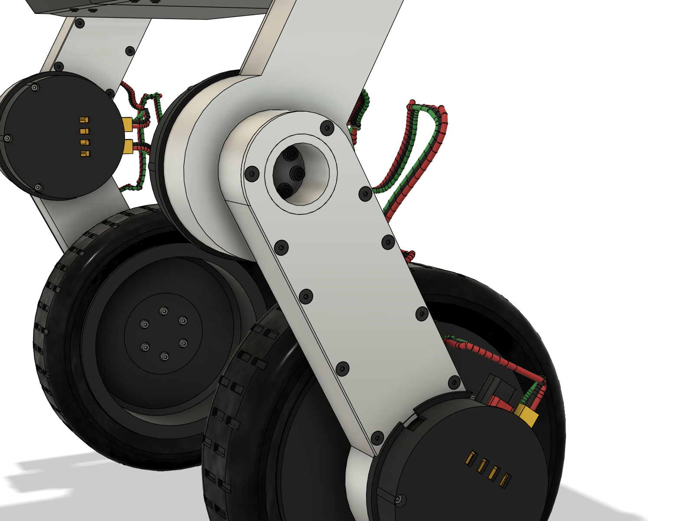
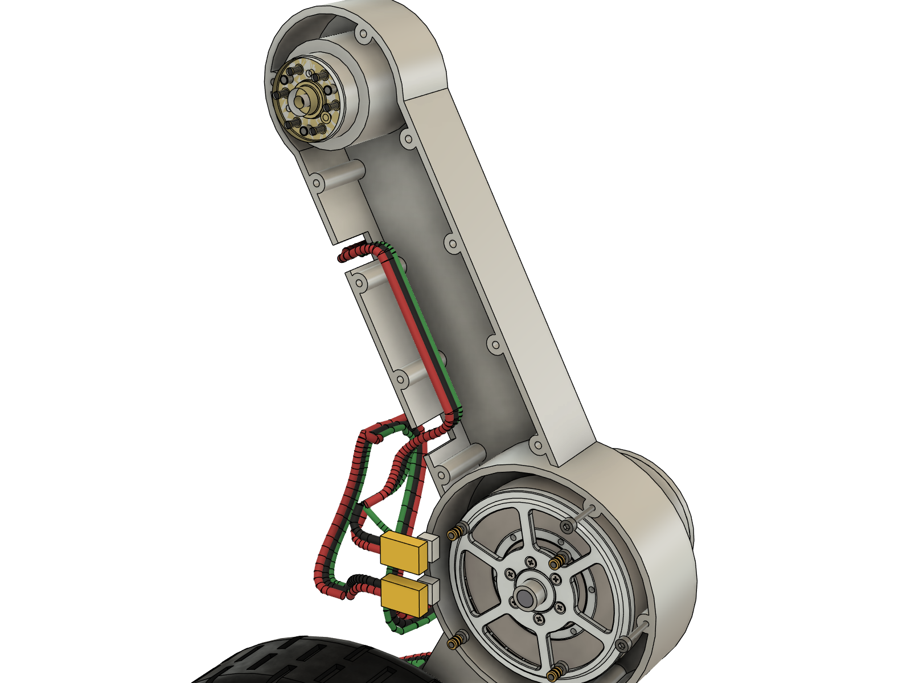
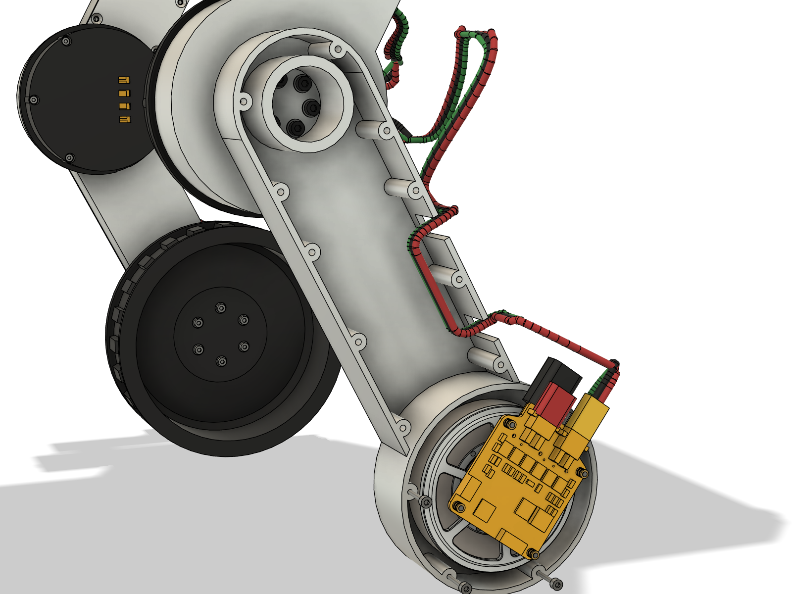

# WheelBiped v3 — v2 + 6061 허벅지·정강이 (Fusion)

`robot_cad_v2`(git `987a914`, 10-31 개정 3: M365 타이어·한 조각 림·림 와셔 자리 9 mm)에서 **양쪽 허벅지·정강이 링크만 PETG
→ 6061-T6**로 바꾼 모델이다. 모터 6개·드라이버·컵·hip 판·몸통·셸·허브 플랜지·림·타이어·배선 경로는 v2 부품을 같은 자리에 그대로
쓴다(관절 면 위치 하나도 안 바뀜). 바뀐 것과 그 근거만 이 문서에 적고, 나머지는 `../robot_cad_v2/README.md`를 본다.

Fusion 문서 **`WheelBiped_v3`**(허브 `Default Project` 최상위, 10-31 버전 1 = 이 README의 빌드: 10.388 kg, 기준 자세 실제 간섭 0건,
회전 조인트 6개)에 새로 빌드했다 — `WheelBiped_v2` 문서는 건드리지 않았다. `export/WheelBiped_v3.f3d`·조립 STEP·`calc/mass_properties.json`은
10-31 재빌드(셸 모서리 기둥 176e896 + 바퀴 허브 플랜지 스피곳 1.3 mm, 3절 끝): **10.392 kg**, 실제 간섭 0건, 고정 간격 55개 그대로.
허브 문서는 아직 버전 1(10.388 kg)이다.

## 0. 결과 한눈에

| 항목 | v2 (PETG 링크) | **v3 (6061 링크)** |
|---|---|---|
| 링크 폭(로봇 y) | 허벅지 76 → 30, 정강이 55 → 30 mm(옆 강성 때문에 바깥으로 넓힘) | **허벅지·정강이 모두 30 mm**(모터 길이가 정하는 최소) |
| 링크 구조 | PETG 출력, 벽 12겹(4.8 mm) + 자이로이드 20 % | **6061-T6 가공 셸**(바깥 판·둘레 벽 2.5 mm) **+ 3 mm 6061 덮개**(M3 접시 볼트 10개) = 닫힌 상자 |
| 링크 질량(한쪽) | 허벅지 424 g, 정강이 381 g | 허벅지 377 g(셸 323 + 덮개 55), 정강이 394 g(셸 333 + 덮개 61) |
| 로봇 질량 | 10.54 kg | **10.39 kg** (−0.15 kg) |
| 크기 | 폭 529 × 높이 561 × 길이 485 mm | **폭 510** × 높이 561 × 길이 485 mm (가장 바깥이 이제 링크가 아니라 바퀴 드라이버 컵, y ±255) |
| 링크 끝 옆 처짐(설계, v2 기준, 한계 1 mm) | 1.01 / 1.01 mm (경계) | **0.23 / 0.14 mm** |
| 접지점 옆 변위(설계, 두 링크 굽힘 + 비틀림) | 12.8 mm (그중 비틀림 6.2) | **1.3 mm** (0.4) — 약 10배 단단 |
| 링크 응력(검토 = 설계 × 2) | 32 / 20 MPa (PETG 강도 45) | 45 / 32 MPa (6061 항복 276) |
| hip·knee 출력 보스 SF 2 검토 | **초과** 68 / 49 MPa (PETG 45) | 통과 68 / 49 MPa (6061 276) |
| 간섭(기준 자세, 체결 부품 v2 438 / v3 418개 포함) | 0건 | **0건** |
| 자세 스윕 30자세 | 타이어–무릎→바퀴 배선(L0 200·240), 타이어–셸(L0 200, hip ±60°) | v2와 같은 두 항목뿐(링크 때문에 새로 생긴 간섭 없음), 최소 간격 같거나 넓음 |
| 모터 재검증(MuJoCo) | 10.57 / 15.57 kg 모두 회복 | 10.42 kg 28개 모두 회복 / 15.42 kg: 15° 내리막 1건이 시드 0에서 판정선(피치 3°) 근처 — v2도 시드 2에서 같은 실패(5절) |
| 부품 수 변화 | — | 링크 4 → 셸 4 + 덮개 4, SUS 클램프 링 8개·링크 인서트 36개·케이블 클립 6개와 나사 24개 없앰, 덮개 나사 40개 추가 |

## 1. 두께를 어디까지 줄일 수 있나 (사용자 질문)

자세한 계산은 `calc/strength.md` 1·1a·1b절(`python calc/strength.py`). 하중은 v2와 같다(바퀴당 설계 300 N + 옆 150 N, 검토는 × 2,
관절 토크 12.5 / 25 N·m).

1. **판 한 장으로는 안 된다.** 허벅지·정강이를 링크 평면에 놓인 통판으로 만들면 옆 굽힘 강성이 두께의 세제곱이라, 링크 끝 옆 처짐
   1 mm를 맞추려면 6061이 15~18 mm, SUS304가 10~12 mm 필요하다(무게 0.75~1.8 kg/쪽, 비틀림에도 약함). PETG가 두꺼워진 것도 같은
   이유다 — 옆 하중을 버티는 데 필요한 건 재료의 강도보다 **로봇 y 방향의 단면 깊이**다.
2. **닫힌 상자(속이 빈 단면)로 만들면 30 mm 폭 안에서 아주 얇아진다.** 같은 30 mm 폭에서 벽 두께만 바꾸면:

   | 단면 (30 × 50/56 mm 상자) | 링크 끝 옆 처짐 허벅지 / 정강이 | 접지점 옆 변위 | 검토 응력 / 항복 | 보 부분 질량(한쪽) |
   |---|---|---|---|---|
   | 6061 t 1.0 | 0.52 / 0.32 mm | 3.1 mm | 100 / 276 MPa | 152 g |
   | 6061 t 2.0 | 0.29 / 0.18 | 1.7 | 54 / 276 | 296 g |
   | **6061 t 2.5 (v3)** | **0.24 / 0.15** | **1.4** | **45 / 276** | **365 g** |
   | SUS304 t 0.5 | 0.36 / 0.22 | 2.1 | 192 / 205 | 226 g |
   | SUS304 t 1.0 | 0.19 / 0.12 | 1.1 | 100 / 205 | 445 g |
   | v2 PETG(넓힌 링크) | 0.95 / 1.00 | 12.8 | 32 / 45 | — |

   계산상으로는 **6061 1 mm, SUS304 0.5 mm 상자도 v2보다 4배 이상 단단하다**. 그래서 두께를 정하는 것은 보가 아니라:
   - **가공**: 6061 셸은 27 mm 깊이 포켓을 3축으로 깎으므로 벽 2.0~2.5 mm가 현실적 하한(떨림·휨) → **2.5 mm**로 했다.
     덮개는 M3 접시 머리 깊이(1.7 mm) 때문에 **3 mm**.
   - **관절 자리**: 모터 자리 판은 모터가 기울려는 모멘트를 하우징 벽까지 판 굽힘으로 넘긴다 — 강도로는 4~5 mm면 되지만(검토
     133~207 MPa), 모터 위치를 v2와 같게 두고 한 면 가공으로 끝내려고 **8 mm**(검토 52 MPa)로 두었다. 바깥 면에 Ø83 × 3 포켓을
     더 깎으면 관절 4곳 합계 약 0.18 kg 줄지만 가공비가 늘어 두지 않았다(가공 부품에 무게만 줄이는 형상은 넣지 않는 원칙).
3. **6061 vs SUS304**: 같은 강성이면 질량이 거의 같다(E/ρ: 25.6 vs 24.3). SUS304가 유리하려면 0.5~1 mm 판금 상자(절곡·용접)여야
   하는데, 그러면 Ø42 H7 모터 포켓·M2.5 탭 같은 관절 자리를 따로 붙여야 하고, 관절 자리까지 SUS로 깎으면 2.9배 무겁고 가공비도
   크다(항복 205 MPa로 6061보다 낮음). **v3는 6061-T6 가공 셸 + 6061 덮개**로 만들었다. 판금 SUS 상자는 8절의 다른 안으로 남긴다.
4. 폭을 30 mm보다 줄이려면 모터를 링크 밖으로 빼야 해서 다리 전체 배치(모터·드라이버 컵·바퀴 위치)를 다시 짜야 한다 — 30 mm는
   AKE60(25 mm) + 모터 자리 판이 정하는 최소다.

## 2. 다시 만들기

v2와 같은 순서(README v2 §2)이고 모듈 로더 이름만 `v3run`이다. 각 줄을 **따로** 실행한다.

```python
import sys; sys.path.insert(0, r'...\robot_cad_v3\fusion'); import v3run
v3run.build()                                   # 빈 문서에서(WheelBiped_v2 문서에서 돌리면 그 문서를 지운다!)
v3run.load()['check'].apply_print_mass()        # PETG 부품 출력 밀도, 타이어 721 g (6061 링크는 재질 밀도 그대로)
v3run.load()['check'].save_mass_json(r'...\robot_cad_v3\calc\mass_properties.json')
K = v3run.load()['check']; K.classify(K.interference())
v3run.load()['poses'].sweep(L0s=(200, 240, 280))                # 그리고 (310, 335): calc/sweep_part1/2.json
v3run.load()['gaps'].measure()                                  # calc/gaps.json
F = v3run.load()['finalize']; F.set_part_numbers(); F.images()  # 그림 16장
F = v3run.load()['finalize']; F.inside_images(); F.link_images(); F.bom()   # 내부 8장 + 링크 2장, BOM
v3run.load()['finalize'].joints()               # 회전 조인트 6개(문서가 파라메트릭으로 바뀜)
v3run.load()['finalize'].drive_check()
v3run.load()['finalize'].exports()              # export/: f3d, 조립 STEP, 부품 STEP·STL
```

모터 재검증: `wheeled_biped`에서 `python -m wbr.bench.ake_cad --cad ../robot_cad_v3/calc/mass_properties.json --out results/ake_cad_v3`
(10-31에 `--cad` 인자를 더했다; 인자 없이 돌리면 v2 그대로). 강도: `python calc/strength.py`.
구매품 STEP 경로는 `fusion/vendor.py`(v2와 같은 파일).

## 3. 6061 링크 설계 (`fusion/legs.py`, 치수 `fusion/params.py` "v3 metal links")



- **허벅지 셸**(6061-T6 판 40 t, 3축 양면 가공): 바깥 판(y 201.5~204, 2.5 mm)과 둘레 벽(2.5 mm)이 한 덩어리, **안쪽(몸통 쪽)이
  열려 있고 3 mm 덮개**가 닫는다. 덮개 바깥 면은 v2 안쪽 면보다 1.5 mm 들어가 있다(셸 ISO 7380 머리 간격 1.85 mm, v2와 같음).
  - hip 쪽: **Ø28 구동 보스**(Ø11.8 × 1.4 스피곳, M3 × 16 12.9 6개 + Ø3 다웰 3개, v2와 같은 모터 출력 체결)가 **r 18 스풀**로
    이어져 바깥 판까지 상자를 꿰뚫는다. 덮개는 스풀에 Ø36 H8/g6로 끼워져, 관절 모멘트가 바깥 판–덮개 사이 짝힘(검토 5.2 kN, 덮개
    구멍 지압 48 MPa)으로 상자에 들어간다. M3 머리는 바깥 면에서 Ø28 접근 구멍(깊이 26 mm)으로 조인다.
  - 무릎 쪽: **모터 하우징**(r 41.5~44, 컵 등록 지름 Ø88 그대로) 안에 **모터 자리 8 mm**(Ø42 H7 × 1.5 파일럿 포켓, Ø30 구멍,
    M2.5 저두 6개 Ø4.8 × 1.7 카운터보어, 리드 홈 12 × 2). 하우징 안쪽 보스 3개에 컵 나사 M2.5 탭(v2 인서트 대신).
  - 덮개 나사: 둘레 벽 안쪽 Ø7 보스 10곳에 M3 탭(깊이 7.5), **ISO 10642 M3 × 8 10.9** — 머리 쪽 2 + 양 모서리 24 / 60 / 95 / 130 mm.
- **정강이 셸**: 반대로 **안쪽 판**(y 205.5~208)에 knee 구동 보스·스풀과 **바퀴 모터 자리 8 mm**가 있고, **바깥쪽이 열려** 3 mm
  덮개(바깥 면 y 235.5 = v2 바깥 면)가 닫는다. 바퀴 하우징 바깥 면(y 235.5)에 바퀴 드라이버 컵이 그대로 앉는다. 덮개 나사는
  24 / 50 / 90 / 130 mm.
- **배선이 상자 안으로**: v2의 12 × 8 홈·클립·인서트 대신, 다리 묶음(16 AWG 2 + CAN)이 뒤 모서리 벽의 **배선 창 2곳**(10 mm 폭,
  덮개가 위를 닫아 창이 됨)으로 들어가 상자 안(뒤 면에서 12 mm 안)을 지나 나온다. 바깥 경로·관절 고리는 v2와 같고, hip 고리 평면만
  넓힌 허벅지 바깥(y 260)에서 **허벅지 바깥 10 mm(y 214)**로 옮겼다.
- **SUS304 클램프 링 8개를 뺐다**: v2는 나사 머리가 맨 PETG를 누르지 않게 링을 깔았지만, 6061에서는 와셔·저두 머리 면압(검토
  ≤ 209 MPa)이 허용치(약 260 MPa) 안이다. 나사 길이·머리 위치는 v2와 같다.
- 관절 면·모터 위치는 v2와 똑같다(모터 링 면 y 197.5 / 212, 출력 면 167 / 198 / 211.5). 그래서 컵·허브·림·타이어·hip 판은 v2 부품
  그대로이고, 링크 사이 틈(허벅지–hip 판 2.0, 허벅지–정강이 1.5 mm)도 같다.
- **바퀴 허브 플랜지 스피곳 1.4 → 1.3 mm**(10-31, 사용자, `params.HUB_SPIGOT`): AKE 출력부 Ø12 × 1.5 홈에 들어가는 Ø11.8 스피곳 끝을
  홈 바닥에서 0.1 → **0.2 mm** 띄웠다(림 등록 턱 B와 같은 여유). PETG 출력 높이 오차(±0.1)와 공차 없는 홈 깊이 때문에 스피곳 끝이
  먼저 닿으면 ② M3 × 14 6개가 플랜지 면이 아닌 스피곳을 조여 플랜지가 기운 채 고정된다 — 위치는 ③ 핀 3개, 하중은 맞댄 면이 받고
  스피곳은 안내만 한다. 허브 플랜지 한 개 −10.9 mm³(길이 19.4 → 19.3). hip·knee의 6061 구동 보스 스피곳(가공품)은 1.4 그대로.

 

## 4. 강도 (`calc/strength.md`)

| 검토 항목 | 값 / 한계 | 판정 |
|---|---|---|
| 허벅지 / 정강이 상자 응력(검토 600 N + 옆 300 N + 25 N·m) | 45 / 32 MPa / 276 | 통과 |
| 링크 끝 옆 처짐(설계, v2 기준) | 0.23 / 0.14 mm / 1 | 통과 |
| 링크 끝 면내 처짐(설계) | 0.02 / 0.02 mm / 1 | 통과 |
| 접지점 옆 변위(설계, 굽힘 + 비틀림, 참고) | 1.3 mm (v2 12.8) | 참고 |
| knee / wheel 모터 자리 판 굽힘(검토, 리드 홈 자리, 단순 지지) | 92 / 52 MPa / 276 | 통과 |
| hip / knee 스풀 굽힘·덮개 구멍 지압(검토) | 46·48 / 33·34 MPa / 276 | 통과 |
| 덮개 볼트 전단(검토, 10.9, 간격 ≤ 36 / 40 mm) | 허벅지 1367 / 정강이 950 N / 2440 | 통과 |
| hip·knee 출력 보스(검토) | 굽힘 68 / 49 MPa / 276, 와셔 면압 145 / 104 / 260 | 통과(v2 초과 → 해소) |
| 출력 M3 12.9 인장(검토, hip) | 4420 / 4879 N | 통과(v2와 같음, 여유 작음) |
| 고정링 나사(hip 12.9 / knee·wheel 8.8, 검토) | 2422 / 3288, 1737 / 2034 N, 머리 면압 ≤ 248 / 260 MPa | 통과 |
| 허브 플랜지 → 바퀴 출력 와셔 지압(검토, PETG, v2 부품) | 58 / 50 MPa | **초과**(v2와 같음, 링크 밖 항목) |

- v2의 "비틀림" 계산은 옆 하중 모멘트 Mx만 링크 기울기로 나눴다 — 실제로는 접지점 옆 하중이 허벅지 축에 191 mm 팔로 걸려 비틀림이
  허벅지 전체에서 일정하다(검토 62 N·m). v3 계산은 접지점 힘의 3차원 모멘트를 그대로 나눈다. 같은 식으로 v2 PETG 링크를 다시 보면
  접지점이 12.8 mm 밀렸다 — PETG 링크의 진짜 약점은 비틀림이었다.
- 처음 덮개 나사를 8개(간격 약 50 mm)로 두었을 때 허벅지 검토 하중에서 나사 하나 2.1 kN(8.8 한계 1.6 kN)로 초과 → 10개(≤ 36 mm),
  10.9로 바꿨다.

## 5. 모터 재검증 (MuJoCo, `wbr/bench/ake_cad.py --cad`)

`results/ake_cad_v3/`(시나리오 28개 × 로봇만 / 짐 5 kg, Plan 4 LQI6, 잡음 + 2 ms 지연, 시드 0). 링크가 가벼워지고(허벅지 쪽 0.80
→ 0.73 kg) 무게중심이 조금 바뀐 것 말고는 v2와 같은 모델이다.

| 경우 | 질량 | 회복 못 한 시나리오 | 최대 토크 hip / knee / 바퀴 [N·m] | 무릎 정지 최대 |
|---|---|---|---|---|
| v2 로봇만 | 10.57 kg | 없음 | 11.24 / 8.19 / 7.41 | 4.14 |
| **v3 로봇만** | **10.42 kg** | **없음** | **11.39 / 8.24 / 7.32** | **4.00** |
| v2 짐 5 kg | 15.57 kg | 없음(15° 내리막: 피치 최대 4.09°, 미끄럼 0.47 m/s, 바퀴 들림 42 ms) | 12.50 / 11.13 / 12.50 | 7.28 |
| v3 짐 5 kg | 15.42 kg | 15° 내리막 0.5 m/s(마지막 1초 피치 3° 초과; 최대 4.20°, 미끄럼 0.59, 들림 47 ms, 포화 0 %) | 12.50 / 11.17 / 12.50 | 7.14 |

- 짐 5 kg의 15° 내리막은 두 모델 모두 판정선 바로 근처다. 잡음 시드만 바꿔 다시 돌리면(`scratchpad` 확인, 같은 시나리오 28개)
  **v2 시드 2는 실패(피치 4.37°, 미끄럼 0.72), v3 시드 1·2는 통과(3.93° / 3.69°)** — 링크 재질 때문에 나빠진 것이 아니라 이 시나리오
  자체가 짐 5 kg에서 한계(바퀴가 들리며 미끄러짐)다. 모터 포화는 없다.
- 짐 5 kg에서 바퀴·hip이 순간 12.5 N·m 한계에 닿는 것(기울기 25°, 밀기 1.5 m/s)은 v2와 같다. 무릎 정지 토크는 조금 줄었다.

## 6. 간섭·간격

- 기준 자세: Fusion 간섭 111건 모두 결합(선–커넥터, 같은 묶음 선, 플러그–헤더) — **실제 간섭 0건**(체결 부품 418개 포함, 나사산은
  골지름으로 그려 탭과 닿기만 함). 처음 빌드에서 정강이 덮개 나사 2개(s 135 mm)의 접시 머리가 바퀴 하우징 테두리에 0.54 mm³ 걸려
  130 mm로 옮겼다.
- 자세 스윕 30자세(L0 200~335 × hip −80~+60°, 고리 선은 자세마다 다시 그림, `calc/sweep_part1/2.json`): v2와 **같은 두 가지뿐**이다 —
  타이어–무릎 → 바퀴 배선(L0 200·240, 실물에서 선을 옮기기로 한 항목), 타이어–셸 hip 부분(L0 200, hip ±60°, 제어기 범위 밖).
  L0 280~335는 실제 간섭 0건, 늘어난 고리 없음.

| 짝 | v2 | v3 |
|---|---|---|
| 허벅지 쪽 부품 – 몸통 | 4.0 mm (허벅지 클립) | 1.85 mm (덮개 접시 머리 = 덮개 면, 셸 버튼 볼트 머리와) |
| 허벅지 몸체·덮개 – 셸 버튼 볼트 머리 | 1.85 mm | 1.85 mm (덮개 면을 v2 안쪽 면만큼 1.5 들임) |
| 타이어·림·허브 – 몸통(L0 ≥ 240) | 11.5 mm | 11.5 mm |
| 타이어 – 허벅지·무릎 컵(배선 빼고) | 22.4 mm | 22.4 mm |
| 정강이 – 몸통 | 49.0 mm | 49.0 mm |
| hip 고리 선 – 다른 부품 | 5.1 mm | 5.1 mm (고리 평면 y 260 → 214) |
| knee 고리 선 – 다른 부품 | 1.84 mm (정강이 클립 나사 머리) | **2.24 mm** (타이어, L0 200 hip −60°; 클립이 없어짐) |

- 고정 간격(`calc/gaps.json`, 좌우 같음): 허벅지 셸–hip 판 1.0(보스 반경)·덮개–hip 판 3.5, 허벅지–정강이 1.0, 무릎 고정링 M2.5 머리–
  정강이 1.7(v2 링–정강이 1.0), 허브 플랜지–정강이 1.0, 림–정강이 9.0, 타이어–정강이 5.0, 바퀴 고정링 M2.5 머리–허브 플랜지 1.2,
  바퀴 출력 M3 머리–림 허브 2.0 mm. 엔코더(칩–자석 1.15, CAN 헤더–로터 캡 2.70, 종단 저항 1.76)와 컵–모터(hip 2.60, knee·wheel 2.91),
  플러그–모터 4.66, 배선–로터 9.41 mm는 v2와 같다(모터·드라이버·컵이 같은 자리). 바퀴를 0 / 20 / 40° 돌려도 바퀴 쪽 부품–정강이 1.0 mm.

## 7. 가공·조립 메모

- **셸**(4개, 좌우 거울상): 6061-T6 판 40 t(구동 보스가 30 mm 봉투 밖으로 7.5 mm 나옴)에서 3축 MCT 2셋업 — ① 열린 쪽: 외곽,
  포켓(깊이 23~27 mm, 벽 2.5), 하우징 안, 모터 파일럿 Ø42 H7 × 1.5, 리드 홈, 구동 보스·스피곳, 덮개·컵 보스 M3·M2.5 탭, 배선 창;
  ② 판 쪽: Ø28 접근 구멍, M3·Ø3 다웰 구멍, Ø30 구멍, M2.5 구멍·카운터보어. 아노다이징 권장(검정이면 hip 판과 맞음).
  안쪽 모서리 R은 공구 반경(모델은 각진 모서리) — 견적 때 R 1.5~3 허용으로 적을 것.
- **덮개**(4개): 6061-T6 3 t 2D CNC 한 면(외곽, Ø36 H8 스풀 구멍, M3 90° 접시 10곳). 레이저면 Ø36 구멍을 리머로 마무리.
- 조립 순서(허벅지): knee 모터를 하우징 안쪽에서 넣어 바깥 면에서 M2.5 × 8 저두 6개 → 무릎 드라이버 컵(하우징 면 M2.5 탭 3개) →
  다리 배선을 배선 창으로 넣어 상자 안에 눕힘 → 덮개를 스풀에 끼워 M3 × 8 접시 10개(나사 고정제 약하게) → hip 출력에 Ø11.8
  스피곳을 맞춰 바깥 면 접근 구멍으로 M3 × 16 12.9 + 와셔 6개. 정강이는 바깥쪽 덮개를 연 상태에서 바퀴 모터·knee 출력 나사를
  먼저 체결한다.
- 배선 창 모서리는 0.5 mm 모따기 + 실리콘 튜브/엣지 보호재로 선 피복을 보호할 것(모델엔 없음).
- 나머지(출력 부품, 타이어 끼우기, 셸, 인서트)는 v2 README §10과 같다. 링크에는 이제 열압입 인서트가 없다.

## 8. 가정·위험·결정할 것

1. **가공비** — 6061 셸 4개는 40 t 판에서 대부분을 깎아내는 2셋업 가공이라 PETG 출력보다 훨씬 비싸다. 더 싼 대안: (a) 6061
   3 mm 판 2장 + 스페이서 블록 샌드위치(레이저 판 + 선반 부품, 부품·나사 수 늘어남), (b) SUS304 1 mm 판금 상자(절곡·용접) + 6061 모터
   자리. 둘 다 계산상 강성은 충분하지만 모델은 만들지 않았다 — 견적을 받아 보고 정하자.
2. **모터 자리 8 mm**는 강도보다 두껍다(1·1b절) — 질량을 더 줄이려면 바깥 면 포켓(관절 4곳 −0.18 kg, 가공비 증가).
3. hip 출력 M3 12.9가 검토 하중에서 보증하중의 91 %, AKE60 출력 베어링 허용 모멘트는 비공개 — v2와 같은 위험(CubeMars 확인).
4. 허브 플랜지 → 바퀴 출력 와셔 지압 58 / 50 MPa(PETG 허브 플랜지, v2 미해결 항목, 링크 밖).
5. 무릎 → 바퀴 배선이 웅크린 자세(L0 200·240)에서 타이어에 닿는 것은 v2와 같다(실물에서 선을 옮기기로 한 사용자 결정).
6. 강도는 손계산이다(셸 안쪽 모서리 응력 집중·덮개 접촉은 FEA로 확인 권장).

## 9. 폴더

| 경로 | 내용 |
|---|---|
| `fusion/` | v2 스크립트 복사본 + v3 변경(`params.py` "v3 metal links", `legs.py` 링크·덮개, `assembly.py`, `harness.py` 배선 상자 안 경로, `fasteners.py` 덮개 나사·인서트/클립 제거, `gaps.py`, `finalize.py`, `v3run.py`) |
| `calc/` | `strength.py`→`strength.md`(1·1a·1b절 새로), `mass_properties.json`, `sweep_part1/2.json`, `gaps.json` |
| `export/` | `WheelBiped_v3.f3d`, `WheelBiped_v3_assembly.step`, `parts_step/`, `parts_stl/` (셸·덮개 STEP은 가공 견적용) |
| `images/` | 그림 26장(v2 24장과 같은 시점 + 25·26 덮개 벗긴 링크) |
| `BOM.md`, `BOM.csv` | 부품표(모델에서 생성) |
