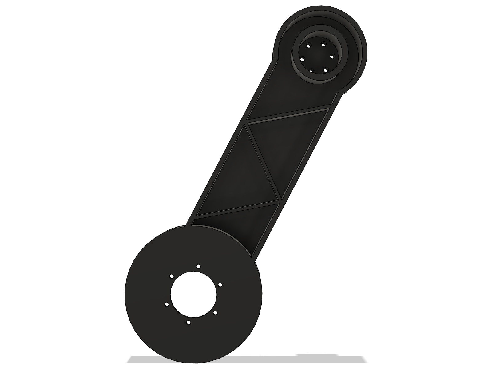
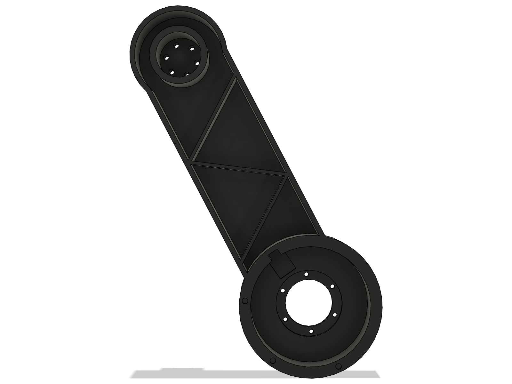

# WheelBiped v4 — v3 + SLA 레진 트러스 허벅지·정강이 (Fusion)

`robot_cad_v3`(git `5a550c1`: 6061 링크 도면, 다웰 구멍 7.5, 허브 플랜지 스피곳 1.3, 셸 모서리 기둥)에서 **양쪽 허벅지·정강이만
6061 가공 상자 → SLA 레진 한 덩어리 출력**으로 바꾼 모델이다(사용자 11-01: 6061 가공 부품 전부 약 300만 원, 출력하면 약 70만 원 →
최대한 3D 프린터로). 재료는 사용자가 정한 **SLA 유사ABS 검정 레진**(밀도 1.20, 인장 41~58 MPa, 인장 탄성 2731 MPa, 굽힘 69~76 MPa,
연신 11 %, HDT 60 °C). 모터·드라이버·컵·hip 판·척추 봉·레일·몸통·셸·허브·림·타이어와 관절 면 위치는 v3 그대로다 — hip 판·봉·레일은
이번 요청 범위 밖이라 아직 6061이다. 바뀐 것과 근거만 적고, 나머지는 `../robot_cad_v3/README.md`를 본다.

Fusion: 새 문서(`wbv4` 속성)에 빌드했다 — `WheelBiped_v2`·`WheelBiped_v3` 허브 문서는 건드리지 않았다.
`export/WheelBiped_v4.f3d`에 같은 모델(회전 조인트 6개)이 있고, 11-01 이 f3d를 그대로 허브 **`WheelBiped_v4`**(`Default Project` 최상위,
버전 1 = git `93a2aa2`, 10.05 kg)로 저장했다.

**11-02 변경(사용자): 허벅지·정강이의 선 넣는 공간(리브 배선 채널 14 × 14·앞 배수 채널 8 × 8·뒤 벽 배선 창 12 × 16 × 2)과 작은
구멍(앞 벽 Ø4 배수 구멍 × 2)을 모두 없애고, 모델의 배선(선·플러그·XT60/XT90 커넥터)도 뺐다.** 트러스 칸 4개가 링크마다 닫힌 빈
공간이 되며, 질량·강도는 **칸 안에 레진이 남지 않는다고 가정**했다(사용자). 허브 문서에서 `v4run.build()`로 다시 만들어 검사·그림·
내보내기를 모두 다시 하고 허브 **`WheelBiped_v4` 버전 2**(9.90 kg)로 저장했다. 아래 표·절은 11-02 값이다.

## 0. 결과 한눈에

| 항목 | v3 (6061 상자) | **v4 (SLA 레진 트러스 상자)** |
|---|---|---|
| 링크 구조 | 6061 셸(벽 2.5) + 3 mm 덮개, 폭 30 mm | **한 덩어리 닫힌 상자(벽 3.0) + 안쪽 와렌 트러스 리브 2.0 mm × 3**, v2처럼 바깥으로 넓힘(허벅지 76, 정강이 55 mm), **구멍·배선 창·리브 채널 없음(닫힌 칸 4개)** |
| 링크 질량(한쪽) | 허벅지 377, 정강이 394 g | **허벅지 305 g(254 cm³), 정강이 268 g(224 cm³)** — 같은 외형을 꽉 채우면 보 부분만 약 3.8배 |
| 로봇 질량 | 10.39 kg | **9.90 kg** (−0.49 kg; 11-01 배선 포함 10.05) |
| 크기 | 폭 510 × 높이 561 × 길이 485 mm | **폭 521** × 높이 561 × 길이 485 mm (넓힌 정강이; 배선 고리가 빠져 11-01의 529보다 좁음) |
| 링크 끝 옆 처짐(설계, 한계 1 mm) | 0.23 / 0.14 mm | **0.87 / 0.94 mm** (v2 PETG 0.95 / 1.00) |
| 접지점 옆 변위(설계, 굽힘 + 비틀림) | 1.3 mm | **10.5 mm** (그중 비틀림 4.3; v2 PETG 12.8) |
| 링크 응력(검토 = 설계 × 2) | 45 / 32 MPa (항복 276) | **28 MPa** (레진 인장 41) |
| 관절부(검토) | 6061 | 모터 판 9 mm 52 MPa(리드 홈 자리), **hip 보스 68 MPa ≈ 굽힘강도 69 (가장 빠듯)** — `calc/strength_v4.md` 2절 |
| 간섭(기준 자세, 체결 부품 포함) | 0건 | **0건**(결합 4건: 바퀴 드라이버 헤더의 종단 저항·XT30 캡) |
| 자세 스윕 30자세 | 타이어–무릎→바퀴 배선(L0 200·240), 타이어–셸(L0 200, hip ±60°) | **타이어–셸(L0 200, hip ±60°)만**(배선이 없어 타이어–배선 항목은 없어짐), L0 240~335 0건 |
| 모터 재검증(MuJoCo) | 10.42 kg 회복 / 15.42 kg 15° 내리막 경계 | **9.93 / 14.93 kg 모두 28개 시나리오 회복**(6절) |
| 부품 수 변화 | — | 덮개 4개·덮개 나사 40개 없앰, SUS 클램프 링 8개·접착 인서트 12개 다시(v2처럼), 11-02 배선·플러그·XT60/XT90 커넥터 없앰(BOM에 선 없음 — 따로 산다) |

 

## 1. 왜 이 모양인가 (`calc/strength_v4.md` 1절)

1. **넓히는 것이 먼저다.** SLA는 꽉 채워 출력하므로 꽉 찬 링크는 레진(값)과 무게만 늘고, 옆 강성은 바깥 치수가 정한다(옆 굽힘 ∝ 폭³).
   v3 폭(30 mm)으로는 레진을 꽉 채워도 링크 끝이 2.6 mm 휜다(한계 1). 그래서 v2 PETG 링크와 같은 외형으로 바깥쪽을 넓혔다 —
   v2에서 30자세 스윕을 통과한 외형이라 새 간섭이 없다.
2. **닫힌 상자 + 안쪽 트러스.** 이 다리의 약점은 비틀림이다(기운 링크에서 옆 하중의 상당 부분이 비틀림 — v3 1절). 옆이 뚫린 평면
   트러스는 비틀림이 거의 0이라 맞지 않고, 바깥은 닫힌 상자(벽 3.0 mm)로 두고 안쪽에 대각선 리브(와렌 트러스, 2.0 mm, 링크마다 3개,
   폭 전체를 가로지름)를 넣었다.
3. **트러스 리브가 하는 일**은 얇은 면판이 좌굴하지 않게 붙잡는 것이다. 옆 굽힘에서 눌리는 면판(폭 최대 56 mm)은 리브가 없으면 긴
   판으로 좌굴한다(벽 2.5는 20 MPa < 검토 압축 24 MPa). 리브가 면판을 삼각형 칸으로 나누면 좌굴 응력이 약 2배(벽 3.0: 59 MPa, 여유
   3배)가 된다. 리브가 보태는 옆 강성은 약 10 %다.
4. 벽 두께 비교(넓힌 외형, 검토 하중): 벽 2.5 + 리브는 링크 끝 1.08 mm로 1 mm 초과, **벽 3.0 + 리브**가 통과하는 가장 얇은 조합
   (0.87 / 0.94 mm, 28 MPa), 벽 4.0 + 리브는 0.72 / 0.77 mm지만 레진이 25 % 더 든다.
5. 그래도 **접지점 옆 변위는 10.5 mm**로 v3(1.3)보다 8배 크다(v2 PETG 12.8보다는 작다). 균형 제어에 문제가 되면 면내 높이를
   +10 mm 키우는 것(약 8.7 mm, 자세 스윕 다시)이 다음 단계다.

## 2. 링크 설계 (`fusion/legs.py` `_hollow_link`, 치수 `fusion/params.py` "v4 SLA resin links")

- 외형: v2 링크(머리 원판 r 30, 보 띠, 모터 하우징 r 44, `_wide`로 바깥 넓힘 — 허벅지 y 250까지, 무릎 55 mm 앞에서 15 mm 경사로
  돌아옴 / 정강이 y 260.5까지, 바퀴 축 50 mm 앞). 허벅지 안쪽 면은 r 40 밖에서 1.5 mm 들어감(셸 버튼 볼트 머리, v2와 같음).
- 속: 바깥 면에서 3.0 mm 안쪽까지 비움(`_cavity`, 넓힌 띠의 경사면도 3.0 mm 안쪽으로 평행 이동), 모터 하우징(r 37~44, 컵 인서트 자리)
  은 막혀 있다. 머리(구동 보스 쪽)는 v3처럼 **스풀 관 r 18**(Ø28 접근 구멍)이 안쪽 판에서 바깥 판까지 상자를 꿰뚫어, 관절 모멘트가
  두 면판에 나뉘어 들어간다.
- 트러스(`truss_nodes`, `_ribs`): 머리 공간 끝(s = 27)에서 하우징(s = 131)까지 대각선 3개, 첫 리브는 뒤(배선) 모서리에서 출발,
  두 모서리 벽을 번갈아 잇는다(링크 축에서 약 52°). 두께 2.0, 링크 폭 전체(넓힌 부분 포함).
- 구멍 없음(11-02 사용자): 리브에 채널이 없고 벽에 배선 창·배수 구멍이 없다. 트러스 칸 4개가 각각 닫힌 빈 공간이다 — Fusion
  확인: 링크마다 몸체 1개·셸 5개(바깥 1 + 빈 공간 4). 칸 안에 레진이 남지 않는다고 가정한다(사용자 11-02; 실제 SLA 출력에서는
  배수 구멍 없이 액체 레진을 뺄 길이 없으니 출력 업체와 확인할 것 — 8절). 11-01까지는 리브 14 × 14 배선 채널 + 8 × 8 배수 채널,
  뒤 벽 배선 창 12 × 16 × 2, 앞 벽 Ø4 배수 구멍 × 2가 있었다(git `93a2aa2`).
- 관절부(v2 출력 설계): 모터 판 9 mm, Ø42.05 포켓 2.5, Ø30 구멍, **SUS304 클램프 링 2 t**(고정링 Ø45/30, 출력 Ø27/12.5) 밑에
  M2.5·M3 머리, 리드 홈 12 × 2 + 축 방향 리드 슬롯, 컵 나사용 M2.5 인서트 3개(**에폭시 접착** — 열경화 수지라 열압입 안 됨), 다웰
  구멍 7.5(v3).

## 3. 다시 만들기

v3와 같은 순서(`../robot_cad_v3/README.md` 2절)이고 로더는 `v4run`이다. **빈 새 문서에서** 실행한다(`v4run.build()`는 활성 문서를
지운다 — v2·v3 문서에서 돌리지 말 것; 11-02에는 허브 `WheelBiped_v4` 문서를 열고 그 안에서 다시 만든 뒤 `doc.save()`로 새 버전을
만들었다). `build()`는 배선 없이 만든다(`build(with_harness=True)`는 옛 배선을 넣지만 링크에 창이 없어 벽을 뚫고 지나간다). 각 줄을
따로 실행한다.

```python
import sys; sys.path.insert(0, r'...\robot_cad_v4\fusion'); import v4run
v4run.build()                                   # 빈 문서에서
v4run.load()['check'].apply_print_mass()        # PETG 부품 출력 밀도, 타이어 721 g (SLA 링크는 레진 밀도 1.20 그대로 — 속이 빈 형상)
v4run.load()['check'].save_mass_json(r'...\robot_cad_v4\calc\mass_properties.json')
K = v4run.load()['check']; K.classify(K.interference())
v4run.load()['poses'].sweep(L0s=(200, 240, 280))               # 그리고 (310, 335): calc/sweep_part1/2.json
v4run.load()['gaps'].measure()                                 # calc/gaps.json
F = v4run.load()['finalize']; F.set_part_numbers(); F.images(); F.link_images(); F.truss_images()   # 그림 16 + 링크 2 + 단면 2
v4run.load()['finalize'].bom()
v4run.load()['finalize'].joints()               # 회전 조인트 6개(문서가 파라메트릭으로 바뀜 — 그림은 그 전에)
v4run.load()['finalize'].drive_check()           # 조인트 20° — 링크 원점 이동 hip 142.7 / knee 93.3 / wheel 35.1 mm, 되돌림 0
v4run.load()['finalize'].exports()              # export/: f3d, 조립 STEP, 부품 STEP·STL
```

강도: `python calc/strength_v4.py`(→ `calc/strength_v4.md`). 모터 재검증: `wheeled_biped`에서
`python -m wbr.bench.ake_cad --cad ../robot_cad_v4/calc/mass_properties.json --out results/ake_cad_v4`.
트러스 단면 그림 27·28(`finalize.truss_images()`)은 왼쪽 링크를 y = 200 / 232 mm에서 잘라 바깥에서 본 것이다 — 리브에 구멍이 없다.

## 4. 강도 요약 (`calc/strength_v4.md`)

| 검토 항목 | 값 / 한계 | 판정 |
|---|---|---|
| 링크 보(검토 600 N + 옆 300 N + 25 N·m, von Mises) | 28 / 41 MPa | 통과 |
| 링크 끝 옆 처짐(설계, v2 기준) | 0.87 / 0.94 / 1 mm | 통과 |
| 면판 좌굴(리브 칸) | 압축 20 / 좌굴 59 MPa | 통과 |
| knee / wheel 모터 판 9 mm 굽힘(검토, 리드 홈 자리, 단순 지지) | 52 / 30 MPa / 굽힘 69 | 통과 |
| hip / knee 구동 보스 Ø28 굽힘(검토) | **68** / 49 MPa / 굽힘 69 | 통과(hip은 경계) |
| SUS 링 밑 레진 면압(검토, 링이 힘을 18 mm로 퍼뜨림) | 출력 53 / 고정링 21 MPa | 통과 |
| 관절 토크 25 N·m 구멍 지압(검토) | 32.6 MPa (고정링 M2.5, 판 2.8 mm) / 41 | 통과 |
| HDT 60 °C | 모터 링 면 온도 실측 필요(3절) | **확인 필요** |

## 5. 간섭·간격

- 기준 자세: Fusion 간섭 4건 모두 결합(바퀴 드라이버 헤더에 꽂힌 CAN 종단 저항·XT30 캡) — **실제 간섭 0건**. 11-01의 111건은
  대부분 배선(선–커넥터, 같은 묶음 선, 플러그–헤더)이었다.
- 자세 스윕 30자세(`calc/sweep_part1/2.json`, 11-02): **타이어–셸 hip 부분(L0 200, hip ±60°, 제어기 범위 밖) 하나뿐**. 11-01에 있던
  타이어–무릎 → 바퀴 배선(L0 200·240)은 배선이 없어 사라졌다. L0 240~335는 0건. 배선 말고는 11-01 값과 같다.
- 최소 간격(스윕): 허벅지–셸 버튼 볼트 머리 1.85 mm(v3와 같음), 무릎 출력 링–hip 판 4.46, 타이어·림·허브–몸통 L0 280 11.5
  (hip −80°)·L0 ≥ 310 13.1, 타이어–무릎 컵 27.6, 정강이–몸통 ≥ 49.
- 고정 간격(`calc/gaps.json`): 허벅지–hip 판·허벅지–정강이·무릎 고정 링–정강이·바퀴 고정 링–허브 플랜지·허브 플랜지–정강이 모두
  1.00 mm, 림–정강이 9.0, 타이어–정강이 5.0, 바퀴 출력 M3 머리–림 허브 2.0, 바퀴 고정링 M2.5 머리–허브 플랜지 1.2. 엔코더·컵·플러그
  간격은 v3와 같다. 배선·플러그 간격 줄은 배선이 없어 빠졌다.

## 6. 모터 재검증 (MuJoCo)

`wheeled_biped/results/ake_cad_v4/`(시나리오 28개 × 로봇만 / 짐 5 kg, Plan 4 LQI6, 잡음 + 2 ms 지연, 시드 0, 11-02 질량 — 배선
없음, 닫힌 칸은 비었다고 가정). 링크가 가벼워진 것(허벅지 쪽 0.73 → 0.65, 정강이 쪽 0.74 → 0.62 kg)만 들어간다 — **MuJoCo 링크는
강체**라 레진 링크의 처짐(접지점 10.5 mm)은 시뮬에 없다.

| 경우 | 질량 | 회복 못 한 시나리오 | 최대 토크 hip / knee / 바퀴 [N·m] | 무릎 정지 최대 |
|---|---|---|---|---|
| v3 로봇만 | 10.42 kg | 없음 | 11.39 / 8.24 / 7.32 | 4.00 |
| **v4 로봇만** | **9.93 kg** | **없음** | **10.62 / 7.77 / 7.06** | **3.87** |
| v3 짐 5 kg | 15.42 kg | 15° 내리막 0.5 m/s(피치 3° 경계) | 12.50 / 11.17 / 12.50 | 7.14 |
| **v4 짐 5 kg** | **14.93 kg** | **없음**(15° 내리막: 바퀴 들림 36 ms) | 12.50 / 10.69 / 12.50 | 7.00 |

- 짐 5 kg에서 바퀴·hip이 순간 12.5 N·m 한계에 닿는 것(기울기 25°, 밀기 1.5 m/s)은 v2·v3와 같다. 15° 내리막은 v3에서도 시드에 따라
  통과·실패가 갈린 판정선 근처 시나리오다(v3 README 5절).

## 7. 출력·조립 메모

- 링크 4개는 SLA 한 덩어리(레진 합계 956 cm³). 서포트는 바깥 면에만. 구멍이 없어 닫힌 칸 4개(링크마다)에서 레진을 뺄 길이 없다 —
  계산은 칸이 비었다고 가정했다(8절 6).
- Ø42.05 모터 포켓·Ø3 다웰 구멍은 출력 오차(±0.1~0.2)가 있으니 실물에 맞춰 사포·리머로 맞춘다. M2.5 인서트는 에폭시로 붙인다.
- 레진은 오래 눌리면 크리프가 있다 — **조임 토크를 낮게**: 출력 M3 12.9 약 1.0 N·m, 고정링 M2.5 약 0.5 N·m + 중강도 나사 고정제,
  처음 몇 주는 풀림을 다시 확인한다.
- 배선: 모델에 없다(11-02). 링크에 창이 없으니 다리 선(16 AWG 2가닥 + CAN)은 링크 바깥으로 두르고 고정한다.
- 조립 순서는 v2와 같다(SUS 링을 판 홈에 넣고 M2.5 저두, 출력 링 + 와셔 위에 M3 × 16).

## 8. 위험·결정할 것

1. **열(HDT 60 °C)** — knee·wheel 모터가 레진 판에 붙어 열이 금속으로 빠지지 않는다. 서 있기·주행 뒤 모터 링 면 온도를 재서 50 °C를
   넘으면 무릎·바퀴 모터 자리만 6061 링(선반)으로 바꾸거나 고온용 레진(HDT 80 °C 이상)으로 출력한다.
2. **hip 구동 보스 Ø28** — 검토 하중 68 MPa로 레진 굽힘강도 69와 같다(설계 하중 기준 안전계수 2). 걱정되면 보스만 6061 선반 부품.
3. **접지점 옆 변위 10.5 mm**(v3 1.3) — 옆 하중에서 바퀴가 조금 기운다. 실물에서 문제가 되면 면내 높이 +10 mm(8.7 mm).
4. 레진 강도는 판매자 자료의 낮은 값으로 봤다. 크리프·피로·자외선 노화는 계산에 없다.
5. hip 판·척추 봉·레일도 출력하려면 따로 검토해야 한다(hip 판은 모터 자리 + 몸통 하중을 받는 부품).
6. **닫힌 칸(11-02)** — 링크마다 닫힌 칸 4개(허벅지 약 351, 정강이 약 296 cm³)를 비었다고 가정했다. 실제 SLA 출력은 칸 안 액체
   레진이 빠지지 않아 그대로 남으면 로봇이 약 1.4 kg 무거워지고(그 질량으로 돌린 MuJoCo는 짐 5 kg 15° 경사 2개가 피치 3° 기준을
   넘었다), 2차 경화·온도 변화로 벽이 부풀거나 갈라질 수 있다. 출력 업체가 배수 구멍을 요구하면 자리를 정해야 한다.

## 9. 폴더

| 경로 | 내용 |
|---|---|
| `fusion/` | v3 스크립트 복사본 + v4 변경(`params.py` "v4 SLA resin links", `legs.py` 트러스 상자(11-02 구멍 없음)·v2 관절부, `assembly.py` SLA 재질·클램프 링·`place_switch`, `vendor.py` 클램프 링, `fasteners.py` 접착 인서트·덮개 나사 제거, `harness.py` hip 고리 평면(11-02부터 빌드에 안 씀), `gaps.py`, `poses.py`, `finalize.py`(`truss_images`), `cadlib.py` SLA 재질, `v4run.py`) |
| `calc/` | `strength_v4.py`→`strength_v4.md`, `mass_properties.json`, `sweep_part1/2.json`, `gaps.json` |
| `export/` | `WheelBiped_v4.f3d`, `WheelBiped_v4_assembly.step`, `parts_step/`, `parts_stl/` (허벅지·정강이 STL이 출력용) |
| `images/` | 그림 16장(v3와 같은 시점) + 25·26 링크 바깥 + 27·28 트러스 단면 (11-02 다시 찍음, 배선 없음) |
| `BOM.md`, `BOM.csv` | 부품표(모델에서 생성) |
