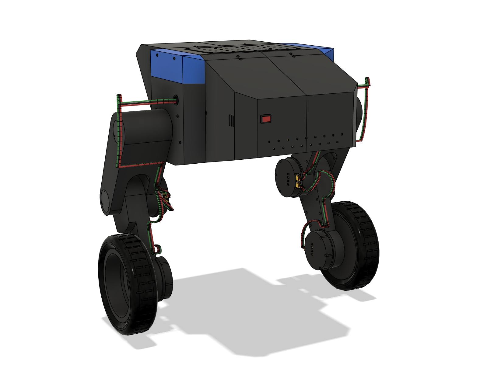
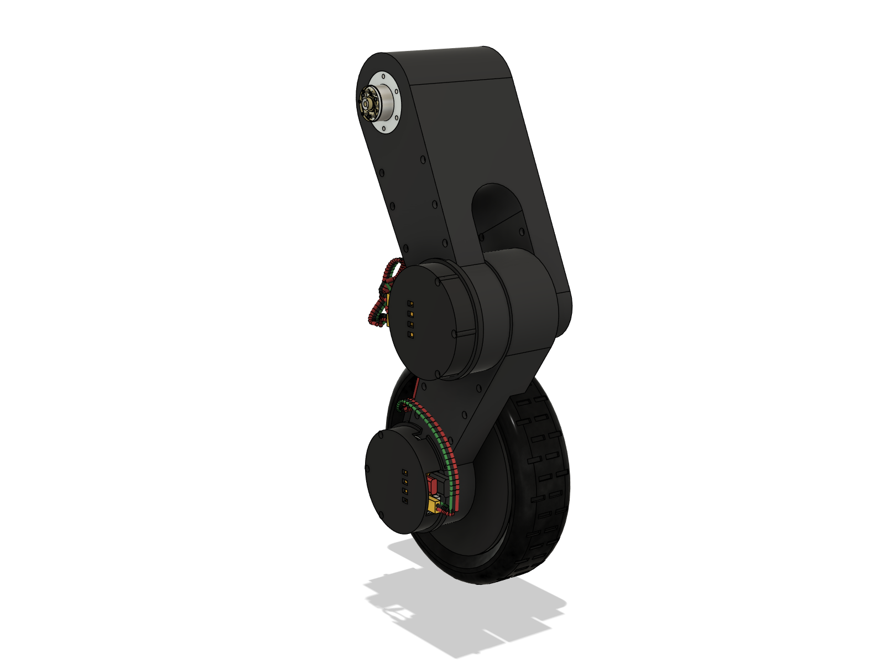
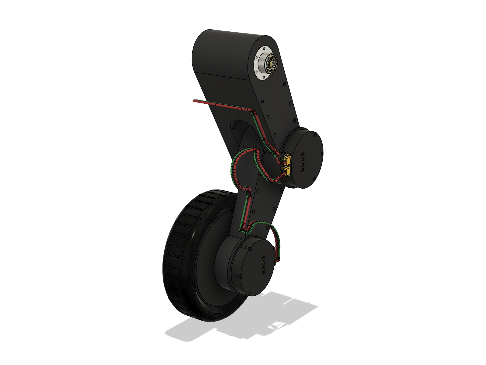
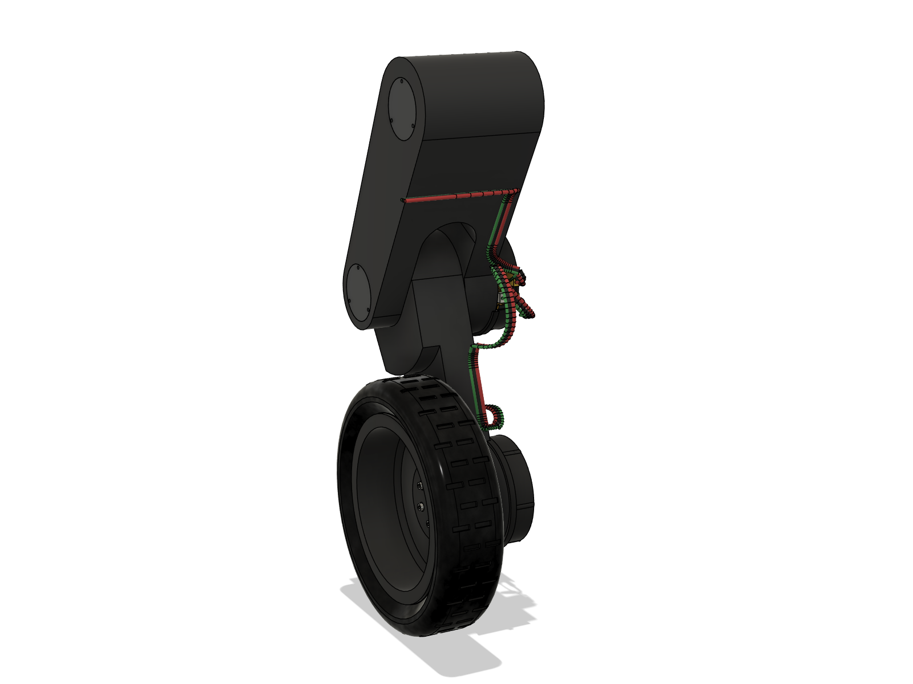

# WheelBiped v5 — 바퀴 바깥쪽 + MJF PA12 갈래 다리 (Fusion)

`robot_cad_v4`(git `681ad00`)의 로봇에서 **바퀴를 바깥쪽으로 돌리고, 허벅지·정강이를 MJF PA12 출력 다리로 바꾼** 모델이다.
다리 시안 세 가지(A 모놀리스, B 스파인, C 레일) 가운데 사용자가 11-01 **A(모놀리스)** 를 골랐고, v5에는 A만 남겼다.

같은 날 사용자 요청으로 세 가지를 더 바꿨다.
- **링크의 배선 구멍을 모두 없앴다.** 출력된 배선 통로도 함께 없앴다.
- **리브 구멍도 없앴다.** 대신 칸마다 Ø6 가루 배출 구멍이 하나씩 있다.
- **실제 배선**을 링크 바깥 뒷면을 따라 깔았다.

몸통·셸·hip 판·척추 봉·레일·모터·드라이버 컵·허브·림·타이어·체결 부품·몸통 배선은 v4 코드(`../robot_cad_v4/fusion`)로 그대로 만든다.
이 폴더의 코드는 링크와 다리 배선을 바꾸고 바퀴를 돌리는 일만 한다. 나머지는 `../robot_cad_v4/README.md`를 본다.

Fusion: 새 문서(`wbv5` 속성)에 빌드했다. 허브의 `WheelBiped_v2~v4` 문서는 건드리지 않았다.
`export/WheelBiped_v5.f3d`에 같은 모델(직접 모델링, 조인트 없음)이 있다. 허브에는 아직 저장하지 않았다.

 

## 0. 결과 한눈에

| 항목 | v4 (SLA 레진 상자) | **v5 (MJF PA12 갈래 다리, 시안 A)** |
|---|---|---|
| 바퀴 | 안쪽(타이어 중심 y 173.5) | **바깥쪽**(타이어 중심 y 267.5, 드라이버 컵은 안쪽) |
| 링크 재료 | SLA 유사ABS 레진(탄성 2731, HDT 60 °C) | **MJF PA12**(탄성 1700, 인장 48 MPa, 밀도 1.01, HDT 175 °C @0.45 MPa) |
| 링크 구조 | 닫힌 상자 벽 3.0 + 와렌 리브 2.0 | **갈래 허벅지 + 무릎 양쪽 지지(61807) + 무릎 쪽 90 mm 깊이 정강이**, 닫힌 상자 벽 3.5 + 구멍 없는 와렌 리브 2.0(허벅지 5, 정강이 6) |
| 링크 구멍 | 배선 창 2 + 배수 구멍 2 | **배선 구멍 없음**, 칸마다 Ø6 가루 배출 구멍(허벅지 8, 정강이 7 — 다른 부품과 맞닿는 숨은 면) |
| 링크 질량(한쪽, PA12 본체) | 허벅지 301, 정강이 265 g | **허벅지 436 g, 정강이 259 g** |
| 관절 부품(한쪽) | SUS 출력 클램프 링 | 6061 hub 인서트 38 + 37 g, 6061 무릎 캡 36 g, 61807 43 g, PA12 hip 캡 5 g |
| 로봇 질량(배선 포함) | 10.05 kg | **10.61 kg**(+0.56 kg; PETG 부품은 v4와 같은 출력 밀도, 타이어 721 g) |
| 크기 | 폭 529 × 높이 561 mm | **폭 589**(타이어 바깥면) × 높이 561 mm |
| 간섭(6자세, 체결 부품·배선 포함) | 0건 | **0건**(결합 72건 = 선이 플러그·부품에 들어가는 자리, moteus 헤더의 플러그) |
| 배선 고리(30자세) | — | hip 고리 최소 **5.0 mm**, 무릎 고리 최소 **4.3 mm**(L0 200), 늘어남 없음 |
| 출력 점검 | — | 링크마다 **몸체 1·셸 1**(가루 갇힌 공간 없음), **리브 끊김 0건**(3절) |

- 간섭 6자세: L0 310·200·240·335 mm, hip 0·−60·+60·−80°(`v5run.POSES`).
- 고리 30자세: L0 200~335 × hip −80~+60°(`v5run.GRID`).

## 1. 다리 구조

 

- **왜 바뀌었나**: PA12는 v4 레진보다 1.6배 무르다. 게다가 바퀴를 바깥으로 돌리면 접지점이 허벅지에서 94 mm 더 멀어진다.
  넓히기만으로는 옆 강성이 모자라서, 무릎 근처에서 허벅지와 정강이가 같은 y 층을 나눠 쓰게 했다.
- **허벅지 = 갈래**: hip에서 깊은 상자 하나로 시작해 크로치(s 84, 반원 — 응력 완화)부터 두 갈래로 나뉜다.
  - 안쪽 갈래: 무릎 모터(v4 출력 자리, Ø88 하우징).
  - 바깥 막대(y 252~277): 정강이 머리 바깥에 있다.
  - 정강이 머리의 **61807 베어링**이 바깥 막대에 볼트로 붙은 **6061 무릎 캡**에 끼워진다. 그래서 무릎은 양쪽에서 잡히고,
    허벅지는 99 mm 폭 상자로 일한다.
- **정강이**: 무릎 r 45 → 바퀴 r 22.5로 곧게 줄어든다. 머리 패드(y 235.5~250.5, 갈래 안)는 무릎 중심에서 r 70까지만 있다.
  무릎과 같은 중심의 원호라서 어느 자세에서나 크로치·타이어와의 간격이 같다.
- **바퀴 바깥쪽**: 바퀴 묶음을 정강이 가운데 면(y 220.5)에서 수직축으로 180° 돌렸다.
  - 드라이버·컵·플러그는 바퀴 축으로 `WHEEL_CLOCK`만큼 다시 돌렸다. 그래야 컵의 홈이 정강이에 맞고, 플러그도 v4와 같은 각도로 놓인다.
  - AKE60 고정자(STEP 부품)는 위치만 바꾸면 Fusion이 다시 계산할 때(부품을 지울 때 등) 원래 자리로 풀린다.
    그래서 돌린 자리에 새로 끼운다(`v5run.REPLACE`).
- **속**: 닫힌 상자(벽 3.5) + 구멍 없는 와렌 리브 2.0. 리브는 앞·뒤·바닥·천장 벽에 모두 붙어 있다.
  - 리브가 가른 칸은 서로 막혀 있다. 그래서 **칸마다 Ø6 배출 구멍**이 하나씩 있다(`legs_v5.cell_escapes`).
  - 위치는 각 삼각형 칸의 밑변 가운데, 벽에서 7.5 mm 안쪽이다. 리브가 벽과 만나는 곳을 피했다.
  - 구멍은 다른 부품과 맞닿아 안 보이는 면에 있다.
    - 허벅지 안쪽 면(y 178): 6개.
    - 갈래 아래 칸의 바깥 막대 쪽(정강이 패드를 보는 막대 안쪽 면, y 252): 2개.
    - 정강이 안쪽 면(y 205.5): 7개.
- **관절부**: hip·무릎 보스는 **6061 선반 인서트**다.
  - Ø28 보스 + 플랜지 r 24. 링크에는 M3 열압입 인서트 6개로 체결한다.
  - PA12 보스는 바깥 바퀴 때문에 커진 hip 옆 모멘트를 못 버틴다.
  - 고정자 쪽은 v4와 같다(모터 판 9 mm, SUS 고정 링).
- **캡**: hip·무릎 캡은 바깥 면과 같은 높이에 들어간다(r 23 × 3, M2.5 3개).
  - 무릎 캡: 61807을 받는 관(Ø35)이고 2 mm 면으로 막혀 있다. 떼면 무릎 출력 나사에 손이 닿는다.
  - hip 캡: Ø28 공구 구멍을 덮는다.

 

단면 그림은 허벅지 y 199, 정강이 y 229.5 높이에서 잘랐다. 리브는 구멍 없는 판이고, 바닥(안쪽 면)에 칸마다 배출 구멍이 보인다.

## 2. 배선 (`fusion/harness_v5.py`)

v4 배선(`../robot_cad_v4/fusion/harness.py`)에서 몸통 안 배선은 그대로 쓰고, 다리 배선 두 줄만 다시 깔았다.
몸통 안 배선은 배터리 → 변환 → 전원보드, 전원보드 → pi3hat, 전원보드 → hip 드라이버, pi3hat → hip CAN, 스위치, 팬이다.
다리마다 hip → 무릎 → 바퀴로 이어지는 데이지 체인이고, 16 AWG 전원 2가닥 + CAN 꼬임선이 한 다발이다.

 

- **hip → 무릎**:
  1. hip 드라이버 J2·CAN1에서 셸 그로밋으로 나간다.
  2. **hip 고리**를 지난다. 고리는 허벅지 바깥 면에서 10 mm 바깥의 면 y 287에 있어 허벅지가 지나가지 않는다.
  3. 허벅지 **뒷면**(안쪽 갈래 띠 y 191)에 붙어 내려간다.
  4. 무릎 컵 뒤에서 J1·CAN2로 갈라진다.
- **무릎 → 바퀴**:
  1. 무릎 드라이버 J2·CAN1에서 무릎 뒤로 나간다.
  2. **무릎 고리**를 지난다. 고리는 허벅지에서 정강이로, 열린 무릎 쐐기 안을 지난다.
  3. 정강이 **뒷면**(y 212)에 붙어 내려간다.
  4. 바퀴 근처에서 정강이 안쪽(y 196)으로 옮긴다.
  5. 바퀴 컵 위를 r 72로 넘어 앞을 보는 바퀴 드라이버 J1·CAN2로 들어간다.
  - 바퀴 드라이버의 포트 위치는 바퀴 회전·재정렬을 그대로 적용한 값이다.
- **띠 나누기**: 허벅지 안쪽 갈래(y 178~204)와 정강이(y 205.5~)는 서로 다른 y 띠다. 한 링크 뒷면에 붙은 선에는 다른 링크가 오지 못한다.
  뒷면의 선은 **접착식 케이블타이 마운트**로 붙인다(구매품, 모델에는 없음). 링크에 구멍을 내지 않는 방식이다.
- **고리 길이**: 30자세에서 양 끝 거리가 가장 멀 때 + 약 20 mm로 정했다(`v5run.chords()`).
  - hip 고리: 43.7~142 → **162 mm**.
  - 무릎 고리: 16.8~92.1 → **115 mm**.
- **고리가 부푸는 방향**: 남는 길이가 아무것도 오지 않는 쪽으로 부풀게 양 끝 방향을 정했다.
  - hip 고리: hip 위쪽으로 부푼다. 고리 면에 올 수 있는 것은 바퀴뿐이고, 바퀴는 hip 아래·뒤에만 온다.
    처음에는 뒤로 부풀어 L0 200·hip −80/−60에서 타이어에 닿았다.
  - 무릎 고리: 무릎 쐐기의 열린 쪽(뒤)으로 부푼다. 처음에는 L0 200에서 정강이에 닿았다.

## 3. 형태 원칙 (사용자 11-01)

- 출력할 수 있게 단순하게. 필요 없는 선, 사소한 돌출·홈, 얕은 단차는 넣지 않는다.
- 평평해도 되는 면은 평평하게, 곧게 이을 수 있는 곳은 직선으로.
- 링크에 배선 구멍을 내지 않는다. 리브에도 구멍을 내지 않는다.
- 그래서 링크마다 **관절 원 두 개의 접선 외형을 그대로 밀어낸 각기둥**이다.
  - 옆면·앞뒤 면은 평면이고, 모서리는 직선이다.
  - 둥근 곳은 관절 원호와 크로치뿐이다.
- 무릎 하우징(Ø88)은 허벅지 안쪽 면(y 178)에서 4 mm 나와 있다. 드라이버 컵의 맞춤 턱(y 174~177.1)이 덮는 자리라서,
  허벅지 면을 턱 밖으로 물려야 무릎 쪽을 깊게 둘 수 있다.

## 4. 다시 만들기

Fusion MCP 스크립트에서 이 폴더를 `sys.path` 맨 앞에 넣고 `import v5run` 한 뒤, 아래 각 줄을 **따로** 실행한다.
`build()`는 새 문서를 만들고, 이전 `wbv5` 문서는 저장하지 않고 닫는다.

```python
v5run.build()          # v4 로봇(배선 제외) → v4 링크·출력 클램프 링 제거 → v5 다리
v5run.harness()        # v4 몸통 배선 + v5 다리 배선, 플러그, XT60·XT90·스위치
v5run.turn()           # 바퀴 묶음 바깥쪽 — 마지막에, 따로
v5run.report()         # 다리 부품 부피·질량·몸체/셸 수
v5run.rib_check()      # 리브 중심선을 1 mm × y 3 mm 간격으로 짚어 끊긴 곳·막힌 공간·배출 구멍 수 검사
v5run.chords()         # 고리 양 끝 거리 범위(30자세) — 고리 길이 정할 때
v5run.interference()   # 6자세 간섭(기본 자세의 고리는 빼고, 자세마다 고리를 새로 만들어 간격을 잰다)
v5run.images()         # images/01~12
v5run.robot_mass()     # PETG 출력 밀도 + 타이어 721 g 적용 후 질량·무게중심
v5run.export()         # export/WheelBiped_v5.f3d
```

- `turn()`을 따로, 마지막에 돌리는 이유는 두 가지다.
  - 빌드 스크립트 안에서는 새 부품의 외곽 상자가 아직 낡아서 판단이 틀린다.
  - 링크에 부품을 넣으면(`cadlib.IdentityParent`) 돌려 둔 자식 부품 위치가 풀린다.
- `turn()`은 여러 번 돌려도 된다. 두 번째 실행은 0개다.

치수는 `fusion/legs_v5.py` 맨 위에 있다(허벅지 `THIGH`, 정강이 `SHANK`, 벽 `WALL`, 리브 `RIB`·`RIBS`, 크로치 `CROTCH`, 패드 `PAD_R`, 배출 구멍 `ESCAPE_D`).
배선 경로·고리 길이는 `fusion/harness_v5.py` 맨 위에 있다.

## 5. 아직 안 한 것

다리 설계와 배선까지 했다. 아래는 사용자 확인 뒤에 할 일이다.

- **PA12 강도 손계산**: 링크 처짐·접지점 옆 변위·응력, hip 인서트 플랜지 볼트, 무릎 61807 짝힘. v4 `strength_v4.md` 수치는 맞지 않는다.
- **30자세 전체 간섭 스윕·간격 측정**: 지금은 고리만 30자세, 전체 간섭은 6자세로 확인했다. v4의 `poses.sweep`, `gaps.measure`에 해당한다.
- **새 부품 체결 부품 형상, BOM**: hub 인서트 플랜지 M3 × 6 + 열압입 인서트, 캡 M2.5 × 3 + 인서트, 61807, 케이블타이 마운트. BOM도 함께 만든다.
- **조인트, 부품 STEP·STL**: v4 `finalize.joints()`, `exports()`에 해당한다.
- **MuJoCo 모터 재검증**: `check.save_mass_json`은 v4의 안쪽 타이어 중심(`P.tyre_centre_y()`)을 쓰므로 바깥쪽 값(267.5)으로 고친 뒤 쓴다.
- **허브 저장.**

## 6. 파일

| 경로 | 내용 |
|---|---|
| `fusion/legs_v5.py` | 다리 형상(허벅지·정강이·hub 인서트·캡·61807·칸별 배출 구멍), 바퀴 회전 행렬 |
| `fusion/harness_v5.py` | 다리 배선 경로(v4 몸통 배선 재사용), 바퀴 드라이버 포트 회전 |
| `fusion/v5run.py` | 빌드·배선·바퀴 회전·점검·그림·질량·내보내기 |
| `images/` | 01~04 다리, 05~07 로봇, 08~10 트러스 단면, 11~12 배선 |
| `export/WheelBiped_v5.f3d` | Fusion 모델(직접 모델링, 조인트 없음) |
