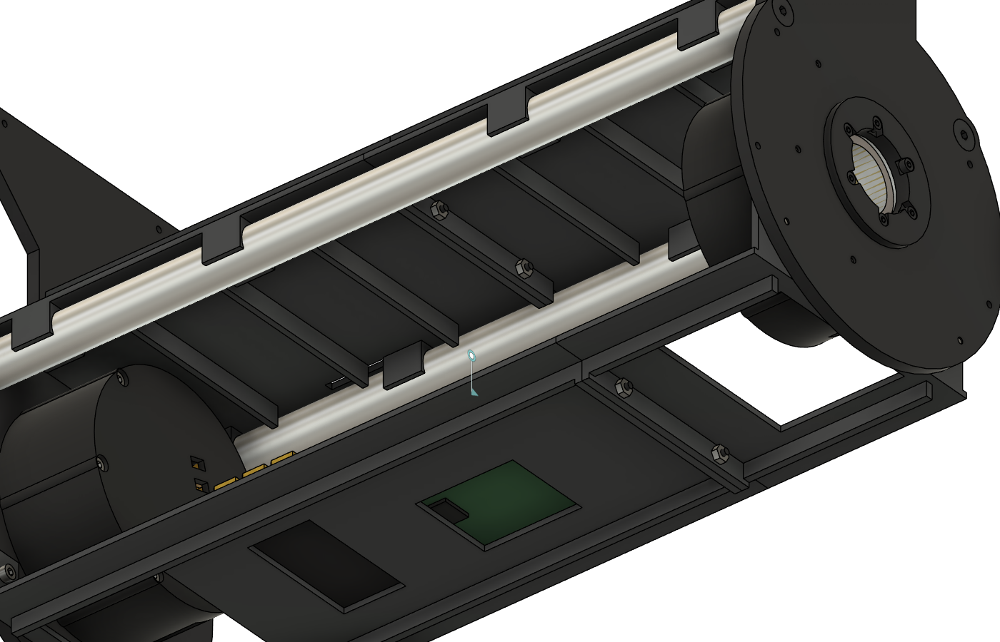
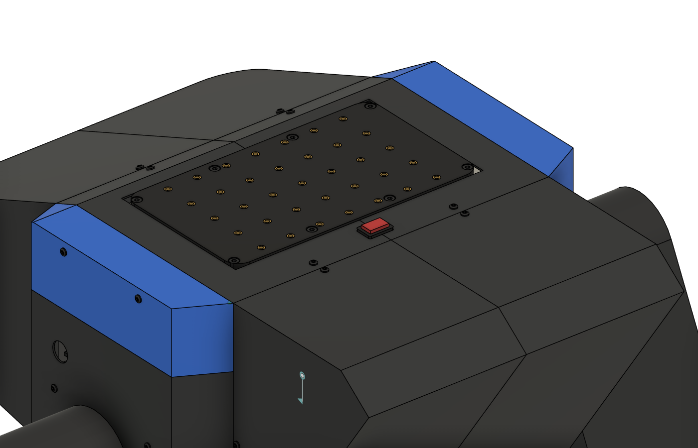
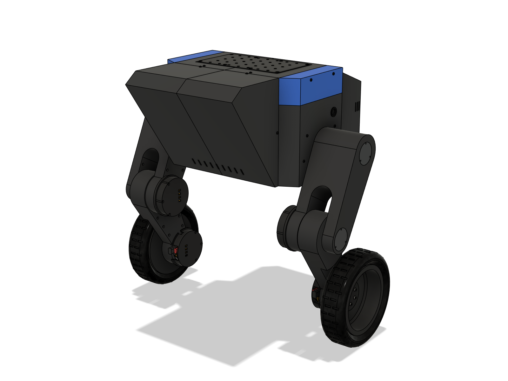
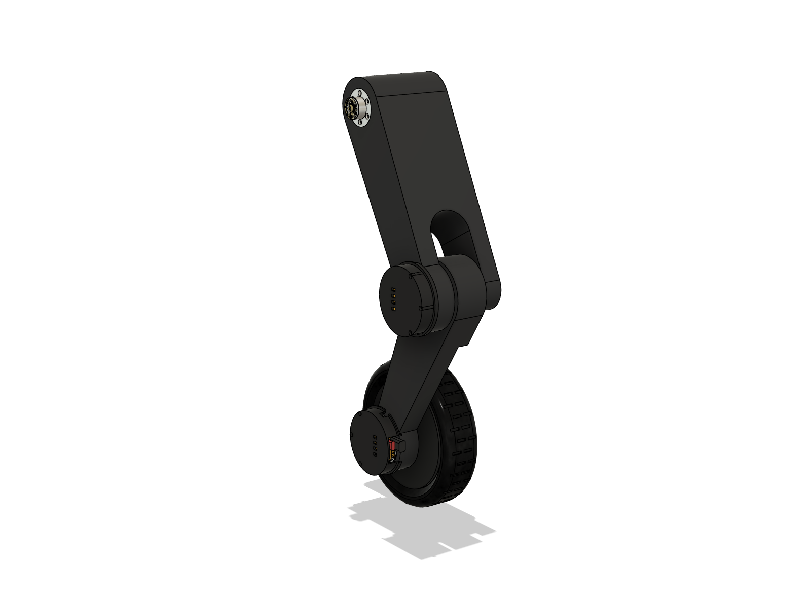
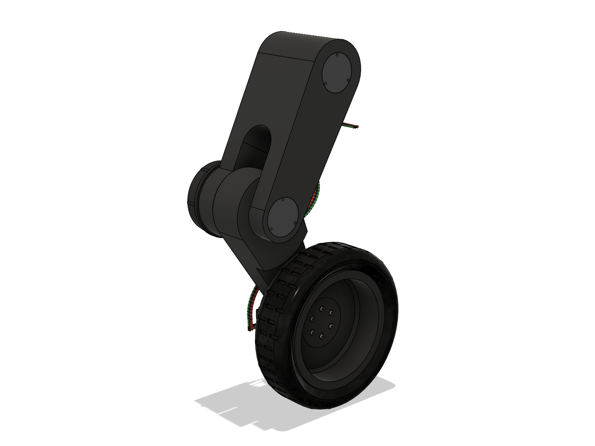
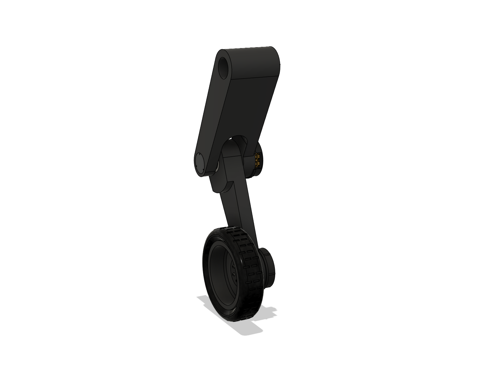
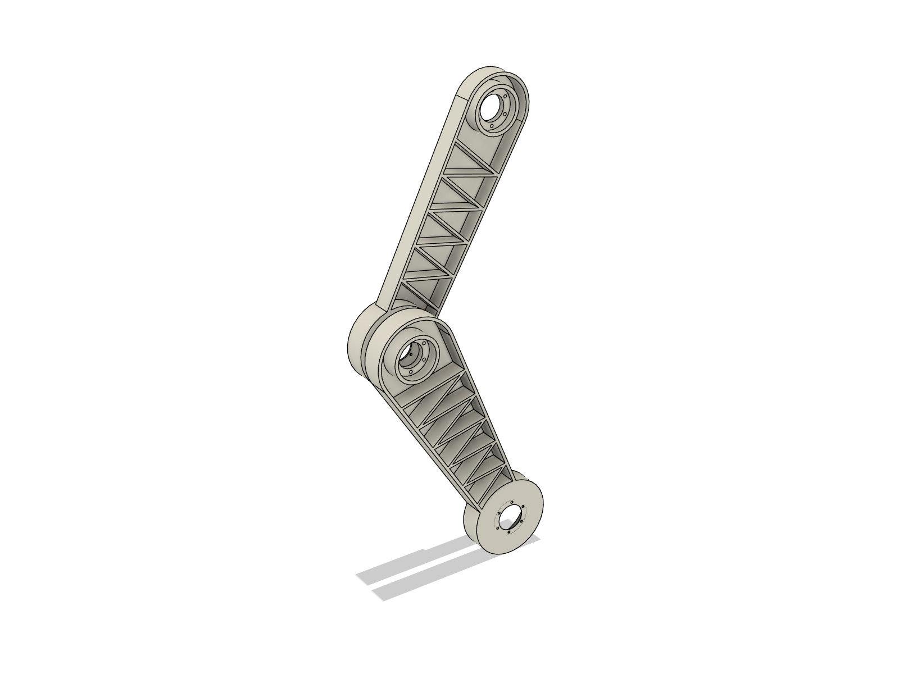
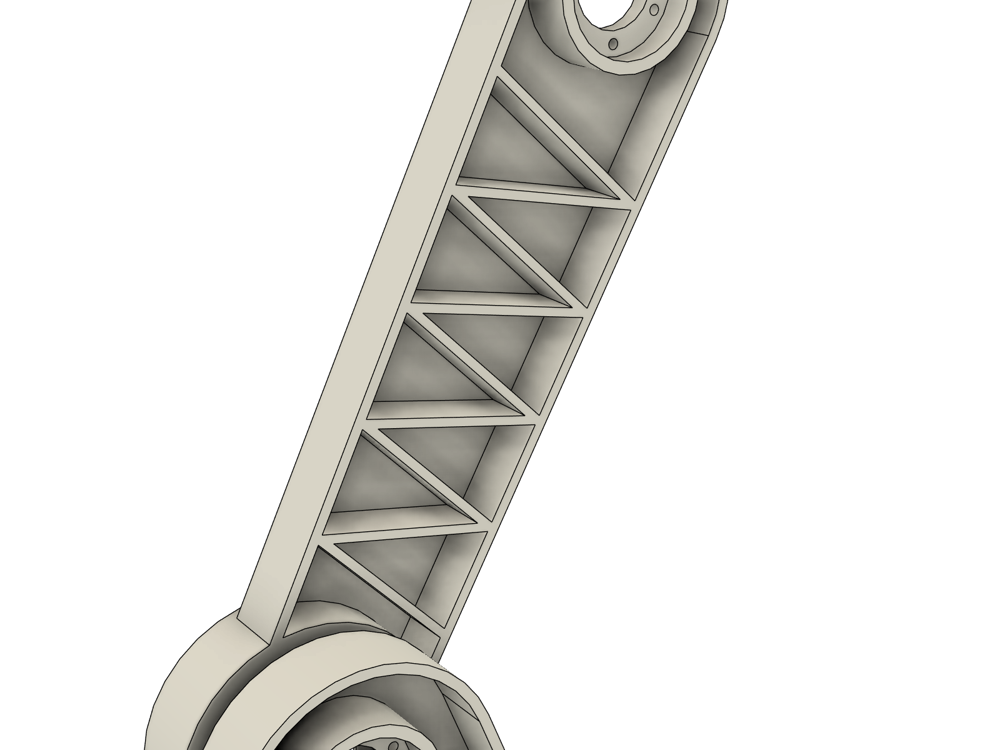
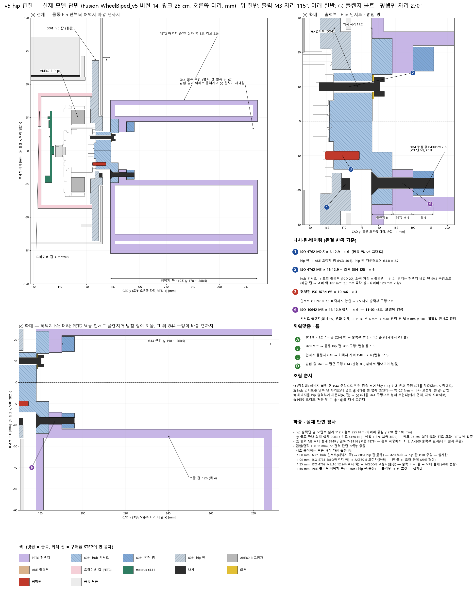
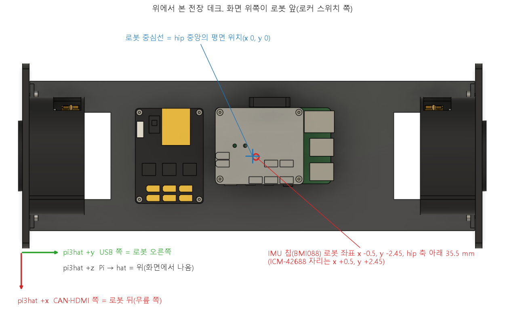

# WheelBiped v5 — 바퀴 바깥쪽 + PETG 출력 갈래 다리 (Fusion)

`robot_cad_v4`(git `681ad00`)의 로봇에서 **바퀴를 바깥쪽으로 돌리고, 허벅지·정강이를 출력 갈래 다리로 바꾼** 모델이다.
다리 시안 세 가지(A 모놀리스, B 스파인, C 레일) 가운데 사용자가 11-01 **A(모놀리스)** 를 골랐고, v5에는 A만 남겼다.

바뀐 순서:
- 11-01: 링크 배선 구멍·리브 구멍 없앰, 배선을 모델에서 뺌(2절). 단면도로 무릎이 조립되지 않는 것을 찾아 **안 A**(바깥 막대를
  바깥으로, 정강이를 띄워 넣는 조립). 링크를 PETG로 보고 강도 계산.
- **11-02 (사용자)**:
  - **hip 캡 없앰** — 구멍만 덮는 덮개였다. 접근 구멍은 바깥 면에 열린 채 둔다.
  - **칸마다 있던 Ø6 가루 배출 구멍 없앰** — 닫힌 칸 그대로.
  - **무릎 틈(허벅지 무릎 판 ↔ 정강이 안쪽 면) 1.5 → 4.0 mm.** 정강이를 얇게 하지 않으려고 **바퀴 묶음 전체를 2.5 mm 바깥으로**
    옮겼다(사용자 선택): 정강이는 다시 평평한 30 mm, 타이어 중심 y 267.5 → 270, 로봇 폭 589 → 594.
  - 알루미늄 CNC 다리 안은 검토 중 취소 — **다리는 PETG로 출력한다.** 모델 재질도 PETG로 바꿨다.
  - **셸 스위치 쪽 조각의 양옆 세로 모서리를 R30 라운드로**(45° 모따기 30이던 자리, 원호는 모따기가 시작되던 곳에서 시작해 스위치·
    타공·옆 통풍 슬롯은 평평한 면에 그대로). v5만 바뀌고 v4는 모따기 그대로다(`shell.REAR_ROUND`, `v4run.build(rear_round=True)`).
  - PETG 강도 초과 항목 다시 설계(사용자 "이번에 같이 고치기"): **hub 인서트를 열압입 인서트 대신 6061 받침 링으로 끼워 고정**,
    **무릎 캡 관을 바깥 막대 구멍에 꼭 맞춤**. 정강이 1 mm 처짐 기준은 이 폭으로 못 맞춰 결정 사항으로 남겼다(5절).
  - 실제 모델을 세 관절 축으로 잘라 **실제 단면도**를 새로 그렸고, 그 단면으로 겹침·틈을 검사했다(`manufacturing/explain/`).
- **11-07 (사용자)**: 허벅지·정강이 17.5 → **25 cm**. 관절 사이만 늘리고 모터 자리는 건드리지 않으며, 옆면은 한 직선이다. 리브를 25 cm에 맞게 다시 배치하고 2.0 → 3.0 mm로 두껍게 했다(0절 끝 "링크 25 cm").

몸통·셸·hip 판·척추 봉·레일·모터·드라이버 컵·허브·림·타이어·체결 부품은 v4 코드(`../robot_cad_v4/fusion`)로 그대로 만든다.
이 폴더의 코드는 링크를 바꾸고 바퀴를 돌리는 일만 한다. 나머지는 `../robot_cad_v4/README.md`를 본다.

Fusion 허브 **`WheelBiped_v5`**(`Default Project` 최상위). `export/WheelBiped_v5.f3d`에 같은 모델(파라메트릭, 조인트 6개)이 있다.
- 버전 1: 배선을 넣었던 git `5a01c18`의 f3d(10.61 kg).
- 버전 2(11-01): 선·플러그·XT60·XT90을 지운 모델(git `0e8be1a`).
- 버전 3(11-01): `relegs()`로 안 A 다리(10.48 kg).
- 버전 4(11-02): 버전 3 형상, STEP·STL 내보낼 때의 표시 상태.
- 버전 5(11-02): hip 캡·배출 구멍 없앰, 무릎 틈 4.0(이때는 정강이 안쪽 면만 물려 바퀴 하우징이 2.5 mm 튀어나옴), PA12 10.446 kg.
- 버전 6(11-02): `shift()`로 바퀴 묶음 2.5 mm 바깥 → `relegs()`(받침 링·캡 맞춤·평평한 정강이) → `turn()`(0개) →
  재질 PETG.  바퀴 고정자 y ±219.2, 6자세 실제 간섭 0건(결합 4건), 리브 끊김 0건, 10.928 kg.
- 버전 7(11-02): `reshell()`로 셸 조각만 다시 만듦(스위치 쪽 세로 모서리 R30) → `turn()`(0개).  바퀴 고정자 y ±219.2,
  6자세 실제 간섭 0건(결합 4건), **10.931 kg**.
- 버전 8(11-07): 형상은 버전 7과 같고 `joints()`로 회전 조인트 6개를 걸었다(파라메트릭, 몸통 고정).  6자세 실제 간섭 0건(결합 4건).
- 버전 9(11-07): 버전 8에 전장 배치 변경(`v5run.relayout()`, IMU를 로봇 중심선으로, 7절 앞의 "전장 배치"). 6자세 실제 간섭 0건(결합 4건), **10.9314 kg**.
  **`shell_rear_R` 몸체가 숨겨진 채 저장되어 있다**(버전 8부터, 사용자 문서 상태 그대로). 이 몸체를 켜면 10.9314 kg(`mass_properties.json`과 차이 0)이고,
  켜기 전에는 `save_mass_json()`이 멈춘다.
- 버전 10(11-07): 허벅지·정강이 25 cm, 옆면 한 직선, 리브 3.0 × 9 / 10개(0절 끝 "링크 25 cm"), **11.597 kg**, 조인트 6개. `shell_rear_R`(옛 이름) 부품이 숨겨진 채 저장되어 있다.
- 버전 11(11-08): 형상은 버전 10과 같고(기준 자세에서 부품 477개의 위치·개수·부피·재질 차이 0), **부품 38개와 그 몸체, 조인트 6개의 이름을 로봇 기준으로 바꿨다**(사용자: "스위치 쪽이 앞이야", `v5run.rename_to_robot()`). 숨긴 부품 없이 기준 자세로 저장했다. `export/` 전체(f3d, 조립 STEP, `parts_step`, `parts_stl`, `links_stl`), `calc/mass_properties.json`, `calc/urdf_data.json`, 도면, 단면도는 이 버전과 같다(f3d 말고는 저장본의 복사본에서 뽑았다). 버전 10까지의 설명에 나오는 이름은 그때의 옛 이름이다.

  | 옛 이름(버전 10까지, v4 코드) | 새 이름 | 실제 위치(CAD) |
  |---|---|---|
  | `shell_rear_R` / `shell_rear_L` | `shell_front_L` / `shell_front_R` | x −167.5(스위치 쪽), y −67.5 / +67.5 |
  | `shell_front_R` / `shell_front_L` | `shell_rear_L` / `shell_rear_R` | x +167.5(무릎 쪽), y −67.5 / +67.5 |
  | `rail_B`, `spine_tube_B` | `rail_F`, `spine_tube_F` | x −52, −47 |
  | `rail_F`, `spine_tube_F` | `rail_B`, `spine_tube_B` | x +52, +47 |
  | 그 밖의 `*_R`, 조인트 `hip_R` 등 | `*_L`, `hip_L` 등 | y − (로봇 왼쪽) |
  | 그 밖의 `*_L`, 조인트 `hip_L` 등 | `*_R`, `hip_R` 등 | y + (로봇 오른쪽) |

  v4 파일은 그대로이고 v4 코드는 옛 규칙으로 부품을 만들므로, `build()`·`reshell()`이 만든 직후에 이름을 바꾼다. 옛 이름 문서(버전 10 이전, 그 f3d)에서 `relegs()` 등을 돌리면 다른 쪽 다리 형상이 들어가므로 멈추게 했다. 다시 뽑은 STEP·STL은 옛 파일과 이름만 맞바뀌었고(부피·외곽 크기 차이 0), 다시 만든 URDF 모델은 이전과 바이트까지 같다.

  새 이름 검증(11-08, 사용자 요청, 모두 저장 없이 닫은 복사본에서, 기준은 버전 11):
  - **`build()` 전체**(25 cm에서 처음 돌림): `build()` → `turn()` → `robot_mass()`로 **11.597 kg**, 몸체 486개의 부피·무게중심·재질 차이 0, 6자세 실제 간섭 0건(결합 4건), `rib_check` 끊김 0, `joint_check` 벌어짐·축 이동·복귀 0. 여기서 뽑은 JSON은 수치 오차(1e-9)만 다르고, STL은 부피·크기가 같으며, 단면은 0.0001 mm 안, 그림 01~10은 달라진 픽셀이 0.002 % 이하다.
  - **`relink()` 경로**: 버전 9(17.5 cm) → `rename_to_robot()` → `unjoint()` → `relink()` → `relegs()` → `turn()` → `joints()`, 차이 0.
  - **`relayout()`**: 차이 0(다시 만든 `electronics_deck`만 재질이 `PETG print`로 돌아가므로 뒤에 `robot_mass()`가 필요).
  - **`shift()`**: 적용 전 f3d(git `0e8be1a`)에서 `rim_R` y +258.8 → +261.3, `rim_L` −258.8 → −261.3, 타이어 중심 ±267.5 → ±270. 양쪽 다 바깥으로 2.5 mm.
  - **옛 이름 차단**: 버전 10 f3d에서 `turn`, `relegs`, `reshell`, `relayout`, `relink`, `shift`, `joints`, `images`, `save_mass_json`, `urdf_export`, `export`, `exports`, `sections` 13개가 모두 멈추고 문서를 바꾸지 않는다. `rename_to_robot()` 뒤에는 돈다.
- 버전 12(11-08, 사용자가 직접 저장): 버전 11에 **조인트 자세만** 다르다(부품 477개의 링크 기준 위치·개수와 몸체 부피 차이 0). 사용자가 잡아 둔 자세로 저장되어 있고 숨긴 부품은 없다.
- 버전 13(11-08, 사용자 요청): **바퀴 허브 플랜지 평행핀 구멍 7.0 → 7.5 mm**. 핀 Ø3 × 10이 3.0 나와 AKE 출력부 핀 구멍(깊이 3)에 여유가 0이었다 — 핀 길이 공차(±0.25)만큼 길면 핀이 먼저 바닥에 닿아 플랜지가 출력면에 붙지 않는다. hip·무릎 hub 인서트(10-31, `DOWEL_HOLE` 7.5)와 같게 2.5만 나오게 했다. v4 코드는 `params.HUB_DOWEL_HOLE` 7.0 그대로, v5는 `v5run.HUB_DOWEL_HOLE` 7.5(`build()`가 바로 만든다). 허브 파일은 `unjoint()` → `deepen_hub_dowels()` → `turn()` → `joints()`. 버전 12와 기준 자세에서 비교: 부품 477개 가운데 바뀐 것은 바퀴 핀 6개(축 방향 0.5 mm, 회전 0)뿐, 몸체 792개 가운데 `hub_flange_L/R`만 −10.60 mm³(구멍 3 × π · 1.5² · 0.5). `joint_check` 이상 없음, 6자세 실제 간섭 0건(결합 4건). 버전 12의 사용자 자세로 되돌려 저장했다. `export/WheelBiped_v5.f3d`, 조립 STEP, `hub_flange_L/R` STEP·STL, 단면 데이터, 바퀴 단면도, `hub_flange` 도면을 다시 뽑았다(나머지 부품 STEP은 시각만 달라 그대로 둠, STL은 바이트까지 같음). 질량 변화 약 0.03 g이라 `calc/*.json`·URDF는 그대로다.
- 버전 14(11-08, 사용자: "문제 2건 + 쉬운 것"): 체결부 축 방향 여유 전수 점검(나사·핀·스피곳·인서트를 공차까지 넣어 계산)에서 나온 고침. v4 파일은 v4 값 그대로이고 v5 값은 `fusion/v5_params.py`(`v5run.load()`, 도면·단면·강도 스크립트가 함께 씀)에 있다.
  - **림 등록 홈 Ø11.2 × 3.2 → 3.6**: 림은 허브 쪽 면을 바닥에 두고 출력해 홈 바닥이 브리지로 처진다. 허브 플랜지 Ø11 × 3 턱이 먼저 닿으면 림이 기운 채 ④에 당겨진다.
  - **셸 hip 조각·안장 안쪽에 Ø8 × 1.6 받침 12곳, 나사 ISO 7380 M3 × 6 → M3 × 8**: 1.4 mm 셸 벽과 hip 판 웹 사이가 1.6 mm 비어 있어 조이면 벽이 휘었다. 물림 3.0 → 5.0.
  - 쉬운 고침: 바퀴 허브 플랜지 핀 구멍 7.5 → **8.0**(핀 2.0 나옴, 출력 오차 ±0.2에도 여유 0.55), 스피곳 높이 바퀴 플랜지 1.3 → **1.0**·hub 인서트 1.4 → **1.2**(출력부 Ø12 × 1.5 홈 바닥에 먼저 닿지 않게; 위치는 핀이 잡음), 링크의 컵 기둥 인서트 구멍 5 → **6**·무릎 캡 인서트 구멍 6 → **7**(열압입 때 밀려 내려간 PETG 자리), moteus 보드 나사 DIN 7984 M2.5 × 6 → **× 5**(끝이 4 mm 인서트 안), 윗판 M4 × 25 카운터보어 4.0 → **4.3**(머리 높이 4.0), hub 인서트 도면에 핀 구멍 깊이 공차 **+0.2/0**.
  - 허브 파일: `unjoint()` → `fix_stackups()` → `relegs()` → `reshell()` → `turn()` → `robot_mass()` → `joints()`. 버전 13과 기준 자세에서 비교: 위치가 바뀐 부품은 바퀴 핀 6개(0.5)·M4 × 25 8개(0.3)뿐, 셸/보드 나사는 새 길이로 같은 자리에, 부피 변화는 계산값과 같다(허벅지 −61.07, 정강이 −27.44, 인서트 −21.87, 허브 플랜지 −43.41, 림 −39.41, 윗판 −84.06, 셸 hip 조각 +263.59, 안장 +131.80 mm³). `joint_check` 이상 없음, 6자세 실제 간섭 0건(결합 4건), **11.598 kg**. 버전 13의 사용자 자세로 되돌려 저장. 다시 뽑은 파일: f3d, 조립 STEP, 바뀐 부품 STEP·STL 22개, 단면 데이터·단면도 3장, 도면 9장(허벅지·정강이·hub 인서트 2·허브 플랜지·림·셸 hip 조각·안장·윗판), BOM. 셸 조각 STEP·STL은 다시 만들면서 링크 25 cm 높이의 실제 좌표로 나온다(이전 파일보다 z +132.857, 모양·크기 같음). 질량 변화 약 1 g이라 `calc/*.json`·URDF는 그대로다.
  - 정강이 바퀴 쪽 컵 기둥 인서트 구멍 하나(바퀴 축에서 r 40.5, 119.7°)는 원래부터 모터 리드선 통로(사각 홈) 모서리와 겹쳐 옆이 약 30 % 트여 있었다 — 버전 16에서 고침.
- **버전 15**(11-08, 사용자: mjbots 주문을 power dist r4.5b로 확정 — CAN-FD로 Pi가 깨끗이 종료한 뒤 전원이 꺼지게): **전원보드 mjpower-ss → power dist r4.5b**.
  - 보드: 80 × 50(mjpower-ss 70 × 50), PCB 1.5, 고정 구멍 M2.5 4개 **74 × 44**(64 × 44), 36 g. 형상은 mjbots가 r4.5b 상품 페이지에 거는 r4.3b 기계 STEP·도면(`C:\Users\User\Desktop\power_dist_r45b\`)이고, PCB와 커넥터 묶음(XT90-M, XT30-F × 6, PH-3 CAN × 2, PH-4 스위치, ZH-6 SWD, PH-5 GPIO)으로 나눴다. 커넥터 자리는 `fusion/pdist_v5.py`에 있다(Fusion에서 STEP을 읽어 잼).
  - 자리·방향은 mjpower-ss 그대로(중심 CAD (0, −61), 긴 변 x, XT90은 스위치 쪽 CAD −x): 보드가 양 끝으로 5 mm씩 길어져 CAD x −40 ~ +40, y −86 ~ −36. 데크 보스·M2.5 인서트·M2.5 × 6 저두 볼트 4개가 74 × 44로 옮겼다(보드 나사는 1.5 PCB 위). CAN1·CAN2는 XT90 옆(CAD x −36, −28, y −71)이라 pi3hat JC3까지 10 cm 케이블이면 된다.
  - 여유: XT90 앞(−x)에서 가장 가까운 것은 셸 이음 나사(CAD x −96)로 **56 mm**(이전 61) — XT90 변환 플러그·선이 들어갈 자리. 보드 위는 배터리 받침까지 84 mm, +x 끝은 셸까지 76 mm.
  - v4 파일은 그대로다. `v5run.load()`가 `pdist_v5.patch()`로 v4 모듈의 보드 마스터(`vendor.mjpower_ss`), 데크 구멍(`torso.mjpower_holes_robot`), 보드 나사 높이, 질량(`check.LUMPED`)을 바꾼다 — `build()`도 r4.5b로 만든다. 보드 나사 이름은 v4 그대로 `FX DIN 7984 M2.5x6 mjpower`.
  - 허브 파일: `unjoint()` → `relayout()`(mjpower-ss를 빼고 r4.5b를 넣으며 `_library`의 옛 마스터도 지움) → `turn()`(126) → `joints()` → `interference()` 6자세 실제 간섭 0건(결합 4건) → `robot_mass()` **11.600 kg**. 조인트 값은 버전 14와 같이 모두 0. 다시 뽑은 파일: f3d, 조립 STEP, 부품 STEP·STL(`exports()`), `electronics_deck` 도면, BOM(`manufacturing/bom.py`: r4.5b, 동봉 로커 스위치 하네스·XT30U 수, CAN은 mjbots 기성 케이블 30 cm 2 + 50 cm 4 + 10 cm 1). 질량 변화 2 g이라 `calc/*.json`·URDF는 그대로다.
- **버전 16**(11-09, 사용자: "알아서 판단해서 수정"): **바퀴 모터를 컵과 함께 돌려 놓음**(`legs_v5.CLOCK_MOTOR`). 11-01에 바퀴를 바깥으로 돌리면서 드라이버·컵만 바퀴 축을 중심으로 55.3° 더 돌렸고(`wheel_clock`) 모터와 정강이의 모터 자리는 두었다. 그래서 모터 리드선이 나오는 축 방향 홈(r 35~41, 폭 7)이 컵의 리드선 홈에서 55° 어긋났고, 컵 기둥 하나가 그 홈 출구 절반을 막았으며, 그 기둥의 인서트 구멍이 홈과 겹쳐 둘레 약 30 %가 트여 있었다(양쪽).
  - 이제 고정자·고정 링·① 나사·자석 스페이서와 정강이의 모터 자리(나사 구멍·리드선 홈)도 같은 각도로 돌아 v4와 같은 관계다: 모터 리드선 홈 69.7°, 컵 리드선 홈 69.65°, 가장 가까운 컵 기둥 119.7°(50° 떨어짐), 정강이 인서트 구멍 3개 모두 막힌 구멍.
  - 버전 15와 기준 자세에서 비교: 바뀐 것은 고정자 묶음 18개(바퀴 축 둘레로 회전)와 정강이(−18.59 mm³, 인서트 구멍과 홈이 겹쳤던 부분)뿐, `joint_check` 이상 없음, 6자세 실제 간섭 0건(결합 4건). 조인트 값은 버전 15와 같이 0.
  - 허브 파일: `unjoint()` → `relegs()` → `turn()`을 0이 될 때까지(STEP 고정자를 새로 끼우면 같은 링크의 돌린 부품이 풀려 여러 번 필요) → `joints()`. 이미 돌린 고정자는 `turn()`이 건너뛰므로(버전 15 이전 문서), 결과를 버전 15 기록과 대조해 고정자 묶음만 돌았는지 확인했다.
- **버전 17**(11-09) **받침·데크 두 조각**(사용자: "배터리 받침과 전장 데크는 한번에 출력하지 말고 두번으로 나눠서 출력해서 조립 또는 이어 붙이게"; 프린터 베드 300 × 300인데 한 덩어리는 대각선으로도 304 / 309 mm). 먼저 f3d 복사본에서 만들고 확인한 뒤(아래), 사용자 "v17로 저장"에 따라 허브 파일에 같은 경로를 적용해 저장했다. 허브 문서의 저장 안 된 변경은 `shell_front_L` 몸체를 숨긴 것뿐이었다(위치·부피·재질·조인트는 버전 16과 같음). 몸체를 다시 켜고 숨긴 것 없이, 기준 자세(조인트 모두 0)로 저장했다. 저장한 문서는 `export/WheelBiped_v5.f3d`와 위치·표시·재질·부피·조인트 차이 0이고, `robot_mass()`는 11.611 kg이다(숨긴 몸체가 있으면 11.479 kg으로 나온다).
  - `fusion/split_v5.py`: v4 형상(`torso.tray`, v5 배치의 `torso.deck`)을 y = 일정한 면으로 자르고, 자른 면마다 바닥 밑으로 **이음 턱 3 × 8 mm**를 붙여 두 턱을 맞대고 **ISO 7380 M3 × 10 버튼 볼트 + DIN 934 M3 너트 2쌍**(y 방향, 머리는 −y 조각 쪽)으로 조인다. 턱 면은 접착해도 된다. 이름은 로봇 기준(`_L` = CAD −y).
  - 배터리 받침: **y 0**(가운데 리브 자리 — 그 리브 대신 턱 두 장, 깊이·폭은 리브와 같은 8 mm · x ±38.6), 볼트 x ±22. 조각마다 척추 봉 받침 두 곳과 벨크로 슬롯이 있어 따로도 얹힌다. `battery_tray_L` 64.4 · `_R` 63.5 cm³(한 덩어리 125.8).
  - 전장 데크: **y 80**(라즈베리파이 USB 끝 y 60.3과 +y 끝 창 y 104 사이), 볼트 x ±25. 턱은 처음에 전체 폭(±55)이었는데 6자세 간섭 검사에서 스위치 쪽 끝이 `shell_mid_R` 바닥(x −34부터 스위치 쪽으로 올라가는 경사)을 1.4 mm 파고들어, **리브 바깥 면 x ±41.5까지**로 줄였다(경사 바닥과 1.5 mm). `electronics_deck_L`(파이·전원보드·인서트 8개 전부) 62.7 · `_R` 20.8 cm³.
  - 확인(가져온 f3d 복사본에서, 허브 문서는 건드리지 않음): `unjoint()` → `resplit()` → `turn()` 126 → 0 → `joints()`. 처음 가져온 버전 16 복사본과 비교해 바뀐 것은 받침·데크 두 부품이 조각 4개와 볼트·너트 8개로 바뀐 것뿐(나머지 525개 위치·부피 차이 0), 6자세 실제 간섭 0건(결합 4건), `joint_check` 이상 없음, **11.611 kg**(+11 g). 질량 변화가 작아 `calc/*.json`·URDF는 그대로다.
  - 다시 뽑은 파일: f3d, 조립 STEP(부품 480개), `parts_step`·`parts_stl`의 `battery_tray_L/R`·`electronics_deck_L/R`(한 덩어리 파일은 지움), 도면 `battery_tray.pdf`·`electronics_deck.pdf`(조각마다 한 장), BOM, 그림 `images/split_tray_deck_below.png`. 나머지 부품 STEP·STL은 머리말 시각·메시 분할만 달라 그대로 두었다.
  - `build()`는 v4 빌드 뒤 조각으로 바꾸고, `relayout()`도 데크를 두 조각으로 다시 만든다(둘 다 이번에 돌려 보지는 않음). 허브 파일 경로: `unjoint()` → `resplit()` → `turn()`(126 → 0) → `joints()` → `robot_mass()`(새 조각에 출력 밀도를 준다).

  
- **버전 18**(11-09, 최신) **스위치 윗면 + 그로밋 제거**(사용자: "스위치는 앞이 아니라 윗면 … 정중앙", "grommet 부품도 제거해줘"). 버전 17 허브 문서에 적용해 확인한 뒤 사용자 "v18로 저장"에 따라 저장했다(숨긴 것 없음, 조인트 모두 0, 저장 직전 `export/WheelBiped_v5.f3d`와 위치·표시·재질·부피·조인트 차이 0). 그 사이 셸 스위치 쪽 경사를 없애고 앞 위판을 다는 안을 만들어 봤으나 사용자가 되돌렸다(버전 18에 없음).
  - 윗면 정중앙은 위판(짐 판) 자리이고 그 밑 배터리 윗면까지 16.6 mm라 스위치(몸체 24 mm + 단자)가 안 들어간다. 사용자가 고른 자리: **셸 가운데 조각 윗면, 위판 구멍 바로 뒤(무릎 쪽) x +78, 좌우 정중앙 y 0**(위판 구멍 끝 x 61과 셸 가운데·뒤 이음선 x 95의 한가운데; 그 밑은 셸 바닥까지 비어 있고 레일은 x 59.5, 배터리는 x 38.8까지, 위쪽 이음판은 y ±60). 구멍 19 × 13은 긴 변이 좌우 방향이고 `shell_mid_L`·`_R`가 반씩 나눈다. 앞면(스위치 쪽) 구멍은 없앴다.
  - `fusion/switch_v5.py`: `v5run.load()`가 v4 `shell.openings`(앞면 구멍 상자를 셸 밖으로 보내고 윗면 구멍을 뚫음)와 `assembly.place_switch`를 바꾼다. 허브 경로 `unjoint()` → `reswitch()`(셸 조각 다시 만들기 + 스위치 이동) → `turn()`(126 → 0) → `joints()` → `robot_mass()`.
  - 그로밋: `v5run.drop_grommets()`가 `FX grommet D16` 2개와 `_library` 마스터를 지운다(셸 옆면 Ø16 hip 케이블 구멍은 그대로). 같은 경로(`unjoint` → 이것 → `turn` → `joints` → `robot_mass`). `build()`도 둘 다 한다(돌려 보지는 않음).
  - 확인(허브 문서): 커밋한 버전 17 f3d와 비교해 바뀐 것은 스위치 자리, 그로밋 2개(+ 마스터), `shell_front_R`(+345.8 mm³, 구멍 메움)·`shell_mid_L`/`_R`(−172.9 mm³씩, 반쪽 구멍)뿐, 6자세 실제 간섭 0건(결합 4건), **11.610 kg**(그로밋 −1 g).
  - 다시 뽑은 파일: f3d, 조립 STEP(부품 478개), `shell_front_R`·`shell_mid_L`·`shell_mid_R` STEP·STL(나머지는 머리말·요소 순서만 달라 그대로 둠), 도면 `shell_front.pdf`·`shell_mid.pdf`, BOM, 그림 `images/switch_top.png`. 스위치 하네스(30 cm)는 이 자리에서 데크의 power dist J2까지 어림 약 29 cm(배선은 모델 없음) — 실물에서 확인.

  

 

## 0. 결과 한눈에

| 항목 | v4 (SLA 레진 상자) | **v5 (PETG 갈래 다리, 시안 A, 허브 버전 9)** |
|---|---|---|
| 바퀴 | 안쪽(타이어 중심 y 173.5) | **바깥쪽**(타이어 중심 y 270, 드라이버 컵은 안쪽) |
| 링크 재료 | SLA 유사ABS 레진 | **PETG FDM**(탄성 2000, 층 안 45 MPa, 밀도 1.27; 벽 3.5 둘레선, 채움 100 %) |
| 링크 구조 | 닫힌 상자 벽 3.0 + 와렌 리브 2.0 | **갈래 허벅지 + 무릎 양쪽 지지(61807)**, 닫힌 상자 벽 3.5 + 구멍 없는 와렌 리브 2.0(허벅지 5, 정강이 6), 닫힌 칸(허벅지 9, 정강이 7) |
| 링크 구멍 | 배선 창 2 + 배수 구멍 2 | **없음**(관절 접근 구멍 Ø44: hip은 허벅지 바깥 면에 열림, 무릎은 61807 자리 아래) |
| 링크 질량(한쪽) | 허벅지 301, 정강이 265 g | **허벅지 590 g, 정강이 326 g** (PETG 꽉 찬 밀도) |
| 관절 부품(한쪽) | SUS 출력 클램프 링 | 6061 hub 인서트 38 + 38 g, **6061 받침 링 12 g × 2**, 6061 무릎 캡 43 g, 61807 43 g |
| 무릎 틈 | — | 무릎 판 ↔ 정강이 **4.0 mm**, 갈래 틈 59.5, 정강이 패드 ↔ 바깥 막대 10.5 |
| 셸 스위치 쪽 세로 모서리 | 45° 모따기 30 | **R30 라운드**(11-02) |
| 로봇 질량 | 10.05 kg | **10.93 kg**(PETG 다리, 다른 PETG 부품은 v4 출력 밀도, 타이어 721 g) |
| 크기 | 폭 529 × 높이 561 mm | **폭 594**(타이어 바깥면) × 높이 561 mm |
| 간섭(6자세, 체결 부품 포함) | 0건 | **0건**(결합 4건 = 바퀴 드라이버 헤더의 종단 저항·캡) |
| 실제 단면 검사(관절마다 5° 간격 72장) | — | 겹침 없음(구매품 커넥터 ↔ 보드뿐), 움직이는 부품 사이 최소 틈 **1.0 mm**(Ø28 보스 ↔ Ø30 구멍, 설계값) |
| 모터 재검증(MuJoCo) | 9.93 / 14.93 kg 모두 회복 판정 | **10.93 / 15.93 kg 모두 28개 회복**(v5 전용 URDF. 요·다리 길이 게인을 이 로봇 크기로 환산, 무릎이 바퀴 토크 반작용을 상쇄. upkie 모델을 늘려 쓰던 11-05·11-06 측정에서는 둘 다 없으면 15.97 kg이 15° 내리막 정지에서 무릎이 뒤로 꺾였다 — 6절) |

간섭 6자세: L0 310·200·240·335 mm, hip 0·−60·+60·−80°(`v5run.POSES`).

위 표와 아래 1~6절의 측정값은 17.5 cm 링크(허브 버전 9)의 값이다. 코드는 이미 25 cm다.

### 링크 25 cm (11-07 사용자, 허브 버전 10)

- **관절부를 그대로 두는 방법**: 관절 원(허벅지 r 38 · r 30, 정강이 r 45 · r 22.5)과 그 안의 모터 자리, 갈래는 17.5 cm 그대로 두고 관절 사이 거리만 75 mm 늘렸다(`legs_v5.STRETCH`). 갈래 길이도 그대로고 크로치는 무릎에서 96.75 mm 그대로다. **옆면은 관절 원에서 관절 원까지 한 직선**이다(11-07 사용자: 가운데에 폭이 일정한 구간을 끼운 첫 안은 옆면이 꺾여 보여 버림). 그래서 모터 자리 바깥의 옆벽 기울기는 조금 달라졌다. 허벅지 2.6 → 1.8°, 정강이 7.4 → 5.2°이고, 같은 자리에서 옆벽 위치 차이는 관절에서 50 mm 떨어진 곳 기준 허벅지 약 0.7 mm, 정강이 약 1.9 mm다.
- **그리는 자세**: 다리 길이 L0 = 442.9 mm. 링크와 다리선 사이 각 27.66°를 그대로 둬서 관절 근처 부품은 회전 없이 평행 이동만 한다. 기립 자세는 조인트로 잡는다(`v5run.pose(460)`).
- **트러스**: 리브 2.0 → 3.0 mm, 허벅지 5 → 9개, 정강이 6 → 10개(같은 간격, 마지막 리브가 관절의 같은 쪽에서 끝남). 닫힌 칸은 허벅지 13, 정강이 11개.

| 항목 | 17.5 cm (버전 9) | **25 cm** |
|---|---|---|
| 로봇 질량 | 10.931 kg | **11.597 kg** |
| 허벅지 / 정강이 PETG | 590 / 326 g | **827.5 / 420.7 g** |
| hip 높이 / 윗판 높이(그리는 자세) | 411 / 560 mm | **543.9 / 692.9 mm** |
| 무게중심 높이 | 327.0 mm | **409.7 mm** |
| 검토 응력 (한계 45 MPa) | 18.4 MPa | **18.2 MPa** |
| 정강이 끝 옆 처짐 (기준 1 mm) | 1.90 mm | **4.98 mm** |
| 접지점 옆 변위 | 8.6 mm | **17.5 mm** |
| hip ⑥ 볼트, 검토 / 설계 (보증 4,879 N) | 4,428 / 2,714 N | **5,166 / 3,083 N** |
| hip ② 볼트, 검토 / 설계 | 6,170 / 3,085 N | **7,499 / 3,749 N** |

리브를 2.0 → 3.0으로 두껍게 해도 정강이 끝 처짐은 5.06 → 4.98 mm, 접지점 변위는 17.7 → 17.5 mm로 거의 그대로다. 옆 처짐은 면·옆 벽이 정한다. 리브 자체의 전단 좌굴 여유는 약 2.2배가 된다(`calc/strength_v5.md` 1절). 두꺼워진 몫의 질량은 다리 한쪽에 약 79 g이다(리브 부피 어림).

**검증(복사본에서 먼저, 같은 순서로 허브 문서에 적용, 저장 뒤 f3d를 복사본으로 열어 부품 527개 위치·조인트 6개가 같음을 확인):**
- 링크 밖 부품 462개: 같은 부품, 회전 차 4×10⁻¹⁶, 위치 오차 0으로 이동량만 다르다(몸통 220개와 hip 쪽 32개 +132.86 mm 위로, 무릎 쪽 82개 (34.82, 66.43) mm, 바퀴 쪽 128개 그대로).
- 다시 만든 부품과 버전 9 부품의 형상 차이(대칭차, 좌우 각각): hub 인서트·받침 링·무릎 캡 전체 0 mm³. 허벅지: hip 쪽 r 34 안, 무릎 하우징·모터 판(y 174 ~ 204, r 44 안), 바깥 막대 보스(r 28 안) 0 mm³. 정강이: 무릎 쪽 hub 관·61807 자리(r 34 안), 바퀴 하우징(r 44 안) 0 mm³. 그 바깥은 옆벽 기울기 때문에 조금 다르다(허벅지 hip r 38 안 360 mm³, 정강이 바퀴 r 47 안 약 560 mm³).
- 옆면: 허벅지·정강이 모두 바깥 외형과 안쪽 벽의 옆면이 평면 2개다(길이 249.9, 249.0 mm).
- 간섭: 6자세와 L0 460·372 mm 모두 실제 0건(결합 4건). 일부러 접은 L0 120 mm에서는 4건 검출(검사가 동작함). 조인트 6개 `joint_check` 벌어짐·축 이동·복귀 0, `rib_check` 끊김 0.

**제어기와 URDF도 25 cm다(11-07 사용자)**: 기립 460 mm, 범위 372~485 mm, hip LQR 가중치 고정, 벌어짐 PD 114.3 / 2.86, 롤 대역 17 rad/s. 벤치는 로봇만 28개 중 27개(무게의 1.5배 밀기만 넘어짐), 짐 5 kg 28개 회복. 단계 시험은 27개 중 7개가 일부 기준을 넘고(넘어짐·무릎 꺾임 없음) 기준은 바꾸지 않았다. 자세한 내용은 `wheeled_biped/docs/robot_v5_model.md` 10절, `wheeled_biped/TEST/README.md`. 아래 6절의 표는 17.5 cm 때 값이다.

**출력 파일도 25 cm다(11-07 사용자)**: STEP·STL·도면·단면도·그림 01~10을 다시 만들었다. STL 부피는 허벅지 651.4, 정강이 331.1 cm³(Fusion 651.6, 331.3), 전체 길이 332, 339 mm. 그림 11~13은 전장 데크 그림이라 그대로다. 정강이 한 덩어리 출력에는 베드 약 278 mm가 필요하다. 실물용 MCU 프로그램은 아직 없다(사용자: 아직 안 만든다). 넣을 값은 `wheeled_biped/models/wheelbiped_v5/description.json`에 있다.

## 1. 다리 구조

 

- **허벅지 = 갈래**: hip에서 깊은 상자 하나(y 178 ~ 288.5)로 시작해 크로치(s 78.25, 반원 r 29.75)부터 두 갈래로 나뉜다.
  - 안쪽 갈래: 무릎 모터(v4 출력 자리, 9 mm 판, Ø88 하우징 — 안쪽 면보다 4 mm 나옴, 컵 립 자리).
  - 바깥 막대(y 263.5 ~ 288.5): 정강이 머리 패드 바깥에 10.5 mm 떨어져 있다. 정강이 패드의 **61807**이 막대에 붙은
    **6061 무릎 캡** 관(Ø35)에 끼워져 무릎을 바깥에서도 잡는다. 캡 관은 막대 구멍에 **꼭 맞는다**(Ø35 H7/g6, 11-02).
- **정강이**: 기본층 y 208 ~ 238(30 mm, **안쪽 면 평평** — 바퀴 하우징 끝과 같은 높이), 무릎 r 70 안에 머리 패드(~ 253).
  무릎 r 45 → 바퀴 r 22.5로 곧게 줄어든다.
- **무릎 틈 4.0**(11-02): 정강이를 허벅지 무릎 판에서 4.0 mm 떼었다. 바퀴 묶음은 정강이 가운데 면에서 180° 돌리는데,
  그 면을 y 220.5 → 221.75로 옮겨(`legs_v5.WHEEL_SHIFT` 2.5) 바퀴·타이어·드라이버 컵·정강이 바퀴 하우징이 함께 2.5 mm 바깥으로 갔다.
- **조립(안 A)**: hub 인서트 보스·스피곳·핀이 정강이 안쪽 면에서 12.5 mm 튀어나온다. 정강이를 9.5 mm 바깥에 띄운 채 갈래에
  넣고(핀 끝 ↔ 무릎 판 1.0, 패드 ↔ 바깥 막대 1.0) 안쪽으로 밀어 출력부에 끼운다. 순서는 `manufacturing/explain/knee_section.png`.
- **관절 체결(11-02 다시 설계)**: hip·무릎 보스는 6061 선반 hub 인서트(Ø28 보스 + 플랜지 r 24 × 6, 링크 면의 자리에 들어감).
  - 링크 쪽에는 **PETG 벽 6 mm**가 있고, 그 뒤 **Ø44 접근 구멍**으로 **6061 받침 링**(Ø43 / Ø29 × 6, M3 탭 6개 r 18)을 떨어뜨려 넣는다.
  - ISO 10642 M3 × 16 12.9 6개가 인서트 플랜지(접시, 면과 같은 높이) → PETG 벽 → 받침 링 탭에 물려, PETG는 **눌리기만** 한다.
    열압입 인서트가 뽑히던 문제(hip 검토 3.1 kN/개)가 없어졌다(검토 4.4 kN/볼트 < 보증 4.9, 벽 압축 38 MPa < 50).
  - 받침 링은 hip·무릎·왼·오른쪽 같은 부품 4개. 모터 출력 나사 ②는 Ø44 구멍과 링 안지름으로 렌치를 넣는다.
  - 무릎에서는 Ø44 구멍이 61807 자리 아래로 이어진다. 61807 바깥륜은 r 22 ~ 23.5 턱에만 앉고, 캡 쪽 안륜은 자유다.
- **AKE60 고정자(STEP 부품)** 는 위치만 바꾸면 Fusion이 다시 계산할 때 원래 자리로 풀린다. `turn()`·`shift()`는 새로 끼운다(`REPLACE`).
- **속**: 닫힌 상자(벽 3.5) + 구멍 없는 와렌 리브 2.0. 리브가 가른 칸은 닫힌 빈칸이다(11-02 배출 구멍 없앰 — FDM이라 빈칸으로 남음).
  허벅지 칸 617 cm³, 정강이 276 cm³. MJF로 뽑으면 이 칸에 가루가 갇힌다.

 

단면 그림은 허벅지 y 199, 정강이 y 232 높이에서 잘랐다.

### 실제 단면도 (`manufacturing/explain/`)

Fusion 모델을 hip·무릎·바퀴 축을 지나는 면으로 잘라(`v5run.sections()` → `sections_v5.json.gz`) 그린 그림이다.
색은 실제 모델 부품이고, 모델에 없는 체결 부품(⑥ 플랜지 볼트, ⑦ 캡 나사)만 보라색으로 겹쳐 그렸다.
그림마다 전체·확대 단면, 나사·핀·베어링 표, 끼워맞춤, 조립 순서, 하중, 단면 검사(5° 간격 72장의 겹침·최소 틈)가 들어 있다.



### 조립 그림·영상 (`manufacturing/explain/assembly/`, 11-08, 11-09 버전 16, 11-10 버전 18 + 출력 재질 표기로 다시 만듦)

hip·무릎·바퀴 관절을 `export/WheelBiped_v5.f3d`(버전 18)에서 복사해 분해 → 조립 단계별로 찍은 그림과 영상이다(v2 양식, 오른쪽 다리,
Fusion 캡처 + ffmpeg). `hip/hip_assembly.mp4`, `knee/knee_assembly.mp4`, `wheel/wheel_assembly.mp4`. 무릎 영상은 안 A 순서(정강이를
9.5 mm 띄워 갈래 틈으로 넣고 안쪽으로 밀기 → 바깥 막대 구멍으로 ② → 무릎 캡)를 따른다. 화면 글자의 재질은 11-09 "모든 부품 출력"
결정(BOM 2절)을 따른다(hip 판·hub 인서트·받침 링·클램프 링·무릎 캡 = PETG). 다시 만드는 법은 그 폴더 README.

## 2. 배선 — 모델에 없음

사용자 요청(11-01)으로 모든 선과 플러그, 선 중간의 XT60·XT90 커넥터를 모델에서 뺐다. 링크에도 배선 구멍이 없다.

남아 있는 것:
- 로봇 앞면(CAD −x, v4에서는 뒷면) 패널의 로커 스위치(패널 부품, v4 `build()`가 끼운다).
- 바퀴 드라이버의 CAN 종단 저항, J2 XT30 캡(v4 드라이버 부속).

한 번 깔아 봤던 배선은 git `5a01c18`에 있다(`fusion/harness_v5.py`, README 2절). 실물에서 배선할 때 참고하면 된다.

## 3. 형태 원칙 (사용자 11-01, 11-02)

- 출력할 수 있게 단순하게. 필요 없는 선, 사소한 돌출·홈, 얕은 단차는 넣지 않는다.
- 평평해도 되는 면은 평평하게, 곧게 이을 수 있는 곳은 직선으로. 링크·리브에 구멍을 내지 않는다(관절 접근 구멍만).
- 링크마다 **관절 원 두 개의 접선 외형을 그대로 밀어낸 각기둥**이다. 둥근 곳은 관절 원호와 크로치뿐이다.
- 무릎 하우징(Ø88)은 허벅지 안쪽 면(y 178)에서 4 mm 나와 있다(드라이버 컵 맞춤 턱 y 174 ~ 177.1 자리).
- PETG 출력 방향: **정강이는 안쪽 면(y 208, 평평)을 바닥에**, **허벅지는 바깥 면(y 288.5, 평평)을 바닥에**.
  허벅지 안쪽 갈래는 갈래 틈 위에 떠 있어 틈 안에 받침이 필요하고, 정강이는 바퀴 모터 칸(Ø74) 안에 받침이 필요하다.
  닫힌 칸 천장은 브리지(칸 폭 30 ~ 40 mm)로 건넌다(`calc/strength_v5.md` 4절).

## 4. 다시 만들기

Fusion MCP 스크립트에서 이 폴더를 `sys.path` 맨 앞에 넣고 `import v5run` 한 뒤, 아래 각 줄을 **따로** 실행한다.
`build()`는 새 문서를 만들고, 이전 `wbv5` 문서는 저장하지 않고 닫는다.

```python
v5run.build()          # v4 로봇(배선 제외) → v4 링크·출력 클램프 링 제거 → v5 다리
v5run.shift()          # 허브 파일만, 한 번(11-02): 옛 버전의 돌린 바퀴 묶음을 2.5 mm 바깥으로 — relegs() 전에
v5run.relink()         # 허브 파일만, 한 번(11-07): 링크 17.5 → 25 cm, 모든 부품을 자기 관절과 함께 평행 이동 — unjoint() 뒤, relegs() 전에
v5run.relegs()         # build() 대신: 열어 둔 허브 파일에서 다리 부품만 다시 만든다(다리만 바꿀 때, 허브 새 버전용)
v5run.deepen_hub_dowels()  # 허브 파일만, 한 번(11-08): 바퀴 허브 플랜지 핀 구멍 7.0 → HUB_DOWEL_HOLE, 핀 6개를 새 바닥으로 — unjoint() 뒤, 그다음 turn(), joints()
v5run.fix_stackups()   # 허브 파일만, 한 번(11-08): 축 방향 여유 고침(핀 구멍 8.0·스피곳·림 홈·윗판 카운터보어·셸/보드 나사) — unjoint() 뒤, 그다음 relegs(), reshell(), turn(), robot_mass(), joints()
v5run.rename_to_robot()  # 허브 파일만, 한 번(11-08): 버전 10까지의 부품·몸체·조인트 이름을 스위치 쪽 기준으로. 이것 없이는 아래 단계가 멈춘다
v5run.reshell()        # 허브 파일: 셸 조각만 다시 만든다(스위치 쪽 세로 모서리 R30) — 그 뒤 따로 turn()
v5run.relayout()       # 허브 파일: 데크를 다시 만들고 Pi·hat·전원보드(11-08부터 power dist r4.5b)·팬을 중심선 배치로(11-07) — 그 뒤 따로 turn()
v5run.urdf_export()    # calc/urdf_data.json + export/links_stl — 그 뒤 wheeled_biped에서 python -m wbr.models.build_v5
v5run.turn()           # 바퀴 묶음 바깥쪽 — 마지막에, 따로 (이미 돌아 있으면 0개)
v5run.report()         # 다리 부품 부피·질량·몸체/셸 수
v5run.rib_check()      # 리브 중심선을 1 mm × y 3 mm 간격으로 짚어 끊긴 곳·막힌 칸 수 검사
v5run.interference()   # 6자세 간섭
v5run.images()         # images/01~10
v5run.robot_mass()     # PETG 출력 밀도 + 타이어 721 g 적용 후 질량·무게중심
v5run.save_mass_json() # calc/mass_properties.json (MuJoCo 재검증용, 바깥쪽 타이어 중심 y 270; 문서를 바꾸지 않아 읽기 전용
                       # 스크립트로 돌릴 수 있다. relegs()·reshell() 뒤에는 apply_print=True)
v5run.export()         # export/WheelBiped_v5.f3d
v5run.exports()        # export/WheelBiped_v5_assembly.step, parts_step/*.step, parts_stl/*.stl
v5run.sections()       # manufacturing/explain/sections_v5.json.gz (관절 단면, 5° 간격)
v5run.joints()         # 회전 조인트 6개 — 모델 변경의 맨 마지막에, 따로 (문서가 파라메트릭으로 바뀜, 이미 있으면 그대로)
v5run.joint_check()    # 조인트마다 20° 돌렸다 되돌려 아래 부품이 한 덩어리로 도는지 확인
v5run.pose(240, -60)   # 다리 길이·hip 각도로 자세 잡기, pose()는 기본 자세
v5run.unjoint()        # 조인트 문서를 다시 고칠 때: 직접 모델링으로 되돌림(조인트·타임라인 삭제) — 그 뒤 반드시 turn()
```

조인트를 건 뒤 모델을 고치는 순서는 `unjoint()` → (`relegs()` 등) → 따로 `turn()` → 따로 `joints()`다.
`relegs`·`reshell`·`shift`·`turn`·`images`는 조인트 문서에서 오류를 내고 멈춘다(11-07 복사본에서 순서대로 돌려 부품 527개 위치가 저장본과 같음을 확인).
링크 길이는 `fusion/link_length.py`에 있다. v4 파일은 그대로 두고 `v5run.load()`가 `params`를 불러온 직후에 늘린다. `relink()`는 옮기는 부품을 모두 새로 끼운다. 자식 부품의 `transform2`는 부모 링크의 변환을 설정하는 순간 원래대로 돌아가기 때문이다(`IdentityParent`, `poses.reset`, 11-07 측정). `build()`는 25 cm로 돌려 보지 않았다.

조인트의 주의점(11-07 측정):
- 조인트가 없으면 `femur_k`·`tibia_k`·`wheel_k`가 최상위에 따로 있고 자식 부품도 부모에 고정되어 있지 않아서, 다리를 돌리면 부품이 분리된다.
- **`unjoint()`는 돌려 둔 바퀴 묶음 126개를 원래 자리로 되돌린다.** 다리를 고치지 않아도 `turn()`을 다시 돌려야 한다.
- 조인트 문서에서는 `poses.apply()`가 조인트 값을 바꾸지 않고, 재계산하면 링크가 제자리로 돌아간다. 자세는 `v5run.pose()`로 잡는다(`interference()`도 이 경로를 쓴다).
- `pose()`로 잡은 자세도 `design.computeAll()`이 0°로 되돌린다. 간섭 분석은 재계산을 하지 않는다(hip 170°에서 실제 간섭 20건 검출).
- Fusion은 조인트 값을 0.1° 단위로 반올림한다. 자세가 관절당 최대 0.05°(바퀴에서 약 0.4 mm) 다를 수 있지만 다리는 강체 그대로다.
- 관절 범위 제한은 없어서 너무 돌리면 부품끼리 뚫고 지나간다.
- 질량·무게중심은 조인트와 무관하다(복사본에서 `mass_properties.json`과 차이 0). `save_mass_json()`은 숨긴 몸체가 있으면 멈춘다 — 숨긴 몸체는 질량표에서 조용히 빠지기 때문이다.

그 뒤 Fusion 밖에서:
- `python manufacturing/part_drawings.py` (`--only thigh hub_ring`, `--png DIR`): `export/parts_step`를 읽어 부품 좌표 STEP
  (`manufacturing/step/`)과 2D 도면 PDF(`manufacturing/drawings/`). gmsh 은선 제거, 전체 약 4분.
- `python manufacturing/explain/real_sections.py`: 실제 단면도 3장(shapely 필요).
- `python calc/strength_v5.py` → `calc/strength_v5.md`.
- 모터 재검증: `wheeled_biped`에서
  `python -m wbr.bench.ake_cad --cad ../robot_cad_v5/calc/mass_properties.json --out results/ake_cad_v5`(6절).

- `turn()`을 따로, 마지막에 돌리는 이유: 빌드 스크립트 안에서는 새 부품의 외곽 상자가 낡아 판단이 틀리고, 링크에 부품을 넣으면
  (`cadlib.IdentityParent`) 돌려 둔 자식 부품 위치가 풀린다. `turn()`은 여러 번 돌려도 된다.

치수는 `fusion/legs_v5.py` 맨 위에 있다(늘린 길이 `STRETCH`, 허벅지 `THIGH`, 정강이 `SHANK`, 벽 `WALL`, 리브 `RIB`·`RIBS`, 크로치 `CROTCH`, 패드 `PAD_R`·`PAD_T`,
바퀴 이동 `WHEEL_SHIFT`, 관절 체결 `WALL_J`·`RING`·`BORE_R`·`FLANGE_BOLT_R`, 캡 맞춤 `CAP_FIT`).

## 5. 아직 안 한 것 · 결정할 것

**11-08 체결부 점검에서 남은 것**(버전 14):
- AKE 출력부 M3 "깊이 5"는 도면의 탭 구멍 표기 관례대로 **나사산 깊이 5**로 본다(11-09 사용자; STEP의 Ø2.5 × 5 구멍은 단순화한 모델). 그러면 ② hip·무릎 M3 × 16은 물림 4.3(공차까지 최대 4.65)으로 바닥까지 0.35 이상, 바퀴 M3 × 14는 4.0(최대 4.35)으로 0.65 이상 남는다.
- 윗판 x ±52(레일 위) 열의 M4 인서트에 넣는 짐 나사는 판 윗면에서 6 mm 이하로(그 밑이 레일).

강도 손계산: `python calc/strength_v5.py` → `calc/strength_v5.md`(PETG, 11-07부터 링크 25 cm + 리브 3.0). 이 절 아래 숫자는 17.5 cm 때 값이다. 25 cm에서는 hip ⑥ 볼트도 검토 하중에서 보증을 넘고, 관절부를 바꾸지 않기로 해서 그대로 두었다(0절 끝).
- 통과: PETG 상자 몸통(검토 18 MPa < 45), ⑥ 받침 링 체결, 무릎 캡 구멍(22 MPa), 61807, 바퀴 쪽 판·고정 링.
- **정강이 옆 처짐 1.90 mm > v2의 링크 하나 1 mm 기준 — 결정할 것.** 정강이는 바깥에 타이어, 안쪽에 허벅지가 있어 폭 30을
  못 넘는다. 면 벽을 7 mm로 해도 1.30 mm(+106 g/개)라 이 폭으로는 1 mm를 못 맞춘다. 접지점 전체 옆 변위는 8.6 mm로 v4(10.5) ·
  v2(12.8)보다 작다 → 기준을 접지점 변위로 볼지 정해야 한다.
- **hip 출력 ② M3 12.9 · hip 고정 링 ① M2.5 12.9가 검토 하중(안전계수 2)에서 보증을 넘는다**(② 6.2 > 4.9 kN, 설계 하중은 통과).
  바깥 바퀴로 hip 옆 모멘트가 커진 탓이고 AKE60 출력부(M3 6개, PCD 20) 한계라 다리 설계로는 못 고친다.
- 무릎 PETG 모터 판·고정 링 ①: 모터가 옆 모멘트를 다 받는다고 보면 검토 하중에서 넘는다. 실제로는 61807이 나눠 받는다(캡 맞춤으로
  그 길을 단단하게 함). 실물에서 무릎 판 변형을 확인할 것.
- **30자세 전체 간섭 스윕·간격 측정**: 지금은 6자세 + 관절 단면 검사. v4의 `poses.sweep`, `gaps.measure`에 해당한다.
- **새 체결 부품 형상**: ⑥ ISO 10642 M3 × 16 12.9 × 6 (관절마다), ⑦ 캡 DIN 7984 M2.5 × 8 × 3 + 인서트는 아직 모델에 없다(61807, 받침 링은 있음).
  **BOM은 11-08에 만들었다**: `BOM.md`·`BOM.csv`(`python manufacturing/bom.py`, 조립 STEP의 인스턴스 수 + 모델에 없는 ⑥·⑦·배선·공구는 ★로 따로).
  **11-09 사용자: 모든 부품을 300 × 300 프린터로 PLA 또는 PETG 출력, 강도는 보지 않음** — 가공 주문을 없애고 예전 가공 부품 9종 26개(hip 판·척추 봉·레일·고정 링·자석 스페이서·hub 인서트·무릎 캡·받침 링)를 같은 STL로 채움 100 % 출력(BOM 2절: 탭은 기초 구멍을 핸드 탭, 끼워맞춤은 실물에 맞춰 다듬기). 모델·도면·질량(금속으로 0.89 kg 더 무거움)·URDF는 아직 금속 기준이다. 배터리 받침·전장 데크는 한 덩어리로는 304 / 309 mm라 같은 날 두 조각으로 나눴다(맨 위 "버전 17").
- **MuJoCo 재검증에서 나온 결정 사항**(6절): 무릎 완전 신장을 막는 기구 멈춤 또는 MCU 관절 한계 보호를 넣을지. 요·다리 길이
  게인은 환산값을 쓰기로 했다(11-05 사용자) — 시뮬 벤치에는 들어갔고, **실기 MCU 설정에도 같은 값을 넣어야 한다.**

## 6. 모터 재검증 (MuJoCo, 11-05)

`v5run.save_mass_json()`이 허브 버전 9의 링크별 질량·무게중심·관성을 `calc/mass_properties.json`에 쓴다(바깥쪽 타이어 중심 y 270,
Fusion 문서는 바꾸지 않는다). `wheeled_biped/results/ake_cad_v5/`가 그 값으로 돌린 결과다(시나리오 28개 × 로봇만 / 짐 5 kg,
Plan 4 LQI8, 잡음 + 2 ms 지연, 시드 0). 이번부터 `ake_cad`는 **좌우 치수도 CAD 값**을 쓴다(링크 무게중심 y, 타이어 중심, MCU 트랙
0.54 m; 전에는 upkie 좌우 배치라 접지 간격이 305 mm였다 — `--lateral upkie`로 예전 방식). MuJoCo 링크는 강체다.

| 항목 | Fusion | MuJoCo 모델 |
|---|---|---|
| 전체 질량 | 10.931 kg | 10.965 kg(질량 없는 보조 몸체 34개 × 1 g) |
| 무게중심(바퀴축 기준 앞, 높이) | +13.3, 327.0 mm | +13.3, 326.7 mm |
| 관성 I_xx / I_yy / I_zz | 0.690 / 0.341 / 0.428 kg m² | 0.692 / 0.342 / 0.429 kg m²(+0.3 ~ 0.4 %) |
| 한쪽 링크 묶음 질량 | 허벅지 쪽 1.023, 정강이 쪽 0.762, 바퀴 1.056 kg | 같음 |
| 제어기 플랜트 ↔ MuJoCo 선형화(L0 310) | — | 불안정 극 6.458 / 8.692 rad/s, 오차 0.004 % / 0.009 %, 입력 행렬 0.03 % |

v4보다 다리 묶음이 1.03 kg 무거워(2.56 → 3.59 kg) 평형 다리각이 −2.87° → −3.85°, 균형 게인이 9 ~ 14 % 바뀐다(게인은 이 모델에서
다시 계산된다).

### 바깥 루프 게인 (11-05 사용자: 환산값 적용)

Plan 4의 요 PI와 다리 길이 PD는 5.3 kg upkie에서 맞춘 값이다. `ake_cad`는 이제 이 둘을 CAD 로봇 크기로 환산해 쓴다
(`ake_cad.outer_loop_gains`; `--outer-gains upkie`가 예전 값). Plan 4 기본값과 균형 제어기(LQI8)는 그대로다.

| 루프 | upkie 값 | 환산 기준 | v5 로봇만 | v5 짐 5 kg |
|---|---|---|---|---|
| 요 PI kp, ki | 0.4, 0.8 | 요 제어 대상 이득 W / (2 R I_zz)의 비(upkie 25.1 → v5 6.3 / 5.9) | 1.60, 3.21 | 1.70, 3.40 |
| 다리 길이 PD kp, kd | 800 N/m, 40 N s/m | 몸통 묶음 질량 비(upkie 2.79 kg → 5.25 / 10.25 kg), 다리 길이 모드 23.9 rad/s 유지 | 1504, 75 | 2936, 147 |

| 경우 | 게인 | 회복 못 한 시나리오 | 최대 토크 hip / knee / 바퀴 [N·m] | 무릎 정지 최대 | 가장 긴 다리 |
|---|---|---|---|---|---|
| v4 로봇만 (11-02) | upkie | 없음 | 10.62 / 7.77 / 7.06 | 3.87 | — |
| v5 로봇만 | upkie | 없음 | 11.73 / 8.52 / 7.63 | 4.25 | — |
| **v5 로봇만** | **환산** | **없음** | **11.67 / 8.54 / 7.63** | **4.24** | 339 mm(높이 전 범위 명령) |
| v4 짐 5 kg (11-02) | upkie | 없음으로 판정됐으나 아래와 같은 꺾임이 있었다 | 12.50 / 10.69 / 12.50 | 7.00 | 350 mm |
| v5 짐 5 kg | upkie | 15° 내리막 0.5 m/s 뒤 정지(무릎 꺾임) | 12.50 / 11.59 / 12.50 | 7.40 | 350 mm |
| **v5 짐 5 kg** | **환산** | **없음** | **12.50 / 11.32 / 12.50** | **7.41** | 338 mm(높이 전 범위 명령) |

위 표는 무릎 결합 보상을 넣기 전의 값이다(`--wheel-reaction off`). `results/ake_cad_v5/`에는 환산 게인 + 결합 보상 + 순응 롤 + 바퀴 속도 차 요 결과가 들어 있다
(아래 "무릎 결합 보상"). 판정도 바뀌었다: 무릎이 완전 신장 반대쪽에서 끝나면 "회복 못 함"이고
(`ake_sizing.knee_flipped`), 요약 표에 가장 긴 다리 길이가 나온다.

- **upkie 게인에서는 짐 5 kg, 15° 내리막 정지에서 무릎이 뒤로 꺾였다.** 정지 명령 0.6 s 뒤 다리가 완전 신장(350 mm)에 닿고 무릎이
  반대쪽으로 넘어가 −72°가 된다. 넘어지지는 않지만 제어기는 무릎이 앞에 있다고 보므로 몸통이 약 5° 기운 채 선다. v4 짐 5 kg도 같은
  시각에 꺾였는데 판정 창(정지 뒤 2 s) 안에서는 피치가 3° 밑이라 "회복"으로 나왔었다. 짐 없음, 오르막, 제자리, 10° 이하 경사에서는
  꺾이지 않았다. 원인은 다리 길이 PD가 이 무게에는 무른 것이다(다리 길이 모드 17.4 rad/s, 짐 5 kg이면 12.5 rad/s로 빠른 불안정
  극 12.1 rad/s와 겹침). 바퀴 토크의 반작용이 정강이에 걸려 15° 경사에서 다리가 2 cm 늘어난 채 서 있다가 제동 때 4 cm까지
  늘어났다. 환산 게인에서는 같은 시나리오의 최대 다리 길이가 316 mm다.
- **upkie 요 게인은 이 로봇에 약했다.** 1 rad/s 명령에 90 % 도달 1.28 s, 3 s 뒤에도 1.15 rad/s였고 짐 5 kg에서는 0.52 rad/s에서
  멈췄다. 환산 게인에서는 0.41 s에 도달해 1.00 rad/s로 선다(짐 5 kg 0.82 s). 균형·밀기 결과는 게인에 따라 달라지지 않았다.
- **제어기가 짐을 모를 때**(짐 5 kg 모델, 9개 시나리오: 정지, 10° 기울기, 밀기 0.5·1.0 W, 0.8 m/s, 요, 15° 경사 정지·오르막·
  내리막): 바깥 루프만 짐 없는 값(1504, 75)이어도 모두 회복하고 꺾이지 않는다(가장 긴 다리 326 mm). 균형 제어기까지 짐을 모르면
  넘어지거나 꺾이지는 않지만 몸통이 평지에서 +2.2°, 15° 경사에서 −3° 안팎 기운 채 선다. 무거운 짐을 실을 때는 제어기에 알려야
  한다는 뜻이다.
- 환산 게인으로도 실물 무릎이 완전 신장을 지나갈 수 있는지는 확인해야 한다. 기구 멈춤이나 MCU 관절 한계 보호가 없으면 더 큰
  외란에서 같은 일이 생길 수 있다(MCU에는 관절 한계 FAULT가 아직 없다).
- 짐 5 kg의 무릎 정지 토크 7.4 N·m는 AKE60 정격 5 N·m를 넘는다(v2부터 같은 항목).

### 무릎 결합 보상 (11-06 사용자: 적용)

바퀴 모터는 바퀴에 τ_w, 정강이에 −τ_w를 건다. 가상 다리 각도를 고정하면 허벅지와 정강이가 무릎각 변화를 `L2 cos β / L0`, `L1 cos α / L0`씩
나눠 가지므로(v5는 L1 = L2라 1/2씩) 무릎 좌표에 걸리는 토크는 `Q = τ_k − τ_h/2 − τ_w/2`다(토크는 모두 +y축 기준, `τ_h`는 다리에 거는 토크).
VMC가 `τ_h/2`는 이미 넣고 있었지만 바퀴 항은 없어서, 앞으로 구동하는 토크가 무릎 앞 자세의 다리를 늘렸다.
이제 `ake_cad`는 **`τ_k = F·J + τ_h/2 + τ_w/2`** 를 쓴다(`McuParams.wheel_reaction_ff`, 명령한 바퀴 토크 사용; `--wheel-reaction off`가 예전
값; Plan 4 기본값은 꺼짐이라 upkie 판정은 그대로다). **실기 MCU에도 같은 항을 넣어야 한다.**

| 경우 | 게인 | 보상 | 회복 못 한 시나리오 | 최대 토크 hip / knee / 바퀴 [N·m] | 무릎 정지 최대 | 가장 긴 다리(높이 명령 제외) |
|---|---|---|---|---|---|---|
| v5 로봇만 | 환산 | 없음 | 없음 | 11.67 / 8.54 / 7.63 | 4.24 | 328 mm |
| **v5 로봇만** | **환산** | **있음** | **없음** | **11.68 / 7.27 / 8.43** | **4.24** | **316 mm** |
| v5 짐 5 kg | 환산 | 없음 | 없음 | 12.50 / 11.32 / 12.50 | 7.41 | 322 mm |
| **v5 짐 5 kg** | **환산** | **있음** | **없음** | **12.50 / 10.21 / 12.50** | **7.45** | **316 mm** |
| v5 짐 5 kg | upkie | 없음 | 15° 내리막 0.5 m/s 뒤 정지(무릎 꺾임) | 12.50 / 11.59 / 12.50 | 7.42 | 350 mm |
| v5 짐 5 kg | upkie | 있음 | 없음 | 12.50 / 10.20 / 12.50 | 7.42 | 324 mm |

- **보상만으로 꺾임이 사라진다.** upkie 게인에서도 꺾이지 않으므로 위 꺾임의 직접 원인은 바퀴 반작용이고, 무른 PD는 그것을 버티지 못한
  쪽이다. 환산 게인은 11-05 결정대로 그대로 둔다.
- 다리 길이 오차(단계 시험, 시드 5개): 10° 경사 정지 3.7~3.8 → 0.04~0.12 mm, 0.5 W 밀기 5.7~6.8 → 0.7~1.6 mm.
- 비용: 로봇만의 바퀴 피크가 25° 기울기 복귀에서 7.63 → 8.43 N·m로 늘었다(AKE60 피크 12.5 안). 10° 경사에 서 있을 때 hip·무릎 토크 피크는
  다리가 덜 펴져 모멘트 팔이 줄지 않으므로 2.5 → 2.7 N·m 정도 커진다.
- 위 "제어기가 짐을 모를 때" 시나리오는 보상을 켜고 다시 돌리지 않았다.

### 순응 롤 (11-07 사용자: 적용)

다리마다 길이 PD가 있으면 한쪽 바퀴만 턱에 오를 때 눌린 다리가 되밀어 몸통이 기운다(`롤 = h / (윤거 + kp_roll)`, 4 cm 턱에서 2.2°).
적분은 시간 상수 3.5 s라 턱을 다 지나도록 다 못 줄인다. 이제 `ake_cad`는 좌우를 나눈다(`McuParams.roll_compliant`, `--roll leg-length`가 예전 값,
Plan 4 기본값은 꺼짐이라 upkie 판정은 그대로다). **실기 MCU에도 같은 구조와 값을 넣어야 한다.**

```
F_좌우 = kp_leg (L_ref − L_평균) − kd_leg L̇_평균 + F_ff / cos θv    평균 길이에만 스프링
         ± clip[kp e_롤 + ∫ − kd 롤속도, F_ff]                      수평은 IMU 롤로 (v5 1603 N/rad, 962 N/(rad s), 100 N s/rad)
         + 다리 범위 벽(L_max 위, L_min − 20 mm 아래)                12034 N/m, 226 N s/m
```

게인은 롤 고유 진동수 34 rad/s, 감쇠비 1.06에서 나온다(`ake_cad.compliant_roll_gains`, 짐 5 kg은 자기 롤 관성으로 2284 / 143). 시드 3개, 1 kHz, 지연 10 ms:

| 왼쪽 바퀴만 턱 (경사 30 cm, 윗면 50 cm) | 롤 피크 | 턱 위 평균 롤 | 턱 위 좌우 다리 길이 차 | 무릎 피크 [N·m] |
|---|---|---|---|---|
| 2 cm, 0.3 m/s | 1.16 → **0.08°** | 0.87 → −0.03° | 12.0 → 20.1 mm | 3.5 → 3.5 |
| 4 cm, 0.3 m/s | 2.19 → **0.16°** | 1.72 → −0.04° | 24.0 → 40.4 mm | 3.9 → 4.7 |
| 4 cm, 0.5 m/s | 2.43 → **0.15°** | 2.03 → −0.03° | 21.2 → 40.2 mm | 4.2 → 3.8 |
| 4 cm, 1 m/s | 2.70 → **0.21°** | 2.23 → −0.01° | 19.1 → 40.0 mm | 5.0 → 4.1 |
| 5 cm, 0.3 m/s | 2.69 → **0.34°** | 2.17 → −0.07° | 29.8 → 50.4 mm | 4.7 → 5.2 |
| 5 cm, 1 m/s | 3.32 → **0.26°** | 2.79 → 0.01° | 24.0 → 49.9 mm | 5.6 → 4.4 |
| 4 cm, 0.5 m/s, 짐 5 kg(제어기가 앎) | 2.39 → **0.26°** | 1.95 → −0.09° | 21.8 → 40.6 mm | 7.2 → 8.9 |
| 4 cm, 0.5 m/s, 짐 5 kg(제어기가 모름) | 2.58 → **0.48°** | 2.04 → −0.10° | 21.1 → 40.7 mm | 7.1 → 8.2 |

- 벤치: 두 경우 28개 모두 회복, 꺾임 없음. 로봇만 11.56 / 7.33 / 8.41 N·m, 짐 5 kg 12.50 / 10.17 / 12.50 N·m, 무릎 정지 최대 4.24 / 7.42 N·m, 가장 긴 다리(높이 명령 제외) 316 mm.
- 다리 범위: 330 mm에서 롤 6° 명령은 5.4°까지 내고 가장 긴 다리 339.3 mm(이전 3.9°, 339.8 mm). 범위 벽이 없는 토크 PD는 같은 명령에서 350 mm까지 가서 무릎이 꺾였다.
- 지연: 밀기 뒤 hip 13~14 Hz 떨림이 시작되는 지연은 전과 같다(0.25·1 W 13 ms, 0.5 W 12 ms). 정지 중 무릎 고주파 토크는 0.145 → 0.161 N·m rms.
- 몸통은 수평을 유지하면서 턱 높이의 절반만큼 올라간다(눌린 다리 −20 mm, 반대쪽 +20 mm, 평균 길이 유지). 옆 이동은 조금 늘었다(4 cm, 0.5 m/s: 0.1~0.4 → 4.0~4.2 cm).
- 한계: 310 mm 자세에서 수평을 지킬 수 있는 턱은 약 5 cm다(다리 범위 ±25 mm). 넓은 턱은 약 5.7 cm부터 모델의 발목 박스에 닿는다(CAD 바퀴 하우징 r 44면 타이어 반경 101에서 57 mm, 비슷하다). 6 cm에서 0.3 m/s는 넘어지지 않지만 피치 약 30°, 토크 포화다.
- 날카로운 턱(경사 15 mm)은 롤은 작아도(2 cm 0.48°, 4 cm 0.67°) 바퀴가 걸려 방향이 틀어졌다. 아래 절에서 다룬다.

### 날카로운 턱의 방향 (11-07 사용자: 적용)

경사 15 mm짜리 턱에 한쪽 바퀴가 걸리면 그 바퀴는 잠깐 멈추고 반대쪽 바퀴는 계속 굴러 로봇이 돈다. 측정한 순서(4 cm, 0.5 m/s):

1. 왼쪽 바퀴가 40 ms 만에 0.53 → 0.1 m/s로 떨어지는 동안 다리가 먼저 벌어져(다리각 차 3~4.7°) 몸통은 바로 돌지 않는다. 그래서 자이로는 수십 ms 늦게 안다.
2. 4 cm 턱을 오르려면 바퀴 토크가 약 4 N·m 필요하다(다리 힘 + 바퀴 무게 54 N × 팔 80 mm). 요 PI(kp 1.6)로 그만큼 내려면 요 오차가 5 rad/s쯤 돼야 하므로 먼저 돌아 버린다.
3. 도는 동안 좌우 타이어에 서로 반대인 옆 힘 약 40 N이 걸려 턱에 닿은 타이어의 마찰이 대부분 옆 힘으로 쓰인다(측정). 접촉점이 축에서 8 cm 앞으로 옮겨 가 회전이 옆 미끄러짐이 되기 때문으로 본다(추정). 그만큼 바퀴가 못 오르고 더 돈다.

**자이로 게인을 키우면 안 된다.** kp × 2는 4 cm 저속에서 토크가 포화하고, × 3은 2 cm에서도 롤 7°, 피치 33°에 포화(4 cm 0.5 m/s는 넘어짐), × 5는 대부분 넘어진다.
다리 벌어짐 PD만 세게 하면(× 3) 방향은 그대로이고 hip 토크만 늘어난다. 그래서 바퀴 자기 속도에 거는 항을 더했다(`McuParams.kw_yaw`, `--yaw-wheel off`가 예전 값,
Plan 4 기본값은 꺼짐). 잠긴 차동기처럼 멈춘 바퀴에 맞춰 반대쪽이 바로 느려지고, 몸통이 도는 대신 토크가 멈춘 바퀴로 간다. **실기 MCU에도 같은 항과 값을 넣어야 한다.**

```
τ_요 = kp (ω_ref − ω_자이로) + ki ∫(ω_ref − ω_자이로) dt + kw (ω_ref − (v_우 − v_좌) / 윤거)
       v5: kp 1.60, ki 9.62(3배), kw 8.01(kp의 5배), ω_ref 변화율 ≤ 3 rad/s²  (짐 5 kg 1.70 / 10.20 / 8.50, `ake_cad.yaw_wheel_damping_gains`)
```

시드 3개(짐 행은 1개), 1 kHz, 지연 10 ms, 순응 롤 켬, 경사 15 mm, 윗면 50 cm, 왼쪽 바퀴. 예전 → 지금이고, 정지 3 s 뒤 방향은 4 cm 이하에서 3.1~3.4 → 0.8~1.2°다:

| 턱, 속도 | 방향 최대 | 옆 이동 [cm] | hip / 무릎 / 바퀴 피크 [N·m] |
|---|---|---|---|
| 2 cm, 0.3 m/s | 39 → **2.8°** | 29 → 3.8 | 3.4 / 4.8 / 3.5 → 2.0 / 5.0 / 2.7 |
| 2 cm, 0.5 m/s | 10 → **2.0°** | 12 → 3.6 | 3.8 / 5.7 / 2.9 → 2.4 / 5.1 / 3.2 |
| 2 cm, 1 m/s | 5.8 → **2.0°** | 12 → 4.3 | 4.1 / 4.9 / 2.4 → 3.2 / 4.9 / 3.9 |
| 3 cm, 0.3 m/s | 56 → **8.7°** | 42 → 8.5 | 5.0 / 5.9 / 4.2 → 2.2 / 5.5 / 3.6 |
| 3 cm, 0.5 m/s | 22 → **3.9°** | 20 → 5.3 | 4.6 / 5.2 / 4.2 → 2.8 / 5.8 / 3.7 |
| 3 cm, 1 m/s | 9.8 → **4.0°** | 16 → 6.5 | 5.4 / 5.7 / 3.3 → 4.3 / 5.7 / 4.9 |
| 4 cm, 0.3 m/s | 55 → 45° | 41 → 42 | 5.0 / 5.7 / 4.0 → 8.3 / 6.8 / 6.3 |
| 4 cm, 0.5 m/s | 51 → **8.5°** | 41 → 9.3 | 9.0 / 9.8 / 7.3 → 3.1 / 6.5 / 4.6 |
| 4 cm, 1 m/s | 15 → **6.9°** | 19 → 10 | 8.1 / 6.7 / 5.1 → 4.8 / 5.8 / 5.7 |
| 5 cm, 0.3 m/s | 65~76 → 44~56° | 46~62 → 40~45 | 포화 → hip 포화 / 11.3 / 10.2 |
| 5 cm, 0.5 m/s | 71~75°, 3번 중 1번 넘어짐 → 50~53°, 안 넘어짐 | 48~54 → 51~55 | 포화 → 포화 |
| 5 cm, 1 m/s | 47 → **13.6°** | 63 → 26 | 12.5 / 10.5 / 10.6 → 9.2 / 7.8 / 7.7 |
| 2 cm, 0.5 m/s, 짐 5 kg(제어기가 앎) | 21 → **3.0°** | 23 → 5.2 | 6.8 / 8.6 / 5.6 → 4.1 / 8.8 / 4.6 |
| 4 cm, 1 m/s, 짐 5 kg(제어기가 앎) | 44 → **8.7°** | 50 → 15 | 포화 → 7.5 / 10.5 / 8.0 |

- 벤치: 두 경우 28개 모두 회복, 꺾임 없음. 로봇만 11.56 / 7.40 / 8.63 N·m, 짐 5 kg 12.50 / 10.38 / 12.50 N·m, 무릎 정지 최대 4.23 / 7.42 N·m.
- 지연: 밀기 뒤 hip 13~14 Hz 떨림이 시작되는 지연은 그대로다(0.25·1 W 13 ms, 0.5 W 12 ms). 다만 kw를 쓰면 15 ms에서 요 쪽 떨림이 먼저 조금 보인다(차동 토크 고주파 0.5 N·m rms, kw 8·ki 2·4배 기준; 그 지연에서는 hip이 이미 포화해 있다).
- 잡음: 정지 중 좌우 차동 토크 고주파 0.014 → 0.091 N·m rms. 바퀴 하나의 고주파는 0.161 → 0.163 N·m rms로 거의 그대로다.
- 요 명령: ω_ref 변화율을 3 rad/s²로 묶었다. 묶지 않으면 1 rad/s 스텝에서 바퀴 5 N·m, 오버슈트 47 %, 다리각 차 5.6°다. 묶으면 1 rad/s 도달이 0.39 → 0.32 s, 오버슈트 8 → 11 %, 다리각 차 3.5 → 3.3°, 2 rad/s(1 m/s 주행)는 도달 0.17 → 0.61 s로 느려지고 다리각 차 7.5 → 3.4°, hip·무릎 피크 6.9 → 4.4 N·m로 준다.
- 완만한 턱(경사 30 cm)도 좋아진다. 4 cm 롤 피크 0.15~0.21 → 0.10~0.12°.

한계:

- **느리게 큰 턱에 끼이면 여전히 돈다.** 4 cm 0.2~0.4 m/s, 5 cm 0.3~0.5 m/s에서는 바퀴가 턱에서 헛돌아 45~55° 돈다(3 cm는 0.2 m/s에서 33°). 헛도는 바퀴는 v_좌를 속여 kw가 못 보고, 평균 속도도 맞는 것처럼 보여 몸통이 더 기울지 않는다. 끼이는 시간이 길수록 ki가 토크를 키운다. 4 cm 0.3 m/s에서 hip 피크가 5 → 8 N·m로 늘고(0.2 m/s는 시드 3개 중 1개가 hip 포화), ki × 4는 0.2~0.4 m/s에서 대부분 hip 포화라서 × 3으로 정했다. 넘어지거나 꺾이지는 않고 방향은 3 s 안에 1° 안팎으로 돌아온다.
- 짐 5 kg에서 4 cm 0.5 m/s는 고쳐지지 않았다. 제어기가 알 때 56 → 57°, 롤 13 → 5.6°, 토크 포화. 모를 때 54 → 50°, 롤 1.3 → 2.9°, 토크 포화.
- 마찰이 낮으면 효과가 준다. μ 0.5에서 2 cm 0.5 m/s는 13 → 3.5°지만 4 cm 1 m/s는 33 → 27°다. μ 0.3에서 2 cm 0.5 m/s는 예전과 같이 넘어진다.
- 시뮬레이션의 타이어는 단단한 타원체이고 모서리에 점으로 닿는다. 실제 공기 타이어는 턱을 감싸고 옆 미끄러짐도 부드러우므로 4 cm 0.3 m/s 같은 끼임은 시뮬레이션이 불리한 쪽일 수 있지만, 실기로 확인한 값은 아니다.

### v5 전용 URDF와 IMU (11-07 사용자: upkie URDF·IMU 값 제거)

여기까지의 표는 upkie URDF를 늘린 모델에서 잰 값이다. 이제 `ake_cad`와 단계 시험은 **Fusion에서 뽑은 v5 URDF**(`wheeled_biped/models/wheelbiped_v5`, `wbr.models.build_v5`)와
**실제 보드 경로의 IMU**(칩 위치, pi3hat 펌웨어 필터 포팅, MCU 상보 필터)로 돈다. `--model upkie`가 예전 경로다. 자세한 내용과 upkie 값 점검표는 [`wheeled_biped/docs/robot_v5_model.md`](../wheeled_biped/docs/robot_v5_model.md).

| 결과 | 값 |
|---|---|
| 모델 ↔ Fusion | 질량 10.9314 kg, 무게중심·관성·관절 위치 일치(`tests/test_robot_v5.py`) |
| 플랜트 ↔ 모델 | 불안정 극 6.457 / 8.691 rad/s(차이 0.01 % 이하), 입력 행렬 0.02 %(`results/wheelbiped_v5_model`) |
| 벤치(앞 = 스위치 쪽) | 두 경우 28개 모두 회복, 꺾임 없음. 로봇만 hip 11.43 / 무릎 9.47 / 바퀴 8.84 N·m, 짐 5 kg 12.50 / 12.50 / 12.50 N·m, 무릎 정지 최대 4.22 / 7.40 N·m. 무릎 피크는 스위치 쪽으로 기운 복귀에서 나온다 |
| 단계 시험(전체 제어기, 시드 5개) | 1440건 모두 통과(2-12·2-13 기준은 앞 주행 측정에 맞춰 다시 정함, `wheeled_biped/v5_lqi/TEST/README.md` 5절) |
| 과속방지턱(한쪽 바퀴) | 14 cm까지 롤 0.5° 안, 20 cm 6.4°(다리 범위 200~344 mm의 한계). 라이브 화면: `python -m wbr.viewer.course_v5` |
| 바닥 여유 | 바퀴 모터 하우징 r 46.4 mm, 바닥에서 54.6 mm(upkie 발목 상자로 잰 약 57 mm 대신) |

### 전장 배치 (11-07 사용자: IMU를 hip 중앙에)



`torso.centre_imu()`(v5만, v4는 그대로), `v5run.relayout()`:
- Pi·pi3hat을 데크 가운데로: pi3hat r4.5의 IMU 자리 두 곳(BMI088, ICM-42688)이 x ±0.5, y ±2.45 mm에 온다(이전 x +8, y −68.3 mm). 높이는 그대로 hip 축 아래 35.5 mm다.
- mjpower-ss를 CAD −y 쪽으로, 긴 변을 x 방향으로 돌렸다(CAD y −86 ~ −36; 11-08 버전 15부터 같은 자리에 power dist r4.5b, x −40 ~ +40). XT90은 스위치 쪽(CAD −x)을 보고, XT30 출력은 반대쪽에서 hat의 XT30(CAD y 약 −22) 옆에 온다.
- 데크는 보스·창만 새 자리로 다시 만들었다(`electronics_deck`, 질량 +0.25 g). 팬은 Pi를 따라 옮겼다(x −43 ~ −36).
- 보드 방향은 그대로다: hat 위쪽, CAN·HDMI는 CAD +x, USB는 CAD +y. **로봇의 앞은 로커 스위치 쪽(CAD −x, 11-07 사용자)** 이라 CAN·HDMI가 로봇 뒤(무릎 쪽), USB가 로봇 오른쪽이고, `R_base_to_imu` = diag(−1, −1, 1)이다. 이 절의 좌표는 CAD 좌표다.
- **부품 이름은 11-08(허브 버전 11)부터 로봇 기준이다**(사용자, 맨 위 버전 11의 표): `shell_front`·`rail_F`·`spine_tube_F`는 스위치 쪽(CAD −x), `_L` 부품은 로봇 왼쪽(CAD −y)이다. URDF(`build_v5`)의 `left_*`, `right_*`와 같은 방향이다.
- 몸통 무게중심의 옆 치우침 −0.71 → −0.13 mm, 로봇 전체 −0.34 → −0.06 mm. 6자세 실제 간섭 0건.
- **높이는 올리지 않았다.** 칩을 hip 축 높이(z 411)로 올리려면 데크 위 41 mm 받침이 더 필요한데, hip 중앙과 현재 높이의 시험 결과가 같았다(`robot_v5_model.md` 3절). 필요하면 받침을 넣을 자리는 있다(hat 위쪽 z 약 422, 튜브 아래 z 443).

## 7. 파일

| 경로 | 내용 |
|---|---|
| `fusion/legs_v5.py` | 다리 형상(허벅지·정강이·hub 인서트·받침 링·무릎 캡·61807), 바퀴 회전·이동 행렬 |
| `fusion/v5run.py` | 빌드·다리만 다시 만들기(`relegs`)·셸만 다시 만들기(`reshell`)·바퀴 회전(`turn`)·이동(`shift`)·조인트(`joints`·`unjoint`·`joint_check`·`pose`)·점검·그림·질량·내보내기·단면(`sections`) |
| `fusion/split_v5.py`, `switch_v5.py` | 11-09 v5 패치: 받침·데크 두 조각, 스위치 윗면(`v5run.load()`가 v4 모듈에 씌움) |
| `calc/strength_v5.py`, `.md` | PETG 강도 손계산(v4 식, 갈래 두 상자, 관절부, 받침 링 체결, 61807 짝힘, 출력 메모) |
| `calc/mass_properties.json` | 링크별 질량·무게중심·관성(허브 버전 11, 링크 25 cm, `v5run.save_mass_json()`), MuJoCo 재검증 입력 |
| `calc/urdf_data.json`, `export/links_stl/` | URDF 입력: 관절 축, 타이어, IMU 위치·축, 링크별 메시(`v5run.urdf_export()`) |
| `images/` | 01~04 다리, 05~07 로봇, 08~10 트러스 단면, 11~13 전장 배치·IMU 축. 다리 그림은 CAD +y 다리(로봇 오른쪽), 파일 이름의 앞·뒤는 스위치 쪽 기준(11-08, 내용은 11-07 그대로) |
| `manufacturing/explain/` | **실제 단면도** `hip_section.png`, `knee_section.png`, `wheel_section.png`(`real_sections.py`, 데이터 `sections_v5.json.gz`, 공용 스타일 `stack_common.py`) |
| `export/WheelBiped_v5.f3d` | Fusion 모델(파라메트릭, 조인트 6개, 배선 없음, 허브 버전 11과 같은 상태, 기준 자세, 숨긴 부품 없음) |
| `export/WheelBiped_v5_assembly.step` | 로봇 전체 조립 STEP(버전 11, 링크 25 cm, 그리는 자세 L0 442.9) |
| `export/parts_step/`, `parts_stl/` | 설계 부품마다 STEP · STL(링크 25 cm). 다리 부품은 CAD 좌표고, `relink()`로 옮긴 기존 부품(셸, 컵 등)은 17.5 cm 때 부품 좌표 그대로다(형상은 같다). 다리 부품은 몸체마다 따로: `thigh_*`, `shank_*`(PETG), `hub_insert_hip_*`, `hub_insert_knee_*`, `hub_ring_hip_*`, `hub_ring_knee_*`, `knee_cap_*`(6061). 나머지는 v4 부품 그대로(바퀴 쪽은 v4 위치의 부품 좌표). 61807과 구매품은 조립 STEP에만 있다 |
| `BOM.md`, `BOM.csv` | 주문용 부품 목록(11-08, 11-09 모두 3D 출력으로): 구매품·예전 가공 부품의 출력·그 밖의 출력(재료·놓는 면·출력 질량·300 베드 크기·높이)·체결 부품(주문용 합계 + 쓰는 곳)·배선·공구. `manufacturing/bom.py`가 조립 STEP에서 수량을 세어 만들고, 분류되지 않은 모델 부품이 있거나 출력 부품이 300 × 300 베드에 안 들어가면 멈춘다 |
| `manufacturing/part_drawings.py` | 2D 도면 생성(v3 `link_drawings` 양식, gmsh 은선 제거) |
| `manufacturing/step/` | v5 새 부품의 부품 좌표 STEP(L·R) |
| `manufacturing/drawings/` | 도면 PDF(A3, 3각법): 아래 표 |

### 도면 (`manufacturing/drawings/`)

| 도면 | 부품 | 내용 |
|---|---|---|
| `thigh.pdf` (WBv5-P01, 3쪽) | 허벅지 | 바깥·안쪽 면 그림, 두 관절 축 단면, 두께 방향 면 높이, 주기, Z 방향 구멍·원통 표(3쪽). 오른쪽을 그렸다. 왼쪽은 리드 홈·컵 인서트 각도가 달라 `_L` STEP으로 따로 만든다 |
| `shank.pdf` (P02, 3쪽) | 정강이 | 허벅지와 같은 구성 |
| `hub_insert_hip.pdf`, `hub_insert_knee.pdf` (M01·M02) | 6061 hub 인서트 | 양 끝 면 그림, 축 단면, 구멍 표, 공차 주기. 출력 나사·핀 각도가 플랜지 구멍과 어긋나 L·R이 거울상, 즉 서로 다른 부품이다 |
| `knee_cap.pdf` (M03) | 6061 무릎 캡 | L·R 같은 부품 |
| `hub_ring.pdf` (M04) | 6061 받침 링 | hip·무릎·L·R 같은 부품 4개 |
| `cup_*`, `hub_flange`, `rim`, `shell_*`, `saddle`, `top_plate`, `battery_tray`, `electronics_deck`, `splice_tabs` (S01~S13) | v4 출력 부품(`shell_front`만 스위치 쪽 세로 모서리 R30으로 v4와 다름; `battery_tray`·`electronics_deck`는 11-09부터 두 조각) | CAD 축 방향 그림 3장과 전체 크기, 재질·출력 방법(형상의 원본은 STEP). 좌우가 있는 부품은 `_R`을 그렸다. 두 조각 부품은 `_L`·`_R` 조각마다 한 장(S11·S12 (1/2), (2/2)) |
| `hip_plate`, `spine_tube`, `rail`, `clamp_ring_stator…`, `magnet_spacer…` (S14~S18) | v2부터 같은 가공 부품 | 같은 3면도 + 치수·공차가 다 들어간 v2 도면 `v2_*.pdf`(v2 STEP과 부피가 같은 것을 확인하고 복사). v2 도면의 이름은 v2 기준이라 `v2_hip_plate_L`이 이 로봇의 `hip_plate_R`(CAD +y)이다 |
