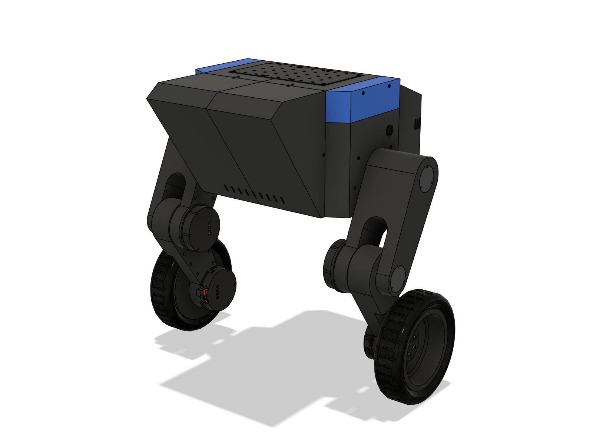
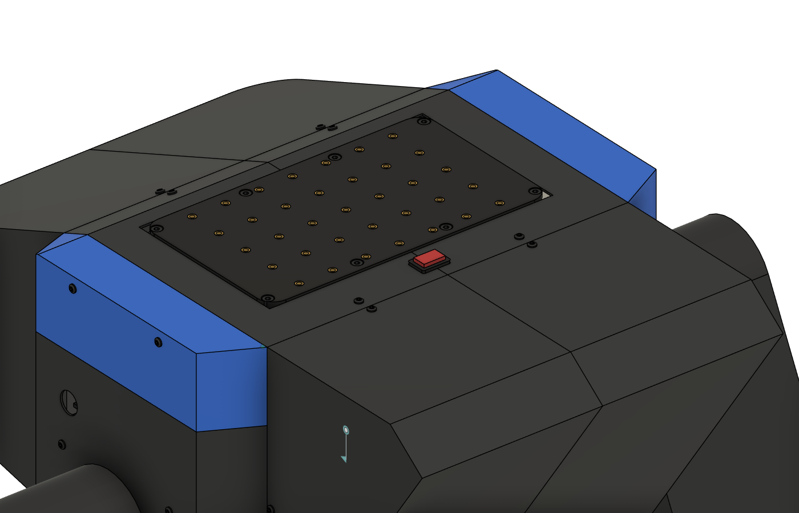
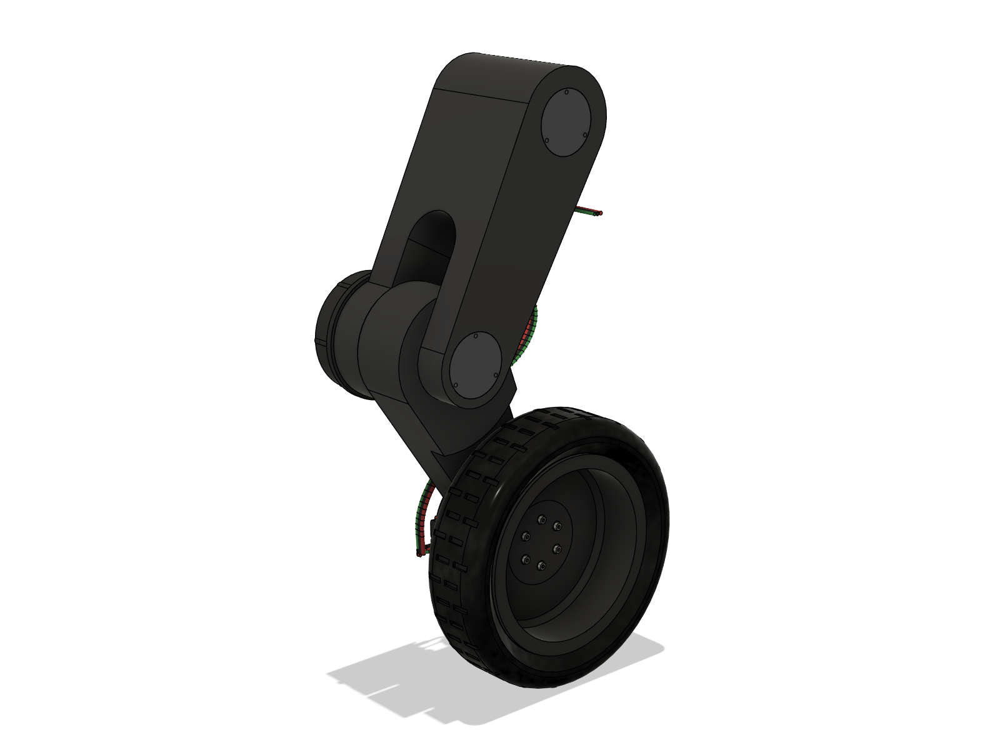
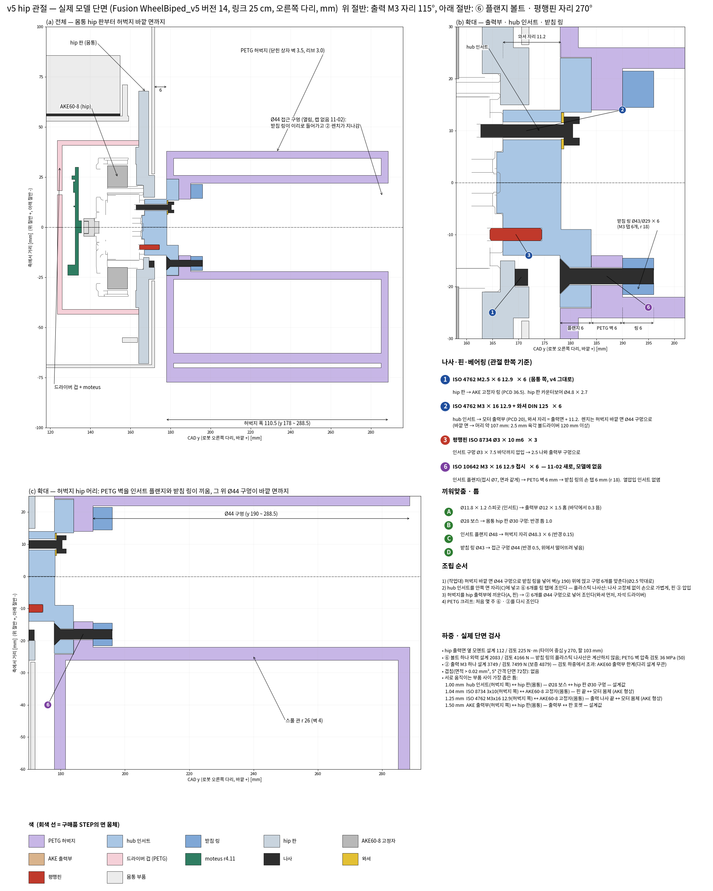

# robot_cad_v5 — 지금 로봇(WheelBiped v5)의 Fusion 모델

6모터 휠 이족 로봇 v5의 CAD 폴더다. Fusion 허브 문서 **`WheelBiped_v5` 버전 18**(11-09)이 기준이고, `export/WheelBiped_v5.f3d`가 같은 모델이다(회전 조인트 6개, 배선 없음).
v4 로봇에서 바퀴를 바깥쪽으로 돌리고 허벅지·정강이를 출력용 갈래 다리로 바꿨다. 몸통·셸·모터 자리·바퀴는 바탕 코드(`fusion_base/`, v4에서 물려받음)가 만들고, `fusion/`의 v5 코드가 그 위에 덮어쓴다.
지난 판(v2~v4) README는 지금 로봇과 어긋나는 내용이 많아 11-15에 지웠다. 아직 맞는 내용은 2절에 옮겼다. 전문: `git show e16135d:robot_cad_v5/docs/v2/README.md`(v3, v4도 같은 경로).

 

## 0. 한눈에

| 항목 | 값 |
|---|---|
| 모터 | CubeMars AKE60-8 KV80 × 6(hip·무릎·바퀴 × 좌우), 피크 12.5 / 정격 5 N·m |
| 드라이버 | mjbots moteus r4.11 × 6(관절마다, 드라이버 컵 안) |
| 컴퓨터·IMU | Raspberry Pi 4B + pi3hat r4.5 |
| 전원 | 배터리 24 V 15 Ah → power dist r4.5b |
| 링크 | 허벅지 = 정강이 = 250 mm |
| 바퀴 | 반경 101 mm, 타이어 폭 54 mm, 타이어 중심 y ±270 mm |
| 관절의 y 위치 | hip ±172, 무릎 ±208, 바퀴 ±270 mm |
| 그리는 자세 | 다리 길이 442.9 mm, hip 축 높이 543.9 mm |
| 크기 | 폭 594 mm(타이어 바깥면), 윗판 높이 692.9 mm(그리는 자세) |
| 모델 질량 | 버전 18: 11.610 kg, `calc/mass_properties.json`: 11.597 kg (실제보다 약 0.89 kg 무겁다 — 5절) |
| 링크 묶음 질량 | 몸통 5.249, 한쪽 허벅지 1.261 · 정강이 0.857 · 바퀴 1.056 kg |
| 무게중심 | 높이 409.7 mm, CAD x +21.3 mm(그리는 자세, 로봇 뒤쪽) |
| 출력 | 모든 부품 PLA·PETG, 베드 300 × 300 mm, 필라멘트 약 5.4 kg |

- 11.597 kg은 버전 11에서 뽑은 `calc/*.json`의 값이고, 제어기 모델이 이것을 쓴다(`plant_params.json`의 `total_mass`). 11.610 kg은 버전 18에서 `v5run.robot_mass()`로 잰 값이다(`manufacturing/bom.py`의 `MODEL_KG`). 버전 13~18의 변화(+13 g)는 작아서 `calc/*.json`을 다시 뽑지 않았다.

방향 규약
- CAD 축: +x 무릎 쪽, +y `_R` 부품 쪽, z 위, 원점은 바닥.
- **로봇의 앞 = CAD −x**(무릎 반대쪽, `shell_front`·`rail_F`·`spine_tube_F` 쪽). **`_L` 부품 = 로봇 왼쪽 = CAD −y.**
- v4 코드는 이름을 반대로 붙인다. v4 파일은 고치지 않고, v5 코드가 만든 직후에 이름을 바꾼다(`v5run.robot_name`).
- 제어기 모델은 CAD 축을 z 둘레로 180° 돌려 쓴다(`wbr.models.build_v5`). 그래서 `R_base_to_imu` = diag(−1, −1, 1)이다.
- 치수 참고용 v2 도면(`manufacturing/v2/drawings/`)의 이름은 v2 기준이다: `hip_plate_L.pdf` = 이 로봇의 `hip_plate_R`(CAD +y).

## 1. 다리 구조

 

- 바퀴는 정강이 바깥쪽, 바퀴 드라이버 컵은 안쪽에 있다.
- 허벅지는 갈래다. hip 쪽 상자 하나(y 178 ~ 288.5)가 두 갈래로 나뉜다. 안쪽 갈래에 무릎 모터가, 바깥 막대(y 263.5 ~ 288.5)에 무릎 캡이 붙는다.
- 정강이(기본층 y 208 ~ 238) 머리의 61807 베어링이 무릎 캡 관(Ø35)에 끼워져 무릎을 양쪽에서 잡는다. 허벅지 무릎 판과 정강이의 틈은 4.0 mm다.
- 링크 속은 닫힌 상자(벽 3.5)와 구멍 없는 리브 3.0(허벅지 9, 정강이 10개)이다. 배선 구멍은 없다.
- hip·무릎 체결: hub 인서트 플랜지 → 링크 벽 6 mm → 받침 링의 M3 탭 6개. 받침 링은 Ø44 접근 구멍으로 넣는다.
- 무릎 조립: 정강이를 9.5 mm 바깥에 띄워 갈래에 넣고 안쪽으로 밀어 끼운다. 순서는 `manufacturing/explain/knee_section.png`와 `manufacturing/explain/assembly/`의 그림·영상에 있다.
- 출력할 때 허벅지는 바깥 면(y 288.5), 정강이는 안쪽 면(y 208)을 바닥에 둔다. 출력 질량은 약 827 / 420 g이다(`BOM.md` 3절).
- 치수는 `fusion/legs_v5.py` 맨 위, 링크 길이는 `fusion/link_length.py`, v4와 다른 체결 치수는 `fusion/v5_params.py`에 있다.

## 2. 전장 · 배선

- 배선은 모델에 없다(11-01 사용자). 선·커넥터 목록은 `BOM.md` 5절, CAN 포트 배정은 `wheeled_biped/ros2_ws/README.md` 2절이 기준이다.
- Pi·pi3hat은 전장 데크 가운데에 있다. 모델의 IMU 위치는 BMI088 자리로 CAD (0.5, 2.45) mm, hip 축 아래 35.5 mm다(`calc/urdf_data.json`). 실물에는 ICM-42688-P가 실려 있어(11-14 확인) 모델을 옮기는 일이 남았다(`wheeled_biped/docs/robot_v5_model.md` 9절). pi3hat이 위, CAN·HDMI는 CAD +x(로봇 뒤), USB는 CAD +y(로봇 오른쪽)를 본다.
- power dist r4.5b는 데크의 CAD −y 쪽(중심 (0, −61))에 있고, XT90이 앞쪽(CAD −x)을 본다(`fusion/pdist_v5.py`).
- 로커 스위치는 몸통 윗면(CAD x +78, y 0)에 있다. 앞면에는 구멍이 없다(`fusion/switch_v5.py`).
- 엔코더 정렬: moteus의 AS5047P는 장착 구멍 중심에서 커넥터 반대쪽으로 4 mm 벗어나 있다. 칩이 모터 축 위에 오게 보드를 놓고, 고정 쪽에 붙은 드라이버 컵의 스탠드오프 4개에 고정한다. AKE 부속 자석(Ø6 × 2.5)은 자석 스페이서(Ø9 × 5.35)의 포켓에 붙인다. 자석 윗면에서 기판 면까지 2.55 mm이고 허용 범위는 2.34~2.76 mm다(`fusion_base/params.py`의 `MAGNET_PCB`). 조립 뒤 moteus 보정에서 엔코더 신호를 확인한다.
- 포트 이름 규칙: moteus의 J1·J2(XT30)와 CAN1·CAN2(PH-3)는 각각 병렬이다. 들어오는 쌍을 J1·CAN2, 나가는 쌍을 J2·CAN1로 쓴다(hip → 무릎 → 바퀴 순서, 바퀴 CAN1에 120 Ω 종단 저항, 바퀴 J2에 보호 캡). 실물 보드에 이 규칙대로 표시한다.
- 몸통의 하중 경로: 배터리 받침 → 척추 봉 → hip 판 → hip 모터 → 다리. 셸은 하중을 받지 않는다.

## 3. 정한 것

- 11-01 사용자: 다리 시안 A(모놀리스). 배선을 모델에서 뺀다. 링크에 구멍을 내지 않는다. 11-02 사용자: 다리를 PETG로 출력한다. 무릎 틈 4.0 mm. 셸 앞쪽 세로 모서리 R30.
- 11-07 사용자: 링크 17.5 → 25 cm, 리브 3.0 mm. IMU를 로봇 중심선으로. 로봇의 앞 = CAD −x.
- 11-08 사용자: 부품·조인트 이름을 로봇 기준으로(버전 11). 전원보드를 power dist r4.5b로(버전 15). 체결부 축 방향 여유 고침(버전 13·14).
- **11-09 사용자: 모든 부품을 PLA·PETG로 출력한다. 강도는 보지 않는다.** 가공 주문은 없다. 탭이 필요한 부품은 채움 100 %로 출력하고 탭은 손으로 낸다(`BOM.md` 2절).
- 11-09 사용자: 배터리 받침·전장 데크를 두 조각으로 나누고 이음마다 M3 × 10 볼트·너트 2쌍으로 잇는다(버전 17, `fusion/split_v5.py`). 스위치를 윗면으로 옮기고 셸 그로밋을 뺀다(버전 18).
- 11-09: 바퀴 모터를 컵과 함께 돌려 리드선 홈을 맞췄다(버전 16). AKE 출력부 M3 "깊이 5"는 나사산 깊이로 본다(사용자).
- 11-14 사용자: 옛 CAD 폴더(`robot_cad_v2`·`v3`·`v4`)를 지우고 쓰는 것만 이 폴더로 옮겼다. 지운 나머지는 git 태그 `before-cleanup-2026-11-14`에 있다.
- **11-15 사용자: 금속 가공 부품을 쓰지 않는다. "스위치 쪽" 표현을 없앤다**(앞쪽 = CAD −x). 문서·도면·강도 계산을 출력 부품 기준으로 고치고, 안 쓰는 파일·코드를 지웠다.
- 11-15 사용자: v5 이전 버전 이름을 없앤다. `v4/fusion/` → `fusion_base/`, `v4run.py` → `baserun.py`. v4 계산 파일, 안 쓰는 그림, 지난 판 README를 지웠다.

## 4. 다시 만들기

**Fusion 안에서**: Fusion MCP 스크립트에서 `fusion/`을 `sys.path` 맨 앞에 넣고 `import v5run` 한 뒤, 아래를 한 줄씩 **따로** 실행한다. 허브 문서 `WheelBiped_v5`를 열어 둔다.

```python
v5run.load()            # 바탕 모듈(fusion_base)과 v5 패치를 불러온다. 문서를 바꾸지 않는다
v5run.report()          # 다리 부품의 부피·질량·덩어리 수
v5run.interference()    # 6자세 간섭(v5run.POSES)
v5run.joint_check()     # 조인트마다 돌렸다 되돌려 한 덩어리로 도는지 확인
v5run.pose(460)         # 다리 길이(mm)·hip 각도로 자세 잡기. pose()는 그리는 자세
v5run.robot_mass()      # 출력 밀도와 타이어 721 g을 넣고 질량·무게중심을 낸다(문서를 바꾼다)
v5run.save_mass_json()  # calc/mass_properties.json
v5run.urdf_export()     # calc/urdf_data.json + export/links_stl
v5run.export()          # export/WheelBiped_v5.f3d
v5run.exports()         # export/WheelBiped_v5_assembly.step, parts_step/, parts_stl/
v5run.sections()        # manufacturing/explain/sections_v5.json.gz (관절 단면)
v5run.build()           # 새 문서에 처음부터 만든다(열려 있던 v5 문서는 저장 없이 닫힌다). 그 뒤 따로 turn(), robot_mass(), joints()
```

- 모델을 고치는 순서: `unjoint()` → 고치는 단계 → 따로 `turn()`(0이 나올 때까지) → `robot_mass()` → 따로 `joints()`. 고치는 단계는 `relegs()` 다리, `reshell()` 셸, `relayout()` 전장, `resplit()` 받침·데크, `reswitch()` 스위치다.
- `unjoint()`는 돌려 둔 바퀴 묶음을 원래 자리로 되돌린다. 고친 것이 없어도 `turn()`을 다시 돌린다.
- 고치는 단계와 `images()`(그림 01~10)는 조인트가 있는 문서에서, `save_mass_json()`은 숨긴 몸체가 있으면 오류를 내고 멈춘다(숨긴 몸체는 질량에서 빠진다).

**Fusion 밖에서**(이 폴더에서)
- `python manufacturing/part_drawings.py`: `export/parts_step` → `manufacturing/step/`, `manufacturing/drawings/`. `--only thigh shank`로 일부만 만든다. gmsh가 필요하다. 도면의 재질·공정 칸은 `BOM.md`와 같게 적는다.
- `python manufacturing/explain/real_sections.py`: 관절 단면도 3장. shapely가 필요하다.
- `python manufacturing/bom.py`: 조립 STEP과 `export/parts_stl` → `BOM.md`, `BOM.csv`. BOM은 손으로 고치지 않는다.
- 제어기 모델: `wheeled_biped/`에서 `python -m wbr.models.build_v5`. `calc/*.json`과 `export/links_stl`을 읽어 `models/wheelbiped_v5`를 덮어쓴다.
- `python calc/strength_v5.py` → `calc/strength_v5.md`. 조립 그림·영상을 다시 만드는 법은 `manufacturing/explain/assembly/README.md`에 있다.

## 5. 아직 안 한 것 · 주의할 점

- **11-14에 폴더를 옮긴 뒤 Fusion에서 확인한 것은 `load()`와 `report()`뿐이다**(루트 `README.md`). `build()`와 허브 문서를 바꾸는 단계는 돌려 보지 않았다. 버전 17·18의 패치가 들어간 `build()`는 그 전에도 돌린 적이 없다. 코드를 읽어 보면 `build()` 안에서 v4 모듈이 다시 불려 전원보드(r4.5b) 패치가 빠질 수 있으니 돌릴 때 확인한다.
- **모델 질량(11.610 / 11.597 kg)은 아직 금속 밀도로 계산된 값이라 실제보다 약 0.89 kg 무겁다.** hip 판·척추 봉·레일·클램프 링·자석 스페이서·hub 인서트·받침 링·무릎 캡(9종 26개)이 Fusion 모델에 금속 재질로 남아 있다(`BOM.md` 2절, `fusion/v5run.py`의 `MAT`). `calc/*.json`, `export/links_stl`, 제어기 모델도 같다(버전 11 것). **출력 밀도로 다시 뽑는 일이 남았다(Fusion 필요)**: 재질을 고치고 `robot_mass()` → `save_mass_json()` → `urdf_export()` → `build_v5`. 실물 질량을 재면 그 값에 맞춘다.
- 그림 `images/`의 01·05·13은 11-08(버전 11) 그림이라 전원보드 교체, 두 조각 받침, 윗면 스위치가 반영돼 있지 않다. 문서에 넣지 않은 버전 11 그림 10장은 11-15에 지웠다(`v5run.images()`가 01~10을 다시 만든다).
- 강도 손계산(`calc/strength_v5.md`, 11-15에 모든 부품을 PETG 값으로 다시 계산)에서 넘는 항목은 그대로 두었다(11-09 사용자: 강도는 보지 않는다): 정강이 끝 옆 처짐 4.98 mm(기준 1 mm), hip ② 볼트 7,499 N(검토 하중, 보증 4,879 N), 출력 부품인 hub 인서트 보스·와셔 자리와 hip 판 웹(설계 하중에서도 넘음). ⑥이 물리는 받침 링의 플라스틱 나사산은 계산하지 않았다. 무릎이 완전 신장을 넘지 않게 막는 기구 멈춤이나 관절 한계 보호도 정하지 않았다.
- 모델에 없는 체결 부품: ⑥ ISO 10642 M3 × 16 × 6(hip·무릎마다), ⑦ 무릎 캡 DIN 7984 M2.5 × 8 × 3과 인서트. `BOM.md`에는 ★로 들어 있다.
- 간섭은 6자세와 관절 단면만 봤다(버전 18 기록: 실제 간섭 0건). 30자세 스윕과 간격 측정은 하지 않았다.
- 실물에서 확인할 것: 스위치 하네스 30 cm가 power dist까지 닿는지(어림 약 29 cm). 윗판 x ±52 열의 짐 나사는 판 윗면에서 6 mm 이하로 넣는다(그 밑이 레일).
- `export/`와 도면의 파일 이름 `clamp_ring_stator_…_SUS304`, `magnet_spacer_…_(6061)`은 Fusion 부품 이름(v4 코드)에서 온 것이다. 둘 다 출력 부품이고, 이름은 Fusion에서 다시 내보낼 때만 바꿀 수 있다.

## 6. 모터 재검증 (MuJoCo)

- 여기 있던 11-05 ~ 11-07의 표는 17.5 cm 링크 때(대부분 upkie 모델을 늘려서) 잰 값이라 뺐다. 지금 모델의 결과는 `wheeled_biped/docs/robot_v5_model.md`와 `wheeled_biped/v5_lqi/TEST/README.md`에, 그때의 제어 설계 근거(무릎 결합 보상, 순응 롤, 바퀴 속도 차 요)는 `robot_v5_model.md` 11절에 있다. 다시 돌리려면 `wheeled_biped/`에서 `python -m wbr.bench.ake_cad`를 쓴다(→ `results/ake_cad_v5/`).
- **한계**: 한쪽 바퀴가 날카로운 4 cm 턱에 0.2~0.4 m/s로 들어가면 바퀴가 끼여 헛돌고 로봇이 약 45° 돈다(시뮬레이션). 넘어지지는 않는다.
- 짐 5 kg을 실으면 기립 자세의 무릎 정지 토크가 AKE60 정격 5 N·m를 넘는다(`robot_v5_model.md`).

## 7. 파일

| 경로 | 내용 |
|---|---|
| `fusion/v5run.py` | 실행 진입점: 불러오기, 빌드, 점검, 내보내기 |
| `fusion/legs_v5.py`, `link_length.py`, `v5_params.py` | 다리 형상, 링크 길이, v4와 다른 치수 |
| `fusion/pdist_v5.py`, `split_v5.py`, `switch_v5.py` | v4 모듈에 씌우는 패치: 전원보드, 두 조각, 윗면 스위치 |
| `fusion_base/` | v5가 불러 쓰는 바탕 코드(몸통·셸·구매품·바퀴, 불러오기는 `baserun.py`). v4에서 물려받았고 형상은 고치지 않는다 |
| `calc/` | 질량·관성과 URDF 입력 JSON, 강도 손계산 |
| `export/` | f3d, 조립 STEP, 부품별 STEP·STL, 링크별 메시(`links_stl/`) |
| `BOM.md`, `BOM.csv` | 구매·출력·체결 부품·배선 목록 |
| `manufacturing/` | `drawings/` 도면 PDF(치수 참고용), `step/` v5 새 부품 STEP, `v2/` 치수 참고용 v2 도면·STEP, `hlr_gmsh.py` 은선 제거 코드 |
| `manufacturing/explain/` | 관절 단면도 3장, `assembly/`(조립 그림·영상) |
| `images/` | 문서에 넣은 그림 5장: 다리(01), 로봇(05), IMU 축(13), 두 조각 받침, 윗면 스위치 |

줄이기 전 전문: `git show 39e448f:robot_cad_v5/README.md`
