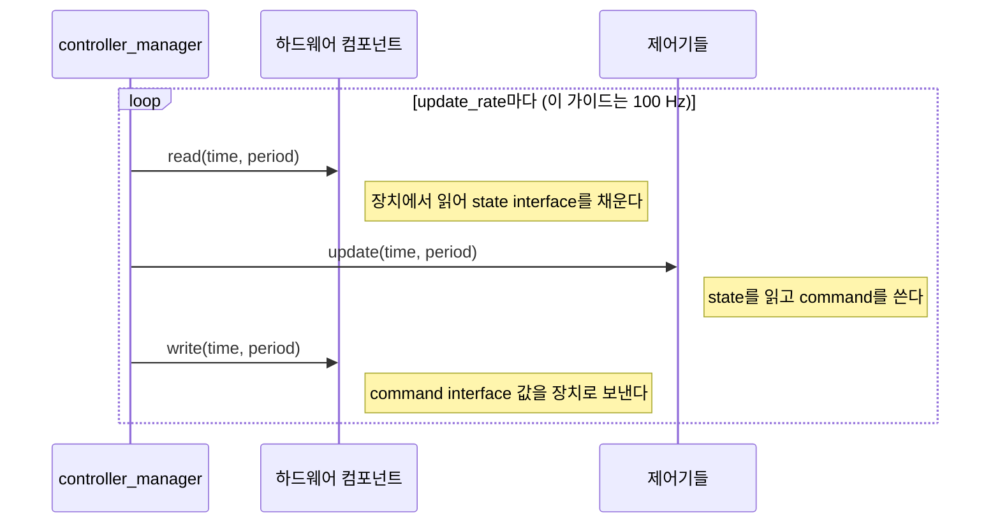
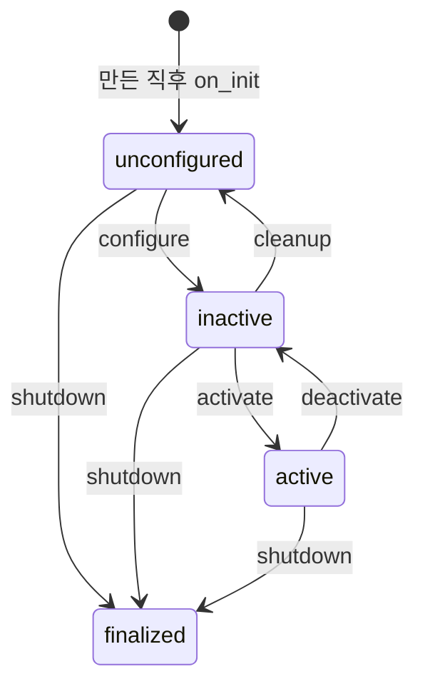
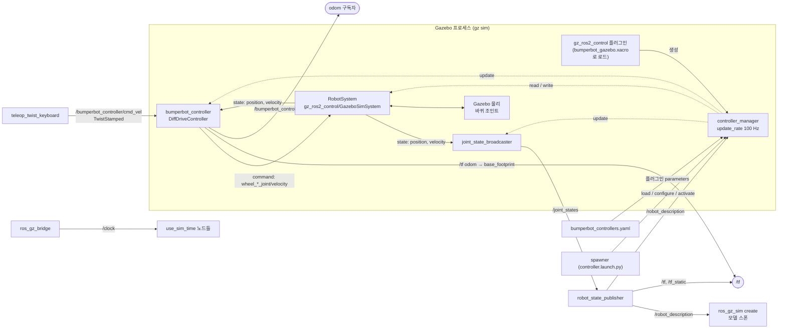
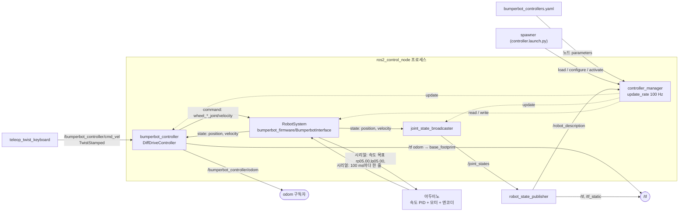
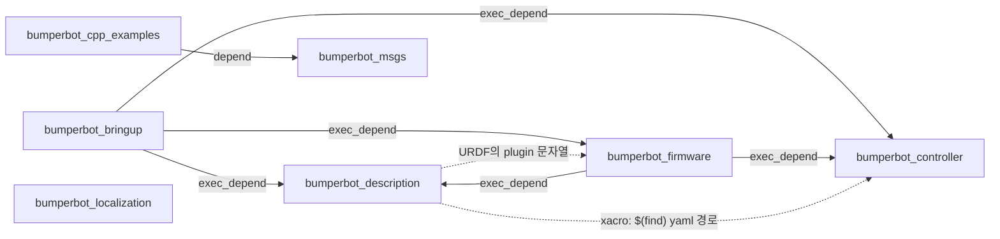

# 00. ros2_control 큰 그림

> 이 장은 코드를 만들지 않는다. 01~12장이 손으로 만드는 것의 **지도**다. 길을 잃으면 이 장의 표에서 "몇 장" 열을 따라 해당 장으로 간다.
> 사실의 근거는 세 가지다. 설치된 Jazzy 헤더(`/opt/ros/jazzy/include`)와 패키지의 `share/`, `ros2 control` 같은 도구의 출력, 각 장에서 직접 돌려 본 결과다(Jazzy, `controller_manager` 4.50). 그 밖의 내용에는 "(일반 지식)"을 붙였다. 확인하지 못한 것은 "확인하지 못했다"고 적었다.

## 이 장에서 하는 일

이 가이드가 답하려는 질문은 네 가지다. ros2_control의 구조, 로봇을 현실이나 시뮬레이션에서 돌릴 때의 노드 구성, 필요한 파일, ROS 2 패키지 구조(그리고 각각 **왜** 그런가)다. 이 장이 한 번에 답한다.

| 질문 | 답이 있는 절 |
|---|---|
| ros2_control은 무슨 문제를 푸는가 | 1절 |
| 어떤 부품(노드, 객체)이 있고 서로 무엇을 하는가 | 2절 |
| 시뮬레이션과 실물에서 노드와 데이터가 어떻게 이어지는가 | 3절 |
| 쓰려면 어떤 파일이 필요하고, 없으면 어떻게 되는가 | 4절 |
| 패키지를 어떻게 나누고 왜 그렇게 나누는가 | 5절 |
| 어느 장에서 무엇을 만드는가 | 6절 |
| 참조 저장소 코드와 이 가이드의 코드는 어디가 다른가 | 7절 |
| 용어 | 8절 |

## 1. ros2_control이 푸는 문제

제어기가 모터 드라이버(시리얼, CAN)나 시뮬레이터의 API를 직접 부르면, 장치가 바뀔 때마다 제어기를 다시 쓴다(일반 지식). ros2_control은 둘 사이에 **이름 붙은 실수 값**(인터페이스)만 둔다. 제어기는 `wheel_left_joint/velocity`에 값을 쓰고 `wheel_left_joint/position`을 읽는다. 그 값이 Gazebo의 조인트로 가는지 시리얼 선으로 가는지는 제어기가 모른다.


그래서 이 가이드의 로봇(bumperbot)에서 시뮬레이션과 실물은 대부분 같은 파일을 쓴다. 먼저 어느 것이 그대로이고 어느 것이 바뀌는지를 본다.

| 항목 | 시뮬레이션 (03·05·07장) | 실물 (11·12장) | 같은가 |
|---|---|---|---|
| 제어기 종류·이름·파라미터 (`bumperbot_controllers.yaml`) | `bumperbot_controller`, `joint_state_broadcaster` | 같다 | 같다 |
| URDF의 조인트와 인터페이스 선언 (`<joint>`, `<command_interface>`, `<state_interface>`) | 바퀴 조인트 둘, 명령 `velocity`, 상태 `position`·`velocity` | 같다 | 같다 |
| 스포너 launch (`controller.launch.py`) | 제어기를 load → configure → activate | 같다 | 같다 |
| 입력 토픽 `/bumperbot_controller/cmd_vel` | `TwistStamped` | 같다 | 같다 |
| 출력 `/joint_states`, `/bumperbot_controller/odom`, `/tf` | 같다 | 같다 | 같다 |
| `robot_state_publisher` | `/robot_description`과 TF | 같다 | 같다 |
| `<hardware><plugin>` | `gz_ros2_control/GazeboSimSystem` | `bumperbot_firmware/BumperbotInterface`와 `port` 파라미터. xacro 인자 `is_sim`이 둘 중 하나를 고른다(12장) | **바뀐다** |
| `controller_manager`가 도는 곳 | Gazebo 프로세스 안(`gz_ros2_control` 플러그인이 만든다) | `ros2_control_node` 프로세스 | **바뀐다** |
| 바퀴 상태의 출처 | Gazebo 물리 | 아두이노가 100 ms마다 보내는 속도 한 줄. 위치는 플러그인이 속도를 적분해 만든다(11장) | **바뀐다** |
| 시계 | `/clock`(ros_gz_bridge), `use_sim_time` 참 | 컴퓨터 시계, `use_sim_time` 거짓 | **바뀐다** |
| 키보드 조종 | `-p use_sim_time:=true`가 필요하다 | 필요 없다(12장 단계 4) | **바뀐다** |
| 로봇의 몸 | Gazebo 모델(`ros_gz_sim`의 `create`가 스폰) | 실물 | **바뀐다** |
| IMU(09장) | Gazebo 센서 → `ros_gz_bridge`(`/imu` → `/imu/out`) | 참조는 Python 노드 `mpu6050_driver.py`. 이 가이드는 싣지 않는다 | **바뀐다.** 둘 다 ros2_control 밖이다 |

- 03장 단계 8도 같은 결론이다. 시뮬레이션과 실물의 차이는 하드웨어 플러그인과 `controller_manager`를 띄우는 주체 둘이다.
- yaml은 같은 파일이지만 12장 단계 2에서 한 번 고친다. `controller_manager`의 `use_sim_time: true` 줄을 지우고(실물에는 `/clock`이 없다) 속도·가속도 한계 값을 바꾼다. 참조의 Section12가 같은 변경을 한다. 고친 yaml을 시뮬레이션과 실물이 함께 쓴다.
- IMU 행의 근거는 참조의 Section11(`gazebo.launch.py`의 브리지, `bumperbot_gazebo.xacro`의 센서)과 Section12(`real_robot.launch.py`의 `mpu6050_driver.py`)다. v5에서는 IMU가 ros2_control 안으로 들어온다(13장).

## 2. 구성 요소

### 2.1 한눈에 보는 표

| 요소 | 하는 일 | 이 가이드에서는 | 몇 장 |
|---|---|---|---|
| `controller_manager`(CM) | 하드웨어와 제어기를 담는 노드. 제어 루프를 돌리고, 제어기를 load·configure·activate·전환하는 ROS 서비스를 제공한다 | 시뮬레이션: Gazebo 안의 `/controller_manager`. 실물: `ros2_control_node` | 03, 11 |
| resource manager | CM 안에서 URDF를 받아 하드웨어 컴포넌트를 만들고, 인터페이스 목록과 점유(claim) 상태를 관리한다 | 눈에 보이지 않는다. `ros2 control list_hardware_interfaces`로 결과를 본다 | 03 |
| 하드웨어 컴포넌트 | 인터페이스의 값을 실제 장치(또는 시뮬레이터)와 주고받는 플러그인 | `GazeboSimSystem`(시뮬레이션), `BumperbotInterface`(실물). 둘 다 `system` | 03, 11 |
| command interface | 제어기가 값을 **쓰는** 곳. 한 번에 한 제어기만 점유한다 | `wheel_left_joint/velocity`, `wheel_right_joint/velocity` | 03 |
| state interface | 제어기가 값을 **읽는** 곳. 점유 개념이 없다 | `<조인트>/position`, `<조인트>/velocity` | 03 |
| 제어기 | 인터페이스를 읽고 써서 일을 한다. 매 주기 `update()`가 불린다 | `bumperbot_controller`(`diff_drive_controller`), `simple_velocity_controller` | 03, 05 |
| 브로드캐스터 | command를 쓰지 않고 state만 읽어 토픽으로 내는 제어기 | `joint_state_broadcaster` → `/joint_states` | 03 |
| 스포너 | 제어기를 load → configure → activate하고 끝나면 종료하는 프로그램 | `controller.launch.py`의 `spawner` 노드 | 03 |
| 플러그인과 pluginlib | 이름 문자열로 C++ 클래스를 찾아 객체를 만든다 | URDF의 `<plugin>`, yaml의 `type:` | 03, 11 |
| 생명주기 | 하드웨어와 제어기가 가진 상태 기계 | `unconfigured → inactive → active` | 10, 11 |
| `/robot_description` 토픽 | CM이 URDF를 받는 길 | `robot_state_publisher`가 낸다 | 02, 03 |
| 제어 루프 | 매 `update_rate`마다 `read → update → write` | 100 Hz | 03 |

### 2.2 제어 루프

CM은 정해진 주기(`update_rate`)마다 같은 순서를 반복한다.



- 이 순서는 `ros2_control_demos`의 예제 7 문서(`references/ros2_control_demos/example_7/doc/userdoc.rst`)에도 적혀 있다. 설치된 `controller_manager.hpp`는 `read`, `update`, `write`를 "(real-time) control loop"에서 불리는 함수로 표시한다.
- 같은 문서는 `ros2_control_node`가 이 루프를 실시간 스레드에서 돌리고, 토픽·서비스 처리는 다른 스레드에서 한다고 적는다. 헤더도 서비스 콜백을 "non real-time safe" 그룹으로 나눈다.
- `read()`는 하드웨어가 `inactive`일 때도 불린다. `write()`는 `active`일 때만 불린다(12장 단계 5에서 확인했다).

### 2.3 하드웨어 컴포넌트 세 종류

URDF의 `<ros2_control type="...">`에 `system`, `actuator`, `sensor` 중 하나를 쓴다. 설치된 헤더에서 확인한 차이는 이렇다.

| 종류 | 기반 클래스 | 헤더의 설명 | 조인트·센서 | `write()` |
|---|---|---|---|---|
| `system` | `SystemInterface` | 복합 시스템. 센서가 있거나 없는 여러 조인트 시스템(산업용·휴머노이드 로봇) | 조인트 필수, 센서 선택 | 반드시 구현(`= 0`) |
| `actuator` | `ActuatorInterface` | 자유도 1개의 액추에이터. 컨베이어나 모터 | 조인트 필수 | 반드시 구현(`= 0`) |
| `sensor` | `SensorInterface` | 독립 센서. 힘-토크 센서, IMU | 센서 필수. 명령 인터페이스가 없다 | `final`이고 항상 `OK`를 돌려준다 |

- 근거는 `hardware_interface/system_interface.hpp`, `actuator_interface.hpp`, `sensor_interface.hpp`, `hardware_info.hpp`의 주석이다. `HardwareInfo`는 `joints`("Required for Actuator and System"), `sensors`("Required for Sensor and optional for System"), `gpios`("Optional for any")를 가진다.
- **이 가이드가 `system`을 쓰는 이유.** 바퀴 둘을 아두이노 하나, 시리얼 포트 하나로 주고받는다. 통신 단위가 "장치 하나 = 조인트 둘"이라서 한 클래스가 둘을 함께 `read()`/`write()`하는 편이 자연스럽다. `GazeboSimSystem`도 `system`이다.
- `actuator`를 쓰면 조인트마다 컴포넌트와 통신이 따로다. `ros2_control_demos`의 예제 6(액추에이터마다 따로 통신)과 예제 14(액추에이터와 센서를 컴포넌트로 따로 둠)가 그 형태를 보여 준다.

### 2.4 인터페이스

```xml
    <ros2_control name="RobotSystem" type="system">

        <!-- ros2_control Gazebo -->
        <xacro:if value="$(arg is_sim)">
            <hardware>
                <plugin>gz_ros2_control/GazeboSimSystem</plugin>
            </hardware>
        </xacro:if>

        <!-- ros2_control Real Robot -->
        <xacro:unless value="$(arg is_sim)">
            <hardware>
                <plugin>bumperbot_firmware/BumperbotInterface</plugin>
                <param name="port">$(arg port)</param>
            </hardware>
        </xacro:unless>

        <!-- ros2_control Common Interfaces -->
        <joint name="wheel_left_joint">
```

위는 `bumperbot_description/urdf/bumperbot_ros2_control.xacro`의 앞부분이다. 03장에서는 `<hardware>` 블록이 하나이고, 12장에서 `is_sim`으로 둘로 갈린다. 아래 `<joint>` 블록(명령 `velocity`, 상태 `position`·`velocity`)은 두 구성이 같다. 이 파일에서 인터페이스가 만들어지는 규칙은 다음과 같다.

| 규칙 | 예 |
|---|---|
| 이름은 `<조인트 이름>/<인터페이스 이름>`이다 | `wheel_left_joint/velocity` |
| 센서와 GPIO는 `<센서 이름>/<인터페이스 이름>`이다 | IMU: `<센서>/orientation.x`(`#include`에 쓰는 이름은 `semantic_components/imu_sensor.hpp`, 파일은 `/opt/ros/jazzy/include/controller_interface/semantic_components/`에 있다). 힘 센서: `tcp_fts_sensor`의 `force.x`(`ros2_control_demos` 예제 4) |
| 인터페이스 이름 상수는 `hardware_interface_type_values.hpp`에 있다 | `position`, `velocity`, `acceleration`, `effort`, `temperature` 등 |
| 값은 기본이 `double`이다. `data_type`에는 `double`, `bool`, `float32`, `uint8`, `int8`, `uint16`, `int16`, `uint32`, `int32`만 쓸 수 있다 | `hardware_info.hpp`의 `HandleDataType`이 이 문자열만 받는다. 다른 이름(`int` 등)은 `Invalid data type` 오류가 난다. `InterfaceInfo`의 주석은 "e.g. bool, int"로 느슨하게 적었다 |
| `ros2 control list_hardware_interfaces`에 `[available]`과 `[claimed]`/`[unclaimed]`가 나온다. 쓸 수 없는 인터페이스에는 `[unavailable]`이 붙는다 | 03장 단계 5, 6. `[unavailable]`은 `ros2_control_demos` 예제 12의 문서에 있다 |
| 한 command interface는 한 번에 제어기 하나만 점유한다 | `resource_manager.hpp`: "Any command interface can only be claimed by a single instance" |
| state interface에는 점유 표시가 없다 | 03장 단계 5 |
| 체인형 제어기는 자기 이름으로 된 reference interface를 command interface 목록에 `[unclaimed]`로 내놓는다 | `bumperbot_controller/linear/velocity`(05장) |

- 명령 인터페이스의 `<param name="min">`/`max`는 기본 설정에서 강제되지 않는다. 03장 단계 2의 설명에 5.0 rad/s 명령이 그대로 통과한 확인 결과가 적혀 있다.
- 하드웨어 컴포넌트는 URDF에 적힌 인터페이스마다 핸들을 **자동으로** 만든다(11장이 이 핸들로 `read`/`write`를 구현하고 12장에서 `ros2_control_node`로 띄워 확인했다). 플러그인은 `set_state("wheel_left_joint/velocity", v)`처럼 이름으로 접근한다.

### 2.5 제어기와 브로드캐스터

CM의 yaml에서 제어기의 이름과 종류를 짝짓는다.

```yaml
controller_manager:
  ros__parameters:
    update_rate: 100 # Hz

    bumperbot_controller:
      type: diff_drive_controller/DiffDriveController

    joint_state_broadcaster:
      type: joint_state_broadcaster/JointStateBroadcaster

    simple_velocity_controller:
      type: velocity_controllers/JointGroupVelocityController
```

위는 `bumperbot_controller/config/bumperbot_controllers.yaml`의 앞부분이다(12장 이후의 최종 모양. 03장~11장에서는 `update_rate` 아래에 `use_sim_time: true` 줄이 있다). 이름(`bumperbot_controller`)은 스포너 인자이고 노드 이름이다. `type`은 `패키지/클래스`이고 pluginlib가 찾는다.

- **제어기는 자기가 쓸 인터페이스를 CM에 알린다.** 설치된 `controller_interface_base.hpp`에서 제어기는 `command_interface_configuration()`과 `state_interface_configuration()`을 구현한다. 요청한 인터페이스가 하드웨어에 없으면 활성화가 실패한다(`example_7`의 문서도 같은 내용이다).
- **브로드캐스터는 별도의 종류가 아니다.** 설치된 `joint_state_broadcaster`의 플러그인 xml은 `base_class_type="controller_interface::ControllerInterface"`다. 제어기와 같은 기반 클래스이고, command를 쓰지 않을 뿐이다.
- 제어기의 기반 클래스는 둘이다. 설치된 헤더 기준으로 `ControllerInterface`를 상속하면 `update()`를 구현하고, `ChainableControllerInterface`를 상속하면 `update()` 대신 `update_reference_from_subscribers()`와 `update_and_write_commands()`를 구현한다. `diff_drive_controller`는 후자다(10장 단계 2).
- 제어기 하나는 노드 하나다. yaml의 최상위 키가 그 노드 이름이다(03장).

| 제어기 | 종류(`type`) | 하는 일 | 몇 장 |
|---|---|---|---|
| `joint_state_broadcaster` | `joint_state_broadcaster/JointStateBroadcaster` | 모든 state interface를 읽어 `/joint_states`로 낸다 | 03 |
| `simple_velocity_controller` | `velocity_controllers/JointGroupVelocityController` | 토픽으로 받은 숫자 배열을 `velocity` command interface에 쓴다 | 03, 05 |
| `bumperbot_controller` | `diff_drive_controller/DiffDriveController` | `cmd_vel`을 바퀴 속도로 바꿔 쓰고, odom과 TF를 낸다 | 05, 07 |

### 2.6 스포너와 `ros2 control` 명령

yaml은 "쓸 수 있는 제어기 목록"일 뿐이다. 올리는 일은 스포너가 한다. 스포너는 CM의 서비스를 불러 load → configure → activate를 하고 종료한다(03장 단계 6). 같은 일을 손으로 하는 명령은 03장 단계 7에 있다. 설치된 `ros2 control --help`의 명령은 열두 개다.

| 명령 | 하는 일 |
|---|---|
| `list_controllers` | 올라온 제어기, 종류, 상태 |
| `list_controller_types` | 설치된 제어기 종류와 기반 클래스 |
| `list_hardware_components` | 하드웨어 컴포넌트와 상태 |
| `list_hardware_interfaces` | command/state interface와 `[claimed]` 표시 |
| `load_controller`, `unload_controller` | 제어기 객체를 만들고 없앤다 |
| `cleanup_controller` | 제어기를 정리한다(`ros2 control --help`의 설명: "Cleanup a controller in a controller manager"). 이 가이드에서는 쓰지 않았다 |
| `reload_controller_libraries` | 제어기 라이브러리를 다시 읽는다("Reload controller libraries"). 이 가이드에서는 쓰지 않았다 |
| `set_controller_state`, `switch_controllers` | 제어기 상태를 옮긴다, 여러 개를 한 번에 켜고 끈다 |
| `set_hardware_component_state` | 하드웨어 컴포넌트 상태를 옮긴다 |
| `view_controller_chains` | 체인형 제어기의 연결 그림을 만든다(이 가이드에서는 쓰지 않았다) |

### 2.7 생명주기

하드웨어 컴포넌트와 제어기는 모두 `rclcpp_lifecycle`의 상태 기계를 가진다(10장 단계 2에서 헤더로 확인).



| 상태 | 하드웨어 컴포넌트(헤더 주석) | 제어기 |
|---|---|---|
| `unconfigured` | 초기화됐으나 통신은 시작 전. 인터페이스를 쓸 수 없다 | load 직후 |
| `inactive` | 통신이 시작됐다. state는 읽을 수 있고 command는 쓸 수 없다 | 파라미터를 읽고 준비했으나 `update()`는 불리지 않는다 |
| `active` | 움직일 수 있다. command를 쓸 수 있다 | command interface를 점유하고 매 주기 `update()`가 불린다 |
| `finalized` | 해제 준비 | 해제 준비 |

- `ros2 control list_hardware_components`는 상태를 `id=3 label=active`처럼 보인다. 번호는 `unconfigured` 1, `inactive` 2, `active` 3, `finalized` 4다(10장).
- 콜백이 돌려주는 값은 셋이다. `SUCCESS`는 목표 상태로 간다. `FAILURE`는 전이가 취소되고 직전 상태에 머문다(다시 시도할 수 있다). `ERROR`나 잡히지 않은 예외는 `on_error`로 간다(10장에서 별도 노드로 확인했다). CM이 하드웨어·제어기의 `ERROR` 뒤에 어떤 상태로 옮기는지는 확인하지 못했다.
- `ros2_control_node`는 시작할 때 하드웨어를 `active`까지 올린다. 종료할 때(SIGINT)는 `deactivate` → `shutdown`을 부른다. `on_cleanup`은 종료 때 불리지 않는다(12장 단계 3).
- 하드웨어만 `inactive`로 내려도(`ros2 control set_hardware_component_state RobotSystem inactive`) 제어기는 `active`로 남고 `/joint_states`는 계속 100 Hz로 나온다. 플러그인의 `on_deactivate`가 정지 명령을 보내고, `active`로 되돌리면 제어기가 쓰던 명령이 곧바로 다시 나간다(12장 단계 5).
- 시작할 때 `on_configure`가 `FAILURE`(예: 포트 없음)를 돌려주면 `ros2_control_node`가 중단된다(11장 단계 8, 12장 단계 3).

## 3. 데이터 흐름

### 3.1 시뮬레이션 구성

`controller_manager`는 Gazebo 프로세스 **안**에 있다. `gz_ros2_control` 플러그인이 만든다. 이 장에서는 05장의 구성 B(`diff_drive_controller`)로 그린다. 구성 A(우리 노드 `simple_controller` + `simple_velocity_controller`)에서는 제어기 자리에 그 둘이 들어간다.



### 3.2 실물 구성

`controller_manager`가 별도 프로세스 `ros2_control_node`다. 하드웨어 자리에 직접 쓴 플러그인이 있고, 그것이 시리얼로 아두이노와 이야기한다.



### 3.3 두 그림에서 같은 부분과 다른 부분

| 부분 | 시뮬레이션 | 실물 |
|---|---|---|
| 제어기들, 스포너, yaml의 제어기 설정 | 같다 | 같다 |
| 제어기 → command interface → 하드웨어 → state interface → 브로드캐스터 → `/joint_states` → `robot_state_publisher` → `/tf` | 같다 | 같다 |
| `/robot_description`을 받는 쪽 | CM, 그리고 모델을 스폰하는 `ros_gz_sim create` | CM뿐이다 |
| CM을 만드는 쪽 | `gz_ros2_control` 플러그인(URDF의 `<gazebo><plugin>`) | launch가 띄우는 `ros2_control_node` |
| yaml이 CM에 가는 길 | 플러그인의 `<parameters>`(URDF 안에 yaml 경로) | `ros2_control_node`의 파라미터 파일 |
| 제어기 노드가 yaml을 받는 길 | CM이 받은 yaml로 적용된다 | 같다. CM이 자기가 받은 yaml(`--params-file`)을 제어기 노드의 인자로 넘긴다 |
| 하드웨어 컴포넌트의 정체 | `GazeboSimSystem`(`gz_ros2_control` 패키지가 제공) | `BumperbotInterface`(직접 쓴다) |
| 하드웨어 뒤에 있는 것 | Gazebo의 바퀴 조인트 | 시리얼 선, 아두이노, 모터 |
| `/clock`과 `use_sim_time` | `ros_gz_bridge`가 `/clock`을 낸다. 노드들이 `use_sim_time`을 쓴다 | 없다 |
| 하드웨어 플러그인을 찾는 쪽 | `gz_ros2_control`이 자기 목록에서 찾는다(아래) | CM의 resource manager가 찾는다 |

`GazeboSimSystem`의 등록 위치가 실물 플러그인과 다르다. 설치된 `share/gz_ros2_control/gz_hardware_plugins.xml`에서 이 클래스의 `base_class_type`은 `hardware_interface::SystemInterface`가 아니라 `gz_ros2_control::GazeboSimSystemInterface`다. ament 색인도 `hardware_interface__pluginlib__plugin`이 아니라 `gz_ros2_control__pluginlib__plugin` 아래에 있다. 시뮬레이터가 바뀌면 `<plugin>` 이름을 푸는 쪽이 달라질 수 있다는 뜻이다(13장).

시험으로 확인한 사실 둘.

- CM은 URDF를 `/robot_description` 토픽에서 받는다. 시뮬레이션과 실물이 같다. `ros2_control_node`에 `robot_description`을 파라미터로 줘도 무시한다. `robot_state_publisher`가 없으면 `Waiting for data on 'robot_description' topic`이 반복된다(12장 단계 3). 참조의 `hardware_interface.launch.py`는 URDF를 `ros2_control_node`에 파라미터로도 주는데, 같은 launch의 `robot_state_publisher`가 토픽을 내서 동작할 뿐이다.
- 제어기 파라미터는 CM에 준 yaml 하나로 적용된다. 시뮬레이션에서는 gz 플러그인의 `<parameters>`로(03장), 실물에서는 `ros2_control_node`의 파라미터 파일로(12장 단계 4) 줬고, 스포너에 `--param-file`을 줄 필요가 없었다. 12장 시험에서 CM 로그에 `Controller 'bumperbot_controller' node arguments: --ros-args --params-file <그 yaml>`이 나왔고 `ros2 param get /bumperbot_controller wheel_radius`가 yaml의 값을 돌려줬다.

## 4. ros2_control을 쓰려면 필요한 것

03장 단계 8의 체크리스트를 넓혀서, 없을 때 실제로 나는 증상과 함께 정리한다.

| # | 필요한 것 | 이 가이드의 파일 | 누가 읽는가 | 없으면 | 몇 장 |
|---|---|---|---|---|---|
| 1 | URDF의 `<ros2_control>` 태그: 하드웨어 이름·종류, 조인트별 command/state interface. 조인트 이름이 `<joint>`와 글자까지 같아야 한다. 시뮬레이션과 실물은 xacro 인자 `is_sim`으로 `<hardware>`만 가른다 | `bumperbot_description/urdf/bumperbot_ros2_control.xacro`(include하는 곳과 인자 선언은 `bumperbot.urdf.xacro`) | CM의 resource manager(`/robot_description` 토픽으로 받는다) | 인터페이스가 없어 제어기가 붙을 곳이 없다. 이름이 다르면 `Joint 'wheel_leftt_joint' not found in URDF`가 나고 `list_hardware_interfaces`가 비어 있다 | 03, 12 |
| 2 | 하드웨어 플러그인(시뮬레이션용): 설치된 것을 이름만 적는다 | `<hardware><plugin>gz_ros2_control/GazeboSimSystem</plugin>`. 패키지 `gz_ros2_control`이 설치돼 있어야 한다 | `gz_ros2_control` 플러그인 | 하드웨어가 만들어지지 않는다 | 03 |
| 3 | 하드웨어 플러그인(실물용): 인터페이스 값을 장치와 주고받는 C++ 클래스 | `bumperbot_firmware/include/bumperbot_firmware/bumperbot_interface.hpp`, `src/bumperbot_interface.cpp` | CM의 resource manager(pluginlib) | 실물을 움직일 수 없다 | 11 |
| 4 | 플러그인 등록: 설명 xml, CMake의 `pluginlib_export_plugin_description_file`, 코드의 `PLUGINLIB_EXPORT_CLASS` | `bumperbot_firmware/bumperbot_interface.xml`, `bumperbot_firmware/CMakeLists.txt`, `src/bumperbot_interface.cpp` | pluginlib(ament 색인 `hardware_interface__pluginlib__plugin/<패키지>`) | `class bumperbot_firmware/BumperbotInterface ... does not exist. Declared types are ...`. `source`를 안 했을 때도 같은 메시지가 난다 | 11, 12 |
| 5 | CM을 띄우는 주체 | 시뮬레이션: `bumperbot_gazebo.xacro`의 `<gazebo><plugin filename="gz_ros2_control-system">`. 실물: `ros2_control_node`를 띄우는 `bumperbot_firmware/launch/hardware_interface.launch.py` | Gazebo / `ros2 launch` | CM이 없다. 스포너가 `waiting for service /controller_manager/list_controllers to become available...`을 반복한다 | 03, 12 |
| 6 | 제어기 설정 yaml: `update_rate`, 제어기 이름과 `type`, 제어기별 파라미터. 시뮬레이션과 실물이 같은 파일을 쓴다 | `bumperbot_controller/config/bumperbot_controllers.yaml` | CM 노드와 제어기 노드(최상위 키가 노드 이름) | `The 'type' param was not defined for '...'`, 스포너가 `Failed loading controller`로 종료한다. 실물에서 `use_sim_time: true`가 남아 있으면 `joint_state_broadcaster`가 활성화되지 않는다(12장 단계 2) | 03, 05, 12 |
| 7 | 제어기를 올리는 스포너 launch | `bumperbot_controller/launch/controller.launch.py` | `ros2 launch` → `spawner` → CM 서비스 | `No controllers are currently loaded!`. 하드웨어는 있지만 아무도 쓰지 않는다 | 03, 12 |
| 8 | `robot_state_publisher`와 `/robot_description` | 시뮬레이션: `bumperbot_description/launch/gazebo.launch.py`. 실물: `bumperbot_firmware/launch/hardware_interface.launch.py` | CM(URDF), `ros_gz_sim create`(스폰), TF를 쓰는 모든 노드 | CM이 `Waiting for data on 'robot_description' topic`을 반복한다 | 02, 12 |
| 9 | 제어기 플러그인이 든 패키지(표준 제어기) | `ros2_controllers`(`package.xml`의 `exec_depend`) | pluginlib(`controller_interface__pluginlib__plugin/<패키지>`) | `type`에 쓴 종류를 못 찾아 load가 실패한다(일반 지식) | 03, 05 |
| 10 | 시계(시뮬레이션만) | `gazebo.launch.py`의 `ros_gz_bridge`(`/clock`) | `use_sim_time`을 쓰는 노드 | 시뮬레이션 시각이 없어 시간 기반 노드가 어긋난다(일반 지식) | 02 |
| 11 | `package.xml`의 의존성, CMake의 `install()` | 각 패키지의 두 파일 | colcon, rosdep, xacro의 `$(find ...)`, `get_package_share_directory` | `package 'bumperbot_controller' not found`(xacro), `file ... was not found in the share directory`(launch) | 01~03, 11, 12 |
| 12 | 조종 입력(ros2_control이 요구하는 것은 아니다) | `teleop_twist_keyboard`(05장). 시뮬레이션에서는 `-p use_sim_time:=true`가 필요하고 실물에서는 필요 없다 | 제어기의 `~/cmd_vel` 구독 | 로봇이 가만히 있다. `use_sim_time`을 빠뜨리면 `diff_drive_controller`의 명령 시간 초과가 작동하지 않는다(05장, 12장) | 05, 12 |
| 13 | 구성을 한 번에 띄우는 launch(없어도 동작한다) | `bumperbot_bringup/launch/simulated_robot.launch.py`, `real_robot.launch.py` | `ros2 launch` | 위 launch를 터미널마다 손으로 띄워야 한다 | 12 |

플러그인 등록(4번)은 이 가이드의 파일로 보면 세 곳이 서로 맞아야 한다.

```xml
<library path="bumperbot_firmware">
    <class name="bumperbot_firmware/BumperbotInterface"
      type="bumperbot_firmware::BumperbotInterface"
      base_class_type="hardware_interface::SystemInterface"
    >
```

위는 `bumperbot_firmware/bumperbot_interface.xml`의 앞부분이다(11장). `class name`이 URDF `<plugin>`의 문자열과 글자까지 같아야 하고, `path`는 CMake의 `add_library` 이름과 같아야 하고, `base_class_type`은 코드의 `PLUGINLIB_EXPORT_CLASS(우리 클래스, 기반 클래스)`의 둘째 인자와 같아야 한다.

설치된 JointStateBroadcaster, DiffDriveController 같은 표준 제어기도 같은 방식으로 등록돼 있다. 확인한 곳은 `/opt/ros/jazzy/share/ament_index/resource_index/controller_interface__pluginlib__plugin/`이고, 거기에 패키지 이름마다 파일이 하나씩 있다.

## 5. 패키지 구조

### 5.1 최종 작업 공간

모든 장을 마치면 `~/bumperbot_ws/src/` 아래에 패키지 여덟 개가 있다. 아래는 12장까지 끝낸 작업 공간을 처음부터 빌드해 확인한 파일 목록이다. 패키지마다 `ros2 pkg create`가 만든 `LICENSE`가 있다. 트리에서는 `LICENSE`와 `build/`, `install/`, `log/`를 뺐다.

```text
~/bumperbot_ws/src/
├── bumperbot_cpp_examples/         연습 노드 (ament_cmake, 실행 파일 패키지)
│   ├── CMakeLists.txt              실행 파일 8개 빌드·설치, 헤더 설치
│   ├── package.xml                 rclcpp, turtlesim, bumperbot_msgs, tf2 등 의존
│   ├── include/bumperbot_cpp_examples/
│   │   ├── simple_turtlesim_kinematics.hpp    04장 노드 클래스 선언
│   │   └── simple_tf_kinematics.hpp           06장 노드 클래스 선언
│   └── src/
│       ├── simple_publisher.cpp               01장 토픽 발행
│       ├── simple_subscriber.cpp              01장 토픽 구독
│       ├── simple_parameter.cpp               01장 파라미터
│       ├── simple_turtlesim_kinematics.cpp    04장 두 거북이 상대 자세
│       ├── simple_service_server.cpp          06장 서비스 서버
│       ├── simple_service_client.cpp          06장 서비스 클라이언트
│       ├── simple_tf_kinematics.cpp           06장 TF 방송과 조회
│       └── simple_lifecycle_node.cpp          10장 라이프사이클 노드
│
├── bumperbot_py_examples/          Python 패키지 구조 비교용 (ament_python, 01장 단계 6)
│   ├── package.xml
│   ├── setup.py                    설치할 패키지와 entry_points
│   ├── setup.cfg                   실행 파일을 lib/<패키지>/에 설치하는 경로
│   ├── resource/bumperbot_py_examples      ament 색인용 빈 파일
│   ├── bumperbot_py_examples/
│   │   ├── __init__.py
│   │   └── simple_publisher.py
│   └── test/                       린트 시험 3개 (ros2 pkg create가 만든다)
│
├── bumperbot_msgs/                 인터페이스 정의 (06장)
│   ├── CMakeLists.txt              rosidl_generate_interfaces로 코드 생성
│   ├── package.xml
│   └── srv/
│       ├── AddTwoInts.srv
│       └── GetTransform.srv
│
├── bumperbot_description/          모델 (코드 없는 자료 패키지. 02장, 03·09·12장에서 고친다)
│   ├── CMakeLists.txt              launch meshes urdf rviz를 share/로 설치
│   ├── package.xml                 exec_depend: robot_state_publisher, xacro, ros_gz_sim, gz_ros2_control ...
│   ├── meshes/                     STL 6개 (02장에서 참조 저장소에서 복사한다. 손으로 치지 않는다. imu_link.STL은 09장에서 쓴다)
│   ├── urdf/
│   │   ├── bumperbot.urdf.xacro            링크·조인트 본체(09장: imu_link). 인자 is_sim, port(12장). 아래 두 xacro를 include
│   │   ├── bumperbot_gazebo.xacro          Gazebo 마찰, gz_ros2_control 플러그인, IMU 센서(09장)
│   │   └── bumperbot_ros2_control.xacro    <ros2_control>: 하드웨어 플러그인(is_sim으로 선택), 조인트별 인터페이스
│   ├── launch/
│   │   ├── display.launch.py       RViz로 모델 보기
│   │   └── gazebo.launch.py        robot_state_publisher, Gazebo, 스폰, /clock·/imu 브리지
│   └── rviz/display.rviz           RViz 설정
│
├── bumperbot_controller/           제어기 설정과 제어 노드 (03장에서 생기고 05·07·08·12장에서 자란다)
│   ├── CMakeLists.txt              노드 2개 빌드·설치, 헤더 설치, launch·config 설치
│   ├── package.xml                 controller_manager, ros2_controllers, teleop_twist_keyboard ...
│   ├── config/
│   │   ├── bumperbot_controllers.yaml     CM 주기, 제어기 이름·종류·파라미터 (시뮬레이션과 실물 공용)
│   │   ├── joy_config.yaml                (선택) joy_node 설정
│   │   └── joy_teleop.yaml                (선택) 조이스틱 → cmd_vel 매핑
│   ├── include/bumperbot_controller/
│   │   ├── simple_controller.hpp
│   │   └── noisy_controller.hpp
│   ├── src/
│   │   ├── simple_controller.cpp          (v, w) → 바퀴 속도, 오도메트리, odom TF (05·07장)
│   │   └── noisy_controller.cpp           잡음·오차를 넣은 오도메트리 odom_noisy (08장)
│   └── launch/
│       ├── controller.launch.py           스포너와 위 두 노드, 구성 전환 인자
│       └── joystick_teleop.launch.py      (선택)
│
├── bumperbot_localization/         센서 융합 (09장. ros2_control 밖, 토픽으로만 연결)
│   ├── CMakeLists.txt              노드 2개 빌드·설치, 헤더 설치, launch·config 설치
│   ├── package.xml                 exec_depend: robot_localization, tf2_ros
│   ├── config/ekf.yaml             robot_localization의 ekf_node 설정
│   ├── include/bumperbot_localization/kalman_filter.hpp
│   ├── src/
│   │   ├── kalman_filter.cpp              직접 쓴 1차원 칼만 필터
│   │   └── imu_republisher.cpp            IMU의 frame_id를 바꿔 다시 발행
│   └── launch/local_localization.launch.py    정적 TF, ekf_node, imu_republisher
│
├── bumperbot_firmware/             실물 하드웨어 (11장 플러그인, 12장 launch)
│   ├── CMakeLists.txt              시리얼 노드 둘과 플러그인 라이브러리 빌드·설치, 플러그인 등록, 헤더 설치, launch 설치
│   ├── package.xml                 hardware_interface, pluginlib, libserial-dev, bumperbot_description ...
│   ├── bumperbot_interface.xml     pluginlib 설명 파일
│   ├── include/bumperbot_firmware/bumperbot_interface.hpp   플러그인 클래스 선언
│   ├── src/
│   │   ├── bumperbot_interface.cpp        플러그인 구현: on_init, 생명주기 콜백(on_configure·on_activate·on_deactivate·on_cleanup·on_shutdown), read, write
│   │   ├── simple_serial_transmitter.cpp  토픽 → 시리얼
│   │   └── simple_serial_receiver.cpp     시리얼 → 토픽
│   ├── firmware/                   아두이노 스케치 6개 (참조에서 복사, 컴퓨터가 읽지 않는다)
│   ├── test/fake_arduino.py        실물 없이 시험하는 가짜 아두이노 (이 가이드가 더함)
│   └── launch/hardware_interface.launch.py    robot_state_publisher + ros2_control_node (12장)
│
└── bumperbot_bringup/              조합 launch (12장. 코드 없음)
    ├── CMakeLists.txt              launch 폴더 설치
    ├── package.xml                 exec_depend: description, controller, firmware
    └── launch/
        ├── simulated_robot.launch.py      Gazebo + 제어기 (+ 조이스틱)
        └── real_robot.launch.py           하드웨어 인터페이스 + 제어기 (+ 조이스틱). 인자 port, use_joystick
```

- 참조의 Python 노드 파일(`simple_controller.py`, `kalman_filter.py`, `mpu6050_driver.py` 등)은 트리에 없다. 이 가이드는 C++ 노드만 쓴다. 위치는 각 장에 적었다.
- `bumperbot_firmware/launch/hardware_interface.launch.py`와 `bumperbot_bringup`은 11장이 아니라 12장에서 만든다. 11장은 플러그인 패키지까지만 다룬다.
- 두 launch의 `use_joystick` 인자(기본 `false`)와 `real_robot.launch.py`의 `port` 인자(기본 `/dev/ttyUSB0`)는 이 가이드가 더한 것이다(12장).

### 5.2 패키지를 왜 이렇게 나누는가

원칙은 하나다. **바뀌는 이유가 같은 파일끼리 한 패키지에 둔다.** `ros2_control_demos`의 README도 한 폴더에 `bringup`, `description`, `hardware`, `controllers`를 둔 구조는 자기 로봇에 권하지 않고, 보통 `<로봇>/[bringup|description|hardware|controllers]`로 패키지를 나눈다고 적는다.

| 패키지 | 들어 있는 것 | 따로 두는 이유 | 몇 장 |
|---|---|---|---|
| `bumperbot_description` | URDF/xacro, 메시, RViz 설정, 모델을 보고 스폰하는 launch | 모델은 제어기·하드웨어와 독립이다. RViz, Gazebo, 실물의 `robot_state_publisher`가 같은 파일을 쓴다. `<ros2_control>` 태그도 여기 있다. URDF 하나가 `/robot_description` 토픽 하나로 모두에게 가기 때문이다. 시뮬레이션과 실물을 가르는 `is_sim` 인자도 여기 있다 | 02, 03, 09, 12 |
| `bumperbot_controller` | 제어기 yaml, 스포너 launch, 직접 쓴 제어 노드 | 제어기 설정은 시뮬레이션과 실물이 같다. 한 곳에 있으면 두 구성이 같은 설정을 쓴다 | 03, 05, 07, 08, 12 |
| `bumperbot_firmware` | 실물 하드웨어 플러그인, 시리얼 노드, 아두이노 스케치 | 실물에만 필요하다. `libserial-dev` 의존이 이 패키지 안에 갇힌다. 시뮬레이션만 쓰는 컴퓨터는 이것을 빌드하지 않아도 된다(일반 지식). 실물을 띄우는 launch(`hardware_interface.launch.py`)도 여기 있다 | 11, 12 |
| `bumperbot_bringup` | 위 패키지들의 launch를 `include`해 조합하는 launch | 어떤 구성(시뮬레이션, 실물)을 띄울지가 한 곳에 모인다. 다른 패키지는 이 패키지를 모른다 | 12 |
| `bumperbot_msgs` | `.srv` 정의 | 타입 정의를 쓰는 패키지가 이 패키지 하나에만 의존하면 된다(ROS 2 관례, 일반 지식) | 06 |
| `bumperbot_localization` | 센서 융합 노드, `ekf.yaml` | ros2_control과 토픽(`bumperbot_controller/odom_noisy`, `imu/out`)으로만 만난다 | 09 |
| `bumperbot_cpp_examples`, `bumperbot_py_examples` | 연습 노드 | ros2_control과 직접 관계가 없다 | 01, 04, 06, 10 |

### 5.3 패키지 사이의 의존 방향



- 실선은 `package.xml`에 적은 의존이다(`bumperbot_bringup`과 `bumperbot_firmware`는 launch에서 다른 패키지의 launch·xacro·yaml을 찾으므로 `<exec_depend>`로 적었다. 12장). 점선은 `package.xml`에 적지 않고 xacro 안에서 **이름으로 찾는** 연결이다. 참조도 `bumperbot_description`의 `package.xml`에 `bumperbot_controller`를 적지 않는다(03장). 의존을 정확히 적으려면 `<exec_depend>`를 더하는 것이 맞다.
- `bumperbot_description` → `bumperbot_firmware` 점선은 파일이 아니라 **문자열**(플러그인 이름) 하나다. 이 이름을 푸는 것은 실행 때 pluginlib다.
- `bumperbot_localization`은 이 작업 공간 안의 패키지를 가리키는 선이 없다. 토픽 이름으로만 이어진다.
- `bumperbot_py_examples`는 이 작업 공간의 다른 패키지와 의존 관계가 없어서 그림에 넣지 않았다.

### 5.4 파일 종류별로 누가 읽는가

| 파일 | 읽는 쪽 | 읽는 때 | 이 가이드의 예 |
|---|---|---|---|
| `package.xml` | colcon(패키지 이름, 빌드 종류, 빌드 순서), rosdep(의존 패키지 설치), `ros2 pkg` 명령 | 빌드 전, 설치 때 | 모든 패키지 |
| `CMakeLists.txt` | CMake, 그리고 `ament_cmake`의 매크로(`ament_package`, `pluginlib_export_plugin_description_file`, `install`) | `colcon build` | 모든 C++ 패키지 |
| `setup.py`, `setup.cfg` | Python 패키징 도구 | `colcon build` | `bumperbot_py_examples`뿐 |
| xacro (`*.xacro`) | `xacro` 프로그램이 URDF로 푼다. 결과를 `robot_state_publisher`가 `/robot_description`으로 낸다. 그것을 CM(`<ros2_control>`), Gazebo(`<gazebo>`), RViz가 읽는다 | launch가 `Command(["xacro ", ...])`를 부를 때 | `bumperbot.urdf.xacro` |
| yaml (제어기) | CM 노드와 제어기 노드가 ROS 파라미터로 읽는다. 최상위 키는 노드 이름이다 | CM이 뜰 때 | `bumperbot_controllers.yaml` |
| yaml (그 밖) | `ekf_node`(robot_localization), `joy_node`, `joy_teleop` | 해당 노드가 뜰 때 | `ekf.yaml`, `joy_*.yaml` |
| launch (`*.launch.py`) | `ros2 launch`(launch 시스템). `get_package_share_directory`로 설치된 파일을 찾는다 | 실행할 때 | 모든 launch |
| 플러그인 xml | pluginlib. ament 색인의 파일(`hardware_interface__pluginlib__plugin/<패키지>`)이 이 xml의 설치 경로를 가리킨다 | CM이 하드웨어를 만들 때 | `bumperbot_interface.xml` |
| `.srv` | rosidl 생성기 | `colcon build` | `AddTwoInts.srv` |
| STL 메시 | RViz, Gazebo | 모델을 그릴 때 | `meshes/*.STL` |
| `.ino` | Arduino IDE. 컴퓨터의 ROS는 읽지 않는다 | 아두이노에 올릴 때 | `firmware/*/*.ino` |

### 5.5 설치 규칙 한 줄 요약

`colcon build`는 소스를 `install/<패키지>/` 아래로 설치한다. 다른 프로그램은 설치된 위치만 본다.

| 대상 | CMake | 설치 위치 | 찾는 쪽 |
|---|---|---|---|
| 실행 파일 | `install(TARGETS ... DESTINATION lib/${PROJECT_NAME})` | `lib/<패키지>/` | `ros2 run`, launch의 `Node(executable=...)` |
| launch, config, urdf, rviz, meshes | `install(DIRECTORY ... DESTINATION share/${PROJECT_NAME})` | `share/<패키지>/` | `get_package_share_directory`, xacro의 `$(find ...)` |
| 플러그인 라이브러리 | `install(TARGETS ${PROJECT_NAME} DESTINATION lib)` | `lib/` | pluginlib(`LD_LIBRARY_PATH`) |
| 플러그인 설명 xml | `pluginlib_export_plugin_description_file(...)` | `share/<패키지>/`와 ament 색인 | pluginlib |
| 헤더 | `install(DIRECTORY include/ DESTINATION include)` | `include/<패키지>/` | 다른 패키지의 컴파일러 |

## 6. 장 지도

| 장 | 참조 섹션 | 만드는 것 | ros2_control에서의 자리 | 끝났을 때 확인되는 것 |
|---|---|---|---|---|
| 01 | Section3 (+ Section4의 `simple_parameter`) | 작업 공간, `bumperbot_cpp_examples`(발행·구독·파라미터), Python 패키지 구조 비교 | 모든 패키지의 틀(`package.xml`, `CMakeLists.txt`, `install()`) | `/simple_publisher`가 `/chatter`를 약 1 Hz로 낸다 |
| 02 | Section4 | `bumperbot_description`(xacro, 메시, RViz, Gazebo 스폰) | 제어 대상(조인트 이름)을 정한다 | `check_urdf` 통과, `gz model --list`에 `bumperbot`, `/clock` |
| 03 | Section5 | `<ros2_control>` xacro, gz 플러그인, `bumperbot_controller`(yaml, 스포너) | ros2_control의 핵심 | 두 제어기 `active`, command interface `[claimed]`, `/joint_states` 약 100 Hz, 바퀴가 돈다 |
| 04 | Section6 | `simple_turtlesim_kinematics` | 직접 관계 없음. 헤더 분리와 이동·회전 개념 | 두 거북이의 상대 이동 벡터와 회전 행렬이 출력된다 |
| 05 | Section7 | `simple_controller` 노드, `diff_drive_controller` 설정, 조종 | 제어기 층: 속도 명령 → 바퀴 속도 | `/bumperbot_controller/cmd_vel`로 로봇이 움직인다. 키보드 조종은 시뮬레이션에서 `-p use_sim_time:=true`가 필요하다 |
| 06 | Section8 | `bumperbot_msgs`, 서비스, TF2 | 곁가지: 인터페이스 패키지, TF 방송 | 서비스가 응답하고 TF 변환이 조회된다 |
| 07 | Section9 | `simple_controller`에 오도메트리 추가 | state interface(`/joint_states`) → 로봇 상태, `odom` TF | `odom → base_footprint` TF가 나오고 오도메트리가 Gazebo의 실제 이동과 비슷하다 |
| 08 | Section10 | `noisy_controller` | 곁가지: 같은 `/joint_states`를 읽는 노드 하나 | `odom_noisy`가 `odom`에서 시간에 비례해 벌어진다 |
| 09 | Section11 | `bumperbot_localization`(IMU, 칼만 필터, `robot_localization`) | 곁가지: ros2_control 밖, 토픽으로 연결. IMU를 ros2_control을 거치지 않고 들여온다 | IMU가 나오고(Gazebo 센서의 `update_rate`는 100 Hz), 융합한 EKF의 방향 오차가 네 번 돌려 0.0002 rad 이하였다(실행마다 조금 다를 수 있다). `odom_noisy`의 방향 오차보다 작다. 위치는 `odom_noisy`보다 나아지지 않는다(바퀴 반지름 오차가 속도 입력에 남는다) |
| 10 | Section12 | `simple_lifecycle_node` | 11장의 준비: 생명주기 | 상태 전이와 로그가 `unconfigured → inactive → active`로 바뀐다 |
| 11 | Section12 | `bumperbot_firmware`(시리얼 노드, 플러그인, 가짜 아두이노) | 핵심: 실물 하드웨어 컴포넌트(플러그인 코드) | 시리얼 노드와 가짜 아두이노로 통신 규약을 시험하고, 플러그인이 경고 없이 빌드돼 pluginlib 색인(`hardware_interface__pluginlib__plugin`)에 올라간다 |
| 12 | Section12 | xacro의 `is_sim`·`port`, yaml 정리, `hardware_interface.launch.py`, `bumperbot_bringup` | 핵심: 플러그인을 URDF에 연결하고 `ros2_control_node`로 띄운다. 두 구성을 조합한다 | 실물 구성에서 `ros2_control_node`가 플러그인을 로드해 `state: id=3 label=active`(`list_hardware_components`가 표시하는 `read/write rate: 100 Hz`)가 된다. 두 제어기가 `active`이고, 속도 명령이 가짜 아두이노에 `right=`·`left=`로 가며 `odom`의 `x`가 늘어난다. 하드웨어를 `inactive`로 내리면 정지 명령이 나가고 올리면 이어진다. 두 launch가 같은 제어기 설정으로 두 구성을 세운다 |
| 13 | — | 코드 없음 | v5 로봇으로 옮길 때 | 대응표와 빈칸 목록 |

**시간이 없으면 이 순서로 읽는다.** 핵심 경로는 **02 → 03 → 05 → 07 → 11 → 12**다.

- 02: 제어 대상을 정한다. 03: ros2_control을 붙인다. 05: 제어기 층을 본다. 07: state interface를 쓴다. 11: 실물 하드웨어 플러그인을 쓴다. 12: 그 플러그인을 로봇 모델에 연결해 띄우고 시뮬레이션과 실물을 하나로 묶는다.
- 곁가지는 01, 04, 06, 08, 09, 10이다. 읽기를 건너뛰는 것이지 만들기를 건너뛰는 것이 아니다. 작업 공간이 누적이라 뒤 장이 앞 장의 파일을 쓴다. 예를 들어 12장의 시험은 08장의 `noisy_controller`(`controller.launch.py`가 항상 함께 띄운다)를 쓰고, 09장이 `bumperbot_description`에 더한 IMU(xacro의 `imu_link`와 센서, `gazebo.launch.py`의 `/imu` 브리지)가 URDF에 들어 있다. `bumperbot_localization` 패키지는 12장의 launch와 시험이 쓰지 않는다. 건너뛸 장이 만드는 파일을 뒤 장이 쓰는지는 그 장의 "이번 장의 파일"과 "정리" 표로 확인한다.
- 01은 곁가지로 분류했지만 `colcon`, `package.xml`, `CMakeLists.txt`를 처음 만진다면 02장 전에 단계 1~2만 읽는다.
- 10은 11장 단계 8의 `on_configure`/`on_activate`가 낯설 때 읽는다.

## 7. 참조 저장소와 이 가이드가 다른 점

참조 코드를 이 가이드와 나란히 놓고 읽을 때 "왜 다르지?"에서 막히지 않도록 각 장 끝의 "참조 코드와 다른 점" 표(01~12장)를 종류별로 모았다. 자세한 줄은 그 장의 표에 있다. 이름(패키지, 파일, 노드, 토픽, 프레임, 제어기)은 바꾸지 않았다. "참조 Section11"처럼 쓴 것은 참조 저장소의 섹션이고, "09장"처럼 쓴 것은 이 가이드의 장이다.

### 7.1 Jazzy 전용으로 정리한 것

| 참조 | 이 가이드 | 이유 | 장 |
|---|---|---|---|
| `is_ignition`, `ign_ros2_control`, `ROS_DISTRO` 검사로 Humble과 Jazzy를 함께 지원(`bumperbot.urdf.xacro`, `bumperbot_ros2_control.xacro`, `bumperbot_gazebo.xacro`, `gazebo.launch.py`, `package.xml`) | 모두 뺐다. `gz_ros2_control`만 쓴다 | 이 가이드의 환경이 Jazzy 하나다 | 03, 07, 09, 12 |
| `diff_drive_controller` yaml의 `use_stamped_vel`, `publish_wheel_data`, `has_*_limits`, `max_jerk`, `min_acceleration`, 제어기 블록 안의 `type` | 뺐거나 `max_deceleration`(음수)으로 바꿨다 | 설치된 4.43.1에서 없어졌거나 deprecated다 | 05, 12 |
| 하드웨어 플러그인: `on_init(const HardwareInfo &)`, `export_state_interfaces()`, `export_command_interfaces()`, 멤버 벡터의 주소 | `on_init(const HardwareComponentInterfaceParams &)`와 자동 핸들(`set_state` / `get_state` / `get_command` / `set_command`) | 옛 방식은 Jazzy 4.50에서 deprecated다 | 11 |
| `rclcpp::get_logger("BumperbotInterface")`, `rclcpp::Clock().now()`로 `last_run_`을 두고 `dt`를 구한다 | 기반 클래스의 `get_logger()`, 그리고 `read()`의 `period`를 `seconds_since_message_`에 누적하고 줄을 처리하면 0으로 돌린다 | 새 API의 멤버를 쓴다. 시계를 따로 만들지 않고 의미는 같다 | 11 |
| `ros2_control_node`에 `robot_description`을 파라미터로도 주고 `"use_sim_time": False`를 같이 준다 | yaml만 준다. URDF는 `robot_state_publisher`에만 준다 | 4.50의 `ros2_control_node`는 `robot_description` 파라미터를 무시하고 토픽에서 받는다. `use_sim_time`은 기본값이 `False`다 | 12 |

### 7.2 C++만 쓴다

| 참조 | 이 가이드 | 이유 | 장 |
|---|---|---|---|
| `ament_cmake_python`, `rclpy`, `ament_python_install_package`, `install(PROGRAMS ... .py)`, `package.xml`의 `rclpy`, `python3-serial`, `python3-smbus` | 모두 뺐다 | C++ 노드만 쓴다 | 05, 07, 08, 09, 11 |
| launch의 `use_python` 인자와 Python 노드를 띄우는 `Node`, `IfCondition`/`UnlessCondition` | 없다. C++ 노드를 바로 띄운다 | 같다 | 05, 08, 09, 12 |
| `tf_transformations`(Python판이 쓴다) | 없다 | 이 환경에 설치돼 있지 않고 C++은 `tf2::Quaternion`을 쓴다 | 07 |
| Python 노드와 패키지 파일(`simple_controller.py`, `noisy_controller.py`, `kalman_filter.py`, `imu_republisher.py`, 시리얼 노드 둘, `mpu6050_driver.py` 등) | 싣지 않는다. 각 장에 참조 위치만 적었다 | 같다. `bumperbot_py_examples`의 `simple_publisher.py` 하나만 구조 비교용으로 쓴다 | 01, 05, 07, 08, 09, 11, 12 |
| `real_robot.launch.py`가 `mpu6050_driver.py`를 띄운다 | 띄우지 않는다. 09장의 `local_localization.launch.py`와 실제 IMU도 12장에서 연결하지 않았다 | Python 노드이고 실물 IMU 드라이버다 | 12 |

### 7.3 버그와 동작을 고친 것

| 참조 | 이 가이드 | 이유 | 장 |
|---|---|---|---|
| 조인트를 인덱스로 가정(0번을 오른쪽으로) | 이름(`wheel_right_joint`, `wheel_left_joint`)으로 찾는다 | 참조 xacro는 왼쪽을 먼저 적어서 그대로 돌리면 **좌우 명령이 뒤바뀐다**(`[왼쪽 3.0, 오른쪽 5.0]`을 줬더니 아두이노가 `right=3.0, left=5.0`을 받았다) | 11 |
| 포트를 `on_activate`에서 열고 `on_deactivate`에서 닫는다. 상태와 명령을 `on_activate`마다 0으로 초기화한다. `on_shutdown`을 override하지 않는다 | `on_configure`에서 열고 `on_cleanup`과 `on_shutdown`에서 닫는다. 상태는 `on_configure`에서만 0으로 한다 | `inactive`에서도 `read()`가 불려서, 참조 방식은 예외가 나 컴포넌트가 내려가고 다시 올라오지 않는다 | 11 |
| `on_deactivate`가 포트만 닫는다 | `rp00.00,lp00.00,` 정지 명령을 보낸다. 보내지 못하면 경고를 남기고 `SUCCESS`를 돌려준다 | 아두이노 스케치에 시간 초과(워치독)가 없다. 정지 명령이 못 나갔다는 것을 로그로 알린다 | 11 |
| `read()`가 `ReadLine()`(줄바꿈까지 블로킹), `stod`와 `res.at()`의 예외를 잡지 않음. `read()`의 LibSerial 예외도 잡지 않는다 | 도착한 바이트만 읽고(붙이기 전에 이미 64글자가 쌓인 줄은 버린다), `try/catch`로 읽을 수 없는 조각과 `nan`, `inf`를 버린다. `ReadTimeout`은 "지금은 더 읽을 것이 없다"로 보고 `OK`, 그 밖의 예외는 `e.what()`을 남기고 `ERROR` | 제어 루프 안에서는 블로킹 금지이고, 예외가 나가면 CM이 컴포넌트를 내린다. 시간 초과 한 번으로 내려가면 안 된다 | 11 |
| 열기 실패 때 `Open`은 되고 `SetBaudRate`가 실패하면 포트가 열린 채 남는다. `catch (...)`로 원인을 숨긴다 | `closePort()`로 정리하고 `e.what()`을 로그에 남긴다 | 원인을 알 수 있다 | 11 |
| `port` 파라미터가 없으면 `FAILURE` | `ERROR` | 설정 오류라서 공식 예제 `example_2`와 같게 했다. `ros2_control_node`의 결과는 같다 | 11 |
| `simple_controller.cpp`, `noisy_controller.cpp`의 생성자 초기화 목록 순서 | 헤더의 멤버 선언 순서로 맞췄다 | 맞추지 않으면 `-Wreorder` 경고가 난다 | 07, 08 |
| `imu_republisher.cpp`가 `rclcpp::spin` 뒤에 바로 `rclcpp::shutdown()` | `imu_pub.reset();`을 한 줄 더한다 | `Ctrl+C`로 끌 때 전역 발행자가 늦게 해제돼 종료 코드 -11로 죽는다 | 09 |
| Python `simple_publisher.py`의 `rclpy.spin(...)` 뒤 `destroy_node()`, `rclpy.shutdown()` | `try/except`로 감싸고 `rclpy.try_shutdown()` | Jazzy에서 `Ctrl+C` 때 트레이스백이 난다 | 01 |
| `real_robot.launch.py`가 `controller.launch.py`에 `use_sim_time`을 넘기지 않는다 | `"use_sim_time": "False"`를 넘긴다 | 넘기지 않으면 `noisy_controller`의 스탬프와 TF 시각이 0이 된다 | 12 |

### 7.4 이 가이드가 더한 것

| 더한 것 | 이유 | 장 |
|---|---|---|
| `bumperbot_firmware/test/fake_arduino.py` | 실물 없이 시험하려고 | 11 |
| xacro 인자 `port`(기본 `/dev/ttyUSB0`), `hardware_interface.launch.py`(xacro를 `is_sim:=False port:=...`로 풀고 `ros2_control_node`에는 yaml만 준다)와 `real_robot.launch.py`의 `port` 인자 | 가상 시리얼 포트로 시험하려고. 참조는 `/dev/ttyUSB0`을 xacro에 고정했다 | 12 |
| `simulated_robot.launch.py`, `real_robot.launch.py`의 `use_joystick` 인자(기본 `false`) | 키보드가 기본 조종이다. 참조는 조이스틱 launch를 항상 include한다 | 12 |
| `teleop_twist_keyboard`를 기본 조종으로(`<exec_depend>`와 `-p stamped:=true`, 시뮬레이션에서는 `-p use_sim_time:=true`) | 조이스틱(`joy`, `joy_teleop`)은 선택이다 | 05 |
| `local_localization.launch.py`의 `use_sim_time` 인자(기본 `True`), `package.xml`의 `tf2_ros` | `use_sim_time` 없이 돌린 EKF가 출력을 내지 않는 경우가 있었다. launch가 `static_transform_publisher`를 쓴다 | 09 |
| `package.xml`의 `<exec_depend>` 보강: 12장의 `bumperbot_firmware`(launch가 쓰는 패키지)와 `bumperbot_bringup` | 참조는 launch가 쓰는 패키지를 적지 않았다. rosdep이 설치하게 했다 | 12 |
| 01장으로 당긴 `simple_parameter`와 `rcl_interfaces` 의존성(참조는 Section4) | 파라미터는 기초 개념이다 | 01 |

### 7.5 표기와 형식을 통일한 것

| 참조 | 이 가이드 | 장 |
|---|---|---|
| `install(DIRECTORY include DESTINATION include)`: 헤더가 `install/<패키지>/include/include/...`로 한 단계 더 깊게 설치된다 | `install(DIRECTORY include/ DESTINATION include)`. 모든 패키지가 같다 | 04, 05, 07, 08, 09, 11 |
| `cmake_minimum_required(VERSION 3.5)`, 경고 옵션 없음, `find_package(urdf)`(02장 패키지에 쓰는 곳이 없다). 참조의 `bumperbot_firmware`는 원래 `3.8`과 경고 옵션이 있다 | `3.8`, `add_compile_options(-Wall -Wextra -Wpedantic)`(C++ 패키지), `urdf` 줄 없음. `ros2 pkg create`가 만드는 모양을 따랐다 | 02, 03, 05, 07, 08 |
| `package.xml`의 `<license>Apache 2.0</license>`, 참조 저자의 관리자 정보, `<author>`, `<?xml-model ...?>` 줄 없음 | `Apache-2.0`, `Your Name` / `you@example.com` 자리표시자, `<author>` 없음. 참조 `bumperbot_msgs`의 `Apàche 2.0` 오타도 바로잡았다 | 01, 02, 03, 05, 06, 09, 11, 12 |
| 패키지에 `LICENSE` 파일 없음 | `ros2 pkg create --license Apache-2.0`이 만든 `LICENSE`가 있다 | 01, 02, 03, 06, 09, 11, 12 |
| `IncludeLaunchDescription(os.path.join(...))`로 경로 문자열을 바로 넘긴다. 쓰지 않는 `import os` | `PythonLaunchDescriptionSource(...)`로 감싼다. 쓰지 않는 import는 뺐다 | 03, 12 |
| `pkg_check_modules(SERIAL libserial)`, 실행 파일의 `target_include_directories(... PUBLIC ...)` | `pkg_check_modules(SERIAL REQUIRED libserial)`(없으면 CMake 단계에서 실패), `PRIVATE`(실행 파일은 다른 타깃이 링크하지 않는다) | 11 |
| `compensate_zeros_*`와 `if/else`로 `0`을 붙인다. `<sstream>`, `<iomanip>`, `<cmath>`를 직접 포함하지 않는다. 빈 생성자. `virtual ~BumperbotInterface();` | `std::setw(5)`와 `std::setfill('0')`(`commandField`). 쓰는 헤더를 직접 포함한다(`<cstddef>`, `<exception>`, `<stdexcept>` 포함). 빈 생성자는 없다. `~BumperbotInterface() override;` | 11 |
| Python `setup.py`: `packages=[package_name]`, `tests_require=['pytest']`, `maintainer='user'`, `license='Apache 2.0'` | `packages=find_packages(exclude=['test'])`, `extras_require={'test': ['pytest']}`, 관리자 직접 입력, `license='Apache-2.0'`. Jazzy의 `ros2 pkg create` 템플릿 | 01 |
| 불필요한 공백, 마지막 줄 줄바꿈 없음, 불규칙한 들여쓰기, 긴 영어 주석 | 정리했다. `ekf.yaml`은 짧은 한국어 주석과 2칸 들여쓰기로, 기본값과 같은 공분산 행렬 두 개는 뺐다. 키와 값은 같다 | 02, 03, 09, 11 |

- 참조와 같지만 알아 둘 것: `bumperbot_description`의 `package.xml`이 `bumperbot_controller`를 적지 않는다(03장). `simple_controller`의 `${Eigen_LIBRARIES}`는 정의되지 않은 변수라 빈 값이다(05장). 참조의 xacro는 Section5에서 오른쪽 조인트를 먼저, Section9에서 왼쪽을 먼저 적는다(03장, 07장). 이 환경에서 `/joint_states`의 조인트 순서는 xacro의 선언 순서와 상관없이 늘 `[wheel_left_joint, wheel_right_joint]`였다. 원인은 확인하지 못했다(07장). 참조 Section12가 바꾼 속도·가속도 한계 값의 이유는 참조에 적혀 있지 않다(12장).

## 8. 용어

| 용어 | 뜻 |
|---|---|
| `controller_manager`(CM) | 하드웨어와 제어기를 담고 제어 루프를 돌리는 노드 |
| resource manager | CM 안에서 URDF를 받아 하드웨어를 만들고 인터페이스의 점유를 관리하는 객체 |
| hardware component | 인터페이스를 장치와 이어 주는 플러그인. `system`, `actuator`, `sensor` 세 종류 |
| command interface | 제어기가 쓰는 값(`조인트/이름`). 한 번에 한 제어기만 쓴다 |
| state interface | 제어기가 읽는 값. 점유 개념이 없다 |
| claimed / unclaimed | command interface를 제어기가 점유한 상태 / 아닌 상태 |
| available / unavailable | 인터페이스를 지금 쓸 수 있는가 |
| controller | 인터페이스로 일을 하는 플러그인. 매 주기 `update()` |
| broadcaster | command 없이 state만 읽어 토픽으로 내는 제어기 |
| spawner | 제어기를 load → configure → activate하는 프로그램. 끝나면 종료한다 |
| chainable controller | 다른 제어기의 입력(reference interface)이 될 수 있는 제어기. `diff_drive_controller`가 그렇다 |
| reference interface | 체인형 제어기가 자기 이름으로 내놓는 command interface |
| lifecycle 상태 넷 | `unconfigured`, `inactive`, `active`, `finalized` |
| `ros2_control_node` | `controller_manager` 패키지의 실행 파일. 실물에서 CM이 도는 프로세스 |
| `gz_ros2_control` | Gazebo 안에서 CM과 하드웨어 컴포넌트(`GazeboSimSystem`)를 만드는 패키지 |
| URDF / xacro | 로봇 모델 XML / 그것을 매크로·인자로 쓰게 하는 확장. `xacro`가 URDF로 푼다 |
| `/robot_description` | URDF 문자열을 담은 토픽. `robot_state_publisher`가 낸다 |
| pluginlib | 이름으로 C++ 클래스를 찾아 만드는 ROS의 플러그인 체계 |
| 플러그인 설명 xml | 라이브러리 이름, 클래스 별명, 실제 타입, 기반 클래스를 적은 파일 |
| ament 색인 | `install/<패키지>/share/ament_index/resource_index/` 아래의 표식 파일들. 설치된 패키지와 플러그인을 찾는 길 |
| `update_rate` | CM의 제어 주기(Hz). 이 가이드는 100 |
| `use_sim_time` | 노드가 `/clock`의 시뮬레이션 시각을 쓰는가 |
| underlay / overlay | `/opt/ros/jazzy`(기반)와 그 위에 `source`한 내 작업 공간. 나중에 `source`한 쪽이 위에 쌓인다(일반 지식) |
| `colcon` / `rosdep` | 작업 공간을 빌드하는 도구 / `package.xml`의 의존성을 시스템 패키지로 설치하는 도구 |
| `$(find 패키지)` | xacro가 패키지의 설치 경로로 바꾸는 치환 |
| `is_sim` | xacro 인자. 참이면 시뮬레이션용 `<hardware>`, 거짓이면 실물용을 URDF에 넣는다(12장) |
