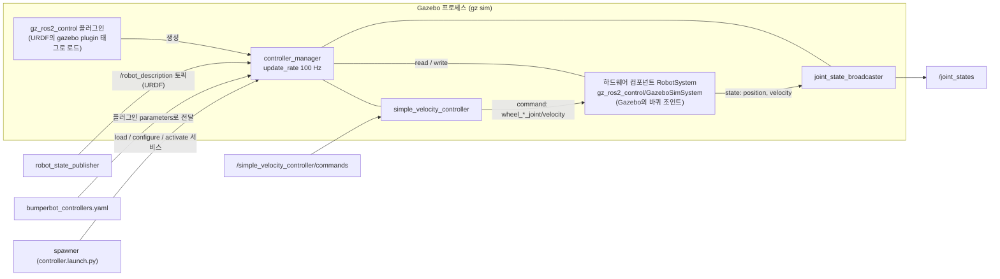

# 03. ros2_control 붙이기 (저장소 Section5)

> 참조: `Section5_Control/bumperbot_ws/src/bumperbot_description/urdf/bumperbot_ros2_control.xacro`, `Section5_Control/bumperbot_ws/src/bumperbot_controller/` (참조 저장소 최상위 기준 경로)

## 이 장에서 하는 일

- 02장의 URDF에 `<ros2_control>` 태그를 더해 "바퀴 두 개는 속도 명령을 받고 위치·속도를 돌려주는 하드웨어"라고 선언한다.
- Gazebo 안에서 `controller_manager`가 돌도록 Gazebo 플러그인(`gz_ros2_control`)을 URDF에 붙인다.
- `bumperbot_controller` 패키지를 만들어 제어기 설정 파일(yaml)과 스포너 launch를 넣는다.
- 끝나면 `ros2 topic pub`으로 바퀴를 돌릴 수 있고 `/joint_states`로 바퀴 위치·속도를 읽을 수 있다.
- ros2_control 전체에서의 자리: 이 장이 "ros2_control을 쓰려면 무엇이 필요한가"에 대한 답이다. 마지막 단계(단계 8)에 체크리스트로 정리한다.

## 이번 장의 파일

```text
~/bumperbot_ws/src/
├── bumperbot_description/
│   ├── package.xml                         [수정] gz_ros2_control 의존성
│   └── urdf/
│       ├── bumperbot.urdf.xacro            [수정] ros2_control xacro include
│       ├── bumperbot_gazebo.xacro          [수정] gz_ros2_control 플러그인
│       └── bumperbot_ros2_control.xacro    [새]  <ros2_control> 태그
└── bumperbot_controller/                   [새 패키지]
    ├── CMakeLists.txt                      [새]
    ├── LICENSE                             [새] (ros2 pkg create가 만든다)
    ├── package.xml                         [새]
    ├── config/
    │   └── bumperbot_controllers.yaml      [새]  controller_manager와 제어기 설정
    └── launch/
        └── controller.launch.py            [새]  스포너
```

## 단계 1. 큰 그림

### 왜 필요한가

파일을 하나씩 만들기 전에, 이 파일들이 서로 어떻게 맞물리는지 알아야 각 파일이 왜 필요한지 보인다. (자세한 설명은 `00_big_picture.md`가 한다. 여기서는 이 장에 필요한 만큼만 쓴다.)

ros2_control은 "제어기"와 "하드웨어"를 분리하는 틀이다.

- **하드웨어 컴포넌트**(`system`, `sensor`, `actuator` 중 하나): 실제 모터 드라이버, 또는 시뮬레이터 안의 조인트. 밖으로는 **인터페이스**만 내놓는다.
  - **command interface**: 제어기가 값을 써 넣는 곳. 이 장에서는 `wheel_left_joint/velocity`(목표 각속도, rad/s).
  - **state interface**: 제어기가 값을 읽는 곳. 이 장에서는 `wheel_left_joint/position`(rad), `wheel_left_joint/velocity`(rad/s).
  - 인터페이스는 `조인트이름/인터페이스이름` 형식의 이름을 가진 **실수(double) 하나**다.
- **제어기**(controller): 인터페이스를 읽고 써서 일을 하는 플러그인. 이 장에서 쓰는 것은 둘이다.
  - `joint_state_broadcaster`: 모든 state interface를 읽어 `/joint_states` 토픽으로 낸다.
  - `velocity_controllers/JointGroupVelocityController`(이름 `simple_velocity_controller`): 토픽으로 받은 숫자를 command interface에 쓴다.
  - 한 command interface는 한 번에 한 제어기만 **claim**(점유)할 수 있다.
- **controller_manager**(CM): 하드웨어와 제어기를 담는 노드다. 설정한 주기(여기서는 100 Hz)로 "하드웨어에서 읽기 → 제어기들 update → 하드웨어에 쓰기"를 반복하고, 제어기를 불러오고(load) 켜고 끄는(configure/activate) ROS 서비스를 제공한다.

시뮬레이션에서는 하드웨어 컴포넌트가 실제 모터 드라이버가 아니라 Gazebo의 조인트다. `gz_ros2_control`이라는 **Gazebo 플러그인**이 그 사이를 잇는다. 이 플러그인은 Gazebo 프로세스 **안에서** `controller_manager`를 만든다. 확인한 근거는 Gazebo를 서버 모드로 띄운 터미널 로그다. `[gazebo-2] [INFO] ... [gz_ros_control]: Loading controller_manager`, `[controller_manager]: Subscribing to '/robot_description' topic for robot description.`처럼 CM과 제어기의 로그가 `gazebo` 프로세스의 로그로 나온다.



이 장에서 만드는 파일과 위 그림의 대응:

| 그림의 요소 | 만드는 파일 |
|---|---|
| 하드웨어 컴포넌트와 그 인터페이스 | `bumperbot_ros2_control.xacro`의 `<ros2_control>` (단계 2) |
| CM 설정과 제어기 종류 | `bumperbot_controllers.yaml` (단계 3) |
| gz_ros2_control 플러그인과 yaml 연결 | `bumperbot_gazebo.xacro`의 `<gazebo><plugin>` (단계 4) |
| 스포너 | `controller.launch.py` (단계 6) |

## 단계 2. `bumperbot_ros2_control.xacro`: 하드웨어 선언

### 왜 필요한가

CM은 "어떤 하드웨어가 어떤 인터페이스를 내놓는지"를 **URDF의 `<ros2_control>` 태그**에서 읽는다. 이 태그가 없으면 CM이 하드웨어를 만들지 못해 제어기가 붙을 command/state interface가 없다. 로봇의 모양을 쓴 URDF와 같은 파일 안에 들어가므로 02장의 xacro에 `include`한다.

### 코드

> 파일: `bumperbot_description/urdf/bumperbot_ros2_control.xacro` — 전체
```xml
<?xml version="1.0"?>
<robot xmlns:xacro="http://www.ros.org/wiki/xacro" name="bumperbot">

    <ros2_control name="RobotSystem" type="system">

        <!-- ros2_control Gazebo -->
        <hardware>
            <plugin>gz_ros2_control/GazeboSimSystem</plugin>
        </hardware>

        <!-- ros2_control Common Interfaces -->
        <joint name="wheel_right_joint">
            <command_interface name="velocity">
              <param name="min">-1</param>
              <param name="max">1</param>
            </command_interface>
            <state_interface name="position" />
            <state_interface name="velocity" />
        </joint>

        <joint name="wheel_left_joint">
            <command_interface name="velocity">
              <param name="min">-1</param>
              <param name="max">1</param>
            </command_interface>
            <state_interface name="position" />
            <state_interface name="velocity" />
        </joint>

    </ros2_control>

</robot>
```

`bumperbot.urdf.xacro`에 include를 더한다. `bumperbot_gazebo.xacro`를 include한 줄 아래에 넣는다.

> 파일: `bumperbot_description/urdf/bumperbot.urdf.xacro` — 수정
```xml
<robot name="bumperbot" xmlns:xacro="http://ros.org/wiki/xacro">

  <!-- Include Gazebo Parameters -->
  <xacro:include filename="$(find bumperbot_description)/urdf/bumperbot_gazebo.xacro" />

  <!-- Include ros2_control Plugins -->
  <xacro:include filename="$(find bumperbot_description)/urdf/bumperbot_ros2_control.xacro" />
```

### 코드 설명

- `<robot xmlns:xacro=... name="bumperbot">`: include되는 파일의 루트. 02장의 `bumperbot_gazebo.xacro`와 같은 역할이다.
- `<ros2_control name="RobotSystem" type="system">`: 하드웨어 컴포넌트 하나를 선언한다. 읽는 곳은 `controller_manager`의 자원 관리자(resource manager)다.
  - `name`: 이 컴포넌트의 이름. 아무 이름이나 되고 `ros2 control list_hardware_components`에 이 이름이 나온다.
  - `type`: `system`(여러 조인트를 한 묶음으로 읽고 쓰는 하드웨어), `sensor`, `actuator` 중 하나. 바퀴 둘을 한 번에 다루므로 `system`이다. 11장에서 직접 쓰는 실물 하드웨어도 `system`이다.
- `<hardware><plugin>gz_ros2_control/GazeboSimSystem</plugin></hardware>`: 이 컴포넌트를 구현한 플러그인 클래스. 읽는 곳은 `gz_ros2_control` 플러그인(pluginlib으로 이름을 찾는다. 설치된 `/opt/ros/jazzy/share/gz_ros2_control/gz_hardware_plugins.xml`에 `gz_ros2_control/GazeboSimSystem` 클래스가 등록되어 있다). 실물 로봇에서는 이 자리에 우리가 쓴 하드웨어 플러그인 이름이 들어간다(11장). 시뮬레이션과 실물에서 바뀌는 곳은 거의 이 한 줄이다.
- `<joint name="wheel_right_joint">`: 이 하드웨어가 다루는 조인트. **이름이 URDF의 `<joint name=...>`와 글자까지 같아야** 한다. 플러그인이 Gazebo 모델에서 이 이름의 조인트를 찾는다. 다르면 시작할 때 `Joint 'wheel_leftt_joint' not found in URDF`라는 오류가 나고 하드웨어 인터페이스 목록이 비어 버린다(오타를 넣어 재현했다).
- `<command_interface name="velocity">`: 제어기가 쓸 수 있는 명령 인터페이스. 이름 `velocity`는 "속도 명령"이라는 뜻이고 단위는 조인트가 회전이므로 rad/s다. 이 한 줄이 `wheel_right_joint/velocity`라는 command interface를 만든다. `gz_ros2_control`이 이 인터페이스를 지원하는 조합은 `position`, `velocity`, `effort`다(일반 지식. 이 장은 `velocity`만 쓴다).
- `<param name="min">-1</param>`, `<param name="max">1</param>`: 이 command interface의 값 범위다. **이 설정에서는 실제로 강제되지 않는다.** 이 가이드를 쓸 때 확인한 결과:
  - CM의 `enforce_command_limits` 파라미터가 기본값 `False`이고, 시작 로그에 `Enforcing command limits is disabled. Command limits from URDF will be ignored.`가 나온다.
  - 그 상태에서 바퀴에 5.0 rad/s를 명령하자 `/joint_states`의 속도가 4.99999...로 나왔다(제한 없음).
  - yaml에 `enforce_command_limits: true`를 임시로 넣으면 같은 명령이 1.0 rad/s로 잘렸고 `Command of at least one joint is out of limits`라는 ERROR 로그가 1초마다 나왔다.
  - 따라서 이 값은 "켜면 ±1 rad/s(바퀴 반지름 0.033 m이므로 약 0.033 m/s)로 제한되는 설정"이다. 참조는 켜지 않고 이 줄을 그대로 둔다.
- `<state_interface name="position" />`, `<state_interface name="velocity" />`: 제어기가 읽을 수 있는 상태. 위치(rad)와 속도(rad/s). `joint_state_broadcaster`가 이 둘을 읽어 `/joint_states`로 낸다. 07장의 오도메트리도 이 값을 쓴다.
- 오른쪽 조인트가 왼쪽보다 먼저 선언되어 있다. 이 순서는 07장에서 `/joint_states`의 조인트 순서를 따질 때 다시 나온다.

`bumperbot.urdf.xacro`에 더한 `include` 줄은 02장의 `bumperbot_gazebo.xacro` include와 같은 방식이다. 이 파일들은 모두 최종 URDF 하나로 합쳐진다.

### 빌드와 시험

새 터미널이라면 `source ~/bumperbot_ws/install/setup.bash`를 먼저 친다. 이 단계에서는 풀린 URDF를 확인한다. 아직 Gazebo 플러그인을 넣지 않았으므로(단계 4) `bumperbot_controller` 패키지가 없어도 풀린다. 새 파일(`bumperbot_ros2_control.xacro`)을 `--symlink-install`로 설치하려면 다시 빌드한다.

```bash
cd ~/bumperbot_ws
colcon build --symlink-install
source install/setup.bash
xacro src/bumperbot_description/urdf/bumperbot.urdf.xacro | check_urdf /dev/stdin | head -3
xacro src/bumperbot_description/urdf/bumperbot.urdf.xacro | grep -n -A6 "<ros2_control"
```

기대 결과:

```text
Finished <<< bumperbot_description [0.26s]
```

작업 공간에 앞 장의 패키지도 있으면 그 패키지의 `Finished` 줄도 함께 나오고 `Summary`의 패키지 수는 사용자마다 다르다. `Failed`가 없고 경고가 없으면 된다.

```text
robot name is: bumperbot
---------- Successfully Parsed XML ---------------
root Link: base_footprint has 1 child(ren)
```

```text
43:  <ros2_control name="RobotSystem" type="system">
44-    <!-- ros2_control Gazebo -->
45-    <hardware>
46-      <plugin>gz_ros2_control/GazeboSimSystem</plugin>
47-    </hardware>
48-    <!-- ros2_control Common Interfaces -->
49-    <joint name="wheel_right_joint">
```

- 통과 조건: 오류 없이 `check_urdf`가 통과하고, 풀린 URDF 안에 `<ros2_control name="RobotSystem" type="system">`이 있다. (줄 번호 `43`은 이 파일을 쓴 모양에 따라 조금 다를 수 있다.)

## 단계 3. `bumperbot_controller` 패키지와 `bumperbot_controllers.yaml`

### 왜 필요한가

CM은 "어떤 제어기를 어떤 이름으로 어떤 설정으로 쓸지"를 파라미터에서 읽는다. 이 파라미터를 담은 yaml이 `bumperbot_controllers.yaml`이다. 이 yaml을 설치(share)하고, 다음 단계들의 launch 파일을 담을 패키지가 `bumperbot_controller`다. 지금은 C++ 코드가 없고 설정과 launch만 있는 패키지다. C++ 노드(`simple_controller`)는 05장에서 이 패키지에 들어온다.

### 코드

```bash
cd ~/bumperbot_ws/src
ros2 pkg create --build-type ament_cmake --license Apache-2.0 \
  --description "The bumperbot_controller package" \
  --maintainer-name "Your Name" --maintainer-email "you@example.com" \
  bumperbot_controller
cd bumperbot_controller
rm -r include src
mkdir -p launch config
```

`ros2 pkg create`는 02장과 같이 `package.xml`, `CMakeLists.txt`, `LICENSE`와 빈 `include/bumperbot_controller/`, `src/`를 만든다. C++ 파일은 05장에서 이 패키지에 들어오므로 그때 `include`와 `src`를 다시 만든다. 이 장에는 C++ 코드가 없으므로 지운다(빈 폴더로 두어도 빌드에는 영향이 없다). 설치할 폴더 `launch`와 `config`를 만든다.

`CMakeLists.txt`와 `package.xml`을 아래 내용으로 바꾸고, `config/bumperbot_controllers.yaml`을 새로 만든다.

> 파일: `bumperbot_controller/CMakeLists.txt` — 전체
```cmake
cmake_minimum_required(VERSION 3.8)
project(bumperbot_controller)

find_package(ament_cmake REQUIRED)

install(
  DIRECTORY launch config
  DESTINATION share/${PROJECT_NAME}
)

ament_package()
```

> 파일: `bumperbot_controller/package.xml` — 전체
```xml
<?xml version="1.0"?>
<?xml-model href="http://download.ros.org/schema/package_format3.xsd" schematypens="http://www.w3.org/2001/XMLSchema"?>
<package format="3">
  <name>bumperbot_controller</name>
  <version>0.0.0</version>
  <description>The bumperbot_controller package</description>
  <maintainer email="you@example.com">Your Name</maintainer>
  <license>Apache-2.0</license>

  <buildtool_depend>ament_cmake</buildtool_depend>

  <exec_depend>ros2launch</exec_depend>
  <exec_depend>robot_state_publisher</exec_depend>
  <exec_depend>xacro</exec_depend>
  <exec_depend>controller_manager</exec_depend>

  <test_depend>ament_lint_auto</test_depend>
  <test_depend>ament_lint_common</test_depend>

  <export>
    <build_type>ament_cmake</build_type>
  </export>

</package>
```

> 파일: `bumperbot_controller/config/bumperbot_controllers.yaml` — 전체
```yaml
controller_manager:
  ros__parameters:
    update_rate: 100 # Hz
    use_sim_time: true

    joint_state_broadcaster:
      type: joint_state_broadcaster/JointStateBroadcaster

    simple_velocity_controller:
      type: velocity_controllers/JointGroupVelocityController


simple_velocity_controller:
  ros__parameters:
    joints:
      - wheel_left_joint
      - wheel_right_joint
```

### 코드 설명

`CMakeLists.txt`: 02장의 `bumperbot_description`과 같은 "자료 패키지" 구조다. `install(DIRECTORY launch config DESTINATION share/${PROJECT_NAME})`가 두 폴더를 `share/bumperbot_controller/`로 설치한다. 이 설치가 있어야 단계 4의 `$(find bumperbot_controller)/config/...`와 launch 파일의 경로 검색이 동작한다. 02장의 `if(BUILD_TESTING)` 블록은 이 파일에 없다. 린트 시험을 쓰지 않으면 없어도 된다. 이 패키지에도 C++ 코드가 아직 없으므로 `ros2 pkg create`가 만드는 `add_compile_options` 블록과 안내 주석은 뺐다(05장에서 C++ 코드를 넣을 때 다시 넣는다).

`package.xml`의 `<test_depend>` 두 줄(`ament_lint_auto`, `ament_lint_common`)은 `ros2 pkg create`가 넣은 린트 패키지다. `colcon test`용이라 빌드에는 영향이 없고, 02장과 같이 그대로 둔다.

`package.xml`의 `exec_depend`:

| 태그 | 쓰이는 곳 |
|---|---|
| `ros2launch` | `ros2 launch` 명령 |
| `robot_state_publisher`, `xacro` | 참조가 넣어 둔 것. 이 장의 launch에서는 쓰지 않는다. |
| `controller_manager` | 스포너(`controller_manager/spawner`)와 `ros2 control` 명령 |

제어기 플러그인 패키지(`joint_state_broadcaster`, `velocity_controllers`)는 `exec_depend`에 없다. 실제로는 필요한 패키지다. 참조는 05장에서 `ros2_controllers`(제어기 모음 메타패키지)를 더해 이를 해결한다. 이 장 시점에는 이미 설치되어 있어서 동작한다.

`bumperbot_controllers.yaml`: ROS 파라미터 파일 형식이다.

- 최상위 키가 **노드 이름**이다. `controller_manager:`는 노드 `/controller_manager`의 파라미터, `simple_velocity_controller:`는 노드 `/simple_velocity_controller`(제어기 하나가 노드 하나다)의 파라미터다. 노드 이름과 키가 다르면 파라미터가 적용되지 않는다. 최상위 키를 `controller_manger:`로 틀리게 쓰고 돌려 보면 Gazebo 로그에 `The 'type' param was not defined for 'simple_velocity_controller'.`가 뜨고 스포너가 `Failed loading controller simple_velocity_controller`로 종료한다(재현했다).
- `ros__parameters:`: ROS 2 파라미터 파일에서 노드 키 바로 아래에 반드시 적는 고정 키다(밑줄 두 개).
- `controller_manager.ros__parameters`:
  - `update_rate: 100`: CM의 제어 주기(Hz). 이 값으로 `read → update → write`가 돈다. 이 가이드를 쓸 때 `/joint_states`가 약 100 Hz(`ros2 topic hz`의 `average rate`가 99.999)로 나왔다.
  - `use_sim_time: true`: 이 노드가 시뮬레이션 시각(`/clock`)을 쓴다. 이 줄을 빼고도 돌려 보았다. CM과 두 제어기의 `use_sim_time`이 모두 `True`였고 `/joint_states`의 시각도 시뮬레이션 시각이었다. 플러그인이 CM에 `use_sim_time:=true`를 자동으로 넘기기 때문으로 보인다(라이브러리 문자열에 `use_sim_time:=true`가 있다). 이 줄은 필수가 아니다. 참조를 따라 적어 두고, 시뮬레이션이라는 뜻을 분명히 한다.
  - `joint_state_broadcaster:` / `type: joint_state_broadcaster/JointStateBroadcaster`: **제어기의 이름**(`joint_state_broadcaster`)과 **종류**(`type`)를 짝짓는다. 이 이름이 스포너 인자(단계 6)와 노드 이름이 된다. `type`은 `패키지/클래스` 형식이고 pluginlib가 찾는다. 설치된 모든 종류는 `ros2 control list_controller_types`로 볼 수 있다. 이 장에서 쓰는 둘은 이렇게 나온다.

```text
joint_state_broadcaster/JointStateBroadcaster                          controller_interface::ControllerInterface
velocity_controllers/JointGroupVelocityController                      controller_interface::ControllerInterface
```

  - `simple_velocity_controller:` / `type: velocity_controllers/JointGroupVelocityController`: 이름은 마음대로 정한다. 종류는 위 목록에 있는 것이어야 한다. 이 제어기는 `std_msgs/msg/Float64MultiArray` 메시지로 조인트별 속도 목표를 받아 command interface `velocity`에 쓴다.
- `simple_velocity_controller.ros__parameters.joints`: 이 제어기가 다룰 조인트 이름의 **순서 있는 목록**. 토픽으로 받는 숫자 배열의 첫 번째 값이 `wheel_left_joint`, 두 번째 값이 `wheel_right_joint`가 된다. 이 순서는 05장에서 `simple_controller`가 값을 만드는 순서를 정한다. 이 제어기는 이 조인트들의 `velocity` command interface를 claim한다. `joint_state_broadcaster`에는 `joints` 같은 파라미터가 없다. 비어 있으면 읽을 수 있는 모든 state interface를 낸다(설치된 파라미터 정의 `joint_state_broadcaster_parameters.hpp`에서 `joints`, `interfaces`가 기본 빈 목록이고 `frame_id`의 기본값이 `base_link`다).

### 빌드와 시험

두 패키지를 함께 빌드한다. 순서는 colcon이 알아서 정한다. 새 터미널이라면 `source ~/bumperbot_ws/install/setup.bash`를 먼저 친다.

```bash
cd ~/bumperbot_ws
colcon build --symlink-install
source install/setup.bash
ros2 pkg prefix bumperbot_controller
ls install/bumperbot_controller/share/bumperbot_controller/config
```

기대 결과(이 단계와 관계있는 줄만):

```text
Finished <<< bumperbot_controller [0.51s]
Finished <<< bumperbot_description [0.26s]
```

작업 공간에 앞 장의 패키지도 있으면 그 패키지의 `Finished` 줄도 함께 나오고 `Summary`의 패키지 수는 사용자마다 다르다. `Failed`가 없고 경고가 없으면 된다.

```text
/home/<사용자>/bumperbot_ws/install/bumperbot_controller
bumperbot_controllers.yaml
```

- 통과 조건: 경고 없이 빌드되고, `ros2 pkg prefix`가 `install/bumperbot_controller`를 출력하고, `share/bumperbot_controller/config/`에 yaml이 있다. 이 yaml이 단계 4의 플러그인이 읽는 파일이다.

## 단계 4. `bumperbot_gazebo.xacro`: Gazebo 플러그인 붙이기

### 왜 필요한가

단계 2의 `<ros2_control>`은 "이런 하드웨어가 있다"는 **선언**일 뿐이다. 이 선언을 읽고 CM을 만들 프로그램이 Gazebo 안에 있어야 한다. 이 플러그인이 읽을 yaml은 단계 3에서 만들었다. 그것이 `gz_ros2_control` 시스템 플러그인이다. Gazebo는 SDF의 `<plugin>` 태그를 보고 공유 라이브러리를 읽어 모델에 붙인다. URDF에서는 `<gazebo>` 태그 안에 `<plugin>`을 쓰면 SDF로 변환될 때 모델의 플러그인이 된다(`gz sdf -p`로 확인했다).

### 코드

`bumperbot_gazebo.xacro`의 마지막 `</gazebo>` 뒤, `</robot>` 앞에 넣는다.

> 파일: `bumperbot_description/urdf/bumperbot_gazebo.xacro` — 수정
```xml
  <!-- ROS 2 Control -->
  <gazebo>
    <plugin filename="gz_ros2_control-system" name="gz_ros2_control::GazeboSimROS2ControlPlugin">
      <parameters>$(find bumperbot_controller)/config/bumperbot_controllers.yaml</parameters>
    </plugin>
  </gazebo>

</robot>
```

`bumperbot_description/package.xml`에는 실행 의존성을 더한다.

> 파일: `bumperbot_description/package.xml` — 수정
```xml
  <exec_depend>ros_gz_bridge</exec_depend>
  <exec_depend>gz_ros2_control</exec_depend>
```

### 코드 설명

- `<gazebo>`(`reference` 없음): 로봇 전체(모델)에 적용하는 Gazebo 태그다. 02장의 `<gazebo reference="링크">`는 링크 하나에 적용되었다.
- `filename="gz_ros2_control-system"`: 읽을 공유 라이브러리 이름. 실제 파일은 `/opt/ros/jazzy/lib/libgz_ros2_control-system.so`다. Gazebo가 `lib` 접두사와 `.so`를 붙여 `GZ_SIM_SYSTEM_PLUGIN_PATH`에서 찾는다. 이 환경변수는 `source /opt/ros/jazzy/setup.bash`가 `/opt/ros/jazzy/lib`로 채우고, `gz_sim.launch.py`가 `LD_LIBRARY_PATH`도 더한다. 저장소 코드에는 없지만 일반 지식에 따르면 이 경로에 라이브러리가 없으면 Gazebo가 플러그인을 로드하지 못한다.
- `name="gz_ros2_control::GazeboSimROS2ControlPlugin"`: 그 라이브러리 안의 C++ 클래스 이름. (설치된 헤더 `gz_ros2_control/gz_ros2_control_plugin.hpp`에 이 클래스가 있다.)
- `<parameters>$(find bumperbot_controller)/config/bumperbot_controllers.yaml</parameters>`: CM에 넘길 파라미터 파일. 플러그인이 이 yaml을 CM 노드의 파라미터 파일로 넘긴다(결과로 CM이 yaml의 `update_rate`와 제어기 목록을 읽는 것을 확인했다). **다른 패키지(`bumperbot_controller`)의 파일을 가리키므로** xacro가 `$(find ...)`로 그 패키지의 설치 경로로 바꾼다. 풀린 URDF를 보면 `.../install/bumperbot_controller/share/bumperbot_controller/config/bumperbot_controllers.yaml`로 되어 있다(확인했다). 그래서 `bumperbot_controller` 패키지가 **빌드되어 있고 source되어 있어야** xacro가 풀린다(단계 3을 먼저 한 이유다). 없으면 `package 'bumperbot_controller' not found`라는 오류가 난다(재현했다).
- 참조에는 Humble용 `ign_ros2_control-system` 플러그인 분기(`is_ignition`)가 있다. Jazzy만 쓰므로 뺐다("참조 코드와 다른 점").

`package.xml`의 `gz_ros2_control`: 플러그인 라이브러리와 `GazeboSimSystem` 클래스를 제공하는 패키지다. 실행할 때 필요하므로 `exec_depend`다.

`bumperbot_description`은 xacro에서 `$(find bumperbot_controller)`를 쓰지만 `package.xml`에 `bumperbot_controller`를 적지 않는다(참조도 같다). 의존성을 정확히 적으려면 `<exec_depend>bumperbot_controller</exec_depend>`를 더하는 것이 맞다. 이 가이드는 참조를 따라 적지 않았다. 순환 의존은 생기지 않는다(`bumperbot_controller`는 `bumperbot_description`을 쓰지 않는다).

### 빌드와 시험

새 터미널이라면 `source ~/bumperbot_ws/install/setup.bash`를 먼저 친다.

```bash
cd ~/bumperbot_ws
colcon build --symlink-install
source install/setup.bash
xacro src/bumperbot_description/urdf/bumperbot.urdf.xacro > /tmp/bumperbot.urdf
check_urdf /tmp/bumperbot.urdf | head -3
grep -c "<ros2_control" /tmp/bumperbot.urdf
grep "bumperbot_controllers.yaml" /tmp/bumperbot.urdf
```

기대 결과(`colcon build`는 이 단계와 관계있는 줄만):

```text
Finished <<< bumperbot_description [0.26s]
```

작업 공간에 앞 장의 패키지도 있으면 그 패키지의 `Finished` 줄도 함께 나오고 `Summary`의 패키지 수는 사용자마다 다르다. `Failed`가 없고 경고가 없으면 된다.

```text
robot name is: bumperbot
---------- Successfully Parsed XML ---------------
root Link: base_footprint has 1 child(ren)
```

```text
1
```

```text
<parameters>/home/<사용자>/bumperbot_ws/install/bumperbot_controller/share/bumperbot_controller/config/bumperbot_controllers.yaml</parameters>
```

- 통과 조건: 경고 없이 빌드되고, `xacro`가 오류 없이 풀리며, `<ros2_control` 태그가 1개이고(`grep -c`가 `1`), `<parameters>`에 설치 경로의 yaml 절대 경로가 들어 있다.
- 이 단계에서 `package 'bumperbot_controller' not found`가 나오면 단계 3의 패키지를 빌드하지 않았거나 `source`하지 않은 것이다.

## 단계 5. 시험 A: 제어기를 올리기 전의 상태

### 왜 필요한가

제어기를 올리기 전에 "하드웨어와 그 인터페이스는 생겼는데 제어기는 없다"는 상태를 눈으로 확인한다. 어느 xacro 줄이 어떤 출력이 되는지 대응시키면 URDF의 태그가 무엇을 만드는지 알 수 있다.

### 코드

새 코드는 없다. 단계 2~4에서 쓴 파일이 만드는 상태를 `ros2 control` 명령으로 본다.

### 코드 설명

쓴 줄이 어떤 출력이 되는지 먼저 정리한다. 실제 출력은 아래 "빌드와 시험"에서 본다.

| 단계 2~4에서 쓴 줄 | 나올 출력 |
|---|---|
| `<ros2_control name="RobotSystem" ...>` | `ros2 control list_hardware_components`의 `name: RobotSystem` |
| `<joint name="wheel_*_joint"><command_interface name="velocity">` | `wheel_*_joint/velocity [available] [unclaimed]` |
| `<state_interface name="position">`, `<state_interface name="velocity">` | state interfaces 네 줄 |
| yaml의 제어기 두 개(`joint_state_broadcaster`, `simple_velocity_controller`) | 아직 load하지 않았으므로 `list_controllers`는 `No controllers are currently loaded!` |
| `<gazebo><plugin ...gz_ros2_control...>` | Gazebo 로그의 `Loading controller_manager`와 노드 `/controller_manager` |

### 빌드와 시험

터미널 A에서 Gazebo를 띄운다. 이 launch는 끝나지 않는다. 단계 7까지 켜 두고, 단계 7이 끝나면 `Ctrl+C`로 끈다.

```bash
cd ~/bumperbot_ws
source install/setup.bash
ros2 launch bumperbot_description gazebo.launch.py
```

(창이 뜬다. 02장과 같은 launch 파일이다.) 터미널 B에서:

```bash
source ~/bumperbot_ws/install/setup.bash
ros2 node list
ros2 control list_hardware_components
ros2 control list_hardware_interfaces
ros2 control list_controllers
```

아래 출력은 이 가이드를 쓸 때 창 없이 서버만 띄워 얻은 것이다(`gz_args`에 `-s`를 더한 launch 사본. 가이드의 launch 파일에는 `-s`가 없다). 값(시각 등)은 실행마다 다르다.

Gazebo 터미널의 로그(줄임, 시각·색상 제거):

```text
[create-3] [INFO] [ros_gz_sim]: Entity creation successful.
[gazebo-2] [INFO] [gz_ros_control]: Loading controller_manager
[gazebo-2] [INFO] [controller_manager]: Using ROS clock for triggering controller manager cycles.
[gazebo-2] [WARN] [controller_manager]: The resource manager is not yet initialized, will wait for the robot description to initialize it..
[gazebo-2] [INFO] [controller_manager]: Subscribing to '/robot_description' topic for robot description.
[gazebo-2] [WARN] [gz_ros_control]: Waiting RM to load and initialize hardware...
[gazebo-2] [INFO] [controller_manager]: Received robot description from topic.
[gazebo-2] [INFO] [controller_manager]: Enforcing command limits is disabled. Command limits from URDF will be ignored.
[gazebo-2] [INFO] [gz_ros_control]: Loading joint: wheel_right_joint
[gazebo-2] [INFO] [gz_ros_control]: 	State:
[gazebo-2] [INFO] [gz_ros_control]: 		 position
[gazebo-2] [INFO] [gz_ros_control]: 		 velocity
[gazebo-2] [INFO] [gz_ros_control]: 	Command:
[gazebo-2] [INFO] [gz_ros_control]: 		 velocity
[gazebo-2] [INFO] [gz_ros_control]: Loading joint: wheel_left_joint
...
[gazebo-2] [INFO] [controller_manager]: Successful initialization of hardware 'RobotSystem'
[gazebo-2] [INFO] [resource_manager]: Successful 'activate' of hardware 'RobotSystem'
[gazebo-2] [INFO] [controller_manager]: Resource Manager has been successfully initialized. Starting Controller Manager services...
```

이 로그에서 알 수 있는 것:

- **URDF는 `/robot_description` 토픽으로 들어온다.** CM이 `robot_state_publisher`가 내는 `/robot_description` 토픽을 구독해 URDF를 받는다(`Subscribing to '/robot_description' topic`, `Received robot description from topic`). 그래서 `robot_state_publisher`가 먼저(또는 함께) 떠 있어야 하고, 02장의 `gazebo.launch.py`가 이 노드를 띄운다. 파라미터 서비스로 URDF를 읽어 오는 것이 아니다(이 버전의 로그 기준).
- 시작 직후 `The resource manager is not yet initialized, will wait for the robot description`, `Waiting RM to load and initialize hardware...` 경고가 나올 수 있다. 타이밍에 따라 나오지 않을 수도 있다. CM이 URDF보다 먼저 떴을 때의 대기 메시지이고, 곧 `Received robot description from topic`이 나오며 풀린다.
- `Loading joint: wheel_right_joint ... State: position velocity / Command: velocity`: 단계 2의 `<joint>`와 `<state_interface>`, `<command_interface>`가 그대로 읽혔다.

그 밖에 나오는 경고 세 가지는 이 구성에서 정상이다. 기능에는 영향이 없었다(이 장의 모든 시험이 통과했다). 원인 해석은 로그 문구에 따른 것이다. 소스는 확인하지 못했다.

| 로그 | 뜻 |
|---|---|
| `[WARN] [controller_manager.hardware_component.system.RobotSystem]: Executor is not available during hardware component initialization for 'RobotSystem'. Skipping node creation!` | 하드웨어 컴포넌트가 자기 노드를 만들 때 쓸 실행기가 없어 노드 생성을 건너뛴다는 알림. 노드 없이도 이 장의 동작에 문제가 없었다. |
| `[WARN] [controller_manager]: Component 'RobotSystem' does not have read or write statistics initialized, skipping registration.` | 읽기/쓰기 통계를 등록하지 않는다는 알림. |
| `[WARN] [gz_ros_control]: Desired controller update period (0.01 s) is slower than the gazebo simulation period (0.001 s).` | CM 주기 0.01 s(100 Hz)가 Gazebo 물리 스텝 0.001 s보다 길다는 알림이다. CM은 물리 스텝 10번에 한 번 돈다. 오류가 아니다. 주기를 1000으로 올리면 사라지겠지만 참조를 따라 100을 쓴다. |

명령 출력:

```text
/controller_manager
/gz_ros_control
/robot_state_publisher
/ros_gz_bridge
```

`/controller_manager`가 노드로 보인다. 이 노드는 Gazebo 프로세스 안에 있다. `/gz_ros_control`은 플러그인이 `controller_manager`와 따로 만드는 노드다. 로그에 `[gz_ros_control]`로 나오고(`Loading joint: ...` 등 하드웨어 초기화 로그), `ros2 node info /gz_ros_control`로 보면 파라미터 서비스 외에 토픽·서비스가 없다. 그 이상의 역할은 확인하지 못했다.

```text
Hardware Component 1
	name: RobotSystem
	type: 
	plugin name: 
	state: id=3 label=active
	read/write rate: 0 Hz
	is_async: False
	command interfaces
		wheel_right_joint/velocity [available] [unclaimed]
		wheel_left_joint/velocity [available] [unclaimed]
```

```text
command interfaces
	wheel_left_joint/velocity [available] [unclaimed]
	wheel_right_joint/velocity [available] [unclaimed]
state interfaces
	wheel_left_joint/position
	wheel_left_joint/velocity
	wheel_right_joint/position
	wheel_right_joint/velocity
```

```text
No controllers are currently loaded!
```

출력과 xacro 줄의 대응:

| 출력 | 나온 곳 |
|---|---|
| `name: RobotSystem` | `<ros2_control name="RobotSystem" ...>` |
| `state: id=3 label=active` | 컴포넌트가 만들어져 `configure`, `activate`까지 끝났다(로그의 `Successful 'activate' of hardware 'RobotSystem'`). 플러그인이 자동으로 켠다. |
| `wheel_right_joint/velocity [available] [unclaimed]` | `<joint name="wheel_right_joint"><command_interface name="velocity">`. `available`은 쓸 수 있다는 뜻, `unclaimed`는 아직 어떤 제어기도 점유하지 않았다는 뜻이다. |
| state interfaces 네 줄 | `<state_interface name="position">`, `<state_interface name="velocity">`가 조인트마다 하나씩. state interface에는 claim 개념이 없어서 표시도 없다. |
| `type:`, `plugin name:`이 비어 있고 `read/write rate: 0 Hz` | 이 시뮬레이션 구성에서는 이렇게 나왔다. 이유는 확인하지 못했다. |
| `No controllers are currently loaded!` | yaml에는 제어기가 적혀 있지만 아직 **load하지 않았다.** yaml은 "쓸 수 있는 제어기 목록"일 뿐이다. 올리는 일은 스포너가 한다(단계 6). |

- 통과 조건 1: Gazebo 로그에 `Loading joint: wheel_right_joint`와 `wheel_left_joint`가 있고 `Resource Manager has been successfully initialized`가 있다.
- 통과 조건 2: `ros2 control list_hardware_interfaces`에 `wheel_left_joint/velocity [available] [unclaimed]`와 `wheel_right_joint/velocity ...`, state interface 네 개가 있다.
- 통과 조건 3: `ros2 control list_controllers`가 `No controllers are currently loaded!`를 출력한다.
- `ros2 control` 명령이 `waiting for service /controller_manager/list_controllers to become available...`을 한 번 출력하고 이어서 결과를 내는 경우가 있다. 서비스 탐색이 끝나기를 기다리는 메시지다.
- 인터페이스가 비어 있다면 Gazebo 로그에서 `ERROR`를 찾는다("자주 나는 오류" 참고).

## 단계 6. `controller.launch.py`와 스포너

### 왜 필요한가

CM에 제어기를 올리는 일은 세 단계다: **load**(yaml의 `type`으로 객체 생성, 상태 `unconfigured`), **configure**(파라미터를 읽고 토픽 등을 준비, 상태 `inactive`), **activate**(인터페이스를 점유하고 매 주기 update 시작, 상태 `active`). 이를 한 번에 해 주는 프로그램이 `controller_manager` 패키지의 `spawner`다. launch 파일에서 제어기마다 스포너 노드를 하나씩 띄운다.

### 코드

> 파일: `bumperbot_controller/launch/controller.launch.py` — 전체
```python
from launch import LaunchDescription
from launch_ros.actions import Node


def generate_launch_description():

    joint_state_broadcaster_spawner = Node(
        package="controller_manager",
        executable="spawner",
        arguments=[
            "joint_state_broadcaster",
            "--controller-manager",
            "/controller_manager",
        ],
    )

    simple_controller = Node(
        package="controller_manager",
        executable="spawner",
        arguments=["simple_velocity_controller",
                   "--controller-manager",
                   "/controller_manager"
        ]
    )

    return LaunchDescription(
        [
            joint_state_broadcaster_spawner,
            simple_controller,
        ]
    )
```

### 코드 설명

- `Node(package="controller_manager", executable="spawner", arguments=[...])`: 스포너 실행. 스포너는 일을 마치면 종료한다(`process has finished cleanly`).
- `arguments=["joint_state_broadcaster", "--controller-manager", "/controller_manager"]`:
  - 첫 인자는 **제어기 이름**(yaml의 `controller_manager.ros__parameters` 아래 키)이다.
  - `--controller-manager`(짧게 `-c`): 어느 CM에 요청할지, CM 노드의 이름이다. Gazebo 플러그인이 만든 CM은 `/controller_manager`다.
- 스포너가 하는 일은 `load → configure → activate`의 순서로 CM의 서비스를 부르는 것이다. 설치된 버전(`ros2 run controller_manager spawner --help`)의 주요 옵션:

| 옵션 | 뜻 |
|---|---|
| `-c`, `--controller-manager` | CM 노드 이름 |
| `-p`, `--param-file` | 제어기 파라미터 yaml을 추가로 읽어 configure 전에 적용 |
| `--load-only` | load만 하고 멈춘다(`unconfigured`) |
| `--inactive` | load, configure까지만(`inactive`) |
| `-u`, `--unload-on-kill` | 스포너가 **끝나지 않고** 남아 있다가 `Ctrl+C`(SIGINT)나 SIGTERM을 받으면 제어기를 deactivate하고 unload한 뒤 끝난다. 주지 않으면 스포너는 활성화를 마치고 바로 끝난다(설치된 `spawner.py`를 읽고 직접 돌려 확인했다. 돌리는 동안 로그에 `Waiting until interrupt to unload controllers`가 나온다) |
| `--controller-manager-timeout` | CM 서비스가 나타나기를 기다리는 시간 |

- **`--param-file`은 필요 없었다.** 단계 4의 `<parameters>`로 CM에 준 yaml에 `simple_velocity_controller`의 `joints`도 들어 있으므로 제어기가 그것을 읽었다(스포너에 `-p`를 주지 않고도 `joints`가 적용되어 활성화되었다). 제어기 파라미터를 CM의 yaml과 다른 파일에 둘 때만 `-p`가 필요하다.
- CM이 아직 없을 때 스포너를 먼저 띄우면 `waiting for service /controller_manager/list_controllers to become available...`을 출력하고 10초 뒤 `Could not contact service /controller_manager/list_controllers`라고 경고한 뒤 다시 기다린다(Gazebo 없이 돌려 보았다). 그래서 launch 순서는 엄격하지 않다.
- 두 번째 스포너의 변수 이름은 `simple_controller`지만 노드가 아니라 스포너다. 05장에서 같은 이름의 C++ 노드가 생기므로 그 장에서 이 부분을 다시 정리한다.
- 두 스포너는 동시에 돈다. 활성화 순서는 정해져 있지 않다. 실행해 보면 `simple_velocity_controller`가 먼저 끝날 수 있다.

### 빌드와 시험

새 launch 파일이 생겼으므로 다시 빌드한다. 단계 5의 Gazebo(터미널 A)는 그대로 켜 둔다.

터미널 B에서 빌드하고 스포너를 돌린다. 빌드 기대 결과는 이 패키지의 `Finished <<< bumperbot_controller` 줄이고, 다른 패키지 줄이 함께 나올 수 있다. 스포너 둘이 일을 마치면 이 launch는 저절로 끝난다(`Ctrl+C`가 필요 없다. 이 장 시점의 launch에는 계속 도는 노드가 없다).

```bash
cd ~/bumperbot_ws
colcon build --symlink-install
source install/setup.bash
ros2 launch bumperbot_controller controller.launch.py
```

터미널 C에서(처음 여는 터미널이면 `source`부터):

```bash
source ~/bumperbot_ws/install/setup.bash
ros2 control list_controllers
ros2 control list_hardware_interfaces
ros2 node list
ros2 topic list
ros2 topic echo /joint_states --once
```

기대 결과(터미널 B, 스포너 로그. 시각과 `pid`는 다르다. 두 스포너가 동시에 도므로 줄의 순서도 다를 수 있다):

```text
[spawner-2] [INFO] [spawner_simple_velocity_controller]: Loaded simple_velocity_controller
[spawner-2] [INFO] [spawner_simple_velocity_controller]: Configured and activated simple_velocity_controller
[INFO] [spawner-2]: process has finished cleanly [pid ...]
[spawner-1] [INFO] [spawner_joint_state_broadcaster]: Loaded joint_state_broadcaster
[spawner-1] [INFO] [spawner_joint_state_broadcaster]: Configured and activated joint_state_broadcaster
[INFO] [spawner-1]: process has finished cleanly [pid ...]
```

```text
joint_state_broadcaster    joint_state_broadcaster/JointStateBroadcaster      active
simple_velocity_controller velocity_controllers/JointGroupVelocityController  active
```

```text
command interfaces
	wheel_left_joint/velocity [available] [claimed]
	wheel_right_joint/velocity [available] [claimed]
state interfaces
	wheel_left_joint/position
	wheel_left_joint/velocity
	wheel_right_joint/position
	wheel_right_joint/velocity
```

```text
/controller_manager
/gz_ros_control
/joint_state_broadcaster
/robot_state_publisher
/ros_gz_bridge
/simple_velocity_controller
```

`ros2 topic list`에 새로 생기는 토픽(줄임): `/joint_states`, `/dynamic_joint_states`, `/simple_velocity_controller/commands`, `/joint_state_broadcaster/transition_event`, `/simple_velocity_controller/transition_event`.

- `/dynamic_joint_states`(`control_msgs/msg/DynamicJointState`): `joint_state_broadcaster`가 `/joint_states`와 함께 내는 메시지로 모든 인터페이스의 값을 담는다. 파라미터 `publish_dynamic_joint_states`의 기본값이 `true`다(설치된 `joint_state_broadcaster_parameters.hpp`에서 확인했다). 이 가이드에서는 쓰지 않는다.
- `/<제어기 이름>/transition_event`(`lifecycle_msgs/msg/TransitionEvent`): 제어기는 라이프사이클 노드라서 상태가 바뀔 때(`unconfigured → inactive → active`) 이 토픽으로 알린다.
- `/simple_velocity_controller/commands`는 단계 6의 아래 시험에서 직접 값을 보낼 토픽이다.

`ros2 topic echo /joint_states --once`의 출력(`stamp`와 아주 작은 `position`·`velocity` 값은 실행마다 다르다):

```text
header:
  stamp:
    sec: 59
    nanosec: 170000000
  frame_id: base_link
name:
- wheel_left_joint
- wheel_right_joint
position:
- -4.417234182137494e-12
- -4.4303683404692634e-12
velocity:
- 2.292809399379689e-19
- 2.148036277409665e-19
effort:
- .nan
- .nan
```

- 통과 조건 1: `list_controllers`에 두 제어기가 모두 `active`다.
- 통과 조건 2: 두 command interface가 `[claimed]`다. 단계 5의 `[unclaimed]`와 다르다. `simple_velocity_controller`가 점유했다.
- 통과 조건 3: `/joint_states`가 나오고 `name`이 두 바퀴 조인트다. 속도는 거의 0, `effort`는 `.nan`(이 하드웨어에는 effort 인터페이스가 없다)이다. `ros2 topic hz /joint_states`(끝나지 않는 명령이다. `Ctrl+C`로 끝낸다)는 약 100 Hz(`average rate: 100.008`)다. 이 값은 창 없이 서버만 띄운 Gazebo에서 얻었다. 창이 있는 Gazebo에서 시뮬레이션이 실시간보다 느리면(실시간 배율이 1보다 작으면) 더 낮게 나올 수 있다(직접 보지 못했다).
- **02장의 `joint_state_publisher_gui`는 이제 필요 없다.** `/joint_states`를 `joint_state_broadcaster`가 낸다. `robot_state_publisher`가 이를 받아 바퀴 프레임의 TF를 만든다. `/joint_states`의 시각은 시뮬레이션 시각이다(Gazebo를 띄운 뒤 흐른 시간이라 `sec: 59`처럼 작은 값이다).
- `/joint_states`의 `name`은 `wheel_left_joint, wheel_right_joint` 순서다. 단계 2의 xacro에서는 오른쪽이 먼저 선언되어 있는데도 이 순서였다(왜 이 순서인지는 07장에서 다시 본다).

### 바퀴를 돌려 보기

`simple_velocity_controller`가 받는 토픽에 속도 두 개를 보낸다. 순서는 yaml의 `joints`와 같이 `[왼쪽, 오른쪽]`이다. 터미널 C에서 먼저 명령을 보낸다.

```bash
ros2 topic pub --once /simple_velocity_controller/commands std_msgs/msg/Float64MultiArray "{data: [1.0, 1.0]}"
```

1초쯤 기다린 뒤 속도와 위치를 읽는다. 바퀴가 가속하는 데 시간이 걸리므로 명령 직후에는 속도가 1.0보다 작을 수 있다.

```bash
ros2 topic echo /joint_states --once --field velocity
ros2 topic echo /joint_states --once --field position
```

3~4초 기다린 뒤 위치를 한 번 더 읽고, Gazebo의 로봇 위치를 본다.

```bash
ros2 topic echo /joint_states --once --field position
gz model -m bumperbot -p
```

기대 결과(위치 값은 명령을 보낸 시각과 읽은 시각에 따라 다르다. 아래는 이 가이드를 쓸 때의 값이다):

```text
array('d', [0.9999999999982957, 0.9999999999940401])
```

```text
array('d', [3.4699999999693674, 3.469999999958508])
```

```text
array('d', [7.359999999963521, 7.359999999935622])
```

```text
  - Name: bumperbot
  - Pose [ XYZ (m) ] [ RPY (rad) ]:
    [0.252376 0.000000 0.000002]
    [-0.000000 -0.010547 -0.000000]
```

- 통과 조건 1: 두 바퀴의 `velocity`가 명령한 1.0 rad/s다.
- 통과 조건 2: 두 번째 `position`이 첫 번째보다 크고, 차이가 두 번 읽은 사이의 시간(초)과 비슷하다. 위 값은 두 번 읽은 시각이 3.89초 차이였고 위치 차이는 `7.36 − 3.47 = 3.89` rad였다. 1.0 rad/s로 도는 바퀴의 위치는 시간에 비례해 는다.
- 통과 조건 3: 로봇의 `x`가 0에서 늘어난다(바퀴가 `r × 회전각 = 0.033 × 7.36 ≈ 0.243` m 굴렀다면 `x`도 그 정도다. `gz model`은 위치를 읽은 시각이 조금 뒤라 값이 조금 더 크다).
- **멈추려면 `[0.0, 0.0]`을 보내야 한다.** 이 제어기는 마지막 명령을 계속 유지한다. `ros2 topic pub` 프로세스를 끝내도 바퀴는 1.0 rad/s로 계속 돈다(확인했다).

```bash
ros2 topic pub --once /simple_velocity_controller/commands std_msgs/msg/Float64MultiArray "{data: [0.0, 0.0]}"
```

- 왼쪽과 오른쪽에 다른 값을 보내면 회전한다. `[5.0, -3.0]`을 보내자 속도가 `[4.99999..., -3.0...]`으로 나왔다(단계 2에서 본 것처럼 `min`/`max`는 강제되지 않는다).
- 숫자를 하나만 보내면(`{data: [2.0]}`) 제어기가 `command size (1) does not match number of interfaces (2)` 오류를 내고 **비활성화된다**(`Deactivating controllers : [ simple_velocity_controller ] as their update resulted in an error!`). 이때 `list_controllers`가 `inactive`를 보이고 command interface는 `[unclaimed]`로 돌아간다. 다시 켜려면 `ros2 control switch_controllers --activate simple_velocity_controller`. (이 오류 로그는 터미널 A의 Gazebo 로그에 나온다.)

## 단계 7. 스포너가 대신 해 주는 일을 손으로 해 보기

### 왜 필요한가

`load → configure → activate`와 `claimed`의 의미는 직접 해 보아야 오래 남는다. 같은 일을 `ros2 control` 명령으로 하나씩 한다. 11장의 하드웨어 인터페이스를 시험할 때도 이 명령들을 쓴다.

### 코드

새 파일은 없다. `ros2 control`의 명령만 쓴다. 단계 6에서 올린 두 제어기를 내리고 다시 올린다. 터미널 A의 Gazebo는 그대로 둔다.

### 코드 설명

| 명령 | 하는 일 |
|---|---|
| `load_controller <이름>` | yaml의 `type`으로 제어기 객체를 만든다. 상태 `unconfigured`. |
| `set_controller_state <이름> inactive` | configure. 파라미터를 읽고 준비한다. |
| `set_controller_state <이름> active` | activate. command interface를 claim하고 update 시작. |
| `switch_controllers --activate/--deactivate <이름>` | 켜거나 끈다. 여러 제어기를 한 번에 바꿀 수 있다(`--activate a b`). `deactivate`하면 claim이 풀린다. |
| `unload_controller <이름>` | 제어기 객체를 없앤다. `active`이면 `Error unloading controller ...`로 실패한다. 이름은 하나만 받는다. |
| `load_controller --set-state active <이름>` | load와 configure, activate를 한 번에 한다. 스포너와 같은 일이다. |

- `active` 상태에서 다시 `activate`하거나 `unconfigured`로 되돌리면 `cannot activate simple_velocity_controller from its current state active`, `cannot cleanup simple_velocity_controller from its current state active`로 거절된다(종료 코드 1). 상태는 `unconfigured → inactive → active` 순서로만 오르내린다.
- 스포너의 `--param-file`은 이 명령에서는 `load_controller <이름> <param_file>`의 마지막 인자에 해당한다.

### 빌드와 시험

터미널 C에서 아래 명령을 순서대로 친다(`ros2 control` 명령은 모두 바로 끝난다). 출력은 이 가이드를 쓸 때 얻은 것이다.

```bash
ros2 control unload_controller joint_state_broadcaster
ros2 control switch_controllers --deactivate joint_state_broadcaster simple_velocity_controller
ros2 control list_controllers
ros2 control unload_controller joint_state_broadcaster
ros2 control unload_controller simple_velocity_controller
ros2 control list_controllers
```

```text
Error unloading controller joint_state_broadcaster, check controller_manager logs
```

```text
Successfully switched controllers!
Deactivated controllers: [ joint_state_broadcaster simple_velocity_controller ]
```

```text
joint_state_broadcaster    joint_state_broadcaster/JointStateBroadcaster      inactive
simple_velocity_controller velocity_controllers/JointGroupVelocityController  inactive
```

```text
Successfully unloaded controller joint_state_broadcaster
Successfully unloaded controller simple_velocity_controller
No controllers are currently loaded!
```

첫 `unload_controller`는 실패한다. `active` 상태의 제어기는 먼저 deactivate해야 unload할 수 있다. `unload_controller`는 이름을 하나만 받는다.

이제 `joint_state_broadcaster`를 한 단계씩 올린다.

```bash
ros2 control load_controller joint_state_broadcaster
ros2 control list_controllers
ros2 control set_controller_state joint_state_broadcaster inactive
ros2 control list_controllers
ros2 control set_controller_state joint_state_broadcaster active
ros2 control list_controllers
```

```text
Successfully loaded controller joint_state_broadcaster
joint_state_broadcaster joint_state_broadcaster/JointStateBroadcaster  unconfigured
Successfully configured joint_state_broadcaster
joint_state_broadcaster joint_state_broadcaster/JointStateBroadcaster  inactive
Successfully activated joint_state_broadcaster
joint_state_broadcaster joint_state_broadcaster/JointStateBroadcaster  active
```

두 번째 제어기는 `load_controller --set-state active`로 한 번에 올린다. 그리고 `switch_controllers`로 켜고 끄며 command interface의 `claimed` 표시를 본다.

```bash
ros2 control load_controller --set-state active simple_velocity_controller
ros2 control list_hardware_interfaces
ros2 control switch_controllers --deactivate simple_velocity_controller
ros2 control list_hardware_interfaces
ros2 control switch_controllers --activate simple_velocity_controller
```

```text
Successfully loaded controller simple_velocity_controller
Successfully loaded controller simple_velocity_controller into state active
```

```text
command interfaces
	wheel_left_joint/velocity [available] [claimed]
	wheel_right_joint/velocity [available] [claimed]
...
```

```text
Successfully switched controllers!
Deactivated controllers: [ simple_velocity_controller ]
```

```text
command interfaces
	wheel_left_joint/velocity [available] [unclaimed]
	wheel_right_joint/velocity [available] [unclaimed]
...
```

```text
Successfully switched controllers!
Activated controllers: [ simple_velocity_controller ]
```

- 통과 조건: 위 명령을 순서대로 실행했을 때 각 `list_controllers`가 `unconfigured → inactive → active`로 바뀌고, `deactivate`하면 command interface가 `[unclaimed]`, `activate`하면 `[claimed]`가 된다.
- 시험이 끝나면 터미널 A에서 `Ctrl+C`로 Gazebo를 끈다. 다음 장에서는 Gazebo를 새로 띄운다.

## 단계 8. 체크리스트: ros2_control에 필요한 것

이 장에서 만든 것을 "ros2_control을 쓰려면 무엇이 필요한가"의 형태로 정리한다. 자기 로봇(v5)에서도 이 여섯 항목이 필요하다.

| # | 필요한 것 | 이 저장소의 파일 | 누가 읽는가 |
|---|---|---|---|
| 1 | URDF의 `<ros2_control>` 태그: 하드웨어 컴포넌트 이름·종류, 조인트별 command/state interface | `bumperbot_description/urdf/bumperbot_ros2_control.xacro` (include: `bumperbot.urdf.xacro`) | `controller_manager`의 자원 관리자. `/robot_description` 토픽으로 받는다. |
| 2 | 하드웨어 플러그인: 인터페이스의 값을 실제 하드웨어(또는 시뮬레이터)와 주고받는 코드 | 시뮬레이션: `gz_ros2_control/GazeboSimSystem`(설치된 패키지, `<hardware><plugin>`에 이름만 적는다). 실물: 11장에서 직접 작성. | 자원 관리자(pluginlib) |
| 3 | `controller_manager`를 띄우는 주체 | 시뮬레이션: Gazebo의 `gz_ros2_control` 플러그인(`bumperbot_gazebo.xacro`의 `<gazebo><plugin>`). 실물: `ros2_control_node`를 launch에서 실행(12장). | Gazebo / launch |
| 4 | 제어기 설정 yaml: 갱신 주기, 제어기 이름과 종류, 제어기별 파라미터 | `bumperbot_controller/config/bumperbot_controllers.yaml` | CM 노드(플러그인의 `<parameters>`로 전달) |
| 5 | 제어기를 올리는 스포너 launch | `bumperbot_controller/launch/controller.launch.py` | `ros2 launch` → `spawner` → CM 서비스 |
| 6 | `package.xml` 의존성과 설치 | `bumperbot_description`: `gz_ros2_control`. `bumperbot_controller`: `controller_manager`(05장에서 `ros2_controllers` 추가). 두 패키지 모두 CMake에서 `install(DIRECTORY ...)` | colcon, rosdep |

- 시뮬레이션과 실물의 차이는 2번과 3번이다. 1, 4, 5번은 거의 그대로 재사용한다. (12장에서 `bumperbot_ros2_control.xacro`에 `is_sim` 분기가 들어온다.)
- 제어기 `type`에 쓴 `velocity_controllers`, `joint_state_broadcaster`는 설치된 ros2_controllers 패키지다. 이 장은 `JointGroupVelocityController`를 쓰지만, 05장에서 `diff_drive_controller`로 바꿔 끼운다. 바꾸는 곳은 yaml(4)과 스포너 인자(5)뿐이고 URDF(1)는 그대로다.

## 참조 코드와 다른 점

| 참조 | 이 가이드 | 이유 |
|---|---|---|
| `bumperbot.urdf.xacro`에 `<xacro:arg name="is_ignition" default="true"/>`와 그에 따른 분기 | 없음 | 이 가이드는 Jazzy만 쓴다. Humble과 Jazzy를 함께 지원하려고 둔 분기다. |
| `bumperbot_ros2_control.xacro`: `<xacro:if value="$(arg is_ignition)">`로 `ign_ros2_control/IgnitionSystem`, `<xacro:unless>`로 `gz_ros2_control/GazeboSimSystem` | `gz_ros2_control/GazeboSimSystem`만 | Jazzy 전용. 설치된 `gz_hardware_plugins.xml`에 `ign_ros2_control/IgnitionSystem`이 호환용 이름으로 남아 있지만 쓰지 않는다. |
| `bumperbot_gazebo.xacro`: `ign_ros2_control-system` / `gz_ros2_control-system` 두 플러그인 분기 | `gz_ros2_control-system` 하나 | 같은 이유. |
| `bumperbot_description/launch/gazebo.launch.py`: `ROS_DISTRO`로 `is_ignition`을 정해 xacro 명령에 `is_ignition:=...`를 붙인다 | 없음(02장의 `gazebo.launch.py` 그대로) | 같은 이유. 이 변경 때문에 `gazebo.launch.py`는 이 장에서 고치지 않는다. |
| `bumperbot_description/package.xml`: `<exec_depend condition="$ROS_DISTRO >= iron">gz_ros2_control</exec_depend>`, `<exec_depend condition="$ROS_DISTRO == humble">ign_ros2_control</exec_depend>` | `<exec_depend>gz_ros2_control</exec_depend>` 하나 | 같은 이유. |
| `controller.launch.py`: `import os`(쓰이지 않음) | 뺌 | 쓰지 않는 import. |
| `bumperbot_controller/package.xml`의 `<author>`, `<maintainer>`(참조 저자), `<license>Apache 2.0</license>`, `<?xml-model ...?>` 줄 없음 | `<author>` 없음, `Your Name` / `you@example.com`, `Apache-2.0`, `<?xml-model ...?>` 줄 있음 | `ros2 pkg create`가 만드는 모양을 따랐다. 02장과 같다. |
| `bumperbot_controller`에 `LICENSE` 없음 | 있음 | `ros2 pkg create --license Apache-2.0`이 만든다. |
| `bumperbot_controller/CMakeLists.txt`: `cmake_minimum_required(VERSION 3.5)` | `3.8` | `ros2 pkg create`가 만드는 값. |
| `bumperbot_description/package.xml`에 `bumperbot_controller` 의존성 없음 | 같음(없음) | 참조를 따랐다. 엄밀히는 `<exec_depend>bumperbot_controller</exec_depend>`가 맞다(단계 4 설명). |
| 파일 안의 공백·들여쓰기 | 정리 | 내용은 같다. |

## 자주 나는 오류

| 증상 | 원인 | 고치는 법 |
|---|---|---|
| `xacro`가 `package 'bumperbot_controller' not found`를 낸다. `included from: .../bumperbot.urdf.xacro`가 함께 나온다. | `bumperbot_gazebo.xacro`의 `$(find bumperbot_controller)`를 풀 수 없다. `bumperbot_controller`를 빌드하지 않았거나 source하지 않았다. | 두 패키지를 함께 `colcon build`하고 `source install/setup.bash`. |
| Gazebo 로그에 `[ERROR] [controller_manager]: Exception caught while loading and initializing components: Joint 'wheel_leftt_joint' not found in URDF`가 나오고 `ros2 control list_hardware_interfaces`가 비어 있다. | `<ros2_control>`의 `<joint name>`이 URDF의 조인트 이름과 다르다(오타). | 두 파일의 조인트 이름을 맞춘다. |
| 스포너가 `[FATAL] ... Failed loading controller ...`로 죽고 Gazebo 로그에 `The 'type' param was not defined for '...'`가 있다. | yaml의 최상위 키가 CM 노드 이름과 다르다(`controller_manger` 오타 등). 또는 제어기 이름 아래에 `type:`이 없다. | 최상위 키가 `controller_manager`인지, 제어기 이름(`simple_velocity_controller` 등)이 yaml과 스포너 인자에서 같은지 본다. |
| 스포너가 `waiting for service /controller_manager/list_controllers to become available...`을 반복하고 10초마다 `Could not contact service`를 낸다. | CM이 아직 없다. Gazebo가 안 떴거나, 플러그인이 로드되지 않았다. | Gazebo 로그에서 `Loading controller_manager`가 나왔는지 본다. 도메인 ID(`ROS_DOMAIN_ID`)가 두 터미널에서 같은지도 확인한다. |
| Gazebo를 띄웠는데 `gz_ros_control` 관련 로그가 전혀 없다. | (재현하지 못했다. 일반 지식) 플러그인 라이브러리를 못 찾았을 가능성이 크다. ROS를 source하지 않고 launch했거나 `gz_ros2_control`이 설치되지 않은 경우다. | `source /opt/ros/jazzy/setup.bash` 뒤에 launch한다. `ros2 pkg prefix gz_ros2_control`로 설치를 확인한다. |
| 바퀴에 명령을 보냈는데 로봇이 움직이지 않는다. `ros2 control list_controllers`에서 `simple_velocity_controller`가 `inactive`다. | 숫자 개수가 `joints`와 다른 명령을 보내 제어기가 오류로 꺼졌다(`command size (1) does not match number of interfaces (2)`). | `ros2 control switch_controllers --activate simple_velocity_controller`로 다시 켜고, `data`에 숫자를 두 개 보낸다. |
| 명령을 멈췄는데 바퀴가 계속 돈다. | `JointGroupVelocityController`는 마지막 명령을 유지한다. | `{data: [0.0, 0.0]}`을 보낸다. |
| 새로 만든 launch·yaml 파일이 `ros2 launch`에서 안 보인다. | `--symlink-install`은 새 파일의 링크를 빌드 때 만든다. | `colcon build --symlink-install`을 다시 하고 새 터미널에서 source한다. |

## 정리

| 파일 | 역할 | 누가 읽는가 |
|---|---|---|
| `bumperbot_description/urdf/bumperbot_ros2_control.xacro` | 하드웨어 컴포넌트·조인트·command/state interface 선언 | controller_manager |
| `bumperbot_description/urdf/bumperbot_gazebo.xacro` | gz_ros2_control 플러그인과 yaml 경로 | Gazebo |
| `bumperbot_description/urdf/bumperbot.urdf.xacro` | ros2_control xacro를 include | xacro |
| `bumperbot_description/package.xml` | `gz_ros2_control` 실행 의존성 | colcon, rosdep |
| `bumperbot_controller/config/bumperbot_controllers.yaml` | CM 주기, 제어기 이름·종류, `joints` | controller_manager |
| `bumperbot_controller/launch/controller.launch.py` | 제어기 스포너 | ros2 launch |
| `bumperbot_controller/CMakeLists.txt`, `package.xml` | launch·config 설치, 의존성 | colcon |

다음 장들은 이 위에 쌓인다. 04장(turtlesim 운동학)은 이 흐름과 따로 간다. 05장에서는 `/bumperbot_controller/cmd_vel`(속도 명령)을 바퀴 속도 두 개로 바꾸는 C++ 노드 `simple_controller`를 이 패키지에 더한다. 그 노드가 `/simple_velocity_controller/commands`로 발행하는 숫자가 이 장에서 손으로 보낸 `[왼쪽, 오른쪽]` 속도다.
