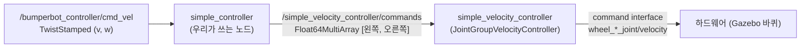
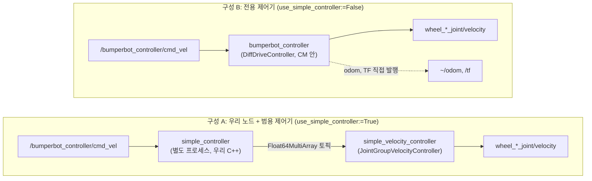

# 05. 차동 구동 운동학과 simple_controller (저장소 Section7)

> 참조: `Section7_Differential_Kinematics/bumperbot_ws/src/bumperbot_controller/` (참조 저장소 최상위 기준 경로)

## 이 장에서 하는 일

- 속도 명령 `(선속도 v, 각속도 w)`를 바퀴 두 개의 각속도로 바꾸는 차동 구동 운동학 식을 정리한다.
- 그 식을 C++ 노드 `simple_controller`로 쓴다. 이 노드는 `/bumperbot_controller/cmd_vel`(`TwistStamped`)을 받아 03장의 `simple_velocity_controller`가 받는 `Float64MultiArray`로 바꿔 발행한다. 로봇이 처음으로 속도 명령에 따라 움직인다.
- 같은 일을 하는 표준 제어기 `diff_drive_controller`로 바꿔 끼우는 방법을 보고, 두 구성을 비교한다.
- 키보드(와 선택 사항으로 조이스틱)로 조종하는 방법을 정리한다.
- ros2_control 전체에서의 자리: 03장은 바퀴에 숫자를 직접 보냈다. 이 장은 "로봇의 속도"를 "바퀴의 속도"로 바꾸는 층을 더한다. 이 층을 우리 노드로 쓸지 제어기 플러그인으로 쓸지가 이 장의 비교 대상이다.

## 이번 장의 파일

```text
~/bumperbot_ws/src/bumperbot_controller/
├── CMakeLists.txt                              [수정] 실행 파일·Eigen 추가
├── package.xml                                 [수정] 의존성 추가
├── include/bumperbot_controller/
│   └── simple_controller.hpp                   [새]
├── src/
│   └── simple_controller.cpp                   [새]
├── config/
│   ├── bumperbot_controllers.yaml              [수정] diff_drive_controller 설정 추가
│   ├── joy_config.yaml                         [새] (선택) 조이스틱 노드 설정
│   └── joy_teleop.yaml                         [새] (선택) 조이스틱 → cmd_vel 매핑
└── launch/
    ├── controller.launch.py                    [수정] simple_controller와 전환 인자
    └── joystick_teleop.launch.py               [새] (선택)
```

## 단계 1. 차동 구동 운동학

### 왜 필요한가

차동 구동 로봇은 좌우 바퀴의 속도를 다르게 해서 방향을 바꾼다. 사용자는 "앞으로 0.1 m/s, 왼쪽으로 0.5 rad/s"처럼 로봇 전체의 속도를 말하고, 제어기는 바퀴 각속도를 정한다. 이 변환식이 `simple_controller`의 핵심이고 07장의 오도메트리(바퀴 → 로봇 위치)는 같은 식을 거꾸로 쓴다.

### 식

기호는 아래와 같다.

| 기호 | 뜻 | 값 |
|---|---|---|
| `r` | 바퀴 반지름 | 0.033 m |
| `L` | 좌우 바퀴 사이 간격 | 0.17 m |
| `φ̇R`, `φ̇L` | 오른쪽·왼쪽 바퀴의 각속도 | rad/s |
| `v` | 로봇의 선속도(앞이 +) | m/s |
| `w` | 로봇의 각속도(위에서 볼 때 반시계가 +) | rad/s |

바퀴가 굴러서 가는 속도는 `r·φ̇`다. 로봇의 선속도는 두 바퀴 속도의 평균이고, 각속도는 두 바퀴 속도의 차이를 간격으로 나눈 것이다.

```text
v = r/2 · (φ̇R + φ̇L)
w = r/L · (φ̇R − φ̇L)
```

행렬로 쓰면:

```text
[ v ]   [ r/2    r/2  ] [ φ̇R ]
[ w ] = [ r/L   −r/L  ] [ φ̇L ]
```

이 행렬 `M`의 역행렬을 쓰면 `v`, `w`에서 바퀴 속도가 나온다. 즉 `[φ̇R, φ̇L]ᵀ = M⁻¹ · [v, w]ᵀ`. 2×2 행렬이라 직접 풀면 다음과 같다.

```text
φ̇R = (v + w·L/2) / r
φ̇L = (v − w·L/2) / r
```

`r = 0.033`, `L = 0.17`을 넣으면 `M`은 다음과 같다(08장까지 같은 값을 쓴다).

```text
M = [ 0.0165     0.0165   ]
    [ 0.194118  −0.194118 ]
```

예: `v = 0.5, w = 0`이면 두 바퀴 모두 `0.5/0.033 = 15.15` rad/s다. `v = 0, w = 1`이면 `φ̇R = 0.17/(2·0.033) = 2.576`, `φ̇L = −2.576` rad/s다(제자리 회전).

`L = 0.17`은 02장에서 본 것처럼 바퀴 구 충돌 모양의 중심 사이 간격(약 0.1702 m)이다. 조인트 원점 사이 간격(0.1402 m)이 아니다. 이 가이드를 쓸 때 확인했다. 단계 3의 회전 시험에서 Gazebo가 실제로 돈 각도(2.4318 rad)가 `L = 0.17`로 계산한 값(2.4350 rad)과 같았고, `L = 0.1402`로 계산한 값(2.9524 rad)과는 달랐다.

## 단계 2. `simple_controller` 노드

### 왜 필요한가

03장의 `simple_velocity_controller`는 바퀴 속도 두 개를 직접 받는다. 로봇의 속도 `(v, w)`를 바퀴 속도로 바꾸는 계산을 하는 노드가 필요하다. 이 노드는 ros2_control 바깥의 일반 ROS 노드이고, 제어기와는 토픽으로만 연결된다.



### 코드

03장에서 `include`와 `src`를 지웠으므로 다시 만든다. 헤더 폴더와 소스 폴더를 만들고 두 파일을 쓴다.

```bash
cd ~/bumperbot_ws/src/bumperbot_controller
mkdir -p include/bumperbot_controller src
```

> 파일: `bumperbot_controller/include/bumperbot_controller/simple_controller.hpp` — 전체
```cpp
#ifndef SIMPLE_CONTROLLER_HPP
#define SIMPLE_CONTROLLER_HPP

#include <rclcpp/rclcpp.hpp>
#include <geometry_msgs/msg/twist_stamped.hpp>
#include <Eigen/Core>
#include <std_msgs/msg/float64_multi_array.hpp>


class SimpleController : public rclcpp::Node
{
public:
    SimpleController(const std::string& name);

private:
    void velCallback(const geometry_msgs::msg::TwistStamped &msg);

    rclcpp::Subscription<geometry_msgs::msg::TwistStamped>::SharedPtr vel_sub_;
    rclcpp::Publisher<std_msgs::msg::Float64MultiArray>::SharedPtr wheel_cmd_pub_;

    double wheel_radius_;
    double wheel_separation_;
    Eigen::Matrix2d speed_conversion_;
};

#endif // SIMPLE_CONTROLLER_HPP
```

> 파일: `bumperbot_controller/src/simple_controller.cpp` — 전체
```cpp
#include "bumperbot_controller/simple_controller.hpp"
#include <Eigen/Geometry>


using std::placeholders::_1;


SimpleController::SimpleController(const std::string& name)
                                  : Node(name)
{
    declare_parameter("wheel_radius", 0.033);
    declare_parameter("wheel_separation", 0.17);
    wheel_radius_ = get_parameter("wheel_radius").as_double();
    wheel_separation_ = get_parameter("wheel_separation").as_double();
    RCLCPP_INFO_STREAM(get_logger(), "Using wheel radius " << wheel_radius_);
    RCLCPP_INFO_STREAM(get_logger(), "Using wheel separation " << wheel_separation_);
    wheel_cmd_pub_ = create_publisher<std_msgs::msg::Float64MultiArray>("/simple_velocity_controller/commands", 10);
    vel_sub_ = create_subscription<geometry_msgs::msg::TwistStamped>("/bumperbot_controller/cmd_vel", 10, std::bind(&SimpleController::velCallback, this, _1));

    speed_conversion_ << wheel_radius_/2, wheel_radius_/2, wheel_radius_/wheel_separation_, -wheel_radius_/wheel_separation_;
    RCLCPP_INFO_STREAM(get_logger(), "The conversion matrix is \n" << speed_conversion_);
}


void SimpleController::velCallback(const geometry_msgs::msg::TwistStamped &msg)
{
    // Implements the differential kinematic model
    // Given v and w, calculate the velocities of the wheels
    Eigen::Vector2d robot_speed(msg.twist.linear.x, msg.twist.angular.z);
    Eigen::Vector2d wheel_speed = speed_conversion_.inverse() * robot_speed;
    std_msgs::msg::Float64MultiArray wheel_speed_msg;
    wheel_speed_msg.data.push_back(wheel_speed.coeff(1));
    wheel_speed_msg.data.push_back(wheel_speed.coeff(0));
    
    wheel_cmd_pub_->publish(wheel_speed_msg);
}


int main(int argc, char* argv[])
{
  rclcpp::init(argc, argv);
  auto node = std::make_shared<SimpleController>("simple_controller");
  rclcpp::spin(node);
  rclcpp::shutdown();
  return 0;
}
```

### 코드 설명: 헤더

- `#ifndef SIMPLE_CONTROLLER_HPP ... #endif`: 헤더가 한 번만 포함되도록 하는 보호 장치(include guard)다.
- `#include <rclcpp/rclcpp.hpp>`: ROS 2 C++ 클라이언트 라이브러리. `rclcpp::Node` 등이 여기 있다.
- `#include <geometry_msgs/msg/twist_stamped.hpp>`: 입력 메시지 `geometry_msgs/msg/TwistStamped`. `header`(시각·프레임)와 `twist`(`linear`, `angular`)를 가진다. 메시지 타입 `a/msg/B`는 C++에서 `a/msg/b.hpp`(소문자·스네이크 케이스)로 포함하고 `a::msg::B`로 쓴다.
- `#include <std_msgs/msg/float64_multi_array.hpp>`: 출력 메시지. `data` 필드가 `double`의 가변 길이 배열이다.
- `#include <Eigen/Core>`: Eigen은 행렬·벡터 계산용 C++ 라이브러리다. `Eigen::Matrix2d`는 2×2 double 행렬이다.
- `class SimpleController : public rclcpp::Node`: `rclcpp::Node`를 상속한 클래스. 이 클래스의 객체가 곧 ROS 노드다.
- `SimpleController(const std::string& name);`: 생성자. 노드 이름을 인자로 받는다(`const std::string&`는 문자열을 복사하지 않고 읽기 전용으로 참조한다는 뜻).
- `void velCallback(const geometry_msgs::msg::TwistStamped &msg);`: 구독한 메시지가 올 때마다 호출될 함수.
- `rclcpp::Subscription<geometry_msgs::msg::TwistStamped>::SharedPtr vel_sub_;`: 구독자 객체를 가리키는 스마트 포인터(`std::shared_ptr`의 별칭 `SharedPtr`). `< >` 안은 메시지 타입이다(템플릿 인자). 이 포인터가 살아 있는 동안 구독이 유지된다. 발행자 `wheel_cmd_pub_`도 같은 형식이다. 이름 끝의 `_`는 클래스의 멤버 변수라는 표시다.
- `double wheel_radius_; double wheel_separation_; Eigen::Matrix2d speed_conversion_;`: 파라미터 두 개와 변환 행렬 `M`.

### 코드 설명: 구현

- `using std::placeholders::_1;`: 아래 `std::bind`에서 "첫 번째 인자 자리"를 뜻하는 `_1`을 이름만으로 쓰게 한다.
- `SimpleController::SimpleController(const std::string& name) : Node(name)`: 생성자. `: Node(name)`은 부모 클래스를 노드 이름 `name`으로 초기화한다(멤버 초기화 목록).
- `declare_parameter("wheel_radius", 0.033);` 등: 파라미터를 선언하고 기본값을 준다. 선언하지 않은 파라미터는 launch에서 값을 줘도 읽을 수 없다. 기본값의 자료형(double)이 파라미터의 자료형이 된다. 이어서 `get_parameter("wheel_radius").as_double()`로 값을 읽는다. launch가 준 값이 있으면 그 값이다.
- `RCLCPP_INFO_STREAM(get_logger(), "..." << 값);`: 로그를 한 줄 낸다. `<<`로 값을 이어 붙인다.
- `create_publisher<std_msgs::msg::Float64MultiArray>("/simple_velocity_controller/commands", 10)`: 발행자. `< >` 안은 메시지 타입, 인자는 토픽 이름과 큐 크기(QoS 깊이)다. 이 토픽은 03장에서 `simple_velocity_controller`가 구독하는 토픽이다.
- `create_subscription<geometry_msgs::msg::TwistStamped>("/bumperbot_controller/cmd_vel", 10, std::bind(&SimpleController::velCallback, this, _1))`: 구독자. `std::bind(&클래스::함수, this, _1)`은 "이 객체(`this`)의 `velCallback`을 부르되 첫 인자는 도착한 메시지로 하라"는 함수 묶음이다. 토픽 이름 `/bumperbot_controller/cmd_vel`은 표준 제어기 `bumperbot_controller`(단계 4)의 입력 토픽과 같은 이름으로 정했다. 그래서 어느 쪽 제어기를 쓰든 조종 프로그램은 바뀌지 않는다.
- `speed_conversion_ << a, b, c, d;`: Eigen의 쉼표 초기화. 행 우선(왼쪽 위 → 오른쪽 위 → 왼쪽 아래 → 오른쪽 아래)으로 채운다. 값은 단계 1의 `M`이다: `r/2, r/2, r/L, −r/L`. 로그에 `The conversion matrix is`와 함께 이 행렬이 출력된다.
- `velCallback`:
  - `Eigen::Vector2d robot_speed(msg.twist.linear.x, msg.twist.angular.z);`: `[v, w]`.
  - `speed_conversion_.inverse() * robot_speed`: `M⁻¹ · [v, w]ᵀ`. 결과 `wheel_speed`는 `[φ̇R, φ̇L]`(오른쪽이 0번)다.
  - `wheel_speed.coeff(i)`는 Eigen 벡터의 `i`번째 성분(0부터 센다)을 읽는 함수다(일반 지식). `wheel_speed_msg.data.push_back(wheel_speed.coeff(1)); ... push_back(wheel_speed.coeff(0));`: 배열에 **왼쪽(`coeff(1)`) 먼저, 오른쪽(`coeff(0)`) 나중**의 순서로 넣는다. 03장의 yaml `joints: [wheel_left_joint, wheel_right_joint]`의 순서와 맞추기 위해서다. 이 순서를 틀리면 좌우가 바뀌어 로봇이 반대로 돈다.
  - `wheel_cmd_pub_->publish(wheel_speed_msg);`: 발행한다.
- `main`: `rclcpp::init`으로 ROS를 시작하고, `std::make_shared<SimpleController>("simple_controller")`로 노드를 만들고(노드 이름 `simple_controller`), `rclcpp::spin(node)`이 콜백을 처리하며 종료 신호를 기다린다. 끝나면 `rclcpp::shutdown()`.
- `#include <Eigen/Geometry>`: 이 파일에서 직접 쓰는 이름은 없어 보이지만 **빼면 안 된다.** `speed_conversion_.inverse()`가 `Eigen/LU`에 있고 `Eigen/Geometry`가 그것을 포함한다. 이 줄을 빼고 빌드하면 `inline function ... Eigen::MatrixBase<Derived>::inverse() const ... used but never defined` 경고에 이어 `ld returned 1 exit status`로 링크가 실패한다(이 가이드를 쓸 때 확인했다).

Python판: `Section7_Differential_Kinematics/bumperbot_ws/src/bumperbot_controller/bumperbot_controller/simple_controller.py`

### 코드: CMakeLists.txt와 package.xml

> 파일: `bumperbot_controller/CMakeLists.txt` — 전체
```cmake
cmake_minimum_required(VERSION 3.8)
project(bumperbot_controller)

if(CMAKE_COMPILER_IS_GNUCXX OR CMAKE_CXX_COMPILER_ID MATCHES "Clang")
  add_compile_options(-Wall -Wextra -Wpedantic)
endif()

find_package(ament_cmake REQUIRED)
find_package(rclcpp REQUIRED)
find_package(geometry_msgs REQUIRED)
find_package(std_msgs REQUIRED)
find_package(Eigen3 REQUIRED)

include_directories(include)
include_directories(${EIGEN3_INCLUDE_DIR})

add_executable(simple_controller src/simple_controller.cpp)
ament_target_dependencies(simple_controller rclcpp geometry_msgs std_msgs ${Eigen_LIBRARIES})

install(
  DIRECTORY include/
  DESTINATION include
)

install(TARGETS
  simple_controller
  DESTINATION lib/${PROJECT_NAME}
)

install(
  DIRECTORY launch config
  DESTINATION share/${PROJECT_NAME}
)

ament_package()
```

`package.xml`에는 빌드·실행에 필요한 패키지를 적는다. 아래 블록의 네 줄이 모두 **새로 넣는 줄**이다. 원래 있던 `<buildtool_depend>ament_cmake</buildtool_depend>` 줄 다음, `<exec_depend>` 줄들 앞에 넣는다.

> 파일: `bumperbot_controller/package.xml` — 수정
```xml
  <depend>rclcpp</depend>
  <depend>geometry_msgs</depend>
  <depend>std_msgs</depend>
  <depend>eigen</depend>
```

### 코드 설명: CMakeLists.txt와 package.xml

03장의 `CMakeLists.txt`에서 달라진 줄은 아래와 같다. `install(DIRECTORY launch config ...)`는 그대로 있다.

| 줄 | 뜻 |
|---|---|
| `cmake_minimum_required(VERSION 3.8)` | 03장의 `3.8`과 같다. |
| `if(CMAKE_COMPILER_IS_GNUCXX OR CMAKE_CXX_COMPILER_ID MATCHES "Clang") add_compile_options(-Wall -Wextra -Wpedantic) endif()` | C++ 코드가 생겼으므로 `ros2 pkg create`가 만들어 주는 경고 옵션 블록을 둔다. 컴파일러가 의심스러운 코드에 경고를 내게 한다. 경고가 없는 코드를 쓰는 습관을 들이려는 것이다(01장과 같다). 이 장의 코드는 경고가 0개다. |
| `find_package(rclcpp REQUIRED)`, `geometry_msgs`, `std_msgs` | 코드가 쓰는 ROS 패키지를 찾는다. 이 줄만으로는 컴파일러에 헤더 경로가 전달되지 않는다. 아래 `ament_target_dependencies`와 짝이다. |
| `find_package(Eigen3 REQUIRED)` | Eigen을 찾는다. |
| `include_directories(include)` | `#include "bumperbot_controller/simple_controller.hpp"`가 `include/` 폴더를 기준으로 찾아지게 한다. |
| `include_directories(${EIGEN3_INCLUDE_DIR})` | Eigen 헤더 폴더를 컴파일러에 알린다. Eigen은 헤더만 있는 라이브러리라 이것으로 충분하다. |
| `add_executable(simple_controller src/simple_controller.cpp)` | 실행 파일 `simple_controller`를 이 소스로 만든다. |
| `ament_target_dependencies(simple_controller rclcpp geometry_msgs std_msgs ${Eigen_LIBRARIES})` | 그 실행 파일이 `rclcpp`, `geometry_msgs`, `std_msgs`에 의존한다고 알린다. 이때 앞에서 `find_package`로 찾아 둔 패키지의 헤더 경로와 링크 라이브러리가 이 실행 파일에 붙는다. `find_package`만 하고 여기에 적지 않으면 헤더를 못 찾는다. `${Eigen_LIBRARIES}`는 어디에서도 정의되지 않은 변수라 빈 값으로 풀린다(참조에 있는 줄이다. Eigen은 헤더뿐이라 영향이 없다). |
| `install(DIRECTORY include/ DESTINATION include)` | 헤더를 `install/bumperbot_controller/include/bumperbot_controller/simple_controller.hpp`로 설치한다. 끝의 `/`가 중요하다. 참조처럼 `DIRECTORY include`(끝에 `/` 없음)로 쓰면 폴더 이름 `include`까지 복사되어 `install/.../include/include/bumperbot_controller/...`로 한 단계 더 깊게 설치된다(이 가이드를 쓸 때 두 경우를 모두 확인했다). 이 패키지의 헤더를 다른 패키지가 쓰지 않으므로 어느 쪽이든 동작에는 영향이 없다. |
| `install(TARGETS simple_controller DESTINATION lib/${PROJECT_NAME})` | 실행 파일을 `lib/bumperbot_controller/`로 설치한다. `ros2 run bumperbot_controller simple_controller`와 launch의 `Node(package=..., executable=...)`가 이 위치에서 찾는다. 이 줄이 없으면 빌드는 되어도 `ros2 run`이 `No executable found`라고 한다. |

`package.xml`의 `<depend>`는 빌드 때와 실행 때 모두 필요한 패키지다(`<build_depend>` + `<exec_depend>`의 줄임). `eigen`은 rosdep이 시스템 패키지(`libeigen3-dev`)로 바꿔 주는 키 이름이다. 새로 더한 것은 이 네 줄이다.

### 빌드와 시험

터미널 A에서 빌드하고 노드를 띄운다. 노드는 끝나지 않는다. 확인을 마치면 `Ctrl+C`로 끝낸다.

```bash
cd ~/bumperbot_ws
colcon build --symlink-install
source install/setup.bash
ros2 run bumperbot_controller simple_controller
```

기대 결과(빌드. 이 패키지의 줄만):

```text
Finished <<< bumperbot_controller [4.17s]
```

작업 공간에 앞 장의 패키지도 있으면 그 패키지의 `Finished` 줄도 함께 나온다. `Summary`의 패키지 수는 사용자마다 다르므로 `Failed`가 없고 경고가 없으면 된다.

기대 결과(노드 터미널):

```text
[INFO] [...] [simple_controller]: Using wheel radius 0.033
[INFO] [...] [simple_controller]: Using wheel separation 0.17
[INFO] [...] [simple_controller]: The conversion matrix is 
   0.0165    0.0165
 0.194118 -0.194118
```

터미널 B에서 구독 쪽을 먼저 열어 둔다. 이 명령은 끝나지 않는다. 두 결과를 모두 보고 `Ctrl+C`로 끝낸다.

```bash
source ~/bumperbot_ws/install/setup.bash
ros2 topic echo /simple_velocity_controller/commands
```

터미널 C에서 명령을 두 번 보낸다.

```bash
source ~/bumperbot_ws/install/setup.bash
ros2 topic pub --once /bumperbot_controller/cmd_vel geometry_msgs/msg/TwistStamped "{twist: {linear: {x: 0.5}, angular: {z: 0.0}}}"
ros2 topic pub --once /bumperbot_controller/cmd_vel geometry_msgs/msg/TwistStamped "{twist: {linear: {x: 0.0}, angular: {z: 1.0}}}"
```

기대 결과(터미널 B, 명령 하나마다 한 번씩):

```text
layout:
  dim: []
  data_offset: 0
data:
- 15.15151515151515
- 15.15151515151515
---
layout:
  dim: []
  data_offset: 0
data:
- -2.5757575757575757
- 2.5757575757575757
---
```

- 통과 조건 1: 경고 없이 빌드된다. 노드가 뜨고 변환 행렬이 단계 1의 `M`과 같다.
- 통과 조건 2: `v = 0.5, w = 0`이면 `[15.15, 15.15]`, `v = 0, w = 1`이면 `[−2.576, 2.576]`(왼쪽이 음수, 오른쪽이 양수)이다. 단계 1에서 손으로 계산한 값과 같다. 반시계(`w > 0`)로 돌려면 오른쪽 바퀴가 앞으로, 왼쪽 바퀴가 뒤로 간다.
- 터미널 C에서 `ros2 topic info /simple_velocity_controller/commands`는 Publisher count가 1, `ros2 topic info /bumperbot_controller/cmd_vel`은 타입이 `geometry_msgs/msg/TwistStamped`다.
- 터미널 A와 B를 `Ctrl+C`로 끝낸다. 같은 노드를 다시 띄우기 전에 앞의 것이 끝났는지 확인한다.

## 단계 3. launch에 `simple_controller` 추가: 로봇이 움직인다

### 왜 필요한가

03장의 `controller.launch.py`는 제어기 스포너 둘만 띄웠다. 이제 `simple_controller` 노드도 함께 띄우고, 파라미터(`wheel_radius`, `wheel_separation`, `use_sim_time`)를 launch 인자로 바꿀 수 있게 한다. `use_sim_time`을 켜야 이 노드가 Gazebo의 시뮬레이션 시각을 쓴다.

### 코드

> 파일: `bumperbot_controller/launch/controller.launch.py` — 전체 (단계 3 시점)
```python
from launch import LaunchDescription
from launch.actions import DeclareLaunchArgument
from launch.substitutions import LaunchConfiguration
from launch_ros.actions import Node


def generate_launch_description():

    use_sim_time_arg = DeclareLaunchArgument(
        "use_sim_time",
        default_value="True",
    )
    wheel_radius_arg = DeclareLaunchArgument(
        "wheel_radius",
        default_value="0.033",
    )
    wheel_separation_arg = DeclareLaunchArgument(
        "wheel_separation",
        default_value="0.17",
    )

    use_sim_time = LaunchConfiguration("use_sim_time")
    wheel_radius = LaunchConfiguration("wheel_radius")
    wheel_separation = LaunchConfiguration("wheel_separation")

    joint_state_broadcaster_spawner = Node(
        package="controller_manager",
        executable="spawner",
        arguments=[
            "joint_state_broadcaster",
            "--controller-manager",
            "/controller_manager",
        ],
    )

    simple_velocity_controller_spawner = Node(
        package="controller_manager",
        executable="spawner",
        arguments=[
            "simple_velocity_controller",
            "--controller-manager",
            "/controller_manager",
        ],
    )

    simple_controller = Node(
        package="bumperbot_controller",
        executable="simple_controller",
        parameters=[
            {"wheel_radius": wheel_radius,
             "wheel_separation": wheel_separation,
             "use_sim_time": use_sim_time}],
    )

    return LaunchDescription(
        [
            use_sim_time_arg,
            wheel_radius_arg,
            wheel_separation_arg,
            joint_state_broadcaster_spawner,
            simple_velocity_controller_spawner,
            simple_controller,
        ]
    )
```

### 코드 설명

- `DeclareLaunchArgument("use_sim_time", default_value="True")` 등 세 개: 명령줄에서 `use_sim_time:=False`처럼 바꿀 수 있는 인자. 기본값은 문자열이다.
- `use_sim_time = LaunchConfiguration("use_sim_time")` 등: 인자의 값을 가리키는 자리표시자. 아래 `Node`의 `parameters`에서 쓴다.
- `joint_state_broadcaster_spawner`, `simple_velocity_controller_spawner`: 03장의 스포너 둘. 03장에서 `simple_controller`라고 부른 변수를 노드 이름과 겹치지 않게 `simple_velocity_controller_spawner`로 바꿨다.
- `Node(package="bumperbot_controller", executable="simple_controller", parameters=[{...}])`: 우리가 쓴 노드를 실행한다. `executable`은 `install(TARGETS ...)`로 설치한 실행 파일 이름이다. `parameters`의 딕셔너리가 노드의 파라미터가 된다. 파라미터 이름은 코드의 `declare_parameter` 이름과 같아야 한다. launch 인자의 값은 문자열이지만 launch가 `0.033`을 실수로 해석해 넘기므로 코드의 `as_double()`이 받는다(정수로 해석되는 `wheel_radius:=1` 같은 값은 double 파라미터와 형이 달라 오류가 난다. "자주 나는 오류" 참고).
- `LaunchDescription([...])`: 인자 선언이 노드보다 앞에 있어야 한다.

### 빌드와 시험

터미널 A에서 빌드하고 Gazebo를 띄운다(끝나지 않는다. 이 단계의 시험이 끝날 때까지 켜 둔다).

```bash
cd ~/bumperbot_ws
colcon build --symlink-install
source install/setup.bash
ros2 launch bumperbot_description gazebo.launch.py
```

터미널 B에서 제어기 launch를 띄운다(끝나지 않는다. 이제 `simple_controller` 노드가 계속 돈다).

```bash
source ~/bumperbot_ws/install/setup.bash
ros2 launch bumperbot_controller controller.launch.py
```

기대 결과(터미널 B 로그. 시각과 `pid`는 다르다. `[spawner-1]` 같은 번호는 launch 목록의 순서에 따른 것이다):

```text
[spawner-1] [INFO] [spawner_joint_state_broadcaster]: Configured and activated joint_state_broadcaster
[spawner-2] [INFO] [spawner_simple_velocity_controller]: Configured and activated simple_velocity_controller
[simple_controller-3] [INFO] [simple_controller]: Using wheel radius 0.033
```

터미널 C에서 먼저 상태를 확인한다.

```bash
source ~/bumperbot_ws/install/setup.bash
ros2 control list_controllers
ros2 node list | grep simple_controller
```

```text
simple_velocity_controller velocity_controllers/JointGroupVelocityController  active
joint_state_broadcaster    joint_state_broadcaster/JointStateBroadcaster      active
/simple_controller
```

이어서 직진 시험이다. 이동하기 전의 바퀴 위치와 Gazebo의 로봇 위치를 읽는다.

```bash
ros2 topic echo /joint_states --once --field position
gz model -m bumperbot -p
```

속도 명령을 보내고 4초쯤 기다린 뒤 바퀴 속도를 읽는다. 명령 직후에는 바퀴가 가속하는 중일 수 있으므로 기다린다.

```bash
ros2 topic pub --once /bumperbot_controller/cmd_vel geometry_msgs/msg/TwistStamped "{twist: {linear: {x: 0.1}, angular: {z: 0.0}}}"
ros2 topic echo /joint_states --once --field velocity
```

`simple_velocity_controller`는 마지막 명령을 유지하므로(03장) 멈추는 명령을 보낸다. 2초쯤 기다린 뒤 이동 후의 값을 읽는다.

```bash
ros2 topic pub --once /bumperbot_controller/cmd_vel geometry_msgs/msg/TwistStamped "{twist: {linear: {x: 0.0}, angular: {z: 0.0}}}"
ros2 topic echo /joint_states --once --field position
gz model -m bumperbot -p
```

기대 결과(이동 전, 속도, 이동 후. 위치 값은 명령을 유지한 시간에 따라 달라진다. 아래는 이 가이드를 쓸 때의 값이다):

```text
array('d', [-4.417234271386984e-12, -4.4303681956653074e-12])
  - Pose [ XYZ (m) ] [ RPY (rad) ]:
    [0.000004 0.000000 0.000002]
    [0.000000 0.010548 -0.000001]
```

```text
array('d', [3.03030303029707, 3.030303030301326])
```

```text
array('d', [19.484848484787403, 19.48484848481281])
  - Pose [ XYZ (m) ] [ RPY (rad) ]:
    [0.642327 0.000008 0.000002]
    [-0.000000 -0.010549 -0.000050]
```

계산: 두 바퀴가 `19.4848` rad 돌았으므로 굴러간 거리는 `r × 회전각 = 0.033 × 19.4848 = 0.6430` m이고, Gazebo의 `x`는 `0.642327 − 0.000004 = 0.6423` m다(차이 0.1%).

이어서 회전 시험이다. 같은 방식으로 `w = 0.5`를 3초쯤 보내고 멈춘다.

```bash
ros2 topic pub --once /bumperbot_controller/cmd_vel geometry_msgs/msg/TwistStamped "{twist: {linear: {x: 0.0}, angular: {z: 0.5}}}"
ros2 topic echo /joint_states --once --field velocity
ros2 topic pub --once /bumperbot_controller/cmd_vel geometry_msgs/msg/TwistStamped "{twist: {linear: {x: 0.0}, angular: {z: 0.0}}}"
ros2 topic echo /joint_states --once --field position
gz model -m bumperbot -p
```

```text
array('d', [-1.287878787877982, 1.2878787878740385])
array('d', [13.212878787827602, 25.756818181766633])
  - Pose [ XYZ (m) ] [ RPY (rad) ]:
    [0.641715 0.000235 0.000002]
    [-0.000000 -0.010548 2.431790]
```

계산: 바퀴 회전각 변화는 왼쪽 `13.2129 − 19.4848 = −6.2719`, 오른쪽 `25.7568 − 19.4848 = 6.2720`이다. 로봇이 돈 각도는 `r × (Δφ_R − Δφ_L) / L = 0.033 × 12.5439 / 0.17 = 2.4350` rad이고 Gazebo의 `yaw`는 `2.431790` rad이다(차이 0.13%). `L = 0.1402`로 계산하면 `2.9524` rad이라 맞지 않는다. (회전 중에는 위치 `x`가 거의 변하지 않는다. 각도는 `−π ~ π` 범위로 표시되므로 π를 넘으면 음수로 돌아온다.)

- 통과 조건 1: `list_controllers`에 `joint_state_broadcaster`와 `simple_velocity_controller`가 `active`이고 노드 목록에 `/simple_controller`가 있다.
- 통과 조건 2: `v = 0.1 m/s`를 명령하면 바퀴 각속도가 `0.1/0.033 = 3.0303` rad/s로 나온다(왼쪽·오른쪽 같음). `w = 0.5`이면 `±0.5 × 0.17 / (2 × 0.033) = ±1.2879` rad/s다.
- 통과 조건 3: Gazebo의 이동 거리가 바퀴 회전량으로 계산한 거리와, Gazebo의 회전각이 `L = 0.17`로 계산한 각도와 1% 안쪽으로 같다. 이동 거리와 각도 자체는 명령을 얼마나 오래 유지했는지에 따라 값이 다르다.
- 이 시험은 `ros2 topic pub --once`를 썼다. 구성 A에서는 마지막 속도가 유지되므로 `0.0` 명령을 꼭 보낸다. `-r 20`으로 반복해서 보내다가 `Ctrl+C`로 끝내도 마지막 속도가 유지되므로 마찬가지다.
- 터미널 A와 B는 단계 4에서 yaml이 바뀌므로 지금 `Ctrl+C`로 끝낸다.

## 단계 4. 표준 제어기로 바꿔 끼우기: `diff_drive_controller`

### 왜 필요한가

단계 2의 구성(우리 노드 + 범용 `JointGroupVelocityController`)과 같은 일을 하는 표준 제어기가 ros2_controllers에 있다. `diff_drive_controller/DiffDriveController`는 속도 명령을 받아 바퀴 속도를 계산해 command interface에 직접 쓰고, 오도메트리와 TF도 자기가 낸다. yaml에 파라미터만 적으면 코드를 쓰지 않아도 된다. 두 구성을 launch 인자 하나로 바꿀 수 있게 한다.



| 항목 | 구성 A (우리 노드 + 범용 제어기) | 구성 B (DiffDriveController) |
|---|---|---|
| 코드 | 변환 노드를 직접 작성 | 없음. yaml 파라미터만 |
| 실행 위치 | 일반 노드(별도 프로세스) + CM 안의 범용 제어기 | CM 프로세스 안의 제어기 플러그인 |
| 입력 | `/bumperbot_controller/cmd_vel` (`TwistStamped`) | 같음 |
| command interface에 쓰는 경로 | 토픽 한 번 거침 → 제어기 → interface | 제어기가 interface에 직접 씀 |
| 오도메트리·TF | 07장에서 직접 구현 | 제어기가 `~/odom`, `/tf`로 자동 발행 |
| 속도·가속 제한 | 없음 | yaml로 설정 |
| 명령 타임아웃 | 없음(마지막 명령 유지) | 있음(`cmd_vel_timeout` 0.5초 뒤 정지) |
| 알고리즘을 바꾸려면 | 노드를 고친다 | 제어기 플러그인을 직접 써야 한다 |

이 비교는 v5 로봇에서 균형 제어기를 어디에 둘지와 이어진다. 균형 제어는 매 제어 주기마다 상태를 읽고 토크를 써야 하므로 구성 B처럼 CM 안의 제어기로 두는 쪽이 토픽 지연이 없다. 구성 A는 알고리즘을 빨리 바꿔 보기 쉽다.

### 먼저: 설치된 파라미터 정의 확인

참조 yaml은 Humble 시절의 파라미터 이름을 쓴다. 설치된 Jazzy의 `diff_drive_controller`(4.43.1)가 쓰는 파라미터를 `/opt/ros/jazzy/include/diff_drive_controller/diff_drive_controller_parameters.hpp`에서 확인했다. 참조 yaml과 비교한 결과다.

| 참조 yaml의 키 | Jazzy 4.43.1 | 이 가이드의 처리 |
|---|---|---|
| `use_stamped_vel: true` | 정의에 없다. 이 제어기는 항상 `TwistStamped`를 구독한다(`ros2 topic info`에서 확인). | 뺀다 |
| `publish_wheel_data: true` | 정의에 없다. | 뺀다 |
| `type: diff_drive_controller/DiffDriveController` (제어기 블록 안) | CM 블록(`controller_manager.ros__parameters.bumperbot_controller.type`)의 `type`만으로 제어기가 올라온다. 제어기 블록 안의 `type`을 빼고 확인했다. | 뺀다 |
| `linear.x.has_velocity_limits`, `has_acceleration_limits`, `angular.z`의 같은 키 | `deprecated, set the respective limits to .NAN for deactivation` | 뺀다. 한계 값을 적으면 켜지고 적지 않으면(NaN) 꺼진다. |
| `has_jerk_limits: false` | 같은 이유로 deprecated. 참조 yaml 그대로 실행하면 로그에 `[deprecated] has_jerk_limits parameter is deprecated, instead set the respective limits to NAN`이 두 번(linear, angular) 나온다. | 뺀다 |
| `max_jerk: 5.0`, `2.5` | 값을 적으면 jerk 제한이 켜진다. 참조는 `has_jerk_limits: false`로 꺼 둔 상태였다. | 같은 동작을 위해 줄을 뺀다 |
| `min_acceleration: -0.4` | `deprecated, use max_deceleration` | `max_deceleration: -0.4`로 바꾼다 |

- `max_deceleration`의 부호: `diff_drive_controller/speed_limiter.hpp`에 "Maximum deceleration [m/s^2], usually <= 0"이라고 되어 있다. `-0.4`로 하고 0.4 m/s로 달리다 멈추는 명령을 보내 확인했다. 속도가 0.4에서 0까지 내려가는 데 약 1.0초가 걸렸다(0.4 m/s²). 가속은 0에서 0.4 m/s까지 약 0.5초(`max_acceleration: 0.8`)였다. **양수(`0.4`)로 쓰면 제어기가 올라오지 않는다.** 그렇게 바꿔 돌려 보니 Gazebo 로그에 `Calling shutdown transition of controller node 'bumperbot_controller' due to init failure.`와 `Could not initialize the controller named 'bumperbot_controller'`가 나왔고 스포너는 `Failed loading controller bumperbot_controller`로 종료 코드 1로 끝났다.
- 한계를 적지 않았을 때: 설치된 `control_toolbox/rate_limiter.hpp`의 `set_params`에 "max must be specified, min defaults to -max if unspecified"라는 주석이 있다. 읽어 보면 `max_*`가 NaN(적지 않음)일 때만 그 제한이 꺼지고, `max_*`가 있는데 `min_*`가 없으면 `min = -max`로 쓰인다. 그래서 이 yaml의 `angular.z`는 `min_velocity`를 적지 않아도 −1.7 rad/s로 제한되고, `max_deceleration`을 적지 않은 `angular.z`의 감속 제한은 −`max_acceleration`(−1.5)이다. yaml의 주석 `Whenever a min_* is unspecified, default to -max_*`가 이것을 말한다.
- 나머지(`publish_rate`, `wheel_separation`, `wheel_radius`, 곱셈 계수, `cmd_vel_timeout`, `base_frame_id`, `publish_limited_velocity`, `enable_odom_tf`, `max_velocity`, `min_velocity`, `max_acceleration`, 공분산)는 그대로 쓰인다.
- 위 변경이 맞는지 확인하는 방법은 실행 로그다. 정리한 yaml로 돌렸을 때 `deprecated`나 `unknown parameter` 경고가 로그에 없었다.

### 코드

yaml 전체는 아래와 같다. `bumperbot_controller:` 블록(제어기 설정)이 새로 생기고, 제어기 종류를 짝짓는 곳(`controller_manager` 블록)에 `bumperbot_controller`의 `type`이 추가되었다.

> 파일: `bumperbot_controller/config/bumperbot_controllers.yaml` — 전체
```yaml
controller_manager:
  ros__parameters:
    update_rate: 100 # Hz
    use_sim_time: true

    bumperbot_controller:
      type: diff_drive_controller/DiffDriveController

    joint_state_broadcaster:
      type: joint_state_broadcaster/JointStateBroadcaster

    simple_velocity_controller:
      type: velocity_controllers/JointGroupVelocityController


bumperbot_controller:
  ros__parameters:
    left_wheel_names  : ['wheel_left_joint']
    right_wheel_names : ['wheel_right_joint']

    publish_rate: 50.0               # default: 50
    pose_covariance_diagonal : [0.001, 0.001, 1.0e-3, 1.0e-3, 1.0e-3, 0.01]
    twist_covariance_diagonal: [0.001, 0.001, 1.0e-3, 1.0e-3, 1.0e-3, 0.01]

    wheel_separation : 0.17
    wheel_radius : 0.033

    wheel_separation_multiplier: 1.0
    left_wheel_radius_multiplier: 1.0
    right_wheel_radius_multiplier: 1.0

    # Velocity commands timeout [s], default 0.5
    cmd_vel_timeout: 0.5

    # Base frame_id
    base_frame_id: base_footprint #default: base_link

    # Publish limited velocity
    publish_limited_velocity: true

    # Publish to TF directly or not
    enable_odom_tf: true

    # Velocity and acceleration limits
    # Whenever a min_* is unspecified, default to -max_*
    linear:
      x:
        max_velocity           : 1.0  # m/s
        min_velocity           : -0.5 # m/s
        max_acceleration       : 0.8  # m/s^2
        max_deceleration       : -0.4 # m/s^2
    angular:
      z:
        max_velocity           : 1.7  # rad/s
        max_acceleration       : 1.5  # rad/s^2


simple_velocity_controller:
  ros__parameters:
    joints:
      - wheel_left_joint
      - wheel_right_joint
```

`package.xml`에는 표준 제어기를 쓰기 위해 `ros2_controllers`를 더한다.

> 파일: `bumperbot_controller/package.xml` — 수정
```xml
  <exec_depend>controller_manager</exec_depend>
  <exec_depend>ros2_controllers</exec_depend>
```

launch 파일은 두 구성을 인자 `use_simple_controller`로 전환하도록 바꾼다.

> 파일: `bumperbot_controller/launch/controller.launch.py` — 전체
```python
from launch import LaunchDescription
from launch.actions import DeclareLaunchArgument, GroupAction
from launch.conditions import IfCondition, UnlessCondition
from launch.substitutions import LaunchConfiguration
from launch_ros.actions import Node


def generate_launch_description():

    use_sim_time_arg = DeclareLaunchArgument(
        "use_sim_time",
        default_value="True",
    )
    use_simple_controller_arg = DeclareLaunchArgument(
        "use_simple_controller",
        default_value="True",
    )
    wheel_radius_arg = DeclareLaunchArgument(
        "wheel_radius",
        default_value="0.033",
    )
    wheel_separation_arg = DeclareLaunchArgument(
        "wheel_separation",
        default_value="0.17",
    )

    use_sim_time = LaunchConfiguration("use_sim_time")
    use_simple_controller = LaunchConfiguration("use_simple_controller")
    wheel_radius = LaunchConfiguration("wheel_radius")
    wheel_separation = LaunchConfiguration("wheel_separation")

    joint_state_broadcaster_spawner = Node(
        package="controller_manager",
        executable="spawner",
        arguments=[
            "joint_state_broadcaster",
            "--controller-manager",
            "/controller_manager",
        ],
    )

    wheel_controller_spawner = Node(
        package="controller_manager",
        executable="spawner",
        arguments=[
            "bumperbot_controller",
            "--controller-manager",
            "/controller_manager",
        ],
        condition=UnlessCondition(use_simple_controller),
    )

    simple_controller = GroupAction(
        condition=IfCondition(use_simple_controller),
        actions=[
            Node(
                package="controller_manager",
                executable="spawner",
                arguments=[
                    "simple_velocity_controller",
                    "--controller-manager",
                    "/controller_manager",
                ],
            ),
            Node(
                package="bumperbot_controller",
                executable="simple_controller",
                parameters=[
                    {"wheel_radius": wheel_radius,
                     "wheel_separation": wheel_separation,
                     "use_sim_time": use_sim_time}],
            ),
        ],
    )

    return LaunchDescription(
        [
            use_sim_time_arg,
            use_simple_controller_arg,
            wheel_radius_arg,
            wheel_separation_arg,
            joint_state_broadcaster_spawner,
            wheel_controller_spawner,
            simple_controller,
        ]
    )
```

### 코드 설명

yaml:

- `controller_manager.ros__parameters.bumperbot_controller.type: diff_drive_controller/DiffDriveController`: 03장의 `joint_state_broadcaster`와 같은 방식으로, 제어기 이름 `bumperbot_controller`에 종류를 짝짓는다. 이름은 스포너 인자와 노드 이름, 토픽 접두사(`/bumperbot_controller/cmd_vel`)가 된다.
- `bumperbot_controller.ros__parameters`의 키:

| 키 | 뜻 |
|---|---|
| `left_wheel_names`, `right_wheel_names` | 왼쪽·오른쪽 바퀴 조인트 이름(목록). 바퀴가 여러 개여도 된다. 이 이름의 `velocity` command interface를 점유하고 `position` state interface를 읽는다. |
| `wheel_separation`, `wheel_radius` | `L`, `r`(단계 1). 같은 값을 `simple_controller`의 파라미터로도 쓴다. |
| `wheel_separation_multiplier`, `left_wheel_radius_multiplier`, `right_wheel_radius_multiplier` | 위 값에 곱하는 보정 계수. 실제 로봇의 오차를 맞출 때 쓴다. |
| `publish_rate` | 오도메트리·TF를 발행하는 주기(Hz). |
| `pose_covariance_diagonal`, `twist_covariance_diagonal` | 오도메트리 메시의 공분산 대각선 값. 센서 융합(09장)에서 의미가 있다. |
| `cmd_vel_timeout` | 이 시간(초) 동안 명령이 없으면 정지한다. |
| `base_frame_id` | 오도메트리 TF의 자식 프레임. 기본값 `base_link`를 이 로봇의 `base_footprint`로 바꾼다. (부모 프레임 `odom_frame_id`의 기본값은 `odom`이다.) |
| `publish_limited_velocity` | 제한을 적용한 속도를 `~/cmd_vel_out` 토픽으로 낸다. |
| `enable_odom_tf` | `odom → base_footprint` 변환을 `/tf`로 직접 낸다. |
| `linear.x.max_velocity`, `min_velocity` | 선속도 한계(m/s). 앞으로 1.0, 뒤로 0.5. |
| `linear.x.max_acceleration`, `max_deceleration` | 선가속도·감속도 한계(m/s²). 가속 0.8, 감속 −0.4(부호에 주의). |
| `angular.z.max_velocity`, `max_acceleration` | 각속도(rad/s)·각가속도 한계. `min_*`를 적지 않았으므로 −`max_*`가 쓰인다(위 설명). |

launch:

- `from launch.conditions import IfCondition, UnlessCondition`: 노드·그룹의 실행 조건. `IfCondition(use_simple_controller)`는 인자가 `True`일 때만, `UnlessCondition`은 아닐 때만 실행한다.
- `wheel_controller_spawner`: `bumperbot_controller`를 올리는 스포너. `condition=UnlessCondition(use_simple_controller)`이므로 `use_simple_controller:=False`일 때만 실행된다.
- `simple_controller = GroupAction(condition=IfCondition(use_simple_controller), actions=[...])`: 스포너와 `simple_controller` 노드를 한 묶음으로 만들어 조건 하나로 켜고 끈다. `GroupAction`이 없으면 두 노드에 같은 `condition`을 따로 써야 한다.
- `joint_state_broadcaster_spawner`는 두 구성에서 모두 필요하므로 조건이 없다.
- 변수 이름 `simple_controller`는 `GroupAction`이고, 안의 `Node(executable="simple_controller")`는 노드다. 이름이 같을 뿐 다른 것이다.
- 기본값은 `use_simple_controller:=True`(구성 A)다.

### 빌드와 시험

`bumperbot_controllers.yaml`의 내용이 바뀌었으므로 Gazebo를 껐다가 다시 띄워야 한다. yaml은 Gazebo가 시작할 때 `controller_manager`가 읽는다. 단계 3의 터미널 A와 B가 아직 켜져 있으면 먼저 `Ctrl+C`로 끝낸다.

터미널 A에서(끝나지 않는다):

```bash
cd ~/bumperbot_ws
colcon build --symlink-install
source install/setup.bash
ros2 launch bumperbot_description gazebo.launch.py
```

기대 결과(빌드. 이 패키지의 줄만):

```text
Finished <<< bumperbot_controller [0.51s]
```

작업 공간에 앞 장의 패키지도 있으면 그 패키지의 `Finished` 줄도 함께 나온다. `Summary`의 패키지 수는 사용자마다 다르므로 `Failed`가 없고 경고가 없으면 된다.

터미널 B에서 표준 제어기 구성으로 올린다(끝나지 않는다. `noisy_controller`는 아직 없으므로 이 장 시점의 launch에서는 스포너가 끝나면 이 launch도 저절로 끝난다. 구성 A와 달리 B에서는 `simple_controller` 노드가 뜨지 않기 때문이다).

```bash
source ~/bumperbot_ws/install/setup.bash
ros2 launch bumperbot_controller controller.launch.py use_simple_controller:=False
```

터미널 C에서 상태를 확인한다.

```bash
source ~/bumperbot_ws/install/setup.bash
ros2 control list_controllers
ros2 control list_hardware_interfaces
ros2 topic list | grep bumperbot
```

```text
bumperbot_controller    diff_drive_controller/DiffDriveController      active
joint_state_broadcaster joint_state_broadcaster/JointStateBroadcaster  active
```

```text
command interfaces
	bumperbot_controller/angular/velocity [available] [unclaimed]
	bumperbot_controller/linear/velocity [available] [unclaimed]
	wheel_left_joint/velocity [available] [claimed]
	wheel_right_joint/velocity [available] [claimed]
state interfaces
	wheel_left_joint/position
	...
```

```text
/bumperbot_controller/cmd_vel
/bumperbot_controller/cmd_vel_out
/bumperbot_controller/odom
/bumperbot_controller/transition_event
```

이어서 움직인다. 터미널 C에서 속도 명령을 계속 보낸다(끝나지 않는다. 시험을 마치면 `Ctrl+C`).

```bash
ros2 topic pub -r 20 /bumperbot_controller/cmd_vel geometry_msgs/msg/TwistStamped "{twist: {linear: {x: 0.2}, angular: {z: 0.0}}}"
```

터미널 D에서 명령을 보내는 동안 오도메트리를 읽는다. 마지막 명령은 2초쯤 뒤에 한 번 더 읽는다.

```bash
source ~/bumperbot_ws/install/setup.bash
ros2 topic echo /bumperbot_controller/odom --once --field twist.twist.linear.x
ros2 topic echo /bumperbot_controller/odom --once --field pose.pose.position.x
```

```text
0.19999999999987475
---
0.7320399971269275
---
```

2초쯤 뒤 `pose.pose.position.x`를 한 번 더 읽으면 값이 더 커져 있다(이 가이드를 쓸 때 `1.308...`).

터미널 C에서 `Ctrl+C`로 보내기를 끝내고 1~2초 뒤(타임아웃으로 선다) Gazebo의 위치와 TF를 읽는다.

```bash
gz model -m bumperbot -p
ros2 run tf2_ros tf2_echo odom base_footprint
```

```text
  - Pose [ XYZ (m) ] [ RPY (rad) ]:
    [1.483900 -0.000022 0.000000]
    [-0.000000 -0.003697 -0.000125]
```

```text
At time 31.980000000
- Translation: [1.485, -0.000, 0.000]
- Rotation: in Quaternion (xyzw) [0.000, 0.000, -0.000, 1.000]
```

`tf2_echo`는 끝나지 않는다. 읽은 뒤 `Ctrl+C`로 끝낸다. 시작 직후에 `Waiting for transform odom -> base_footprint: Invalid frame ID ...`가 한두 번 나올 수 있다.

- 통과 조건 1: `bumperbot_controller`가 `active`이고 두 바퀴의 command interface가 `[claimed]`다. 이때 `simple_velocity_controller`는 올라오지 않았고(`list_controllers`에 없다) `/simple_controller` 노드도 없다.
- 통과 조건 2: `/bumperbot_controller/cmd_vel`, `/bumperbot_controller/odom`, `/bumperbot_controller/cmd_vel_out`이 있다. 이 제어기는 03장의 xacro에 없던 `bumperbot_controller/linear/velocity`, `bumperbot_controller/angular/velocity`라는 command interface 두 개(`[unclaimed]`)를 자기 이름으로 내놓는다. 다른 제어기가 이 제어기에 연결(chain)할 수 있게 하는 인터페이스다. 이 장에서는 쓰지 않는다.
- 통과 조건 3: `0.2 m/s`를 보내면 `twist.twist.linear.x`가 `0.2`이고 위치 `x`가 늘어난다. 멈춘 뒤 오도메트리·TF의 `x`가 Gazebo의 `x`와 1% 안쪽으로 같다(위 시험에서 `1.485` 대 `1.4839`). 이동 거리는 명령을 보낸 시간에 따라 값이 다르다.
- 터미널 A의 Gazebo 로그에 `[WARN] ... [bumperbot_controller]: Velocity command timed out. Braking.`이 나온다. 0.5초(`cmd_vel_timeout`) 동안 새 명령이 없으면 정지한다는 알림이다. 명령을 받은 적이 없을 때도 시작 직후에 나온다.
- `ros2 topic pub --once`로 한 번만 보내면 0.5초 뒤 멈춘다. 계속 움직이려면 `-r 20`처럼 반복해서 보낸다. 구성 A와 다른 점이다.
- 명령의 `header.stamp`를 비워 두면(`ros2 topic pub`의 기본) 로그에 `Received TwistStamped with zero timestamp, setting it to current time, this message will only be shown once`가 한 번 나온다. 제어기가 현재 시각으로 채우므로 동작에는 문제가 없다.
- **구성을 바꾸려면 Gazebo부터 다시 띄운다.** 이미 올라온 제어기가 command interface를 점유하고 있어서, 같은 Gazebo에 다른 구성의 `controller.launch.py`를 올리면 새 제어기가 `inactive`로 남거나 스포너가 실패한다(구성 A가 켜진 Gazebo에 B를 올리면 `bumperbot_controller`가 `inactive`였다). 구성 A로 돌아갈 때도 터미널 A의 Gazebo를 `Ctrl+C`로 끄고 다시 띄운 뒤 `use_simple_controller` 인자 없이 launch한다.
- 터미널 A, B를 `Ctrl+C`로 끝낸다.

## 단계 5. 조종: 키보드와 (선택) 조이스틱

### 왜 필요한가

터미널에서 `ros2 topic pub`로 명령을 보내는 것은 불편하다. 키보드로 속도를 바꿔 가며 움직일 수 있는 도구를 쓴다.

### 코드: 키보드

`teleop_twist_keyboard`(설치된 버전 2.4.1)는 `stamped` 파라미터를 `true`로 주면 `TwistStamped`를 발행한다. 기본값은 `Twist`다. 우리 제어기는 `TwistStamped`를 받으므로 이 파라미터가 필요하다. 토픽 이름은 `cmd_vel`을 `/bumperbot_controller/cmd_vel`로 리맵한다. 또 하나, `use_sim_time`을 `true`로 줘야 한다(아래 설명).

`package.xml`에는 이 도구를 실행 의존성으로 적는다. 아래 블록의 `ros2_controllers` 줄은 단계 4에서 이미 넣은 줄이고, 그 다음 줄 `teleop_twist_keyboard`가 새로 넣는 줄이다.

> 파일: `bumperbot_controller/package.xml` — 수정
```xml
  <exec_depend>ros2_controllers</exec_depend>
  <exec_depend>teleop_twist_keyboard</exec_depend>
```

이 프로그램은 터미널에서 키를 읽으므로 launch 파일에 넣지 않고 별도 터미널에서 돌린다. 명령은 아래와 같고 시험 방법은 "빌드와 시험"에 있다.

```bash
source ~/bumperbot_ws/install/setup.bash
ros2 run teleop_twist_keyboard teleop_twist_keyboard --ros-args -r cmd_vel:=/bumperbot_controller/cmd_vel -p stamped:=true -p use_sim_time:=true
```

이 터미널이 선택(focus)된 상태에서 키를 누른다. 이 프로그램은 키를 누를 때마다 메시지를 **한 번** 발행한다(설치된 `teleop_twist_keyboard.py`를 읽어 확인했다). 키를 누르고 있으면 터미널의 키 반복이 메시지를 계속 보낸다.

| 키 | 동작 |
|---|---|
| `i` | 앞으로 |
| `,` | 뒤로 |
| `j` / `l` | 제자리에서 왼쪽 / 오른쪽 회전 |
| `u` / `o` | 앞으로 가면서 왼쪽(반시계) / 오른쪽(시계)으로 돈다 |
| `m` / `.` | 뒤로 가면서 각속도를 준다(`m`은 시계, `.`은 반시계 방향의 각속도) |
| `k` 또는 그 밖의 키 | 정지 |
| `q` / `z` | 최대 속도(선·각) 10% 증가 / 감소 |
| `w` / `x` | 선속도만 10% 증가 / 감소 |
| `e` / `c` | 각속도만 10% 증가 / 감소 |

시작할 때 속도는 `speed 0.50`(m/s), `turn 1.00`(rad/s)이다. 이 값은 파라미터 `speed`, `turn`으로 바꿀 수도 있다. 이 노드의 고유 파라미터는 `stamped`, `frame_id`, `speed`, `turn`이다(`ros2 param list`에는 `use_sim_time` 같은 기본 파라미터도 함께 나온다).

### 코드 설명

- `-r cmd_vel:=/bumperbot_controller/cmd_vel`: 노드 안의 토픽 이름 `cmd_vel`을 다른 이름으로 바꾼다(remap).
- `-p stamped:=true`: 파라미터 `stamped`를 `true`로 준다. `stamped`를 빼면 발행자가 `Twist`가 되어 구독자(`TwistStamped`)와 타입이 달라서 연결되지 않는다.
- `-p use_sim_time:=true`: 이 노드는 메시지의 `header.stamp`를 **자기 시계**로 채운다. `use_sim_time`을 주지 않으면 벽시계 시각(1.7×10⁹ 초 안팎)이 들어간다. 그런데 `bumperbot_controller`(구성 B)는 시뮬레이션 시각으로 명령의 나이를 재므로 벽시계 시각의 명령은 "아직 오래되지 않은" 것으로 보인다. 그래서 구성 B에서 `cmd_vel_timeout`(0.5초)이 작동하지 않는다. 이 가이드를 쓸 때 구성 B에서 `i`를 한 번만 누르고 아무것도 하지 않았더니, `use_sim_time` 없이는 로봇이 0.5 m/s로 계속 달리다가 `k`를 눌러야 섰고, `-p use_sim_time:=true`를 붙이면 약 0.5초 동안 속도가 올랐다가 저절로 0이 되었다(`odom`의 `linear.x`를 0.5초 간격으로 읽으면 `0.24`, `0.29`까지 올랐다가 `0.08`, `0.00`으로 내려왔다. 가속도 제한(0.8 m/s²) 때문에 0.5 m/s에 닿지 못한다). 구성 A의 `simple_controller`는 시각을 보지 않으므로 이 옵션과 상관없이 동작한다.
- 이 설정이 맞는지는 `ros2 topic info /bumperbot_controller/cmd_vel -v`로 볼 수 있다. 발행자(`teleop_twist_keyboard`)와 구독자(`bumperbot_controller` 또는 `simple_controller`)의 타입이 모두 `geometry_msgs/msg/TwistStamped`여야 한다.

### 빌드와 시험

앞 단계의 Gazebo와 제어기 launch가 떠 있어야 한다. 구성 B(`use_simple_controller:=False`)에서 시험하는 것이 정지 동작을 보기에 좋다. 단계 4의 터미널 A, B를 그대로 쓰거나 새로 띄운다. 터미널 C에서 키보드 프로그램을 돌리고(끝나지 않는다. `Ctrl+C`로 끝낸다), 터미널 D에서 확인한다.

```bash
source ~/bumperbot_ws/install/setup.bash
ros2 run teleop_twist_keyboard teleop_twist_keyboard --ros-args -r cmd_vel:=/bumperbot_controller/cmd_vel -p stamped:=true -p use_sim_time:=true
```

터미널 D에서:

```bash
source ~/bumperbot_ws/install/setup.bash
ros2 control list_controllers
ros2 node list | grep teleop
ros2 topic info /bumperbot_controller/cmd_vel -v | grep -E "Node name|Topic type"
ros2 param get /teleop_twist_keyboard stamped
ros2 param get /teleop_twist_keyboard use_sim_time
```

기대 결과(표준 제어기 구성에서, 줄여서):

```text
bumperbot_controller    diff_drive_controller/DiffDriveController      active
joint_state_broadcaster joint_state_broadcaster/JointStateBroadcaster  active
```

```text
/teleop_twist_keyboard
```

```text
Node name: teleop_twist_keyboard
Topic type: geometry_msgs/msg/TwistStamped
Node name: bumperbot_controller
Topic type: geometry_msgs/msg/TwistStamped
```

```text
Boolean value is: True
Boolean value is: True
```

터미널 C에서 `i`를 한 번 누르고 아무것도 누르지 않은 채 터미널 D에서 `ros2 topic echo /bumperbot_controller/odom --field twist.twist.linear.x`(끝나지 않는다)를 보고 있으면 속도가 잠깐 올랐다가 0으로 돌아온다. `i`를 계속 누르고 있으면 0.5 m/s로 간다. 이 가이드를 쓸 때는 키 입력을 가상 터미널로 흉내 내어 같은 결과를 확인했다. 키를 직접 누르는 시험은 사용자가 한다.

- 통과 조건 1: 발행자·구독자의 타입이 모두 `TwistStamped`다.
- 통과 조건 2: `i`를 누르고 있으면 로봇이 0.5 m/s로 앞으로 가고(`odom`의 `linear.x`가 `0.50` 안팎), 한 번만 누르면 0.5초쯤 뒤 선다(구성 B). `k`를 누르면 선다.
- 구성 A에서는 키를 한 번 눌러도 마지막 명령이 유지되어 계속 가므로 정지하려면 `k`를 눌러야 한다.
- 시험을 마치면 터미널 C와 앞 단계의 launch들을 `Ctrl+C`로 끝낸다.

### 코드: 조이스틱 (선택)

조이스틱이 있을 때만 쓴다. 이 가이드를 쓴 컴퓨터에는 조이스틱이 없어서 `/joy` 메시지를 손으로 보내 확인했다. 참조 파일을 그대로 쓴다. `joy`(조이스틱 드라이버)와 `joy_teleop`(조이스틱 값을 다른 메시지로 바꿔 주는 노드)이 설치되어 있어야 한다. 파일을 만들 폴더는 `config/`, `launch/`로 이미 있다.

> 파일: `bumperbot_controller/config/joy_config.yaml` — 전체
```yaml
joystick:
  ros__parameters:
    device_id: 0
    device_name: ""
    deadzone: 0.5
    autorepeat_rate: 20.0
    sticky_buttons: false
    coalesce_interval_ms: 1
```

> 파일: `bumperbot_controller/config/joy_teleop.yaml` — 전체
```yaml
joy_teleop:
  ros__parameters:
    move:
      type: topic
      interface_type: geometry_msgs/msg/TwistStamped
      topic_name: bumperbot_controller/cmd_vel
      deadman_buttons: [5]
      axis_mappings:
        twist-linear-x:
          axis: 1
          scale: 1.0
          offset: 0.0
        twist-angular-z:
          axis: 3
          scale: 8.0
          offset: 0.0
```

> 파일: `bumperbot_controller/launch/joystick_teleop.launch.py` — 전체
```python
import os

from ament_index_python.packages import get_package_share_directory

from launch import LaunchDescription
from launch.actions import DeclareLaunchArgument
from launch.substitutions import LaunchConfiguration
from launch_ros.actions import Node


def generate_launch_description():

    use_sim_time_arg = DeclareLaunchArgument(name="use_sim_time", default_value="True",
                                      description="Use simulated time"
    )

    joy_teleop = Node(
        package="joy_teleop",
        executable="joy_teleop",
        parameters=[os.path.join(get_package_share_directory("bumperbot_controller"), "config", "joy_teleop.yaml"),
                    {"use_sim_time": LaunchConfiguration("use_sim_time")}],
    )

    joy_node = Node(
        package="joy",
        executable="joy_node",
        name="joystick",
        parameters=[os.path.join(get_package_share_directory("bumperbot_controller"), "config", "joy_config.yaml"),
                    {"use_sim_time": LaunchConfiguration("use_sim_time")}]
    )

    return LaunchDescription(
        [
            use_sim_time_arg,
            joy_teleop,
            joy_node
        ]
    )
```

`package.xml`에는 실행 의존성을 더한다. 아래 블록에서 `teleop_twist_keyboard`까지는 앞에서 넣은 줄이고, 그 다음의 `joy`와 `joy_teleop` 두 줄이 새로 넣는 줄이다.

> 파일: `bumperbot_controller/package.xml` — 수정
```xml
  <exec_depend>teleop_twist_keyboard</exec_depend>
  <exec_depend>joy</exec_depend>
  <exec_depend>joy_teleop</exec_depend>
```

### 코드 설명

- `joy_config.yaml`: `joystick`이라는 이름의 `joy_node`(launch의 `name="joystick"`)의 파라미터. `device_id`(몇 번째 조이스틱), `device_name`(비워 두면 `device_id`를 쓴다), `deadzone`(축이 이 값보다 작게 움직이면 0으로 본다), `autorepeat_rate`(값이 변하지 않아도 이 주기로 반복 발행), `sticky_buttons`(버튼을 눌렀다 떼도 눌린 상태를 유지), `coalesce_interval_ms`(이 시간 안의 변화를 한 메시지로 합친다). 이 키들의 뜻은 `joy` 패키지의 일반 지식이고 이 가이드에서는 값을 바꿔 보지 않았다.
- `joy_teleop.yaml`: `joy_teleop` 노드의 설정.
  - `move:`: 매핑 하나의 이름이다. 이름은 마음대로 정한다.
  - `type: topic`: 이 매핑이 **토픽 발행**이라는 뜻이다. 서비스나 액션을 부르는 매핑도 있다(`joy_teleop`의 일반 지식).
  - `interface_type: geometry_msgs/msg/TwistStamped`, `topic_name: bumperbot_controller/cmd_vel`: 발행할 메시지 타입과 토픽이다. 토픽 이름 앞에 `/`가 없는 **상대 이름**이라 노드의 네임스페이스(`/`)가 붙어 `/bumperbot_controller/cmd_vel`이 된다.
  - `deadman_buttons: [5]`: 5번 버튼을 누르고 있을 때만 명령을 낸다.
  - `axis_mappings`: 조이스틱의 축 값을 메시지의 필드에 넣는다. 키 `twist-linear-x`는 메시지 필드 경로 `twist.linear.x`를 `-`로 이어 쓴 것이다. 아래 시험에서 축 1이 `twist.linear.x`에, 축 3이 `twist.angular.z`에 들어가는 것을 확인했다. `axis`는 축 번호, `scale`은 곱하는 값, `offset`은 더하는 값이다. 축 1은 `scale 1.0`, 축 3은 `scale 8.0`이다. 축·버튼 번호는 조이스틱마다 다르다. `8.0`은 참조 값 그대로이고 구성 B에서는 각속도 한계(1.7 rad/s)로 잘린다.
- `joystick_teleop.launch.py`: `joy_teleop`과 `joy_node`를 두 설정 파일과 함께 띄운다. `get_package_share_directory("bumperbot_controller")`로 설치된 `config/` 경로를 찾으므로 `install(DIRECTORY ... config ...)`가 필요하다.

### 빌드와 시험

터미널 A에서 빌드하고 launch를 실행한다(끝나지 않는다. 시험이 끝나면 `Ctrl+C`). 새 파일(`joy_*.yaml`, `joystick_teleop.launch.py`)을 `--symlink-install`로 연결하려면 다시 빌드해야 한다. 빌드 기대 결과는 `Finished <<< bumperbot_controller` 줄이고 다른 패키지 줄이 함께 나올 수 있다.

```bash
cd ~/bumperbot_ws
colcon build --symlink-install
source install/setup.bash
ros2 launch bumperbot_controller joystick_teleop.launch.py
```

조이스틱이 없는 환경에서는 `/joy` 메시지를 손으로 보내 `joy_teleop`의 동작을 확인한다. 이 시험을 하려면 **받는 쪽을 먼저** 띄워야 한다. 메시지가 이미 지나간 뒤에 `echo`를 띄우면 다음 메시지를 끝없이 기다린다.

터미널 B에서 먼저(첫 메시지를 받으면 스스로 끝난다):

```bash
source ~/bumperbot_ws/install/setup.bash
ros2 topic echo /bumperbot_controller/cmd_vel --once
```

터미널 C에서 5번 버튼을 누른 것으로 하고 축 1을 0.5, 축 3을 0.2로 둔 `/joy` 메시지를 한 번 보낸다.

```bash
source ~/bumperbot_ws/install/setup.bash
ros2 topic pub --once /joy sensor_msgs/msg/Joy "{axes: [0.0, 0.5, 0.0, 0.2], buttons: [0,0,0,0,0,1]}"
```

기대 결과(터미널 B. `stamp`는 실행마다 다르다):

```text
header:
  stamp:
    sec: 81
    nanosec: 749000000
  frame_id: ''
twist:
  linear:
    x: 0.5
    y: 0.0
    z: 0.0
  angular:
    x: 0.0
    y: 0.0
    z: 1.600000023841858
---
```

- 통과 조건: 노드 `/joy_teleop`과 `/joystick`이 뜨고(`ros2 node list`), 위 `/joy` 메시지에 대해 `cmd_vel`의 `linear.x`가 `0.5`(`0.5 × 1.0`), `angular.z`가 `1.6`(`0.2 × 8.0`)이다. `angular.z`가 `1.600000023841858`처럼 끝자리가 이상한 것은 `/joy` 메시지의 축 값이 32비트 실수(`float32`)라서 `0.2`가 정확히 표현되지 않기 때문이다. 이 시험에 쓴 `ros-jazzy-joy-teleop`은 2.1.0이다.
- 실제 조이스틱을 연결한 시험은 하지 못했다.
- 터미널 A를 `Ctrl+C`로 끝낸다.

## 참조 코드와 다른 점

| 참조 | 이 가이드 | 이유 |
|---|---|---|
| `CMakeLists.txt`: `find_package(ament_cmake_python REQUIRED)`, `find_package(rclpy REQUIRED)`, `ament_python_install_package(${PROJECT_NAME})`, `install(PROGRAMS ${PROJECT_NAME}/simple_controller.py ...)` | 없음 | 이 가이드는 C++ 노드만 쓰므로 Python 노드 설치에 필요한 줄을 뺐다. |
| `package.xml`: `<buildtool_depend>ament_cmake_python</buildtool_depend>`, `<depend>rclpy</depend>` | 없음 | 같은 이유. |
| Python판 노드 `bumperbot_controller/simple_controller.py` | 싣지 않음 | 같은 이유. 참조 위치만 적는다(`Section7_Differential_Kinematics/bumperbot_ws/src/bumperbot_controller/bumperbot_controller/simple_controller.py`). |
| `controller.launch.py`: `use_python` 인자와 `simple_controller.py`를 띄우는 `Node` | 없음. `Node(executable="simple_controller")`만 | 같은 이유. |
| `CMakeLists.txt`: `cmake_minimum_required(VERSION 3.5)`, 경고 옵션 없음 | `3.8`, `add_compile_options(-Wall -Wextra -Wpedantic)` 블록 | `ros2 pkg create`가 만드는 모양을 따랐다. 01장과 같다. |
| `CMakeLists.txt`: `install(DIRECTORY include DESTINATION include)` | `install(DIRECTORY include/ DESTINATION include)` | 끝에 `/`가 없으면 `install/.../include/include/...`로 한 단계 더 깊게 설치된다. 01·04장과 같은 형태로 통일했다. |
| `package.xml`: maintainer(참조 저자), `<license>Apache 2.0</license>`, `<author>` | `Your Name` / `you@example.com`, `Apache-2.0`, `<author>` 없음, `LICENSE` 파일(03장에서 만든 것) | 03장과 같다. |
| `package.xml`에 `teleop_twist_keyboard` 없음 | `<exec_depend>teleop_twist_keyboard</exec_depend>`를 더함 | 이 가이드는 키보드 조종을 기본으로 한다. 조이스틱(`joy`, `joy_teleop`)은 선택이다. |
| yaml `bumperbot_controller`: `type`, `use_stamped_vel`, `publish_wheel_data`, `has_*_limits`, `max_jerk`, `min_acceleration` | 위 표대로 뺌 또는 `max_deceleration`으로 대체 | Jazzy 4.43.1의 `diff_drive_controller`에서 없어졌거나 deprecated다. 단계 4의 표 참고. |
| 키보드 조종 명령(참조 저장소에는 없음) | `-p stamped:=true -p use_sim_time:=true`를 붙인다 | 단계 5 설명 참고. |

## 자주 나는 오류

| 증상 | 원인 | 고치는 법 |
|---|---|---|
| 빌드 오류 `fatal error: bumperbot_controller/simple_controller.hpp: No such file or directory` | `include_directories(include)`가 없거나(그 줄을 빼고 재현했다) 헤더가 `include/bumperbot_controller/` 폴더에 있지 않다. | 헤더 경로가 `include/<패키지 이름>/simple_controller.hpp`인지, CMake에 `include_directories(include)`가 있는지 본다. |
| 빌드는 되는데 `ros2 run bumperbot_controller simple_controller`가 `No executable found`라고 한다. | `install(TARGETS simple_controller DESTINATION lib/${PROJECT_NAME})`가 없다(그 줄을 빼고 재현했다). | 그 줄을 넣고 다시 빌드한다. |
| CMake 오류 `ament_target_dependencies() the passed package name 'geometry_msgs' was not found before` | `ament_target_dependencies`에는 적었지만 `find_package(geometry_msgs REQUIRED)`를 빠뜨렸다(재현했다). | 코드가 쓰는 패키지마다 `find_package`와 `ament_target_dependencies` 양쪽에 적는다. |
| 로봇이 앞으로는 가는데 좌우가 반대로 돈다. | `velCallback`의 `push_back` 순서(왼쪽 먼저)와 yaml의 `joints` 순서가 다르다. | 둘의 순서를 `[왼쪽, 오른쪽]`으로 맞춘다. |
| 명령을 멈춰도 바퀴가 계속 돈다(구성 A). | `JointGroupVelocityController`가 마지막 명령을 유지한다. | `v = 0, w = 0`을 보낸다. |
| 구성 B에서 키를 한 번 눌렀더니 로봇이 조금 가다 선다. | `cmd_vel_timeout`(0.5초)이 지나 정지한다. `ros2 topic pub --once`도 마찬가지다. | 키를 누르고 있거나(`teleop_twist_keyboard`), `ros2 topic pub -r 20`처럼 반복해서 보낸다. |
| 구성 B에서 키를 한 번 누르면 `k`를 누를 때까지 로봇이 계속 간다. | `teleop_twist_keyboard`에 `-p use_sim_time:=true`를 주지 않아 명령의 `header.stamp`가 벽시계 시각이다. 컨트롤러는 시뮬레이션 시각으로 나이를 재므로 타임아웃이 작동하지 않는다(재현했다). | 옵션을 준다. |
| 로봇이 전혀 움직이지 않고 `ros2 topic info /bumperbot_controller/cmd_vel -v`에서 발행자 타입이 `geometry_msgs/msg/Twist`다. | `teleop_twist_keyboard`에 `-p stamped:=true`를 주지 않았다. | 옵션을 준다. |
| `ros2 run bumperbot_controller simple_controller --ros-args -p wheel_radius:=1`처럼 정수로 주면 `terminate called after throwing an instance of 'rclcpp::exceptions::InvalidParameterTypeException'`, `parameter 'wheel_radius' has invalid type: ... parameter {wheel_radius} is of type {double}, setting it to {integer} is not allowed.`로 노드가 죽는다. | 코드가 파라미터를 double(기본값 `0.033`)로 선언했는데 정수 `1`을 넘겼다. launch의 `wheel_radius:=1`도 같은 값이 넘어가므로 같은 오류가 날 것으로 보이지만 launch 경로는 확인하지 못했다. | `1.0`처럼 소수점을 쓴다. |
| yaml을 고쳤는데 제어기 설정이 그대로다. | yaml은 Gazebo가 시작할 때 `controller_manager`가 읽는다. | Gazebo(`gazebo.launch.py`)를 껐다가 다시 띄운다. |
| 이전 Gazebo가 남아 있는 채로 다시 띄웠더니 명령도 안 줬는데 오도메트리 값(`x`, `theta`)이 움직인다. | 같은 도메인·파티션에 이전 Gazebo(와 `controller_manager`)가 남아 모델과 제어기가 둘이 되었다. 이 가이드를 쓰다가 겪었다. | 이전 launch를 `Ctrl+C`로 끝낸다. `ps -eo pid,args \| grep "gz sim"`로 남은 프로세스를 확인한다. |
| `[WARN] ... [deprecated] has_jerk_limits parameter is deprecated` | 참조 yaml의 `has_jerk_limits`를 그대로 썼다. | 단계 4의 표대로 정리한다. |

## 정리

| 파일 | 역할 | 누가 읽는가 |
|---|---|---|
| `include/bumperbot_controller/simple_controller.hpp`, `src/simple_controller.cpp` | `(v, w)` → 바퀴 속도 변환 노드 | 컴파일러 → `simple_controller` 실행 파일 |
| `CMakeLists.txt`, `package.xml` | 빌드·설치·의존성 | colcon, rosdep |
| `config/bumperbot_controllers.yaml` | `bumperbot_controller`(diff_drive_controller)의 종류와 파라미터 추가 | controller_manager |
| `launch/controller.launch.py` | 스포너와 `simple_controller`, 구성 전환 인자 | `ros2 launch` |
| `config/joy_*.yaml`, `launch/joystick_teleop.launch.py` | (선택) 조이스틱 조종 | `joy_node`, `joy_teleop` |

다음 장들: 06장(TF2와 서비스)을 거쳐 07장에서 이 `simple_controller`에 `/joint_states` 구독과 오도메트리를 더한다. 이때 이 장에서 쓴 `wheel_radius`, `wheel_separation`과 `[왼쪽, 오른쪽]` 순서가 다시 쓰인다.
