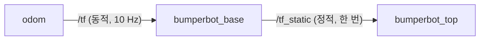

# 06. 메시지 패키지, 서비스, TF2 (저장소 Section8)

> 참조: `Section8_TF2_Library/bumperbot_ws/src/bumperbot_msgs/`, `Section8_TF2_Library/bumperbot_ws/src/bumperbot_cpp_examples/` (`src/simple_service_server.cpp`, `src/simple_service_client.cpp`, `include/bumperbot_cpp_examples/simple_tf_kinematics.hpp`, `src/simple_tf_kinematics.cpp`, `CMakeLists.txt`, `package.xml`)

## 이 장에서 하는 일

세 가지를 만든다.

1. 인터페이스 전용 패키지 `bumperbot_msgs`: 서비스 타입 `AddTwoInts`, `GetTransform`을 `.srv` 파일로 정의하고 C++ 코드를 생성한다.
2. 서비스 서버와 클라이언트: 두 정수를 더하는 가장 작은 서비스.
3. `simple_tf_kinematics`: 좌표 변환(TF)을 `/tf`, `/tf_static`으로 내보내고, TF 버퍼에서 변환을 조회해 서비스로 답한다.

ros2_control 전체에서 이 장은 두 곳에 쓰인다. 첫째, **다른 패키지에 인터페이스를 정의해 두고 가져다 쓰는 방법**(`find_package` + `package.xml`의 `<depend>`)이다. 둘째, 07장에서 오도메트리를 만들 때 `odom → base_footprint` 변환을 `/tf`로 내보내는데 그 코드가 이 장의 `TransformBroadcaster`와 같은 모양이다.

## 이번 장의 파일

```text
~/bumperbot_ws/src/
├── bumperbot_msgs/                                      [새]
│   ├── CMakeLists.txt                                   [새]
│   ├── package.xml                                      [새]
│   ├── LICENSE                                          [새] (`ros2 pkg create`가 만든다)
│   └── srv/
│       ├── AddTwoInts.srv                               [새]
│       └── GetTransform.srv                             [새]
└── bumperbot_cpp_examples/
    ├── CMakeLists.txt                                   [수정]
    ├── package.xml                                      [수정]
    ├── include/bumperbot_cpp_examples/
    │   └── simple_tf_kinematics.hpp                     [새]
    └── src/
        ├── simple_service_server.cpp                    [새]
        ├── simple_service_client.cpp                    [새]
        └── simple_tf_kinematics.cpp                     [새]
```

## 단계 1. 인터페이스 패키지 `bumperbot_msgs`

### 왜 필요한가

서비스·메시지·액션 타입은 `.srv`, `.msg`, `.action` 파일로 정의하고, `rosidl`이라는 도구가 이 파일에서 C++, Python, C 코드를 생성한다. 생성된 코드를 쓰는 패키지(서버, 클라이언트)는 이 생성물에 의존한다. 타입 정의를 별도 패키지로 두면 서비스를 쓰는 모든 패키지가 `bumperbot_msgs` 하나에만 의존하면 된다. 이것이 ROS 2의 관례다(일반 지식).

`std_srvs`, `geometry_msgs` 같은 기본 인터페이스 패키지가 `/opt/ros/jazzy`에 이미 있고, `bumperbot_msgs`는 같은 구조를 가진 우리 패키지다.

### 명령

```bash
cd ~/bumperbot_ws/src
ros2 pkg create --build-type ament_cmake --license Apache-2.0 \
  --description "Definition of Interfaces for the bumperbot" \
  --maintainer-name "Your Name" --maintainer-email "you@example.com" \
  bumperbot_msgs
rmdir bumperbot_msgs/src bumperbot_msgs/include/bumperbot_msgs bumperbot_msgs/include
mkdir bumperbot_msgs/srv
```

`ros2 pkg create`는 `src/`와 `include/`를 빈 폴더로 만든다. 인터페이스 패키지에는 C++ 소스가 없으므로 지운다. 지우지 않아도 동작에는 영향이 없다.

### 코드: `.srv` 파일

> `.srv` 파일은 요청(Request)과 응답(Response)을 `---` 한 줄로 나눈다. 파일 이름은 **대문자로 시작하는 CamelCase**여야 한다.

> 파일: `bumperbot_msgs/srv/AddTwoInts.srv` — 전체
```text
# Request
int64 a
int64 b
---
# Response
int64 sum
```

> 파일: `bumperbot_msgs/srv/GetTransform.srv` — 전체
```text
# Request
string frame_id
string child_frame_id
---
# Response
geometry_msgs/TransformStamped transform
bool success
```

`AddTwoInts`는 정수 `a`, `b`를 받아 `sum`을 돌려준다. `GetTransform`은 프레임 이름 두 개를 받아 그 사이의 변환(`geometry_msgs/TransformStamped`)과 성공 여부를 돌려준다. `#`으로 시작하는 줄은 주석이다. 필드 타입 `int64`, `string`, `bool`은 기본 타입이고, `geometry_msgs/TransformStamped`는 다른 패키지의 메시지이므로 아래 `CMakeLists.txt`에서 `geometry_msgs`를 의존성으로 알려야 한다.

### 코드: `CMakeLists.txt`

> 파일: `bumperbot_msgs/CMakeLists.txt` — 전체
```cmake
cmake_minimum_required(VERSION 3.8)
project(bumperbot_msgs)

if(CMAKE_COMPILER_IS_GNUCXX OR CMAKE_CXX_COMPILER_ID MATCHES "Clang")
  add_compile_options(-Wall -Wextra -Wpedantic)
endif()

find_package(ament_cmake REQUIRED)
find_package(geometry_msgs REQUIRED)
find_package(rosidl_default_generators REQUIRED)

rosidl_generate_interfaces(${PROJECT_NAME}
  "srv/AddTwoInts.srv"
  "srv/GetTransform.srv"
  DEPENDENCIES geometry_msgs
)

ament_package()
```

| 줄 | 뜻 |
|---|---|
| `find_package(geometry_msgs REQUIRED)` | `GetTransform.srv`가 쓰는 `geometry_msgs/TransformStamped`를 위해 필요하다 |
| `find_package(rosidl_default_generators REQUIRED)` | rosidl의 코드 생성기 모음을 불러온다. `rosidl_generate_interfaces`가 여기서 온다 |
| `rosidl_generate_interfaces(${PROJECT_NAME} "srv/AddTwoInts.srv" "srv/GetTransform.srv" DEPENDENCIES geometry_msgs)` | 나열한 `.srv` 파일에서 코드를 생성하고 설치한다. 첫 인자는 패키지 이름이다. 파일 경로는 패키지 폴더 기준이다. 새 `.srv`를 추가하면 여기에도 적어야 한다. `DEPENDENCIES`에는 인터페이스 파일 안에서 쓰는 다른 패키지를 모두 적는다 |
| `add_executable`, `install(TARGETS ...)` 없음 | 실행 파일이 없는 패키지이므로 필요 없다. 생성된 라이브러리·헤더의 설치는 `rosidl_generate_interfaces`가 한다 |
| `ament_package()` | 01장과 같다 |

### 코드: `package.xml`

> 파일: `bumperbot_msgs/package.xml` — 전체
```xml
<?xml version="1.0"?>
<?xml-model href="http://download.ros.org/schema/package_format3.xsd" schematypens="http://www.w3.org/2001/XMLSchema"?>
<package format="3">
  <name>bumperbot_msgs</name>
  <version>0.0.0</version>
  <description>Definition of Interfaces for the bumperbot</description>
  <maintainer email="you@example.com">Your Name</maintainer>
  <license>Apache-2.0</license>

  <buildtool_depend>ament_cmake</buildtool_depend>
  <build_depend>rosidl_default_generators</build_depend>

  <depend>geometry_msgs</depend>

  <exec_depend>rosidl_default_runtime</exec_depend>

  <member_of_group>rosidl_interface_packages</member_of_group>

  <test_depend>ament_lint_auto</test_depend>
  <test_depend>ament_lint_common</test_depend>

  <export>
    <build_type>ament_cmake</build_type>
  </export>
</package>
```

| 줄 | 뜻 |
|---|---|
| `<buildtool_depend>ament_cmake</buildtool_depend>` | 01장과 같다 |
| `<build_depend>rosidl_default_generators</build_depend>` | **빌드할 때만** 필요하다. 코드를 생성하는 도구다. 실행할 때는 필요 없다 |
| `<depend>geometry_msgs</depend>` | `GetTransform.srv`가 쓰는 메시지 패키지. 생성된 헤더가 `geometry_msgs`의 헤더를 포함하므로 빌드와 실행 모두 필요하다 |
| `<exec_depend>rosidl_default_runtime</exec_depend>` | **실행할 때만** 필요하다. 생성된 코드가 쓰는 런타임 라이브러리(타입 지원 등)다 |
| `<member_of_group>rosidl_interface_packages</member_of_group>` | "이 패키지는 인터페이스 패키지다"라는 선언이다. `rosidl_generate_interfaces`가 이 선언을 검사한다. 빼고 빌드하면 `Packages installing interfaces must include '<member_of_group>rosidl_interface_packages</member_of_group>' in their package.xml`로 CMake가 멈춘다 |

### 빌드와 시험

```bash
cd ~/bumperbot_ws
colcon build --symlink-install
source install/setup.bash
```

```text
Starting >>> bumperbot_msgs
Finished <<< bumperbot_msgs [3.69s]
```

작업 공간에 다른 패키지(`bumperbot_cpp_examples` 등)도 있어서 함께 빌드된다. 그 패키지의 줄도 나온다. `bumperbot_msgs`가 `Finished`이고 `Summary`에 실패가 없으면 된다.

타입이 ROS에 등록됐는지 본다.

```bash
ros2 interface list | grep bumperbot
ros2 interface package bumperbot_msgs
ros2 interface show bumperbot_msgs/srv/AddTwoInts
ros2 interface show bumperbot_msgs/srv/GetTransform
ros2 interface proto bumperbot_msgs/srv/AddTwoInts
```

```text
    bumperbot_msgs/srv/AddTwoInts
    bumperbot_msgs/srv/GetTransform
```

```text
bumperbot_msgs/srv/AddTwoInts
bumperbot_msgs/srv/GetTransform
```

```text
# Request
int64 a
int64 b
---
# Response
int64 sum
```

```text
# Request
string frame_id
string child_frame_id
---
# Response
geometry_msgs/TransformStamped transform
	std_msgs/Header header
		builtin_interfaces/Time stamp
			int32 sec
			uint32 nanosec
		string frame_id
	string child_frame_id
	Transform transform
		Vector3 translation
			float64 x
			float64 y
			float64 z
		Quaternion rotation
			float64 x 0
			float64 y 0
			float64 z 0
			float64 w 1
bool success
```

```text
"a: 0
b: 0
"
```

`ros2 interface show`가 `GetTransform`의 `TransformStamped`를 끝까지 펼쳐 보여 준다.

`install/`에 생긴 것을 본다. 이 패키지는 실행 파일 대신 생성된 라이브러리와 헤더를 설치한다.

```bash
ls ~/bumperbot_ws/install/bumperbot_msgs/include/bumperbot_msgs/bumperbot_msgs/srv/
ls ~/bumperbot_ws/install/bumperbot_msgs/lib
```

```text
add_two_ints.h
add_two_ints.hpp
detail
get_transform.h
get_transform.hpp
```

```text
libbumperbot_msgs__rosidl_generator_c.so
libbumperbot_msgs__rosidl_generator_py.so
libbumperbot_msgs__rosidl_typesupport_cpp.so
...
python3.12
```

헤더 이름은 `.srv` 파일 이름(`AddTwoInts`)을 snake_case(`add_two_ints`)로 바꾼 것이다. 다음 단계의 소스에서 `#include "bumperbot_msgs/srv/add_two_ints.hpp"`로 쓴다. Python 노드를 쓰지 않아도 Python용 코드가 함께 생성된다.

통과 조건: `ros2 interface show`가 두 서비스를 보인다.

## 단계 2. 서비스 서버와 클라이언트

### 왜 필요한가

토픽은 "계속 흘려보내는 값"이고, 서비스는 "한 번 묻고 한 번 답을 받는 호출"이다. 설치된 `ros2 control` 명령에는 `load_controller`, `set_controller_state` 같은 하위 명령이 있고, 이것들이 서비스 호출이라는 점은 일반 지식이다(이 가이드에서 직접 확인하는 것은 03장이다). 가장 작은 서비스로 서버/클라이언트의 모양을 익힌다. 패키지 관점에서는 **다른 패키지(`bumperbot_msgs`)의 타입을 쓰는 방법**을 익힌다.

### 코드: 서버

> 파일: `bumperbot_cpp_examples/src/simple_service_server.cpp` — 전체 (단계 2 시점)
```cpp
#include <rclcpp/rclcpp.hpp>
#include "bumperbot_msgs/srv/add_two_ints.hpp"

#include <memory>


using namespace std::placeholders;

class SimpleServiceServer : public rclcpp::Node
{
public:
    SimpleServiceServer() : Node("simple_service_server")
    {
        service_ = create_service<bumperbot_msgs::srv::AddTwoInts>("add_two_ints", std::bind(&SimpleServiceServer::serviceCallback, this, _1, _2));
        RCLCPP_INFO(rclcpp::get_logger("rclcpp"), "Service add_two_ints Ready");
    }


private:
    rclcpp::Service<bumperbot_msgs::srv::AddTwoInts>::SharedPtr service_;

    void serviceCallback(const std::shared_ptr<bumperbot_msgs::srv::AddTwoInts::Request> req,
                         const std::shared_ptr<bumperbot_msgs::srv::AddTwoInts::Response> res)
    {
        RCLCPP_INFO_STREAM(rclcpp::get_logger("rclcpp"), "New Request Received a: " << req->a << " b: " << req->b);
        res->sum = req->a + req->b;
        RCLCPP_INFO_STREAM(rclcpp::get_logger("rclcpp"), "Returning sum: " << res->sum);
    }

};


int main(int argc, char* argv[])
{
  rclcpp::init(argc, argv);
  auto node = std::make_shared<SimpleServiceServer>();
  rclcpp::spin(node);
  rclcpp::shutdown();
  return 0;
}
```

### 코드 설명: 서버

| 부분 | 뜻 |
|---|---|
| `#include "bumperbot_msgs/srv/add_two_ints.hpp"` | 단계 1이 생성한 헤더. 타입은 `bumperbot_msgs::srv::AddTwoInts`이고 그 안에 `Request`, `Response`가 있다 |
| `using namespace std::placeholders;` | `_1`, `_2`를 모두 쓰게 한다. 서비스 콜백은 인자가 둘이다 |
| `create_service<AddTwoInts>("add_two_ints", std::bind(&SimpleServiceServer::serviceCallback, this, _1, _2))` | `add_two_ints`라는 이름의 서비스를 연다. 요청이 오면 콜백이 불린다 |
| `serviceCallback(const std::shared_ptr<Request> req, const std::shared_ptr<Response> res)` | 서비스 콜백의 모양. 요청을 읽고 **응답 객체 `res`를 채운다.** 함수가 끝나면 채워진 응답이 클라이언트에게 간다 |
| `rclcpp::get_logger("rclcpp")` | 노드와 상관없이 이름이 `rclcpp`인 로거를 쓴다. 그래서 로그에 `[rclcpp]`가 찍힌다. 노드 이름으로 찍으려면 `get_logger()`를 쓴다 |
| `std::shared_ptr` | 요청·응답을 공유 포인터로 받는다. 멤버는 `req->a`처럼 `->`로 접근한다 |

### 코드: 클라이언트

> 파일: `bumperbot_cpp_examples/src/simple_service_client.cpp` — 전체 (단계 2 시점)
```cpp
#include <rclcpp/rclcpp.hpp>
#include "bumperbot_msgs/srv/add_two_ints.hpp"

#include <chrono>
#include <memory>


using namespace std::chrono_literals;
using std::placeholders::_1;


class SimpleServiceClient : public rclcpp::Node 
{
public:
    SimpleServiceClient(int a, int b) : Node("simple_service_client")
    {
        client_ = create_client<bumperbot_msgs::srv::AddTwoInts>("add_two_ints");

        auto request = std::make_shared<bumperbot_msgs::srv::AddTwoInts::Request>();
        request->a = a;
        request->b = b;

        while (!client_->wait_for_service(1s)) {
            if (!rclcpp::ok()) 
            {
                RCLCPP_ERROR(rclcpp::get_logger("rclcpp"), "Interrupted while waiting for the service. Exiting.");
                return;
            }
            RCLCPP_INFO(rclcpp::get_logger("rclcpp"), "service not available, waiting again...");
        }

        auto result = client_->async_send_request(request, std::bind(&SimpleServiceClient::responseCallback, this, _1));
    }

private:
    rclcpp::Client<bumperbot_msgs::srv::AddTwoInts>::SharedPtr client_;

    void responseCallback(rclcpp::Client<bumperbot_msgs::srv::AddTwoInts>::SharedFuture future)
    {
        if(future.valid())
        {
            RCLCPP_INFO_STREAM(rclcpp::get_logger("rclcpp"), "Service Response " << future.get()->sum);
        }
        else
        {
            RCLCPP_ERROR(rclcpp::get_logger("rclcpp"), "Service Failure");
        }
    }
};


int main(int argc, char* argv[])
{
  rclcpp::init(argc, argv);

  if (argc != 3) {
    RCLCPP_ERROR(rclcpp::get_logger("rclcpp"), "Wrong number of arguments! Usage: simple_service_client A B");
    return 1;
  }

  auto node = std::make_shared<SimpleServiceClient>(atoi(argv[1]), atoi(argv[2]));
  rclcpp::spin(node);
  rclcpp::shutdown();
  return 0;
}
```

### 코드 설명: 클라이언트

| 부분 | 뜻 |
|---|---|
| `SimpleServiceClient(int a, int b)` | 생성자에서 요청을 보낸다. 값은 명령줄에서 받는다 |
| `create_client<AddTwoInts>("add_two_ints")` | 같은 이름의 서비스를 부르는 클라이언트를 만든다 |
| `std::make_shared<AddTwoInts::Request>()` | 요청 객체를 만들고 `a`, `b`를 채운다 |
| `while (!client_->wait_for_service(1s))` | 서버가 뜰 때까지 1초씩 기다린다. 기다리는 동안 `rclcpp::ok()`가 거짓이 되면(Ctrl+C) 빠져나간다 |
| `client_->async_send_request(request, std::bind(&SimpleServiceClient::responseCallback, this, _1))` | 요청을 비동기로 보낸다. 바로 돌아오고, 응답이 오면 `responseCallback`이 불린다 |
| `responseCallback(SharedFuture future)` | 응답은 `future`로 온다. `future.get()->sum`으로 꺼낸다 |
| `main()`의 `argc != 3` 검사 | `argc`는 명령줄 항목 수이고 `argv[0]`은 실행 파일 이름이다. `simple_service_client 10 20`이면 `argc`는 3이고 `argv[1]`이 `"10"`, `argv[2]`가 `"20"`이다. 인자가 `A B` 두 개가 아니면 사용법을 출력하고 끝난다 |
| `atoi(argv[1])` | 문자열(`"10"`)을 정수 `int`로 바꾸는 C 함수다. 숫자가 아닌 글자가 오면 오류를 알리지 않고 0을 돌려준다 |

`rclcpp::spin(node)`이 응답 콜백을 부른다. 콜백이 끝나도 `spin`은 계속 도는 코드이므로 응답을 받은 뒤에도 클라이언트는 Ctrl+C를 누를 때까지 끝나지 않는다.

### `CMakeLists.txt`, `package.xml` 수정

`bumperbot_msgs`를 찾고, 실행 파일 둘을 추가하고, `install` 목록에 넣는다.

아래 "수정" 블록의 `# ...` 줄은 "원래 있던 줄을 그대로 둔다"는 뜻이다. 파일에 치지 않는다.

> 파일: `bumperbot_cpp_examples/CMakeLists.txt` — 수정 (단계 2 시점)
```cmake
find_package(turtlesim REQUIRED)
find_package(bumperbot_msgs REQUIRED)
# ...
add_executable(simple_turtlesim_kinematics src/simple_turtlesim_kinematics.cpp)
ament_target_dependencies(simple_turtlesim_kinematics rclcpp turtlesim)

add_executable(simple_service_server src/simple_service_server.cpp)
ament_target_dependencies(simple_service_server rclcpp bumperbot_msgs)

add_executable(simple_service_client src/simple_service_client.cpp)
ament_target_dependencies(simple_service_client rclcpp bumperbot_msgs)
# ...
install(TARGETS
  simple_publisher
  simple_subscriber
  simple_parameter
  simple_turtlesim_kinematics
  simple_service_server
  simple_service_client
  DESTINATION lib/${PROJECT_NAME}
)
```

`package.xml`에 `<depend>bumperbot_msgs</depend>`를 더한다.

> 파일: `bumperbot_cpp_examples/package.xml` — 수정 (단계 2 시점)
```xml
  <buildtool_depend>ament_cmake</buildtool_depend>
  <depend>rclcpp</depend>
  <depend>std_msgs</depend>
  <depend>rcl_interfaces</depend>
  <depend>turtlesim</depend>
  <depend>bumperbot_msgs</depend>

  <test_depend>ament_lint_auto</test_depend>
  <test_depend>ament_lint_common</test_depend>
```

`ament_target_dependencies(simple_service_server rclcpp bumperbot_msgs)`에서 `bumperbot_msgs`를 빼면 `fatal error: bumperbot_msgs/srv/add_two_ints.hpp: No such file or directory`로 컴파일이 실패한다. 인터페이스 패키지도 다른 패키지처럼 `find_package`와 `ament_target_dependencies`로 연결해야 한다.

`package.xml`의 `<depend>bumperbot_msgs</depend>`를 빠뜨리면 더 알아채기 어려운 오류가 난다. colcon은 `package.xml`의 의존성으로 빌드 순서를 정한다. 의존성이 없으면 `bumperbot_cpp_examples`와 `bumperbot_msgs`를 **동시에** 빌드하기 시작하고, 앞쪽이 먼저 끝나기 전에 `find_package(bumperbot_msgs)`가 실행되어 다음처럼 실패한다.

```text
Could not find a package configuration file provided by "bumperbot_msgs"
...
Failed   <<< bumperbot_cpp_examples [0.62s, exited with code 1]
```

### 빌드와 시험

```bash
cd ~/bumperbot_ws
colcon build --symlink-install
source install/setup.bash
```

먼저 서버 없이 클라이언트를 띄운다. 터미널 A에서 한다. 새 터미널이면 `source /opt/ros/jazzy/setup.bash`와 `source ~/bumperbot_ws/install/setup.bash`를 먼저 한다. 이 명령은 서버를 기다리며 끝나지 않는다.

```bash
ros2 run bumperbot_cpp_examples simple_service_client 2 3
```

```text
[INFO] [1795239224.715913183] [rclcpp]: service not available, waiting again...
[INFO] [1795239225.716137717] [rclcpp]: service not available, waiting again...
```

Ctrl+C로 끈다. 이때 `terminate called after throwing an instance of 'rclcpp::exceptions::RCLError'` 메시지가 함께 나온다. 서버를 기다리다 중단하면 생성자가 `return`한 뒤 `main()`이 이미 종료된 ROS 컨텍스트로 `spin`하려 하기 때문이다. 참조 코드의 한계이며 동작에는 영향이 없어 그대로 둔다.

인자를 잘못 주면 다음처럼 끝난다.

```bash
ros2 run bumperbot_cpp_examples simple_service_client 2
```

```text
[ERROR] [1795239226.714996836] [rclcpp]: Wrong number of arguments! Usage: simple_service_client A B
[ros2run]: Process exited with failure 1
```

이제 서버를 띄운다. 터미널 A를 그대로 쓴다.

터미널 A (끝나지 않는 명령):

```bash
ros2 run bumperbot_cpp_examples simple_service_server
```

```text
[INFO] [1795239226.845768029] [rclcpp]: Service add_two_ints Ready
```

터미널 B(처음 한 번 위와 같이 `source`한다)에서 `ros2` 명령으로 먼저 호출한다. 바로 끝나는 명령이다.

```bash
ros2 service list -t | grep add_two
ros2 service call /add_two_ints bumperbot_msgs/srv/AddTwoInts "{a: 5, b: 7}"
```

```text
/add_two_ints [bumperbot_msgs/srv/AddTwoInts]
```

```text
requester: making request: bumperbot_msgs.srv.AddTwoInts_Request(a=5, b=7)

response:
bumperbot_msgs.srv.AddTwoInts_Response(sum=12)
```

서버 터미널에는 다음이 찍힌다.

```text
[INFO] [1795239230.363510360] [rclcpp]: New Request Received a: 5 b: 7
[INFO] [1795239230.363529894] [rclcpp]: Returning sum: 12
```

우리가 만든 클라이언트로도 터미널 B에서 호출한다. 이 명령은 응답을 받은 뒤에도 끝나지 않으므로 `Service Response 30`이 나오면 Ctrl+C로 끈다.

```bash
ros2 run bumperbot_cpp_examples simple_service_client 10 20
```

```text
[INFO] [1795239230.779541616] [rclcpp]: Service Response 30
```

통과 조건: `ros2 service call`이 `sum=12`를, 클라이언트가 `Service Response 30`을 낸다. 시험이 끝나면 터미널 A의 서버도 Ctrl+C로 끈다. 다음 단계에서 같은 이름의 노드를 쓰는 것은 아니지만, 서버가 남아 있으면 이후 `ros2 service list`가 헷갈린다.

Python판의 참조 위치: `Section8_TF2_Library/bumperbot_ws/src/bumperbot_py_examples/bumperbot_py_examples/simple_service_server.py`, `simple_service_client.py`

## 단계 3. TF2: 좌표 변환 내보내기와 조회

### 왜 필요한가

로봇에는 여러 좌표계(프레임)가 있다. 바닥에 고정된 `odom`, 로봇 몸통의 `base_footprint`, 바퀴, 센서 등이다. 프레임 사이의 이동·회전 관계를 모아 두고 "A 프레임에서 B 프레임으로 가는 변환"을 시간과 함께 물어볼 수 있게 한 것이 **TF2**다. 04장에서 직접 계산한 "이동 벡터 + 회전 행렬"이 TF2의 한 변환이다.

- 변환을 **내보내는** 쪽: `TransformBroadcaster`(계속 바뀌는 변환 → `/tf`), `StaticTransformBroadcaster`(안 바뀌는 변환 → `/tf_static`).
- 변환을 **조회하는** 쪽: `Buffer` + `TransformListener`. 리스너가 `/tf`, `/tf_static`을 구독해 버퍼에 쌓고, 버퍼가 프레임 트리를 따라 변환을 계산해 준다.

07장에서 오도메트리 노드가 `odom → base_footprint` 변환을 `/tf`로 내보낸다. 이 단계의 `dynamic_tf_broadcaster_`가 같은 일을 한다.

### 코드: 헤더

> 파일: `bumperbot_cpp_examples/include/bumperbot_cpp_examples/simple_tf_kinematics.hpp` — 전체
```cpp
#ifndef SIMPLE_TF_KINEMATICS_HPP
#define SIMPLE_TF_KINEMATICS_HPP

#include <rclcpp/rclcpp.hpp>
#include <geometry_msgs/msg/transform_stamped.hpp>
#include <tf2/LinearMath/Quaternion.h>
#include <tf2_ros/static_transform_broadcaster.h>
#include <tf2_ros/transform_broadcaster.h>
#include <tf2/exceptions.h>
#include <tf2_ros/transform_listener.h>
#include <tf2_ros/buffer.h>
#include "bumperbot_msgs/srv/get_transform.hpp"

#include <memory>


class SimpleTfKinematics : public rclcpp::Node
{
public:
    SimpleTfKinematics(const std::string& name);

private: 
    void timerCallback();

    bool getTransformCallback(const std::shared_ptr<bumperbot_msgs::srv::GetTransform::Request> req,
                              const std::shared_ptr<bumperbot_msgs::srv::GetTransform::Response> res);

    rclcpp::TimerBase::SharedPtr timer_;
    rclcpp::Service<bumperbot_msgs::srv::GetTransform>::SharedPtr get_transform_srv_;

    std::shared_ptr<tf2_ros::StaticTransformBroadcaster> static_tf_broadcaster_;
    std::unique_ptr<tf2_ros::TransformBroadcaster> dynamic_tf_broadcaster_;
    
    geometry_msgs::msg::TransformStamped static_transform_stamped_;
    geometry_msgs::msg::TransformStamped dynamic_transform_stamped_;
    double last_x_;
    double x_increment_;
    
    std::shared_ptr<tf2_ros::TransformListener> tf_listener_{nullptr};
    std::unique_ptr<tf2_ros::Buffer> tf_buffer_;
    tf2::Quaternion last_orientation_;
    tf2::Quaternion orientation_increment_;
    int rotations_counter_;
};

#endif // SIMPLE_TF_KINEMATICS_HPP
```

### 코드: 소스

> 파일: `bumperbot_cpp_examples/src/simple_tf_kinematics.cpp` — 전체
```cpp
#include "bumperbot_cpp_examples/simple_tf_kinematics.hpp"

#include <chrono>

using namespace std::chrono_literals;
using namespace std::placeholders;


SimpleTfKinematics::SimpleTfKinematics(const std::string& name)
    : Node(name),
      last_x_(0.0),
      x_increment_(0.05),
      rotations_counter_(0)
{
  static_tf_broadcaster_ = std::make_shared<tf2_ros::StaticTransformBroadcaster>(this);
  dynamic_tf_broadcaster_ = std::make_unique<tf2_ros::TransformBroadcaster>(*this);
  tf_buffer_ = std::make_unique<tf2_ros::Buffer>(this->get_clock());
  tf_listener_ = std::make_shared<tf2_ros::TransformListener>(*tf_buffer_);

  static_transform_stamped_.header.stamp = get_clock()->now();
  static_transform_stamped_.header.frame_id = "bumperbot_base";
  static_transform_stamped_.child_frame_id = "bumperbot_top";
  static_transform_stamped_.transform.translation.x = 0;
  static_transform_stamped_.transform.translation.y = 0;
  static_transform_stamped_.transform.translation.z = 0.3;
  static_transform_stamped_.transform.rotation.x = 0;
  static_transform_stamped_.transform.rotation.y = 0;
  static_transform_stamped_.transform.rotation.z = 0;
  static_transform_stamped_.transform.rotation.w = 1;
  static_tf_broadcaster_->sendTransform(static_transform_stamped_);
  RCLCPP_INFO_STREAM(get_logger(), "Publishing static transform between " <<
                   static_transform_stamped_.header.frame_id << " and " << 
                   static_transform_stamped_.child_frame_id);

  // Timer
  timer_ = create_wall_timer(0.1s, std::bind(&SimpleTfKinematics::timerCallback, this));

  // Service Server
  get_transform_srv_ = create_service<bumperbot_msgs::srv::GetTransform>("get_transform", std::bind(&SimpleTfKinematics::getTransformCallback, this, _1, _2));

  // Quaternion
  last_orientation_.setRPY(0, 0, 0);
  orientation_increment_.setRPY(0, 0, 0.05); // in radians
}


void SimpleTfKinematics::timerCallback()
{  
  dynamic_transform_stamped_.header.stamp = get_clock()->now();
  dynamic_transform_stamped_.header.frame_id = "odom";
  dynamic_transform_stamped_.child_frame_id = "bumperbot_base";
  dynamic_transform_stamped_.transform.translation.x = last_x_ + x_increment_;
  dynamic_transform_stamped_.transform.translation.y = 0;
  dynamic_transform_stamped_.transform.translation.z = 0;
  // dynamic_transform_stamped_.transform.rotation.x = 0;
  // dynamic_transform_stamped_.transform.rotation.y = 0;
  // dynamic_transform_stamped_.transform.rotation.z = 0;
  // dynamic_transform_stamped_.transform.rotation.w = 1;

  // Euler to Quaternion
  tf2::Quaternion q;
  q = last_orientation_ * orientation_increment_;
  q.normalize(); // sum == 1
  dynamic_transform_stamped_.transform.rotation.x = q.x();
  dynamic_transform_stamped_.transform.rotation.y = q.y();
  dynamic_transform_stamped_.transform.rotation.z = q.z();
  dynamic_transform_stamped_.transform.rotation.w = q.w();

  dynamic_tf_broadcaster_->sendTransform(dynamic_transform_stamped_);
  last_x_ = dynamic_transform_stamped_.transform.translation.x;
  last_orientation_ = q;
  rotations_counter_++;
  if(rotations_counter_ >= 100)
  {
    orientation_increment_ = orientation_increment_.inverse();
    rotations_counter_ = 0;
  }
}


bool SimpleTfKinematics::getTransformCallback(const std::shared_ptr<bumperbot_msgs::srv::GetTransform::Request> req,
                                              const std::shared_ptr<bumperbot_msgs::srv::GetTransform::Response> res)
{
  RCLCPP_INFO_STREAM(get_logger(), "Requested Transform between " << req->frame_id << " and " << req->child_frame_id);
  geometry_msgs::msg::TransformStamped requested_transform;
  try{
    requested_transform = tf_buffer_->lookupTransform(req->frame_id, 
                                                     req->child_frame_id, 
                                                     tf2::TimePointZero);
  }
  catch (tf2::TransformException &ex) {
    RCLCPP_ERROR_STREAM(get_logger(), "An error occurred while transforming " 
                     << req->frame_id << " and " << req->child_frame_id
                     << ": " << ex.what());
    res->success = false;
    return true;
  }

  res->transform = requested_transform;
  res->success = true;
  return true;
}


int main(int argc, char* argv[])
{
  rclcpp::init(argc, argv);
  auto node = std::make_shared<SimpleTfKinematics>("simple_tf_kinematics");
  rclcpp::spin(node);
  rclcpp::shutdown();
  return 0;
}
```

### 코드 설명

**헤더**

| 부분 | 뜻 |
|---|---|
| `tf2_ros/static_transform_broadcaster.h`, `tf2_ros/transform_broadcaster.h` | 내보내는 쪽 클래스 |
| `tf2_ros/transform_listener.h`, `tf2_ros/buffer.h` | 조회하는 쪽 클래스 |
| `tf2/LinearMath/Quaternion.h` | 회전을 4원수로 다루는 `tf2::Quaternion` |
| `tf2/exceptions.h` | `lookupTransform`이 던지는 `tf2::TransformException` 같은 예외 타입 |
| `geometry_msgs/msg/transform_stamped.hpp` | 변환 메시지 `TransformStamped` |
| `bumperbot_msgs/srv/get_transform.hpp` | 단계 1이 생성한 `GetTransform` 서비스 타입 |
| `std::unique_ptr<...> dynamic_tf_broadcaster_` | 한 곳만 소유하는 스마트 포인터. `shared_ptr`과 달리 복사할 수 없다 |
| `static_transform_stamped_`, `dynamic_transform_stamped_` | 내보낼 변환 메시지를 멤버로 들고 있는다 |
| `last_x_`, `x_increment_`, `last_orientation_`, `orientation_increment_` | 움직이는 변환을 만들기 위한 상태 |

**소스: 생성자**

| 부분 | 뜻 |
|---|---|
| `std::make_shared<tf2_ros::StaticTransformBroadcaster>(this)` | `/tf_static`으로 내보내는 방송자. 노드를 받는다. 여기서는 `this`(노드를 가리키는 포인터)를 넘긴다 |
| `std::make_unique<tf2_ros::TransformBroadcaster>(*this)` | `/tf`로 내보내는 방송자. 여기서는 `*this`(노드 객체 자체, 참조)를 넘긴다. 두 클래스의 생성자 모두 설치된 헤더에서 `NodeT && node`를 받는 템플릿이라 포인터와 참조 둘 다 받는다. 참조 코드가 두 방식을 섞어 쓴 이유는 코드에 적혀 있지 않다. 동작은 같다 |
| `tf_buffer_ = std::make_unique<tf2_ros::Buffer>(this->get_clock())` | 변환을 쌓아 두는 버퍼. 시간 정보를 위해 노드의 시계를 받는다 |
| `tf_listener_ = std::make_shared<tf2_ros::TransformListener>(*tf_buffer_)` | `/tf`, `/tf_static`을 구독해 버퍼에 채운다. 버퍼를 먼저 만들고 리스너를 만든다 |
| `static_transform_stamped_` 채우기 | `header.frame_id`는 **부모** 프레임(`bumperbot_base`), `child_frame_id`는 **자식** 프레임(`bumperbot_top`)이다. `translation.z = 0.3`은 부모 기준 위로 0.3 m라는 뜻이다. `rotation`은 `(0, 0, 0, 1)`로 회전 없음이다 |
| `static_tf_broadcaster_->sendTransform(...)` | 정적 변환은 **한 번만** 보낸다. `/tf_static`은 나중에 구독을 시작한 노드도 마지막 값을 받는 설정(transient local)이라 한 번이면 충분하다 |
| `create_wall_timer(0.1s, ...)` | 0.1초마다 `timerCallback`을 부른다(10 Hz) |
| `create_service<GetTransform>("get_transform", ...)` | 변환 조회 서비스 |
| `last_orientation_.setRPY(0, 0, 0)`, `orientation_increment_.setRPY(0, 0, 0.05)` | 롤·피치·요(rad)에서 4원수를 만든다. 요를 한 번에 0.05 rad씩 돌릴 증분을 만든다 |

**소스: `timerCallback`**

| 부분 | 뜻 |
|---|---|
| `header.stamp = get_clock()->now()` | 변환의 시각. TF는 시간이 붙은 변환을 버퍼에 쌓는다 |
| `frame_id = "odom"`, `child_frame_id = "bumperbot_base"` | `odom` 프레임 기준으로 `bumperbot_base`가 어디 있는가 |
| `translation.x = last_x_ + x_increment_` | 한 번에 0.05 m씩, 즉 0.1초마다 0.05 m(0.5 m/s)로 앞으로 간다 |
| `q = last_orientation_ * orientation_increment_` | 4원수를 곱하면 회전이 이어 붙는다. 이전 방향에 증분 회전을 더한 것이다 |
| `q.normalize()` | 곱셈을 반복하면 4원수 길이가 1에서 조금씩 어긋나므로 길이를 다시 1로 맞춘다 |
| `rotation.x/y/z/w = q.x()/...` | 4원수를 메시지에 옮긴다 |
| `dynamic_tf_broadcaster_->sendTransform(...)` | `/tf`로 내보낸다 |
| `// dynamic_transform_stamped_.transform.rotation.x = 0;` 등 주석 처리된 네 줄 | 회전을 `(0, 0, 0, 1)`(회전 없음)로 고정하던 이전 버전의 흔적이다. 지금은 바로 아래 4원수 계산이 `rotation`을 채우므로 쓰이지 않는다. 지워도 동작은 같다 |
| `rotations_counter_ >= 100`일 때 `orientation_increment_.inverse()` | 100번(10초)마다 회전 방향을 뒤집는다. 몸통이 한쪽으로만 계속 돌지 않고 왕복하게 한다 |

**소스: `getTransformCallback`**

| 부분 | 뜻 |
|---|---|
| `tf_buffer_->lookupTransform(req->frame_id, req->child_frame_id, tf2::TimePointZero)` | 버퍼에서 "`frame_id` 프레임 안에서 본 `child_frame_id` 프레임의 자세"를 구한다. `tf2::TimePointZero`는 "버퍼에 있는 가장 최근 변환"이라는 뜻이다. 두 프레임이 직접 이어져 있지 않아도 트리를 따라 계산해 준다 |
| `catch (tf2::TransformException &ex)` | 프레임이 없거나 이어지지 않으면 예외가 난다. 로그를 찍고 `success = false`로 응답한다. 콜백이 `bool`을 돌려주지만 `rclcpp`의 서비스 콜백은 반환값을 쓰지 않는다. `return true;`(참조 코드)를 `return false;`로 바꿔 두 경우 모두 빌드해 시험했을 때도 호출 결과가 같았다(`success=True`/`False` 응답이 그대로 왔다). ROS 1 서비스 콜백이 `bool`을 돌려주던 습관이 남은 것이다(일반 지식). 호출 결과는 `res->success`로만 전달된다 |
| `res->transform = requested_transform; res->success = true;` | 성공 응답. 뒤의 `return true`도 같은 이유로 의미가 없다 |

이 노드가 만드는 프레임 트리는 다음과 같다.



### `CMakeLists.txt`, `package.xml` 수정

`geometry_msgs`, `tf2`, `tf2_ros`를 더 찾고, 실행 파일을 추가하고, `install` 목록에 넣는다.

> 파일: `bumperbot_cpp_examples/CMakeLists.txt` — 수정
```cmake
find_package(turtlesim REQUIRED)
find_package(bumperbot_msgs REQUIRED)
find_package(geometry_msgs REQUIRED)
find_package(tf2 REQUIRED)
find_package(tf2_ros REQUIRED)
# ...
add_executable(simple_service_client src/simple_service_client.cpp)
ament_target_dependencies(simple_service_client rclcpp bumperbot_msgs)

add_executable(simple_tf_kinematics src/simple_tf_kinematics.cpp)
ament_target_dependencies(simple_tf_kinematics rclcpp bumperbot_msgs geometry_msgs tf2 tf2_ros)
# ...
install(TARGETS
  simple_publisher
  simple_subscriber
  simple_parameter
  simple_turtlesim_kinematics
  simple_service_server
  simple_service_client
  simple_tf_kinematics
  DESTINATION lib/${PROJECT_NAME}
)

ament_package()
```

`package.xml`에는 `geometry_msgs`, `tf2`, `tf2_ros`를 더한다.

> 파일: `bumperbot_cpp_examples/package.xml` — 수정
```xml
  <buildtool_depend>ament_cmake</buildtool_depend>
  <depend>rclcpp</depend>
  <depend>std_msgs</depend>
  <depend>rcl_interfaces</depend>
  <depend>turtlesim</depend>
  <depend>bumperbot_msgs</depend>
  <depend>geometry_msgs</depend>
  <depend>tf2</depend>
  <depend>tf2_ros</depend>

  <test_depend>ament_lint_auto</test_depend>
  <test_depend>ament_lint_common</test_depend>

```

헤더 `simple_tf_kinematics.hpp`는 `include/bumperbot_cpp_examples/`에 두므로 04장에서 넣은 `include_directories(include)`가 이미 처리한다. 다시 할 일이 없다.

### 빌드와 시험

```bash
cd ~/bumperbot_ws
colcon build --symlink-install
source install/setup.bash
```

터미널 A에서 노드를 띄운다. 끝나지 않는 명령이다.

```bash
ros2 run bumperbot_cpp_examples simple_tf_kinematics
```

```text
[INFO] [1795239259.276494895] [simple_tf_kinematics]: Publishing static transform between bumperbot_base and bumperbot_top
```

터미널 B에서 시험한다. 새 터미널이면 `source /opt/ros/jazzy/setup.bash`와 `source ~/bumperbot_ws/install/setup.bash`를 먼저 한다. 표시가 없으면 바로 끝나는 명령이다.

**1. 토픽과 정적 변환**

```bash
ros2 topic list -t
ros2 topic info /tf_static -v
ros2 topic echo /tf_static --once
```

```text
/parameter_events [rcl_interfaces/msg/ParameterEvent]
/rosout [rcl_interfaces/msg/Log]
/tf [tf2_msgs/msg/TFMessage]
/tf_static [tf2_msgs/msg/TFMessage]
```

`/tf_static -v`(줄임)는 다음처럼 나온다. 퍼블리셔와 구독자 모두 `Durability: TRANSIENT_LOCAL`이다(위의 "한 번만 보내도 되는" 이유다). 구독자는 노드가 TF 리스너로 만든 것이다(`transform_listener_impl_...` 이름의 노드).

```text
Type: tf2_msgs/msg/TFMessage

Publisher count: 1

Node name: simple_tf_kinematics
Endpoint type: PUBLISHER
QoS profile:
  Reliability: RELIABLE
  Durability: TRANSIENT_LOCAL

Subscription count: 1

Node name: transform_listener_impl_624b71e22f70
Endpoint type: SUBSCRIPTION
QoS profile:
  Reliability: RELIABLE
  Durability: TRANSIENT_LOCAL
```

`transform_listener_impl_` 뒤의 숫자는 실행할 때마다 다르다.

```text
transforms:
- header:
    stamp:
      sec: 1795239259
      nanosec: 276456160
    frame_id: bumperbot_base
  child_frame_id: bumperbot_top
  transform:
    translation:
      x: 0.0
      y: 0.0
      z: 0.3
    rotation:
      x: 0.0
      y: 0.0
      z: 0.0
      w: 1.0
---
```

**2. 동적 변환**

```bash
ros2 topic echo /tf --once
```

```text
transforms:
- header:
    stamp:
      sec: 1795239264
      nanosec: 776637682
    frame_id: odom
  child_frame_id: bumperbot_base
  transform:
    translation:
      x: 2.7499999999999982
      y: 0.0
      z: 0.0
    rotation:
      x: 0.0
      y: 0.0
      z: 0.9808930570231559
      w: 0.1945477079889869
---
```

`x`가 시간이 지날수록 커지고, 회전은 `z`, `w`에 담긴 요 각이다.

**3. `tf2_echo`: 버퍼에서 변환 조회**

`tf2_echo`는 1초마다 값을 출력하며 끝나지 않는다. 두 명령을 하나씩 실행하고 몇 번 출력된 뒤 Ctrl+C로 끈다.

```bash
ros2 run tf2_ros tf2_echo bumperbot_base bumperbot_top
```

```text
[INFO] [1795239265.022059415] [tf2_echo]: Waiting for transform bumperbot_base ->  bumperbot_top: Invalid frame ID "bumperbot_base" passed to canTransform argument target_frame - frame does not exist
At time 0.0
- Translation: [0.000, 0.000, 0.300]
- Rotation: in Quaternion (xyzw) [0.000, 0.000, 0.000, 1.000]
- Rotation: in RPY (radian) [0.000, -0.000, 0.000]
- Rotation: in RPY (degree) [0.000, -0.000, 0.000]
- Matrix:
  1.000  0.000  0.000  0.000
  0.000  1.000  0.000  0.000
  0.000  0.000  1.000  0.300
  0.000  0.000  0.000  1.000
```

이어서 두 번째 명령을 같은 터미널에서 실행하고 Ctrl+C로 끈다.

```bash
ros2 run tf2_ros tf2_echo odom bumperbot_top
```

```text
At time 1795239268.976887646
- Translation: [4.850, 0.000, 0.300]
- Rotation: in Quaternion (xyzw) [0.000, 0.000, -0.657, 0.754]
- Rotation: in RPY (radian) [0.000, 0.000, -1.433]
- Rotation: in RPY (degree) [0.000, 0.000, -82.115]
- Matrix:
  0.137  0.991  0.000  4.850
 -0.991  0.137 -0.000  0.000
 -0.000  0.000  1.000  0.300
  0.000  0.000  0.000  1.000
```

맨 위 `Waiting for transform ... frame does not exist` 한 줄은 `tf2_echo`의 버퍼가 아직 비어 있을 때 나오는 정상 메시지다. 두 번째 명령은 `odom`과 `bumperbot_top`이 **직접 연결돼 있지 않은데도** 두 변환을 이어 붙여 `z = 0.3`(정적 변환)과 `x = 4.85쯤`(동적 변환)을 합친 결과를 보여 준다. `x`와 회전 값은 실행 시점에 따라 다르다. 두 번째 출력의 숫자는 노드를 띄운 지 약 10초 후에 본 값이다. `Matrix:`는 04장에서 본 동차 변환 행렬이며 **4x4**다. 회전은 왼쪽 위 3x3이고 이동은 오른쪽 열의 위 세 원소다. 이 노드의 회전은 z축 둘레뿐이라 왼쪽 위 3x3 안에서 왼쪽 위 2x2에만 `cos`, `sin` 값이 보이고, 세 번째 행과 열은 `(0, 0, 1)`이다. 맨 아랫줄 `0 0 0 1`은 동차 좌표를 맞추는 고정값이다.

**4. 우리가 만든 서비스**

```bash
ros2 service call /get_transform bumperbot_msgs/srv/GetTransform "{frame_id: 'odom', child_frame_id: 'bumperbot_top'}"
ros2 service call /get_transform bumperbot_msgs/srv/GetTransform "{frame_id: 'odom', child_frame_id: 'nonexistent'}"
```

```text
response:
bumperbot_msgs.srv.GetTransform_Response(transform=geometry_msgs.msg.TransformStamped(header=std_msgs.msg.Header(stamp=builtin_interfaces.msg.Time(sec=1795239271, nanosec=676634731), frame_id='odom'), child_frame_id='bumperbot_top', transform=geometry_msgs.msg.Transform(translation=geometry_msgs.msg.Vector3(x=6.199999999999986, y=0.0, z=0.29999999999999993), rotation=geometry_msgs.msg.Quaternion(x=0.0, y=0.0, z=0.9463000876874144, w=-0.32328956686350374))), success=True)
```

```text
response:
bumperbot_msgs.srv.GetTransform_Response(transform=geometry_msgs.msg.TransformStamped(header=std_msgs.msg.Header(stamp=builtin_interfaces.msg.Time(sec=0, nanosec=0), frame_id=''), child_frame_id='', transform=geometry_msgs.msg.Transform(translation=geometry_msgs.msg.Vector3(x=0.0, y=0.0, z=0.0), rotation=geometry_msgs.msg.Quaternion(x=0.0, y=0.0, z=0.0, w=1.0))), success=False)
```

노드 터미널에는 서비스 로그가 남는다.

```text
[INFO] [1795239271.716170833] [simple_tf_kinematics]: Requested Transform between odom and bumperbot_top
[INFO] [1795239273.203827890] [simple_tf_kinematics]: Requested Transform between odom and nonexistent
[ERROR] [1795239273.203890399] [simple_tf_kinematics]: An error occurred while transforming odom and nonexistent: "nonexistent" passed to lookupTransform argument source_frame does not exist.
```

통과 조건: `/tf_static`에 `bumperbot_base → bumperbot_top`(`z: 0.3`), `/tf`에 `odom → bumperbot_base`, `tf2_echo odom bumperbot_top`이 두 변환을 합친 값, 서비스는 존재하는 프레임에 `success=True`, 없는 프레임에 `success=False`다.

Python판의 참조 위치: `Section8_TF2_Library/bumperbot_ws/src/bumperbot_py_examples/bumperbot_py_examples/simple_tf_kinematics.py`

## 참조 코드와 다른 점

| 참조 | 이 가이드 | 이유 |
|---|---|---|
| `bumperbot_msgs/package.xml`의 `<license>Apàche 2.0</license>` | `<license>Apache-2.0</license>` | 참조에 오타(`à`)가 있다. ament 라이선스 식별자로 바꿨다 |
| `srv/GetTransform.srv`의 `# Request ` (끝에 공백) | 끝 공백 없음 | 동작 차이 없음 |
| `bumperbot_msgs`에 `LICENSE`가 없다 | `LICENSE`(Apache-2.0 전문)가 있다 | `ros2 pkg create --license Apache-2.0`가 만든다 (01장과 같다) |
| `maintainer`는 저자 | `Your Name`, `you@example.com` placeholder | 01장과 같다. 자기 값으로 바꾼다 |
| `simple_tf_kinematics`, 서비스 서버·클라이언트 코드 | 같다 | Section8과 Section12의 `simple_tf_kinematics.cpp`·`.hpp`를 `diff`로 비교해 같음을 확인했다. Jazzy에서 경고 없이 빌드된다 |
| `bumperbot_cpp_examples`의 `CMakeLists.txt`, `package.xml` | 같다. 단 `license`, maintainer는 01장과 같은 placeholder와 `Apache-2.0` | 없음 |

## 자주 나는 오류

| 증상 | 원인 | 고치는 법 |
|---|---|---|
| `Could not find a package configuration file provided by "bumperbot_msgs"` (colcon 빌드 중) | `bumperbot_cpp_examples/package.xml`에 `<depend>bumperbot_msgs</depend>`가 없어서 colcon이 두 패키지를 동시에 빌드한다 | `<depend>`를 넣는다 |
| `fatal error: bumperbot_msgs/srv/add_two_ints.hpp: No such file or directory` | `ament_target_dependencies(...)`에 `bumperbot_msgs`가 빠졌다 | 목록에 넣는다 |
| `Unknown package 'bumperbot_msgs'` (`ros2 interface show`) | 새로 만든 패키지를 빌드한 뒤 이 터미널에서 `source install/setup.bash`를 다시 하지 않았다 | 다시 `source`한다 |
| `'add_two_ints_Request' is an invalid message name. It should have the pattern '^[A-Z][A-Za-z0-9]*$'` | `.srv` 파일 이름이 소문자로 시작한다 | `AddTwoInts.srv`처럼 CamelCase로 짓는다 |
| `KeyError: 'geometry_msgs'` (빌드 중) | `.srv`가 `geometry_msgs`를 쓰는데 `rosidl_generate_interfaces`의 `DEPENDENCIES`에 없다 | `DEPENDENCIES geometry_msgs`를 넣는다 |
| `Packages installing interfaces must include '<member_of_group>rosidl_interface_packages</member_of_group>'` | 인터페이스 패키지의 `package.xml`에 `<member_of_group>`이 없다 | 줄을 넣는다 |
| 새 `.srv`를 추가했는데 `ros2 interface show`에 안 나온다 | `rosidl_generate_interfaces`의 파일 목록에 안 적었다 | 목록에 추가하고 다시 빌드한다 |
| `tf2_echo`가 `Invalid frame ID "..." ... frame does not exist`를 계속 낸다 | 그 프레임을 내보내는 노드가 없거나 `/tf`에 도달하지 않는다 | `ros2 topic echo /tf`로 프레임 이름을 확인한다. 같은 `ROS_DOMAIN_ID`인지도 본다 |
| 서비스 클라이언트가 응답을 받고도 끝나지 않는다 | 참조 코드는 응답 뒤에도 `spin`한다 | Ctrl+C로 끈다 |

## 정리

| 파일 | 역할 |
|---|---|
| `bumperbot_msgs/srv/AddTwoInts.srv`, `GetTransform.srv` | 서비스 타입 정의 |
| `bumperbot_msgs/CMakeLists.txt`, `package.xml` | `rosidl_generate_interfaces`로 코드를 생성하고 인터페이스 패키지로 등록한다 |
| `bumperbot_cpp_examples/src/simple_service_server.cpp`, `simple_service_client.cpp` | `add_two_ints` 서비스와 호출하는 클라이언트 |
| `bumperbot_cpp_examples/include/.../simple_tf_kinematics.hpp`, `src/simple_tf_kinematics.cpp` | 정적·동적 TF 방송, TF 버퍼 조회, `get_transform` 서비스 |
| `bumperbot_cpp_examples/CMakeLists.txt`, `package.xml` | `bumperbot_msgs`, `geometry_msgs`, `tf2`, `tf2_ros` 의존 추가 |

이 장에서 익힌 `TransformBroadcaster`와 `TransformStamped` 채우기는 07장에서 오도메트리가 `odom → base_footprint` 변환을 내보낼 때 그대로 쓰인다. `bumperbot_msgs` 같은 인터페이스 패키지를 `find_package` + `<depend>`로 가져다 쓰는 방식은 이후 모든 패키지에서 같다.
