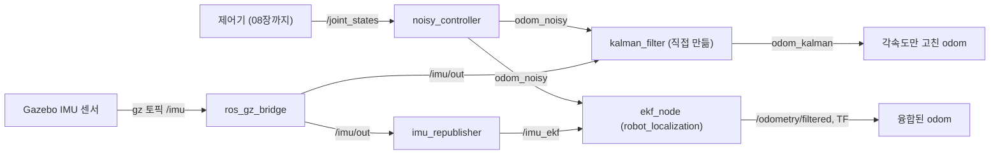
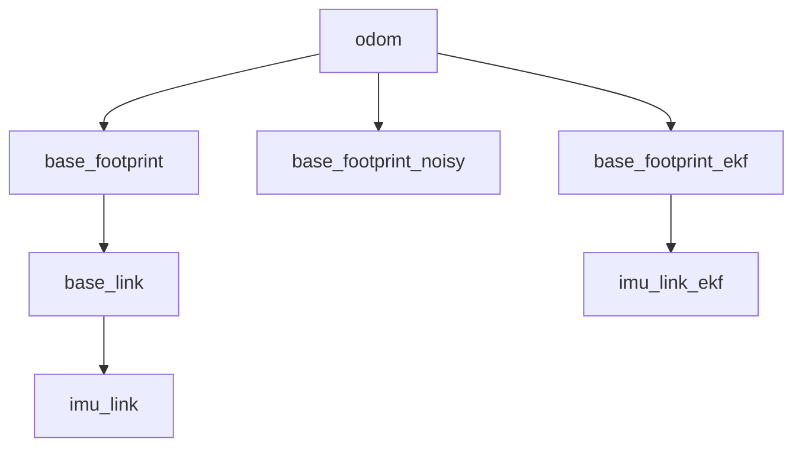

# 09. 센서 융합 (저장소 Section11)

> 참조: `Section11_Sensor_Fusion/bumperbot_ws/src/bumperbot_localization/`, `Section11_Sensor_Fusion/bumperbot_ws/src/bumperbot_description/` (참조 저장소 최상위 기준 경로)

## 이 장에서 하는 일

- 로봇에 IMU(관성 센서)를 단다. URDF에 링크를 더하고, Gazebo에 센서를 달고, `ros_gz_bridge`로 ROS 토픽 `/imu/out`을 낸다.
- 08장에서 일부러 틀리게 만든 오도메트리 `/bumperbot_controller/odom_noisy`와 IMU를 합쳐 더 나은 추정을 만든다. 두 가지 방법을 쓴다.
  - 직접 만든 1차원 칼만 필터 `kalman_filter`: 각속도 하나만 합친다. 원리를 배우려고 만든다.
  - `robot_localization` 패키지의 `ekf_node`(확장 칼만 필터): 위치·방향·속도·가속도를 한꺼번에 합친다. 실제로 쓰는 쪽이다.
- 새 패키지 `bumperbot_localization`이 생긴다. 순수 `ament_cmake` 패키지이고 노드는 C++만 쓴다.
- ros2_control 전체에서의 자리: 이 장은 ros2_control 자체가 아니라 **제어기가 내보낸 값을 받아 쓰는 쪽**이다. 흐름은 "제어기 → `/joint_states` → `noisy_controller` → `odom_noisy` → 융합"이다. IMU는 이 장에서는 ros2_control을 거치지 않고 Gazebo에서 `ros_gz_bridge`를 거쳐 곧바로 ROS 토픽으로 들어온다. v5 로봇에서는 IMU가 하드웨어 컴포넌트의 state interface로 올라갈 계획이다. 그 이야기는 13장에서 한다.



## 이번 장의 파일

```text
~/bumperbot_ws/src/
├── bumperbot_description/
│   ├── urdf/
│   │   ├── bumperbot.urdf.xacro                 [수정] imu_link, imu_joint
│   │   └── bumperbot_gazebo.xacro               [수정] IMU 시스템 플러그인, IMU 센서
│   └── launch/
│       └── gazebo.launch.py                     [수정] /imu 브리지
└── bumperbot_localization/                      [새]
    ├── CMakeLists.txt
    ├── package.xml
    ├── LICENSE                                  (ros2 pkg create가 만든다)
    ├── include/bumperbot_localization/
    │   └── kalman_filter.hpp
    ├── src/
    │   ├── kalman_filter.cpp
    │   └── imu_republisher.cpp
    ├── config/
    │   └── ekf.yaml
    └── launch/
        └── local_localization.launch.py
```

### 준비와 터미널 약속

- 08장까지 만든 `~/bumperbot_ws`에서 이어서 한다. `bumperbot_description`, `bumperbot_controller`가 있어야 하고, 02장에서 복사한 메시 폴더에 `imu_link.STL`이 있어야 한다.
- `robot_localization`이 설치돼 있어야 한다. 다음 명령이 경로를 출력하면 된다.

```bash
ros2 pkg prefix robot_localization
```

```text
/opt/ros/jazzy
```

경로 대신 오류가 나오면 설치되지 않은 것이다. `sudo apt install ros-jazzy-robot-localization`으로 설치한다(이 가이드를 쓰는 동안 설치된 버전은 3.8.4였다).

- 이 장에서는 터미널을 다섯 개 쓴다. 새 터미널을 처음 열 때마다 `source ~/bumperbot_ws/install/setup.bash`를 먼저 친다. 코드를 고치고 다시 빌드한 뒤에도 이미 열어 둔 터미널에서는 `source`를 다시 치는 것이 안전하다.

| 터미널 | 하는 일 |
|---|---|
| A | Gazebo: `ros2 launch bumperbot_description gazebo.launch.py` |
| B | 제어기: `ros2 launch bumperbot_controller controller.launch.py` (구성 A, 기본값) |
| C | 이 장의 노드(`kalman_filter`, `imu_republisher`, `local_localization.launch.py`) |
| D | 속도 명령 발행 |
| E | 토픽 확인 |

- 이 장의 시험은 모두 구성 A(`use_simple_controller:=True`, 기본값)로 했다. 구성 A의 `JointGroupVelocityController`는 **마지막 명령을 유지한다.** 속도 명령을 한 번 보내면 정지 명령을 보내기 전까지 계속 돈다. 그래서 아래 시험은 끝에 정지 명령을 보낸다. `odom_noisy`는 `noisy_controller`가 `/joint_states`만 읽어 내므로 08장에서 확인한 대로 두 구성 모두에서 뜬다. 구성 B는 이 장에서 시험하지 않았다.
- Gazebo 창, RViz 창은 직접 보지 못했다. 이 장의 확인은 토픽, TF, `gz model` 명령의 출력으로 한다. 시험은 서버 전용 Gazebo(`gz sim -s`)로 했고, 아래 `gazebo.launch.py`는 창이 뜨는 원래 모양이다.

## 단계 1. URDF에 IMU 링크 더하기

### 왜 필요한가

IMU는 로봇 몸체의 어딘가에 붙는 물리 부품이다. 어디에 붙는지를 로봇 모델이 알아야 두 가지가 된다. 첫째, 단계 2에서 Gazebo 센서를 "이 링크에" 붙일 수 있다. 둘째, IMU 메시지의 `frame_id`(`imu_link`)가 로봇의 TF 트리 안의 실제 프레임이 된다. `robot_state_publisher`가 URDF를 읽어 `base_link → imu_link` TF를 낸다.

`imu_link`는 고정 조인트(`imu_joint`)로 `base_link`에 붙는다. 링크의 모양(메시)은 02장에서 복사해 둔 `imu_link.STL`이다.

### 코드

`bumperbot_description/urdf/bumperbot.urdf.xacro`의 맨 끝, 마지막 캐스터 조인트(`caster_rear_joint`) 뒤와 `</robot>` 앞에 링크와 조인트를 더한다. 아래 블록의 첫 줄(`<joint name="caster_rear_joint" ...>`)부터 `</joint>`까지는 이미 있는 줄이다.

> 파일: `bumperbot_description/urdf/bumperbot.urdf.xacro` — 수정
```xml
  <joint name="caster_rear_joint" type="fixed">
    <origin xyz="-0.04755 0 -0.0275" rpy="0 0 0" />
    <parent link="base_link" />
    <child link="caster_rear_link" />
    <axis xyz="0 0 0" />
  </joint>

  <link name="imu_link">
    <inertial>
      <origin xyz="-0.00552433659106688 0.000168210391520346 0.000514000497342681" rpy="0 0 0" />
      <mass value="0.000528415362211671" />
      <inertia ixx="1.46176048428261E-08" ixy="1.40015117949421E-10" ixz="-1.99633872937403E-12"
               iyy="8.59662482954888E-09" iyz="7.52375112767959E-12"
               izz="2.30279421279312E-08" />
    </inertial>
    <visual>
      <origin xyz="0 0 0" rpy="0 0 0" />
      <geometry>
        <mesh filename="package://bumperbot_description/meshes/imu_link.STL" />
      </geometry>
      <material name="">
        <color rgba="0.792156862745098 0.819607843137255 0.933333333333333 1" />
      </material>
    </visual>
    <collision>
      <origin xyz="0 0 0" rpy="0 0 0" />
      <geometry>
        <mesh filename="package://bumperbot_description/meshes/imu_link.STL" />
      </geometry>
    </collision>
  </link>

  <joint name="imu_joint" type="fixed">
    <origin xyz="0 0 0.0698986241758014" rpy="0 0 0" />
    <parent link="base_link" />
    <child link="imu_link" />
    <axis xyz="0 0 0" />
  </joint>

</robot>
```

### 코드 설명

- `<link name="imu_link">`: 링크 하나. 안의 세 덩어리는 다른 링크와 같은 구조다.
  - `<inertial>`: 질량 `0.000528415...` kg(약 0.5 g)과 관성 모멘트. 실제 부품에서 가져온 값이다. 아주 가벼워서 로봇의 움직임에 영향을 주지 않는다.
  - `<visual>`: 화면에 그릴 모양. `package://bumperbot_description/meshes/imu_link.STL`을 쓰고, `<material>`의 `<color rgba=...>`로 색을 칠한다(연한 청회색).
  - `<collision>`: 충돌 모양. 같은 메시를 쓴다.
- `<joint name="imu_joint" type="fixed">`: 두 링크를 움직이지 않게 붙이는 조인트.
  - `<parent link="base_link" />`, `<child link="imu_link" />`: `base_link`에 `imu_link`를 붙인다.
  - `<origin xyz="0 0 0.0698986241758014" rpy="0 0 0" />`: `base_link` 원점에서 위로 6.99 cm. 회전(`rpy`)은 0이라서 `imu_link`의 축은 `base_link`와 같은 방향이다(x 앞, y 왼쪽, z 위). `base_joint`가 `base_footprint`에서 `base_link`를 0.033 m 올려 놓았으므로 `imu_link`의 높이는 `base_footprint` 기준 0.033 + 0.0699 = 0.1029 m다. 이 값이 단계 7의 정적 TF `--z 0.103`과 맞는다.
  - `<axis xyz="0 0 0" />`: 고정 조인트에는 의미가 없다. 다른 고정 조인트(캐스터)와 같은 모양으로 둔 것이다.
- 파일 맨 위의 `<xacro:include ...>` 두 줄은 바뀌지 않는다.

### 빌드와 시험

```bash
cd ~/bumperbot_ws
colcon build --symlink-install --packages-select bumperbot_description
source install/setup.bash
xacro src/bumperbot_description/urdf/bumperbot.urdf.xacro | check_urdf /dev/stdin
```

기대 결과:

```text
Finished <<< bumperbot_description [0.58s]
```

```text
robot name is: bumperbot
---------- Successfully Parsed XML ---------------
root Link: base_footprint has 1 child(ren)
    child(1):  base_link
        child(1):  caster_front_link
        child(2):  caster_rear_link
        child(3):  imu_link
        child(4):  wheel_left_link
        child(5):  wheel_right_link
```

- 통과 조건: 빌드가 실패하지 않고(`Summary`에 실패가 없다), `check_urdf`의 트리에서 `imu_link`가 `base_link`의 자식으로 붙어 있다. 시간(`[0.58s]`)은 컴퓨터마다 다르다.
- `check_urdf`는 메시 파일이 실제로 있는지는 검사하지 않는다. `ls ~/bumperbot_ws/src/bumperbot_description/meshes/imu_link.STL`로 파일을 따로 확인한다.

## 단계 2. Gazebo IMU 센서와 시스템 플러그인

### 왜 필요한가

단계 1의 `imu_link`는 모양이 있는 링크일 뿐 센서가 아니다. Gazebo에게 "이 링크에 IMU가 있다"고 알리는 것이 `<sensor type="imu">` 태그다. 그런데 센서 태그만으로는 값이 나오지 않는다. gz sim은 기능을 **시스템 플러그인** 단위로 가지고 있고, IMU 값을 계산해서 내보내는 일은 `gz-sim-imu-system` 플러그인이 한다. 설치된 `empty.sdf` 월드(`/opt/ros/jazzy/opt/gz_sim_vendor/share/gz/gz-sim8/worlds/empty.sdf`)에는 `gz-sim-physics-system`, `gz-sim-user-commands-system`, `gz-sim-scene-broadcaster-system`, `gz-sim-contact-system` 네 개뿐이고 IMU 플러그인은 없다. 그래서 로봇 모델에 직접 넣는다. 03장에서 `gz_ros2_control` 플러그인을 로봇 모델에 넣은 것과 같은 방식이다.

플러그인을 빼고 시험해 봤다. `/imu/out` 토픽은 만들어지지만 5초 동안 `ros2 topic hz /imu/out`에 아무것도 나오지 않았다(메시지가 오지 않는다). 센서 태그와 플러그인이 모두 있어야 한다.

### 코드

`bumperbot_description/urdf/bumperbot_gazebo.xacro`의 맨 아래를 고친다. 이미 있는 `<gazebo>` 블록(03장의 `gz_ros2_control` 플러그인)에 IMU 시스템 플러그인을 한 줄 더하고, 그 뒤에 IMU 센서 블록을 더한다. 아래 블록은 `<!-- ROS 2 Control -->` 주석부터 파일 끝까지다.

> 파일: `bumperbot_description/urdf/bumperbot_gazebo.xacro` — 수정
```xml
  <!-- ROS 2 Control -->
  <gazebo>
    <plugin filename="gz_ros2_control-system" name="gz_ros2_control::GazeboSimROS2ControlPlugin">
      <parameters>$(find bumperbot_controller)/config/bumperbot_controllers.yaml</parameters>
    </plugin>
    <plugin filename="gz-sim-imu-system" name="gz::sim::systems::Imu">
    </plugin>
  </gazebo>

  <!-- IMU -->
  <gazebo reference="imu_link">
    <sensor name="imu" type="imu">
      <always_on>true</always_on>
      <update_rate>100</update_rate>
      <gz_frame_id>imu_link</gz_frame_id>
      <topic>imu</topic>
      <imu>
        <angular_velocity>
          <x>
            <noise type="gaussian">
              <mean>0.0</mean>
              <stddev>2e-4</stddev>
            </noise>
          </x>
          <y>
            <noise type="gaussian">
              <mean>0.0</mean>
              <stddev>2e-4</stddev>
            </noise>
          </y>
          <z>
            <noise type="gaussian">
              <mean>0.0</mean>
              <stddev>2e-4</stddev>
            </noise>
          </z>
        </angular_velocity>
        <linear_acceleration>
          <x>
            <noise type="gaussian">
              <mean>0.0</mean>
              <stddev>1.7e-2</stddev>
            </noise>
          </x>
          <y>
            <noise type="gaussian">
              <mean>0.0</mean>
              <stddev>1.7e-2</stddev>
            </noise>
          </y>
          <z>
            <noise type="gaussian">
              <mean>0.0</mean>
              <stddev>1.7e-2</stddev>
            </noise>
          </z>
        </linear_acceleration>
      </imu>
    </sensor>
  </gazebo>

</robot>
```

### 코드 설명

- `<plugin filename="gz-sim-imu-system" name="gz::sim::systems::Imu">`: IMU 시스템 플러그인. `filename`은 Gazebo가 불러올 라이브러리 이름이고 `name`은 그 안의 클래스 이름이다. 안에 설정할 것이 없어서 내용이 비어 있다. 참조 코드에는 Humble용(`ignition-gazebo-imu-system`)과 Jazzy용 두 가지가 `is_ignition` 분기로 들어 있는데 이 가이드는 Jazzy 쪽만 쓴다.
- 이 `<plugin>`은 `reference`가 없는 `<gazebo>` 블록 안에 있으므로 로봇 모델 전체에 붙는다. `gz sdf -p`로 변환해 보면 `<model>` 바로 아래에 들어간다(아래 시험).
- `<gazebo reference="imu_link">`: 이 링크에 붙일 Gazebo 전용 설정. 02장의 바퀴·캐스터 마찰 설정과 같은 태그다.
  - 고정 조인트로 이어진 링크는 SDF로 바뀔 때 하나로 합쳐진다(02장). 그래서 변환된 SDF에서는 센서가 `base_footprint` 링크 안에 들어간다. 변환된 `<sensor>`에는 `<pose>`가 없다. 센서가 `imu_link`의 위치(링크 원점에서 위로 0.103 m)에 놓이는지는 확인하지 못했다. 이 장의 시험(각속도, 정지 상태의 가속도)은 센서 위치에 크게 민감하지 않아서 확인하지 않고 넘어갔다.
- `<sensor name="imu" type="imu">`: `type="imu"`가 센서 종류다. 이름 `imu`는 아래 토픽 이름과 상관없다(토픽은 `<topic>`이 정한다).
- `<always_on>true</always_on>`: 센서를 항상 켠다(일반 지식: SDF 사양에서 이 값이 true이면 구독자가 없어도 `update_rate`에 맞춰 갱신한다).
- `<update_rate>100</update_rate>`: 초당 100번 측정한다. 단계 3에서 `ros2 topic hz`가 약 100 Hz를 보여 준다.
- `<gz_frame_id>imu_link</gz_frame_id>`: 메시지 헤더의 `frame_id`에 들어갈 이름. 이 태그를 빼고 시험해 보니 `frame_id`가 `bumperbot/base_footprint/imu`(모델/링크/센서 이름)가 됐다. 이 태그가 있으면 `imu_link`다. 이 태그는 sdformat이 정의된 태그로 알지 못해서 URDF를 SDF로 바꿀 때 `Warning ... XML Element[gz_frame_id], child of element[sensor], not defined in SDF. Copying[gz_frame_id] as children of [sensor].`라는 경고가 나온다. 값은 그대로 복사되어 동작한다. 정상이다.
- `<topic>imu</topic>`: gz 토픽 이름. gz 쪽에서 `/imu`가 된다. 단계 3의 브리지가 이 이름을 쓴다.
- `<imu>` 안의 `<angular_velocity>`와 `<linear_acceleration>`: 각 축(`x`, `y`, `z`)마다 `<noise type="gaussian">`이 있다. 정규분포 잡음이고 `<mean>`은 평균(0), `<stddev>`는 표준편차다. 각속도는 `2e-4` rad/s, 가속도는 `1.7e-2` m/s²다. 단계 3의 시험에서 이 값이 그대로 나온다. 이 잡음이 없으면 시뮬레이션의 IMU는 완벽한 값을 낸다.
- `<imu>`에는 방향(orientation)의 잡음 설정이 없다. 센서는 방향을 Gazebo 월드 기준으로 잡음 없이 낸다. 이 점은 단계 8의 결과를 읽을 때 중요하다.

### 빌드와 시험

터미널 하나에서 변환 결과를 본다. 이 단계도 Gazebo를 띄우지 않고 시험할 수 있다.

```bash
cd ~/bumperbot_ws
colcon build --symlink-install --packages-select bumperbot_description
source install/setup.bash
xacro src/bumperbot_description/urdf/bumperbot.urdf.xacro > /tmp/bumperbot.urdf
gz sdf -p /tmp/bumperbot.urdf 2>/dev/null | grep -E "<sensor|<plugin name='gz::sim::systems::Imu'|gz_frame_id|<update_rate>|<topic>"
```

기대 결과:

```text
      <sensor name='imu' type='imu'>
        <update_rate>100</update_rate>
        <topic>imu</topic>
        <gz_frame_id>imu_link</gz_frame_id>
    <plugin name='gz::sim::systems::Imu' filename='gz-sim-imu-system'/>
```

경고는 표준 오류로 나오므로 위 명령은 `2>/dev/null`로 숨겼다. 보려면 다음과 같이 한다.

```bash
gz sdf -p /tmp/bumperbot.urdf 2>&1 >/dev/null
```

```text
Warning [Utils.cc:132] [/sdf/model[@name="bumperbot"]/link[@name="base_footprint"]/sensor[@name="imu"]/gz_frame_id:...]: XML Element[gz_frame_id], child of element[sensor], not defined in SDF. Copying[gz_frame_id] as children of [sensor].
```

- 통과 조건: 센서(`type='imu'`, `update_rate` 100, `topic` imu, `gz_frame_id` imu_link)와 플러그인(`gz-sim-imu-system`)이 변환된 SDF에 있다. 경고 한 줄은 정상이다(경고 중간의 경로는 사용자 컴퓨터에 따라 다르다).
- 이 단계에서는 Gazebo를 아직 띄우지 않았다. 값이 실제로 나오는지는 단계 3에서 본다.

## 단계 3. 브리지: `/imu`를 ROS 토픽 `/imu/out`으로

### 왜 필요한가

단계 2의 센서는 gz 쪽 토픽 `/imu`에 값을 낸다. gz 토픽은 ROS 2 토픽이 아니다. 02장에서 `/clock`을 ROS로 넘기려고 `ros_gz_bridge`의 `parameter_bridge`를 썼다. 같은 브리지에 IMU를 한 줄 더한다.

### 코드

`bumperbot_description/launch/gazebo.launch.py`의 `gz_ros2_bridge` 노드를 고친다. `arguments` 목록에 한 줄을 더하고, `remappings`를 더한다.

> 파일: `bumperbot_description/launch/gazebo.launch.py` — 수정
```python
    gz_ros2_bridge = Node(
        package="ros_gz_bridge",
        executable="parameter_bridge",
        arguments=[
            "/clock@rosgraph_msgs/msg/Clock[gz.msgs.Clock",
            "/imu@sensor_msgs/msg/Imu[gz.msgs.IMU",
        ],
        remappings=[
            ("/imu", "/imu/out"),
        ]
    )
```

### 코드 설명

- `"/imu@sensor_msgs/msg/Imu[gz.msgs.IMU"`: 브리지 인자는 `토픽@ROS메시지타입방향gz메시지타입`이다. 여기서는 gz 토픽 `/imu`, ROS 타입 `sensor_msgs/msg/Imu`, gz 타입 `gz.msgs.IMU`다. 방향 기호 `[`는 Gazebo → ROS 한 방향이다(02장). 앞 줄의 `/clock`과 같은 방식이다.
- `remappings=[("/imu", "/imu/out")]`: 브리지가 ROS 쪽에 만드는 토픽 이름을 `/imu`에서 `/imu/out`으로 바꾼다. `/imu/out`이라는 이름은 참조 코드의 것이다. 이 이름을 바꾸면 이 장의 노드(`kalman_filter`, `imu_republisher`)가 구독하는 이름도 바꿔야 한다.
- 브리지가 시작할 때 `Creating GZ->ROS Bridge: [/imu (gz.msgs.IMU) -> /imu (sensor_msgs/msg/Imu)]`라는 로그를 낸다. 이 로그에는 이름을 바꾸기 전의 이름(`/imu`)이 나온다. 실제 ROS 토픽은 `/imu/out`이다.
- `LaunchDescription`의 목록은 바뀌지 않는다.

### 빌드와 시험

터미널 A에서 Gazebo를 띄운다. 이 터미널은 시험이 끝날 때까지 둔다.

```bash
cd ~/bumperbot_ws
colcon build --symlink-install --packages-select bumperbot_description
source install/setup.bash
ros2 launch bumperbot_description gazebo.launch.py
```

터미널 A의 로그에서 IMU와 관련된 줄은 다음과 같다. 모두 정상이다(앞의 시간 값은 매번 다르고, `parameter_bridge-4`, `gazebo-2`의 번호는 launch 목록에서의 순서라서 launch 파일에 따라 달라질 수 있다).

```text
[parameter_bridge-4] [INFO] [...] [ros_gz_bridge]: Creating GZ->ROS Bridge: [/imu (gz.msgs.IMU) -> /imu (sensor_msgs/msg/Imu)] (Lazy 0)
[gazebo-2] Warning [Utils.cc:132] [/sdf/model[@name="bumperbot"]/link[@name="base_footprint"]/sensor[@name="imu"]/gz_frame_id:<urdf-string>:L0]: XML Element[gz_frame_id], child of element[sensor], not defined in SDF. Copying[gz_frame_id] as children of [sensor].
[gazebo-2] [INFO] [...] [gz_ros_control]: Loading sensor: imu
[gazebo-2] [WARN] [...] [gz_ros_control]: IMU sensor 'imu' not found in hardware_info, skipping.
```

마지막 두 줄은 03장의 `gz_ros2_control` 플러그인이 모델 안의 센서를 보고 `<ros2_control>` 태그에서 같은 이름의 센서를 찾았지만 없어서 건너뛴다는 뜻으로 읽힌다. 이 장의 IMU는 ros2_control을 거치지 않으므로 상관없다.

터미널 E에서 확인한다(새 터미널이면 `source ~/bumperbot_ws/install/setup.bash`를 먼저 친다).

```bash
ros2 topic list | grep imu
```

```text
/imu/out
```

주기를 본다. 끝나지 않는 명령이다. 몇 초 뒤 `Ctrl+C`로 끝낸다.

```bash
ros2 topic hz /imu/out
```

```text
average rate: 100.000
	min: 0.010s max: 0.010s std dev: 0.00013s window: 101
average rate: 99.994
	min: 0.009s max: 0.010s std dev: 0.00014s window: 201
```

헤더의 `frame_id`와 정지 상태의 값을 한 번씩 읽는다.

```bash
ros2 topic echo /imu/out --once --field header.frame_id
ros2 topic echo /imu/out --once --field linear_acceleration.z
ros2 topic echo /imu/out --once --field angular_velocity.z
```

```text
imu_link
---
9.804466602238229
---
-0.00012218098302217166
---
```

값 하나만 봐서는 잡음과 평균을 구분할 수 없다. 300개를 모아 평균과 표준편차를 계산하는 짧은 셸 함수를 쓴다. 터미널 E에서 정의한다(그 터미널에서만 유효하다).

```bash
topic_stat() { ros2 topic echo --no-lost-messages "$1" --field "$2" 2>/dev/null | head -n 600 | awk '/^-?[0-9]/ {s+=$1; q+=$1*$1; n++} END {if (n==0) {print "n=0 (값이 없다)"; exit} m=s/n; v=q/n-m*m; if (v<0) v=0; printf "n=%d mean=%.5f std=%.5f\n", n, m, sqrt(v)}'; }
```

- `ros2 topic echo 토픽 --field 필드`: 메시지마다 그 필드 값 한 줄과 `---` 한 줄을 낸다. `--no-lost-messages`는 `A message was lost!!!`로 시작하는 안내 줄을 내지 않게 하는 옵션이다(`ros2 topic echo --help`에서 확인했다). 이 줄이 섞이면 숫자 계산이 틀어진다.
- `head -n 600`: 600줄(값 300개 + `---` 300줄)을 받으면 끝낸다. 100 Hz이므로 약 3초다. `2>/dev/null`은 `head`가 파이프를 닫을 때 `echo`가 내는 `BrokenPipeError` 오류 메시지를 숨긴다.
- `awk '/^-?[0-9]/ {...}'`: 숫자로 시작하는 줄만 골라 개수 `n`, 합 `s`, 제곱합 `q`를 모은다. `---` 줄은 숫자로 시작하지 않아 자연히 걸러진다. 끝(`END`)에서 평균 `mean`과 표준편차 `std`(`sqrt(E[x²] − 평균²)`)를 낸다. 숫자 줄이 하나도 없으면(`n==0`) 0으로 나누지 않고 `n=0 (값이 없다)`를 낸다. 계산 오차로 분산이 음수가 되면 0으로 고친다.
- 토픽에 메시지가 오지 않으면 `head`가 600줄을 기다리며 끝나지 않는다. 그때는 `Ctrl+C`로 끄고 토픽을 확인한다.
- (이름을 `stat`로 하지 않는다. 같은 이름의 셸 명령이 이미 있다.)

```bash
topic_stat /imu/out linear_acceleration.z
topic_stat /imu/out angular_velocity.z
```

```text
n=300 mean=9.79967 std=0.01658
n=300 mean=-0.00001 std=0.00018
```

가속도 z의 평균이 중력 가속도(9.8 m/s²)에 가깝고, 표준편차가 단계 2에서 정한 잡음(0.017, 0.0002)과 같다.

이제 회전시켜 본다. 터미널 B에서 제어기를 띄운다.

```bash
source ~/bumperbot_ws/install/setup.bash
ros2 launch bumperbot_controller controller.launch.py
```

터미널 D에서 제자리 회전 명령을 계속 보낸다. 끝나지 않는 명령이다.

```bash
source ~/bumperbot_ws/install/setup.bash
ros2 topic pub -r 20 /bumperbot_controller/cmd_vel geometry_msgs/msg/TwistStamped "{twist: {angular: {z: 0.5}}}"
```

3초쯤 뒤 터미널 E에서:

```bash
topic_stat /imu/out angular_velocity.z
```

```text
n=300 mean=0.49933 std=0.00020
```

터미널 D에서 `Ctrl+C`로 명령 발행을 끝낸 뒤 **정지 명령을 보낸다.** 구성 A는 마지막 명령을 유지하므로 이것을 보내지 않으면 로봇이 계속 돈다.

```bash
ros2 topic pub --times 5 -r 10 /bumperbot_controller/cmd_vel geometry_msgs/msg/TwistStamped "{twist: {}}"
```

- 통과 조건 1: `/imu/out`이 있고 주기가 100 Hz에 가깝다.
- 통과 조건 2: `frame_id`가 `imu_link`다(`bumperbot/base_footprint/imu`라면 `<gz_frame_id>`가 빠졌다).
- 통과 조건 3: 정지 상태에서 `linear_acceleration.z`의 평균이 9.8 근처이고, `angular_velocity.z`의 평균이 0 근처다.
- 통과 조건 4: 회전 명령 0.5 rad/s에서 `angular_velocity.z`의 평균이 0.5에 가깝다(위 시험에서 0.49933).
- 값은 매번 조금씩 다르다. 평균이 위 숫자와 정확히 같을 필요는 없다.
- 터미널 A(Gazebo)와 B(제어기)는 이어지는 단계에서도 쓰므로 그대로 둔다.

## 단계 4. `bumperbot_localization` 패키지 뼈대

### 왜 필요한가

이 장의 노드 둘(`kalman_filter`, `imu_republisher`), 설정 파일(`ekf.yaml`), launch 파일이 들어갈 패키지가 필요하다. 이 장의 코드는 `bumperbot_controller`와 책임이 다르다. 제어기는 로봇을 움직이고, 이 패키지는 로봇이 어디에 있는지를 추정한다. 그래서 별도 패키지로 둔다. 순수 `ament_cmake` 패키지이고 C++만 쓴다.

### 코드

`ros2 pkg create`로 뼈대를 만든다. 패키지 이름을 `--dependencies`보다 앞에 쓴다(01장).

```bash
cd ~/bumperbot_ws/src
ros2 pkg create bumperbot_localization --build-type ament_cmake --license Apache-2.0 \
  --description "Sensor fusion examples" \
  --maintainer-name "Your Name" --maintainer-email "you@example.com" \
  --dependencies rclcpp nav_msgs sensor_msgs
```

`Your Name`, `you@example.com`은 자기 이름과 이메일로 바꾼다. 기대 결과:

```text
going to create a new package
package name: bumperbot_localization
destination directory: /home/<사용자>/bumperbot_ws/src
package format: 3
version: 0.0.0
description: Sensor fusion examples
maintainer: ['Your Name <you@example.com>']
licenses: ['Apache-2.0']
build type: ament_cmake
dependencies: ['rclcpp', 'nav_msgs', 'sensor_msgs']
creating folder ./bumperbot_localization
creating ./bumperbot_localization/package.xml
creating source and include folder
creating folder ./bumperbot_localization/src
creating folder ./bumperbot_localization/include/bumperbot_localization
creating ./bumperbot_localization/CMakeLists.txt
```

만들어진 파일은 `CMakeLists.txt`, `package.xml`, `LICENSE`(Apache-2.0 전문)이고, 빈 폴더 `src/`, `include/bumperbot_localization/`가 생긴다. `config/`, `launch/` 폴더는 단계 7에서 만든다.

`CMakeLists.txt`를 01장과 같은 방식으로 고친다. 주석(`# find dependencies` 등)과 `if(BUILD_TESTING) ... endif()` 블록을 지우고, 헤더를 설치하는 `install(DIRECTORY include/ ...)` 블록을 더한다. 그리고 `cmake_minimum_required(VERSION 3.8)`과 `-Wall -Wextra -Wpedantic` 경고 옵션 블록은 `ros2 pkg create`가 만든 그대로 둔다.

> 파일: `bumperbot_localization/CMakeLists.txt` — 전체 (단계 4 시점)
```cmake
cmake_minimum_required(VERSION 3.8)
project(bumperbot_localization)

if(CMAKE_COMPILER_IS_GNUCXX OR CMAKE_CXX_COMPILER_ID MATCHES "Clang")
  add_compile_options(-Wall -Wextra -Wpedantic)
endif()

find_package(ament_cmake REQUIRED)
find_package(rclcpp REQUIRED)
find_package(nav_msgs REQUIRED)
find_package(sensor_msgs REQUIRED)

install(
  DIRECTORY include/
  DESTINATION include
)

ament_package()
```

`package.xml`은 `ros2 pkg create`가 만든 것에 `<exec_depend>` 두 줄을 더한다.

> 파일: `bumperbot_localization/package.xml` — 전체
```xml
<?xml version="1.0"?>
<?xml-model href="http://download.ros.org/schema/package_format3.xsd" schematypens="http://www.w3.org/2001/XMLSchema"?>
<package format="3">
  <name>bumperbot_localization</name>
  <version>0.0.0</version>
  <description>Sensor fusion examples</description>
  <maintainer email="you@example.com">Your Name</maintainer>
  <license>Apache-2.0</license>

  <buildtool_depend>ament_cmake</buildtool_depend>

  <depend>rclcpp</depend>
  <depend>nav_msgs</depend>
  <depend>sensor_msgs</depend>

  <exec_depend>tf2_ros</exec_depend>
  <exec_depend>robot_localization</exec_depend>

  <test_depend>ament_lint_auto</test_depend>
  <test_depend>ament_lint_common</test_depend>

  <export>
    <build_type>ament_cmake</build_type>
  </export>
</package>
```

### 코드 설명

`CMakeLists.txt` (01장과 같은 줄은 짧게 적는다):

- `cmake_minimum_required(VERSION 3.8)`, `project(bumperbot_localization)`: CMake 버전과 프로젝트 이름. 프로젝트 이름은 `package.xml`의 `<name>`과 같아야 한다.
- `if(CMAKE_COMPILER_IS_GNUCXX ... endif()`: GCC나 Clang이면 컴파일러 경고 옵션을 켠다. `-Wall -Wextra -Wpedantic`은 의심스러운 코드를 경고로 알려 준다. 이 가이드는 경고 없이 빌드되는 것을 목표로 한다.
- `find_package(ament_cmake REQUIRED)`: ament 빌드 도구. `find_package(rclcpp REQUIRED)`, `nav_msgs`, `sensor_msgs`: 이 패키지의 노드가 쓰는 C++ 라이브러리와 메시. `ros2 pkg create --dependencies`가 만든 줄이다.
- `install(DIRECTORY include/ DESTINATION include)`: 헤더를 설치 폴더로 복사한다. 끝의 `/`가 중요하다. `include`(슬래시 없음)로 쓰면 폴더 이름까지 따라가서 `install/bumperbot_localization/include/include/...`로 한 단계 깊게 설치된다(참조 코드의 모양이다).
- `ament_package()`: 맨 끝에 두는 필수 줄. 이 패키지를 ament 인덱스에 등록한다.

`package.xml`:

- `<depend>rclcpp</depend>`, `nav_msgs`, `sensor_msgs`: 빌드할 때도 실행할 때도 필요한 패키지.
- `<exec_depend>tf2_ros</exec_depend>`: 단계 7의 launch가 `tf2_ros` 패키지의 `static_transform_publisher`를 실행한다. 실행할 때만 필요하다.
- `<exec_depend>robot_localization</exec_depend>`: 단계 7의 launch가 `robot_localization`의 `ekf_node`를 실행한다. 이 줄이 있으면 `rosdep`이 의존성을 찾아 설치할 수 있다(일반 지식).
- `<test_depend>`는 린터용이고 이 가이드에서는 쓰지 않는다(01장).
- 참조 코드의 `package.xml`에는 `ament_cmake_python`(`<buildtool_depend>`)과 `rclpy`가 있다. Python 노드를 위한 것이라서 이 가이드는 뺐다.

### 빌드와 시험

```bash
cd ~/bumperbot_ws
colcon build --symlink-install --packages-select bumperbot_localization
source install/setup.bash
ros2 pkg prefix bumperbot_localization
```

기대 결과:

```text
Finished <<< bumperbot_localization [0.75s]
```

```text
/home/<사용자>/bumperbot_ws/install/bumperbot_localization
```

- 통과 조건: `Finished <<< bumperbot_localization`이 나오고 `ros2 pkg prefix`가 설치 경로를 출력한다. 경로 앞부분은 사용자 컴퓨터마다 다르다.
- 아직 실행 파일이 없다. 다음 단계에서 만든다.

## 단계 5. 1차원 칼만 필터 `kalman_filter`

### 왜 필요한가

08장의 `odom_noisy`는 엔코더 잡음 때문에 각속도가 심하게 흔들린다. 단계 3의 시험에서 IMU의 각속도는 표준편차가 0.0002 rad/s였다. 같은 구간에서 `odom_noisy`의 각속도는 표준편차가 약 0.14 rad/s다(아래 시험). 정확한 센서와 부정확한 센서를 어떻게 합칠까? 칼만 필터는 "예측"과 "측정"을 각각의 불확실성(분산)에 따라 가중해 섞는다. 이 노드는 그 원리를 가장 단순한 모양, 값 하나(각속도)짜리로 보여 준다.

정리하면 이 필터에서:

- **상태**: 로봇의 각속도 ω. 평균 `mean_`과 분산 `variance_`로 표현한다(분산이 클수록 값을 믿지 못한다).
- **예측**: 오도메트리 각속도가 지난번 메시지보다 얼마나 변했는지(`motion_`)를 평균에 더한다. 분산은 `motion_variance_`만큼 커진다.
- **측정**: IMU의 각속도 `imu_angular_z_`. 분산은 `measurement_variance_`다.

### 식

평균을 μ, 분산을 σ²라고 하자. `u`는 오도메트리 각속도의 변화(`motion_`), `σm²`은 `motion_variance_`(4.0), `z`는 IMU 각속도, `σr²`은 `measurement_variance_`(0.5)다.

```text
예측:  μ  ← μ + u
       σ² ← σ² + σm²

갱신:  μ  ← (σr²·μ + σ²·z) / (σ² + σr²)
       σ² ← (σ²·σr²) / (σ² + σr²)
```

갱신 식의 평균은 `K = σ² / (σ² + σr²)`로 놓으면 `μ ← (1 − K)·μ + K·z`다. K는 0과 1 사이이고, 예측의 분산이 측정의 분산보다 클수록 1에 가까워져 측정(IMU)을 더 믿는다. 코드의 `measurementUpdate()`가 위 갱신 식이고 `statePrediction()`이 위 예측 식이다. 한 번의 오도메트리 메시지마다 예측 → 갱신 순서로 한 번씩 돈다.

이 값들(4.0, 0.5)에서 분산은 몇 번 돌면 일정한 값으로 수렴한다. 예측 직후 `σ²`가 4.45쯤이고 `K`는 약 0.90이다(위 식을 반복 계산해 구했다). 즉 필터 출력은 IMU를 약 0.9, 예측(지난 출력 + 오도메트리의 변화)을 약 0.1 섞은 값이다.

### 코드

> 헤더 `include/bumperbot_localization/`과 소스 `src/`는 단계 4에서 이미 만들어졌다.

> 파일: `bumperbot_localization/include/bumperbot_localization/kalman_filter.hpp` — 전체
```cpp
#ifndef KALMAN_FILTER_HPP
#define KALMAN_FILTER_HPP

#include <rclcpp/rclcpp.hpp>
#include <nav_msgs/msg/odometry.hpp>
#include <sensor_msgs/msg/imu.hpp>


class KalmanFilter : public rclcpp::Node
{
public:
    KalmanFilter(const std::string& name);

    void statePrediction();

    void measurementUpdate();


private:
    void odomCallback(const nav_msgs::msg::Odometry &);

    void imuCallback(const sensor_msgs::msg::Imu &);


    rclcpp::Subscription<nav_msgs::msg::Odometry>::SharedPtr odom_sub_;
    rclcpp::Subscription<sensor_msgs::msg::Imu>::SharedPtr imu_sub_;
    rclcpp::Publisher<nav_msgs::msg::Odometry>::SharedPtr odom_pub_;
    double mean_;
    double variance_;
    double motion_variance_;
    double measurement_variance_;
    double motion_;
    bool is_first_odom_;
    double last_angular_z_;
    double imu_angular_z_;
    nav_msgs::msg::Odometry kalman_odom_;
};

#endif // KALMAN_FILTER_HPP
```

> 파일: `bumperbot_localization/src/kalman_filter.cpp` — 전체
```cpp
#include "bumperbot_localization/kalman_filter.hpp"

using std::placeholders::_1;


KalmanFilter::KalmanFilter(const std::string& name)
                    : Node(name),
                      mean_(0.0),
                      variance_(1000.0),
                      motion_variance_(4.0),
                      measurement_variance_(0.5),
                      motion_(0.0),
                      is_first_odom_(true),
                      last_angular_z_(0.0),
                      imu_angular_z_(0.0)
{
  odom_sub_ = create_subscription<nav_msgs::msg::Odometry>("bumperbot_controller/odom_noisy", 10, std::bind(&KalmanFilter::odomCallback, this, _1));
  imu_sub_ = create_subscription<sensor_msgs::msg::Imu>("imu/out", 1000, std::bind(&KalmanFilter::imuCallback, this, _1));
  odom_pub_ = create_publisher<nav_msgs::msg::Odometry>("bumperbot_controller/odom_kalman", 10);
}


void KalmanFilter::odomCallback(const nav_msgs::msg::Odometry &odom)
{
  kalman_odom_ = odom;

  if(is_first_odom_)
  {
      last_angular_z_ = odom.twist.twist.angular.z;
      mean_ = odom.twist.twist.angular.z;
      is_first_odom_ = false;
      return;
  }

    motion_ = odom.twist.twist.angular.z - last_angular_z_;

    statePrediction();
    measurementUpdate();

    // Update for the next iteration
    last_angular_z_ = odom.twist.twist.angular.z;

    // Update and publish the filtered odom message
    kalman_odom_.twist.twist.angular.z = mean_;
    odom_pub_->publish(kalman_odom_);
}


void KalmanFilter::imuCallback(const sensor_msgs::msg::Imu &imu)
{
    imu_angular_z_ = imu.angular_velocity.z;
}


void KalmanFilter::measurementUpdate()
{
    mean_ = (measurement_variance_ * mean_ + variance_ * imu_angular_z_)
          / (variance_ + measurement_variance_);

    variance_ = (variance_ * measurement_variance_)
              / (variance_ + measurement_variance_);
}


void KalmanFilter::statePrediction()
{
    mean_ = mean_ + motion_;
    variance_ = variance_ + motion_variance_;
}


int main(int argc, char* argv[])
{
  rclcpp::init(argc, argv);
  auto node = std::make_shared<KalmanFilter>("kalman_filter");
  rclcpp::spin(node);
  rclcpp::shutdown();
  return 0;
}
```

`CMakeLists.txt`에 실행 파일을 더한다. 이 단계가 끝난 시점의 파일 전체다.

> 파일: `bumperbot_localization/CMakeLists.txt` — 전체 (단계 5 시점)
```cmake
cmake_minimum_required(VERSION 3.8)
project(bumperbot_localization)

if(CMAKE_COMPILER_IS_GNUCXX OR CMAKE_CXX_COMPILER_ID MATCHES "Clang")
  add_compile_options(-Wall -Wextra -Wpedantic)
endif()

find_package(ament_cmake REQUIRED)
find_package(rclcpp REQUIRED)
find_package(nav_msgs REQUIRED)
find_package(sensor_msgs REQUIRED)

include_directories(include)

add_executable(kalman_filter src/kalman_filter.cpp)
ament_target_dependencies(kalman_filter rclcpp nav_msgs sensor_msgs)

install(
  DIRECTORY include/
  DESTINATION include
)

install(TARGETS
  kalman_filter
  DESTINATION lib/${PROJECT_NAME}
)

ament_package()
```

### 코드 설명

`kalman_filter.hpp`:

- `class KalmanFilter : public rclcpp::Node`: 노드 클래스. `rclcpp::Node`를 상속한다(`public` 상속이라서 `create_subscription` 등을 그대로 쓴다).
- `statePrediction()`, `measurementUpdate()`: 식의 예측과 갱신. `public`이지만 클래스 안에서만 부른다.
- `odomCallback`, `imuCallback`: 두 구독의 콜백. 인자가 `const ...msg::Odometry &`처럼 **상수 참조**다. 메시지를 복사하지 않고 읽기만 한다는 뜻이다.
- 멤버 변수:

| 멤버 | 뜻 |
|---|---|
| `mean_`, `variance_` | 상태(각속도)의 평균과 분산 |
| `motion_variance_` | 예측 때마다 더하는 분산 σm² (4.0) |
| `measurement_variance_` | IMU 측정의 분산 σr² (0.5) |
| `motion_` | 이번 오도메트리 각속도 − 지난번 오도메트리 각속도 |
| `is_first_odom_` | 첫 오도메트리 메시지인지 |
| `last_angular_z_` | 지난번 오도메트리 각속도 |
| `imu_angular_z_` | 가장 최근에 받은 IMU 각속도 |
| `kalman_odom_` | 내보낼 `Odometry` 메시지 |

`kalman_filter.cpp`:

- `using std::placeholders::_1;`: 콜백을 묶을 때 쓰는 자리표시자(`_1`은 "첫 번째 인자는 나중에 들어온다").
- 생성자의 `: Node(name), mean_(0.0), variance_(1000.0), ...`: 멤버를 초기화 목록으로 초기화한다. **목록의 순서는 헤더에서 멤버를 선언한 순서와 같아야 한다.** 다르면 `-Wall`에서 `-Wreorder` 경고가 난다. `variance_(1000.0)`은 "처음에는 각속도를 전혀 모른다"는 뜻이다(분산이 매우 크다).
- `create_subscription<nav_msgs::msg::Odometry>("bumperbot_controller/odom_noisy", 10, std::bind(&KalmanFilter::odomCallback, this, _1))`:
  - 구독 토픽 `bumperbot_controller/odom_noisy`(08장의 `noisy_controller`가 내는 `/bumperbot_controller/odom_noisy`. `/`로 시작하지 않는 상대 이름이라 노드의 네임스페이스를 앞에 붙여 푼다. 이 노드는 네임스페이스를 주지 않았으므로 `/`다).
  - `10`은 큐 깊이다.
  - `std::bind(&KalmanFilter::odomCallback, this, _1)`는 멤버 함수를 콜백으로 쓰려고 `this`(이 객체)와 묶은 것이다. 메시지가 오면 `this->odomCallback(메시지)`가 불린다.
- `create_subscription<sensor_msgs::msg::Imu>("imu/out", 1000, ...)`: 구독 토픽 `imu/out`(단계 3에서 만든 `/imu/out`), 큐 깊이 1000. 오도메트리(10)보다 훨씬 큰 이유는 참조 그대로이고 확인하지 못했다. 일반 지식에 따르면 큐가 클수록 콜백이 늦어져도 메시지를 덜 버린다. 이 노드의 `imuCallback`은 값을 저장만 해서 1000까지 필요하지는 않다.
- `create_publisher<nav_msgs::msg::Odometry>("bumperbot_controller/odom_kalman", 10)`: 발행 토픽 `/bumperbot_controller/odom_kalman`.
- `odomCallback`: 이 노드의 중심이다.
  1. `kalman_odom_ = odom;`: 받은 메시지를 통째로 복사한다. 위치, 방향, 프레임 이름, 공분산이 모두 `odom_noisy` 그대로다.
  2. 첫 메시지(`is_first_odom_`)이면 `last_angular_z_`와 `mean_`을 그 각속도로 정하고 `return`한다. 필터는 둘째 메시지부터 돈다.
  3. `motion_ = odom.twist.twist.angular.z - last_angular_z_;`: 예측에 쓸 값. 오도메트리 각속도 **자체**가 아니라 **지난번에서 얼마나 변했는지**다.
  4. `statePrediction(); measurementUpdate();`: 식의 예측, 갱신.
  5. `last_angular_z_`를 이번 값으로 바꾼다. 다음 번 `motion_`을 계산하려는 것이다.
  6. `kalman_odom_.twist.twist.angular.z = mean_;`: 복사한 메시지에서 **각속도만** 필터의 평균으로 바꿔 발행한다. 그래서 `odom_kalman`의 위치와 방향(pose)은 `odom_noisy`와 같고, 고쳐진 것은 `twist.twist.angular.z` 하나뿐이다.
- `imuCallback`: 받은 각속도를 `imu_angular_z_`에 저장만 한다. IMU(100 Hz)와 오도메트리는 서로 다른 시각에 오므로, 오도메트리 메시지가 올 때마다 그때까지 온 가장 최근 IMU 값을 쓴다.
- `main`: `rclcpp::init`, 노드 생성(이름 `kalman_filter`), `spin`, `shutdown`. 03장의 노드와 같은 모양이다.

`CMakeLists.txt` (단계 4와 달라진 줄):

- `include_directories(include)`: `#include "bumperbot_localization/kalman_filter.hpp"`가 `include/` 폴더 안에서 찾아지게 한다.
- `add_executable(kalman_filter src/kalman_filter.cpp)`: 실행 파일 `kalman_filter`를 만든다.
- `ament_target_dependencies(kalman_filter rclcpp nav_msgs sensor_msgs)`: 이 실행 파일이 쓰는 패키지(헤더 경로와 링크 라이브러리를 더해 준다).
- `install(TARGETS kalman_filter DESTINATION lib/${PROJECT_NAME})`: 실행 파일을 `install/bumperbot_localization/lib/bumperbot_localization/`에 둔다. `ros2 run`이 찾는 곳이다. 이 줄이 없으면 `ros2 run`이 `No executable found`를 낸다.

Python판: `Section11_Sensor_Fusion/bumperbot_ws/src/bumperbot_localization/bumperbot_localization/kalman_filter.py`

### 빌드와 시험

```bash
cd ~/bumperbot_ws
colcon build --symlink-install --packages-select bumperbot_localization
source install/setup.bash
```

```text
Finished <<< bumperbot_localization [4.88s]
```

경고는 없어야 한다. 터미널 A(Gazebo)와 B(제어기)가 단계 3에서 계속 떠 있어야 한다. 아니면 다시 띄운다.

터미널 C에서 노드를 띄운다. 끝나지 않는 명령이다.

```bash
source ~/bumperbot_ws/install/setup.bash
ros2 run bumperbot_localization kalman_filter
```

이 노드는 launch 파일에 들어 있지 않다(참조 저장소의 `local_localization.launch.py`에도 없다). 그래서 `ros2 run`으로 따로 띄운다. 터미널 E에서 노드의 연결을 본다.

```bash
ros2 node info /kalman_filter
```

```text
/kalman_filter
  Subscribers:
    /bumperbot_controller/odom_noisy: nav_msgs/msg/Odometry
    /imu/out: sensor_msgs/msg/Imu
    /parameter_events: rcl_interfaces/msg/ParameterEvent
  Publishers:
    /bumperbot_controller/odom_kalman: nav_msgs/msg/Odometry
    /parameter_events: rcl_interfaces/msg/ParameterEvent
    /rosout: rcl_interfaces/msg/Log
  Service Servers:
```

(이하 파라미터 서비스 목록은 줄였다.)

이제 같은 구간에서 세 각속도를 숫자로 비교한다. 터미널 D에서 회전 명령을 계속 보낸다. 끝나지 않는 명령이다.

```bash
ros2 topic pub -r 20 /bumperbot_controller/cmd_vel geometry_msgs/msg/TwistStamped "{twist: {angular: {z: 0.5}}}"
```

3초쯤 뒤 터미널 E에서(단계 3의 `topic_stat`이 정의된 터미널이어야 한다. 새 터미널이면 다시 정의한다):

```bash
topic_stat /bumperbot_controller/odom_noisy twist.twist.angular.z
topic_stat /imu/out angular_velocity.z
topic_stat /bumperbot_controller/odom_kalman twist.twist.angular.z
```

```text
n=300 mean=0.51680 std=0.14638
n=300 mean=0.49932 std=0.00021
n=300 mean=0.49928 std=0.02001
```

(순서대로 `odom_noisy`, IMU, 필터 출력이다.) 터미널 D에서 `Ctrl+C`로 끝내고 정지 명령을 보낸 뒤, 같은 세 명령을 정지 상태에서 다시 친다.

```bash
ros2 topic pub --times 5 -r 10 /bumperbot_controller/cmd_vel geometry_msgs/msg/TwistStamped "{twist: {}}"
```

```text
n=300 mean=0.00710 std=0.14441
n=300 mean=0.00000 std=0.00020
n=300 mean=-0.00005 std=0.01997
```

- 통과 조건 1: `odom_kalman` 토픽이 있다(`ros2 topic list`).
- 통과 조건 2: 필터 출력의 **표준편차가 `odom_noisy`보다 작다**(위 시험에서 0.02 대 0.14, 회전 중과 정지 중 모두). 필터 출력의 흔들림이 7분의 1쯤으로 줄었다.
- 통과 조건 3: 필터 출력의 **평균이 IMU의 평균에 가깝다**(0.4993 대 0.4993). `odom_noisy`의 평균은 바퀴 반지름·간격 오차 때문에 명령값에서 어긋나 있다(이번 시험에서 0.517).
- 필터 출력의 표준편차(0.02)는 IMU(0.0002)보다는 훨씬 크다. 출력에 K = 0.9 대신 남은 0.1만큼 예측(오도메트리 변화)이 섞이기 때문이다. 오도메트리 각속도 변화의 잡음이 약 0.14 × √2 ≈ 0.2이므로 0.1을 곱하면 0.02쯤이다(어림 계산이고 위 관측값과 크기가 맞는다).
- 값은 잡음 때문에 매번 조금씩 다르다.

터미널 C의 `kalman_filter`는 `Ctrl+C`로 끈다. `[INFO] [...] [rclcpp]: signal_handler(SIGINT/SIGTERM)` 한 줄만 나오고 오류 없이 끝난다(5번 시험해 5번 모두 종료 코드 0이었다).

## 단계 6. `imu_republisher`: IMU의 `frame_id` 바꾸기

### 왜 필요한가

`robot_localization`의 `ekf_node`는 입력 메시지가 어느 프레임에서 잰 값인지를 헤더의 `frame_id`로 알고, 필요하면 TF로 자기 프레임(`base_link_frame`)으로 바꾼다. 이 장에서 EKF의 로봇 프레임은 `base_footprint_ekf`다. 08장에서 `odom_noisy`의 `child_frame_id`를 `base_footprint_ekf`로 해 둔 이유가 이것이다. EKF가 쓰는 프레임 이름으로 이미 적혀 있으면 변환이 필요 없다.

IMU 메시지는 `frame_id`가 `imu_link`다. 이것을 `base_footprint_ekf`로 바꿔 `imu_ekf` 토픽으로 다시 내는 노드가 `imu_republisher`다. 참조 저장소가 이렇게 하는 의도는 EKF가 쓰는 프레임 트리를 로봇의 실제 TF 트리(`odom → base_footprint → base_link → imu_link`)와 따로 두려는 것으로 읽힌다. 확인한 것은 다음과 같다.

- `child_frame_id`를 로봇의 실제 프레임으로 둔 입력은 값이 틀어졌다. 시험에서 `/bumperbot_controller/odom`(`child_frame_id`가 `base_footprint`인 정확한 오도메트리)을 EKF 입력으로 넣었더니 EKF가 TF로 `base_footprint → odom → base_footprint_ekf` 변환을 하면서 속도의 방향이 틀어졌다. 직진과 회전 뒤 `y`가 0.23 m가 나왔다(실제 `y`는 0에 가깝다). 한 번 돌린 결과다.
- IMU를 `imu_link` 그대로 EKF에 넣은 경우는 차이가 작았다. 같은 주행 뒤 yaw가 `imu_republisher`를 거친 EKF에서는 2.351 rad, `/imu/out`을 그대로 넣은 EKF에서는 2.338 rad였고 실제는 2.355 rad였다(한 번 돌린 결과). `imu_link`에서 `base_footprint_ekf`까지 TF가 이어져 있어서 EKF가 변환을 해 냈다. 이 시뮬레이션에서는 필수가 아니었다.

### 코드

참조 코드와 한 줄 다르다. `main()` 끝의 `imu_pub.reset();`이다. 이유는 아래 코드 설명과 "자주 나는 오류"에 있다.

> 파일: `bumperbot_localization/src/imu_republisher.cpp` — 전체
```cpp
#include <rclcpp/rclcpp.hpp>
#include <sensor_msgs/msg/imu.hpp>

using namespace std::chrono_literals;

rclcpp::Publisher<sensor_msgs::msg::Imu>::SharedPtr imu_pub;

void imuCallback(const sensor_msgs::msg::Imu &imu)
{
  sensor_msgs::msg::Imu new_imu;
  new_imu = imu;
  new_imu.header.frame_id = "base_footprint_ekf";
  imu_pub->publish(new_imu);
}


int main(int argc, char **argv)
{
  rclcpp::init(argc, argv);

  std::shared_ptr<rclcpp::Node> node = rclcpp::Node::make_shared("imu_republisher_node");
  rclcpp::sleep_for(1s);
  imu_pub = node->create_publisher<sensor_msgs::msg::Imu>("imu_ekf", 10);
  auto imu_sub = node->create_subscription<sensor_msgs::msg::Imu>("imu/out", 10, imuCallback);

  rclcpp::spin(node);
  imu_pub.reset();
  rclcpp::shutdown();
}
```

`CMakeLists.txt`에 실행 파일을 더한다. 단계 5의 파일에서 `add_executable(imu_republisher ...)`와 `ament_target_dependencies(imu_republisher ...)`를 더하고, `install(TARGETS` 목록에 `imu_republisher`를 더한다.

> 파일: `bumperbot_localization/CMakeLists.txt` — 수정
```cmake
add_executable(kalman_filter src/kalman_filter.cpp)
ament_target_dependencies(kalman_filter rclcpp nav_msgs sensor_msgs)

add_executable(imu_republisher src/imu_republisher.cpp)
ament_target_dependencies(imu_republisher rclcpp sensor_msgs)

install(
  DIRECTORY include/
  DESTINATION include
)

install(TARGETS
  kalman_filter
  imu_republisher
  DESTINATION lib/${PROJECT_NAME}
)
```

### 코드 설명

- `#include <sensor_msgs/msg/imu.hpp>`와 `using namespace std::chrono_literals;`: IMU 메시지 헤더, 그리고 `1s`처럼 시간 단위를 숫자 뒤에 붙여 쓰는 문법(`std::chrono` 리터럴)이다.
- `rclcpp::Publisher<sensor_msgs::msg::Imu>::SharedPtr imu_pub;`: 발행자를 **전역 변수**로 둔다. 콜백 `imuCallback`이 일반 함수라서 클래스 멤버가 아니기 때문이다. 03장의 노드들처럼 클래스로 만들지 않은 간단한 모양이다. 전역 변수는 `main()`이 끝난 **뒤에** 프로그램이 끝날 때 해제된다(C++ 규칙, 일반 지식). 그 시점에는 노드와 ROS 통신 계층이 이미 사라져 있다. 아래 `imu_pub.reset();`이 필요한 이유다.
- `imuCallback`: 받은 메시지를 `new_imu`로 복사하고 `header.frame_id`만 `"base_footprint_ekf"`로 바꿔 발행한다. 시각(`header.stamp`)과 값은 그대로다.
- `main`:
  - `rclcpp::Node::make_shared("imu_republisher_node")`: 노드 이름이 `imu_republisher_node`다. 실행 파일 이름(`imu_republisher`)과 다르다.
  - `rclcpp::sleep_for(1s);`: 1초 쉰다. 참조 코드의 줄이고 이유는 확인하지 못했다. 발행자·구독자를 만들기 전에 잠시 기다리는 것으로 읽힌다.
  - 발행 `imu_ekf`, 구독 `imu/out`(큐 10). 구독 콜백으로 일반 함수 `imuCallback`을 그대로 넘긴다.
  - `rclcpp::spin(node);`: `Ctrl+C`(SIGINT)를 받으면 `spin`이 돌아온다.
  - **`imu_pub.reset();`**: 전역 변수가 잡고 있는 발행자를 `spin` 뒤, `rclcpp::shutdown()` 앞에서 직접 놓는다. **이 줄은 참조 코드에 없다.** 참조 코드대로(이 줄 없이) 두고 `Ctrl+C`로 끄면 노드가 `[ERROR] ... Error in destruction of rcl publisher handle: cannot publish data`를 내고 종료 코드 -11(`SIGSEGV`, 메모리 접근 오류)로 죽는다. 프로세스를 3번 띄워 3번 모두 재현했다. `imu_pub.reset();`을 더한 뒤에는 5번 모두 종료 코드 0으로 오류 없이 끝났다. 원인은 위의 해제 순서(전역 발행자가 노드와 통신 계층이 사라진 뒤에 해제됨)로 읽히고, 줄을 더해 사라지는 것으로 확인했다. 내부를 더 들여다보지는 않았다.
  - `main()`의 끝에 `return 0;`이 없는 것은 참조 그대로다. C++에서 `main`은 `return`이 없으면 0을 돌려준다(일반 지식).
- `CMakeLists.txt`: 단계 5의 `kalman_filter`와 같은 세 줄(`add_executable`, `ament_target_dependencies`, `install(TARGETS` 목록)이다. 이 노드는 `sensor_msgs`만 쓰므로 의존 패키지가 `rclcpp sensor_msgs`다. 이 파일에서 `install(TARGETS` 목록에 이름을 더하는 것을 잊으면 `ros2 run`/launch가 `No executable found`를 낸다.

Python판: `Section11_Sensor_Fusion/bumperbot_ws/src/bumperbot_localization/bumperbot_localization/imu_republisher.py`

### 빌드와 시험

```bash
cd ~/bumperbot_ws
colcon build --symlink-install --packages-select bumperbot_localization
source install/setup.bash
```

```text
Finished <<< bumperbot_localization [3.66s]
```

터미널 A(Gazebo)가 떠 있는 상태에서, 터미널 C에서 노드를 띄운다. 끝나지 않는 명령이다.

```bash
source ~/bumperbot_ws/install/setup.bash
ros2 run bumperbot_localization imu_republisher
```

터미널 E에서:

```bash
ros2 topic echo /imu/out --once --field header.frame_id
ros2 topic echo /imu_ekf --once --field header.frame_id
ros2 node list | grep imu
```

```text
imu_link
---
base_footprint_ekf
---
/imu_republisher_node
```

주기를 본다. 끝나지 않는 명령이다. 몇 초 뒤 `Ctrl+C`로 끝낸다.

```bash
ros2 topic hz /imu_ekf
```

```text
average rate: 100.042
	min: 0.010s max: 0.010s std dev: 0.00012s window: 102
```

- 통과 조건 1: `/imu_ekf`의 `frame_id`가 `base_footprint_ekf`이고 주기가 `/imu/out`과 같다(약 100 Hz).

터미널 C에서 `Ctrl+C`로 끈다. 끌 때 오류가 나지 않아야 한다.

```text
[INFO] [...] [rclcpp]: signal_handler(SIGINT/SIGTERM)
```

```bash
echo $?
```

```text
0
```

- 통과 조건 2: `Ctrl+C`로 끌 때 위 `signal_handler` 한 줄만 나오고 `[ERROR]`나 `Failed to delete datawriter` 같은 줄이 없으며, 종료 코드가 0이다. `imu_pub.reset();`이 빠져 있으면 오류가 나고 종료 코드가 -11(셸에서는 139)이다. 아래 "자주 나는 오류"에 그때의 출력이 있다.
- 다음 단계의 launch가 이 노드를 함께 띄운다.

## 단계 7. robot_localization의 EKF: `ekf.yaml`과 launch

### 왜 필요한가

단계 5의 필터는 각속도 하나만 합친다. `robot_localization`의 `ekf_node`는 같은 일을 위치(x, y, z), 방향(roll, pitch, yaw), 속도 3개, 각속도 3개, 가속도 3개 — 상태 15개 전체에 대해 하고, 센서를 여러 개 받을 수 있다. 이미 만들어진 노드이므로 우리가 할 일은 **설정**이다. 그 설정이 `ekf.yaml`이다. 노드는 이 파일에서 다음을 읽는다.

1. 어떤 토픽을 입력으로 쓰는가(`imu0`, `odom0`).
2. 각 입력의 15개 값 중 어느 것을 쓰는가(`imu0_config`, `odom0_config`).
3. 프레임 이름(`odom_frame`, `base_link_frame`, ...).

그리고 launch 파일 하나가 이 노드, 단계 6의 `imu_republisher`, 정적 TF를 함께 띄운다. 정적 TF(`base_footprint_ekf` → `imu_link_ekf`)는 참조가 띄우는 것이라서 그대로 따른다. "EKF의 프레임 트리에도 IMU 프레임을 하나 달아 둔다"는 뜻으로 읽힌다. 아래에서 보듯 이 장의 시험에서는 이 TF가 실제로 쓰이지 않는 것으로 보인다. 그래도 참조와 같게 둔다.

### 코드

폴더를 만든다.

```bash
mkdir -p ~/bumperbot_ws/src/bumperbot_localization/config ~/bumperbot_ws/src/bumperbot_localization/launch
```

`ekf.yaml`. 참조 파일은 긴 영어 주석이 대부분이다. 키와 값은 그대로 두고 주석을 짧게 줄였고, 두 15×15 행렬은 뺐다(아래 설명).

> 파일: `bumperbot_localization/config/ekf.yaml` — 전체
```yaml
ekf_filter_node:
  ros__parameters:
    frequency: 30.0                       # 필터 출력 주기 [Hz]
    two_d_mode: true                      # 평면 로봇: z, roll, pitch를 0으로 고정한다
    publish_tf: true                      # TF odom -> base_footprint_ekf를 낸다

    map_frame: map
    odom_frame: odom
    base_link_frame: base_footprint_ekf   # 이 필터가 추정하는 로봇 프레임
    world_frame: odom                     # 추정 결과의 기준 프레임

    # 입력 1: IMU (imu_republisher가 내는 토픽)
    imu0: imu_ekf
    imu0_config: [false, false, false,    # x, y, z
                  false, false, true,     # roll, pitch, yaw
                  false, false, false,    # vx, vy, vz
                  false, false, true,     # vroll, vpitch, vyaw
                  true,  false, false]    # ax, ay, az
    imu0_differential: true
    imu0_pose_use_child_frame: false

    # 입력 2: 일부러 틀리게 만든 오도메트리
    odom0: bumperbot_controller/odom_noisy
    odom0_config: [false, false, false,   # x, y, z
                   false, false, false,   # roll, pitch, yaw
                   true,  true,  false,   # vx, vy, vz
                   false, false, false,   # vroll, vpitch, vyaw
                   false, false, false]   # ax, ay, az
    odom0_differential: true
    odom0_pose_use_child_frame: false
```

`launch/local_localization.launch.py`.

> 파일: `bumperbot_localization/launch/local_localization.launch.py` — 전체
```python
import os
from ament_index_python.packages import get_package_share_directory

from launch import LaunchDescription
from launch.actions import DeclareLaunchArgument
from launch.substitutions import LaunchConfiguration
from launch_ros.actions import Node


def generate_launch_description():
    use_sim_time_arg = DeclareLaunchArgument(
        "use_sim_time",
        default_value="True",
    )

    use_sim_time = LaunchConfiguration("use_sim_time")

    static_transform_publisher = Node(
        package="tf2_ros",
        executable="static_transform_publisher",
        arguments=["--x", "0", "--y", "0", "--z", "0.103",
                   "--qx", "1", "--qy", "0", "--qz", "0", "--qw", "0",
                   "--frame-id", "base_footprint_ekf",
                   "--child-frame-id", "imu_link_ekf"],
    )

    robot_localization = Node(
        package="robot_localization",
        executable="ekf_node",
        name="ekf_filter_node",
        output="screen",
        parameters=[
            os.path.join(get_package_share_directory("bumperbot_localization"), "config", "ekf.yaml"),
            {"use_sim_time": use_sim_time},
        ],
    )

    imu_republisher = Node(
        package="bumperbot_localization",
        executable="imu_republisher",
    )

    return LaunchDescription([
        use_sim_time_arg,
        static_transform_publisher,
        robot_localization,
        imu_republisher,
    ])
```

`CMakeLists.txt`에 설치 블록을 더한다. `install(TARGETS` 블록 뒤, `ament_package()` 앞이다. 이 줄이 없으면 launch와 yaml이 설치되지 않아서 `ros2 launch`가 파일을 못 찾는다.

> 파일: `bumperbot_localization/CMakeLists.txt` — 수정
```cmake
install(TARGETS
  kalman_filter
  imu_republisher
  DESTINATION lib/${PROJECT_NAME}
)

install(
  DIRECTORY launch config
  DESTINATION share/${PROJECT_NAME}
)

ament_package()
```

### 코드 설명: `ekf.yaml`

최상위 키 `ekf_filter_node`는 노드 이름과 같아야 한다(launch의 `name="ekf_filter_node"`). `ros__parameters` 아래가 파라미터다. (노드 이름과 최상위 키가 다르면 파라미터가 적용되지 않는다. 일반 지식이고 이 장에서 재현해 보지는 않았다.)

| 키 | 값 | 뜻 |
|---|---|---|
| `frequency` | 30.0 | 필터 출력 주기(Hz). `ros2 topic hz /odometry/filtered`가 약 30 Hz를 보여 준다. |
| `two_d_mode` | true | 평면 로봇이라서 z, roll, pitch와 그 속도·z 가속도를 쓰지 않는다. 설치된 예제 `/opt/ros/jazzy/share/robot_localization/params/ekf.yaml`의 주석은 "이 값이 true이면 3D 정보를 상태 추정에 쓰지 않는다"고 한다. |
| `publish_tf` | true | 추정 결과를 TF로도 낸다. 이 설정에서 TF `odom → base_footprint_ekf`가 나온다. |
| `map_frame` | map | `map` 프레임 이름. `world_frame`이 `odom`이어서 이 설정에서는 쓰이지 않는다(일반 지식). |
| `odom_frame` | odom | `odom` 프레임 이름. |
| `base_link_frame` | base_footprint_ekf | **이 필터가 추정하는 로봇 프레임.** 출력 메시지의 `child_frame_id`, TF의 자식 프레임이 이것이다. 이 이름이 입력의 프레임 이름(단계 6)과 같다. |
| `world_frame` | odom | 추정 결과의 기준(부모) 프레임. 바퀴 오도메트리나 IMU처럼 끊김 없이 이어지는 값을 합칠 때는 `odom_frame`과 같게 둔다(설치된 예제 주석). 그래서 출력은 `frame_id: odom`이다. |

센서 입력 두 개(`imu0`, `odom0`). 숫자 0은 입력의 번호다(`imu1`, `odom1`, `twist0`, `pose0`을 더할 수 있다). 각 입력에 `..._config`라는 15칸 목록이 있다. **칸의 순서는 고정이다**: x, y, z, roll, pitch, yaw, vx, vy, vz, vroll, vpitch, vyaw, ax, ay, az. `true`인 칸의 값만 필터가 쓴다.

| 칸 | 의미 | `imu0_config` | `odom0_config` |
|---|---|---|---|
| 1 | x (위치) | false | false |
| 2 | y | false | false |
| 3 | z | false | false |
| 4 | roll (방향) | false | false |
| 5 | pitch | false | false |
| 6 | yaw | **true** | false |
| 7 | vx (속도) | false | **true** |
| 8 | vy | false | **true** |
| 9 | vz | false | false |
| 10 | vroll (각속도) | false | false |
| 11 | vpitch | false | false |
| 12 | vyaw | **true** | false |
| 13 | ax (가속도) | **true** | false |
| 14 | ay | false | false |
| 15 | az | false | false |

- IMU에서 쓰는 것: `yaw`(방향), `vyaw`(각속도 z), `ax`(앞쪽 가속도). `yaw`와 `vyaw`를 **둘 다** 켠 것은 같은 회전을 두 가지로 알려 주는 셈이다. `yaw`는 IMU가 내는 절대 방향을 쓰고(아래 `imu0_differential`), `vyaw`는 자이로의 각속도를 쓴다. 참조가 둘을 함께 켠 의도는 확인하지 못했다. 둘 중 하나만 켜도 되는지는 단계 8에서 시험했다.
  - IMU는 위치와 속도를 직접 재지 않으므로 그 칸은 false다.
  - `roll`, `pitch`, `vroll`, `vpitch`, `az`, `vz`는 평면 로봇이라서(`two_d_mode`) 쓰지 않는다. `az`는 중력 때문에 항상 9.8쯤이라서 쓸모가 없다.
  - `ay`는 차동 구동 로봇이 옆으로 가속하지 못하므로 false다(일반 지식).
- 오도메트리에서 쓰는 것: `vx`, `vy`(속도). 위치(`x`, `y`)와 방향(`yaw`)은 쓰지 않는다. 바퀴 오도메트리의 위치와 방향은 오차가 쌓이는 값이라서, 속도만 받고 위치는 필터가 속도를 적분해서 구한다. 방향은 IMU에서 받는다. `vyaw`도 false다. 각속도는 IMU의 것을 쓰고 오도메트리의 각속도는 잡음이 크기 때문이다(단계 5). `vy`를 쓰는 이유는 참조 설정이고 의도는 확인하지 못했다. 일반 지식에 따르면 차동 구동 로봇은 옆으로 움직이지 못하므로 `vy ≈ 0`이라는 측정값이 구속 조건 역할을 한다.
- `imu0: imu_ekf`, `odom0: bumperbot_controller/odom_noisy`: 입력 토픽. IMU는 단계 6의 `imu_republisher`가 내는 토픽이고, 오도메트리는 08장의 `odom_noisy`다.
- `imu0_differential: true`: 설치된 예제 `ekf.yaml`의 주석은 이 옵션을 이렇게 설명한다. 켜면 **절대 자세(pose) 측정을 미분해서 속도로 바꾸고, 그 속도를 평소처럼 적분해서 쓴다.** 속도(twist) 측정에는 효과가 없다. 이 설정에서 IMU의 자세 칸은 `yaw` 하나이므로, IMU가 내는 절대 yaw를 그대로 필터의 yaw로 삼지 않고 **메시지마다의 변화량**으로 바꿔서 쓴다. 필터의 yaw는 시작할 때 0에서 출발하므로, 로봇이 처음부터 어느 방향을 보고 있었는지가 필터의 yaw에 들어오지 않는다. 이 로봇은 월드의 yaw 0에서 시작해서 두 값이 같은 상황이라 이 차이는 시험에서 드러나지 않았다(단계 8에서 이 옵션을 끈 EKF도 같은 결과였다).
- `odom0_differential: true`: 이 입력은 위치·방향 칸을 쓰지 않으므로 효과가 없다. 설치된 예제 주석도 속도(twist) 값에는 이 옵션이 효과가 없다고 한다. 참조 설정 그대로 둔다.
- `odom0_pose_use_child_frame: false`: 설치된 예제 주석에 따르면 오도메트리의 위치에 `child_frame_id`의 시작 자세를 원점으로 쓸지를 정한다. 이 입력은 위치를 쓰지 않으므로 상관없다.
- `imu0_pose_use_child_frame: false`: 참조 파일에 있는 줄인데, 설치된 `ekf_node`가 선언하는 파라미터 목록에는 없다(`ros2 param list /ekf_filter_node | grep pose_use_child_frame`의 출력이 `odom0_pose_use_child_frame` 하나뿐이었다). 이 줄은 무시된다. 참조 파일과 같게 두었다. 지워도 된다.

#### 두 15×15 행렬을 뺀 이유

참조의 `ekf.yaml`에는 `process_noise_covariance`(예측 단계에서 상태마다 더하는 불확실성)와 `initial_estimate_covariance`(필터가 시작할 때의 불확실성)가 15×15 행렬로 들어 있다. 손으로 치기 어려운 225칸짜리 두 개다. 이 가이드는 **뺐다.** 근거는 세 가지다.

1. 설치된 예제 `/opt/ros/jazzy/share/robot_localization/params/ekf.yaml`의 주석이 두 파라미터에 대해 "지정하지 않으면 아래 행렬이 기본값"이라고 쓰고, 그 예제의 행렬이 참조 파일의 행렬과 같은 값이다(대각 성분 0.05, 0.05, 0.06, 0.03, 0.03, 0.06, 0.025, 0.025, 0.04, 0.01, 0.01, 0.02, 0.01, 0.01, 0.015이고 나머지는 0, 초기 추정은 대각 성분이 모두 `1e-9`).
2. 두 행렬을 넣은 EKF와 뺀 EKF를 같은 입력으로 동시에 돌렸다. 넣은 쪽은 참조 `ekf.yaml`을 그대로 쓰고 노드 이름과 `publish_tf`만 바꿨다(`ros2 param get`으로 두 행렬이 225개 숫자로 읽힌 것을 확인했다). 같은 주행 뒤 위치 (x, y)가 넣은 쪽 (1.478, 1.262), 뺀 쪽 (1.479, 1.262)이고 yaw는 둘 다 1.519 rad였다(한 번 돌린 결과). 두 노드를 시작한 직후 위치 분산이 자라는 속도도 같았다(x, y는 초당 0.05, yaw는 초당 0.06. 8초 구간을 한 번 쟀다).
3. 뺀 노드에서 `ros2 param get /ekf_filter_node process_noise_covariance`는 `Parameter not set`을 출력한다. 즉 값이 파라미터로 들어 있지 않고 노드 안의 기본값이 쓰인다.

확인하지 못한 것: 평면 모드에서 쓰지 않는 칸(z, roll, pitch 등)까지 모든 대각 성분이 기본값과 같은지는 직접 보지 못했다. 위 2번은 x, y, yaw에서 확인한 것이다. 행렬을 직접 바꿔 보고 싶으면 설치된 예제 파일(`/opt/ros/jazzy/share/robot_localization/params/ekf.yaml`)의 해당 줄을 복사해 `ros__parameters` 아래에 붙인다. 이 노드는 15개 대각 값만 적어도 받는다(예제 주석: "full specification or specification of only the diagonal values").

### 코드 설명: launch 파일

- `DeclareLaunchArgument("use_sim_time", default_value="True")`, `use_sim_time = LaunchConfiguration("use_sim_time")`: 시뮬레이션 시각을 쓸지를 launch 인자로 받는다. 이 장의 시험은 모두 시뮬레이션이라서 기본값이 `True`다. 08장의 `controller.launch.py`도 같은 인자를 쓴다. **이 인자는 참조 launch에 없다.** `ekf_node`에 `use_sim_time`을 주지 않고 돌렸더니 EKF가 출력을 내지 않는 경우가 있었다(같은 조건에서 어떤 때는 출력이 나왔다. 원인은 확인하지 못했다). `use_sim_time`을 켠 쪽은 모든 시험에서 출력을 냈다. 입력 메시지의 시각(`header.stamp`)이 시뮬레이션 시각이므로 EKF도 시뮬레이션 시각으로 맞추는 것이 맞는 모양이다. 실물 로봇(12장)에서는 `use_sim_time:=False`로 띄운다.
- `static_transform_publisher = Node(package="tf2_ros", executable="static_transform_publisher", arguments=[...])`: 움직이지 않는 TF 하나를 `/tf_static` 토픽에 **한 번** 발행한다. 그 뒤 노드는 계속 살아 있을 뿐 다시 발행하지 않는다. 나중에 뜬 구독자도 받을 수 있는 것은 `/tf_static`이 transient_local QoS(마지막 메시지를 보관해 두었다가 새 구독자에게 준다)이기 때문이다. 설치된 헤더 `/opt/ros/jazzy/include/tf2_ros/tf2_ros/qos.hpp`의 `StaticBroadcasterQoS`가 `transient_local()`이고, `ros2 topic info /tf_static -v`에서 이 노드의 발행 Durability가 `TRANSIENT_LOCAL`로 나왔다. 인자는 위치 `--x 0 --y 0 --z 0.103`, 회전 `--qx 1 --qy 0 --qz 0 --qw 0`(쿼터니언), 부모 `--frame-id base_footprint_ekf`, 자식 `--child-frame-id imu_link_ekf`다.
  - 쿼터니언 `(x, y, z, w) = (1, 0, 0, 0)`은 **x축 둘레 180° 회전**이다. `tf2_echo base_footprint_ekf imu_link_ekf`로 보면 RPY가 `[3.142, 0, 0]`이고 회전 행렬은 `diag(1, −1, −1)`이다. 즉 `imu_link_ekf`의 y축과 z축이 부모와 반대 방향이다(위아래가 뒤집힌 IMU).
  - URDF의 `imu_joint`와 비교하면 위치는 맞다. `imu_joint`의 `z`는 0.0699이고 `base_joint`가 0.033이라서 합이 0.1029 ≈ 0.103이다. **회전은 맞지 않는다.** URDF의 `imu_joint`는 회전이 없는데(`rpy="0 0 0"`) 이 TF는 180° 회전이다. 참조 그대로이고 이유는 확인하지 못했다.
  - 이 TF는 이 장의 시험에서 쓰이지 않는 것으로 보인다. IMU 메시지의 `frame_id`가 `base_footprint_ekf`이고 `imu_link_ekf`를 `frame_id`로 쓰는 메시지가 없기 때문이다. 시험 중 이 프로세스를 끈 채로도 EKF 출력이 30 Hz로 계속 나왔고 경고도 없었다.
- `robot_localization = Node(package="robot_localization", executable="ekf_node", name="ekf_filter_node", ...)`: EKF 노드. `name="ekf_filter_node"`가 `ekf.yaml`의 최상위 키와 맞아야 한다. `output="screen"`은 로그를 터미널에 보인다.
  - `parameters=[경로, {"use_sim_time": use_sim_time}]`: 파라미터 소스를 목록으로 줄 수 있다. 파일 경로(문자열)와 딕셔너리를 섞어도 되고, 뒤에 오는 것이 앞의 같은 이름을 덮어쓴다. 파일 경로는 `get_package_share_directory("bumperbot_localization")`로 설치된 share 폴더를 찾아 `config/ekf.yaml`을 붙인다.
- `imu_republisher = Node(package="bumperbot_localization", executable="imu_republisher")`: 단계 6의 노드. 참조 launch에서는 변수 이름이 `imu_republisher_cpp`였다.
- `imu_republisher`와 `static_transform_publisher`에는 `use_sim_time`을 주지 않았다. `imu_republisher`는 받은 메시지의 `header.stamp`를 그대로 복사해 내고 노드의 시계를 읽지 않는다(`rclcpp::sleep_for(1s)`는 시작할 때 한 번 쉬는 것이다). 정적 TF는 `tf2_echo`에서 `At time 0.0`으로 나와 시각에 의존하지 않는다. 그래서 시뮬레이션에서 두 노드가 `use_sim_time` 없이 돌아도 시험에서 문제가 없었다.
- `LaunchDescription([...])`: 인자 선언이 맨 앞이다. 참조 launch에 있던 `use_python` 인자와 Python 판 `imu_republisher.py` 노드는 이 가이드에서 뺐다.

### 빌드와 시험

터미널 A(Gazebo), B(제어기)가 떠 있는 상태에서:

```bash
cd ~/bumperbot_ws
colcon build --symlink-install --packages-select bumperbot_localization
source install/setup.bash
```

```text
Finished <<< bumperbot_localization [5.20s]
```

터미널 C에서 launch한다. 끝나지 않는 명령이다. 줄 앞의 `static_transform_publisher-1`, `ekf_node-2` 같은 번호, `pid` 값, 시각 값은 실행마다 또는 launch 목록 순서에 따라 다를 수 있다.

```bash
source ~/bumperbot_ws/install/setup.bash
ros2 launch bumperbot_localization local_localization.launch.py
```

```text
[INFO] [launch]: All log files can be found below ...
[INFO] [launch]: Default logging verbosity is set to INFO
[INFO] [static_transform_publisher-1]: process started with pid [...]
[INFO] [ekf_node-2]: process started with pid [...]
[INFO] [imu_republisher-3]: process started with pid [...]
[static_transform_publisher-1] [INFO] [...] [static_transform_publisher_...]: Spinning until stopped - publishing transform
[static_transform_publisher-1] translation: ('0.000000', '0.000000', '0.103000')
[static_transform_publisher-1] rotation: ('1.000000', '0.000000', '0.000000', '0.000000')
[static_transform_publisher-1] from 'base_footprint_ekf' to 'imu_link_ekf'
[ekf_node-2] [INFO] [...] [ekf_filter_node]: Waiting for clock to start...
```

`Waiting for clock to start...`는 `use_sim_time`이 켜진 노드가 `/clock`을 기다린다는 로그다. Gazebo(터미널 A)가 떠 있으면 곧 지나간다. 터미널 E에서 확인한다.

```bash
ros2 node list | grep -E "ekf|imu_republisher|static"
ros2 topic list | grep -E "odometry|imu_ekf"
ros2 topic echo /odometry/filtered --once --field child_frame_id
```

```text
/ekf_filter_node
/imu_republisher_node
/static_transform_publisher_XnejbinoqBDJ4Esj
```

```text
/imu_ekf
/odometry/filtered
```

```text
base_footprint_ekf
---
```

(정적 TF 노드의 뒤쪽 글자는 실행마다 다르다.) 주기를 본다. 끝나지 않는 명령이다. 몇 초 뒤 `Ctrl+C`로 끝낸다.

```bash
ros2 topic hz /odometry/filtered
```

```text
WARNING: topic [/odometry/filtered] does not appear to be published yet
average rate: 30.009
```

TF를 읽는다. 끝나지 않는 명령이다. 몇 줄이 나온 뒤 `Ctrl+C`로 끝낸다.

```bash
ros2 run tf2_ros tf2_echo odom base_footprint_ekf
```

```text
[INFO] [...] [tf2_echo]: Waiting for transform odom ->  base_footprint_ekf: Invalid frame ID "odom" passed to canTransform argument target_frame - frame does not exist
At time 130.210000000
- Translation: [-0.002, -0.000, 0.000]
- Rotation: in Quaternion (xyzw) [0.000, 0.000, 0.000, 1.000]
- Rotation: in RPY (radian) [0.000, -0.000, 0.000]
- Rotation: in RPY (degree) [0.000, -0.000, 0.006]
- Matrix:
  1.000 -0.000  0.000 -0.002
```

(첫 줄의 `Waiting for transform`은 TF가 도착하기 전의 안내로 정상이다. 시각과 값은 매번 다르다. 정지 상태에서는 0 근처에 있다.)

이제 TF 트리에서 `odom` 아래에 자식이 셋이다. 정확한 오도메트리(`simple_controller`)가 내는 `base_footprint`, 08장의 `noisy_controller`가 내는 `base_footprint_noisy`, 이 단계의 EKF가 내는 `base_footprint_ekf`다. 자식 이름이 모두 달라서 서로 겹치지 않는다. (이 TF 트리를 `ros2 run tf2_tools view_frames`로 직접 확인했다. 이 명령은 명령을 친 폴더에 `frames_*.pdf`와 `.gv` 파일을 만드니 `~/bumperbot_ws`가 아닌 임시 폴더에서 친다.)



- 통과 조건 1: `/odometry/filtered`가 약 30 Hz로 나오고 `child_frame_id`가 `base_footprint_ekf`다.
- 통과 조건 2: `tf2_echo odom base_footprint_ekf`가 변환을 출력한다.
- 통과 조건 3: `ros2 node list`에 `/ekf_filter_node`, `/imu_republisher_node`가 있다.
- 출력이 나오지 않으면(`does not appear to be published yet`가 계속 나오면) Gazebo(터미널 A)가 떠 있는지, `/clock`이 나오는지(`ros2 topic hz /clock`)를 먼저 본다.

## 단계 8. 실제 자세, `odom_noisy`, EKF 비교

### 왜 필요한가

이 장의 목적이다. 융합이 `odom_noisy`보다 나아졌는지를 **숫자로** 본다. 비교 대상은 세 가지다. Gazebo가 아는 로봇의 실제 자세(`gz model -m bumperbot -p`), 오차가 든 `odom_noisy`, EKF의 `/odometry/filtered`다. 정확한 오도메트리(`/bumperbot_controller/odom`)도 함께 읽어 기준으로 삼는다.

### 시험

터미널 A(Gazebo), B(제어기), C(`local_localization.launch.py`)를 **모두 새로 띄운다.** 각 오도메트리가 시작할 때 0에서 출발해야 같은 자세를 비교할 수 있다. 로봇이 이미 움직인 상태라면 세 터미널을 `Ctrl+C`로 끄고 다시 띄운다. 터미널 C가 `Waiting for clock to start...` 뒤에 조용해진 것을 확인한 뒤 터미널 D에서 명령을 보낸다.

구성 A는 마지막 명령을 유지한다. 그래서 명령을 보낸 뒤 정지 명령을 보내지 않으면 다음 명령을 치는 동안에도 로봇이 계속 움직여서 시험이 사람의 타이핑 속도에 좌우된다. 이를 막으려고 **구간마다 정지 명령을 함께 보내는 셸 함수** `drive`를 쓴다. 터미널 D에서 정의한다(그 터미널에서만 유효하다).

```bash
source ~/bumperbot_ws/install/setup.bash
drive() { timeout $1 ros2 topic pub -r 20 /bumperbot_controller/cmd_vel geometry_msgs/msg/TwistStamped "$2" > /dev/null; ros2 topic pub --times 5 -r 10 /bumperbot_controller/cmd_vel geometry_msgs/msg/TwistStamped "{twist: {}}" > /dev/null; }
```

- `drive 시간 "속도 명령"`: 속도 명령을 `-r 20`(초당 20번)으로 `시간`초 동안 보내고(`timeout`이 그 시간 뒤 끈다), 곧바로 속도 0의 명령 5개를 보내 멈춘다. 명령을 한 줄씩 쳐도 구간 사이에는 로봇이 서 있다.
- `> /dev/null`은 `ros2 topic pub`이 찍는 긴 `publishing #...` 출력을 버린다.

직진, 제자리 회전, 직진 순서로 한 줄씩 친다. 각 줄이 끝나야(프롬프트가 돌아와야) 다음 줄을 친다.

```bash
drive 6 "{twist: {linear: {x: 0.2}}}"
drive 3 "{twist: {angular: {z: 0.5}}}"
drive 6 "{twist: {linear: {x: 0.2}}}"
```

`timeout`이 시간을 재는 것은 실제 시간이다. 로봇은 시뮬레이션 시각을 따르고, `ros2 topic pub`이 시작 직후 구독자를 찾느라 명령이 조금 늦게 나가기도 한다. 그래서 회전한 각도와 이동 거리는 실행마다 다르다(이 장의 네 번의 시험에서 최종 yaw가 1.56 ~ 1.94 rad이었다). 비교 대상은 같은 주행이므로 각도가 달라도 상관없다.

멈춘 뒤 터미널 E에서 읽는다. 각 `echo`는 한 번만 읽고 끝난다.

```bash
gz model -m bumperbot -p
for t in /bumperbot_controller/odom /bumperbot_controller/odom_noisy /odometry/filtered; do
  echo $t
  ros2 topic echo $t --once --csv --no-lost-messages | cut -d, -f5,6,10,11
done
```

- `gz model -m bumperbot -p`: Gazebo가 아는 로봇의 실제 위치(`XYZ`)와 자세(`RPY`).
- `ros2 topic echo 토픽 --once --csv`: 메시지 하나를 쉼표로 이은 한 줄로 낸다. 열은 `sec, nanosec, frame_id, child_frame_id, x, y, z, qx, qy, qz, qw, ...` 순서다. `cut -d, -f5,6,10,11`이 `x`, `y`, `qz`, `qw`만 고른다. `--no-lost-messages`는 `A message was lost!!!` 안내 줄을 내지 않게 한다.

```text
Requesting state for world [empty]...

Warning [Utils.cc:132] [/sdf/model[@name="bumperbot"]/link[@name="base_footprint"]/sensor[@name="imu"]/gz_frame_id:<data-string>:L178]: XML Element[gz_frame_id], child of element[sensor], not defined in SDF. Copying[gz_frame_id] as children of [sensor].
Model: [10]
  - Name: bumperbot
  - Pose [ XYZ (m) ] [ RPY (rad) ]:
    [1.063990 1.335580 0.000001]
    [0.000000 0.007679 1.777090]
/bumperbot_controller/odom
1.062307764111657,1.336216566781256,0.7770717444527859,0.6294120303689024
/bumperbot_controller/odom_noisy
1.1450469167842539,1.6049994570481085,0.8071380614498761,0.5903627272778457
/odometry/filtered
1.235114456128688,1.546230091658651,0.7761975878198815,0.6304897339866823
```

`gz model`이 내는 `Warning`은 단계 2의 `gz_frame_id` 경고와 같은 것이고 정상이다. `Model: [10]`의 숫자와 소수 아랫자리는 실행마다 다를 수 있다.

yaw는 쿼터니언에서 `yaw = 2 · atan2(qz, qw)`로 구한다(평면에서 z축 둘레로만 도는 자세라서 성립한다). 예를 들어 EKF의 값은 다음과 같다.

```bash
python3 -c "import math; print(2*math.atan2(0.7761975878198815, 0.6304897339866823))"
```

```text
1.7772246738784476
```

(출력의 아랫자리는 컴퓨터에 따라 다를 수 있다.) 위 출력 세 줄에서 같은 식으로 계산한 값은 다음 표와 같다(계산값이다. 명령의 출력이 아니다). "원점 거리"는 시작점(0, 0)에서 실제 위치까지의 직선거리 1.708 m다.

| 출처 | x | y | yaw (rad) | 실제와의 위치 차이 (m) | 위치 차이 / 원점 거리 | 실제와의 yaw 차이 (rad) |
|---|---|---|---|---|---|---|
| Gazebo 실제 | 1.064 | 1.336 | 1.777 | 0 | 0 | 0 |
| `odom` (정확한 값) | 1.062 | 1.336 | 1.780 | 0.002 | 0.001 | 0.003 |
| `odom_noisy` | 1.145 | 1.605 | 1.879 | 0.281 | 0.165 | 0.102 |
| `/odometry/filtered` | 1.235 | 1.546 | 1.777 | 0.271 | 0.159 | 0.0001 |

같은 시험을 네 번(Gazebo를 처음부터 다시 띄워서) 되풀이했다. 실제와의 차이만 모으면 다음과 같다(계산값. 네 번째 줄이 위의 출력이다).

| 시험 | 실제 yaw (rad) | 원점 거리 (m) | `odom_noisy` yaw 차이 | `odom_noisy` 위치 차이 (m) | EKF yaw 차이 | EKF 위치 차이 (m) | EKF 위치 차이 / 원점 거리 |
|---|---|---|---|---|---|---|---|
| 1 | 1.56 | 1.83 | 0.058 | 0.243 | -0.0001 | 0.299 | 0.164 |
| 2 | 1.78 | 1.82 | 0.241 | 0.272 | -0.0001 | 0.286 | 0.157 |
| 3 | 1.94 | 1.32 | 0.067 | 0.199 | -0.0002 | 0.214 | 0.162 |
| 4 | 1.78 | 1.71 | 0.102 | 0.281 | 0.0001 | 0.271 | 0.159 |

### 결과 읽기

- **방향(yaw)은 확실히 좋아졌다.** EKF의 yaw 차이는 네 번 모두 1e-3 rad보다 작았다(-0.0002 ~ 0.0001). `odom_noisy`는 0.058 ~ 0.241 rad(3° ~ 14°)이고 네 번 모두 같은 부호(양수)로 어긋났다. 엔코더 잡음이 쌓인 것에 더해, 바퀴 반지름·간격 오차로 회전량이 약 3% 크게 계산되기 때문으로 읽힌다(`0.038/0.19`과 `0.033/0.17`의 비가 1.03이다. 08장).
- **위치는 좋아지지 않았다.** EKF의 위치 차이(0.21 ~ 0.30 m)는 `odom_noisy`(0.20 ~ 0.28 m)와 비슷하거나 네 번 중 세 번은 조금 나빴다. 통과 조건은 "EKF의 yaw 차이가 `odom_noisy`보다 작다"이고, 위치는 통과하지 못했다.
- **위치 차이의 크기는 설정에서 설명된다.** EKF는 오도메트리에서 속도 `vx`, `vy`만 받아(`odom0_config`) 위치를 적분한다. `odom_noisy`의 속도는 바퀴 반지름을 15% 크게 알아서(0.038 대 0.033, 08장) 모든 이동량이 약 15% 크다. EKF의 방향은 실제와 같으므로 EKF의 경로는 실제 경로를 거의 같은 비율로 키운 모양이다. 그러면 위치 차이는 **원점에서 실제 위치까지의 직선거리의 약 15%**여야 한다. 표의 마지막 열이 그렇다(0.157 ~ 0.164, 네 번 모두). `0.038/0.033 − 1 = 0.15`와 가깝다(약간 큰 0.01은 설명하지 못했다). 이동한 경로의 길이가 아니라 원점에서의 직선거리에 비례한다는 점이 중요하다. 이 장에서 `wheel_radius_error:=0.0`으로 되돌려 같은 시험을 해 보지는 않았다. 해 보면 이 차이가 줄어들 것이다(예상).
- **IMU의 `yaw`와 `vyaw` 중 무엇이 효과를 냈는가.** 같은 주행에서 `imu0_config`만 바꾼 EKF 셋을 함께 돌렸다(단계 7의 `ekf.yaml`을 복사해 노드 이름, 출력 토픽, `publish_tf: false`를 바꾸고 `-p use_sim_time:=true`를 주었다). 실제와의 yaw 차이(rad)는 다음과 같다.

| 설정 | 시험 1 | 시험 2 | 시험 3 | 시험 4 |
|---|---|---|---|---|
| 참조 설정(`yaw`와 `vyaw` 둘 다, `differential: true`) | -0.0001 | -0.0001 | -0.0002 | 0.0001 |
| `yaw` 끔(`vyaw`만) | -0.0011 | -0.0008 | -0.0006 | -0.0006 |
| `vyaw` 끔(`yaw`만) | -0.0001 | -0.0001 | -0.0001 | 0.0002 |
| `imu0_differential: false` | 0.0000 | 0.0000 | 0.0000 | 0.0000 |

  네 설정 모두 yaw 차이가 1.2e-3 rad 이하였다. 즉 이 시뮬레이션에서는 **자이로 각속도(`vyaw`)만으로도** `odom_noisy`보다 훨씬 정확한 방향을 얻는다(IMU의 각속도 잡음이 0.0002 rad/s로 매우 작다). 절대 yaw를 쓰면 차이가 한 자릿수 더 작아지지만(1e-4) 이 로봇에서는 어느 쪽이든 실용적으로 같다. 참조가 둘을 함께 켠 이유는 확인하지 못했다.
- **이 결과는 시뮬레이션이라서 방향에 유리하다.** Gazebo의 IMU는 방향(orientation)을 잡음 없이 월드 기준으로 낸다(`/imu/out`의 `orientation`을 별도로 읽어 보니 정지 상태에서 `orientation.y`의 표준편차가 0이었고, 제자리 회전 뒤의 `orientation`으로 구한 yaw가 `gz model`의 yaw와 같았다). 그리고 각속도 잡음이 작다. 일반 지식에 따르면 지자기 센서가 없는 6축 IMU는 절대 yaw를 내지 못하고 자이로를 적분한 yaw는 시간이 가면 흐른다. 실제 IMU에서도 같은 정확도가 나온다는 뜻이 아니다. 이 장에서는 실제 IMU를 쓰지 않았다.
- 직접 만든 필터의 각속도 잡음 감소(표준편차 0.14 → 0.02)는 단계 5에서 숫자로 확인했다.

통과 조건(관계로 적는다. 고정 숫자가 아니다):

- 통과 조건 1: **EKF의 yaw 차이가 `odom_noisy`의 yaw 차이보다 작다**(네 번 모두 그랬다).
- 통과 조건 2: 위치는 EKF가 `odom_noisy`보다 낫다고 기대하지 않는다. EKF의 위치 차이 / 원점 거리가 `wheel_radius`의 상대 오차(약 0.15)와 비슷한 값(0.15 ~ 0.17)에 모인다.

## 단계 9. 직접 만든 필터와 `robot_localization`의 관계

`kalman_filter`는 **원리를 배우려고 직접 만든 것**이고, 실제로 쓰는 것은 `robot_localization`의 EKF다. 둘 다 "예측 → 측정으로 갱신"이라는 같은 틀이다. 달라지는 점은 규모다. `kalman_filter`는 각속도 하나만 상태로 두고 선형이어서 식이 네 줄이다. `ekf_node`는 상태가 15개(위치, 방향, 속도, 각속도, 가속도)이고, 로봇의 움직임 모델이 비선형이라서 확장 칼만 필터(EKF)를 쓰며(일반 지식), 입력을 여러 개 받고 TF로 프레임을 변환하고 이상한 측정을 걸러 내는 일까지 한다. 그래서 위치와 방향을 추정할 때는 `ekf_node`를 쓰고, `kalman_filter`는 식이 코드의 어느 줄인지 확인하는 데 쓴다. `kalman_filter`는 `local_localization.launch.py`에 들어 있지 않으므로(참조 launch에도 없다) 보려면 `ros2 run bumperbot_localization kalman_filter`로 따로 띄운다. 두 노드는 서로 독립이라서 같이 띄워도 된다(`odom_kalman`은 `odom_noisy`를 읽어 내는 별도의 토픽이다). 이 장의 시험 중 세 번은 둘을 동시에 띄웠고 EKF 출력은 정상이었다.

## 참조 코드와 다른 점

| 참조 | 이 가이드 | 이유 |
|---|---|---|
| `bumperbot_gazebo.xacro`: `<xacro:if value="$(arg is_ignition)">` / `<xacro:unless ...>`로 Humble(`ignition-gazebo-imu-system`)과 Jazzy(`gz-sim-imu-system`) 분기 | Jazzy 쪽(`gz-sim-imu-system` / `gz::sim::systems::Imu`)만 | Jazzy 전용. 03장 `gz_ros2_control` 플러그인과 같은 `<gazebo>` 블록에 넣는 위치는 참조와 같다. |
| `bumperbot_gazebo.xacro`의 IMU 센서 블록 들여쓰기가 불규칙 | 2칸 들여쓰기로 정리 | 내용은 같다(태그와 값이 같다). |
| `bumperbot.urdf.xacro`의 `imu_link`, `imu_joint` | 같음 | 줄 끝 공백만 정리했다. |
| `gazebo.launch.py`: `remappings=[('/imu', '/imu/out')]` | `[("/imu", "/imu/out")]` | 따옴표만 다르다(이 가이드의 파일은 큰따옴표). |
| `CMakeLists.txt`: `find_package(ament_cmake_python)`, `find_package(rclpy)`, `ament_python_install_package(...)`, `install(PROGRAMS ...py ...)` | 없음 | C++만 쓴다. |
| `CMakeLists.txt`: `install(DIRECTORY include DESTINATION include)` | `install(DIRECTORY include/ DESTINATION include)` | 끝의 `/`가 없으면 `install/.../include/include/...`로 한 단계 더 깊게 설치된다. 01장과 같다. |
| `package.xml`: `<buildtool_depend>ament_cmake_python</buildtool_depend>`, `<depend>rclpy</depend>`, `<license>Apache 2.0</license>`, 관리자 Antonio Brandi, 설명 `ROS 2 Code Examples` | 없음 / `Apache-2.0` / 관리자는 본인 정보 / 설명 `Sensor fusion examples` | C++만 쓴다. 라이선스 표기와 관리자는 `ros2 pkg create`가 만든 형식과 사용자 본인 정보를 쓴다(01장과 같다). |
| (없음) | `package.xml`에 `<exec_depend>tf2_ros</exec_depend>` | launch가 `tf2_ros`의 `static_transform_publisher`를 실행한다. |
| (없음) | `LICENSE` 파일 | `ros2 pkg create --license Apache-2.0`가 만든다. |
| `kalman_filter.cpp/.hpp` | 같음 | 줄 끝 공백만 정리했다. 코드 내용은 그대로다. |
| `imu_republisher.cpp`: `rclcpp::spin(node);` 바로 뒤에 `rclcpp::shutdown();` | `rclcpp::spin(node);` 뒤, `rclcpp::shutdown();` 앞에 `imu_pub.reset();` 한 줄 추가 | 참조대로면 `Ctrl+C`로 끌 때 전역 발행자가 뒤늦게 해제되어 `[ERROR] ... Error in destruction of rcl publisher handle`를 내고 종료 코드 -11로 죽는다(재현했다). 그 밖에 줄 끝 공백만 정리했다. `main()`에 `return 0;`이 없는 것은 참조 그대로다. |
| `local_localization.launch.py`: 변수 이름 `imu_republisher_cpp`, `imu_republisher_py`, `use_python` | `imu_republisher` | Python 노드를 뺐으므로 이름을 줄였다. 노드 구성은 같다. 줄바꿈·빈 줄·인자 사이 공백도 정리했다. |
| `kalman_filter.py`, `imu_republisher.py`, `__init__.py` | 싣지 않음 | C++만 쓴다. Python판 위치를 각 노드 설명 끝에 적었다. |
| `local_localization.launch.py`: `use_python` 인자, `imu_republisher_py` 노드와 `IfCondition`/`UnlessCondition` | 없음 | C++만 쓴다. |
| `local_localization.launch.py`: `use_sim_time`을 주지 않는다 | `use_sim_time` launch 인자(기본 `True`)를 만들어 `ekf_node`에 준다 | `use_sim_time` 없이 돌린 EKF가 출력을 내지 않는 경우가 있었다(원인 확인하지 못함). 실물에서는 `False`로 준다. |
| `ekf.yaml`: 긴 영어 주석, 4칸·6칸 들여쓰기 | 짧은 한국어 주석, 2칸 들여쓰기 | 손으로 칠 분량을 줄였다. 키와 값은 같다. |
| `ekf.yaml`: `process_noise_covariance`, `initial_estimate_covariance` 15×15 행렬 | 뺐다 | 노드의 기본값과 같다고 확인했다(단계 7). 같은 입력에서 결과가 같았다. |
| 참조 저장소의 `bumperbot_cpp_examples/package.xml`, `bumperbot_py_examples/package.xml`이 Section11에서 달라진 것(의존성 줄 순서) | 반영하지 않음 | 이 장과 관계없고 줄 순서만 바뀌었다. |

## 자주 나는 오류

| 증상 | 원인 | 고치는 법 |
|---|---|---|
| `/imu/out` 토픽은 있는데 메시지가 오지 않는다(`ros2 topic hz`에 아무것도 안 나온다). | `bumperbot_gazebo.xacro`에 `gz-sim-imu-system` 플러그인이 없다. 센서 태그만 있으면 값이 계산되지 않는다. (플러그인을 빼고 재현했다.) | 단계 2의 `<plugin filename="gz-sim-imu-system" ...>`를 `<gazebo>` 블록에 넣는다. |
| `/imu/out`의 `frame_id`가 `bumperbot/base_footprint/imu`다. | `<gz_frame_id>imu_link</gz_frame_id>`가 없다. (재현했다.) | 센서 블록에 `<gz_frame_id>`를 넣는다. |
| `Warning [Utils.cc:132] ... gz_frame_id ... not defined in SDF. Copying[gz_frame_id] ...` | sdformat이 `gz_frame_id`를 정의된 태그로 모른다. | 정상이다. 값은 복사되어 동작한다. |
| `[gz_ros_control]: IMU sensor 'imu' not found in hardware_info, skipping.` | `gz_ros2_control`이 모델의 센서를 `<ros2_control>` 태그에서 찾는데 IMU는 거기 없다. | 정상이다. 이 장의 IMU는 ros2_control을 거치지 않는다. |
| 로봇이 명령을 끊어도 계속 돈다. | 구성 A의 `JointGroupVelocityController`는 마지막 명령을 유지한다. | 속도 `0`의 명령을 보낸다: `ros2 topic pub --times 5 -r 10 /bumperbot_controller/cmd_vel geometry_msgs/msg/TwistStamped "{twist: {}}"`. |
| `/odometry/filtered`가 나오지 않는다(`does not appear to be published yet`가 계속 나온다). | Gazebo가 안 떠 있어 `/clock`이 없거나(`use_sim_time`을 켠 노드는 `/clock`을 기다린다), `use_sim_time`을 끄고 시뮬레이션과 함께 띄웠다. | Gazebo(터미널 A)를 먼저 띄운다. launch 인자 `use_sim_time`의 기본값(`True`)을 바꾸지 않는다. |
| `kalman_filter` 또는 `imu_republisher`를 `ros2 run`했는데 `No executable found`. | `CMakeLists.txt`의 `install(TARGETS` 목록에 이름이 없다. 또는 빌드 뒤 `source install/setup.bash`를 하지 않았다. | 목록에 더하고 다시 빌드한다. |
| `ros2 launch bumperbot_localization ...`가 launch 파일을 못 찾는다(`file ... was not found`). | `CMakeLists.txt`에 `install(DIRECTORY launch config ...)`가 없다. | 단계 7의 설치 블록을 더하고 다시 빌드한다(`--symlink-install`이어도 새로 만든 폴더는 빌드가 필요하다). |
| launch를 `Ctrl+C`로 끌 때 `[ekf_node-2] terminate called after throwing an instance of 'rclcpp::exceptions::RCLError'`, `what(): could not create publisher: rcl node's context is invalid`가 나오고 `[ERROR] [ekf_node-2]: process has died [... exit code -6 ...]`가 나온다. | Gazebo가 없어서 `ekf_node`가 `Waiting for clock to start...`에서 기다리는 중에 끌었다. `robot_localization`의 `ekf_node` 쪽 동작이다(3번 모두 재현했다). | 무해하다. Gazebo를 먼저 띄운다. Gazebo가 떠 있을 때는 3번 모두 `process has finished cleanly`로 끝났다. |
| `imu_republisher`를 `Ctrl+C`로 끄면 `[ERROR] [...] [imu_republisher_node.rclcpp]: Error in destruction of rcl publisher handle: cannot publish data, at ./src/rmw_publish.cpp:66 ...`가 나오고 종료 코드가 -11(셸에서는 139)이다. launch로 띄웠다면 `[ERROR] [imu_republisher-3]: process has died [pid ..., exit code -11, ...]`가 나온다. | 전역 변수로 둔 발행자가 `main()`이 끝난 뒤 노드와 통신 계층이 사라진 다음에 해제된다(참조 코드의 모양이다). | `rclcpp::spin(node);` 뒤, `rclcpp::shutdown();` 앞에 `imu_pub.reset();`를 넣는다(단계 6). |
| 컴파일 경고 `-Wreorder`. | 생성자 초기화 목록의 순서가 헤더의 멤버 선언 순서와 다르다. | 목록의 순서를 선언 순서에 맞춘다. (일반 지식이다. 이 장에서 재현하지 않았다.) |
| `ros2 topic echo --field ...`를 `head`에 연결했더니 `BrokenPipeError` 추적 메시지가 길게 나온다. | `head`가 입력을 다 받고 닫은 뒤 `echo`가 쓰려다 난다. | `2>/dev/null`을 붙인다(`topic_stat` 함수에 이미 들어 있다). |
| `ros2 run tf2_tools view_frames`를 쳤더니 폴더에 `frames_*.pdf`, `.gv`가 생겼다. | 이 명령은 현재 폴더에 파일을 쓴다. | 소스 폴더나 저장소가 아닌 임시 폴더에서 친다. 이 장을 쓰다가 실제로 겪었다. |

## 정리

이 장이 끝난 시점의 파일은 다음과 같다. 다음 장들(11장 하드웨어 인터페이스, 12장 bringup)은 이 상태에서 출발한다.

| 파일 | 역할 | 누가 읽는가 |
|---|---|---|
| `bumperbot_description/urdf/bumperbot.urdf.xacro` | `imu_link`, `imu_joint` 추가 | `xacro`, `robot_state_publisher`, Gazebo |
| `bumperbot_description/urdf/bumperbot_gazebo.xacro` | IMU 시스템 플러그인과 IMU 센서(100 Hz, 잡음) | Gazebo(gz sim) |
| `bumperbot_description/launch/gazebo.launch.py` | gz `/imu`를 ROS `/imu/out`으로 브리지 | `ros2 launch`, `ros_gz_bridge` |
| `bumperbot_localization/package.xml`, `CMakeLists.txt` | 새 패키지(순수 `ament_cmake`) | colcon, ament |
| `bumperbot_localization/include/.../kalman_filter.hpp`, `src/kalman_filter.cpp` | 1차원 칼만 필터. `odom_noisy`와 `/imu/out`의 각속도를 합쳐 `odom_kalman` 발행 | 컴파일러 → `kalman_filter` 노드 |
| `bumperbot_localization/src/imu_republisher.cpp` | IMU `frame_id`를 `base_footprint_ekf`로 바꿔 `imu_ekf` 발행 | 컴파일러 → `imu_republisher` 노드 |
| `bumperbot_localization/config/ekf.yaml` | EKF 입력(`imu_ekf`, `odom_noisy`)과 사용할 값, 프레임 이름 | `ekf_node` |
| `bumperbot_localization/launch/local_localization.launch.py` | 정적 TF, `ekf_node`, `imu_republisher`를 함께 띄움 (`use_sim_time` 인자) | `ros2 launch` |

확인한 것: IMU가 100 Hz로 나오고 정지 상태의 가속도·각속도 잡음이 설정과 같다. 직접 만든 필터의 각속도 표준편차가 `odom_noisy`의 7분의 1이다. EKF가 30 Hz로 `/odometry/filtered`와 TF `odom → base_footprint_ekf`를 낸다. EKF는 방향을 실제와 거의 같게 만들었지만 위치는 `odom_noisy`보다 낫지 않았다. 직접 보지 못한 것: Gazebo 창, RViz 창, 구성 B(`diff_drive_controller`)에서의 시험, 실제 IMU.

다음은 10장(라이프사이클 노드)이다. ros2_control의 하드웨어 컴포넌트가 쓰는 상태 기계를 미리 익힌다. 그 다음 11장(하드웨어 인터페이스 플러그인)에서 시뮬레이션의 `gz_ros2_control` 자리에 실제 로봇을 연결하는 플러그인을 쓴다. 이 장에서 ros2_control을 거치지 않던 IMU는 v5 로봇에서 하드웨어 컴포넌트의 state interface로 올라갈 계획이고, 13장에서 다룬다. 이 장의 `bumperbot_controller`는 바뀌지 않았다.
