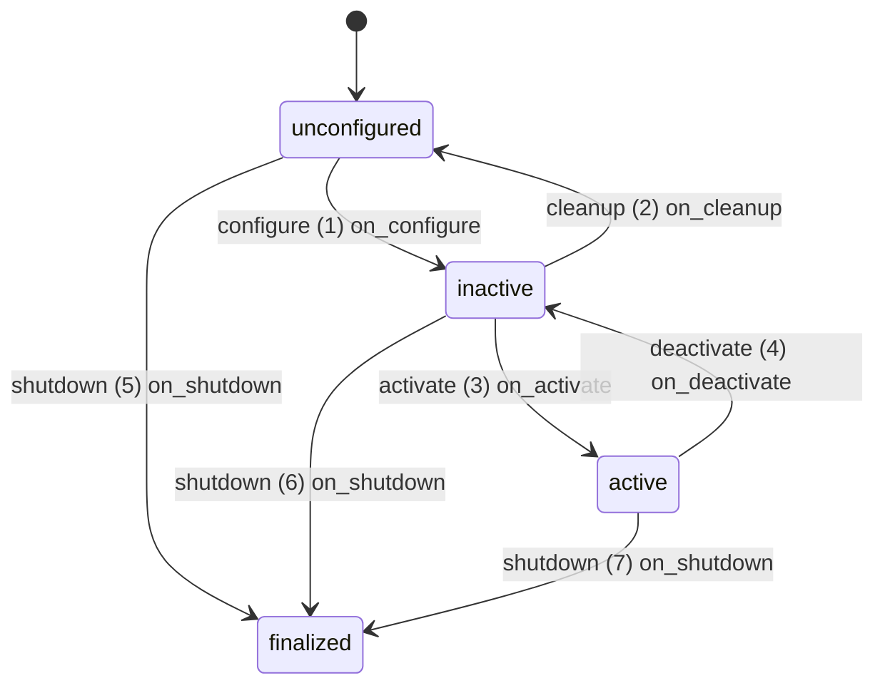

# 10. 라이프사이클 노드 (저장소 Section12)

> 참조: `Section12_Build_the_Robot/bumperbot_ws/src/bumperbot_cpp_examples/src/simple_lifecycle_node.cpp`, `.../CMakeLists.txt`, `.../package.xml`

## 이 장에서 하는 일

라이프사이클(managed) 노드를 만든다. 일반 노드는 만들어지면 곧바로 동작하지만, 라이프사이클 노드는 **상태 기계**를 가진다. `unconfigured → inactive → active` 순서로 외부에서 전이를 명령해야 일을 시작하고, 끝낼 때는 `deactivate`, `cleanup`, `shutdown`을 거친다. `ros2 lifecycle` 명령으로 상태를 옮겨 가며 로그와 토픽 구독 동작이 어떻게 달라지는지 본다.

**이 장의 목적은 다음 11장(하드웨어 인터페이스)의 준비다.** ros2_control의 하드웨어 컴포넌트(`SystemInterface`)와 제어기(`ControllerInterface`)가 이 장의 라이프사이클 노드와 같은 상태 기계를 쓴다. 설치된 헤더를 직접 보고 그 근거를 확인한다. 11장에서 `on_init`, `on_activate`, `on_deactivate`를 쓸 때 "이게 어느 상태로 가는 전이인가"를 알고 시작하게 하는 것이 이 장의 일이다.

## 이번 장의 파일

```text
~/bumperbot_ws/src/bumperbot_cpp_examples/
├── CMakeLists.txt                       [수정]
├── package.xml                          [수정]
└── src/
    └── simple_lifecycle_node.cpp        [새]
```

## 단계 1. 라이프사이클 노드 `simple_lifecycle_node`

### 왜 필요한가

로봇에서는 "통신 포트를 열고 설정을 읽는 일"과 "모터에 명령을 보내기 시작하는 일"을 나누고 싶다. 한 번에 시작하면 설정이 틀렸을 때 모터가 이미 돌고 있을 수 있다. 라이프사이클 노드는 이 둘을 `configure`와 `activate`라는 별개 전이로 나눈다. 전이를 일으키는 쪽은 노드 밖(사람이 `ros2 lifecycle set`을 치거나, 관리하는 다른 프로그램)이다.

네 가지 기본 상태와 전이는 다음과 같다. 전이 이름 옆 번호는 `ros2 lifecycle list`가 보여 준 전이 번호다.



`finalized`에서는 더 이상 전이가 없다. 상태도에는 주 상태(primary state) 네 개만 그렸다. 전이가 진행되는 동안 거치는 중간 상태(`configuring`, `activating` 등)는 아래 시험의 `ros2 lifecycle list` 설명에서 다룬다.

전이 콜백이 `SUCCESS`를 돌려주지 않으면 어떻게 되는지는 이 장의 시험 6에서 실제로 확인한다. 요약은 다음과 같다. `FAILURE`는 전이를 취소하고 **직전의 주 상태에 머문다**(같은 전이를 다시 요청할 수 있고 `on_error`는 불리지 않는다). `ERROR`를 돌려주거나 콜백에서 **잡히지 않은 예외**가 나면 `on_error`가 불린다(`rclcpp_lifecycle/node_interfaces/lifecycle_node_interface.hpp` 주석).

### 코드

> 파일: `bumperbot_cpp_examples/src/simple_lifecycle_node.cpp` — 전체
```cpp
#include <rclcpp/rclcpp.hpp>
#include <rclcpp_lifecycle/lifecycle_node.hpp>
#include <std_msgs/msg/string.hpp>

#include <chrono>
#include <memory>
#include <string>
#include <thread>


using namespace std::chrono_literals;
using std::placeholders::_1;


class SimpleLifecycleNode : public rclcpp_lifecycle::LifecycleNode
{
public:

  explicit SimpleLifecycleNode(const std::string & node_name, bool intra_process_comms = false)
  : rclcpp_lifecycle::LifecycleNode(node_name,
      rclcpp::NodeOptions().use_intra_process_comms(intra_process_comms))
  {}

  rclcpp_lifecycle::node_interfaces::LifecycleNodeInterface::CallbackReturn
  on_configure(const rclcpp_lifecycle::State &)
  {
    sub_ = create_subscription<std_msgs::msg::String>(
        "chatter", 10, std::bind(&SimpleLifecycleNode::msgCallback, this, _1));
    RCLCPP_INFO(get_logger(), "Lifecycle node on_configure() called.");
    return rclcpp_lifecycle::node_interfaces::LifecycleNodeInterface::CallbackReturn::SUCCESS;
  }

  rclcpp_lifecycle::node_interfaces::LifecycleNodeInterface::CallbackReturn
  on_activate(const rclcpp_lifecycle::State & state)
  {
    LifecycleNode::on_activate(state);
    RCLCPP_INFO(get_logger(), "Lifecycle node on_activate() called.");
    std::this_thread::sleep_for(2s);
    return rclcpp_lifecycle::node_interfaces::LifecycleNodeInterface::CallbackReturn::SUCCESS;
  }

  rclcpp_lifecycle::node_interfaces::LifecycleNodeInterface::CallbackReturn
  on_deactivate(const rclcpp_lifecycle::State & state)
  {
    LifecycleNode::on_deactivate(state);
    RCLCPP_INFO(get_logger(), "Lifecycle node on_deactivate() called.");
    return rclcpp_lifecycle::node_interfaces::LifecycleNodeInterface::CallbackReturn::SUCCESS;
  }

  rclcpp_lifecycle::node_interfaces::LifecycleNodeInterface::CallbackReturn
  on_cleanup(const rclcpp_lifecycle::State &)
  {
    sub_.reset();
    RCLCPP_INFO(get_logger(), "Lifecycle node on_cleanup() called.");
    return rclcpp_lifecycle::node_interfaces::LifecycleNodeInterface::CallbackReturn::SUCCESS;
  }

  rclcpp_lifecycle::node_interfaces::LifecycleNodeInterface::CallbackReturn
  on_shutdown(const rclcpp_lifecycle::State &)
  {
    sub_.reset();
    RCLCPP_INFO(get_logger(), "Lifecycle node on_shutdown() called");
    return rclcpp_lifecycle::node_interfaces::LifecycleNodeInterface::CallbackReturn::SUCCESS;
  }

  void
  msgCallback(const std_msgs::msg::String &msg)
  {
    auto state = get_current_state();
    if(state.label() == "active")
    {
      RCLCPP_INFO_STREAM(get_logger(), "Lifecycle node heard: " << msg.data.c_str());
    }    
  }

private:
  rclcpp::Subscription<std_msgs::msg::String>::SharedPtr sub_;
};


int main(int argc, char * argv[])
{
  rclcpp::init(argc, argv);

  rclcpp::executors::SingleThreadedExecutor ste;

  std::shared_ptr<SimpleLifecycleNode> simple_lifecycle_node =
    std::make_shared<SimpleLifecycleNode>("simple_lifecycle_node");

  ste.add_node(simple_lifecycle_node->get_node_base_interface());
  ste.spin();
  rclcpp::shutdown();

  return 0;
}
```

`CMakeLists.txt`와 `package.xml`도 함께 고친다. `rclcpp_lifecycle`를 찾고, 실행 파일을 추가하고, `install` 목록에 넣는다.

> 파일: `bumperbot_cpp_examples/CMakeLists.txt` — 수정
```cmake
find_package(geometry_msgs REQUIRED)
find_package(tf2 REQUIRED)
find_package(tf2_ros REQUIRED)
find_package(rclcpp_lifecycle REQUIRED)
# ...
add_executable(simple_tf_kinematics src/simple_tf_kinematics.cpp)
ament_target_dependencies(simple_tf_kinematics rclcpp bumperbot_msgs geometry_msgs tf2 tf2_ros)

add_executable(simple_lifecycle_node src/simple_lifecycle_node.cpp)
ament_target_dependencies(simple_lifecycle_node rclcpp rclcpp_lifecycle std_msgs)
# ...
install(TARGETS
  simple_publisher
  simple_subscriber
  simple_parameter
  simple_turtlesim_kinematics
  simple_service_server
  simple_service_client
  simple_tf_kinematics
  simple_lifecycle_node
  DESTINATION lib/${PROJECT_NAME}
)
```

`package.xml`에 `<depend>rclcpp_lifecycle</depend>`를 더한다. 위 블록의 `# ...` 줄은 "원래 있던 줄을 그대로 둔다"는 뜻이고 파일에 치지 않는다.

> 파일: `bumperbot_cpp_examples/package.xml` — 수정
```xml
  <depend>bumperbot_msgs</depend>
  <depend>geometry_msgs</depend>
  <depend>tf2</depend>
  <depend>tf2_ros</depend>
  <depend>rclcpp_lifecycle</depend>

  <test_depend>ament_lint_auto</test_depend>
  <test_depend>ament_lint_common</test_depend>
```

### 코드 설명

| 부분 | 뜻 |
|---|---|
| `#include <rclcpp_lifecycle/lifecycle_node.hpp>` | 라이프사이클 노드 헤더. 패키지 `rclcpp_lifecycle`가 필요하다 |
| `class SimpleLifecycleNode : public rclcpp_lifecycle::LifecycleNode` | `rclcpp::Node` 대신 `LifecycleNode`를 상속한다. 만들어진 노드는 `unconfigured` 상태로 시작한다 |
| `explicit SimpleLifecycleNode(const std::string & node_name, bool intra_process_comms = false)` | `explicit`는 `SimpleLifecycleNode x = "이름"` 같은 암묵 변환을 막는다. `NodeOptions().use_intra_process_comms(...)`는 같은 프로세스 안의 노드끼리 메시지를 복사 없이 주고받는 옵션이다. 이 예제에서는 기본값 `false`를 쓴다 |
| `CallbackReturn` 반환 타입 | 전이 콜백의 반환형. `SUCCESS`면 전이가 완료되고 목표 상태로 간다. `FAILURE`면 전이가 취소되고 직전 주 상태에 머문다. `ERROR`면 `on_error`가 불린다(시험 6에서 확인한다) |
| `const rclcpp_lifecycle::State &` 인자 | 전이가 일어나기 **직전의 상태**(`previous_state`)다. 시험 6의 `on_error`에서 `label()`이 `unconfigured`, `inactive`, `active`처럼 직전 상태 이름으로 찍혔다. `on_activate`, `on_deactivate`는 이 값을 부모 구현에 넘기려고 이름(`state`)을 붙였다 |
| `on_configure(const rclcpp_lifecycle::State &)`처럼 인자 이름이 없는 곳 | 인자를 쓰지 않아서 이름을 생략했다. 이름을 붙이고 쓰지 않으면 이 패키지가 켠 `-Wextra`가 `unused parameter` 경고를 낸다(일반 지식) |
| `on_configure` | `unconfigured → inactive`에서 불린다. 여기서 구독을 만든다. **자원을 준비하는 자리**다 |
| `on_activate` | `inactive → active`에서 불린다. 첫 줄 `LifecycleNode::on_activate(state)`는 부모 클래스 구현을 부른다. 라이프사이클 노드의 **관리되는 퍼블리셔**(`LifecyclePublisher`)를 활성화하는 일을 하므로 덮어쓰는 쪽에서 불러 주는 것이 규칙이다(일반 지식). 이 노드에는 퍼블리셔가 없지만 같은 모양으로 쓴다. 이어서 로그를 찍고 2초 쉰다 |
| `std::this_thread::sleep_for(2s)` | 참조 코드가 `on_activate` 안에서 2초 쉰다. 의도는 확인하지 못했다. 전이 콜백이 오래 걸리면 `ros2 lifecycle set`도 그만큼 기다린다는 것을 보여 준다(아래 시험에서 `ros2 lifecycle set`이 2초 남짓 걸렸다. 명령줄 도구가 뜨는 시간이 더해져 환경에 따라 다르다) |
| `on_deactivate` | `active → inactive`. 부모 구현을 부르고 로그를 찍는다 |
| `on_cleanup` | `inactive → unconfigured`. `sub_.reset()`으로 `on_configure`에서 만든 구독을 없앤다. `configure`와 `cleanup`은 서로 정반대 일을 하도록 짠다 |
| `on_shutdown` | 어느 상태에서든 `finalized`로 갈 때. 구독을 없앤다 |
| `msgCallback`의 `get_current_state().label() == "active"` | 구독 자체는 `inactive` 상태에서도 살아 있어 콜백이 불린다. **구독은 관리 대상이 아니기 때문**이다. 그래서 콜백 안에서 현재 상태를 직접 검사해 `active`일 때만 로그를 찍는다 |
| `main()`의 `SingleThreadedExecutor`와 `ste.add_node(node->get_node_base_interface())` | 라이프사이클 노드는 `rclcpp::Node`가 아니라서 실행기에는 `get_node_base_interface()`로 꺼낸 기본 인터페이스를 넘겨야 한다. `rclcpp::spin(node->get_node_base_interface())`처럼 `spin`에 바로 넘겨도 돌아간다(이 장의 시험 6 실험 노드가 이 방식으로 동작했다). 참조 코드는 실행기를 직접 만들어 `add_node`한 것이다. 이 차이는 선택이다 |

### 빌드와 시험

```bash
cd ~/bumperbot_ws
colcon build --symlink-install
source install/setup.bash
```

```text
Starting >>> bumperbot_cpp_examples
Finished <<< bumperbot_cpp_examples [3.67s]

Summary: 1 package finished [3.73s]
```

작업 공간에 다른 패키지(`bumperbot_msgs` 등)도 있어서 함께 빌드된다. 그 패키지의 줄도 나오고 `N packages finished`의 N도 다르다. `bumperbot_cpp_examples`가 `Finished`이고 `Summary`에 실패가 없으면 된다.

터미널 세 개를 쓴다. 터미널을 처음 열 때마다 `source /opt/ros/jazzy/setup.bash`와 `source ~/bumperbot_ws/install/setup.bash`를 먼저 한다.

터미널 A: 라이프사이클 노드를 띄운다. 끝나지 않는 명령이다. 아무 로그도 나오지 않는다. 노드는 `unconfigured` 상태로 가만히 있다.

```bash
ros2 run bumperbot_cpp_examples simple_lifecycle_node
```

터미널 B: 메시지를 내보내는 01장의 퍼블리셔를 띄운다. 끝나지 않는 명령이다.

```bash
ros2 run bumperbot_cpp_examples simple_publisher
```

터미널 C: 상태를 조회한다. 모두 바로 끝나는 명령이다.

```bash
ros2 lifecycle nodes
ros2 lifecycle get /simple_lifecycle_node
ros2 lifecycle list /simple_lifecycle_node
ros2 topic info /chatter
```

```text
/simple_lifecycle_node
```

```text
unconfigured [1]
```

```text
- configure [1]
	Start: unconfigured
	Goal: configuring
- shutdown [5]
	Start: unconfigured
	Goal: shuttingdown
```

```text
Type: std_msgs/msg/String
Publisher count: 1
Subscription count: 0
```

`unconfigured`에서 가능한 전이는 `configure`와 `shutdown`뿐이다. 구독자도 0개다. `Start`는 전이를 시작하는 주 상태이고, `Goal`은 전이가 **진행되는 동안의 중간 상태**(transition state)다. 콜백이 실행되는 동안 노드는 `configuring`, `activating`, `deactivating`, `cleaningup`, `shuttingdown`, 오류 처리 중에는 `errorprocessing` 중 하나에 있다(`lifecycle_msgs/msg/State`의 `TRANSITION_STATE_*` 상수). 콜백이 `SUCCESS`를 돌려주면 목표 주 상태(`inactive` 등)로 간다. `ros2 lifecycle get`이 보여 주는 것은 평소에는 주 상태이고, 콜백이 오래 걸리는 동안(이 장의 `on_activate`) 호출하면 중간 상태가 보일 수 있다.

라이프사이클 노드는 `ros2 node list`에도 보이지만 `ros2 lifecycle nodes`는 그중 라이프사이클 서비스를 가진 노드만 보여 준다(일반 지식). 그 서비스는 다음과 같다.

```bash
ros2 service list -t | grep simple_lifecycle | grep -E 'state|transition'
```

```text
/simple_lifecycle_node/change_state [lifecycle_msgs/srv/ChangeState]
/simple_lifecycle_node/get_available_states [lifecycle_msgs/srv/GetAvailableStates]
/simple_lifecycle_node/get_available_transitions [lifecycle_msgs/srv/GetAvailableTransitions]
/simple_lifecycle_node/get_state [lifecycle_msgs/srv/GetState]
/simple_lifecycle_node/get_transition_graph [lifecycle_msgs/srv/GetAvailableTransitions]
```

토픽은 다음과 같다. 전이가 일어날 때마다 이 토픽으로 이벤트가 나온다.

```bash
ros2 topic list | grep simple_lifecycle
```

```text
/simple_lifecycle_node/transition_event
```

`ros2 lifecycle`는 이 서비스들을 부르는 클라이언트일 뿐이다.

**1. configure**

```bash
ros2 lifecycle set /simple_lifecycle_node configure
ros2 lifecycle get /simple_lifecycle_node
ros2 topic info /chatter
```

```text
Transitioning successful
inactive [2]
Type: std_msgs/msg/String
Publisher count: 1
Subscription count: 1
```

노드 터미널에 `Lifecycle node on_configure() called.`가 찍힌다. 구독이 생겼다(`Subscription count: 1`). 그러나 `inactive`이므로 퍼블리셔가 메시지를 내보내도 `heard:` 로그는 나오지 않는다. 몇 초 기다려 확인한다.

**2. activate**

```bash
time ros2 lifecycle set /simple_lifecycle_node activate
ros2 lifecycle get /simple_lifecycle_node
```

```text
Transitioning successful

real	0m3.012s
active [3]
```

`on_activate`가 2초 쉬므로 명령이 2초 남짓 걸린다(`time`이 위처럼 3초쯤 보이는 것은 명령줄 도구가 뜨는 시간이 더해져서이고 환경에 따라 다르다). 노드 터미널(터미널 A)에는 다음이 나온다. `counter:` 번호는 실행 시점에 따라 다르다.

```text
[INFO] [1795239313.057442483] [simple_lifecycle_node]: Lifecycle node on_activate() called.
[INFO] [1795239315.057614141] [simple_lifecycle_node]: Lifecycle node heard: Hello ROS 2 - counter:11
[INFO] [1795239315.057646328] [simple_lifecycle_node]: Lifecycle node heard: Hello ROS 2 - counter:12
[INFO] [1795239315.387057903] [simple_lifecycle_node]: Lifecycle node heard: Hello ROS 2 - counter:13
[INFO] [1795239316.386914813] [simple_lifecycle_node]: Lifecycle node heard: Hello ROS 2 - counter:14
```

`on_activate` 로그(`...13.057`)보다 2초 뒤에 `heard:` 로그가 시작한다. 그리고 `heard:`의 처음 두 줄(`...15.0574`, `...15.0576`)이 같은 시각이다. 이는 `on_activate`가 2초 쉬는 동안 실행기가 막혀서 그사이 도착한 메시지가 전이가 끝난 뒤 한꺼번에 처리됐기 때문이다. 이 시간 동안은 `state`가 `active`가 아니었으므로 그전에 도착한 메시지는 처리 시점의 상태 검사로 걸러지지 않고, 전이가 끝나 `active`가 된 뒤 처리돼 로그가 찍힌다. 전이 콜백 안에서 오래 걸리는 일을 하면 같은 실행기의 다른 콜백이 멈춘다.

**3. deactivate와 cleanup**

```bash
ros2 lifecycle set /simple_lifecycle_node deactivate
ros2 lifecycle get /simple_lifecycle_node
ros2 lifecycle set /simple_lifecycle_node cleanup
ros2 lifecycle get /simple_lifecycle_node
ros2 topic info /chatter
```

```text
Transitioning successful
inactive [2]
Transitioning successful
unconfigured [1]
Type: std_msgs/msg/String
Publisher count: 1
Subscription count: 0
```

`deactivate` 뒤에는 `heard:` 로그가 멈추고(구독은 살아 있으나 상태 검사에서 걸러진다), `cleanup` 뒤에는 구독자가 0으로 돌아간다. 다시 `configure`를 하면 구독이 새로 만들어진다.

**4. 허용되지 않는 전이**

```bash
ros2 lifecycle set /simple_lifecycle_node activate
```

```text
Unknown transition requested, available ones are:
- configure [1]
- shutdown [5]
```

`unconfigured`에서는 `activate`를 할 수 없다. 지금 상태에서 가능한 전이만 받는다.

**5. shutdown**

```bash
ros2 lifecycle set /simple_lifecycle_node shutdown
ros2 lifecycle get /simple_lifecycle_node
```

```text
Transitioning successful
finalized [4]
```

노드 로그에 `on_shutdown() called`가 찍힌다. 프로세스는 계속 살아 있지만 라이프사이클 상태는 끝났다(`finalized`). Ctrl+C로 노드를 끈다.

**6. 전이 콜백이 `FAILURE`나 `ERROR`를 돌려주면**

이 시험은 이 가이드의 코드를 바꾸지 않고, 별도 실험 노드에서 확인한 결과다. 콜백 하나가 환경 변수에 따라 `FAILURE`, `ERROR`를 돌려주거나 예외를 던지게 하고, `on_error`를 덮어써 로그를 찍게 한 작은 `LifecycleNode`를 만들어 `ros2 lifecycle set`으로 전이를 시켰다. 직접 해 보려면 `simple_lifecycle_node.cpp`의 `on_configure`에서 `return ...SUCCESS;`를 임시로 `FAILURE`나 `ERROR`로 바꾸고 다시 빌드한다. 시험이 끝나면 되돌린다.

| 콜백이 한 일 | `ros2 lifecycle set` 결과 | 전이 뒤 상태 | `on_error` |
|---|---|---|---|
| `on_configure`가 `FAILURE` | `Transitioning failed` | `unconfigured`. 같은 전이를 다시 요청하면 `on_configure`가 다시 불린다 | 불리지 않는다 |
| `on_activate`가 `FAILURE` | `Transitioning failed` | `inactive`에 머문다 | 불리지 않는다 |
| `on_configure`가 `ERROR` | `Transitioning failed`, 노드 로그에 `Callback returned ERROR during the transition: configure` | `on_error`의 반환값에 따라 다르다(아래) | 불린다. `previous_state`는 `unconfigured` |
| `on_activate`가 `ERROR` | `Transitioning failed` | 위와 같다. `on_error`가 `SUCCESS`를 돌려주면 `unconfigured`(`inactive`가 아니다) | 불린다. `previous_state`는 `inactive` |
| `on_deactivate`가 `ERROR` | `Transitioning failed` | `on_error`가 `SUCCESS`를 돌려주면 `unconfigured` | 불린다. `previous_state`는 `active` |
| `on_configure`가 예외를 던짐 | 로그에 `Caught exception in callback for transition 10`과 원인 | `ERROR`와 같이 처리된다 | 불린다 |
| 위의 `ERROR` 뒤에 `on_error`가 `FAILURE`를 돌려줌 | `Transitioning failed` | `finalized`. 이후 `activate`는 `Unknown transition requested`로 거부된다 | — |

정리하면 다음과 같다.

- `FAILURE`는 "이번 전이는 못 했다"이다. 상태가 그대로이고 다시 시도할 수 있다. 하드웨어 통신이 아직 안 열렸을 때처럼 **재시도할 만한 실패**에 쓴다.
- `ERROR`(또는 예외)는 "이 노드를 안전하게 정리해야 한다"이다. `on_error`가 불리고, 그 반환값이 `SUCCESS`면 `unconfigured`로, `FAILURE`면 `finalized`로 간다. 설치된 헤더 주석은 `on_error`의 기본 구현이 실패값(`false`)을 돌려주어 `finalized`로 간다고 적고 있다. 이 시험에서는 기본 구현 자체가 아니라 `on_error`를 덮어쓰고 `FAILURE`를 돌려주게 해 `finalized`가 됨을 확인했다.
- `ros2_control`의 하드웨어 컴포넌트와 제어기도 같은 반환값(`SUCCESS`/`FAILURE`/`ERROR`)을 쓴다(`system_interface.hpp` 주석). 다만 `controller_manager`가 `ERROR` 뒤에 어떤 상태로 옮기는지는 이 시험으로 확인하지 못했다. 11장에서 하드웨어 콜백이 `FAILURE`와 `ERROR`를 돌려줄 때를 구분해 쓴다.

통과 조건: 시작 상태가 `unconfigured [1]`, `configure` 뒤 `inactive [2]`와 구독자 1개, `activate` 뒤 `active [3]`와 `heard:` 로그, `deactivate` 뒤 `heard:` 멈춤, `cleanup` 뒤 `unconfigured`와 구독자 0개, 불가능한 전이는 거부, `shutdown` 뒤 `finalized [4]`, 시험 6의 `FAILURE`는 상태 유지·`ERROR`는 `on_error` 호출이다. 로그 순서는 `on_configure`, `on_activate`, `on_deactivate`, `on_cleanup`, `on_shutdown`이다.

Python판의 참조 위치: `Section12_Build_the_Robot/bumperbot_ws/src/bumperbot_py_examples/bumperbot_py_examples/simple_lifecycle_node.py`

## 단계 2. ros2_control이 같은 상태 기계를 쓰는 근거

이 단계는 빌드가 없다. 설치된 헤더를 열어 확인한다. 아래 줄 번호는 이 가이드를 쓴 환경(Jazzy, `hardware_interface` 4.50.0)의 것이다. 헤더 내용이 다르면 번호는 달라질 수 있다.

### 왜 필요한가

11장에서 쓰는 하드웨어 인터페이스 플러그인은 `ros2_control_node`(controller_manager)가 읽어 들여 상태를 옮긴다. 이 장에서 본 `configure → activate` 순서가 그 플러그인의 콜백 호출 순서와 같다. 이것을 모르고 11장의 코드를 쓰면 "`on_activate`가 왜 안 불리는가", "`write()`가 왜 호출되지 않는가" 같은 질문에서 막힌다.

### 하드웨어 컴포넌트

터미널에서 다음을 실행한다. 헤더가 있는 폴더로 이동하면 파일 이름만 쓸 수 있다.

```bash
cd /opt/ros/jazzy/include/hardware_interface/hardware_interface
sed -n 28,56p system_interface.hpp
```

출력은 `SystemInterface` 머리 주석(반환값 의미와 상태별 설명)이다. 주석을 그대로 옮기지 않고 아래 표로 줄여 적었다.

| 상태 | 불리는 콜백 (주석) | 뜻 (주석을 줄여 옮김) |
|---|---|---|
| UNCONFIGURED | `on_init`, `on_cleanup` | 하드웨어가 초기화됐으나 통신은 시작되지 않았다. 인터페이스를 쓸 수 없다 |
| INACTIVE | `on_configure`, `on_deactivate` | 통신이 시작되고 설정됐다. **상태(state)는 읽을 수 있지만 명령(command) 인터페이스는 쓸 수 없다** |
| ACTIVE | `on_activate` | 하드웨어의 전원 회로가 켜지고 움직일 수 있다(예: 브레이크 해제). 명령 인터페이스를 쓸 수 있다 |
| FINALIZED | `on_shutdown` | 해제 준비가 끝났다. 할당한 메모리를 정리했다 |

반환값 의미도 이 주석에 있다. `SUCCESS`는 성공, `FAILURE`는 실패했지만 다시 호출할 수 있다는 뜻, `ERROR`는 `on_error`에서 처리해야 할 심각한 오류다. 이 의미는 이 장의 시험 6에서 `rclcpp_lifecycle` 노드로 확인한 동작(`FAILURE`는 상태 유지, `ERROR`는 `on_error`)과 같다.

클래스 상속과 `read()`, `write()`는 다음으로 확인한다.

```bash
grep -n -E "class SystemInterface|write\(" system_interface.hpp
grep -n -E "class HardwareComponentInterface :|virtual return_type read|virtual return_type write" hardware_component_interface.hpp
```

```text
66:class SystemInterface : public HardwareComponentInterface
69:  return_type write(const rclcpp::Time & time, const rclcpp::Duration & period) override = 0;
```

```text
65:class HardwareComponentInterface : public rclcpp_lifecycle::node_interfaces::LifecycleNodeInterface
292:  virtual return_type read(const rclcpp::Time & time, const rclcpp::Duration & period) = 0;
316:  virtual return_type write(const rclcpp::Time & time, const rclcpp::Duration & period);
```

`SystemInterface`는 `HardwareComponentInterface`를 상속하고(`system_interface.hpp:66`), 그 `HardwareComponentInterface`가 이 장에서 쓴 `LifecycleNodeInterface`를 상속한다(`hardware_component_interface.hpp:65`). 이 장의 `on_configure` 등과 같은 시그니처의 콜백이 하드웨어 컴포넌트에도 있다는 뜻이다. `on_init`만 라이프사이클 전이가 아니라 하드웨어 컴포넌트가 로드될 때 한 번 불리는 초기화다(`hardware_component_interface.hpp`의 `on_init(const HardwareComponentInterfaceParams &)`). 이 가이드가 쓰는 Jazzy 4.50.0에서 `on_init(const HardwareInfo &)`는 `[[deprecated]]`다(11장에서 다룬다).

하드웨어 컴포넌트에는 라이프사이클 콜백 말고 `read()`와 `write()`가 있다. 기반 클래스에서는 `read()`만 `= 0`(순수 가상)이고 `write()`는 기본 구현이 있다(292, 316줄). 그런데 `SystemInterface`가 `write()`를 다시 `= 0`으로 선언한다(69줄). 따라서 `SystemInterface`를 상속한 플러그인은 **`read()`와 `write()` 둘 다 반드시 구현**해야 한다. 이 둘은 `controller_manager`가 제어 주기마다 부른다.

### 제어기

```bash
cd /opt/ros/jazzy/include/controller_interface/controller_interface
grep -n -E "class ControllerInterfaceBase|virtual return_type update" controller_interface_base.hpp
grep -n -E "class ChainableControllerInterface|update\(|update_reference_from_subscribers|update_and_write_commands" chainable_controller_interface.hpp
cd /opt/ros/jazzy/include/diff_drive_controller/diff_drive_controller
grep -n -E "class DiffDriveController|on_init|on_configure|on_activate|on_deactivate|on_cleanup|on_shutdown|on_error|update_reference_from_subscribers|update_and_write_commands" diff_drive_controller.hpp
```

```text
118:class ControllerInterfaceBase : public rclcpp_lifecycle::node_interfaces::LifecycleNodeInterface
207:  virtual return_type update(const rclcpp::Time & time, const rclcpp::Duration & period) = 0;
```

```text
37:class ChainableControllerInterface : public ControllerInterfaceBase
52:  return_type update(const rclcpp::Time & time, const rclcpp::Duration & period) final;
143:  virtual return_type update_reference_from_subscribers(
153:   * This means that this method is called after \update_reference_from_subscribers if controller is
159:  virtual return_type update_and_write_commands(
```

```text
44:class DiffDriveController : public controller_interface::ChainableControllerInterface
56:  controller_interface::return_type update_reference_from_subscribers(
59:  controller_interface::return_type update_and_write_commands(
62:  controller_interface::CallbackReturn on_init() override;
64:  controller_interface::CallbackReturn on_configure(
67:  controller_interface::CallbackReturn on_activate(
70:  controller_interface::CallbackReturn on_deactivate(
73:  controller_interface::CallbackReturn on_cleanup(
76:  controller_interface::CallbackReturn on_error(
```

제어기의 기반 클래스 `ControllerInterfaceBase`도 `LifecycleNodeInterface`를 상속한다(118줄). 설치된 `DiffDriveController`는 `ChainableControllerInterface`를 거쳐(44줄) `on_init`, `on_configure`, `on_activate`, `on_deactivate`, `on_cleanup`, `on_error`를 덮어쓴다. 05장에서 `diff_drive_controller`를 쓰고 `ros2 control list_controllers`로 상태를 볼 때 이 상태 이름(`unconfigured`, `inactive`, `active`)이 나온다.

제어기의 주기 동작 함수는 기반 클래스에서 `update(const rclcpp::Time &, const rclcpp::Duration &)`다(207줄, 순수 가상 함수). 다만 `ChainableControllerInterface`는 `update()`를 `final`로 막아 두고(52줄) 대신 `update_reference_from_subscribers()`와 `update_and_write_commands()`를 구현하게 한다(143, 159줄). `DiffDriveController`가 이 둘을 구현한다(56, 59줄). 체인형이 아닌 `ControllerInterface`를 상속하는 제어기는 `update()`를 직접 구현한다. 07장 이후 우리가 쓰는 제어기에서 어느 쪽을 쓰는지는 그 장에서 다룬다.

`controller_interface_base.hpp`의 주석에서 알 수 있는 순서 규칙이 두 가지 있다.

- `command_interface_configuration()`과 `state_interface_configuration()`은 `inactive`나 `active` 상태에서만 불린다. 즉 `on_configure`가 먼저 끝나 있어야 한다. 이 설정이 "이 제어기가 하드웨어의 어떤 인터페이스를 쓰는가"를 알려 주고, 활성화 가능 여부 검사와 하드웨어 인터페이스 확보에 쓰인다.
- `configure()`는 라이프사이클 `configure` 전이를 감싸면서 제어기 파라미터를 읽는다(헤더 주석: "Custom configure method to read additional parameters").

### 상태를 바꾸는 명령

`ros2 control`에는 이 장의 `ros2 lifecycle set`에 해당하는 명령이 있다. 설치된 도움말에서 확인했다.

```bash
ros2 control set_controller_state -h
ros2 control set_hardware_component_state -h
```

```text
usage: ros2 control set_controller_state ... controller_name {unconfigured,inactive,active}
usage: ros2 control set_hardware_component_state ... hardware_component_name {unconfigured,inactive,active}
```

제어기든 하드웨어 컴포넌트든 목표 상태로 `unconfigured`, `inactive`, `active` 셋을 줄 수 있다. 이 명령들을 실제로 쓰는 것은 03장(제어기)과 11장(하드웨어)이다.

### 대응표

| 전이 | 라이프사이클 노드 (이 장) | 하드웨어 컴포넌트 (`SystemInterface`) | 제어기 (`ControllerInterface`) |
|---|---|---|---|
| 객체를 만든 뒤 | 생성자. 상태는 `unconfigured` | `on_init(params)`: URDF의 `<ros2_control>` 정보(`HardwareInfo`)를 받아 파싱한다. 끝나면 `unconfigured` | `on_init()`: 순수 가상 함수. 파라미터 선언 등. 끝나면 `unconfigured` |
| `unconfigured → inactive` | `on_configure`: 구독 생성 | `on_configure`: 통신 시작. 상태 인터페이스 읽기 가능 | `on_configure`: 파라미터 읽기(`configure()`), 구독·퍼블리셔 준비 |
| `inactive → active` | `on_activate`: 전이 후 `heard:` 로그 시작 | `on_activate`: 전원 켬. 명령 인터페이스 사용 가능 | `on_activate`: 인터페이스를 확보하고 `update()` 호출이 시작된다 |
| `active → inactive` | `on_deactivate` | `on_deactivate`: 명령 인터페이스 사용 중지 | `on_deactivate`: `update()` 호출이 멈춘다 |
| `inactive → unconfigured` | `on_cleanup`: 구독 해제 | `on_cleanup`: 통신 종료 | `on_cleanup` |
| `→ finalized` | `on_shutdown` | `on_shutdown` | `on_shutdown`(기반 클래스 기본 구현) |
| 오류 | `on_error`: 콜백이 `ERROR`를 돌려주거나 예외가 났을 때 | `on_error` | `on_error` |
| 주기 동작 | 타이머·구독 콜백 | `read()` 후 `write()`를 `controller_manager`가 부른다. 둘 다 반드시 구현한다 | `update()`를 `controller_manager`가 부른다. `ChainableControllerInterface`(`DiffDriveController`)는 `update()` 대신 `update_reference_from_subscribers()`와 `update_and_write_commands()`를 구현한다 |

표에서 헤더 주석으로 직접 확인한 것은 하드웨어 컴포넌트의 상태별 의미(UNCONFIGURED, INACTIVE, ACTIVE, FINALIZED와 콜백 대응), 두 기반 클래스가 `LifecycleNodeInterface`를 상속한다는 것, 제어기 설정 함수가 `inactive`/`active`에서만 불린다는 것, `diff_drive_controller`가 덮어쓰는 콜백 목록과 `ChainableControllerInterface`의 `update()` 처리다. 제어기의 `on_activate`에서 `update()`가 시작된다는 순서와 `on_deactivate`에서 멈춘다는 설명은 위 주석에서 이어서 추론한 것이며 03장에서 `ros2 control list_controllers`와 `set_controller_state`로 확인한다.

예제로도 확인할 수 있다. `~/my_robot_project/references/ros2_control_demos/example_2/hardware/include/ros2_control_demo_example_2/diffbot_system.hpp`(ros2_control 공식 예제 저장소, jazzy 브랜치. bumperbot 참조 저장소와 별개다)는 `on_init`, `on_configure`, `on_activate`, `on_deactivate`, `read`, `write`를 덮어쓴다. 11장이 따라 하는 bumperbot 참조 저장소의 `~/my_robot_project/references/bumperbot_odometry_control/Section12_Build_the_Robot/bumperbot_ws/src/bumperbot_firmware/include/bumperbot_firmware/bumperbot_interface.hpp`(Humble 방식)는 `on_init`, `on_activate`, `on_deactivate`, `read`, `write`를 덮어쓴다. `on_configure`를 덮어쓰지 않으면 기본 구현이 `SUCCESS`를 돌려주므로(`lifecycle_node_interface.hpp` 주석) `configure`는 아무 일 없이 통과한다.

## 참조 코드와 다른 점

| 참조 | 이 가이드 | 이유 |
|---|---|---|
| `simple_lifecycle_node.cpp` | 같다 | Jazzy에서 경고 없이 빌드되고 동작한다 |
| `package.xml`에서 `<depend>turtlesim</depend>`가 `tf2_ros` 뒤로 옮겨져 있다 | 의존성 순서는 이 가이드가 만든 순서를 따른다 | 순서는 동작에 영향이 없다 |

## 자주 나는 오류

| 증상 | 원인 | 고치는 법 |
|---|---|---|
| `ros2 lifecycle nodes`에 노드가 안 보인다 | 노드가 아직 안 떴거나 `ROS_DOMAIN_ID`가 다르다. 일반 노드(`rclcpp::Node`)는 라이프사이클 서비스가 없어 원래 안 나온다 | 노드를 띄운 터미널과 `ROS_DOMAIN_ID`를 확인한다. `LifecycleNode`를 상속했는지 본다 |
| `Unknown transition requested, available ones are: ...` | 현재 상태에서 불가능한 전이를 요청했다 | `ros2 lifecycle list <노드>`로 가능한 전이를 본다 |
| `activate`했는데 `heard:`가 안 나온다 | 퍼블리셔가 안 떠 있다. 또는 `on_configure`가 구독을 만들지 못했다 | `ros2 topic info /chatter`에서 구독자 수를 본다 |
| `ros2 lifecycle set`이 오래 걸린다 | 전이 콜백이 오래 걸린다(이 장은 `on_activate`가 2초 쉰다) | 콜백 안의 `sleep_for`나 블로킹 호출을 확인한다 |
| `undefined reference to rclcpp_lifecycle::...` | `find_package(rclcpp_lifecycle REQUIRED)`나 `ament_target_dependencies`에 `rclcpp_lifecycle`가 없다 | 두 곳을 확인한다 |

## 정리

| 파일 | 역할 |
|---|---|
| `bumperbot_cpp_examples/src/simple_lifecycle_node.cpp` | 라이프사이클 콜백 다섯 개와 상태에 따라 로그를 내는 구독 |
| `bumperbot_cpp_examples/CMakeLists.txt` | `rclcpp_lifecycle` 의존과 실행 파일 추가 |
| `bumperbot_cpp_examples/package.xml` | `<depend>rclcpp_lifecycle</depend>` 추가 |

이 장에서 익힌 `unconfigured → inactive → active` 상태 기계와 `on_init`, `on_configure`, `on_activate`, `on_deactivate`, `on_cleanup`, `on_shutdown` 콜백이 11장 하드웨어 인터페이스의 뼈대다. 11장에서는 이 콜백 중 `on_init`, `on_activate`, `on_deactivate`와 `read()`, `write()`를 채워 모터와 통신하는 `SystemInterface` 플러그인을 만든다.
