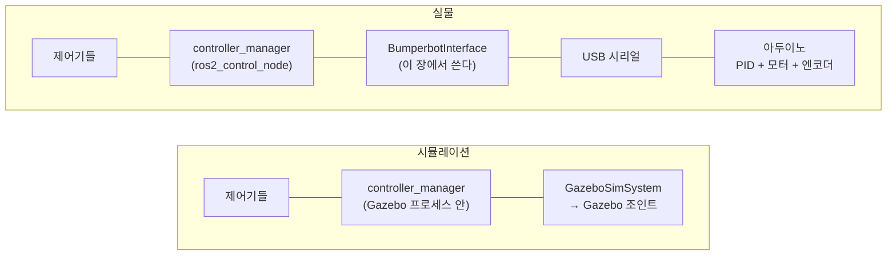
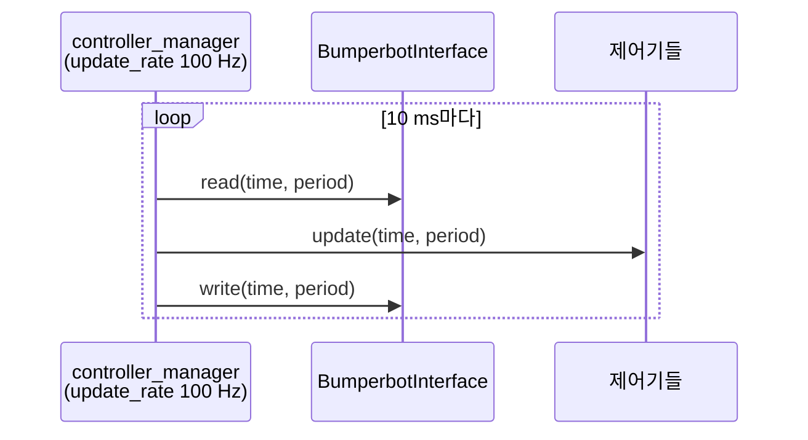
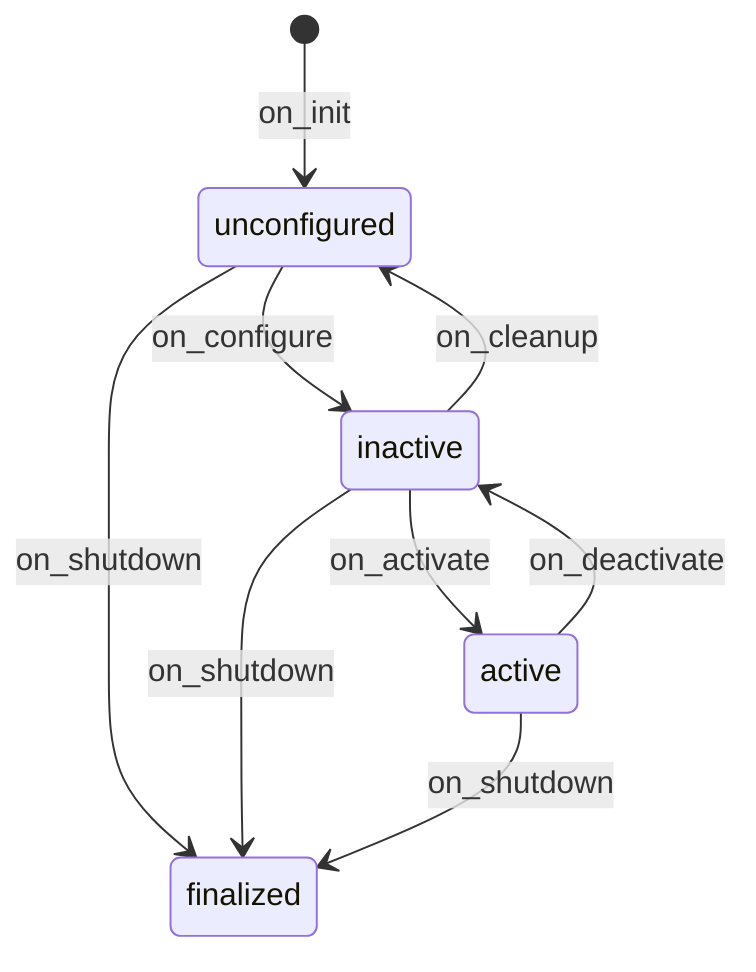

# 11. 하드웨어 인터페이스 플러그인 (저장소 Section12)

> 참조: `Section12_Build_the_Robot/bumperbot_ws/src/bumperbot_firmware/` (`CMakeLists.txt`, `package.xml`, `bumperbot_interface.xml`, `include/bumperbot_firmware/bumperbot_interface.hpp`, `src/bumperbot_interface.cpp`, `src/simple_serial_transmitter.cpp`, `src/simple_serial_receiver.cpp`, `firmware/`)

## 이 장에서 하는 일

시뮬레이션에서는 Gazebo의 `gz_ros2_control`이 `controller_manager`(CM)와 하드웨어 컴포넌트를 대신 만들어 주었다. 실제 로봇에서는 이 둘을 직접 마련해야 한다.

| ros2_control이 돌려면 필요한 것 | 시뮬레이션(3장) | 실물(이 장) |
|---|---|---|
| CM이 도는 프로세스 | Gazebo 안(`gz_ros2_control` 시스템 플러그인) | `ros2_control_node` (`controller_manager` 패키지의 실행 파일) |
| 하드웨어 컴포넌트 = 제어기의 명령을 하드웨어에 쓰고, 하드웨어의 상태를 읽어 오는 클래스 | `gz_ros2_control/GazeboSimSystem` (이미 만들어져 있다) | **직접 쓴다.** `bumperbot_firmware/BumperbotInterface` |
| URDF의 `<ros2_control>` 태그 | `<plugin>`에 위 이름 | `<plugin>`에 직접 쓴 클래스 이름과 `port` 파라미터 |
| 제어기 설정 yaml | `bumperbot_controllers.yaml` | 같은 파일 |

이 장은 둘째 줄을 한다. **하드웨어 컴포넌트를 C++ 플러그인으로 쓰고**, 가상 시리얼 포트와 "가짜 아두이노"로 노트북에서 시험한다. 끝나면 `bumperbot_firmware` 패키지가 `hardware_interface::SystemInterface`를 상속한 플러그인을 pluginlib에 등록한 상태가 된다. 이 플러그인을 실제 로봇 모델(URDF)에 연결하고 `ros2_control_node`로 띄우는 일(xacro의 `is_sim` 분기, launch)은 12장에서 한다.



**역할 분담이 이 장의 핵심 전제다.** 바퀴 속도를 목표에 맞추는 루프(PID)는 아두이노 안에서 돈다(단계 4에서 스케치로 확인한다). ros2_control(제어기 + 하드웨어 컴포넌트)은 **속도 목표만 보낸다.** 그래서 명령 인터페이스는 `velocity` 하나이고, 상태 인터페이스는 `velocity`와 `position`이다. 아두이노는 위치를 보내지 않으므로 플러그인이 속도를 적분해서 위치를 만든다(단계 9).

참조 저장소의 Python 노드(`simple_serial_transmitter.py`, `simple_serial_receiver.py`, `mpu6050_driver.py`)는 치지 않는다. 위치만 적는다: `Section12_Build_the_Robot/bumperbot_ws/src/bumperbot_firmware/bumperbot_firmware/`. `mpu6050_driver.py`는 실물 IMU(I2C 센서) 드라이버이고 12장에서 한 줄로 언급한다.

## 이번 장의 파일

```text
~/bumperbot_ws/src/bumperbot_firmware/
├── CMakeLists.txt                          [새]
├── package.xml                             [새]
├── LICENSE                                 [새]  ros2 pkg create가 만든다 (단계 1)
├── bumperbot_interface.xml                 [새]  플러그인 설명 파일 (단계 10)
├── include/bumperbot_firmware/
│   └── bumperbot_interface.hpp             [새]  플러그인 클래스 선언 (단계 6~9)
├── src/
│   ├── bumperbot_interface.cpp             [새]  플러그인 구현 (단계 6~10)
│   ├── simple_serial_transmitter.cpp       [새]  ROS 토픽 → 시리얼 (단계 2)
│   └── simple_serial_receiver.cpp          [새]  시리얼 → ROS 토픽 (단계 3)
├── firmware/                               [새]  아두이노 스케치. 참조에서 복사한다 (단계 4)
│   ├── robot_control/robot_control.ino
│   ├── robot_control_inverted/robot_control_inverted.ino
│   ├── simple_encoder_reader/simple_encoder_reader.ino
│   ├── simple_motor_control/simple_motor_control.ino
│   ├── simple_serial_receiver/simple_serial_receiver.ino
│   └── simple_serial_transmitter/simple_serial_transmitter.ino
└── test/
    └── fake_arduino.py                     [새]  이 가이드가 더한 것 (참조에 없음, 단계 5)
```

`launch/`는 12장에서 생긴다. 이 장은 `bumperbot_firmware` 하나만으로 단계 10까지 진행한다. 앞 장의 `bumperbot_description`, `bumperbot_controller`는 12장에서 쓴다.

## 준비

이 장에서 새로 필요한 시스템 패키지는 둘이다.

```bash
sudo apt install libserial-dev socat
```

- `libserial-dev`: C++에서 시리얼 포트를 여는 라이브러리 LibSerial의 헤더와 `.so`. 이 장의 모든 코드가 쓴다.
- `socat`: 가상 시리얼 포트 한 쌍을 만드는 도구. 실물 아두이노 없이 시험할 때 쓴다.

설치를 확인한다.

```bash
pkg-config --modversion libserial
which socat
```

```text
1.0.0
/usr/bin/socat
```

버전(`1.0.0`)은 설치된 것에 따라 다를 수 있다. 이 가이드는 이 컴퓨터(Ubuntu 24.04의 `libserial-dev 1.0.0`)에서 시험했다.

터미널을 새로 열 때마다 두 줄을 먼저 한다. 이 장의 명령에서는 이를 "터미널 준비"라고 부른다.

```bash
source /opt/ros/jazzy/setup.bash
source ~/bumperbot_ws/install/setup.bash
```

## 단계 1. 패키지 뼈대와 libserial 의존성

### 왜 필요한가

colcon은 `package.xml`로 패키지의 이름과 의존성을, `CMakeLists.txt`로 빌드 방법을 읽는다. 이 두 파일이 없으면 `colcon build`가 폴더를 패키지로 보지 않는다.

이 패키지는 ROS 패키지(`rclcpp` 등) 말고 **시스템 라이브러리 LibSerial**도 쓴다. ROS 패키지가 아니므로 의존성을 적는 방법이 둘 다 다르다.

- `package.xml`에는 `<depend>libserial-dev</depend>`를 적는다. `libserial-dev`는 rosdep이 아는 키다. `rosdep install`이 이 키를 apt 패키지로 풀어 설치한다. 이 컴퓨터에서 `rosdep resolve libserial-dev`는 `#apt` 아래에 `libserial-dev`를 돌려준다.
- `CMakeLists.txt`에서는 `find_package(libserial)`을 쓰지 않는다. Ubuntu의 `libserial-dev`가 CMake용 설정 파일(`libserialConfig.cmake`)을 설치하지 않기 때문이다. `dpkg -L libserial-dev`로 보면 설치되는 것은 헤더 4개, `libserial.so`, 그리고 `libserial.pc`(pkg-config용 파일)뿐이다. `find_package(libserial REQUIRED)`를 시험하면 `Could not find a package configuration file provided by "libserial"`로 실패한다. 그래서 pkg-config를 거쳐 `pkg_check_modules`로 찾는다.

`pkg_check_modules(SERIAL REQUIRED libserial)`는 `libserial.pc`를 읽어 `SERIAL_`로 시작하는 변수를 만든다. 이 컴퓨터에서 값은 다음과 같았다.

| 변수 | 값 | 뜻 |
|---|---|---|
| `SERIAL_INCLUDE_DIRS` | `/usr/include` | 헤더를 찾을 폴더 |
| `SERIAL_LDFLAGS` | `-L/usr/lib/x86_64-linux-gnu;-lserial` | 링크할 때 줄 옵션 |

이 값은 이 컴퓨터(x86_64 PC)의 것이다. `x86_64-linux-gnu`는 CPU 구조에 따라 다르다(일반 지식: 64비트 라즈베리 파이는 `aarch64-linux-gnu`). 그래서 경로를 코드에 적지 않고 pkg-config가 알려 주는 변수를 쓴다.

### 코드

패키지를 만든다. 이 명령은 폴더와 기본 파일을 만들어 준다.

```bash
cd ~/bumperbot_ws/src
ros2 pkg create --build-type ament_cmake --license Apache-2.0 \
  --maintainer-name "Your Name" --maintainer-email you@example.com bumperbot_firmware
```

만들어지는 것은 `package.xml`, `CMakeLists.txt`, `LICENSE`, 빈 폴더 `include/bumperbot_firmware/`와 `src/`다. 두 파일의 내용을 아래 것으로 바꾼다. 명령이 만든 `CMakeLists.txt` 끝에 있는 `if(BUILD_TESTING) ... endif()` 블록(`ament_lint_auto`로 코드 스타일 검사를 켜는 부분)은 지운다. 이 가이드는 스타일 검사를 쓰지 않는다. `package.xml`의 `test_depend` 두 줄은 그대로 둔다.

> 파일: `bumperbot_firmware/package.xml` — 전체 (단계 1 시점)
```xml
<?xml version="1.0"?>
<?xml-model href="http://download.ros.org/schema/package_format3.xsd" schematypens="http://www.w3.org/2001/XMLSchema"?>
<package format="3">
  <name>bumperbot_firmware</name>
  <version>0.0.0</version>
  <description>Hardware interface and serial communication for the bumperbot</description>
  <maintainer email="you@example.com">Your Name</maintainer>
  <license>Apache-2.0</license>

  <buildtool_depend>ament_cmake</buildtool_depend>

  <depend>libserial-dev</depend>

  <test_depend>ament_lint_auto</test_depend>
  <test_depend>ament_lint_common</test_depend>

  <export>
    <build_type>ament_cmake</build_type>
  </export>
</package>
```

> 파일: `bumperbot_firmware/CMakeLists.txt` — 전체 (단계 1 시점)
```cmake
cmake_minimum_required(VERSION 3.8)
project(bumperbot_firmware)

if(CMAKE_COMPILER_IS_GNUCXX OR CMAKE_CXX_COMPILER_ID MATCHES "Clang")
  add_compile_options(-Wall -Wextra -Wpedantic)
endif()

find_package(ament_cmake REQUIRED)
find_package(PkgConfig REQUIRED)
pkg_check_modules(SERIAL REQUIRED libserial)

ament_package()
```

### 코드 설명

`package.xml`

- `<?xml-model ...?>`: 이 파일이 따라야 할 형식(format 3)의 스키마 위치다. 편집기가 검사할 때 쓴다. 없어도 빌드는 된다.
- `<package format="3">`: package.xml 형식 버전.
- `<name>`: 패키지 이름. 폴더 이름, CMake의 `project()`와 같아야 한다.
- `<version>`, `<description>`, `<maintainer email>`, `<license>`: 패키지 정보. `ros2 pkg list`나 배포 도구가 읽고, 빌드 동작에는 영향이 없다.
- `<buildtool_depend>ament_cmake</buildtool_depend>`: 이 패키지를 빌드하는 도구. colcon이 `ament_cmake` 패키지로 다룬다.
- `<depend>libserial-dev</depend>`: 빌드할 때도 실행할 때도 필요한 의존성. (`<depend>`는 `build_depend`, `exec_depend`, `build_export_depend`를 한꺼번에 적은 것이다.) 이 키는 rosdep이 읽는다. 단계 2부터 `rclcpp` 같은 ROS 패키지가 여기에 더해진다.
- `<test_depend>`: 시험 때만 필요한 의존성. 이 가이드에서는 쓰지 않는다.
- `<export><build_type>ament_cmake</build_type></export>`: colcon이 빌드 방법을 알아내는 곳.

`CMakeLists.txt`

- `cmake_minimum_required(VERSION 3.8)`, `project(bumperbot_firmware)`: CMake 버전과 프로젝트 이름.
- `add_compile_options(-Wall -Wextra -Wpedantic)`: 컴파일러 경고를 거의 다 켠다. 이 장의 통과 기준은 **경고 0개**다. 경고가 있으면 colcon이 빌드 끝에 `--- stderr: bumperbot_firmware` 블록으로 보여 준다.
- `find_package(ament_cmake REQUIRED)`: ament의 CMake 함수들(`ament_package()` 등)을 쓰기 위한 것.
- `find_package(PkgConfig REQUIRED)`: `pkg_check_modules`를 쓰기 위한 CMake 모듈을 불러온다. `REQUIRED`가 있으면 pkg-config가 없을 때 바로 실패한다.
- `pkg_check_modules(SERIAL REQUIRED libserial)`: `libserial.pc`를 읽어 `SERIAL_...` 변수를 만든다. `REQUIRED`는 참조에 없는 것을 더했다. 없으면 libserial이 없어도 CMake가 조용히 지나가고 훨씬 뒤의 컴파일에서 `libserial/SerialPort.h: No such file`로 실패한다.
- `ament_package()`: 이 패키지를 ament 색인에 등록하고 다른 패키지가 쓸 수 있게 설정 파일을 만든다. **항상 마지막 줄**이어야 한다.

### 빌드와 시험

```bash
cd ~/bumperbot_ws
source /opt/ros/jazzy/setup.bash
colcon build --symlink-install --packages-select bumperbot_firmware --event-handlers console_direct+ | grep -E "libserial|Finished <<<"
```

기대 결과:

```text
-- Checking for module 'libserial'
--   Found libserial, version 1.0.0
Finished <<< bumperbot_firmware [0.5s]
```

버전과 걸린 시간은 컴퓨터마다 다르다. `Checking for module`과 `Found libserial` 두 줄은 **CMake 캐시가 없는 첫 빌드에서만** 나온다. 같은 패키지를 다시 빌드하면 `Finished <<<` 줄만 나온다(`--cmake-force-configure`를 줘도 캐시된 결과를 쓰므로 나오지 않는다. 확인했다). 다시 보려면 `rm -rf build/bumperbot_firmware install/bumperbot_firmware` 뒤에 빌드한다. 통과 조건: 첫 빌드에서 `Found libserial, version ...`이 나오고 `Finished <<<`로 끝난다. libserial이 없으면 `The following required packages were not found: libserial`로 CMake가 멈춘다.

## 단계 2. 시리얼 송신 노드 `simple_serial_transmitter`

### 왜 필요한가

플러그인을 쓰기 전에, "PC에서 시리얼 포트로 글자를 보낸다"는 가장 작은 일부터 확인한다. 이 노드는 ROS 토픽 `serial_transmitter`로 받은 문자열을 시리얼 포트로 그대로 내보낸다. 플러그인이 `write()` 안에서 하는 일(문자열을 만들어 포트에 쓰기)의 가장 작은 모형이다. 최종 시스템에서는 쓰이지 않는다. 참조 저장소가 시리얼 통신을 단계별로 보여 주려고 둔 중간 예제다.

Python판: `Section12_Build_the_Robot/bumperbot_ws/src/bumperbot_firmware/bumperbot_firmware/simple_serial_transmitter.py`

### 코드

소스 파일을 만든다.

> 파일: `bumperbot_firmware/src/simple_serial_transmitter.cpp` — 전체 (단계 2 시점)
```cpp
#include <rclcpp/rclcpp.hpp>
#include <std_msgs/msg/string.hpp>

#include <libserial/SerialPort.h>

using std::placeholders::_1;

class SimpleSerialTransmitter : public rclcpp::Node
{
public:
  SimpleSerialTransmitter() : Node("simple_serial_transmitter")
  {
    declare_parameter<std::string>("port", "/dev/ttyUSB0");

    port_ = get_parameter("port").as_string();

    sub_ = create_subscription<std_msgs::msg::String>(
        "serial_transmitter", 10, std::bind(&SimpleSerialTransmitter::msgCallback, this, _1));
    
    arduino_.Open(port_);
    arduino_.SetBaudRate(LibSerial::BaudRate::BAUD_115200);
  }

  ~SimpleSerialTransmitter()
  {
    arduino_.Close();
  }

private:
  rclcpp::Subscription<std_msgs::msg::String>::SharedPtr sub_;
  std::string port_;
  LibSerial::SerialPort arduino_;

  void msgCallback(const std_msgs::msg::String &msg)
  {
    RCLCPP_INFO_STREAM(this->get_logger(), "New message received, publishing on serial: " << msg.data);
    arduino_.Write(msg.data);
  }
};


int main(int argc, char * argv[])
{
  rclcpp::init(argc, argv);
  rclcpp::spin(std::make_shared<SimpleSerialTransmitter>());
  rclcpp::shutdown();
  return 0;
}
```

CMake에 실행 파일을 더한다. `find_package`에 `rclcpp`와 `std_msgs`를 더하고, `add_executable` 블록과 `install`을 만든다. **블록 안의 `# ...` 줄은 "원래 있던 줄을 그대로 둔다"는 뜻이다. 파일에 치지 않는다.** 이 장의 "수정" 블록에서 `// ...`, `<!-- ... -->`도 같은 뜻이다.

> 파일: `bumperbot_firmware/CMakeLists.txt` — 수정 (단계 2 시점)
```cmake
# ...
find_package(ament_cmake REQUIRED)
find_package(rclcpp REQUIRED)
find_package(std_msgs REQUIRED)
find_package(PkgConfig REQUIRED)
pkg_check_modules(SERIAL REQUIRED libserial)

add_executable(simple_serial_transmitter src/simple_serial_transmitter.cpp)
ament_target_dependencies(simple_serial_transmitter rclcpp std_msgs)
target_include_directories(simple_serial_transmitter PRIVATE "${SERIAL_INCLUDE_DIRS}")
target_link_libraries(simple_serial_transmitter "${SERIAL_LDFLAGS}")

install(TARGETS
  simple_serial_transmitter
  DESTINATION lib/${PROJECT_NAME}
)

ament_package()
```

`package.xml`에는 노드가 쓰는 ROS 패키지를 더한다.

> 파일: `bumperbot_firmware/package.xml` — 수정 (단계 2 시점)
```xml
<!-- ... -->
  <buildtool_depend>ament_cmake</buildtool_depend>

  <depend>rclcpp</depend>
  <depend>std_msgs</depend>
  <depend>libserial-dev</depend>
<!-- ... -->
```

### 코드 설명

소스 파일

- `#include <libserial/SerialPort.h>`: LibSerial의 `LibSerial::SerialPort` 클래스. 포트를 열고 닫고 읽고 쓴다.
- `using std::placeholders::_1;`: `std::bind`에서 "콜백이 받을 첫 번째 인자 자리"를 뜻하는 표시다.
- `declare_parameter<std::string>("port", "/dev/ttyUSB0")`: 노드 파라미터 `port`를 선언하고 기본값을 `/dev/ttyUSB0`으로 둔다. 실물 아두이노가 USB로 꽂히면 보통 이 이름이 붙는다. 실행할 때 `--ros-args -p port:=...`로 바꿀 수 있다. `get_parameter("port").as_string()`이 그 값을 읽는다.
- `create_subscription<std_msgs::msg::String>("serial_transmitter", 10, std::bind(&SimpleSerialTransmitter::msgCallback, this, _1))`: 토픽 `serial_transmitter`를 구독한다. 메시지가 오면 `msgCallback`이 불린다(큐 크기 10).
- `arduino_.Open(port_)`: 포트를 연다. 실패하면 `LibSerial::OpenFailed` 예외가 나고 노드는 종료한다. LibSerial은 포트를 열 때 **다른 프로그램이 같은 포트를 못 열게 막는다**(독점). 이 성질이 시험할 때 한 번 문제가 된다(아래 "자주 나는 오류").
- `arduino_.SetBaudRate(LibSerial::BaudRate::BAUD_115200)`: 통신 속도 115200 baud. 아두이노 스케치의 `Serial.begin(115200)`과 **같아야** 한다. 다르면 글자가 깨진다.
- 소멸자 `~SimpleSerialTransmitter() { arduino_.Close(); }`: 노드가 끝날 때 포트를 닫는다.
- `msgCallback`: `arduino_.Write(msg.data)`. 받은 문자열을 글자 그대로 포트에 쓴다. 줄바꿈 등은 붙이지 않는다.
- `main`: `rclcpp::spin`으로 콜백을 기다린다.

`CMakeLists.txt`

- `find_package(rclcpp REQUIRED)`, `find_package(std_msgs REQUIRED)`: 노드가 쓰는 ROS 패키지를 찾는다.
- `add_executable(simple_serial_transmitter src/simple_serial_transmitter.cpp)`: 소스 파일 하나로 실행 파일 `simple_serial_transmitter`를 만든다.
- `ament_target_dependencies(simple_serial_transmitter rclcpp std_msgs)`: 이 실행 파일이 쓰는 ROS 패키지의 헤더 경로와 라이브러리를 연결한다.
- `target_include_directories(simple_serial_transmitter PRIVATE "${SERIAL_INCLUDE_DIRS}")`: libserial 헤더를 찾을 폴더를 더한다. 이 컴퓨터에서는 `/usr/include`라서 컴파일러 기본 경로와 같지만, pkg-config가 알려 주는 값을 그대로 쓰면 다른 위치에 설치된 경우에도 동작한다. `PRIVATE`는 "이 타깃을 컴파일할 때만 쓴다"는 뜻이다. `PUBLIC`이면 이 타깃을 링크하는 다른 타깃에도 같은 설정이 전해진다. 실행 파일은 다른 타깃이 링크하지 않으므로 `PRIVATE`로 충분하다. 이 가이드는 실행 파일과 플러그인 라이브러리(단계 6)에 모두 `PRIVATE`를 쓴다. 참조는 실행 파일에만 `PUBLIC`을 썼고 동작은 같다.
- `target_link_libraries(simple_serial_transmitter "${SERIAL_LDFLAGS}")`: 링크 옵션 `-L/usr/lib/x86_64-linux-gnu;-lserial`을 준다. 실행 파일이 `libserial.so`를 쓰게 된다.
- `install(TARGETS simple_serial_transmitter DESTINATION lib/${PROJECT_NAME})`: 빌드한 실행 파일을 `install/bumperbot_firmware/lib/bumperbot_firmware/`에 둔다. `ros2 run bumperbot_firmware simple_serial_transmitter`는 이 위치에서 실행 파일을 찾는다. 이 줄이 없으면 `ros2 run`이 `No executable found`라고 한다.

`package.xml`

- `<depend>rclcpp</depend>`, `<depend>std_msgs</depend>`: CMake의 `find_package`와 짝이다. 두 곳에 모두 적어야 한다. package.xml에만 있으면 `rosdep`과 colcon의 빌드 순서는 맞지만 CMake가 헤더를 못 찾는다. CMake에만 있으면 빌드는 되지만 다른 컴퓨터에서 `rosdep install`이 설치해 주지 않는다.

### 빌드와 시험

```bash
cd ~/bumperbot_ws
colcon build --symlink-install --packages-select bumperbot_firmware
```

기대 결과(`--packages-select`라서 이 패키지 하나만 빌드된다. 걸린 시간은 컴퓨터마다 다르다):

```text
Starting >>> bumperbot_firmware
Finished <<< bumperbot_firmware [3.9s]

Summary: 1 package finished [4.0s]
```

`--- stderr: bumperbot_firmware` 블록이 없어야 한다(경고 0개).

시험은 가상 시리얼 포트 한 쌍을 만들어서 한다. 터미널 A에서 socat을 띄운다.

```bash
socat -d -d pty,raw,echo=0,link=/tmp/ttyV0 pty,raw,echo=0,link=/tmp/ttyV1
```

```text
... N PTY is /dev/pts/6
... N PTY is /dev/pts/7
... N starting data transfer loop with FDs [5,5] and [7,7]
```

`socat`이 가상 시리얼 장치 두 개를 만들고 서로 연결했다. 한쪽에 쓰면 다른 쪽에서 읽힌다. PC와 아두이노를 USB 케이블로 이은 것과 같다. 이 장에서 `/tmp/ttyV0`은 **PC 쪽**(노드가 여는 쪽), `/tmp/ttyV1`은 **아두이노 쪽**이다. `link=`는 `/dev/pts/6` 같은 번호(컴퓨터마다 다르다) 대신 쓸 고정 이름이다. `raw`는 글자를 가공하지 않는 옵션이고, `echo=0`은 받은 글자를 되돌려 보내지 않는 옵션이다. 이 터미널은 시험이 끝날 때까지 둔다.

터미널 B에서 아두이노 쪽을 읽는다. 이 명령은 끝나지 않는다.

```bash
cat /tmp/ttyV1
```

터미널 C에서 노드를 PC 쪽 포트에 붙인다. 이 터미널은 새로 열었으므로 먼저 "터미널 준비"의 `source` 두 줄을 친다. 노드는 끝나지 않는다.

```bash
ros2 run bumperbot_firmware simple_serial_transmitter --ros-args -p port:=/tmp/ttyV0
```

터미널 D도 새로 열고 "터미널 준비"를 한 뒤 메시지를 한 번 보낸다. 이 명령은 보내고 끝난다.

```bash
ros2 topic pub --once /serial_transmitter std_msgs/msg/String "{data: 'rp05.00,lp05.00,'}"
```

드물게 첫 메시지가 구독자에게 닿지 않는 일이 있다. 터미널 C에 로그가 나오지 않으면 같은 명령을 다시 친다.

기대 결과. 터미널 C(`[INFO]` 뒤 숫자는 시각이라 실행할 때마다 다르다):

```text
[INFO] [1795239435.179534587] [simple_serial_transmitter]: New message received, publishing on serial: rp05.00,lp05.00,
```

터미널 B:

```text
rp05.00,lp05.00,
```

통과 조건: C에 로그가 나오고, B에 보낸 글자가 그대로 나온다(줄바꿈 없이 이어서 나온다). 끝낼 때는 터미널 C와 B를 `Ctrl+C`로 끝내고 **터미널 A의 socat도 `Ctrl+C`로 끝낸다.** 다음 시험은 새 socat으로 시작한다(이유는 "자주 나는 오류"의 첫 항목).

## 단계 3. 시리얼 수신 노드 `simple_serial_receiver`

### 왜 필요한가

반대 방향이다. 아두이노가 보내는 글자를 읽어 ROS 토픽 `serial_receiver`로 내보낸다. 플러그인의 `read()`가 하는 일(포트에서 줄을 읽어 해석하기)의 모형이다. 이 노드에서 **"줄이 덜 왔을 때 `ReadLine()`이 멈춘다"**는 점을 눈으로 확인해 둔다. 그 이유로 단계 9의 `read()`는 `ReadLine()`을 쓰지 않는다.

Python판: `Section12_Build_the_Robot/bumperbot_ws/src/bumperbot_firmware/bumperbot_firmware/simple_serial_receiver.py`

### 코드

소스 파일을 만든다.

> 파일: `bumperbot_firmware/src/simple_serial_receiver.cpp` — 전체 (단계 3 시점)
```cpp
#include <rclcpp/rclcpp.hpp>
#include <std_msgs/msg/string.hpp>

#include <chrono>

#include <libserial/SerialPort.h>

using namespace std::chrono_literals;


class SimpleSerialReceiver : public rclcpp::Node
{
public:
  SimpleSerialReceiver() : Node("simple_serial_receiver")
  {
    declare_parameter<std::string>("port", "/dev/ttyUSB0");

    port_ = get_parameter("port").as_string();

    arduino_.Open(port_);
    arduino_.SetBaudRate(LibSerial::BaudRate::BAUD_115200);

    pub_ = create_publisher<std_msgs::msg::String>("serial_receiver", 10);
    timer_ = create_wall_timer(0.01s, std::bind(&SimpleSerialReceiver::timerCallback, this));
  }

  ~SimpleSerialReceiver()
  {
    arduino_.Close();
  }

  void timerCallback()
  {
    if(rclcpp::ok() && arduino_.IsDataAvailable())
    {
      auto message = std_msgs::msg::String();
      arduino_.ReadLine(message.data);
      pub_->publish(message);
    }
  }

private:
  rclcpp::Publisher<std_msgs::msg::String>::SharedPtr pub_;
  rclcpp::TimerBase::SharedPtr timer_;
  std::string port_;
  LibSerial::SerialPort arduino_;
};


int main(int argc, char* argv[])
{
  rclcpp::init(argc, argv);
  auto node = std::make_shared<SimpleSerialReceiver>();
  rclcpp::spin(node);
  rclcpp::shutdown();
  return 0;
}
```

CMake에 실행 파일을 하나 더한다. 앞 단계에서 친 `simple_serial_transmitter` 블록 아래에 넣고, `install(TARGETS ...)` 목록에 한 줄을 더한다.

> 파일: `bumperbot_firmware/CMakeLists.txt` — 수정 (단계 3 시점)
```cmake
# ...
target_link_libraries(simple_serial_transmitter "${SERIAL_LDFLAGS}")

add_executable(simple_serial_receiver src/simple_serial_receiver.cpp)
ament_target_dependencies(simple_serial_receiver rclcpp std_msgs)
target_include_directories(simple_serial_receiver PRIVATE "${SERIAL_INCLUDE_DIRS}")
target_link_libraries(simple_serial_receiver "${SERIAL_LDFLAGS}")

install(TARGETS
  simple_serial_transmitter
  simple_serial_receiver
  DESTINATION lib/${PROJECT_NAME}
)

ament_package()
```

### 코드 설명

소스 파일

- `using namespace std::chrono_literals;`: `0.01s` 같은 시간 표기를 쓰게 해 준다.
- `create_publisher<std_msgs::msg::String>("serial_receiver", 10)`: 토픽 `serial_receiver`에 문자열을 내보낸다.
- `create_wall_timer(0.01s, std::bind(&SimpleSerialReceiver::timerCallback, this))`: 10 ms마다 `timerCallback`을 부른다. 시리얼 포트의 데이터를 주기적으로 확인하는 방식이다.
- `timerCallback`: `arduino_.IsDataAvailable()`가 참이면(포트에 읽을 바이트가 있으면) `arduino_.ReadLine(message.data)`로 한 줄을 읽어 발행한다. `rclcpp::ok()`는 종료 신호가 오지 않았는지 확인한다.
- `ReadLine`은 줄바꿈 글자(`\n`)가 올 때까지 읽는다. 읽은 줄에는 줄바꿈이 그대로 들어 있다. 아두이노의 `Serial.println()`은 `\r\n`을 붙이므로 발행되는 문자열은 `...\r\n`으로 끝난다. **줄이 반쯤만 도착했으면 `ReadLine`은 나머지가 올 때까지 기다린다**(바이트가 하나라도 있으면 `IsDataAvailable()`가 참이기 때문이다).
- 나머지(`port` 파라미터, `Open`, `SetBaudRate`, 소멸자)는 단계 2와 같다.

`CMakeLists.txt`

- `add_executable(simple_serial_receiver ...)`, `ament_target_dependencies`, `target_include_directories`, `target_link_libraries`: 송신 노드와 같은 짝이다. 이름만 `simple_serial_receiver`다.
- `install(TARGETS simple_serial_transmitter simple_serial_receiver DESTINATION lib/${PROJECT_NAME})`: 두 실행 파일을 한 번에 설치한다.

### 빌드와 시험

```bash
cd ~/bumperbot_ws
colcon build --symlink-install --packages-select bumperbot_firmware
```

`Finished <<< bumperbot_firmware`이고 `--- stderr` 블록이 없어야 한다.

터미널 A: 앞 단계의 socat을 `Ctrl+C`로 끝내고 새로 띄운다(같은 명령).

```bash
socat -d -d pty,raw,echo=0,link=/tmp/ttyV0 pty,raw,echo=0,link=/tmp/ttyV1
```

터미널 C(새 터미널이면 "터미널 준비" 후): 수신 노드를 PC 쪽에 붙인다. 노드는 끝나지 않는다.

```bash
ros2 run bumperbot_firmware simple_serial_receiver --ros-args -p port:=/tmp/ttyV0
```

터미널 D(새 터미널이면 "터미널 준비" 후): 토픽을 본다. 이 명령은 끝나지 않는다.

```bash
ros2 topic echo --field data /serial_receiver
```

터미널 B: 아두이노 쪽에 글자를 써 넣는다. 아두이노처럼 `\r\n`으로 끝낸다.

```bash
printf 'rp05.00,lp05.00,\r\n' > /tmp/ttyV1
```

기대 결과. 터미널 D:

```text
rp05.00,lp05.00,

---
```

토픽의 문자열은 `rp05.00,lp05.00,\r\n`이고 터미널에는 줄바꿈이 이어서 출력되어 빈 줄이 하나 생긴다.

줄이 덜 왔을 때를 확인한다(선택). 터미널 B에서 줄의 앞부분만 보내고, 2초 뒤에 나머지를 보낸다.

```bash
printf 'rp01.00,l' > /tmp/ttyV1
sleep 2
printf 'p02.00,\r\n' > /tmp/ttyV1
```

D에는 처음 2초 동안 아무것도 나오지 않다가, 나머지가 도착하면 한 줄 `rp01.00,lp02.00,`가 나온다. 노드가 `ReadLine()` 안에서 줄바꿈을 기다리며 멈춰 있었다는 뜻이다. 시리얼 노드에서는 문제가 아니다. 하지만 **제어 루프 안에서 이렇게 멈추면 안 된다.** 단계 9에서 다시 다룬다.

통과 조건: D에 보낸 줄이 그대로 나온다. 끝낼 때는 터미널 D와 C를 `Ctrl+C`로 끝내고 터미널 A의 socat도 끝낸다.

## 단계 4. 아두이노 펌웨어 읽기 (코드를 치지 않는다)

### 왜 필요한가

플러그인은 아두이노와 **글자로 약속한 규약**으로 대화한다. 플러그인을 쓰려면 아두이노가 무엇을 받고 무엇을 보내는지 정확히 알아야 한다. 아두이노 쪽 코드는 이 장에서 치지 않는다. 읽어서 규약만 뽑는다. 스케치는 참조에서 복사한다.

```bash
cp -r ~/my_robot_project/references/bumperbot_odometry_control/Section12_Build_the_Robot/bumperbot_ws/src/bumperbot_firmware/firmware \
  ~/bumperbot_ws/src/bumperbot_firmware/
```

`.ino` 파일은 Arduino IDE로 열어 보드에 올리는 스케치다. colcon 빌드는 이 폴더를 무시한다. 실물 보드에 올릴 때는 Arduino IDE의 라이브러리 관리자에서 `PID`(Brett Beauregard의 PID_v1)를 설치해야 한다(`robot_control.ino`가 `#include <PID_v1.h>`를 쓴다. 일반 지식으로 라이브러리 이름은 이렇게 알려져 있고, 이 컴퓨터에서 설치해 보지는 않았다).

### 스케치 6개

| 폴더 | 하는 일 |
|---|---|
| `simple_serial_transmitter` | 정수를 1씩 올리며 `Serial.println(x)`로 PC에 계속 보낸다. 수신 노드(단계 3) 시험용. |
| `simple_serial_receiver` | PC가 보낸 정수가 0이면 13번 핀 LED를 끄고 아니면 켠다. 송신 노드(단계 2) 시험용. |
| `simple_motor_control` | PC가 보낸 숫자(float)에 100을 곱해 모터 A의 PWM에 준다. 모터 구동 확인용. |
| `simple_encoder_reader` | 모터 A를 PWM 100으로 돌리며 엔코더로 계산한 속도를 `r<부호><값>` 형식으로 PC에 보낸다. 엔코더 확인용. |
| `robot_control` | 위의 것들을 합친 **완성본.** 양쪽 바퀴, PID, 아래 규약. 이 장의 플러그인이 대화하는 상대. |
| `robot_control_inverted` | `robot_control`과 `diff`로 비교했다(이 가이드를 쓰면서 직접 확인했다). 다른 곳은 두 가지다. ① 핀 번호: L298N의 `enA`/`enB`와 `in1`~`in4`, 엔코더의 위상 A/B 핀이 좌우로 맞바뀌어 있다. ② `setup()`에서 `in1`~`in4`의 초기 레벨(`HIGH`/`LOW`)이 반대다. PID, 규약, `loop()`는 같다. 배선이 반대인 로봇용으로 보이고, 이 장에서는 쓰지 않는다. |

### `robot_control.ino`의 규약

| 항목 | PC → 아두이노 (명령) | 아두이노 → PC (측정) |
|---|---|---|
| 형식 | `r<부호><값>,l<부호><값>,` | `r<부호><값>,l<부호><값>,` + `\r\n` |
| 예 | `rp05.00,ln03.50,` | `rp5.00,ln3.50,\r\n` |
| 순서 | 오른쪽 바퀴(`r`), 왼쪽 바퀴(`l`) | 오른쪽(`r`), 왼쪽(`l`) |
| 부호 | `p` = 정방향, `n` = 역방향 | `p`/`n`. 마지막 엔코더 펄스에서 위상 B의 레벨로 정한다. 왼쪽은 엔코더가 반대로 달려 있어 `HIGH`일 때 `n`이다 |
| 값 | 속도의 **절댓값** rad/s. 5글자 `NN.NN` | 속도의 **절댓값** rad/s. `String(double)`이 만드는 소수 둘째 자리 (`0.52`, `5.00`, `12.34`). 자릿수는 고정이 아니다 |
| 끝 | 각 조각이 쉼표로 끝난다. 줄바꿈 없음 | 쉼표 뒤에 `\r\n`(`Serial.println`) |
| 주기 | 정해진 주기가 없다. 받는 대로 반영한다 | 100 ms마다 한 줄 (`interval = 100`, 10 Hz) |
| 속도 | 115200 baud | 115200 baud |

아두이노가 명령을 읽는 방식은 글자를 하나씩 처리하는 상태 기계다(`loop()`의 `Serial.read()` 부분).

- `r`이 오면 "지금부터 오는 값은 오른쪽 바퀴 것"으로 바꾸고 값 버퍼 위치를 0으로 돌린다. `l`도 같다.
- `p`나 `n`이 오면 현재 대상 바퀴의 **방향 핀**(H-브리지 `in1/in2` 또는 `in3/in4`)을 필요하면 뒤집는다. 부호는 값에 곱해지지 않고 모터 방향으로 처리된다.
- `,`가 오면 버퍼의 글자를 `atof`로 숫자로 바꿔 대상 바퀴의 **속도 목표**(`right_wheel_cmd_vel`, `left_wheel_cmd_vel`)로 저장하고, 버퍼를 `"00.00"`으로 되돌린다.
- 그 밖의 글자는 값 버퍼(`char value[] = "00.00"`, 5칸)에 차례로 넣는다. 다섯 글자를 넘는 글자는 버린다.

측정 속도는 엔코더 펄스 수에서 나온다.

```text
right_wheel_meas_vel = (10 * right_encoder_counter * (60.0/385.0)) * 0.10472
```

100 ms 동안 센 펄스 수에 10을 곱하면 초당 펄스 수, 385(바퀴 한 바퀴의 펄스 수)로 나누고 60을 곱하면 분당 회전수(rpm), 0.10472(= 2π/60)를 곱하면 rad/s다. 카운터는 100 ms마다 0으로 돌아간다.

### 정리: 누가 무엇을 하는가

- **속도 PID는 아두이노에서 돈다.** `PID_v1` 라이브러리의 `Compute()`를 `loop()` 안의 코드가 100 ms마다(`millis()`와 `interval = 100`을 비교해서) 부른다. 입력은 측정 속도, 목표는 PC가 보낸 속도 명령, 출력은 PWM 0~255(`analogWrite`)다. 게인은 오른쪽 `Kp 11.5, Ki 7.5, Kd 0.1`, 왼쪽 `12.8, 8.3, 0.1`이다. 속도 명령이 0이면 출력도 0으로 강제한다.
- **ros2_control은 속도 목표만 보낸다.** 토크나 전류를 제어하지 않는다. 그래서 하드웨어 컴포넌트의 명령 인터페이스는 `velocity` 하나다.
- 아두이노는 **위치를 보내지 않는다.** 속도만 보낸다. `joint_state_broadcaster`와 `diff_drive_controller`는 위치 상태도 읽으므로, 플러그인이 속도를 시간으로 적분해서 위치를 만든다.
- 아두이노에는 **명령 시간 초과(워치독)가 없다.** 마지막으로 받은 속도 명령을 새 명령이 올 때까지 계속 수행한다. PC 프로그램이 죽거나 하드웨어가 비활성화되어도 모터는 마지막 속도로 돈다. 그래서 단계 9에서 비활성화할 때 정지 명령(`rp00.00,lp00.00,`)을 보낸다.

### 시험

이 단계는 코드를 치지 않는다. 통과 조건은 두 가지다. `~/bumperbot_ws/src/bumperbot_firmware/firmware/` 아래에 폴더 6개가 있다. 그리고 위 규약 표의 예 `rp05.00,ln03.50,`에서 `r`/`l`, `p`/`n`, 값 5글자, 쉼표가 각각 무엇인지 말할 수 있다.

```bash
ls ~/bumperbot_ws/src/bumperbot_firmware/firmware
```

```text
robot_control  robot_control_inverted  simple_encoder_reader  simple_motor_control  simple_serial_receiver  simple_serial_transmitter
```

## 단계 5. 가짜 아두이노 `test/fake_arduino.py` (이 가이드가 더한 것)

### 왜 필요한가

실물 아두이노와 모터가 없어도 플러그인(단계 6~10)과 `ros2_control_node`를 시험하려면 아두이노 역할을 하는 상대가 있어야 한다. `socat`이 케이블이고, 이 스크립트가 아두이노다. **이 파일은 참조 저장소에 없다. 이 가이드가 시험을 위해 더했다.** ROS 노드가 아니라 표준 라이브러리만 쓰는 Python 스크립트라서 빌드하거나 설치(install)하지 않고 소스 폴더에서 `python3`으로 바로 실행한다.

가짜 아두이노가 하는 일:

- 포트에서 글자를 읽어 `robot_control.ino`의 `loop()`와 **같은 방식**(글자 하나씩 처리하는 상태 기계)으로 명령을 해석한다. 속도 명령이 바뀌면 `cmd  right=+5.00  left=-3.50 rad/s`처럼 화면에 찍는다.
- 100 ms마다 `rp5.00,ln3.50,\r\n` 형식의 측정 속도를 보낸다. 값은 실제 스케치처럼 소수 둘째 자리이고 자릿수는 고정이 아니다(단계 4의 표). 측정 속도는 명령을 시간 상수 0.3초의 **1차 지연**으로 따라간다(`--tau 1.0`처럼 바꿀 수 있다. 0이면 즉시).
- 실물과 다른 점: PID, 모터, 엔코더의 양자화가 없다. 응답은 단순한 1차 지연일 뿐이다. 실물 로봇의 응답을 대신하지 않는다. 이 스크립트로 확인하는 것은 **통신 규약과 플러그인 동작**이다.

### 코드

`test/` 폴더가 아직 없으므로 먼저 만든다.

```bash
mkdir -p ~/bumperbot_ws/src/bumperbot_firmware/test
```

> 파일: `bumperbot_firmware/test/fake_arduino.py` — 전체 (단계 5 시점)
```python
"""가짜 아두이노: robot_control.ino의 시리얼 규약을 흉내 낸다. (이 가이드가 더한 것. 참조에 없다)

  PC -> 아두이노  rp05.00,ln03.50,    r/l 바퀴, p/n 부호, 값 5글자 NN.NN [rad/s], 쉼표
  아두이노 -> PC  rp5.00,ln3.50,\\r\\n  0.1초마다. 값은 소수 둘째 자리 (스케치의 String(double))

받은 속도 명령을 1차 지연으로 따라가는 값을 측정 속도로 돌려준다. 표준 라이브러리만 쓴다.
사용: python3 fake_arduino.py /tmp/ttyV1 [--tau 0.3]
"""
import math
import os
import re
import select
import signal
import sys
import time
import tty


class Wheels:
    """스케치 loop()가 글자를 하나씩 읽는 방식 그대로 명령을 해석한다."""

    def __init__(self):
        self.target = None                      # 지금 읽는 바퀴: 'r' 또는 'l'
        self.forward = {"r": True, "l": True}
        self.value = list("00.00")              # 값 버퍼 5칸
        self.idx = 0
        self.cmd = {"r": 0.0, "l": 0.0}         # 부호 있는 속도 명령 [rad/s]

    def feed(self, text):
        """글자를 먹이고, 명령이 바뀌었으면 True."""
        old = dict(self.cmd)
        for ch in text:
            if ch in "rl":
                self.target, self.idx = ch, 0
            elif ch in "pn" and self.target:
                self.forward[self.target] = ch == "p"
            elif ch == ",":
                if self.target:
                    m = re.match(r"[+-]?(\d+\.?\d*|\.\d+)", "".join(self.value))   # C의 atof처럼
                    mag = float(m.group(0)) if m else 0.0
                    self.cmd[self.target] = mag if self.forward[self.target] else -mag
                self.idx, self.value = 0, list("00.00")
            elif ch not in "\r\n" and self.idx < 5:
                self.value[self.idx] = ch
                self.idx += 1
        return self.cmd != old


def main():
    port = sys.argv[1]
    tau = float(sys.argv[sys.argv.index("--tau") + 1]) if "--tau" in sys.argv else 0.3
    fd = os.open(port, os.O_RDWR | os.O_NOCTTY | os.O_NONBLOCK)
    tty.setraw(fd)
    print(f"fake_arduino: {port} 열림 (tau={tau}s)", flush=True)

    stop = []
    for sig in (signal.SIGINT, signal.SIGTERM):
        signal.signal(sig, lambda *_: stop.append(1))

    wheels, meas, last = Wheels(), {"r": 0.0, "l": 0.0}, time.monotonic()
    while not stop:
        if select.select([fd], [], [], max(0.0, last + 0.1 - time.monotonic()))[0]:
            try:
                data = os.read(fd, 256)
            except BlockingIOError:
                data = None
            except OSError:
                data = b""
            if data == b"":                     # 상대가 닫혔다
                print("fake_arduino: 포트가 닫혔다", flush=True)
                break
            if data and wheels.feed(data.decode("ascii", "replace")):
                print(f"cmd  right={wheels.cmd['r']:+.2f}  left={wheels.cmd['l']:+.2f} rad/s", flush=True)
        now = time.monotonic()
        if now - last >= 0.1:                   # 100 ms마다 측정 속도 한 줄
            alpha = 1.0 if tau <= 0 else 1.0 - math.exp(-(now - last) / tau)
            last = now
            for w in "rl":
                meas[w] += (wheels.cmd[w] - meas[w]) * alpha
            line = "".join(f"{w}{'p' if meas[w] >= 0 else 'n'}{abs(meas[w]):.2f}," for w in "rl")
            try:
                os.write(fd, (line + "\r\n").encode())
            except OSError:
                pass                            # 받는 쪽이 없으면 버린다
    os.close(fd)


if __name__ == "__main__":
    main()
```

### 코드 설명

- 맨 위 `""" ... """`: 파일 설명(독스트링)이다. 규약 두 줄이 단계 4의 표와 같은 모양이다.
- `class Wheels`: 스케치 `loop()`의 글자 처리를 그대로 옮긴 것이다. `feed(text)`가 글자를 하나씩 본다. `r`/`l`이면 대상 바퀴를 바꾸고 값 버퍼 위치(`idx`)를 0으로, `p`/`n`이면 대상 바퀴의 방향을, `,`이면 5칸 버퍼를 숫자로 읽어 속도 명령(`cmd`)에 저장하고 버퍼를 `"00.00"`으로 되돌린다. 그 밖의 글자는 5칸까지 버퍼에 넣는다. 정규식 `re.match(...)`는 스케치의 `atof`처럼 앞에서부터 읽을 수 있는 만큼만 숫자로 읽는 데 쓴다. 명령이 바뀌었을 때만 `True`를 돌려준다.
- `os.open(port, O_RDWR | O_NOCTTY | O_NONBLOCK)`와 `tty.setraw(fd)`: 가상 포트를 열고 글자 가공을 끈다(raw 모드). `O_NONBLOCK`이라 읽을 것이 없어도 멈추지 않는다.
- `signal.signal(...)`: `Ctrl+C`(SIGINT)와 종료 신호(SIGTERM)가 오면 `stop`에 값을 넣어 루프를 끝낸다.
- 메인 루프의 `select.select([fd], [], [], 시간)`: "읽을 글자가 오거나 다음 전송 시각(100 ms 뒤)이 될 때까지" 기다린다. 쉬지 않고 도는 반복(바쁜 루프)이 되지 않게 한다.
- `os.read(fd, 256)`: 글자가 오면 `Wheels.feed`에 먹인다. 빈 바이트(`b""`)나 `OSError`는 상대가 포트를 닫았다는 뜻이라 루프를 끝낸다. 이 처리가 없으면 `select`가 계속 "읽을 수 있다"고 알려 바쁜 루프가 된다.
- 전송: 100 ms가 지나면 측정 속도를 `meas += (명령 - meas) * (1 - exp(-dt/tau))`로 갱신하고(1차 지연), `rp5.00,ln3.50,` 모양의 한 줄에 `\r\n`을 붙여 보낸다. 부호는 `p`/`n`이고 값은 `{abs:.2f}`다. 이 모양이 실물 스케치의 `Serial.println(encoder_read)`와 같다.

### 빌드와 시험

이 파일은 빌드하지 않는다. 시험은 단계 2·3의 노드와 같은 가상 포트 한 쌍으로 한다.

**시험 1: 송신 노드 → 가짜 아두이노.** 터미널 A에서 socat을 새로 띄운다(앞 단계의 socat은 `Ctrl+C`로 끝낸다).

```bash
socat -d -d pty,raw,echo=0,link=/tmp/ttyV0 pty,raw,echo=0,link=/tmp/ttyV1
```

터미널 B에서 가짜 아두이노를 아두이노 쪽 포트에 붙인다. 끝나지 않는다.

```bash
python3 ~/bumperbot_ws/src/bumperbot_firmware/test/fake_arduino.py /tmp/ttyV1
```

```text
fake_arduino: /tmp/ttyV1 열림 (tau=0.3s)
```

터미널 C(새 터미널이면 "터미널 준비" 후)에서 송신 노드를 PC 쪽에 붙인다. 끝나지 않는다.

```bash
ros2 run bumperbot_firmware simple_serial_transmitter --ros-args -p port:=/tmp/ttyV0
```

터미널 D(새 터미널이면 "터미널 준비" 후)에서 메시지를 보낸다. 보내고 끝난다. (드물게 첫 메시지가 구독자에게 닿지 않는 일이 있다. `cmd` 줄이 안 나오면 같은 명령을 다시 친다.)

```bash
ros2 topic pub --once /serial_transmitter std_msgs/msg/String "{data: 'rp05.00,ln03.50,'}"
ros2 topic pub --once /serial_transmitter std_msgs/msg/String "{data: 'rn12.34,lp00.00,'}"
```

기대 결과. 터미널 B:

```text
cmd  right=+5.00  left=-3.50 rad/s
cmd  right=-12.34  left=+0.00 rad/s
```

**시험 2: 가짜 아두이노 → 수신 노드.** 터미널 C, B, A를 모두 `Ctrl+C`로 끝내고 socat부터 새로 띄운다(터미널 A, 같은 명령). 터미널 B에서 가짜 아두이노를 다시 붙인다(같은 명령). 아직 수신 노드를 붙이기 **전에**, 터미널 D에서 명령을 한 번 보내 둔다. LibSerial이 연 포트는 다른 프로그램이 열 수 없으므로, 수신 노드가 포트를 잡기 전에 해야 한다.

```bash
printf 'rp05.00,ln03.50,' > /tmp/ttyV0
```

가짜 아두이노 터미널(B)에 `cmd  right=+5.00  left=-3.50 rad/s`가 나온다. 이제 터미널 C에서 수신 노드를 PC 쪽에 붙인다. 끝나지 않는다.

```bash
ros2 run bumperbot_firmware simple_serial_receiver --ros-args -p port:=/tmp/ttyV0
```

터미널 D에서 토픽을 본다. 끝나지 않는다.

```bash
ros2 topic echo --field data /serial_receiver
```

기대 결과. 터미널 D(0.1초마다 한 줄. 가짜 아두이노가 명령에 수렴한 뒤의 값이다. 수렴 전에는 `rp4.67,ln3.27,`처럼 중간값이 먼저 나올 수 있다):

```text
rp5.00,ln3.50,

---
rp5.00,ln3.50,

---
```

통과 조건: 시험 1에서 B가 보낸 명령을 그대로 찍고, 시험 2에서 D의 값이 보낸 명령(5.00, 3.50)으로 수렴한다. 부호 `n`이 왼쪽에 유지되는 것도 본다. 끝낼 때는 C, D, B, A를 `Ctrl+C`로 끝낸다.

## 단계 6. 플러그인 클래스 뼈대 (`bumperbot_interface.hpp`, `.cpp`)

### 왜 필요한가

`ros2_control_node`는 우리 코드를 모른다. URDF의 `<plugin>bumperbot_firmware/BumperbotInterface</plugin>`라는 **이름 하나**를 받아서 그 클래스를 불러(load) 쓴다. 그러려면 두 가지가 맞아야 한다.

1. 우리 클래스가 `hardware_interface::SystemInterface`를 **상속**한다. `ros2_control_node`(정확히는 CM 안의 resource manager)는 모든 하드웨어를 이 기반 클래스의 포인터로만 다룬다.
2. 그 클래스가 정해진 이름의 함수(`on_init`, `on_configure`, `read`, `write` 등)를 **override**한다. CM이 필요한 때에 이 함수들을 부른다.

기반 클래스는 셋이다. 하나의 시리얼 포트 뒤에 바퀴 둘이 있는 이 로봇은 **System**이다.

| 기반 클래스 | 쓰임 |
|---|---|
| `ActuatorInterface` | 조인트 하나(모터 드라이버 하나)를 다룬다. |
| `SensorInterface` | 상태만 읽는다(IMU, 힘 센서 등). 명령 인터페이스가 없다. |
| `SystemInterface` | 조인트 여러 개와 센서를 하나의 통신 채널로 다룬다. 바퀴 둘을 아두이노 하나로 다루는 이 로봇이 해당한다. |

설치된 헤더에서 계층을 확인했다. `SystemInterface`(`system_interface.hpp`)는 `HardwareComponentInterface`(`hardware_component_interface.hpp`)를 상속하고, 그 클래스가 `rclcpp_lifecycle::node_interfaces::LifecycleNodeInterface`를 상속한다. 즉 10장에서 본 라이프사이클 노드의 콜백(`on_configure`, `on_activate` 등)이 하드웨어 컴포넌트에도 그대로 있다. `SystemInterface` 자신이 다시 선언하는 것은 `write()` 하나뿐이다.

이 단계에서는 뼈대만 만든다. 클래스를 선언하고, 나중에 모든 단계가 공통으로 쓰는 "포트를 안전하게 닫는 함수"만 구현한다.

### 클래스가 override할 수 있는 함수와 불리는 때

아래 표는 설치된 헤더 `hardware_component_interface.hpp`(Jazzy, ros2_control 4.50)에서 확인한 목록이다. "불리는 때"의 `ros2_control_node` 쪽은 단계 10 이후의 시험에서 실제 로그로 확인한다.

| 함수 | 불리는 때 | 하는 일 | 이 가이드 |
|---|---|---|---|
| `on_init(params)` | CM이 URDF를 받아 이 플러그인을 불러온 직후, 한 번 | URDF에서 읽은 정보(`info_`)를 읽고 검사한다 | 단계 7 |
| `on_configure` | `unconfigured → inactive` | 통신을 연다. 값을 초기화한다 | 단계 8 |
| `on_activate` | `inactive → active` | 명령을 0으로 두고 구동을 시작한다 | 단계 8 |
| `on_deactivate` | `active → inactive` | 구동을 멈춘다 | 단계 8, 9 |
| `on_cleanup` | `inactive → unconfigured` | 통신을 닫는다 | 단계 8 |
| `on_shutdown` | `finalized`로 갈 때(노드를 끝낼 때, 상태를 `finalized`로 요청할 때) | 통신을 닫는다 | 단계 8 |
| `on_error` | 전이 중 오류가 났을 때 | 기본 구현을 쓴다 | 쓰지 않음 |
| `read(time, period)` | 제어 주기마다. 제어기 `update()` 전 | 하드웨어에서 읽어 **상태 인터페이스**를 채운다 | 단계 9 |
| `write(time, period)` | 제어 주기마다. 제어기 `update()` 후 | **명령 인터페이스** 값을 하드웨어에 쓴다 | 단계 9 |
| `on_export_state_interfaces()`, `on_export_command_interfaces()` | 초기화 때 | 기본 구현이 URDF의 `<state_interface>`, `<command_interface>`로 핸들을 만들어 내보낸다. 보통 override하지 않는다 | 쓰지 않음 |
| `export_unlisted_state_interface_descriptions()`, `export_unlisted_command_interface_descriptions()` | 초기화 때 | **URDF에 없는 인터페이스를 더하고 싶을 때** override해서 그 설명(`InterfaceDescription`)을 돌려준다 (헤더 190행 부근 주석 "export custom StateInterfaces which are not defined in the URDF file") | 쓰지 않음 |
| `export_state_interfaces()`, `export_command_interfaces()` | 초기화 때 | **옛 방식**(deprecated). 멤버 변수의 주소를 내보낸다 | 쓰지 않음 (참조가 쓴다) |
| `prepare_command_mode_switch`, `perform_command_mode_switch` | 제어기를 바꿔 끼울 때 | 명령 종류(위치/속도 등)를 바꿀 때 | 쓰지 않음 |

`read`와 `write`가 제어 루프 안에서 불리는 순서는 "저장소 코드에는 없지만 일반 지식에 따르면" `read → 제어기 update → write`다. 3장의 CM 설명(하드웨어에서 읽기 → 제어기들 update → 하드웨어에 쓰기)과 같다.



생명주기는 10장의 상태 기계와 같다. `system_interface.hpp`의 주석이 각 상태의 뜻을 적어 두었다.



| 상태 | `system_interface.hpp` 주석의 뜻 |
|---|---|
| `unconfigured` | 초기화는 됐지만 통신은 시작하지 않았다. 어떤 인터페이스도 쓸 수 없다. |
| `inactive` | **통신이 시작되고 설정된 상태.** 상태 인터페이스는 읽을 수 있고, 명령 인터페이스는 쓸 수 없다. |
| `active` | 전원이 들어가 움직일 수 있다. 명령 인터페이스도 쓸 수 있다. |
| `finalized` | 해제를 기다린다. |

이 표에서 **"inactive에서도 통신은 살아 있고 상태는 읽힌다"**는 점이 단계 8의 설계를 정한다. `finalized`로 가는 화살표 셋(`on_shutdown`)은 어느 상태에서든 올 수 있다. 이 플러그인은 `on_cleanup`과 `on_shutdown`에서 포트를 닫는다.

### 코드

> 파일: `bumperbot_firmware/include/bumperbot_firmware/bumperbot_interface.hpp` — 전체 (단계 6 시점)
```cpp
#ifndef BUMPERBOT_INTERFACE_HPP
#define BUMPERBOT_INTERFACE_HPP

#include <libserial/SerialPort.h>

#include <hardware_interface/system_interface.hpp>

#include <string>


namespace bumperbot_firmware
{

class BumperbotInterface : public hardware_interface::SystemInterface
{
public:
  ~BumperbotInterface() override;

private:
  void closePort();

  LibSerial::SerialPort arduino_;
  std::string port_;
};
}  // namespace bumperbot_firmware


#endif  // BUMPERBOT_INTERFACE_HPP
```

> 파일: `bumperbot_firmware/src/bumperbot_interface.cpp` — 전체 (단계 6 시점)
```cpp
#include "bumperbot_firmware/bumperbot_interface.hpp"


namespace bumperbot_firmware
{

BumperbotInterface::~BumperbotInterface()
{
  closePort();
}


void BumperbotInterface::closePort()
{
  if (arduino_.IsOpen())
  {
    try
    {
      arduino_.Close();
      RCLCPP_INFO(get_logger(), "Port %s closed", port_.c_str());
    }
    catch (...)
    {
      RCLCPP_FATAL_STREAM(
        get_logger(), "Something went wrong while closing connection with port " << port_);
    }
  }
}
}  // namespace bumperbot_firmware
```

### 코드 설명

`bumperbot_interface.hpp`

- `#ifndef BUMPERBOT_INTERFACE_HPP ... #endif`: 같은 헤더가 두 번 포함돼도 클래스가 두 번 정의되지 않게 하는 보호 장치(include guard).
- `#include <libserial/SerialPort.h>`: 시리얼 포트 클래스.
- `#include <hardware_interface/system_interface.hpp>`: 기반 클래스 `hardware_interface::SystemInterface`.
- `class BumperbotInterface : public hardware_interface::SystemInterface`: 상속. 콜론 뒤가 "이 클래스는 SystemInterface의 한 종류다"라는 선언이다.
- `~BumperbotInterface() override;`: 소멸자. 기반 클래스의 소멸자가 `virtual`이므로 `override`로 적는다. `override`를 쓰면 기반 클래스에 그런 함수가 없을 때 컴파일러가 오류로 알려 준다. 철자를 틀린 함수가 조용히 새 함수가 되는 사고를 막는다.
- `private:`의 `closePort()`: 포트가 열려 있으면 닫는 함수. 소멸자와 `on_cleanup`, `on_shutdown`(단계 8)이 함께 쓴다.
- `LibSerial::SerialPort arduino_;`, `std::string port_;`: 포트 객체와 포트 경로(예: `/dev/ttyUSB0`). 뒤에 `_`가 붙은 이름은 클래스 멤버라는 표시다.

`bumperbot_interface.cpp`

- `closePort()`: `arduino_.IsOpen()`이 참일 때만 `Close()`를 부른다. `Close()`는 예외를 던질 수 있어 `try { } catch (...) { }`로 감싼다. `catch (...)`는 "어떤 종류의 예외든 잡는다"는 뜻이다.
- 소멸자가 `closePort()`를 부르는 이유: C++에서 소멸자 밖으로 예외가 나가면 프로그램이 즉시 종료되므로, 예외를 이 함수 안에서 모두 삼킨다.
- `RCLCPP_FATAL_STREAM(get_logger(), "..." << port_)`: 로그를 남긴다. **`get_logger()`는 기반 클래스가 주는 멤버 함수다.** 이 컴포넌트 전용 로거를 돌려주고, 로그 앞에 `controller_manager.hardware_component.system.<ros2_control 이름>`이 붙는다(단계 10 이후의 시험 로그에서 `...system.RobotSystem`으로 확인한다). 참조는 `rclcpp::get_logger("BumperbotInterface")`를 썼다.

### 옛 방식(참조, Humble용)과 새 방식(이 가이드)

이 클래스 설계가 참조와 가장 크게 다른 부분이다. 사용자는 앞으로 옛 방식으로 쓰인 다른 저장소도 읽게 되므로 대조해 둔다.

옛 방식에서는 상태와 명령을 **멤버 변수**로 두고, 그 변수의 주소를 프레임워크에 넘긴다. 참조 `bumperbot_interface.hpp` 36~42행과 `bumperbot_interface.cpp` 57~71행이다.

```cpp
// 참조 bumperbot_interface.hpp (36~42행, 일부)
std::vector<double> velocity_commands_;
std::vector<double> position_states_;
std::vector<double> velocity_states_;

// 참조 bumperbot_interface.cpp (57~71행, 일부)
std::vector<hardware_interface::StateInterface> BumperbotInterface::export_state_interfaces()
{
  std::vector<hardware_interface::StateInterface> state_interfaces;
  for (size_t i = 0; i < info_.joints.size(); i++)
  {
    state_interfaces.emplace_back(hardware_interface::StateInterface(
        info_.joints[i].name, hardware_interface::HW_IF_POSITION, &position_states_[i]));
    ...
```

새 방식(Jazzy 4.50)에서는 프레임워크가 URDF의 `<state_interface>`, `<command_interface>`를 읽어 **핸들을 직접 만들고 보관한다.** 우리 코드는 이름으로 값을 읽고 쓴다.

| | 옛 방식 (참조) | 새 방식 (이 가이드) |
|---|---|---|
| `on_init` 인자 | `const HardwareInfo &` | `const HardwareComponentInterfaceParams &` (안에 `hardware_info`) |
| 값을 두는 곳 | 멤버 `std::vector<double>` 세 개 | 프레임워크가 만든 핸들. 코드에는 변수가 없다 |
| 인터페이스 내보내기 | `export_state_interfaces()`, `export_command_interfaces()`를 직접 구현해 `&변수`를 넘긴다 | 구현하지 않는다. 기본 구현이 URDF대로 만든다 |
| 값 쓰기 | `velocity_states_.at(0) = 값;` | `set_state("wheel_right_joint/velocity", 값);` |
| 값 읽기 | `velocity_commands_.at(0)` | `get_command("wheel_right_joint/velocity")` |
| 처음 값 | 코드가 정한다(`= {0.0, 0.0}`) | URDF에 `initial_value`가 없으면 **NaN.** 코드가 0.0으로 채운다 |
| 이름 | 인덱스(`[0]`)로 조인트를 가정 | `<조인트 이름>/<인터페이스 이름>` 문자열 |
| 범위를 벗어난 접근 | 두 가지가 있다. `read`/`write`의 `.at(0)`은 범위를 벗어나면 `std::out_of_range` 예외를 던진다. 그런데 `export_*_interfaces()`는 `reserve()`만 하고 원소를 만들지 않은 벡터의 `&v[i]`를 내보낸다. 이것은 표준이 보장하지 않는 **정의되지 않은 동작**이다(`on_activate`의 `v = {0.0, 0.0}`가 용량 안에서 재할당 없이 채워 주기 때문에 실제로는 동작한다) | 이름이 없으면 `std::runtime_error`. 주소를 다루는 코드가 없다 |
| 로거 | `rclcpp::get_logger("...")` | `get_logger()` |

설치된 헤더에서의 근거: `hardware_component_interface.hpp` 143~144행(`on_init(const HardwareInfo &)`에 `[[deprecated(...)]]`), 156~157행(새 `on_init`), 178~181행·213~216행(`export_*_interfaces()`에 `[[deprecated]]`), 199행·237행(`on_export_*_interfaces()`), 404행·453행·512행·561행(`set_state`, `get_state`, `set_command`, `get_command`), `handle.hpp` 94행(`initial_value`가 비면 `quiet_NaN()`).

참조 코드를 Jazzy 4.50에서 그대로 빌드해 보면 경고가 **한 개** 난다. `SystemInterface::on_init(hardware_info)`를 부르는 줄(참조 `bumperbot_interface.cpp` 32행)이 deprecated라는 경고다. `export_*_interfaces()`를 override하는 것만으로는 경고가 나지 않는다. 이 가이드는 경고를 0개로 만드는 것이 목표라서 새 방식으로 쓴다.

### CMake와 package.xml

플러그인은 **공유 라이브러리**(`.so`)다. 실행 파일이 아니다. `ros2_control_node`가 실행 중에 `dlopen`으로 이 라이브러리를 읽어 들이기 때문이다. 그래서 `add_executable`이 아니라 `add_library(... SHARED ...)`를 쓴다.

> 파일: `bumperbot_firmware/CMakeLists.txt` — 수정 (단계 6 시점)
```cmake
# ...
find_package(ament_cmake REQUIRED)
find_package(rclcpp REQUIRED)
find_package(std_msgs REQUIRED)
find_package(hardware_interface REQUIRED)
find_package(pluginlib REQUIRED)
find_package(rclcpp_lifecycle REQUIRED)
find_package(PkgConfig REQUIRED)
pkg_check_modules(SERIAL REQUIRED libserial)
# ...
target_link_libraries(simple_serial_receiver "${SERIAL_LDFLAGS}")

add_library(${PROJECT_NAME} SHARED
  src/bumperbot_interface.cpp
)
target_include_directories(${PROJECT_NAME} PRIVATE
  include
  "${SERIAL_INCLUDE_DIRS}"
)
target_link_libraries(${PROJECT_NAME}
  "${SERIAL_LDFLAGS}"
)
ament_target_dependencies(${PROJECT_NAME}
  hardware_interface
  pluginlib
  rclcpp
  rclcpp_lifecycle
)
# ...
```

- `find_package(hardware_interface REQUIRED)`: 기반 클래스 `SystemInterface`와 `ros2_control`의 타입들.
- `find_package(pluginlib REQUIRED)`: 플러그인 등록 매크로(단계 10에서 쓴다).
- `find_package(rclcpp_lifecycle REQUIRED)`: `CallbackReturn`(단계 7부터)과 `rclcpp_lifecycle::State`(단계 8부터).
- `add_library(${PROJECT_NAME} SHARED src/bumperbot_interface.cpp)`: `libbumperbot_firmware.so`를 만든다. `${PROJECT_NAME}`은 `project()`에 적은 `bumperbot_firmware`다. 이 이름이 플러그인 설명 파일의 `<library path="bumperbot_firmware">`(단계 10)와 같아야 한다.
- `target_include_directories(${PROJECT_NAME} PRIVATE include "${SERIAL_INCLUDE_DIRS}")`: `include/` 폴더(우리 헤더)와 libserial 헤더 경로. `PRIVATE`는 이 라이브러리를 컴파일할 때만 쓴다는 뜻이다.
- `target_link_libraries(${PROJECT_NAME} "${SERIAL_LDFLAGS}")`: libserial을 링크한다.
- `ament_target_dependencies(${PROJECT_NAME} hardware_interface pluginlib rclcpp rclcpp_lifecycle)`: 이 라이브러리가 쓰는 ROS 패키지 넷. 이 단계의 코드가 직접 포함하는 헤더는 `hardware_interface/system_interface.hpp` 하나뿐이다. `RCLCPP_FATAL_STREAM`(`rclcpp`)과 `rclcpp_lifecycle`은 그 헤더가 대신 포함해 준다. 단계 7부터 `rclcpp/rclcpp.hpp`와 `rclcpp_lifecycle/...` 헤더를 직접 포함하고 단계 10에서 `pluginlib`를 쓴다. 직접 쓰는 패키지는 직접 적는 편이 안전해서 지금 함께 적는다.

`package.xml`에도 같은 의존성을 더한다.

> 파일: `bumperbot_firmware/package.xml` — 수정 (단계 6 시점)
```xml
<!-- ... -->
  <buildtool_depend>ament_cmake</buildtool_depend>

  <depend>rclcpp</depend>
  <depend>std_msgs</depend>
  <depend>hardware_interface</depend>
  <depend>pluginlib</depend>
  <depend>rclcpp_lifecycle</depend>
  <depend>libserial-dev</depend>
<!-- ... -->
```

### 빌드와 시험

```bash
cd ~/bumperbot_ws
colcon build --symlink-install --packages-select bumperbot_firmware
```

```text
Starting >>> bumperbot_firmware
Finished <<< bumperbot_firmware [4.3s]

Summary: 1 package finished [4.4s]
```

```bash
ls ~/bumperbot_ws/build/bumperbot_firmware/*.so
```

```text
/home/<사용자>/bumperbot_ws/build/bumperbot_firmware/libbumperbot_firmware.so
```

통과 조건: `--- stderr` 블록(경고)이 없고 `libbumperbot_firmware.so`가 만들어졌다. 이 클래스는 아직 `read`와 `write`를 구현하지 않아 추상 클래스이므로 인스턴스를 만들 수 없다. 단계 9까지 그대로 두고, 로드 시험은 단계 10 이후에 한다.

## 단계 7. `on_init`: URDF에서 정보 읽기

### 왜 필요한가

`ros2_control_node`는 URDF의 `<ros2_control>` 태그를 읽어 `HardwareInfo`라는 구조체로 바꾸고, 플러그인을 만든 직후 `on_init`에 넘긴다. **플러그인이 URDF의 정보를 받는 유일한 자리**다. 여기서 포트 이름을 읽고, 조인트가 기대한 대로 선언됐는지 검사한다. 검사를 여기서 해 두면, 틀린 URDF는 시작할 때 이유와 함께 거절되고 제어 중에 알 수 없는 예외로 죽지 않는다.

### xacro와 코드의 대응

URDF에 다음 같은 태그가 있다(참조 `bumperbot_ros2_control.xacro`의 실물용 부분. 12장 단계 1에서 직접 만든다).

```xml
<ros2_control name="RobotSystem" type="system">
  <hardware>
    <plugin>bumperbot_firmware/BumperbotInterface</plugin>
    <param name="port">/dev/ttyUSB0</param>
  </hardware>
  <joint name="wheel_left_joint">
    <command_interface name="velocity"/>
    <state_interface name="position"/>
    <state_interface name="velocity"/>
  </joint>
  <joint name="wheel_right_joint">
    <command_interface name="velocity"/>
    <state_interface name="position"/>
    <state_interface name="velocity"/>
  </joint>
</ros2_control>
```

| URDF 태그 | `HardwareInfo`의 필드 (`hardware_info.hpp`) | 이 코드에서 |
|---|---|---|
| `<ros2_control name="RobotSystem">` | `info_.name` | 로그 이름(`...system.RobotSystem`)과 `ros2 control`의 컴포넌트 이름 |
| `type="system"` | `info_.type` | `SystemInterface`로 다룬다 |
| `<hardware><plugin>` | `info_.hardware_plugin_name` | CM이 이 문자열로 플러그인을 찾는다. 코드는 쓰지 않는다 |
| `<param name="port">값` | `info_.hardware_parameters["port"]` (문자열→문자열 맵) | `port_` |
| `<joint name="...">` | `info_.joints[i].name` | 바퀴 조인트 찾기 |
| `<command_interface name="velocity">` | `info_.joints[i].command_interfaces[j].name`, 그리고 `joint_command_interfaces_["wheel_right_joint/velocity"]` | 검사 |
| `<state_interface name="...">` | `info_.joints[i].state_interfaces[j].name`, `joint_state_interfaces_["wheel_right_joint/position"]` | 검사 |

`info_`는 `HardwareComponentInterface`가 들고 있는 보호(protected) 멤버(`HardwareInfo info_;`)다. `joint_state_interfaces_`와 `joint_command_interfaces_`도 같은 클래스의 보호 멤버로, 이름이 `<조인트 이름>/<인터페이스 이름>`인 `std::unordered_map`이다(헤더 618~621행. 이 이름 규칙이 맞는 것은 이 단계의 코드가 실제로 통과하는 것으로 확인했다).

### 코드

헤더를 고친다. 이 단계의 파일 전체다.

> 파일: `bumperbot_firmware/include/bumperbot_firmware/bumperbot_interface.hpp` — 전체 (단계 7 시점)
```cpp
#ifndef BUMPERBOT_INTERFACE_HPP
#define BUMPERBOT_INTERFACE_HPP

#include <libserial/SerialPort.h>

#include <hardware_interface/system_interface.hpp>
#include <rclcpp/rclcpp.hpp>
#include <rclcpp_lifecycle/node_interfaces/lifecycle_node_interface.hpp>

#include <string>


namespace bumperbot_firmware
{

using CallbackReturn = rclcpp_lifecycle::node_interfaces::LifecycleNodeInterface::CallbackReturn;

class BumperbotInterface : public hardware_interface::SystemInterface
{
public:
  ~BumperbotInterface() override;

  // Implementing hardware_interface::SystemInterface
  CallbackReturn on_init(
    const hardware_interface::HardwareComponentInterfaceParams & params) override;

private:
  // One wheel: the joint name and its interface names "<joint>/position", "<joint>/velocity".
  // The state interface and the command interface share the velocity name.
  struct Wheel
  {
    std::string joint;
    std::string position;
    std::string velocity;
  };

  void closePort();

  LibSerial::SerialPort arduino_;
  std::string port_;
  Wheel right_wheel_;
  Wheel left_wheel_;
};
}  // namespace bumperbot_firmware


#endif  // BUMPERBOT_INTERFACE_HPP
```

구현에서는 맨 위에 포함 파일을 더하고, `namespace bumperbot_firmware` 안에 이름 없는 `namespace`(상수)를 둔 다음, **소멸자 아래**에 `on_init`을 넣는다. 아래 블록의 `// ...`는 "원래 있던 줄"이다(단계 6의 `closePort()`와 네임스페이스를 닫는 줄은 그대로 아래에 있다).

> 파일: `bumperbot_firmware/src/bumperbot_interface.cpp` — 수정 (단계 7 시점)
```cpp
#include "bumperbot_firmware/bumperbot_interface.hpp"
#include <hardware_interface/types/hardware_interface_type_values.hpp>

#include <stdexcept>
// ...
namespace bumperbot_firmware
{
namespace
{
// Must match the <joint name="..."> in the xacro
constexpr char kRightWheelJoint[] = "wheel_right_joint";
constexpr char kLeftWheelJoint[] = "wheel_left_joint";
}  // namespace


BumperbotInterface::~BumperbotInterface()
{
  closePort();
}


CallbackReturn BumperbotInterface::on_init(
  const hardware_interface::HardwareComponentInterfaceParams & params)
{
  CallbackReturn result = hardware_interface::SystemInterface::on_init(params);
  if (result != CallbackReturn::SUCCESS)
  {
    return result;
  }

  try
  {
    port_ = info_.hardware_parameters.at("port");
  }
  catch (const std::out_of_range &)
  {
    RCLCPP_FATAL(get_logger(), "No Serial Port provided! Aborting");
    return CallbackReturn::ERROR;
  }

  // Find the wheels by joint name. The protocol with the Arduino is "right wheel, left wheel"
  right_wheel_ = {
    kRightWheelJoint,
    std::string(kRightWheelJoint) + "/" + hardware_interface::HW_IF_POSITION,
    std::string(kRightWheelJoint) + "/" + hardware_interface::HW_IF_VELOCITY};
  left_wheel_ = {
    kLeftWheelJoint,
    std::string(kLeftWheelJoint) + "/" + hardware_interface::HW_IF_POSITION,
    std::string(kLeftWheelJoint) + "/" + hardware_interface::HW_IF_VELOCITY};

  // Each wheel needs a position and a velocity state interface and a velocity command interface
  for (const Wheel * wheel : {&right_wheel_, &left_wheel_})
  {
    if (
      joint_state_interfaces_.count(wheel->position) == 0 ||
      joint_state_interfaces_.count(wheel->velocity) == 0 ||
      joint_command_interfaces_.count(wheel->velocity) == 0)
    {
      RCLCPP_FATAL(
        get_logger(),
        "Joint '%s' needs the state interfaces position and velocity "
        "and the command interface velocity",
        wheel->joint.c_str());
      return CallbackReturn::ERROR;
    }
  }

  return CallbackReturn::SUCCESS;
}
// ...
```

### 코드 설명

헤더

- `using CallbackReturn = ...::CallbackReturn;`: 긴 이름에 짧은 별칭을 붙인다. 이 타입은 `SUCCESS`, `FAILURE`, `ERROR` 세 값을 가진 열거형이다. `SUCCESS`는 성공, `FAILURE`는 실패지만 다시 불러 볼 수 있다는 뜻, `ERROR`는 심각한 오류라는 뜻이다(`system_interface.hpp` 주석).
- `on_init(const hardware_interface::HardwareComponentInterfaceParams & params) override;`: 새 시그니처. `params.hardware_info`가 `HardwareInfo`다. (`params.executor`도 있는데 이 플러그인은 쓰지 않는다.)
- `struct Wheel { std::string joint; std::string position; std::string velocity; };`: 바퀴 하나가 쓰는 이름 셋. `joint`는 조인트 이름(`wheel_right_joint`, 오류 로그에 쓴다), `position`은 위치 **상태** 인터페이스의 이름(`wheel_right_joint/position`), `velocity`는 속도의 이름(`wheel_right_joint/velocity`)이다. 속도는 상태 인터페이스와 명령 인터페이스가 이름 공간이 따로라서 **같은 문자열**을 양쪽에 쓴다.
- `Wheel right_wheel_; Wheel left_wheel_;`: 오른쪽·왼쪽 바퀴 하나씩.

구현

- `constexpr char kRightWheelJoint[] = "wheel_right_joint";`: 컴파일할 때 값이 정해지는 문자열 상수. 무명 `namespace { ... }` 안에 두면 이 `.cpp` 파일 안에서만 보이는 이름이 된다. **이 이름은 xacro의 `<joint name="...">`와 글자까지 같아야 한다.**
- `hardware_interface::SystemInterface::on_init(params)`: 기반 클래스의 `on_init`을 **먼저** 부른다. 이 호출이 `info_`를 채우고 `joint_state_interfaces_`, `joint_command_interfaces_`를 만든다. 실패하면 그 값을 그대로 돌려준다.
- `info_.hardware_parameters.at("port")`: 맵에서 키 `port`를 찾는다. `.at()`은 없으면 `std::out_of_range`를 던지므로 `try/catch`로 잡아 `RCLCPP_FATAL`로 이유를 남기고 `CallbackReturn::ERROR`를 돌려준다. `port`가 없는 것은 URDF를 고쳐야 풀리는 설정 오류라서 다시 시도해도 같은 결과다. 그래서 "다시 시도할 수 없는 심각한 오류"인 `ERROR`를 돌려준다. 참조는 `FAILURE`를 돌려줬다. `ros2_control_node`에서의 결과는 같다(`Failed to initialize hardware 'RobotSystem'`로 거절하고, 노드는 살아서 새 `robot_description`을 기다린다). 반대로 `on_configure`는 `FAILURE`를 돌려준다(단계 8). 10장의 시험 6에서 확인한 의미(`FAILURE`는 직전 상태에 머물러 다시 시도할 수 있고, `ERROR`는 `on_error`로 간다)에 맞춘 선택이다.
- 이 단계에서 새로 더한 `#include`: 헤더의 `<rclcpp/rclcpp.hpp>`는 `rclcpp::Time`, `rclcpp::Duration`과 로깅 매크로를, `<rclcpp_lifecycle/node_interfaces/lifecycle_node_interface.hpp>`는 `CallbackReturn`의 정의를 위한 것이다. 구현의 `<hardware_interface/types/hardware_interface_type_values.hpp>`는 문자열 상수 `HW_IF_POSITION`, `HW_IF_VELOCITY`를, `<stdexcept>`는 `std::out_of_range`를 위한 것이다.
- `right_wheel_ = { std::string(kRightWheelJoint) + "/" + hardware_interface::HW_IF_POSITION, ... };`: 조인트 이름에 `/position`을 붙여 인터페이스 이름을 만든다. `HW_IF_POSITION`은 `hardware_interface_type_values.hpp`에 있는 문자열 상수 `"position"`이고, `HW_IF_VELOCITY`는 `"velocity"`다. `{a, b, c}`는 `Wheel`의 세 멤버(`joint`, `position`, `velocity`)를 차례로 채운다.
- `for (const Wheel * wheel : {&right_wheel_, &left_wheel_})`: 두 포인터를 차례로 꺼내 같은 검사를 한다.
- `joint_state_interfaces_.count(이름) == 0`: 맵에 그 키가 없다는 뜻이다. 바퀴마다 `position` 상태, `velocity` 상태, `velocity` 명령이 모두 있어야 한다. 하나라도 빠졌으면 `RCLCPP_FATAL`과 `ERROR`로 거절한다. 로그에는 조인트 이름을 찍는다(`Joint 'wheel_right_joint' needs the state interfaces position and velocity and the command interface velocity`). 어느 인터페이스가 빠졌는지는 xacro에서 그 조인트 블록을 보면 된다. 이 검사가 없으면 잘못된 URDF에서도 `on_init`이 지나가고, 제어 중 `set_state`가 `std::runtime_error`를 던져 컴포넌트가 멈춘다.
- **조인트를 인덱스(`info_.joints[0]`)가 아니라 이름으로 찾는 이유.** 참조는 `info_.joints`의 0번을 오른쪽 바퀴로 가정한다. 그런데 참조 xacro는 `wheel_left_joint`를 **먼저** 적는다. 이 조합을 Jazzy 4.50에서 실제로 돌려 확인했다. 제어기에 `[왼쪽 3.0, 오른쪽 5.0]`을 주었더니 가짜 아두이노가 `right=+3.00 left=+5.00`을 받았다. 좌우가 바뀐다. 이름으로 찾으면 xacro의 조인트 순서와 상관없이 `wheel_right_joint`가 항상 프로토콜의 `r`이 된다. 'r'과 'l'이 물리적으로 어느 바퀴인지는 모터 배선이 정한다. 이 가이드는 해 보지 못했다(실물이 없다).

### 빌드와 시험

```bash
cd ~/bumperbot_ws
colcon build --symlink-install --packages-select bumperbot_firmware
```

`Finished <<< bumperbot_firmware`이고 `--- stderr` 블록(경고)이 없어야 한다. 이 시점에서도 클래스가 추상이라 `on_init`이 불리는 시험은 아직 못 한다. 실제 로봇 모델로 하는 실행 시험은 **12장 단계 3**에서 한다. `on_init`이 URDF를 받아 성공하는 로그(`Initialize hardware` → `Successful initialization`)가 거기 있다. `port` 파라미터가 없을 때의 `No Serial Port provided! Aborting`은 12장의 xacro에서 `<param name="port">` 줄을 지워 보면 나온다(이 장을 쓰며 임시 URDF로 확인했다).

## 단계 8. 생명주기 함수: `on_configure`, `on_activate`, `on_deactivate`, `on_cleanup`, `on_shutdown`

### 왜 필요한가

시리얼 포트를 **언제 열고 닫는가**가 이 단계의 설계다.

참조는 `on_activate`에서 열고 `on_deactivate`에서 닫는다. 이 방식은 Jazzy 4.50에서 문제가 된다. **`inactive` 상태에서도 CM은 `read()`를 계속 부른다**(`system_interface.hpp` 주석: "INACTIVE: 통신이 시작됐고, 상태는 읽을 수 있다"). 참조 플러그인을 4.50에서 돌려 `inactive`로 바꾸면 다음 오류가 난다.

```text
[ERROR] [controller_manager]: Exception of type : N9LibSerial7NotOpenE thrown during read of the component 'RobotSystem': Serial port not open.
[ERROR] [controller_manager]: Deactivating following hardware components as their read cycle resulted in an error: [ RobotSystem ]
```

닫힌 포트를 읽으려다 예외가 나고, CM이 컴포넌트를 내려 버린다. 그 직후 `ros2 control list_hardware_components`(참조 플러그인)가 보여 주는 상태는 다음과 같다.

```text
	name: RobotSystem
	plugin name: bumperbot_firmware/BumperbotInterface
	state: id=1 label=unconfigured
```

`unconfigured`(id=1)까지 내려간 것이다. 다시 `active`로 올리려는 `ros2 control set_hardware_component_state RobotSystem active`도 `Error activating hardware component, check controller_manager logs`로 실패했다. 이 가이드의 설계는 다음과 같다.

| 함수 | 하는 일 | 이유 |
|---|---|---|
| `on_configure` | 상태·명령을 0으로 채운다. 포트를 **연다.** | `inactive`에서도 읽어야 하므로 통신은 여기서 시작한다. 핸들의 초기값은 NaN이다 |
| `on_activate` | 명령을 0으로 둔다 | 켜는 순간 이전 명령이 남아 있지 않게 한다 |
| `on_deactivate` | (단계 9에서 정지 명령을 보낸다) | 아두이노가 마지막 명령을 계속 수행하기 때문 |
| `on_cleanup` | 포트를 **닫는다** | `configure`의 반대 |
| `on_shutdown` | 포트를 **닫는다** | `finalized`로 가는 길(노드 종료, 상태 요청)에서도 포트를 닫는다. 이 경로는 `on_cleanup`을 거치지 않는다 |

포트를 `inactive ↔ active` 전환마다 다시 열지 않는 데는 이유가 둘 더 있다. 하나는 이 장의 시험 환경이다. LibSerial은 포트를 열 때 독점을 걸고, 가상 포트(socat)에서는 닫아도 독점이 남아서 **다시 열 수 없다**(`strace`로 `ioctl(..., TIOCEXCL)` 호출을 확인했고, 다시 열면 `Bad file descriptor`로 실패했다). 다른 하나는 실물이다. 저장소 코드에는 없지만 일반 지식에 따르면 아두이노 우노는 PC가 포트를 열 때마다 리셋되어 몇 초 동안 응답하지 않는다. 실물에서 확인하지는 못했다.

### 코드

헤더에 세 군데를 고친다. 포함 파일 한 줄, 생명주기 함수 다섯 개의 선언, 멤버 둘이다.

> 파일: `bumperbot_firmware/include/bumperbot_firmware/bumperbot_interface.hpp` — 수정 (단계 8 시점)
```cpp
// ...
#include <rclcpp_lifecycle/node_interfaces/lifecycle_node_interface.hpp>
#include <rclcpp_lifecycle/state.hpp>
// ...
  ~BumperbotInterface() override;

  // Implementing rclcpp_lifecycle::node_interfaces::LifecycleNodeInterface
  CallbackReturn on_configure(const rclcpp_lifecycle::State &) override;
  CallbackReturn on_activate(const rclcpp_lifecycle::State &) override;
  CallbackReturn on_deactivate(const rclcpp_lifecycle::State &) override;
  CallbackReturn on_cleanup(const rclcpp_lifecycle::State &) override;
  CallbackReturn on_shutdown(const rclcpp_lifecycle::State &) override;
// ...
  LibSerial::SerialPort arduino_;
  std::string port_;
  Wheel right_wheel_;
  Wheel left_wheel_;
  std::string line_;                  // the line being received from the Arduino
  double seconds_since_message_ = 0.0;
// ...
```

구현에서는 맨 위에 포함 파일 둘(`<cstddef>`, `<exception>`)을 더하고, 이름 없는 `namespace`에 상수 `kMaxLineLength`를 두고, `on_init` 아래·`closePort()` 위에 다섯 함수를 넣는다. 모두 `namespace bumperbot_firmware` 안이다.

> 파일: `bumperbot_firmware/src/bumperbot_interface.cpp` — 수정 (단계 8 시점)
```cpp
#include "bumperbot_firmware/bumperbot_interface.hpp"
#include <hardware_interface/types/hardware_interface_type_values.hpp>

#include <cstddef>
#include <exception>
#include <stdexcept>
// ...
constexpr char kLeftWheelJoint[] = "wheel_left_joint";
// Longest line we expect from the Arduino is about 20 characters
constexpr std::size_t kMaxLineLength = 64;
}  // namespace
// ...
  return CallbackReturn::SUCCESS;
}


CallbackReturn BumperbotInterface::on_configure(const rclcpp_lifecycle::State &)
{
  RCLCPP_INFO(get_logger(), "Configuring robot hardware ...");

  // Reset commands and states
  for (const Wheel * wheel : {&right_wheel_, &left_wheel_})
  {
    set_state(wheel->position, 0.0);
    set_state(wheel->velocity, 0.0);
    set_command(wheel->velocity, 0.0);
  }
  line_.clear();
  line_.reserve(kMaxLineLength);
  seconds_since_message_ = 0.0;

  try
  {
    arduino_.Open(port_);
    arduino_.SetBaudRate(LibSerial::BaudRate::BAUD_115200);
  }
  catch (const std::exception & e)
  {
    RCLCPP_FATAL_STREAM(
      get_logger(), "Something went wrong while interacting with port "
                      << port_ << ": " << e.what()
                      << " (does the device exist, and is no other program using it?)");
    closePort();
    return CallbackReturn::FAILURE;
  }

  RCLCPP_INFO(get_logger(), "Port %s opened", port_.c_str());
  return CallbackReturn::SUCCESS;
}


CallbackReturn BumperbotInterface::on_activate(const rclcpp_lifecycle::State &)
{
  RCLCPP_INFO(get_logger(), "Starting robot hardware ...");

  // Start from zero commands
  set_command(right_wheel_.velocity, 0.0);
  set_command(left_wheel_.velocity, 0.0);

  RCLCPP_INFO(get_logger(), "Hardware started, ready to take commands");
  return CallbackReturn::SUCCESS;
}


CallbackReturn BumperbotInterface::on_deactivate(const rclcpp_lifecycle::State &)
{
  RCLCPP_INFO(get_logger(), "Stopping robot hardware ...");
  RCLCPP_INFO(get_logger(), "Hardware stopped");
  return CallbackReturn::SUCCESS;
}


CallbackReturn BumperbotInterface::on_cleanup(const rclcpp_lifecycle::State &)
{
  closePort();
  return CallbackReturn::SUCCESS;
}


CallbackReturn BumperbotInterface::on_shutdown(const rclcpp_lifecycle::State &)
{
  closePort();
  return CallbackReturn::SUCCESS;
}
// ...
```

### 코드 설명

헤더

- `#include <rclcpp_lifecycle/state.hpp>`: 콜백의 인자 `const rclcpp_lifecycle::State &`의 정의.
- `CallbackReturn on_configure(const rclcpp_lifecycle::State &) override;`와 나머지 셋: 기반 클래스의 가상 함수를 다시 정의한다. 인자는 이전 상태를 담은 객체인데 이 플러그인은 쓰지 않아서 이름을 생략했다(이름을 적고 쓰지 않으면 `-Wextra`가 `unused parameter` 경고를 낸다).
- `std::string line_;`: 아두이노에서 받고 있는 한 줄이 모이는 버퍼(단계 9).
- `double seconds_since_message_ = 0.0;`: 마지막으로 줄을 처리한 뒤 흐른 시간(단계 9). `= 0.0`은 멤버의 기본값이다.

구현

- `constexpr std::size_t kMaxLineLength = 64;`: `std::size_t`(크기를 나타내는 정수형)는 `<cstddef>`에 있어서 직접 포함했다(`<exception>`은 `catch`에서 쓰는 `std::exception`을 위한 것이다). 아두이노가 보내는 줄은 20글자 안팎이다. 이보다 훨씬 긴 글자가 줄바꿈 없이 이어지면(통신 속도가 맞지 않을 때 등) 버퍼가 끝없이 커지지 않게 버리는 기준이다. `read()`가 글자를 붙이기 **전에** 이 길이를 확인한다(단계 9).
- `on_configure`
  - `for (const Wheel * wheel : {&right_wheel_, &left_wheel_})`: 두 바퀴를 같은 방법으로 초기화한다. `set_state(이름, 0.0)`은 **상태 인터페이스**의 값을, `set_command(이름, 0.0)`은 **명령 인터페이스**의 값을 쓴다. URDF에 `initial_value`가 없으면 핸들의 처음 값은 NaN(숫자가 아님)이고, NaN이 `joint_states`에 실려 나가는 일을 막으려고 0.0으로 채운다.
  - `line_.clear(); line_.reserve(kMaxLineLength);`: 줄 버퍼의 메모리를 여기서 한 번 확보한다. `read()`가 글자를 붙일 때마다 메모리를 새로 잡지 않게 하려는 것이다(제어 루프 안의 메모리 할당을 줄이는 습관). `read()`가 글자를 붙이기 전에 길이가 이미 64글자면 비우므로 버퍼가 64글자를 넘는 일이 없고, 따라서 이 용량을 넘어 재할당이 일어나지 않는다.
  - `arduino_.Open(port_)`와 `SetBaudRate(BAUD_115200)`: 단계 2와 같다. 실패하면 `catch (const std::exception & e)`가 잡고 `e.what()`(LibSerial의 오류 설명)과 힌트를 로그에 남긴 다음 `closePort()`로 반쯤 열린 포트를 정리하고 `FAILURE`를 돌려준다. LibSerial은 이 가이드에서 확인한 두 경우(경로가 없을 때, 다른 프로그램이 이미 열어 둔 포트)에 모두 `Bad file descriptor`라고만 알려 주어 둘을 구분할 수 없었다. 그래서 힌트를 붙였다. `catch (const std::exception & e)`는 `std::exception`을 상속한 모든 예외를 `e`라는 이름으로 받는다. 참조는 `catch (...)`로 메시지 없이 잡았다.
- `on_activate`: 두 바퀴의 속도 명령을 0.0으로 쓴다. 이 함수는 `inactive → active` 전환마다 불린다. **`seconds_since_message_`는 여기서 0으로 돌리지 않는다.** `inactive`에서도 `read()`가 계속 돌며 이 값을 쌓고 줄을 처리할 때마다 0으로 돌리기 때문에, 켤 때 0으로 돌리면 그 순간까지 쌓인 시간(최대 100 ms)이 위치 적분에서 빠진다.
- `on_deactivate`: 지금은 로그만 남긴다. 정지 명령은 `write`의 문자열 만들기가 있어야 보낼 수 있으므로 단계 9에서 더한다.
- `on_cleanup`: `closePort()`. `inactive`에서 `unconfigured`로 돌아갈 때 불린다.
- `on_shutdown`: `closePort()`. `finalized`로 갈 때 불린다. 노드를 끝낼 때(`deactivate` → `shutdown`)와 서비스로 `finalized`를 요청할 때 모두 `on_cleanup` 없이 이 함수로 온다. 소멸자도 같은 `closePort()`를 부르지만 이미 닫혔으면 `IsOpen()`이 거짓이라 아무것도 하지 않으므로 두 번 닫는 일이 없다. 확인했다: `active`인 상태에서 서비스로 `finalized`를 요청하자 `'deactivate'`(정지 명령) → `'shutdown'` 순서로 불렸고 로그에 `Port /tmp/ttyV0 closed`가 나왔다. `ros2_control_node`가 열어 둔 포트 파일 설명자(`/proc/<pid>/fd`의 `/dev/pts/...`)가 그 요청 직후 사라졌고, 이어서 노드를 끝낼 때 오류 없이 `process has finished cleanly`로 끝났다. 포트는 `on_configure`에서 열고 `on_cleanup`이나 `on_shutdown`에서 닫는다.

### `on_configure`가 실패하면

`on_configure`는 포트를 열지 못하면 `FAILURE`를 돌려준다. 10장의 시험 6에서 본 뜻 그대로, `FAILURE`는 "이번 전이는 못 했다"이고 상태는 직전(`unconfigured`)에 머문다. 장치가 아직 꽂히지 않은 경우처럼 **나중에 다시 하면 될 수 있는 실패**라서 `ERROR`가 아니라 `FAILURE`를 쓴다(`on_init`의 설정 오류는 반대로 `ERROR`다. 단계 7). 12장 단계 3의 시험에서 만나게 될 `ros2_control_node`의 동작을 임시 URDF로 확인했다.

- **기본 설정에서는 노드가 끝난다.** `ros2_control_node`가 시작할 때 `configure`와 `activate`를 시도하다 실패하면 다음과 같이 `abort`한다. CM의 파라미터 `hardware_components_initial_state.shutdown_on_initial_state_failure`의 기본값이 `true`이기 때문이다(설치된 헤더 `controller_manager/controller_manager_parameters.hpp`에서 확인했다).

```text
terminate called after throwing an instance of 'std::runtime_error'
  what():  Failed to set the initial state of the component : RobotSystem to active
```

- **이 파라미터를 `false`로 두면** 노드는 살아남고, 컴포넌트는 `unconfigured`에 머문다. 임시 yaml에 아래처럼 적고 `ros2_control_node`를 띄웠다(`controller_manager`의 `ros__parameters` 아래).

```yaml
controller_manager:
  ros__parameters:
    hardware_components_initial_state:
      shutdown_on_initial_state_failure: false
```

```text
[ERROR] [resource_manager]: Failed to 'configure' hardware 'RobotSystem'
[ERROR] [controller_manager]: Failed to set the initial state of the component : 'RobotSystem' to 'active'
```

`ros2 control list_hardware_components`는 `state: id=1 label=unconfigured`를 보였다. 그 뒤 가상 포트(socat)와 가짜 아두이노를 띄우고 `ros2 control set_hardware_component_state RobotSystem inactive`를 다시 하니 `Port ... opened`와 함께 `inactive`로 올라갔고, `active`도 성공했다. 이것이 `FAILURE`가 주는 "다시 시도"다. 이 가이드의 launch는 기본값(`true`)을 쓴다. 포트가 없으면 노드가 바로 끝나서 원인이 로그에 남는 쪽이 처음 배우는 사람에게 낫다.

### 빌드와 시험

```bash
cd ~/bumperbot_ws
colcon build --symlink-install --packages-select bumperbot_firmware
```

`Finished <<< bumperbot_firmware`이고 `--- stderr` 블록(경고)이 없어야 한다. 이 함수들이 `ros2_control_node`에서 불리는 순서와 로그는 12장 단계 3(시작할 때의 `configure`, `activate`), 단계 5(`inactive`와 `active` 전환)에서 확인한다.

## 단계 9. `read`와 `write`: 제어 루프 안에서

### 왜 필요한가

`read`와 `write`는 CM의 제어 루프가 **매 주기** 부르는 함수다. `update_rate: 100`(`bumperbot_controllers.yaml`)이면 10 ms마다다.

- `write()`: 제어기가 명령 인터페이스에 쓴 속도를 `rp05.00,ln03.50,` 형식으로 만들어 아두이노에 보낸다.
- `read()`: 아두이노가 보낸 측정 속도를 읽어 상태 인터페이스(속도, 위치)에 쓴다. 제어기(`joint_state_broadcaster`, `diff_drive_controller`)는 이 값을 읽는다.

아두이노는 100 ms마다 한 줄을 보내므로, 100 Hz인 `read()` 열 번 중 아홉 번은 새 줄이 없다.

**실시간 루프라서 이 두 함수는 멈추면 안 된다.** 이 함수가 오래 걸리면 제어 주기가 밀려 모든 제어기의 동작이 어긋난다. 참조는 `IsDataAvailable()`로 데이터가 있는지 먼저 보고, 있으면 `ReadLine()`을 부른다. `IsDataAvailable()`는 "바이트가 **하나라도** 있다"이고 `ReadLine()`은 "**줄 하나가 끝날 때까지** 기다린다"이므로, 줄이 반쯤 도착한 순간에는 나머지가 올 때까지 `read()`가 멈춘다(단계 3에서 노드로 확인했다. 115200 baud에서 20글자는 약 2 ms지만, 아두이노가 줄 중간에 멈추면 끝없이 기다린다). 이 가이드는 `ReadByte(c, 1)`로 **이미 도착한 바이트만** 읽어 버퍼에 모으고, 줄바꿈이 오면 그때 해석한다. 줄이 덜 왔으면 다음 주기에 이어서 읽는다. 이 반복에는 주기당 상한을 두지 않았다. 115200 baud는 초당 약 11,520바이트이므로 10 ms 사이에 들어오는 양은 최대 약 115바이트라서 반복이 길어지지 않는다(실제 시리얼 장치의 경우다. 가상 포트(socat)에는 보레이트 제한이 없어서 상대가 마음껏 쏟아 내면 한 주기에 읽는 양이 더 많을 수 있다).

**위치는 속도를 적분해서 만든다.** 아두이노는 속도만 보내므로 `position += velocity * dt`다. `dt`는 "마지막 줄을 처리한 뒤 흐른 시간"이다. 참조는 `rclcpp::Clock().now()`로 직접 시간을 재서 `dt`를 구했다. 이 가이드는 `read()`의 인자 `period`(CM이 알려 주는 제어 주기, 헤더 주석 "The measured time taken by the last control loop iteration")를 `seconds_since_message_`에 누적한다. 시계를 따로 만들지 않아도 같은 값이 나온다. `inactive`에서도 `read()`가 계속 불리므로 비활성 구간에도 이 적분은 이어진다. 비활성화할 때 정지 명령을 보내서 아두이노의 속도가 0으로 가므로 위치는 그 사이 더 늘지 않고 멈춘다.

### 코드

먼저 헤더에 `read`, `write`와 도우미 함수 둘(`sendVelocities`, `updateStates`)의 선언을 더한다.

> 파일: `bumperbot_firmware/include/bumperbot_firmware/bumperbot_interface.hpp` — 수정 (단계 9 시점)
```cpp
// ...
  CallbackReturn on_init(
    const hardware_interface::HardwareComponentInterfaceParams & params) override;
  hardware_interface::return_type read(
    const rclcpp::Time &, const rclcpp::Duration & period) override;
  hardware_interface::return_type write(
    const rclcpp::Time &, const rclcpp::Duration &) override;
// ...
  void closePort();
  bool sendVelocities(double right, double left);
  void updateStates(const std::string & line);
// ...
```

구현의 맨 위에 포함 파일을 더하고, 문자열 한 조각을 만드는 함수 `commandField`를 이름 없는 `namespace` 안, `kMaxLineLength` 아래에 둔다.

> 파일: `bumperbot_firmware/src/bumperbot_interface.cpp` — 수정 (단계 9 시점)
```cpp
#include "bumperbot_firmware/bumperbot_interface.hpp"
#include <hardware_interface/types/hardware_interface_type_values.hpp>

#include <cmath>
#include <cstddef>
#include <exception>
#include <iomanip>
#include <sstream>
#include <stdexcept>
// ...
constexpr std::size_t kMaxLineLength = 64;

// "rp05.00," : wheel (r/l), sign (p/n), |velocity| with 2 decimals, filled with zeros to 5 characters.
// The Arduino reads only 5 characters of the value, so |velocity| must stay below 100 rad/s.
std::string commandField(char wheel, double velocity)
{
  std::ostringstream field;
  field << wheel << (velocity >= 0.0 ? 'p' : 'n') << std::fixed << std::setprecision(2)
        << std::setw(5) << std::setfill('0') << std::abs(velocity) << ',';
  return field.str();
}
}  // namespace
// ...
```

`read()`는 `on_cleanup` 아래, `closePort()` 위에 넣는다. 모두 `namespace bumperbot_firmware` 안이다.

> 파일: `bumperbot_firmware/src/bumperbot_interface.cpp` — 수정 (단계 9 시점)
```cpp
// ...
hardware_interface::return_type BumperbotInterface::read(
  const rclcpp::Time &, const rclcpp::Duration & period)
{
  seconds_since_message_ += period.seconds();

  try
  {
    // Read only the bytes that already arrived, so the control loop never waits for the Arduino
    while (arduino_.IsDataAvailable())
    {
      char c = '\0';
      arduino_.ReadByte(c, 1);
      if (c != '\n')
      {
        if (line_.size() >= kMaxLineLength)
        {
          line_.clear();
        }
        line_ += c;
        continue;
      }
      updateStates(line_);
      line_.clear();
    }
  }
  catch (const LibSerial::ReadTimeout &)
  {
    // Nothing more to read right now. The rest of the line comes in a later cycle
  }
  catch (const std::exception & e)
  {
    RCLCPP_ERROR_STREAM(
      get_logger(), "Something went wrong while reading from port " << port_ << ": " << e.what());
    return hardware_interface::return_type::ERROR;
  }
  return hardware_interface::return_type::OK;
}
// ...
```

`read()` 바로 아래에 `write()`를 넣는다.

> 파일: `bumperbot_firmware/src/bumperbot_interface.cpp` — 수정 (단계 9 시점)
```cpp
// ...
hardware_interface::return_type BumperbotInterface::write(
  const rclcpp::Time &, const rclcpp::Duration &)
{
  if (!sendVelocities(get_command(right_wheel_.velocity), get_command(left_wheel_.velocity)))
  {
    return hardware_interface::return_type::ERROR;
  }
  return hardware_interface::return_type::OK;
}
// ...
```

`closePort()` 아래, 네임스페이스를 닫는 줄 위에 `sendVelocities()`와 `updateStates()`를 넣는다.

> 파일: `bumperbot_firmware/src/bumperbot_interface.cpp` — 수정 (단계 9 시점)
```cpp
// ...
bool BumperbotInterface::sendVelocities(double right, double left)
{
  const std::string message = commandField('r', right) + commandField('l', left);
  try
  {
    arduino_.Write(message);
  }
  catch (const std::exception & e)
  {
    RCLCPP_ERROR_STREAM(
      get_logger(), "Something went wrong while sending the message " << message
                                                                      << " to the port " << port_
                                                                      << ": " << e.what());
    return false;
  }
  return true;
}


void BumperbotInterface::updateStates(const std::string & line)
{
  // A line looks like "rp05.00,ln03.50,\r": wheel (r/l), sign (p/n), |velocity| in rad/s
  std::stringstream ss(line);
  std::string res;
  bool updated = false;
  while (std::getline(ss, res, ','))
  {
    if (res.size() < 3 || (res[1] != 'p' && res[1] != 'n'))
    {
      continue;
    }
    const Wheel * wheel = nullptr;
    if (res[0] == 'r')
    {
      wheel = &right_wheel_;
    }
    else if (res[0] == 'l')
    {
      wheel = &left_wheel_;
    }
    else
    {
      continue;
    }

    double velocity = std::nan("");
    try
    {
      const int multiplier = res[1] == 'p' ? 1 : -1;
      velocity = multiplier * std::stod(res.substr(2));
    }
    catch (const std::exception &)
    {
      // Not a number. velocity stays NaN
    }
    // stod also accepts "nan" and "inf". Those would turn the position into NaN for good
    if (!std::isfinite(velocity))
    {
      RCLCPP_WARN_THROTTLE(
        get_logger(), *get_clock(), 1000, "Ignoring unreadable field '%s'", res.c_str());
      continue;
    }
    set_state(wheel->velocity, velocity);
    // The position is the velocity integrated over the time since the last message
    set_state(wheel->position, get_state(wheel->position) + velocity * seconds_since_message_);
    updated = true;
  }
  if (updated)
  {
    seconds_since_message_ = 0.0;
  }
}
}  // namespace bumperbot_firmware
```

비활성화할 때 정지 명령을 보내도록 `on_deactivate`를 고친다.

> 파일: `bumperbot_firmware/src/bumperbot_interface.cpp` — 수정 (단계 9 시점)
```cpp
// ...
CallbackReturn BumperbotInterface::on_deactivate(const rclcpp_lifecycle::State &)
{
  RCLCPP_INFO(get_logger(), "Stopping robot hardware ...");

  // The Arduino keeps running the last command it received, so tell it to stop
  if (!sendVelocities(0.0, 0.0))
  {
    RCLCPP_WARN(
      get_logger(),
      "Could not send the stop command. The Arduino may keep running the last command");
    return CallbackReturn::SUCCESS;
  }

  RCLCPP_INFO(get_logger(), "Hardware stopped");
  return CallbackReturn::SUCCESS;
}
// ...
```

### 코드 설명

`commandField`

- `std::ostringstream field; field << ...`: 문자열을 `cout`처럼 `<<`로 이어 붙여 만드는 객체. `field.str()`이 만들어진 문자열이다.
- `wheel << (velocity >= 0.0 ? 'p' : 'n')`: 바퀴 글자(`r`/`l`) 뒤에 부호 글자를 붙인다. `조건 ? 값1 : 값2`는 조건이 참이면 값1, 아니면 값2다.
- `std::fixed << std::setprecision(2)`: 소수점 아래 두 자리로 고정한다. `std::setw(5) << std::setfill('0')`: 폭을 5로 하고 빈칸을 `0`으로 채운다. 그래서 `5.0`은 `05.00`, `12.345`는 `12.35`가 된다. `<iomanip>`에 있는 조작자들이다. **`setw(5)`는 최소 폭이다.** 값이 100 이상이면 `123.46`처럼 6글자가 된다. 스케치의 값 버퍼(`char value[] = "00.00"`)는 5글자라서 다섯 글자를 넘는 부분을 버린다. 이 규약으로는 **100 rad/s 이상의 속도 명령을 보낼 수 없다.** 값을 자르는 코드는 넣지 않았다(이 로봇의 바퀴는 그 속도에 닿지 않는다. 제어기의 속도 제한이 그 안에 둔다).
- `std::abs(velocity)`: 값은 절댓값으로 보낸다. 부호는 앞의 `p`/`n`이 나타낸다.
- 참조는 같은 일을 `compensate_zeros_*` 문자열 둘과 `if/else`로 했다. 출력은 같다(9.995 이상 10 미만인 값만 다르다. 반올림하면 `10.00`이 되는 값인데, 참조는 `010.00`을 보내고 이 가이드는 `10.00`을 보낸다. 스케치는 5글자만 읽어서 둘 다 10.0으로 읽는다).

`write` / `sendVelocities`

- `get_command(right_wheel_.velocity)`: 제어기가 쓴 오른쪽 바퀴 속도 **명령**을 이름으로 읽는다(`double`). 단계 7에서 검사했으므로 이름은 있다.
- `sendVelocities(right, left)`: `commandField('r', right) + commandField('l', left)`로 `rp05.00,ln03.50,`를 만들어 `arduino_.Write(message)`로 보낸다. 실패하면 `RCLCPP_ERROR_STREAM`으로 원인(`e.what()`)을 남기고 `false`를 돌려준다.
- `write`는 `sendVelocities`가 실패하면 `return_type::ERROR`를 돌려준다. **`ERROR`를 돌려주면 CM이 이 컴포넌트를 비활성화하고 이 컴포넌트의 인터페이스를 쓰는 제어기도 내린다.** 실물에서 포트가 사라진 경우(USB가 뽑힌 경우)에 안전하게 멈추는 동작이다. 가상 포트(socat)를 죽인 시험에서 `Deactivating following hardware components as their write cycle resulted in an error` 로그와 컴포넌트가 `unconfigured`로 내려가는 것을 확인했다(12장의 시험에는 넣지 않았다).
- `on_deactivate`에서는 `sendVelocities(0.0, 0.0)`을 부른다. 단계 4에서 확인했듯 아두이노에는 시간 초과가 없다. 정지 명령을 보내지 않고 비활성화하면 모터가 마지막 속도로 계속 돈다. 참조는 포트만 닫고 정지 명령을 보내지 않는다. 정상적인 내림에서는 이 함수가 먼저 불린다. 실제로 확인했다: 노드 종료(`Ctrl+C`), `ros2 control set_hardware_component_state RobotSystem unconfigured`, 그리고 서비스로 `finalized`를 요청하는 경우 모두 `deactivate` → (`cleanup` 또는 `shutdown`) 순서였고 가짜 아두이노가 정지 명령(`cmd  right=+0.00  left=+0.00`)을 받았다. 그래서 `on_shutdown`은 정지 명령을 보내지 않고 포트만 닫는다(단계 8). 예외가 하나 있다. `read`나 `write`가 `ERROR`를 돌려 CM이 컴포넌트를 내리는 경우에는 `on_deactivate`가 불리지 않았다(가상 포트를 죽인 시험에서 로그에 `Stopping robot hardware ...`가 없었고 상태는 곧바로 `unconfigured`가 됐다). 이때는 포트가 이미 사라진 상황이라 정지 명령을 보낼 수도 없다. `on_deactivate`가 정지 명령을 보내지 못하면(`sendVelocities`가 `false`) 경고 `Could not send the stop command. The Arduino may keep running the last command`를 남기고 `SUCCESS`를 돌려준다. 이 경고는 정상 비활성화 중에 쓰기가 실패할 때만 나온다. **이 경로는 시험으로 일으키지 못했다**(쓰기가 실패하면 CM이 먼저 컴포넌트를 내려 버린다). (`ros2 control set_hardware_component_state`는 `unconfigured`, `inactive`, `active`만 받는다. `finalized`는 `controller_manager_msgs/srv/SetHardwareComponentState` 서비스에 `target_state: {id: 4, label: finalized}`를 직접 불러서 시험했다.)

`read`

- `seconds_since_message_ += period.seconds();`: 이번 주기의 시간을 누적한다. `period`는 `rclcpp::Duration`이고 `.seconds()`가 초(double)다. `rclcpp::Time`인 첫 번째 인자는 쓰지 않아 이름을 생략했다.
- `while (arduino_.IsDataAvailable())`: 포트에 읽을 바이트가 있는 동안 반복한다.
- `arduino_.ReadByte(c, 1)`: 한 바이트를 읽는다. 둘째 인자는 시간 제한(밀리초)이다. 데이터가 있다는 것을 확인했으므로 기다리지 않고 바로 읽힌다.
- `if (c != '\n') { ... line_ += c; continue; }`: 줄바꿈이 아니면 버퍼에 붙인다. **붙이기 전에** 버퍼가 이미 `kMaxLineLength`(64)글자이면 먼저 비운다. 이렇게 하면 `line_`이 64글자를 넘지 않아 단계 8에서 확보한 용량(`reserve`) 안에서만 움직이고, 65번째 글자에서 재할당이 일어나지 않는다.
- 줄바꿈이면 `updateStates(line_)`로 한 줄을 해석하고 버퍼를 비운다. 한 주기에 줄이 여러 개 쌓여 있어도 다 처리한다(참조는 한 주기에 한 줄만 읽었다).
- `catch (const LibSerial::ReadTimeout &)`: `ReadByte`의 시간 제한(1 ms)이 지나면 LibSerial이 던지는 예외다(`SerialPortConstants.h`에서 `class ReadTimeout : public std::runtime_error`를 확인했다). `IsDataAvailable()`가 참이었어도 드물게 시간 초과가 날 수 있다고 보고, 이것은 "지금은 더 읽을 것이 없다"는 뜻으로 다루어 루프를 끝내고 `OK`로 돌아간다. 이미 모은 `line_`은 그대로 남아 다음 주기에 이어진다. 이 경우를 실제로 일으키지는 못했다(코드만 있다). `ReadTimeout`은 `std::runtime_error`를 상속하므로 일반 `catch (const std::exception &)`보다 **앞에** 적어야 한다.
- `catch (const std::exception & e)`: 포트가 사라지는 등 그 밖의 LibSerial 예외는 `RCLCPP_ERROR_STREAM`으로 남기고 `ERROR`를 돌려준다. 참고로 `read`나 `write`에서 예외가 그대로 나가도 CM이 잡아서 컴포넌트를 비활성화한다(참조 플러그인에서 확인한 동작이다). 이 가이드는 원인을 `e.what()`으로 남기려고 직접 잡는다.

`updateStates`

- 한 줄은 `rp05.00,ln03.50,\r` 모양이다. `std::stringstream ss(line)`과 `std::getline(ss, res, ',')`로 쉼표를 기준으로 조각을 하나씩 꺼낸다: `rp05.00`, `ln03.50`, `\r`.
- `res.size() < 3 || (res[1] != 'p' && res[1] != 'n')`: 형식에 맞지 않는 조각(`\r`처럼 짧은 것, 부호 자리가 `p/n`이 아닌 것)은 건너뛴다. 참조는 `res.at(1)`을 바로 썼다.
- `res[0]`이 `r`이면 오른쪽, `l`이면 왼쪽 바퀴다. 둘 다 아니면 건너뛴다.
- `std::stod(res.substr(2))`: 세 번째 글자부터를 숫자(double)로 바꾼다. 부호 `p`는 +1, `n`은 -1을 곱한다. 숫자가 아니면 `std::invalid_argument`, 너무 크면 `std::out_of_range`가 난다. 둘 다 `try/catch`로 잡고 `velocity`를 `std::nan("")`(숫자 아님)으로 둔다.
- `if (!std::isfinite(velocity))`: `std::stod`는 글자 `nan`, `inf`도 그대로 NaN, 무한대로 읽는다. 아두이노의 `Serial.print`는 NaN을 `nan`으로 찍는다. 이 값이 한 번 들어오면 위치가 `위치 + NaN × 시간`이 되어 **계속 NaN**이 된다. 그래서 `std::isfinite`(유한한 수인가)로 걸러서 읽을 수 없는 조각과 함께 버린다(1초에 한 번만 경고). 가짜 아두이노 대신 손으로 `rpnan,lpinf,`, `rp1e999,ln-nan,`, 빈 줄을 보내 확인했다. 위치는 유한한 값을 유지했고 경고는 `Ignoring unreadable field 'rpnan'` 한 줄만 나왔다. **줄 하나가 깨졌다고 예외를 밖으로 내보내면 CM이 컴포넌트를 비활성화해 로봇이 멈추기 때문이다.**
- `set_state(wheel->velocity, velocity)`: 속도 상태를 쓴다. `set_state(wheel->position, get_state(wheel->position) + velocity * seconds_since_message_)`: 위치 상태에 `속도 × 경과 시간`을 더한다. 속도는 100 ms 동안의 평균이고, 줄이 도착한 시점에 그 시간만큼 적분한다.
- `updated`: 조각을 하나라도 반영했을 때만 `true`가 된다. 그때만 `seconds_since_message_ = 0.0`으로 돌린다. 줄이 비었거나 깨져서 아무것도 반영하지 못했다면 경과 시간을 남겨 두었다가 다음 줄이 그 시간까지 적분하게 한다. 확인한 방법: 유효한 줄(5 rad/s) 뒤에 깨진 줄과 빈 줄을 1초 동안 섞어 보내고 다시 유효한 줄을 보냈다. 보낸 쪽이 잰 두 유효한 줄 사이 간격은 1.3016초였고 그 동안 위치가 6.500 늘었다(5 × 1.3016 ≈ 6.508). 한 줄 안에서 오른쪽·왼쪽 바퀴는 같은 `dt`를 쓴다(0으로 돌리는 것은 줄을 다 처리한 뒤다).

### 알려진 한계

이 단계의 코드가 일부러 고치지 않은 것과 측정하지 않은 것이다.

- **이름으로 접근하는 `set_state`/`get_state`/`get_command`는 실시간 안전하지 않다.** 헤더가 "not real-time safe"라고 적는다(`hardware_component_interface.hpp` 399, 448, 508행 부근). 이름으로 맵을 찾고 락을 잡기 때문이다. `read()`는 줄 하나를 처리할 때 이름 조회를 여러 번 하고, `write()`는 주기마다 문자열을 만들고(`std::ostringstream`) 시리얼에 쓴다(메모리 할당과 시스템 호출). 100 Hz인 이 학습용 로봇에서는 충분하다고 보고 이렇게 썼고, 공식 예제 `example_2`도 같은 방식이다. 이 컴퓨터에서 100 Hz로 문제없이 돌았지만 걸린 시간은 **측정하지 않았다.** 1 kHz 같은 빠른 루프에서는 핸들을 미리 가져다 두고 락을 기다리지 않는 호출(`wait_until_set = false`, 헤더에 그 시그니처가 있다)을 쓰는 식으로 달리 해야 한다. 자세한 것은 13장에서 다룬다.
- **한 주기에 줄이 여러 개 쌓이면** 첫 줄이 누적된 시간을 모두 가져가 적분하고, 다음 줄들은 시간 0으로 적분된다(속도 상태는 마지막 줄의 값이 된다). 100 Hz에서 아두이노가 10 Hz로 보내는 정상 상태에서는 줄이 쌓이지 않는다. 시작할 때 포트에 남아 있던 옛 데이터가 한꺼번에 들어오는 경우 등에서만 생긴다.
- **속도 명령은 100 rad/s 미만이어야 한다.** 위에서 본 대로 100 이상이면 6글자가 나가고 스케치는 앞 5글자만 읽는다(예: `123.46`은 `123.4`로 읽힌다).
- **명령이 NaN이면** `rn00nan,`(또는 무한대면 `lp00inf,`)이 그대로 나간다. NaN이 `>= 0.0`에서 거짓이라 부호가 `n`이 되고 값 자리에 `00nan`이 들어간다. 스케치가 이것을 어떻게 읽는지는 확인하지 못했다. 이 플러그인은 명령 값을 검사하지 않는다. `on_configure`와 `on_activate`가 0.0으로 채워 두고, 제어기가 NaN을 쓰지 않는다는 가정에 기댄다.
- **너무 긴 줄을 버린 뒤 그 줄의 나머지가 다음 줄처럼 읽힐 수 있다.** 64글자를 넘는 글자열(줄바꿈이 없는 쓰레기 등)은 통째로 버리는데, 버린 뒤에 이어서 오는 글자는 새 줄의 시작으로 취급된다. `updateStates`의 형식 검사(길이, `p`/`n`)가 걸러 내고, 걸러지지 않아도 0.1초 뒤 정상 줄이 바로잡는다. 확인했다: 줄바꿈 없는 200글자 뒤의 첫 정상 줄은 앞 조각이 쓰레기에 붙어 버려지고(오른쪽 바퀴 값이 그 줄에서는 갱신되지 않았다) 다음 정상 줄에서 둘 다 갱신됐다.
- **좌우 바퀴가 같은 `seconds_since_message_`를 쓴다.** 한 줄을 다 처리한 뒤 0으로 돌리므로 한쪽 조각만 반영된 줄이면 다른 바퀴는 그 구간을 적분하지 못한다. 이 프로토콜은 항상 두 바퀴를 한 줄에 보내므로 정상 상태에서는 문제가 없다.
- **오래 조용했다가 온 첫 줄에서 위치가 튈 수 있다.** 줄이 오지 않는 동안 시간만 쌓이고, 다음 줄이 오면 `속도 × 쌓인 시간`이 한 번에 더해진다. 아두이노가 멈췄다가 다시 보내는 경우가 그렇다.
- **장치가 사라진 채 종료하면** LibSerial의 소멸자가 `Close()` 실패(`Input/output error`)를 던져 `ros2_control_node`가 `terminate`로 끝난다. 포트가 사라진 뒤 `write`가 `ERROR`를 돌려 컴포넌트가 내려간 다음 노드를 종료할 때 재현했다. 참조도 같다. 고치지 않았다.
- 아두이노 쪽 시간 초과가 없으므로, **PC 프로그램이 정지 명령 없이 죽으면**(`kill -9` 등) 모터는 마지막 속도로 돈다. 정지 명령은 `on_deactivate`가 불릴 때만 나간다.

### 빌드와 시험

```bash
cd ~/bumperbot_ws
colcon build --symlink-install --packages-select bumperbot_firmware
```

`Finished <<< bumperbot_firmware`이고 `--- stderr` 블록(경고)이 없어야 한다.

문자열을 만드는 부분만 ROS 없이 따로 확인해 볼 수 있다. 아래는 `commandField`를 그대로 옮긴 작은 프로그램이다. **작업 공간의 파일이 아니라 시험용 임시 파일이다.** 작업 공간 밖 아무 곳(예: 홈 폴더의 `~/fmt_test.cpp`)에 만들고, 확인이 끝나면 `rm ~/fmt_test.cpp ~/fmt_test`로 지운다.

```cpp
#include <cmath>
#include <iomanip>
#include <iostream>
#include <sstream>
#include <string>

std::string commandField(char wheel, double velocity)
{
  std::ostringstream field;
  field << wheel << (velocity >= 0.0 ? 'p' : 'n') << std::fixed << std::setprecision(2)
        << std::setw(5) << std::setfill('0') << std::abs(velocity) << ',';
  return field.str();
}

int main()
{
  std::cout << commandField('r', 5.0) + commandField('l', -12.345) << "\n";
  std::cout << commandField('r', 0.0) + commandField('l', 3.14159) << "\n";
  std::cout << commandField('r', 123.456) + commandField('l', NAN) << "\n";
  return 0;
}
```

```bash
cd ~
g++ -std=c++17 -Wall -Wextra -Wpedantic fmt_test.cpp -o fmt_test && ./fmt_test
```

```text
rp05.00,ln12.35,
rp00.00,lp03.14,
rp123.46,ln00nan,
```

통과 조건: 빌드에 경고가 없고, 보내는 문자열이 단계 4의 규약(`r`/`l`, `p`/`n`, 5글자 값, 쉼표)과 같다. 세 번째 줄은 한계를 보여 준다(100 이상은 6글자, NaN은 `00nan`). `read`와 `write`가 실제로 도는 모습(가짜 아두이노와 `ros2_control_node`)은 **12장 단계 4**에서 직진과 제자리 회전 명령을 보내며 확인한다.

## 단계 10. pluginlib 등록과 빌드

### 왜 필요한가

`ros2_control_node`는 URDF에서 문자열 `bumperbot_firmware/BumperbotInterface`만 받는다. 이 문자열로 `libbumperbot_firmware.so`를 찾아 읽고 클래스의 객체를 만들려면 **pluginlib**가 필요하다. pluginlib는 ROS의 플러그인 체계다. 세 곳이 서로 맞아야 한다.

1. **라이브러리 안**: `PLUGINLIB_EXPORT_CLASS(우리 클래스, 기반 클래스)` 매크로가 "이 라이브러리에 `SystemInterface`의 한 구현이 있다"는 등록 코드를 만든다.
2. **설명 파일**(`bumperbot_interface.xml`): 라이브러리 이름, 클래스의 별명(`name`), 실제 C++ 클래스(`type`), 기반 클래스를 적은 파일.
3. **ament 색인**: CMake의 `pluginlib_export_plugin_description_file`이 설명 파일의 위치를 `install/.../share/ament_index/resource_index/hardware_interface__pluginlib__plugin/` 아래에 적어 둔다. 실행 중 resource manager는 이 색인을 보고 설치된 모든 하드웨어 플러그인의 설명 파일을 찾는다.

URDF의 `<plugin>` 문자열이 설명 파일의 `class name`과 **글자까지 같아야** 한다.

### 코드

구현 파일에 포함 파일 한 줄과 매크로 한 줄을 더한다. 매크로는 파일 맨 끝, 네임스페이스를 닫는 줄 **아래**(네임스페이스 밖)에 둔다.

> 파일: `bumperbot_firmware/src/bumperbot_interface.cpp` — 수정 (단계 10 시점)
```cpp
#include "bumperbot_firmware/bumperbot_interface.hpp"
#include <hardware_interface/types/hardware_interface_type_values.hpp>
#include <pluginlib/class_list_macros.hpp>
// ...
}  // namespace bumperbot_firmware

PLUGINLIB_EXPORT_CLASS(bumperbot_firmware::BumperbotInterface, hardware_interface::SystemInterface)
```

설명 파일을 만든다. 패키지 폴더(`~/bumperbot_ws/src/bumperbot_firmware/`) 바로 아래에 둔다.

> 파일: `bumperbot_firmware/bumperbot_interface.xml` — 전체 (단계 10 시점)
```xml
<library path="bumperbot_firmware">
    <class name="bumperbot_firmware/BumperbotInterface"
      type="bumperbot_firmware::BumperbotInterface"
      base_class_type="hardware_interface::SystemInterface"
    >
      <description>
        Bumperbot Hardware Interface
      </description>
    </class>
  </library>
```

CMake에는 설명 파일을 ament 색인에 올리는 줄과, 라이브러리를 설치하고 내보내는 줄들을 더한다.

> 파일: `bumperbot_firmware/CMakeLists.txt` — 수정 (단계 10 시점)
```cmake
# ...
ament_target_dependencies(${PROJECT_NAME}
  hardware_interface
  pluginlib
  rclcpp
  rclcpp_lifecycle
)

pluginlib_export_plugin_description_file(hardware_interface bumperbot_interface.xml)
# ...
  DESTINATION lib/${PROJECT_NAME}
)

install(
  TARGETS ${PROJECT_NAME}
  DESTINATION lib
)

install(
  DIRECTORY include/
  DESTINATION include
)

ament_export_include_directories(
  include
)

ament_export_libraries(
  ${PROJECT_NAME}
)

ament_export_dependencies(
  hardware_interface
  pluginlib
  rclcpp
  rclcpp_lifecycle
)

ament_package()
```

### 코드 설명

`bumperbot_interface.cpp`

- `#include <pluginlib/class_list_macros.hpp>`: 등록 매크로가 정의된 헤더.
- `PLUGINLIB_EXPORT_CLASS(bumperbot_firmware::BumperbotInterface, hardware_interface::SystemInterface)`: 첫째 인자는 우리 클래스, 둘째는 그 기반 클래스. 매크로는 이 `.so`가 읽힐 때 "`BumperbotInterface`를 `SystemInterface`로 만들어 주는 공장 함수"를 pluginlib의 등록부에 올리는 코드를 만든다. 네임스페이스 **밖**, 파일 맨 끝에 둔다.

`bumperbot_interface.xml`

- `<library path="bumperbot_firmware">`: 라이브러리 파일. `lib` 접두사와 `.so`를 뺀 이름이다. `libbumperbot_firmware.so`를 가리키며, CMake `add_library(${PROJECT_NAME} ...)`의 이름과 같아야 한다. 이 라이브러리는 `install/bumperbot_firmware/lib/`에 설치되고, `source install/setup.bash`가 이 폴더를 `LD_LIBRARY_PATH`에 넣어 준다(`install/bumperbot_firmware/share/bumperbot_firmware/hook/ld_library_path_lib.dsv`로 확인했다).
- `<class name="bumperbot_firmware/BumperbotInterface">`: **URDF의 `<plugin>`에 적는 문자열**이다. 사용자가 부르는 별명이라서 C++ 클래스 이름과 달라도 된다. 관례로 `패키지 이름/클래스 이름`으로 쓴다.
- `type="bumperbot_firmware::BumperbotInterface"`: 실제 C++ 클래스(네임스페이스 포함).
- `base_class_type="hardware_interface::SystemInterface"`: 기반 클래스. 단계 6의 `class ... : public hardware_interface::SystemInterface`와 같아야 한다. CM은 이 기반 클래스로 등록된 플러그인만 하드웨어로 찾는다.
- `<description>`: 설명. 동작과 상관없다.

설치된 `mock_components`의 설명 파일(`/opt/ros/jazzy/share/hardware_interface/mock_components_plugin_description.xml`)이 같은 구조다. `<library path="mock_components">`, `<class name="mock_components/GenericSystem" type="mock_components::GenericSystem" base_class_type="hardware_interface::SystemInterface">`. 3장에서 쓴 `gz_ros2_control/GazeboSimSystem`은 구조는 같지만 `base_class_type`이 `gz_ros2_control::GazeboSimSystemInterface`다. Gazebo 플러그인이 자기 로더로 읽는 별도의 계열이어서, 시뮬레이션과 실물의 `<plugin>` 이름이 달라야 한다.

`CMakeLists.txt`

- `pluginlib_export_plugin_description_file(hardware_interface bumperbot_interface.xml)`: 첫째 인자 `hardware_interface`는 "어느 패키지의 플러그인 목록에 올리는가"다(= 기반 클래스를 가진 패키지). 이 호출이 ament 색인에 `hardware_interface__pluginlib__plugin/bumperbot_firmware` 파일을 만들고 설명 파일을 `share/bumperbot_firmware/`에 설치한다.
- `install(TARGETS ${PROJECT_NAME} DESTINATION lib)`: 라이브러리를 `install/bumperbot_firmware/lib/`에 둔다. 실행 파일은 `lib/<패키지 이름>/`에 두고 라이브러리는 `lib/`에 둔다. `lib/`에 있어야 위의 `LD_LIBRARY_PATH` 설정이 적용된다.
- `install(DIRECTORY include/ DESTINATION include)`와 `ament_export_include_directories(include)`: 다른 패키지가 이 패키지의 헤더를 쓸 수 있게 한다. 이 패키지의 플러그인은 `ros2_control_node`가 읽기만 하므로 필수는 아니다. **`include` 뒤의 `/`가 중요하다.** `DIRECTORY include`(참조)는 폴더 자체를 설치해서 헤더가 `install/bumperbot_firmware/include/include/bumperbot_firmware/bumperbot_interface.hpp`로 한 단계 더 깊이 들어간다(이 가이드로 확인했다). `DIRECTORY include/`는 폴더의 **안**을 설치해서 `install/bumperbot_firmware/include/bumperbot_firmware/bumperbot_interface.hpp`가 된다. `ament_export_include_directories(include)`가 가리키는 `install/bumperbot_firmware/include`에서 `#include <bumperbot_firmware/bumperbot_interface.hpp>`가 찾아지는 쪽은 `include/`다. 다른 패키지가 이 헤더를 쓰는 경우는 이 가이드에 없어서 그쪽 동작은 시험하지 않았다.
- `ament_export_libraries(${PROJECT_NAME})`, `ament_export_dependencies(...)`: 이 패키지를 `find_package`로 가져가는 쪽이 라이브러리와 의존 패키지를 자동으로 얻게 한다. 마찬가지로 참조와 같게 둔다.

### 완성된 파일 (대조용)

여기까지의 파일 전체다. 손으로 친 것과 차이가 있으면 이 모습과 맞춘다.

> 파일: `bumperbot_firmware/package.xml` — 전체 (단계 10 시점)
```xml
<?xml version="1.0"?>
<?xml-model href="http://download.ros.org/schema/package_format3.xsd" schematypens="http://www.w3.org/2001/XMLSchema"?>
<package format="3">
  <name>bumperbot_firmware</name>
  <version>0.0.0</version>
  <description>Hardware interface and serial communication for the bumperbot</description>
  <maintainer email="you@example.com">Your Name</maintainer>
  <license>Apache-2.0</license>

  <buildtool_depend>ament_cmake</buildtool_depend>

  <depend>rclcpp</depend>
  <depend>std_msgs</depend>
  <depend>hardware_interface</depend>
  <depend>pluginlib</depend>
  <depend>rclcpp_lifecycle</depend>
  <depend>libserial-dev</depend>

  <test_depend>ament_lint_auto</test_depend>
  <test_depend>ament_lint_common</test_depend>

  <export>
    <build_type>ament_cmake</build_type>
  </export>
</package>
```

> 파일: `bumperbot_firmware/CMakeLists.txt` — 전체 (단계 10 시점)
```cmake
cmake_minimum_required(VERSION 3.8)
project(bumperbot_firmware)

if(CMAKE_COMPILER_IS_GNUCXX OR CMAKE_CXX_COMPILER_ID MATCHES "Clang")
  add_compile_options(-Wall -Wextra -Wpedantic)
endif()

find_package(ament_cmake REQUIRED)
find_package(rclcpp REQUIRED)
find_package(std_msgs REQUIRED)
find_package(hardware_interface REQUIRED)
find_package(pluginlib REQUIRED)
find_package(rclcpp_lifecycle REQUIRED)
find_package(PkgConfig REQUIRED)
pkg_check_modules(SERIAL REQUIRED libserial)

add_executable(simple_serial_transmitter src/simple_serial_transmitter.cpp)
ament_target_dependencies(simple_serial_transmitter rclcpp std_msgs)
target_include_directories(simple_serial_transmitter PRIVATE "${SERIAL_INCLUDE_DIRS}")
target_link_libraries(simple_serial_transmitter "${SERIAL_LDFLAGS}")

add_executable(simple_serial_receiver src/simple_serial_receiver.cpp)
ament_target_dependencies(simple_serial_receiver rclcpp std_msgs)
target_include_directories(simple_serial_receiver PRIVATE "${SERIAL_INCLUDE_DIRS}")
target_link_libraries(simple_serial_receiver "${SERIAL_LDFLAGS}")

add_library(${PROJECT_NAME} SHARED
  src/bumperbot_interface.cpp
)
target_include_directories(${PROJECT_NAME} PRIVATE
  include
  "${SERIAL_INCLUDE_DIRS}"
)
target_link_libraries(${PROJECT_NAME}
  "${SERIAL_LDFLAGS}"
)
ament_target_dependencies(${PROJECT_NAME}
  hardware_interface
  pluginlib
  rclcpp
  rclcpp_lifecycle
)

pluginlib_export_plugin_description_file(hardware_interface bumperbot_interface.xml)

install(TARGETS
  simple_serial_transmitter
  simple_serial_receiver
  DESTINATION lib/${PROJECT_NAME}
)

install(
  TARGETS ${PROJECT_NAME}
  DESTINATION lib
)

install(
  DIRECTORY include/
  DESTINATION include
)

ament_export_include_directories(
  include
)

ament_export_libraries(
  ${PROJECT_NAME}
)

ament_export_dependencies(
  hardware_interface
  pluginlib
  rclcpp
  rclcpp_lifecycle
)

ament_package()
```

> 파일: `bumperbot_firmware/include/bumperbot_firmware/bumperbot_interface.hpp` — 전체 (단계 10 시점)
```cpp
#ifndef BUMPERBOT_INTERFACE_HPP
#define BUMPERBOT_INTERFACE_HPP

#include <libserial/SerialPort.h>

#include <hardware_interface/system_interface.hpp>
#include <rclcpp/rclcpp.hpp>
#include <rclcpp_lifecycle/node_interfaces/lifecycle_node_interface.hpp>
#include <rclcpp_lifecycle/state.hpp>

#include <string>


namespace bumperbot_firmware
{

using CallbackReturn = rclcpp_lifecycle::node_interfaces::LifecycleNodeInterface::CallbackReturn;

class BumperbotInterface : public hardware_interface::SystemInterface
{
public:
  ~BumperbotInterface() override;

  // Implementing rclcpp_lifecycle::node_interfaces::LifecycleNodeInterface
  CallbackReturn on_configure(const rclcpp_lifecycle::State &) override;
  CallbackReturn on_activate(const rclcpp_lifecycle::State &) override;
  CallbackReturn on_deactivate(const rclcpp_lifecycle::State &) override;
  CallbackReturn on_cleanup(const rclcpp_lifecycle::State &) override;
  CallbackReturn on_shutdown(const rclcpp_lifecycle::State &) override;

  // Implementing hardware_interface::SystemInterface
  CallbackReturn on_init(
    const hardware_interface::HardwareComponentInterfaceParams & params) override;
  hardware_interface::return_type read(
    const rclcpp::Time &, const rclcpp::Duration & period) override;
  hardware_interface::return_type write(
    const rclcpp::Time &, const rclcpp::Duration &) override;

private:
  // One wheel: the joint name and its interface names "<joint>/position", "<joint>/velocity".
  // The state interface and the command interface share the velocity name.
  struct Wheel
  {
    std::string joint;
    std::string position;
    std::string velocity;
  };

  void closePort();
  bool sendVelocities(double right, double left);
  void updateStates(const std::string & line);

  LibSerial::SerialPort arduino_;
  std::string port_;
  Wheel right_wheel_;
  Wheel left_wheel_;
  std::string line_;                  // the line being received from the Arduino
  double seconds_since_message_ = 0.0;
};
}  // namespace bumperbot_firmware


#endif  // BUMPERBOT_INTERFACE_HPP
```

> 파일: `bumperbot_firmware/src/bumperbot_interface.cpp` — 전체 (단계 10 시점)
```cpp
#include "bumperbot_firmware/bumperbot_interface.hpp"
#include <hardware_interface/types/hardware_interface_type_values.hpp>
#include <pluginlib/class_list_macros.hpp>

#include <cmath>
#include <cstddef>
#include <exception>
#include <iomanip>
#include <sstream>
#include <stdexcept>


namespace bumperbot_firmware
{
namespace
{
// Must match the <joint name="..."> in the xacro
constexpr char kRightWheelJoint[] = "wheel_right_joint";
constexpr char kLeftWheelJoint[] = "wheel_left_joint";
// Longest line we expect from the Arduino is about 20 characters
constexpr std::size_t kMaxLineLength = 64;

// "rp05.00," : wheel (r/l), sign (p/n), |velocity| with 2 decimals, filled with zeros to 5 characters.
// The Arduino reads only 5 characters of the value, so |velocity| must stay below 100 rad/s.
std::string commandField(char wheel, double velocity)
{
  std::ostringstream field;
  field << wheel << (velocity >= 0.0 ? 'p' : 'n') << std::fixed << std::setprecision(2)
        << std::setw(5) << std::setfill('0') << std::abs(velocity) << ',';
  return field.str();
}
}  // namespace


BumperbotInterface::~BumperbotInterface()
{
  closePort();
}


CallbackReturn BumperbotInterface::on_init(
  const hardware_interface::HardwareComponentInterfaceParams & params)
{
  CallbackReturn result = hardware_interface::SystemInterface::on_init(params);
  if (result != CallbackReturn::SUCCESS)
  {
    return result;
  }

  try
  {
    port_ = info_.hardware_parameters.at("port");
  }
  catch (const std::out_of_range &)
  {
    RCLCPP_FATAL(get_logger(), "No Serial Port provided! Aborting");
    return CallbackReturn::ERROR;
  }

  // Find the wheels by joint name. The protocol with the Arduino is "right wheel, left wheel"
  right_wheel_ = {
    kRightWheelJoint,
    std::string(kRightWheelJoint) + "/" + hardware_interface::HW_IF_POSITION,
    std::string(kRightWheelJoint) + "/" + hardware_interface::HW_IF_VELOCITY};
  left_wheel_ = {
    kLeftWheelJoint,
    std::string(kLeftWheelJoint) + "/" + hardware_interface::HW_IF_POSITION,
    std::string(kLeftWheelJoint) + "/" + hardware_interface::HW_IF_VELOCITY};

  // Each wheel needs a position and a velocity state interface and a velocity command interface
  for (const Wheel * wheel : {&right_wheel_, &left_wheel_})
  {
    if (
      joint_state_interfaces_.count(wheel->position) == 0 ||
      joint_state_interfaces_.count(wheel->velocity) == 0 ||
      joint_command_interfaces_.count(wheel->velocity) == 0)
    {
      RCLCPP_FATAL(
        get_logger(),
        "Joint '%s' needs the state interfaces position and velocity "
        "and the command interface velocity",
        wheel->joint.c_str());
      return CallbackReturn::ERROR;
    }
  }

  return CallbackReturn::SUCCESS;
}


CallbackReturn BumperbotInterface::on_configure(const rclcpp_lifecycle::State &)
{
  RCLCPP_INFO(get_logger(), "Configuring robot hardware ...");

  // Reset commands and states
  for (const Wheel * wheel : {&right_wheel_, &left_wheel_})
  {
    set_state(wheel->position, 0.0);
    set_state(wheel->velocity, 0.0);
    set_command(wheel->velocity, 0.0);
  }
  line_.clear();
  line_.reserve(kMaxLineLength);
  seconds_since_message_ = 0.0;

  try
  {
    arduino_.Open(port_);
    arduino_.SetBaudRate(LibSerial::BaudRate::BAUD_115200);
  }
  catch (const std::exception & e)
  {
    RCLCPP_FATAL_STREAM(
      get_logger(), "Something went wrong while interacting with port "
                      << port_ << ": " << e.what()
                      << " (does the device exist, and is no other program using it?)");
    closePort();
    return CallbackReturn::FAILURE;
  }

  RCLCPP_INFO(get_logger(), "Port %s opened", port_.c_str());
  return CallbackReturn::SUCCESS;
}


CallbackReturn BumperbotInterface::on_activate(const rclcpp_lifecycle::State &)
{
  RCLCPP_INFO(get_logger(), "Starting robot hardware ...");

  // Start from zero commands
  set_command(right_wheel_.velocity, 0.0);
  set_command(left_wheel_.velocity, 0.0);

  RCLCPP_INFO(get_logger(), "Hardware started, ready to take commands");
  return CallbackReturn::SUCCESS;
}


CallbackReturn BumperbotInterface::on_deactivate(const rclcpp_lifecycle::State &)
{
  RCLCPP_INFO(get_logger(), "Stopping robot hardware ...");

  // The Arduino keeps running the last command it received, so tell it to stop
  if (!sendVelocities(0.0, 0.0))
  {
    RCLCPP_WARN(
      get_logger(),
      "Could not send the stop command. The Arduino may keep running the last command");
    return CallbackReturn::SUCCESS;
  }

  RCLCPP_INFO(get_logger(), "Hardware stopped");
  return CallbackReturn::SUCCESS;
}


CallbackReturn BumperbotInterface::on_cleanup(const rclcpp_lifecycle::State &)
{
  closePort();
  return CallbackReturn::SUCCESS;
}


CallbackReturn BumperbotInterface::on_shutdown(const rclcpp_lifecycle::State &)
{
  closePort();
  return CallbackReturn::SUCCESS;
}


hardware_interface::return_type BumperbotInterface::read(
  const rclcpp::Time &, const rclcpp::Duration & period)
{
  seconds_since_message_ += period.seconds();

  try
  {
    // Read only the bytes that already arrived, so the control loop never waits for the Arduino
    while (arduino_.IsDataAvailable())
    {
      char c = '\0';
      arduino_.ReadByte(c, 1);
      if (c != '\n')
      {
        if (line_.size() >= kMaxLineLength)
        {
          line_.clear();
        }
        line_ += c;
        continue;
      }
      updateStates(line_);
      line_.clear();
    }
  }
  catch (const LibSerial::ReadTimeout &)
  {
    // Nothing more to read right now. The rest of the line comes in a later cycle
  }
  catch (const std::exception & e)
  {
    RCLCPP_ERROR_STREAM(
      get_logger(), "Something went wrong while reading from port " << port_ << ": " << e.what());
    return hardware_interface::return_type::ERROR;
  }
  return hardware_interface::return_type::OK;
}


hardware_interface::return_type BumperbotInterface::write(
  const rclcpp::Time &, const rclcpp::Duration &)
{
  if (!sendVelocities(get_command(right_wheel_.velocity), get_command(left_wheel_.velocity)))
  {
    return hardware_interface::return_type::ERROR;
  }
  return hardware_interface::return_type::OK;
}


void BumperbotInterface::closePort()
{
  if (arduino_.IsOpen())
  {
    try
    {
      arduino_.Close();
      RCLCPP_INFO(get_logger(), "Port %s closed", port_.c_str());
    }
    catch (...)
    {
      RCLCPP_FATAL_STREAM(
        get_logger(), "Something went wrong while closing connection with port " << port_);
    }
  }
}


bool BumperbotInterface::sendVelocities(double right, double left)
{
  const std::string message = commandField('r', right) + commandField('l', left);
  try
  {
    arduino_.Write(message);
  }
  catch (const std::exception & e)
  {
    RCLCPP_ERROR_STREAM(
      get_logger(), "Something went wrong while sending the message " << message
                                                                      << " to the port " << port_
                                                                      << ": " << e.what());
    return false;
  }
  return true;
}


void BumperbotInterface::updateStates(const std::string & line)
{
  // A line looks like "rp05.00,ln03.50,\r": wheel (r/l), sign (p/n), |velocity| in rad/s
  std::stringstream ss(line);
  std::string res;
  bool updated = false;
  while (std::getline(ss, res, ','))
  {
    if (res.size() < 3 || (res[1] != 'p' && res[1] != 'n'))
    {
      continue;
    }
    const Wheel * wheel = nullptr;
    if (res[0] == 'r')
    {
      wheel = &right_wheel_;
    }
    else if (res[0] == 'l')
    {
      wheel = &left_wheel_;
    }
    else
    {
      continue;
    }

    double velocity = std::nan("");
    try
    {
      const int multiplier = res[1] == 'p' ? 1 : -1;
      velocity = multiplier * std::stod(res.substr(2));
    }
    catch (const std::exception &)
    {
      // Not a number. velocity stays NaN
    }
    // stod also accepts "nan" and "inf". Those would turn the position into NaN for good
    if (!std::isfinite(velocity))
    {
      RCLCPP_WARN_THROTTLE(
        get_logger(), *get_clock(), 1000, "Ignoring unreadable field '%s'", res.c_str());
      continue;
    }
    set_state(wheel->velocity, velocity);
    // The position is the velocity integrated over the time since the last message
    set_state(wheel->position, get_state(wheel->position) + velocity * seconds_since_message_);
    updated = true;
  }
  if (updated)
  {
    seconds_since_message_ = 0.0;
  }
}
}  // namespace bumperbot_firmware

PLUGINLIB_EXPORT_CLASS(bumperbot_firmware::BumperbotInterface, hardware_interface::SystemInterface)
```

### 빌드와 시험

```bash
cd ~/bumperbot_ws
colcon build --symlink-install --packages-select bumperbot_firmware
source install/setup.bash
```

```text
Starting >>> bumperbot_firmware
Finished <<< bumperbot_firmware [4.3s]

Summary: 1 package finished [4.4s]
```

(걸린 시간은 컴퓨터마다 다르다.) `--- stderr: bumperbot_firmware` 블록이 없어야 한다(경고 0개). 이제 클래스가 구체 클래스가 됐다(`read`, `write`가 구현되었다).

플러그인이 ament 색인에 올라갔는지 확인한다.

```bash
ls ~/bumperbot_ws/install/bumperbot_firmware/share/ament_index/resource_index/hardware_interface__pluginlib__plugin/
cat ~/bumperbot_ws/install/bumperbot_firmware/share/ament_index/resource_index/hardware_interface__pluginlib__plugin/bumperbot_firmware
ls ~/bumperbot_ws/install/bumperbot_firmware/lib
ls ~/bumperbot_ws/install/bumperbot_firmware/include/bumperbot_firmware
python3 -c "from ament_index_python.resources import get_resources; print(sorted(get_resources('hardware_interface__pluginlib__plugin')))"
```

```text
bumperbot_firmware
share/bumperbot_firmware/bumperbot_interface.xml
bumperbot_firmware  libbumperbot_firmware.so
bumperbot_interface.hpp
['bumperbot_firmware', 'hardware_interface']
```

다섯 개 출력이 보여 주는 것: 색인에 `bumperbot_firmware` 항목이 있고, 그 내용이 설명 파일의 위치이고, 라이브러리가 `lib/`에 설치됐고, 헤더가 `include/bumperbot_firmware/` 바로 아래에 설치됐고, 시스템 전체의 하드웨어 플러그인 목록에 우리 패키지가 올라갔다. 마지막 줄은 이 컴퓨터의 결과다(`hardware_interface`는 ROS가 기본으로 주는 `mock_components`를 등록한 항목이다). 다른 플러그인 패키지가 설치돼 있으면 목록이 더 길다. **목록에 `bumperbot_firmware`가 들어 있으면 된다.** `source install/setup.bash`를 하지 않은 터미널에서는 목록에 `bumperbot_firmware`가 없다.

통과 조건: 빌드 경고 0개, 위 다섯 개 출력(마지막 줄은 `bumperbot_firmware`가 들어 있으면 된다).

## 참조 코드와 다른 점

| 참조 | 이 가이드 | 이유 |
|---|---|---|
| `on_init(const HardwareInfo &)`와 `SystemInterface::on_init(hardware_info)` 호출 | `on_init(const HardwareComponentInterfaceParams &)`와 `on_init(params)` 호출 | Jazzy 4.50에서 deprecated (참조는 경고 1개) |
| 멤버 `std::vector<double>` 3개와 `export_state_interfaces()`, `export_command_interfaces()`. 벡터는 `reserve()`만 하고 `&v[i]`의 주소를 내보내며, `on_activate`에서 `v = {0.0, 0.0}`로 대입(재할당이 없다는 가정에 기댄다) | 프레임워크가 만든 핸들을 `set_state`, `get_state`, `set_command`, `get_command`와 이름 `<조인트>/<인터페이스>`로 쓴다. 변수와 `export_*` 함수는 없다 | 새 API. 벡터 접근 문제도 같이 없어진다 |
| 조인트를 인덱스로 가정(0번이 오른쪽) | 조인트를 이름(`wheel_right_joint`, `wheel_left_joint`)으로 찾고, 필요한 인터페이스가 없으면 `on_init`에서 이유를 로그하고 거절 | 참조 xacro는 `wheel_left_joint`를 먼저 적는다. 실제로 돌려 보면 좌우가 바뀐다(`[왼쪽 3.0, 오른쪽 5.0]`을 줬더니 아두이노가 `right=3.0, left=5.0`을 받았다) |
| `rclcpp::get_logger("BumperbotInterface")` | `get_logger()` | 새 API의 멤버. 로그에 컴포넌트 이름이 붙는다 |
| `rclcpp::Clock().now()`로 `last_run_`을 두고 `dt`를 구함(줄이 올 때만 갱신) | `read()`의 `period`를 `seconds_since_message_`에 누적하고 줄을 처리하면 0으로 | 시계를 따로 만들지 않는다. 의미는 같다. `inactive`에서도 `read()`가 불리므로 적분은 비활성 구간에도 이어진다(비활성화할 때 정지 명령을 보내 아두이노의 속도가 0으로 가므로 위치는 멈춘다). 줄이 비었거나 깨져 아무 조각도 반영하지 못하면 경과 시간을 0으로 돌리지 않고 남긴다 |
| 포트를 `on_activate`에서 열고 `on_deactivate`에서 닫는다 | `on_configure`에서 열고 `on_cleanup`과 `on_shutdown`에서 닫는다. `on_activate`는 명령을 0으로 | `inactive`에서도 `read()`가 불린다. 참조 방식은 `NotOpen` 예외로 컴포넌트가 `unconfigured`로 내려가 다시 올라오지 않는다. 가상 포트는 다시 열 수 없다 |
| `on_deactivate`가 포트만 닫는다 | `rp00.00,lp00.00,`를 보낸다 | 스케치에 시간 초과가 없어 마지막 명령으로 모터가 계속 돈다 |
| `IsDataAvailable()`가 참이면 `ReadLine()`으로 한 줄(줄바꿈까지 블로킹) | `IsDataAvailable()`인 동안 `ReadByte(c, 1)`로 도착한 바이트만 읽어 `line_`에 모으고 `\n`에서 해석(붙이기 전에 이미 64글자면 버림). 한 주기에 쌓인 줄을 모두 처리 | 제어 루프 안에서는 블로킹 금지 |
| `res.at(1)`와 `std::stod`의 예외를 잡지 않음 | 조각 형식을 확인하고 `stod`를 `try/catch`로 감싼다. 읽을 수 없는 조각은 버린다 | `read`에서 예외가 나가면 CM이 컴포넌트를 비활성화한다. 줄 하나가 깨졌다고 로봇이 멈추면 안 된다 |
| `catch (...)`로 열기·쓰기 실패를 메시지 없이 처리 | `catch (const std::exception & e)`로 `e.what()`을 로그에 남긴다 | 원인을 알 수 있다. 이 가이드에서 확인한 두 열기 실패(경로 없음, 이미 열린 포트)가 모두 `Bad file descriptor`로만 나와 구분할 수 없어서 힌트를 붙였다 |
| `port` 파라미터가 없으면 `FAILURE` | `ERROR` | 설정 오류라서 공식 예제(`example_2`)와 같게 했다. `ros2_control_node`의 결과는 같다 |
| `compensate_zeros_*`와 `if/else`로 `0`을 붙임 | `std::setw(5)`와 `std::setfill('0')`(`commandField`) | 출력은 같다(9.995 이상 10 미만인 값만 다르다). 짧다 |
| `<sstream>`, `<iomanip>`, `<cmath>`를 직접 포함하지 않음 | 직접 포함. `std::size_t`를 쓰므로 `<cstddef>`, `catch`에서 쓰는 `<exception>`, `std::out_of_range`를 위한 `<stdexcept>`도 직접 포함 | 다른 헤더가 대신 포함해 주는 것에 기대지 않는다 |
| 빈 생성자 `BumperbotInterface() {}` | 삭제 | 기본 생성자로 충분하다 |
| 소멸자 선언 `virtual ~BumperbotInterface();` | `~BumperbotInterface() override;` | 기반 클래스의 소멸자가 `virtual`이므로 `override`로 적으면 컴파일러가 검사해 준다 |
| `on_shutdown`을 override하지 않는다(기본 구현). 종료 때는 소멸자가 포트를 닫는다 | `on_shutdown`에서 `closePort()` | `finalized`로 가는 요청에서도 포트가 닫힌다(소멸자는 이미 닫혔으면 아무것도 하지 않는다) |
| `on_deactivate`에서 포트를 닫는다(정지 명령 없음) | `sendVelocities(0.0, 0.0)`을 보내고, 실패하면 경고를 남기고 `SUCCESS`를 돌려준다 | 정지 명령이 못 나갔다는 것을 로그로 알린다 |
| package.xml `<description>The bumperbot_firmware package</description>` | `<description>Hardware interface and serial communication for the bumperbot</description>` | 내용을 설명하는 문구로 바꿨다 |
| 상태와 명령을 `on_activate`마다 0으로 초기화(`v = {0.0, 0.0}`) | 상태와 명령은 `on_configure`에서 0으로, `on_activate`에서는 명령만 0으로 | 다시 활성화해도 위치가 0으로 되돌아가지 않는다. 핸들의 처음 값이 NaN이라 처음 한 번의 초기화는 꼭 필요하다 |
| `read()`에서 LibSerial 예외를 잡지 않음(`write()`만 `try/catch`). CM이 대신 잡아 컴포넌트를 내린다 | `read()`도 `try/catch`. `ReadTimeout`은 "지금은 더 읽을 것이 없다"로 보고 `OK`로 돌아가고, 그 밖의 예외는 `e.what()`을 남기고 `ERROR` | 시간 초과 한 번으로 컴포넌트가 내려가지 않게 하고, 원인을 로그에 남긴다 |
| `Open` 또는 `SetBaudRate`가 실패하면 그대로 `FAILURE` | 실패하면 `closePort()`로 정리한 뒤 `FAILURE` | `Open`은 되고 `SetBaudRate`가 실패하면 포트가 열린 채 남는다 |
| `std::stod`의 결과를 그대로 쓴다 | `std::isfinite`로 `nan`, `inf`를 버린다 | 한 번 들어오면 위치가 계속 NaN이 된다 |
| 실행 파일의 `target_include_directories(... PUBLIC ...)` | `PRIVATE` | 실행 파일은 다른 타깃이 링크하지 않는다. 플러그인 라이브러리와 일관되게 했다 |
| `install(DIRECTORY include DESTINATION include)` | `install(DIRECTORY include/ DESTINATION include)` | 참조 방식은 헤더가 `install/bumperbot_firmware/include/include/bumperbot_firmware/...`로 한 단계 더 깊게 설치된다(확인했다). 끝에 `/`를 붙이면 `install/bumperbot_firmware/include/bumperbot_firmware/...`가 된다 |
| `install(DIRECTORY launch DESTINATION share/${PROJECT_NAME})`와 `launch/hardware_interface.launch.py` | 아직 없다 | 12장 단계 3에서 launch 파일과 함께 더한다 |
| 패키지에 `LICENSE` 파일이 없다 | `ros2 pkg create --license Apache-2.0`이 만든 `LICENSE` 파일이 있다 | 명령이 만들어 준다. 내용은 Apache-2.0 표준 문구다 |
| package.xml: 메인테이너·작성자 `Antonio Brandi`, `<license>Apache 2.0</license>` | `Your Name <you@example.com>`, `<license>Apache-2.0</license>`. `<author>` 줄은 없다 | 사용자 패키지. `Apache-2.0`은 SPDX 표기다 |
| 참조에 있고 이 가이드가 싣지 않은 파일: `bumperbot_firmware/__init__.py`, `simple_serial_transmitter.py`, `simple_serial_receiver.py`, `mpu6050_driver.py` | 없다 | 노드는 C++만 쓴다. 위치만 적었다(`mpu6050_driver.py`는 12장에서 한 줄) |
| `find_package(PkgConfig)`, `pkg_check_modules(SERIAL libserial)` | `find_package(PkgConfig REQUIRED)`, `pkg_check_modules(SERIAL REQUIRED libserial)` | 없으면 CMake 단계에서 바로 실패한다 |
| `ament_cmake_python`, `rclpy`, `ament_python_install_package`, `install(PROGRAMS ... .py)`, package.xml의 `python3-serial`, `python3-smbus` | 모두 뺐다 | 노드는 C++만 쓴다(설계 결정) |
| `install(TARGETS ... ARCHIVE DESTINATION lib LIBRARY DESTINATION lib RUNTIME DESTINATION bin DESTINATION lib/${PROJECT_NAME})` | `install(TARGETS ... DESTINATION lib/${PROJECT_NAME})` | 마지막 `DESTINATION`만 쓰였다. 간단히 했다 |
| 시리얼 노드 2개, `bumperbot_interface.xml`, 아두이노 스케치 | 내용은 같다. 노드 두 개와 `bumperbot_interface.xml`은 파일 끝에 줄바꿈 하나가 더 있다(참조에는 없다). 스케치는 복사한 그대로다 | |
| (없음) | `test/fake_arduino.py` | 실물 없이 시험하려고 더했다 |

## 자주 나는 오류

| 증상 | 원인 | 고치는 법 |
|---|---|---|
| 노드가 `terminate called after throwing an instance of 'LibSerial::OpenFailed'`, `what(): Bad file descriptor`로 죽는다 | 포트를 열지 못했다. LibSerial은 열기 실패를 이 메시지로 알려 준다. 이 장에서 확인한 원인은 둘이고, 둘 다 같은 메시지였다. ① 경로가 없다 (socat을 안 띄웠거나 이름이 다르다). ② **이미 한 번 LibSerial로 연 가상 포트다.** LibSerial은 포트를 열 때 독점(`TIOCEXCL`)을 건다. 실물 USB 시리얼은 닫으면 풀리지만 socat 가상 포트는 socat이 살아 있는 동안 독점이 남는다 | `ls -l /tmp/ttyV0`로 경로를 본다. 노드를 다시 띄울 때는 **socat도 끝내고 새로 띄운다.** (저장소 코드에는 없지만 일반 지식에 따르면 실물 `/dev/ttyUSB0`에서는 사용자가 `dialout` 그룹에 없을 때도 열기가 실패한다. 그때 어떤 메시지가 나오는지는 확인하지 못했다) |
| 같은 포트를 노드 두 개가 열 수 없다 | 위와 같은 독점 | 시험할 때 한쪽은 `printf ... > /tmp/ttyV1`, `cat /tmp/ttyV1`처럼 LibSerial을 쓰지 않는 도구로 접근한다 |
| `CMake Error ... Could not find a package configuration file provided by "libserial"` | `find_package(libserial)`를 썼다. `libserial-dev`는 CMake 설정 파일을 주지 않는다 | `find_package(PkgConfig REQUIRED)`와 `pkg_check_modules(SERIAL REQUIRED libserial)`로 바꾼다 |
| `The following required packages were not found: libserial` | `libserial-dev`가 설치되지 않았다 | `sudo apt install libserial-dev` |
| `fatal error: libserial/SerialPort.h: No such file or directory` | `REQUIRED` 없이 `pkg_check_modules`를 쓰고 libserial이 없거나, `target_include_directories`에 `"${SERIAL_INCLUDE_DIRS}"`를 빠뜨렸다 | 위 두 가지를 확인한다 |
| `ros2_control_node`가 시작하자마자 `terminate called after throwing an instance of 'std::runtime_error'`, `what(): Failed to set the initial state of the component : RobotSystem to active`로 끝난다 (12장 단계 3에서 만난다) | 시작할 때 `on_configure`가 `FAILURE`를 돌려줬다. 보통 포트를 열지 못한 것이다. 기본 설정(`shutdown_on_initial_state_failure: true`)에서는 노드가 끝난다(단계 8) | 같은 로그의 앞쪽 `Something went wrong while interacting with port ...` 줄을 읽는다. 포트 경로, socat, 가짜 아두이노가 떠 있는지 확인한다 |
| `ros2 run bumperbot_firmware simple_serial_transmitter`가 `No executable found` | CMake의 `install(TARGETS ... DESTINATION lib/${PROJECT_NAME})`가 없거나 `source install/setup.bash`를 하지 않았다 | 둘을 확인하고 다시 빌드한다 |
| 빌드는 되는데 `--- stderr: bumperbot_firmware`에 `warning: ... unused parameter` | override한 함수의 인자에 이름을 붙이고 쓰지 않았다 | 이름을 지운다(`const rclcpp_lifecycle::State &`) |
| `error: ... marked 'override', but does not override`, 이어서 `error: no declaration matches ...` | override한 함수의 시그니처가 기반 클래스와 다르다. 예를 들어 `on_activate(const rclcpp_lifecycle::State &) const override;`처럼 `const`를 붙이면(재현했다) 같은 함수가 아니다. `override`가 이런 실수를 컴파일 오류로 알려 준다 | 헤더의 시그니처와 글자 그대로 맞춘다 |
| `warning: 'virtual ... HardwareComponentInterface::on_init(const HardwareInfo&)' is deprecated` | 참조처럼 옛 `on_init(const hardware_interface::HardwareInfo &)`를 쓰고 기반 클래스의 같은 시그니처를 불렀다. Jazzy 4.50에서는 컴파일은 되지만 경고가 난다(재현했다) | `on_init(const hardware_interface::HardwareComponentInterfaceParams & params)`로 쓰고 `SystemInterface::on_init(params)`를 부른다 |
| `ros2_control_node`가 `class bumperbot_firmware/BumperbotInterface ... does not exist. Declared types are ...` (12장에서도 만날 수 있다) | URDF의 `<plugin>` 문자열이 `bumperbot_interface.xml`의 `class name`과 다르거나, 작업 공간을 `source`하지 않아 플러그인이 ament 색인에 없다 | 두 문자열을 글자 단위로 맞춘다. `source ~/bumperbot_ws/install/setup.bash`를 한다. 이 메시지는 철자를 한 글자 틀린 이름과 `source`하지 않은 터미널에서 모두 재현했다 |

## 정리

| 파일 | 상태 | 역할 | 읽는 쪽 |
|---|---|---|---|
| `bumperbot_firmware/package.xml` | 새 | 패키지 정보와 의존성 | colcon, rosdep |
| `bumperbot_firmware/LICENSE` | 새 (`ros2 pkg create`가 만든다) | Apache-2.0 라이선스 문구 | 사람 |
| `bumperbot_firmware/CMakeLists.txt` | 새 | 시리얼 노드 둘과 플러그인 라이브러리의 빌드·설치·등록 | CMake |
| `bumperbot_firmware/src/simple_serial_transmitter.cpp` | 새 | 토픽 `serial_transmitter` → 시리얼 | `ros2 run` |
| `bumperbot_firmware/src/simple_serial_receiver.cpp` | 새 | 시리얼 → 토픽 `serial_receiver` | `ros2 run` |
| `bumperbot_firmware/firmware/*` | 새 (복사) | 아두이노 스케치. `robot_control.ino`가 완성본 | Arduino IDE |
| `bumperbot_firmware/test/fake_arduino.py` | 새 (이 가이드가 더함) | 실물 없이 시험하는 가짜 아두이노 | 직접 실행 |
| `bumperbot_firmware/include/bumperbot_firmware/bumperbot_interface.hpp` | 새 | 플러그인 클래스 선언 | 컴파일러 |
| `bumperbot_firmware/src/bumperbot_interface.cpp` | 새 | 플러그인 구현: `on_init`, 생명주기, `read`, `write` | `ros2_control_node`(CM의 resource manager) |
| `bumperbot_firmware/bumperbot_interface.xml` | 새 | pluginlib 설명 파일. `class name`이 URDF `<plugin>`의 문자열 | pluginlib |

이 장에서 정한 규약:

- 플러그인은 `hardware_interface::SystemInterface`를 상속한 공유 라이브러리이고, URDF의 `<plugin>bumperbot_firmware/BumperbotInterface</plugin>`로 불린다.
- 속도 PID는 아두이노에 있고 플러그인은 속도 목표(`velocity` 명령 인터페이스)만 보낸다. 상태는 속도와, 속도를 적분한 위치다.
- 포트는 `on_configure`에서 열고 `on_cleanup`과 `on_shutdown`에서 닫는다. `on_deactivate`는 정지 명령을 보낸다.
- 바퀴 조인트 이름은 `wheel_right_joint`, `wheel_left_joint`다. xacro와 글자까지 같아야 한다.

플러그인은 등록까지 끝났다. 실제 로봇 모델(URDF)에 연결해 `ros2_control_node`로 띄우는 것은 12장에서 한다. 12장에서 URDF의 `<hardware>`에 이 플러그인 이름과 `port`를 적고(단계 1), `ros2_control_node`와 `robot_state_publisher`를 띄우는 launch를 만들어(단계 3) 가짜 아두이노와 연결한다. 로드와 활성화, 명령·상태 왕복, `inactive ↔ active` 전환도 거기서 확인한다(단계 3~5). 이어서 시뮬레이션과 실물을 한 launch 파일로 묶는 `bumperbot_bringup` 패키지를 만든다(단계 6).
