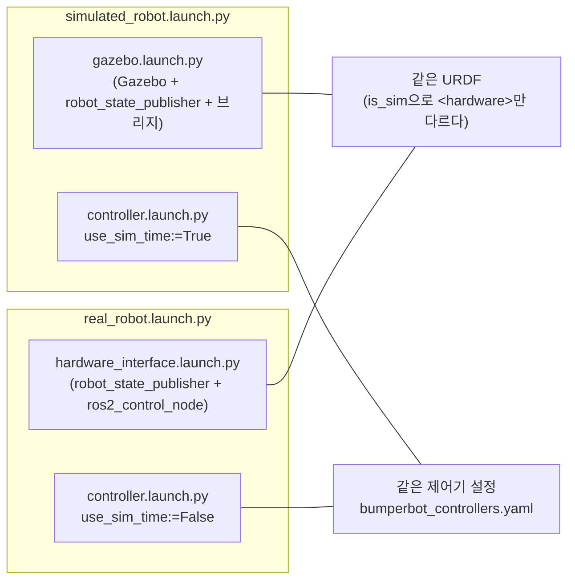
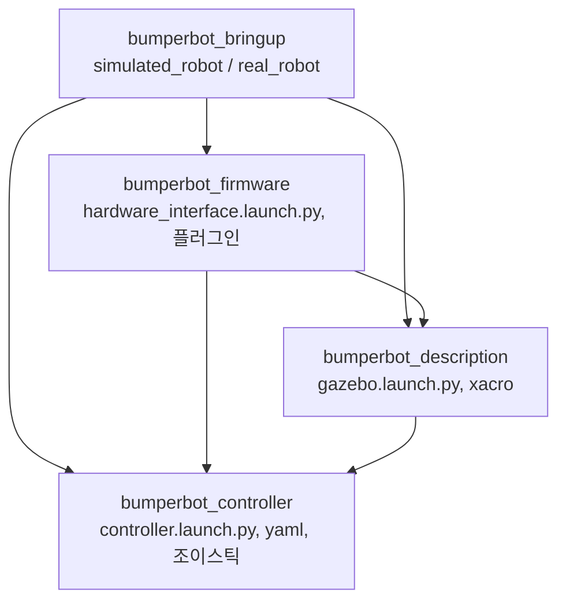

# 12. 실물 구성 띄우기와 bringup (저장소 Section12)

> 참조: `Section12_Build_the_Robot/bumperbot_ws/src/`의 `bumperbot_description/urdf/bumperbot.urdf.xacro`, `bumperbot_description/urdf/bumperbot_ros2_control.xacro`, `bumperbot_controller/config/bumperbot_controllers.yaml`, `bumperbot_controller/package.xml`, `bumperbot_firmware/launch/hardware_interface.launch.py`, `bumperbot_bringup/` (참조 저장소 최상위 기준 경로)

## 이 장에서 하는 일

이 장이 답하는 질문은 하나다. **시뮬레이션에서 돌던 제어기와 설정을 그대로 두고, 무엇을 바꾸면 실물 로봇으로 가는가.**

3장의 체크리스트(단계 8)에서 시뮬레이션과 실물이 갈리는 곳은 2번(하드웨어 플러그인)과 3번(`controller_manager`를 띄우는 주체)이었다. 2번은 11장에서 만들었다. 이 장은 그 플러그인을 URDF에 연결하고, 3번을 `ros2_control_node`로 채우고, 둘을 한 번에 띄우는 `bumperbot_bringup` 패키지를 만든다. 실물 아두이노가 없으므로 11장의 가짜 아두이노와 가상 시리얼 포트로 노트북에서 전체 경로를 확인한다.

| # | 필요한 것 | 시뮬레이션 | 실물 | 이 장에서 |
|---|---|---|---|---|
| 1 | URDF의 `<ros2_control>` 태그 | `bumperbot_ros2_control.xacro` | 같은 파일. `<hardware>` 한 블록만 다르다 | **단계 1**: `is_sim` 분기 |
| 2 | 하드웨어 플러그인 | `gz_ros2_control/GazeboSimSystem` | `bumperbot_firmware/BumperbotInterface` (11장) | **단계 1**: 이름을 연결 |
| 3 | `controller_manager`를 띄우는 주체 | Gazebo 안의 `gz_ros2_control` 플러그인 | `ros2_control_node` | **단계 3**: launch 파일 |
| 4 | 제어기 설정 yaml | `bumperbot_controllers.yaml` | **같은 파일** | **단계 2**: 둘이 함께 쓰도록 정리, **단계 4**: 어떻게 전달되는지 확인 |
| 5 | 제어기를 올리는 스포너 launch | `controller.launch.py` | **같은 파일**. `use_sim_time` 인자만 다르다 | **단계 4**, **단계 5** |
| 6 | `package.xml` 의존성과 설치 | 3장에서 완료 | 이 장에서 launch 설치와 실행 의존성 추가 | 단계 2, 3, 6 |



## 이번 장의 파일

```text
~/bumperbot_ws/src/
├── bumperbot_description/
│   └── urdf/
│       ├── bumperbot.urdf.xacro            [수정] is_sim, port 인자
│       └── bumperbot_ros2_control.xacro    [수정] <hardware>를 is_sim으로 가른다
├── bumperbot_controller/
│   ├── config/bumperbot_controllers.yaml   [수정] use_sim_time 삭제, 속도·가속 한계
│   └── package.xml                         [수정] ros2_control 의존성
├── bumperbot_firmware/
│   ├── CMakeLists.txt                      [수정] launch 설치
│   ├── package.xml                         [수정] launch가 쓰는 패키지
│   └── launch/
│       └── hardware_interface.launch.py    [새]
└── bumperbot_bringup/                      [새 패키지]
    ├── CMakeLists.txt                      [새]
    ├── LICENSE                             [새] (ros2 pkg create가 만든다)
    ├── package.xml                         [새]
    └── launch/
        ├── simulated_robot.launch.py       [새]
        └── real_robot.launch.py            [새]
```

`bumperbot_localization`은 이 장에서 바뀌지 않는다.

## 준비

- 11장까지 끝난 `~/bumperbot_ws`에서 이어서 한다. `bumperbot_description`(메시 폴더 포함), `bumperbot_controller`, `bumperbot_localization`, `bumperbot_firmware`가 빌드돼 있어야 하고, 11장의 `test/fake_arduino.py`와 `socat`이 있어야 한다.
- 이 장의 시험은 11장과 같은 가상 시리얼 포트를 쓴다. `/tmp/ttyV0`은 PC 쪽(ros2_control_node가 여는 쪽), `/tmp/ttyV1`은 아두이노 쪽(가짜 아두이노가 여는 쪽)이다. **LibSerial이 한 번 연 가상 포트는 다시 열 수 없다**(11장). 시험을 다시 시작할 때마다 socat을 `Ctrl+C`로 끝내고 새로 띄운다.
- 새 터미널을 처음 열 때마다 아래 두 줄을 먼저 친다. 이 장의 명령에서 "터미널 준비"라고 부른다.

```bash
source /opt/ros/jazzy/setup.bash
source ~/bumperbot_ws/install/setup.bash
```

- 코드를 고치고 다시 빌드한 뒤에는 이미 열어 둔 터미널에서도 `source ~/bumperbot_ws/install/setup.bash`를 다시 치는 것이 안전하다.
- 이 장의 실물 구성 시험은 터미널을 여섯 개까지 쓴다. 단계마다 필요한 것만 띄운다.

| 터미널 | 하는 일 |
|---|---|
| A | `socat`으로 가상 포트 한 쌍 |
| B | 가짜 아두이노 |
| C | `hardware_interface.launch.py`(단계 3~5). 단계 6에서는 `real_robot.launch.py`가 대신한다 |
| D | `controller.launch.py`(단계 4~5). 단계 6의 `real_robot.launch.py`는 제어기까지 함께 띄우므로 D를 따로 띄우지 않는다 |
| E | 확인 명령, 속도 명령 |
| F | 키보드 조종 |

- 이 장의 시험은 모두 서버 전용 Gazebo와 가상 시리얼로 했다. Gazebo 창과 RViz 창은 직접 보지 못했다. 아래 `simulated_robot.launch.py`는 창이 뜨는 원래 모양이다.

## 단계 1. xacro에서 시뮬레이션과 실물 가르기

### 왜 필요한가

URDF의 `<ros2_control>` 태그는 "바퀴 두 개가 어떤 인터페이스를 가진 하드웨어"인지(`<joint>` 블록)와 "그 하드웨어를 누가 구현했는지"(`<hardware><plugin>`)를 적는다. 3장에서 본 대로 앞의 것은 시뮬레이션이든 실물이든 같다. 달라지는 것은 `<plugin>` 한 줄이다.

- 시뮬레이션: `gz_ros2_control/GazeboSimSystem`. Gazebo의 `gz_ros2_control` 플러그인이 읽어 간다.
- 실물: `bumperbot_firmware/BumperbotInterface`와 `<param name="port">`. `ros2_control_node`의 resource manager가 pluginlib로 읽어 가고, `port` 값은 11장의 `on_init`이 `info_.hardware_parameters`에서 꺼낸다.

URDF를 두 벌 쓰지 않으려고 xacro의 **인자**를 쓴다. xacro는 URDF를 만들기 전에 실행되는 매크로 언어라서, 명령줄의 `is_sim:=false` 같은 값을 읽어 어느 블록을 URDF에 넣을지 정할 수 있다.

- `is_sim`: 기본값 `true`. 시뮬레이션을 띄우는 지금까지의 launch는 이 인자를 주지 않으므로 아무것도 바뀌지 않는다. 실물 launch가 `is_sim:=False`를 준다. 이 글자는 `false`와 `False` 모두 같게 읽힌다(단계 1의 설명).
- `port`: 기본값 `/dev/ttyUSB0`. **참조에는 없고 이 가이드가 더했다.** 참조는 `/dev/ttyUSB0`을 xacro에 고정해 적었다. 가상 시리얼 포트(`/tmp/ttyV0`)로 시험하려고 인자로 뺐다.

### 코드

`bumperbot.urdf.xacro`의 맨 위, `<robot>` 태그 바로 아래에 인자 둘을 선언한다. **블록 안의 `<!-- ... -->` 줄은 "원래 있던 줄을 그대로 둔다"는 뜻이다. 파일에 치지 않는다.** 이 장의 "수정" 블록에서 `# ...`와 `// ...`도 같은 뜻이다.

> 파일: `bumperbot_description/urdf/bumperbot.urdf.xacro` — 수정
```xml
<!-- ... -->
<robot name="bumperbot" xmlns:xacro="http://ros.org/wiki/xacro">

  <!-- Load Simulated or Real Hardware Interfaces -->
  <xacro:arg name="is_sim" default="true"/>

  <!-- Serial port of the Arduino on the real robot -->
  <xacro:arg name="port" default="/dev/ttyUSB0"/>

  <!-- Include Gazebo Parameters -->
  <xacro:include filename="$(find bumperbot_description)/urdf/bumperbot_gazebo.xacro" />

  <!-- Include ros2_control Plugins -->
  <xacro:include filename="$(find bumperbot_description)/urdf/bumperbot_ros2_control.xacro" />
<!-- ... -->
```

`bumperbot_ros2_control.xacro`는 `<hardware>` 블록을 둘로 나눈다. 파일 전체다.

> 파일: `bumperbot_description/urdf/bumperbot_ros2_control.xacro` — 전체
```xml
<?xml version="1.0"?>
<robot xmlns:xacro="http://www.ros.org/wiki/xacro" name="bumperbot">

    <ros2_control name="RobotSystem" type="system">

        <!-- ros2_control Gazebo -->
        <xacro:if value="$(arg is_sim)">
            <hardware>
                <plugin>gz_ros2_control/GazeboSimSystem</plugin>
            </hardware>
        </xacro:if>

        <!-- ros2_control Real Robot -->
        <xacro:unless value="$(arg is_sim)">
            <hardware>
                <plugin>bumperbot_firmware/BumperbotInterface</plugin>
                <param name="port">$(arg port)</param>
            </hardware>
        </xacro:unless>

        <!-- ros2_control Common Interfaces -->
        <joint name="wheel_left_joint">
            <command_interface name="velocity">
              <param name="min">-1</param>
              <param name="max">1</param>
            </command_interface>
            <state_interface name="position" />
            <state_interface name="velocity" />
        </joint>

        <joint name="wheel_right_joint">
            <command_interface name="velocity">
              <param name="min">-1</param>
              <param name="max">1</param>
            </command_interface>
            <state_interface name="position" />
            <state_interface name="velocity" />
        </joint>

    </ros2_control>

</robot>
```

### 코드 설명

- `<xacro:arg name="is_sim" default="true"/>`: xacro 인자를 선언한다. 값은 `xacro 파일 is_sim:=false`처럼 명령줄에서 오고, 없으면 `default`다. 인자는 **그 인자를 쓰는 파일을 include하기 전에** 선언해야 한다. include한 `bumperbot_ros2_control.xacro`가 `$(arg is_sim)`을 쓰기 때문에 두 줄이 include 위에 있다. 선언을 지우고 xacro를 돌리면 `error: Undefined substitution argument is_sim`으로 멈춘다.
- `<xacro:if value="$(arg is_sim)">`: 조건이 참일 때만 안쪽을 URDF에 넣는다. `<xacro:unless>`는 반대다. `$(arg is_sim)`은 인자의 글자(`true`, `false`, `True`, `False`)를 불리언으로 읽는다. 불리언이 아닌 글자(`maybe`)를 주면 `Xacro conditional "$(arg is_sim)" evaluated to "maybe", which is not a boolean expression.`로 멈춘다.
- `<param name="port">$(arg port)</param>`: `<hardware>` 안의 `<param>`은 `HardwareInfo`의 `hardware_parameters`에 키 `port`로 들어간다(11장 단계 7). 값 자리에도 `$(arg ...)`를 쓸 수 있다.
- `<joint>` 블록은 손대지 않았다. `wheel_left_joint`, `wheel_right_joint`와 `velocity` 명령, `position`·`velocity` 상태는 두 구성에서 같다. 11장의 플러그인이 조인트를 **이름으로** 찾으므로 이 이름이 바뀌면 안 된다. 위 블록에서 `<command_interface name="velocity">` 안의 `<param name="min">`·`max` ±1은 3장에서 둔 그대로다. 기본 설정에서는 이 한계가 강제되지 않는다(`ros2_control_node` 로그에 `Enforcing command limits is disabled. Command limits from URDF will be ignored.`가 나온다). 속도 한계는 제어기의 yaml이 정한다(단계 2).
- `bumperbot_gazebo.xacro`의 `<gazebo>` 블록(마찰, IMU, `gz_ros2_control` 플러그인)은 `is_sim`과 상관없이 URDF에 남는다. 실물에서는 아무도 읽지 않는다. `robot_state_publisher`와 `ros2_control_node`는 `<gazebo>` 태그를 무시한다(단계 3의 시험에서 경고 없이 도는 것으로 확인했다). 다만 이 파일의 `$(find bumperbot_controller)`는 실물에서도 xacro가 계산하므로 `bumperbot_controller` 패키지가 설치돼 있어야 xacro가 끝난다.
- `bumperbot_description`의 `package.xml`에는 `bumperbot_firmware` 의존성을 적지 않는다. URDF는 플러그인을 **이름 글자**로만 가리키고, `bumperbot_firmware`의 launch가 `bumperbot_description`을 쓰므로 반대로도 적으면 서로를 필요로 하는 순환이 생긴다. 둘을 함께 묶는 일은 단계 6의 `bumperbot_bringup`이 맡는다.

### 빌드와 시험

(새 터미널이면 "터미널 준비"를 먼저 한다.)

```bash
cd ~/bumperbot_ws
colcon build --symlink-install --packages-select bumperbot_description
source install/setup.bash
```

`--packages-select`라서 이 패키지 하나만 빌드된다. `Finished <<< bumperbot_description`이고 `--- stderr` 블록이 없어야 한다.

기본값(시뮬레이션)일 때와 실물일 때의 `<hardware>`를 비교한다.

```bash
xacro ~/bumperbot_ws/src/bumperbot_description/urdf/bumperbot.urdf.xacro | grep -A3 "<hardware>"
```

```text
    <hardware>
      <plugin>gz_ros2_control/GazeboSimSystem</plugin>
    </hardware>
    <!-- ros2_control Common Interfaces -->
```

```bash
xacro ~/bumperbot_ws/src/bumperbot_description/urdf/bumperbot.urdf.xacro is_sim:=false port:=/tmp/ttyV0 | grep -A3 "<hardware>"
```

```text
    <hardware>
      <plugin>bumperbot_firmware/BumperbotInterface</plugin>
      <param name="port">/tmp/ttyV0</param>
    </hardware>
```

`port`를 주지 않으면 기본값이 들어간다.

```bash
xacro ~/bumperbot_ws/src/bumperbot_description/urdf/bumperbot.urdf.xacro is_sim:=false | grep "name=\"port\""
```

```text
      <param name="port">/dev/ttyUSB0</param>
```

실물용 URDF가 올바른 URDF인지도 본다. `<gazebo>` 블록이 남아 있어도 `check_urdf`는 통과한다.

```bash
xacro ~/bumperbot_ws/src/bumperbot_description/urdf/bumperbot.urdf.xacro is_sim:=false port:=/tmp/ttyV0 > /tmp/bumperbot_real.urdf
check_urdf /tmp/bumperbot_real.urdf | head -3
```

```text
robot name is: bumperbot
---------- Successfully Parsed XML ---------------
root Link: base_footprint has 1 child(ren)
```

통과 조건: 기본값에서는 `GazeboSimSystem`, `is_sim:=false`에서는 `BumperbotInterface`와 `port` 값이 나온다. 시뮬레이션 쪽이 그대로 도는지는 단계 6에서 확인한다.

## 단계 2. yaml을 시뮬레이션과 실물이 함께 쓰도록 정리하기

### 왜 필요한가

제어기 설정 yaml(`bumperbot_controllers.yaml`)은 두 구성이 **같은 파일**을 읽는다. 시뮬레이션에서는 `bumperbot_gazebo.xacro`의 `<gazebo><plugin><parameters>`가 Gazebo 안의 `controller_manager`에 넘기고, 실물에서는 단계 3의 `ros2_control_node`가 launch의 `parameters`로 받는다. 시뮬레이션 전용으로 쓰던 줄이 있으면 실물에서 문제가 되므로 고친다. 참조 저장소도 Section12에서 같은 파일을 고쳤다(`diff -r`로 Section11과 비교했다).

두 가지가 바뀐다.

**1. `controller_manager`의 `use_sim_time: true`를 지운다.** 시뮬레이션에서는 Gazebo가 `/clock`을 내보내고 노드들이 그 시계를 따른다. 실물에는 `/clock`을 내는 것이 없다. 이 줄을 그대로 두고 실물 구성을 띄우면 `controller_manager`가 시뮬레이션 시계를 기다린다. 확인한 결과는 이렇다. `use_sim_time: true`가 든 yaml로 `ros2_control_node`를 띄우면 로그가 `Using ROS clock for triggering controller manager cycles.`로 바뀌고(원래는 `Using Steady (Monotonic) clock ...`), 하드웨어는 `active`이지만 시계가 흐르지 않아 `joint_state_broadcaster`를 올리려 하면 `Failed to activate controller : joint_state_broadcaster`로 실패한다. 반대로 시뮬레이션에서는 이 줄이 없어도 된다. 줄을 지운 yaml로 Gazebo를 띄웠을 때 `controller_manager`의 `use_sim_time`이 `True`였고 제어기도 정상으로 올라왔다(Gazebo 플러그인이 시뮬레이션 시계를 따로 설정하는 것으로 보인다. 그 부분의 코드는 읽지 못했다).

**2. 속도·가속도 한계 값을 바꾼다.** 참조는 Section12에서 이 값들을 바꿨다.

| 항목 | 참조 Section11 | 참조 Section12 (이 가이드 값) |
|---|---|---|
| `linear.x.max_velocity` | 1.0 | 0.7 |
| `linear.x.min_velocity` | -0.5 | -0.7 |
| `linear.x.max_acceleration` | 0.8 | 0.7 |
| `linear.x` 감속 (`min_acceleration` → 이 가이드는 `max_deceleration`) | -0.4 | -0.7 |
| `angular.z.max_velocity` | 1.7 | 8.5 |
| `angular.z.min_velocity` | (없음. 자동으로 `-max`) | -8.5 |
| `angular.z.max_acceleration` | 1.5 | 5.0 |
| `angular.z` 감속 | (없음) | -5.0 |

참조는 이 값을 바꾼 **이유를 적지 않았다**(저장소에서 확인하지 못했다). 값을 계산해 보면 한 가지가 보인다. 바퀴 지름 0.066 m(반지름 0.033 m), 바퀴 간격 0.17 m에서 선속도 한계 0.7 m/s는 바퀴 한 개가 `0.7 ÷ 0.033 ≈ 21 rad/s`로 도는 것이고, 각속도 한계 8.5 rad/s는 제자리 회전에서 바퀴 한 개가 `8.5 × 0.085 ÷ 0.033 ≈ 22 rad/s`로 도는 것이다. 두 한계가 비슷한 바퀴 속도에 해당한다. 실물 모터의 최대 속도에서 정했을 가능성이 있지만 **이 가이드는 확인하지 못했다.** 직진과 회전을 최대로 섞어도 바퀴는 `(0.7 + 8.5 × 0.085) ÷ 0.033 ≈ 43 rad/s`로, 11장에서 본 아두이노 규약의 한계(100 rad/s 미만)보다 낮다. 이 값은 계산이고 시험으로 재지 않았다.

3장·5장의 yaml처럼 이 파일은 Jazzy의 `diff_drive_controller`(4.43.1) 이름을 쓴다. 참조의 `min_acceleration`은 `max_deceleration`(음수)으로 적고, 한계를 켜는 `has_*_limits` 줄은 없다.

### 코드

`bumperbot_controllers.yaml`에서 바뀌는 곳은 두 군데다. 위쪽 `controller_manager` 블록에서 `use_sim_time: true` 줄을 **지운다**. 아래쪽 한계 값은 다음 모양이 된다.

> 파일: `bumperbot_controller/config/bumperbot_controllers.yaml` — 수정
```yaml
controller_manager:
  ros__parameters:
    update_rate: 100 # Hz

    bumperbot_controller:
      type: diff_drive_controller/DiffDriveController
# ...
    # Velocity and acceleration limits
    # Whenever a min_* is unspecified, default to -max_*
    linear:
      x:
        max_velocity           : 0.7  # m/s
        min_velocity           : -0.7 # m/s
        max_acceleration       : 0.7  # m/s^2
        max_deceleration       : -0.7 # m/s^2
    angular:
      z:
        max_velocity           : 8.5  # rad/s
        min_velocity           : -8.5 # rad/s
        max_acceleration       : 5.0  # rad/s^2
        max_deceleration       : -5.0 # rad/s^2
# ...
```

`package.xml`에는 `ros2_control`을 더한다. 참조가 Section12에서 같은 줄을 더했다.

> 파일: `bumperbot_controller/package.xml` — 수정
```xml
<!-- ... -->
  <exec_depend>controller_manager</exec_depend>
  <exec_depend>ros2_control</exec_depend>
<!-- ... -->
```

### 코드 설명

- `ros2_control`은 메타패키지다. 설치된 `package.xml`을 읽으면 `controller_manager`, `controller_interface`, `hardware_interface`, `controller_manager_msgs`, `ros2controlcli` 같은 패키지를 묶는다. 이 장에서 쓰는 `ros2 control ...` 명령은 `ros2controlcli` 패키지의 것이다. 참조는 이 줄을 더한 이유를 적지 않았다. 위 목록으로 보아 실물 구성에 필요한 패키지(`ros2_control_node`는 `controller_manager`, `ros2 control` 명령은 `ros2controlcli`)를 한 번에 의존성으로 거는 것으로 읽힌다(추정).
- 한계 값에서 "`min_*`를 적지 않으면 `-max_*`가 된다"는 규칙이 있다(5장). 이번에는 참조가 `min_velocity`와 감속 값을 모두 적으므로 이 가이드도 모두 적었다.

### 빌드와 시험

(새 터미널이면 "터미널 준비"를 먼저 한다.)

```bash
cd ~/bumperbot_ws
colcon build --symlink-install --packages-select bumperbot_controller
source install/setup.bash
```

`Finished <<< bumperbot_controller`이고 `--- stderr` 블록이 없어야 한다. yaml이 문법에 맞는지와 바뀐 값을 읽어 본다.

```bash
python3 -c "
import os, yaml
d = yaml.safe_load(open(os.path.expanduser('~/bumperbot_ws/install/bumperbot_controller/share/bumperbot_controller/config/bumperbot_controllers.yaml')))
print(sorted(d['controller_manager']['ros__parameters']))
print(d['bumperbot_controller']['ros__parameters']['linear']['x']['max_velocity'])
print(d['bumperbot_controller']['ros__parameters']['angular']['z']['max_velocity'])
"
```

```text
['bumperbot_controller', 'joint_state_broadcaster', 'simple_velocity_controller', 'update_rate']
0.7
8.5
```

첫 줄에 `use_sim_time`이 없어야 한다. 이 값들이 실제 제어기에 적용되는지는 단계 4에서, 시뮬레이션이 이 yaml로 그대로 도는지는 단계 6에서 확인한다.

## 단계 3. `hardware_interface.launch.py`: 실물의 controller_manager 띄우기

### 왜 필요한가

시뮬레이션에서는 Gazebo가 `gz_ros2_control` 플러그인으로 `controller_manager`를 자기 프로세스 안에 만들었다. 실물에는 Gazebo가 없으므로 `controller_manager` 패키지의 실행 파일 **`ros2_control_node`**가 그 일을 한다. 이 노드는 `controller_manager` 노드(이름 `controller_manager`) 하나를 만들고 제어 루프를 돌린다. 그런데 이 노드는 혼자서 URDF를 모른다. URDF를 어디서 받는지 확인한 결과는 이렇다.

- `ros2_control_node`는 URDF를 **`/robot_description` 토픽**에서 받는다. 로그에 `Subscribing to '/robot_description' topic for robot description.`, 이어서 `Received robot description from topic.`이 나온다. Gazebo 안의 `controller_manager`와 같은 방식이다.
- `robot_description`을 **파라미터로 줘도 무시한다.** 파라미터만 주고 `robot_state_publisher`가 없으면 `Waiting for data on 'robot_description' topic to finish initialization` 경고만 1초마다 반복된다. 참조의 `hardware_interface.launch.py`는 파라미터로도 주는데, 같은 launch의 `robot_state_publisher`가 같은 이름의 토픽을 내서 동작할 뿐이다. 이 가이드는 `ros2_control_node`에는 **yaml 파일만 주고** URDF는 `robot_state_publisher`에만 준다.

그래서 launch 파일이 띄울 것은 둘이다.

1. `robot_state_publisher`: xacro를 `is_sim:=False`와 `port:=...`로 풀어서 `/robot_description` 토픽으로 내보낸다. TF도 만든다.
2. `ros2_control_node`: 위 토픽에서 URDF를 받아 `<ros2_control>` 태그를 읽고 플러그인을 불러온다. 제어기 설정 yaml은 launch의 `parameters`로 준다.

launch 파일은 11장에서 만든 `bumperbot_firmware` 패키지에 둔다(참조와 같다). 이 launch가 `bumperbot_description`(xacro)과 `bumperbot_controller`(yaml)를 쓴다.

### 코드

`launch/` 폴더를 만든다.

```bash
mkdir -p ~/bumperbot_ws/src/bumperbot_firmware/launch
```

> 파일: `bumperbot_firmware/launch/hardware_interface.launch.py` — 전체
```python
import os
from launch import LaunchDescription
from launch.actions import DeclareLaunchArgument
from launch.substitutions import Command, LaunchConfiguration
from launch_ros.actions import Node
from launch_ros.parameter_descriptions import ParameterValue
from ament_index_python.packages import get_package_share_directory


def generate_launch_description():
    port_arg = DeclareLaunchArgument(
        "port",
        default_value="/dev/ttyUSB0",
        description="Serial port of the Arduino",
    )

    robot_description = ParameterValue(
        Command(
            [
                "xacro ",
                os.path.join(
                    get_package_share_directory("bumperbot_description"),
                    "urdf",
                    "bumperbot.urdf.xacro",
                ),
                " is_sim:=False",
                " port:=",
                LaunchConfiguration("port"),
            ]
        ),
        value_type=str,
    )

    robot_state_publisher_node = Node(
        package="robot_state_publisher",
        executable="robot_state_publisher",
        parameters=[{"robot_description": robot_description}],
    )

    controller_manager = Node(
        package="controller_manager",
        executable="ros2_control_node",
        parameters=[
            os.path.join(
                get_package_share_directory("bumperbot_controller"),
                "config",
                "bumperbot_controllers.yaml",
            ),
        ],
    )

    return LaunchDescription(
        [
            port_arg,
            robot_state_publisher_node,
            controller_manager,
        ]
    )
```

`CMakeLists.txt`에는 launch 폴더를 설치하는 줄을 더한다.

> 파일: `bumperbot_firmware/CMakeLists.txt` — 수정
```cmake
# ...
install(
  TARGETS ${PROJECT_NAME}
  DESTINATION lib
)

install(
  DIRECTORY include/
  DESTINATION include
)

install(
  DIRECTORY launch
  DESTINATION share/${PROJECT_NAME}
)
# ...
```

`package.xml`에는 이 launch가 쓰는 패키지를 실행 의존성으로 적는다.

> 파일: `bumperbot_firmware/package.xml` — 수정
```xml
<!-- ... -->
  <depend>libserial-dev</depend>

  <exec_depend>ros2launch</exec_depend>
  <exec_depend>xacro</exec_depend>
  <exec_depend>robot_state_publisher</exec_depend>
  <exec_depend>controller_manager</exec_depend>
  <exec_depend>bumperbot_description</exec_depend>
  <exec_depend>bumperbot_controller</exec_depend>
<!-- ... -->
```

### 코드 설명

launch 파일

- `DeclareLaunchArgument("port", default_value="/dev/ttyUSB0")`: launch 인자 `port`. `ros2 launch ... port:=/tmp/ttyV0`로 바꾼다. 기본값은 단계 1의 xacro와 같다.
- `Command(["xacro ", 경로, " is_sim:=False", " port:=", LaunchConfiguration("port")])`: `xacro` 명령을 실행하고 출력(URDF 문자열)을 값으로 쓴다. 리스트의 원소를 이어 붙여 한 줄 명령이 되고, `LaunchConfiguration("port")`는 launch 인자의 값으로 바뀐다. 각 조각 앞의 공백(`" is_sim:=False"`)은 명령줄에서 인자를 나누려고 적은 것이다.
- `ParameterValue(..., value_type=str)`: 값이 문자열임을 알려 준다. 이것이 없으면 launch가 URDF를 YAML처럼 해석하려 한다.
- `is_sim:=False`: 단계 1의 xacro가 실물 `<hardware>` 블록을 고르게 한다.
- `robot_state_publisher` 노드: `{"robot_description": robot_description}`만 준다. 참조도 이 노드에는 `robot_description`만 준다.
- `ros2_control_node`: `parameters=[yaml 경로]`. 참조는 여기에 `robot_description` 파라미터와 `"use_sim_time": False`도 같이 줬다. 이 가이드는 둘 다 뺐다(앞의 것은 무시되고, 뒤의 것은 `use_sim_time`의 기본값이 이미 `False`라서 같다). 이 파일의 `controller_manager.ros__parameters`가 `ros2_control_node`의 파라미터가 된다. 제어기 블록(`bumperbot_controller:` 등)은 노드 이름이 다르므로 이 노드가 아니라 제어기 노드의 것이다. 어떻게 제어기에 닿는지는 단계 4에서 확인한다.
- `get_package_share_directory("bumperbot_controller")`: 설치된 패키지의 `share` 폴더 경로. 이 launch는 **설치본**을 읽으므로 `colcon build`를 다시 하기 전에는 yaml을 고친 것이 반영되지 않는다(`--symlink-install`이면 심볼릭 링크라서 바로 반영된다).
- 노드를 띄울 때 `output` 인자를 주지 않아도 로그가 터미널에 `[ros2_control_node-2] ...`처럼 접두사가 붙어 나온다.

`CMakeLists.txt`, `package.xml`

- `install(DIRECTORY launch DESTINATION share/${PROJECT_NAME})`: `ros2 launch bumperbot_firmware ...`가 `install/bumperbot_firmware/share/bumperbot_firmware/launch/`에서 파일을 찾는다. 이 줄이 없으면 `file '...launch.py' was not found in the share directory of package 'bumperbot_firmware'`로 실패한다.
- `<exec_depend>`: `ros2launch`(`ros2 launch` 명령), `xacro`, `robot_state_publisher`, `controller_manager`(`ros2_control_node`), 그리고 launch가 파일을 읽어 가는 `bumperbot_description`, `bumperbot_controller`. `bumperbot_firmware`가 이 둘에 의존하는 방향이고, 둘은 `bumperbot_firmware`를 모르므로 순환이 없다.

### 빌드와 시험

(새 터미널이면 "터미널 준비"를 먼저 한다.)

```bash
cd ~/bumperbot_ws
colcon build --symlink-install --packages-select bumperbot_firmware
source install/setup.bash
```

`Finished <<< bumperbot_firmware`이고 `--- stderr` 블록이 없어야 한다. launch 인자를 확인한다.

```bash
ros2 launch bumperbot_firmware hardware_interface.launch.py --show-args
```

```text
Arguments (pass arguments as '<name>:=<value>'):

    'port':
        Serial port of the Arduino
        (default: '/dev/ttyUSB0')
```

**시험 1: 아두이노(가짜)가 있을 때.** 터미널 A에서 socat을 띄운다. 끝나지 않는다.

```bash
socat -d -d pty,raw,echo=0,link=/tmp/ttyV0 pty,raw,echo=0,link=/tmp/ttyV1
```

터미널 B에서 가짜 아두이노를 아두이노 쪽 포트에 붙인다(터미널 준비는 필요 없다). 끝나지 않는다.

```bash
python3 ~/bumperbot_ws/src/bumperbot_firmware/test/fake_arduino.py /tmp/ttyV1
```

터미널 C(터미널 준비)에서 launch를 띄운다. 끝나지 않는다.

```bash
ros2 launch bumperbot_firmware hardware_interface.launch.py port:=/tmp/ttyV0
```

기대 결과. 터미널 C에서 `[ros2_control_node-2]` 접두사가 붙은 줄 중 생명주기와 관련된 것만 줄이면 다음 순서다(`[INFO] [...]` 뒤 숫자는 시각이라 실행마다 다르다).

```text
[ros2_control_node-2] [INFO] [...] [controller_manager]: Subscribing to '/robot_description' topic for robot description.
[ros2_control_node-2] [INFO] [...] [controller_manager]: Received robot description from topic.
[ros2_control_node-2] [INFO] [...] [controller_manager]: Loading hardware 'RobotSystem'
[ros2_control_node-2] [INFO] [...] [controller_manager]: Loaded hardware 'RobotSystem' from plugin 'bumperbot_firmware/BumperbotInterface'
[ros2_control_node-2] [INFO] [...] [controller_manager]: Initialize hardware 'RobotSystem'
[ros2_control_node-2] [INFO] [...] [controller_manager]: Successful initialization of hardware 'RobotSystem'
[ros2_control_node-2] [INFO] [...] [resource_manager]: 'configure' hardware 'RobotSystem'
[ros2_control_node-2] [INFO] [...] [controller_manager.hardware_component.system.RobotSystem]: Configuring robot hardware ...
[ros2_control_node-2] [INFO] [...] [controller_manager.hardware_component.system.RobotSystem]: Port /tmp/ttyV0 opened
[ros2_control_node-2] [INFO] [...] [resource_manager]: 'activate' hardware 'RobotSystem'
[ros2_control_node-2] [INFO] [...] [controller_manager.hardware_component.system.RobotSystem]: Starting robot hardware ...
[ros2_control_node-2] [INFO] [...] [controller_manager.hardware_component.system.RobotSystem]: Hardware started, ready to take commands
[ros2_control_node-2] [INFO] [...] [controller_manager]: Resource Manager has been successfully initialized. Starting Controller Manager services...
```

`[ros2_control_node-2]`의 `-2` 같은 번호는 launch가 노드에 붙인 순서라서 구성에 따라 달라질 수 있다. 각 줄이 11장의 어느 코드에서 나오는지 대응된다. `Loaded hardware ... from plugin ...`은 pluginlib가 플러그인을 찾아 읽었다는 뜻이다(11장 단계 10). `Initialize`는 `on_init`(단계 7), `'configure'`와 `Port ... opened`는 `on_configure`(단계 8), `'activate'`와 `Hardware started`는 `on_activate`다. 기본 설정에서 `ros2_control_node`는 시작할 때 `configure`와 `activate`를 모두 한다. 그 밖에 `Could not enable FIFO RT scheduling policy ... Operation not permitted` 경고가 한 줄 나온다. 실시간 스케줄링 권한이 없는 일반 환경에서 나오는 경고이고 시험에는 영향이 없다.

터미널 E(터미널 준비)에서 상태를 본다.

```bash
ros2 node list
ros2 control list_hardware_components
ros2 control list_hardware_interfaces
```

```text
/controller_manager
/robot_state_publisher
/robotsystem
```

```text
Hardware Component 1
	name: RobotSystem
	type: system
	plugin name: bumperbot_firmware/BumperbotInterface
	state: id=3 label=active
	read/write rate: 100 Hz
	is_async: False
	command interfaces
		wheel_right_joint/velocity [available] [unclaimed]
		wheel_left_joint/velocity [available] [unclaimed]
```

```text
command interfaces
	wheel_left_joint/velocity [available] [unclaimed]
	wheel_right_joint/velocity [available] [unclaimed]
state interfaces
	wheel_left_joint/position
	wheel_left_joint/velocity
	wheel_right_joint/position
	wheel_right_joint/velocity
```

- `/robotsystem`은 하드웨어 컴포넌트가 만든 노드다. 이름은 `<ros2_control name="RobotSystem">`을 소문자로 바꾼 것이다. 이 플러그인은 이 노드를 쓰지 않는다(파라미터 서비스만 있다).
- `state: id=3 label=active`, `read/write rate: 100 Hz`: 하드웨어가 활성이고, yaml의 `update_rate: 100`으로 `read`/`write`가 100 Hz로 불린다.
- `type`과 `plugin name`이 채워진 것은 5장의 시뮬레이션 출력과 다르다. Gazebo 안의 `controller_manager`에서는 이 둘이 비어 있고 rate가 `0 Hz`로 나온다(단계 7에 두 출력을 나란히 놓는다).
- 인터페이스가 나열되는 순서(`wheel_right_joint`가 먼저인지 `wheel_left_joint`가 먼저인지)는 실행마다 다를 수 있다.
- 명령 인터페이스는 아직 `[unclaimed]`다. 제어기가 점유하지 않았기 때문이다(단계 4).
- 상태 인터페이스 4개는 11장 단계 7에서 검사한 이름이다.

통과 조건: 로그의 생명주기 순서가 위와 같고, `state: id=3 label=active`와 `read/write rate: 100 Hz`가 나온다. 시험 1이 끝나면 터미널 C를 `Ctrl+C`로 끝낸다(`'deactivate'`와 `'shutdown'`이 로그에 남고 가짜 아두이노에 정지 명령이 가며, `Port /tmp/ttyV0 closed`가 찍힌다). 터미널 B와 A도 끝낸다.

**시험 2: 포트가 없을 때.** socat과 가짜 아두이노 없이 launch만 띄운다. 터미널 C(터미널 준비):

```bash
ros2 launch bumperbot_firmware hardware_interface.launch.py port:=/tmp/ttyV0
```

기대 결과(줄여서):

```text
[ros2_control_node-2] [FATAL] [...] [controller_manager.hardware_component.system.RobotSystem]: Something went wrong while interacting with port /tmp/ttyV0: Bad file descriptor (does the device exist, and is no other program using it?)
[ros2_control_node-2] [ERROR] [...] [resource_manager]: Failed to 'configure' hardware 'RobotSystem'
[ros2_control_node-2] terminate called after throwing an instance of 'std::runtime_error'
[ros2_control_node-2]   what():  Failed to set the initial state of the component : RobotSystem to active
[ERROR] [ros2_control_node-2]: process has died [pid ..., exit code -6, cmd '/opt/ros/jazzy/lib/controller_manager/ros2_control_node --ros-args --params-file ...']
```

11장 단계 8의 설계 그대로다. `on_configure`가 포트를 열지 못해 `FAILURE`를 돌려주고, 기본 설정에서는 `ros2_control_node`가 끝난다. yaml의 `controller_manager.ros__parameters.hardware_components_initial_state.shutdown_on_initial_state_failure`가 기본값 `true`이기 때문이다(`false`로 두면 노드가 살아남는다. 11장 단계 8). `robot_state_publisher`는 살아 있어 launch는 계속 떠 있으므로 `Ctrl+C`로 끝낸다. 이 시험은 "포트 경로", "socat", "가짜 아두이노"를 확인하라는 신호를 읽는 연습이다.

## 단계 4. 제어기 올리기와 파라미터 전달

### 왜 필요한가

단계 3의 `controller_manager`는 제어기가 없는 빈 상태다. 시뮬레이션에서 쓰던 `controller.launch.py`로 `joint_state_broadcaster`와 `bumperbot_controller`(`diff_drive_controller`)를 올린다. **이 파일은 고치지 않는다.** 스포너는 `controller_manager`의 서비스를 부르는 일반 프로그램이고, 그 `controller_manager`가 Gazebo 안에 있는지 `ros2_control_node`인지 알지 못한다. `--controller-manager /controller_manager`가 노드 이름으로 찾는다.

고치지 않는 것은 한 군데를 빼고 맞다. `controller.launch.py`는 `use_sim_time` 인자를 가지고 기본값이 `True`다. 실물 구성에서는 `False`를 줘야 한다. 이유는 아래 "`use_sim_time`을 빠뜨리면"에서 본다.

또 하나 확인할 것이 있다. 제어기의 파라미터(`wheel_radius`, 속도 한계 등)가 어디서 오는가이다. 시뮬레이션에서는 Gazebo 플러그인의 `<parameters>`가 yaml을 `controller_manager`에 넘기고 스포너에는 파일을 주지 않았다. 실물에서도 스포너에 `--param-file`을 줘야 하는가?

### 코드

바꾸는 코드는 없다. 명령만 다르다. 터미널 A, B, C를 단계 3 시험 1처럼 띄운다(socat, 가짜 아두이노, `hardware_interface.launch.py port:=/tmp/ttyV0`. 이전 시험의 socat은 끝내고 새로 띄운다). 터미널 D(터미널 준비)에서 제어기를 올린다. 이 launch는 스포너를 띄우고 끝나지 않는다.

```bash
ros2 launch bumperbot_controller controller.launch.py use_simple_controller:=False use_sim_time:=False
```

### 빌드와 시험

기대 결과. 터미널 D(줄여서):

```text
[spawner-2] [INFO] [...] [spawner_bumperbot_controller]: waiting for service /controller_manager/list_controllers to become available...
[spawner-2] [INFO] [...] [spawner_bumperbot_controller]: Loaded bumperbot_controller
[spawner-2] [INFO] [...] [spawner_bumperbot_controller]: Configured and activated bumperbot_controller
[spawner-1] [INFO] [...] [spawner_joint_state_broadcaster]: Loaded joint_state_broadcaster
[spawner-1] [INFO] [...] [spawner_joint_state_broadcaster]: Configured and activated joint_state_broadcaster
[noisy_controller-3] [INFO] [...] [noisy_controller]: Using wheel radius 0.038
```

(`noisy_controller`는 8장에서 만든 노드다. 이 launch가 항상 함께 띄운다. 반지름과 간격에 일부러 오차를 더한 값이 로그에 나온다.)

터미널 E(터미널 준비)에서 확인한다.

```bash
ros2 control list_controllers
ros2 control list_hardware_interfaces
```

```text
joint_state_broadcaster joint_state_broadcaster/JointStateBroadcaster  active
bumperbot_controller    diff_drive_controller/DiffDriveController      active
```

```text
command interfaces
	bumperbot_controller/angular/velocity [available] [unclaimed]
	bumperbot_controller/linear/velocity [available] [unclaimed]
	wheel_left_joint/velocity [available] [claimed]
	wheel_right_joint/velocity [available] [claimed]
state interfaces
	wheel_left_joint/position
	wheel_left_joint/velocity
	wheel_right_joint/position
	wheel_right_joint/velocity
```

(제어기 순서는 실행마다 다를 수 있다.) 바퀴의 두 명령 인터페이스가 `[claimed]`가 됐다. `diff_drive_controller`가 점유했다.

### 제어기 파라미터는 어디서 오는가

스포너를 보면 `--param-file`이 없다. 그런데 제어기는 올라왔다. 제어기의 파라미터가 실제로 yaml 값인지 읽어 본다.

```bash
ros2 param get /bumperbot_controller wheel_radius
ros2 param get /bumperbot_controller wheel_separation
ros2 param get /bumperbot_controller linear.x.max_velocity
ros2 param get /bumperbot_controller angular.z.max_velocity
```

```text
Double value is: 0.033
Double value is: 0.17
Double value is: 0.7
Double value is: 8.5
```

yaml에 적은 값이다(단계 2에서 바꾼 `0.7`, `8.5`도 적용됐다). 답은 `ros2_control_node`의 로그에 있다. 터미널 C에서 제어기를 올릴 때 이 줄이 나온다.

```text
[ros2_control_node-2] [INFO] [...] [controller_manager]: Controller 'bumperbot_controller' node arguments: --ros-args --params-file /home/.../install/bumperbot_controller/share/bumperbot_controller/config/bumperbot_controllers.yaml
```

**`controller_manager`가 제어기 노드를 만들 때, 자기가 받은 yaml 파일(`--params-file`)을 제어기 노드의 인자로 그대로 넘긴다.** `joint_state_broadcaster`도 같은 줄이 나온다(확인했다). 그래서 다음이 성립한다.

- `ros2_control_node`에 yaml을 한 번 주면(단계 3의 launch) 그 yaml 안의 **모든** 제어기 블록(`bumperbot_controller:`, `simple_velocity_controller:` 등)이 해당 제어기에 적용된다. 스포너에 `--param-file`을 줄 필요가 없다. 시뮬레이션에서 `<gazebo><plugin><parameters>`가 하는 일과 같다.
- 스포너의 `--param-file`은 "이 제어기에만 다른 파일을 더 적용하고 싶을 때" 쓰는 선택 사항이다. 이 가이드는 쓰지 않는다.
- 이 사실은 v5 로봇에서 설정을 구성할 때(13장) 쓴다. 제어기 설정은 `controller_manager`가 받는 yaml **하나**에 모으면 된다.

### 직진과 회전: 좌우가 맞는가

속도 명령을 보내서 가짜 아두이노가 받는 글자를 본다. 11장에서 조인트를 이름으로 찾도록 고친 이유가 이 시험에서 확인된다. 터미널 B(가짜 아두이노)의 출력이 시험 대상이다. 터미널 E에서 직진 명령을 5초 동안 보낸다. 보내고 끝난다.

```bash
ros2 topic pub -r 10 -t 50 /bumperbot_controller/cmd_vel geometry_msgs/msg/TwistStamped "{twist: {linear: {x: 0.1}}}"
```

기대 결과. 터미널 B(차례로 속도가 올라간다. 마지막 값은 `0.1 ÷ 0.033 ≈ 3.03 rad/s`다):

```text
cmd  right=+0.21  left=+0.21 rad/s
cmd  right=+0.42  left=+0.42 rad/s
...
cmd  right=+3.03  left=+3.03 rad/s
```

명령을 멈추면 `cmd_vel_timeout`(0.5초) 뒤에 제어기가 스스로 멈추고 `cmd  right=+0.00  left=+0.00 rad/s`까지 줄어든다. 터미널 C에 `Velocity command timed out. Braking.`이 나온다. 5초 동안 명령을 보냈으므로 로봇이 약 0.5 m 앞으로 갔다. 터미널 E에서 읽는다(끝난 뒤 바로 읽는다).

```bash
ros2 topic echo --once --field pose.pose.position /bumperbot_controller/odom
```

```text
x: 0.5...
y: 0.0
z: 0.0
---
```

(`x`는 `0.5`보다 조금 크게 나온다. 정지에서 출발하는 가속은 거리를 조금 줄이지만, 마지막 명령 뒤 `cmd_vel_timeout`(0.5초) 동안 마지막 속도가 유지되고 그 뒤 감속하면서 더 가기 때문이다. `0.1 m/s × 0.5초 ≈ 0.05 m`쯤이다. 이 가이드를 쓸 때의 값은 `0.53`~`0.54`였고 통과 조건이 아니다. 실행마다 다르다.) 같은 속도로 직진할 때 두 바퀴의 값이 **같다**. 이번에는 제자리 회전이다. 터미널 E:

```bash
ros2 topic pub -r 10 -t 30 /bumperbot_controller/cmd_vel geometry_msgs/msg/TwistStamped "{twist: {angular: {z: 0.5}}}"
```

터미널 B(마지막 값은 `0.5 × 0.085 ÷ 0.033 ≈ 1.29 rad/s`다):

```text
cmd  right=+0.90  left=-0.90 rad/s
cmd  right=+1.03  left=-1.03 rad/s
cmd  right=+1.16  left=-1.16 rad/s
cmd  right=+1.29  left=-1.29 rad/s
```

반시계 회전(`angular.z > 0`)에서 오른쪽 바퀴는 앞으로, 왼쪽 바퀴는 뒤로 간다. 부호가 반대이고 크기가 같다. 이 부호가 맞는 이유는 `diff_drive_controller`가 `wheel_left_joint`와 `wheel_right_joint`라는 **이름**으로 명령을 쓰고, 11장의 플러그인이 그 이름으로 `r`과 `l` 자리를 찾아 글자를 만들기 때문이다. 참조 플러그인은 조인트를 순서로 가정해서 이 시험에서 좌우가 뒤바뀐다(11장 단계 7).

상태와 TF도 본다. 터미널 E:

```bash
ros2 topic echo --once /joint_states
ros2 run tf2_ros tf2_echo odom base_footprint
```

```text
name:
- wheel_left_joint
- wheel_right_joint
position:
- ...
- ...
velocity:
- ...
- ...
effort:
- .nan
- .nan
```

`/joint_states`의 `position`은 11장의 플러그인이 속도를 적분해 만든 값이고, `effort`는 이 로봇에 effort 인터페이스가 없어서 `nan`이다. `tf2_echo`는 끝나지 않으니 몇 초 뒤 `Ctrl+C`로 끝낸다.

```text
At time 1795246646.651156595
- Translation: [0.540, 0.000, 0.000]
- Rotation: in Quaternion (xyzw) [0.000, 0.000, 0.754, 0.657]
...
```

(`At time`은 현재 시각, 값은 실행마다 다르다.) `odom → base_footprint`가 시각 스탬프와 함께 갱신되고 있다. 스탬프가 실제 시각이다.

### 키보드로 조종하기

5장의 키보드 조종을 실물 구성에서도 그대로 쓴다. 한 가지가 다르다. 시뮬레이션에서는 `-p use_sim_time:=true`가 필요했다. 키보드 노드가 명령의 `header.stamp`를 자기 시계로 찍고, 제어기는 시뮬레이션 시각으로 명령의 나이를 재기 때문이다. 실물 구성에서는 제어기와 키보드 노드가 모두 실제 시각을 쓰므로 이 인자가 필요 없다. 위에서 올린 구성(터미널 A~D, `use_sim_time:=False`)이 떠 있는 상태에서 터미널 F(터미널 준비)에 띄운다. 끝나지 않는다.

```bash
ros2 run teleop_twist_keyboard teleop_twist_keyboard --ros-args -r cmd_vel:=/bumperbot_controller/cmd_vel -p stamped:=true
```

```text
This node takes keypresses from the keyboard and publishes them
as Twist/TwistStamped messages. It works best with a US keyboard layout.
...
currently:	speed 0.50	turn 1.00
```

이 터미널이 선택(focus)된 상태에서 `i`를 계속 누르면 터미널 B에서 `cmd  right=...  left=...`가 올라가고, `k`를 누르면 0으로 내려간다. 이 가이드를 쓸 때는 키 입력을 가상 터미널로 흉내 내어 확인했다(`i`를 0.1초마다 3초 동안 보내고 `k`로 정지: 가짜 아두이노가 받은 값이 올라갔다가 0으로 내려갔다). 키를 직접 누르는 시험은 사용자가 한다. 실제 키보드에서는 키를 처음 누른 뒤 키 반복이 시작되기까지 지연이 있어서, 그 사이 명령이 끊기고 `cmd_vel_timeout`(0.5초)과 겹치면 로봇이 잠깐 멈췄다가 다시 가는 것처럼 보일 수 있다. 이것은 추정이고 직접 확인하지 못했다. 끝낼 때는 터미널 F에서 `Ctrl+C`를 누른다.

### `use_sim_time`을 빠뜨리면 (따로 하는 실험)

참조의 `real_robot.launch.py`는 `controller.launch.py`에 `use_sim_time`을 넘기지 않는다. 그러면 기본값 `True`가 `noisy_controller`에 들어간다. 이 실험은 **지금까지의 구성을 모두 끝내고 따로** 한다. 터미널 F와 E의 명령을 끝내고 터미널 D, C, B, A도 `Ctrl+C`로 끝낸다. 그 뒤 터미널 A, B, C를 단계 3 시험 1처럼 새로 띄운다(socat부터 새로. 제어기가 이미 올라온 `controller_manager`에 다시 올리면 실패한다. 아래 "자주 나는 오류"). 터미널 D에서 `use_sim_time:=False` **없이** 제어기를 올린다.

```bash
ros2 launch bumperbot_controller controller.launch.py use_simple_controller:=False
```

터미널 E(터미널 준비)에서 직진 명령을 5초 동안 보낸다(보내고 끝난다). 로봇이 움직여야 `odom_noisy`와 TF에 값이 생긴다.

```bash
ros2 topic pub -r 10 -t 50 /bumperbot_controller/cmd_vel geometry_msgs/msg/TwistStamped "{twist: {linear: {x: 0.1}}}"
```

이어서 본다. 마지막 명령은 끝나지 않으니 몇 초 뒤 `Ctrl+C`로 끝낸다.

```bash
ros2 param get /noisy_controller use_sim_time
ros2 topic echo --once --field header.stamp /bumperbot_controller/odom_noisy
ros2 run tf2_ros tf2_echo odom base_footprint_noisy
```

```text
Boolean value is: True
```

```text
sec: 0
nanosec: 0
---
```

```text
At time 0.0
- Translation: [0.608, 0.039, 0.000]
```

(`Translation`의 값은 실행마다 다르다. 직진 명령을 보낸 뒤라서 `x`가 0이 아니고, `y`는 `noisy_controller`가 일부러 넣은 오차 때문에 0이 아니다.)

- 실물에는 `/clock`이 없다. `use_sim_time: True`인 노드의 시계는 0에서 움직이지 않는다. `noisy_controller`는 메시지와 TF에 자기 시계를 찍으므로 `odom_noisy`의 `header.stamp`가 0이고 TF `odom → base_footprint_noisy`도 `At time 0.0`이다. 같은 시험에서 `diff_drive_controller`의 `odom → base_footprint`는 실제 시각이었다(`controller_manager`가 `use_sim_time: false`로 돌기 때문이다).
- 위치 값은 적분이 계속되어 있으므로 숫자만 보면 정상처럼 보인다. 그러나 다른 노드가 이 TF를 현재 시각으로 조회하면 찾지 못한다. 센서 융합(9장)의 `ekf_node` 같은 곳에서 문제가 된다.
- 그래서 이 가이드의 `real_robot.launch.py`는 `controller.launch.py`에 `use_sim_time: "False"`를 넘긴다(단계 6). 참조와 다른 점이다. 확인한 것은 `noisy_controller`의 스탬프와 TF까지이고, `ekf_node`와 함께 돌려 보지는 않았다.

**실험을 끝낸 뒤에는 되돌린다.** 지금 구성은 `noisy_controller`의 `use_sim_time`이 `True`인 채다. 터미널 D, C, B, A를 모두 `Ctrl+C`로 끝내고, A, B, C를 새로 띄운 뒤(하드웨어 launch도 새로 띄워야 제어기를 다시 올릴 수 있다), 터미널 D를 이 단계 처음의 명령 `controller.launch.py use_simple_controller:=False use_sim_time:=False`로 올린다. 단계 5는 이렇게 되돌린 구성에서 한다. `ros2 param get /noisy_controller use_sim_time`이 `Boolean value is: False`인지로 확인한다.

## 단계 5. 하드웨어를 손으로 inactive로 내려 보기

### 왜 필요한가

10장에서 라이프사이클 노드의 상태 전이를 `ros2 lifecycle`로 손으로 움직였고, 11장에서 그 전이마다 불리는 콜백(`on_configure`, `on_activate`, `on_deactivate`, `on_cleanup`)을 플러그인에 썼다. 하드웨어 컴포넌트도 같은 명령으로 상태를 옮길 수 있다. `ros2 control set_hardware_component_state`다. 이 명령으로 11장의 설계가 실제로 맞게 돌아가는지, 그리고 **제어기가 켜진 채 하드웨어만 내려가면 무슨 일이 일어나는지** 본다.

### 빌드와 시험

단계 4의 구성(터미널 A~D. 제어기는 `use_sim_time:=False`로 올린 것)이 떠 있어야 한다. 터미널 E에서 직진 명령을 계속 보낸다(`-t` 없이). 끝나지 않는다.

```bash
ros2 topic pub -r 10 /bumperbot_controller/cmd_vel geometry_msgs/msg/TwistStamped "{twist: {linear: {x: 0.1}}}"
```

터미널 F(터미널 준비)에서 하드웨어를 `inactive`로 내린다.

```bash
ros2 control set_hardware_component_state RobotSystem inactive
```

```text
Successfully set RobotSystem to state lifecycle_msgs.msg.State(id=2, label='inactive')
```

기대 결과. 터미널 C(하드웨어 launch)에 `on_deactivate`가 남긴 줄이 나온다.

```text
[ros2_control_node-2] [INFO] [...] [resource_manager]: 'deactivate' hardware 'RobotSystem'
[ros2_control_node-2] [INFO] [...] [controller_manager.hardware_component.system.RobotSystem]: Stopping robot hardware ...
[ros2_control_node-2] [INFO] [...] [controller_manager.hardware_component.system.RobotSystem]: Hardware stopped
[ros2_control_node-2] [INFO] [...] [resource_manager]: Successful 'deactivate' of hardware 'RobotSystem'
```

터미널 B(가짜 아두이노)에는 `cmd  right=+0.00  left=+0.00 rad/s`가 나온다. 11장 단계 9에서 `on_deactivate`가 보내도록 한 **정지 명령**이다. 터미널 E의 명령은 계속 나가고 있는데도 아두이노는 멈춘다. `write()`가 `inactive`에서는 불리지 않기 때문이다. 확인한다. 터미널 F:

```bash
ros2 control list_hardware_components | grep state
ros2 control list_controllers
ros2 topic echo --once /joint_states
```

```text
	state: id=2 label=inactive
```

```text
joint_state_broadcaster joint_state_broadcaster/JointStateBroadcaster  active
bumperbot_controller    diff_drive_controller/DiffDriveController      active
```

```text
name:
- wheel_left_joint
- wheel_right_joint
position:
- ...
- ...
velocity:
- 0.0
- 0.0
```

- **`inactive`에서도 `read()`는 계속 돈다.** `/joint_states`가 계속 발행되고 바퀴 속도가 `0.0`으로 줄어 있다(가짜 아두이노의 측정 속도가 정지 명령을 따라 0으로 갔다). 11장 단계 8에서 포트를 `on_configure`에서 열고 `on_cleanup`에서 닫도록 한 이유다. 참조처럼 `on_deactivate`에서 포트를 닫으면 이 `read()`가 예외를 내고 하드웨어가 `unconfigured`까지 내려가 다시 올라오지 않는다(참조 플러그인으로 확인했다).
- **`diff_drive_controller`는 `active`로 남는다.** 하드웨어가 내려가도 제어기는 스스로 내려가지 않고 명령 인터페이스도 `[available] [claimed]`로 보인다(`ros2 control list_hardware_interfaces`). 제어기는 계속 명령을 인터페이스에 쓰지만 `write()`가 불리지 않아 하드웨어에 닿지 않는다. 이 동작은 `controller_manager` 4.50에서 확인한 것이다(`controller_manager.ros__parameters.defaults.deactivate_controllers_on_hardware_self_deactivate`라는 파라미터(기본 `true`)가 있다는 것은 헤더에서 봤지만, 이 시험은 사용자가 `set_hardware_component_state`로 내린 경우이고 그 파라미터의 효과는 시험하지 않았다).

이제 다시 올린다. 터미널 F:

```bash
ros2 control set_hardware_component_state RobotSystem active
```

```text
Successfully set RobotSystem to state lifecycle_msgs.msg.State(id=3, label='active')
```

터미널 C에 `'activate'`, `Starting robot hardware ...`, `Hardware started, ready to take commands`가 나온다. 터미널 E의 직진 명령이 계속 나가고 있었으므로 곧 터미널 B에 `cmd  right=+3.03  left=+3.03 rad/s`가 다시 나온다. `on_activate`가 명령을 0으로 쓰지만 제어기가 바로 다시 쓴다. `/joint_states`의 위치는 0으로 되돌아가지 않고 이어서 늘어난다(11장 단계 8: 상태 초기화는 `on_configure`에서만 한다).

통과 조건: `inactive`로 내리면 가짜 아두이노가 정지 명령을 받고 `/joint_states`는 계속 나오며, `active`로 올리면 명령이 이어진다. 끝낼 때는 터미널 E의 명령을 `Ctrl+C`로 끝낸 뒤 C, D, B, A를 `Ctrl+C`로 끝낸다. 터미널 C를 끝내면 `'deactivate'`가 한 번 더 불리고(`on_deactivate` → 정지 명령) 이어서 `'shutdown'`이 불리고 `Port /tmp/ttyV0 closed`가 찍힌다. 이때 `controller_manager.pal_statistics`가 `context cannot be slept with because it's invalid!`라는 ERROR를 두 줄 남긴다. 프레임워크 쪽 메시지이고 플러그인과 상관없다.

## 단계 6. `bumperbot_bringup` 패키지: 구성을 한 번에 띄우기

### 왜 필요한가

지금까지 실물 구성을 띄우려면 launch를 두 개(하드웨어, 제어기) 따로 쳤다. 시뮬레이션은 `gazebo.launch.py`와 `controller.launch.py` 둘이다. 이 조합을 한 파일로 묶은 것이 bringup이다. 그런데 이 파일을 왜 새 패키지에 두는가?

- **의존 방향.** 조합하는 쪽은 조합되는 쪽을 알아야 하고 반대는 모른다. `bumperbot_bringup`은 `bumperbot_description`(Gazebo), `bumperbot_controller`(제어기), `bumperbot_firmware`(하드웨어)를 모두 쓰고, 셋은 `bumperbot_bringup`을 모른다. 세 패키지 사이의 의존도 그림과 같다. `bumperbot_firmware`의 launch는 `bumperbot_description`(xacro)과 `bumperbot_controller`(yaml)를 쓰고, `bumperbot_description`의 xacro는 `$(find bumperbot_controller)`로 `bumperbot_controller`를 찾는다(단계 1). 거꾸로 이 둘이 `bumperbot_firmware`를 가리키는 일은 없다. 조합 launch를 `bumperbot_controller`에 두면 `bumperbot_controller`가 `bumperbot_firmware`에 의존하게 되고, `bumperbot_firmware`의 launch는 `bumperbot_controller`의 yaml을 쓰므로 순환이 생긴다.
- **코드가 없다.** launch 파일만 있는 패키지는 컴파일할 코드가 없어서 CMake에 `install(DIRECTORY launch ...)` 한 줄이면 된다. 그래도 파일을 설치하고 ament 색인에 올리려면 `colcon build`는 해야 한다(`--symlink-install`이면 launch 파일을 고쳐도 다시 빌드할 필요는 없다). 다른 패키지를 바꾸지 않고 구성을 추가할 수 있다. v5 로봇(13장)에서도 같은 구조로 쓴다.



### 코드

패키지를 만든다.

```bash
cd ~/bumperbot_ws/src
ros2 pkg create --build-type ament_cmake --license Apache-2.0 \
  --maintainer-name "Your Name" --maintainer-email you@example.com bumperbot_bringup
mkdir -p ~/bumperbot_ws/src/bumperbot_bringup/launch
```

명령이 만든 `package.xml`과 `CMakeLists.txt`를 아래로 바꾼다. `CMakeLists.txt` 끝의 `if(BUILD_TESTING) ... endif()` 블록은 지운다(11장 단계 1과 같다). 아래 파일에 남아 있는 `add_compile_options(-Wall -Wextra -Wpedantic)` 블록과 `package.xml`의 `<test_depend>` 두 줄은 `ros2 pkg create`가 만든 그대로 둔 것이다. 이 패키지에는 컴파일할 코드가 없어서 실제로 쓰이지 않는다. `include/`와 `src/` 폴더는 쓰지 않으므로 비워 둔다(지워도 된다).

> 파일: `bumperbot_bringup/package.xml` — 전체
```xml
<?xml version="1.0"?>
<?xml-model href="http://download.ros.org/schema/package_format3.xsd" schematypens="http://www.w3.org/2001/XMLSchema"?>
<package format="3">
  <name>bumperbot_bringup</name>
  <version>0.0.0</version>
  <description>Launch files that bring up the whole bumperbot, simulated or real</description>
  <maintainer email="you@example.com">Your Name</maintainer>
  <license>Apache-2.0</license>

  <buildtool_depend>ament_cmake</buildtool_depend>

  <exec_depend>ros2launch</exec_depend>
  <exec_depend>bumperbot_description</exec_depend>
  <exec_depend>bumperbot_controller</exec_depend>
  <exec_depend>bumperbot_firmware</exec_depend>

  <test_depend>ament_lint_auto</test_depend>
  <test_depend>ament_lint_common</test_depend>

  <export>
    <build_type>ament_cmake</build_type>
  </export>
</package>
```

> 파일: `bumperbot_bringup/CMakeLists.txt` — 전체
```cmake
cmake_minimum_required(VERSION 3.8)
project(bumperbot_bringup)

if(CMAKE_COMPILER_IS_GNUCXX OR CMAKE_CXX_COMPILER_ID MATCHES "Clang")
  add_compile_options(-Wall -Wextra -Wpedantic)
endif()

find_package(ament_cmake REQUIRED)

install(
  DIRECTORY launch
  DESTINATION share/${PROJECT_NAME}
)

ament_package()
```

시뮬레이션 구성이다. 창이 뜨는 Gazebo(원래 모양)를 띄운다.

> 파일: `bumperbot_bringup/launch/simulated_robot.launch.py` — 전체
```python
import os
from launch import LaunchDescription
from launch.actions import DeclareLaunchArgument, IncludeLaunchDescription
from launch.conditions import IfCondition
from launch.launch_description_sources import PythonLaunchDescriptionSource
from launch.substitutions import LaunchConfiguration
from ament_index_python.packages import get_package_share_directory


def generate_launch_description():
    use_joystick_arg = DeclareLaunchArgument(
        "use_joystick",
        default_value="false",
        description="Also start the joystick teleop nodes",
    )

    gazebo = IncludeLaunchDescription(
        PythonLaunchDescriptionSource(
            os.path.join(
                get_package_share_directory("bumperbot_description"),
                "launch",
                "gazebo.launch.py",
            )
        ),
    )

    controller = IncludeLaunchDescription(
        PythonLaunchDescriptionSource(
            os.path.join(
                get_package_share_directory("bumperbot_controller"),
                "launch",
                "controller.launch.py",
            )
        ),
        launch_arguments={
            "use_simple_controller": "False",
            "use_sim_time": "True",
        }.items(),
    )

    joystick = IncludeLaunchDescription(
        PythonLaunchDescriptionSource(
            os.path.join(
                get_package_share_directory("bumperbot_controller"),
                "launch",
                "joystick_teleop.launch.py",
            )
        ),
        launch_arguments={
            "use_sim_time": "True",
        }.items(),
        condition=IfCondition(LaunchConfiguration("use_joystick")),
    )

    return LaunchDescription(
        [
            use_joystick_arg,
            gazebo,
            controller,
            joystick,
        ]
    )
```

실물 구성이다.

> 파일: `bumperbot_bringup/launch/real_robot.launch.py` — 전체
```python
import os
from launch import LaunchDescription
from launch.actions import DeclareLaunchArgument, IncludeLaunchDescription
from launch.conditions import IfCondition
from launch.launch_description_sources import PythonLaunchDescriptionSource
from launch.substitutions import LaunchConfiguration
from ament_index_python.packages import get_package_share_directory


def generate_launch_description():
    port_arg = DeclareLaunchArgument(
        "port",
        default_value="/dev/ttyUSB0",
        description="Serial port of the Arduino",
    )
    use_joystick_arg = DeclareLaunchArgument(
        "use_joystick",
        default_value="false",
        description="Also start the joystick teleop nodes",
    )

    hardware_interface = IncludeLaunchDescription(
        PythonLaunchDescriptionSource(
            os.path.join(
                get_package_share_directory("bumperbot_firmware"),
                "launch",
                "hardware_interface.launch.py",
            )
        ),
        launch_arguments={
            "port": LaunchConfiguration("port"),
        }.items(),
    )

    controller = IncludeLaunchDescription(
        PythonLaunchDescriptionSource(
            os.path.join(
                get_package_share_directory("bumperbot_controller"),
                "launch",
                "controller.launch.py",
            )
        ),
        launch_arguments={
            "use_simple_controller": "False",
            "use_sim_time": "False",
        }.items(),
    )

    joystick = IncludeLaunchDescription(
        PythonLaunchDescriptionSource(
            os.path.join(
                get_package_share_directory("bumperbot_controller"),
                "launch",
                "joystick_teleop.launch.py",
            )
        ),
        launch_arguments={
            "use_sim_time": "False",
        }.items(),
        condition=IfCondition(LaunchConfiguration("use_joystick")),
    )

    return LaunchDescription(
        [
            port_arg,
            use_joystick_arg,
            hardware_interface,
            controller,
            joystick,
        ]
    )
```

### 코드 설명

- `package.xml`: `<exec_depend>`로 세 패키지와 `ros2launch`를 적는다. 참조의 bringup `package.xml`에는 실행 의존성이 하나도 없다. 이 가이드는 `rosdep`이 의존성을 따라 설치하도록 적었다.
- `IncludeLaunchDescription(PythonLaunchDescriptionSource(경로), launch_arguments=...)`: 다른 launch 파일을 불러와 그 안의 노드를 함께 띄운다. `launch_arguments`는 불러온 파일의 `DeclareLaunchArgument` 인자에 값을 준다. 딕셔너리의 `.items()`를 넘긴다. 참조는 `PythonLaunchDescriptionSource` 없이 경로 문자열을 바로 넘겼다. 이 환경에서도 문자열을 launch가 읽는다(`--show-args`로 include한 파일의 인자가 보이는 것을 확인했고, 그 형태로 노드까지 띄워 보지는 않았다). 다른 장의 `gazebo.launch.py`와 같은 모양으로 맞췄다.
- `os.path.join(get_package_share_directory(패키지), "launch", 파일)`: 설치된 패키지의 launch 파일 경로. 이 패키지들이 설치돼 있고 `source`가 돼 있어야 한다.
- `simulated_robot.launch.py`
  - `gazebo.launch.py`: Gazebo, `robot_state_publisher`, 로봇 생성, 브리지(3장, 9장).
  - `controller.launch.py`에 `use_simple_controller: "False"`(표준 제어기 구성)과 `use_sim_time: "True"`(시뮬레이션 시계). 기본값과 같지만 실물과 대칭이 되도록 적었다. 참조는 `use_python: "False"`도 넘겼는데, 이 가이드는 Python 노드를 쓰지 않으므로 그 인자가 없다.
  - Gazebo가 `controller_manager`를 띄우는 데 시간이 걸린다. 스포너는 `controller_manager`의 서비스가 나타날 때까지 기다리므로 두 launch를 동시에 띄워도 순서가 맞는다.
- `real_robot.launch.py`
  - `port` 인자를 받아 `hardware_interface.launch.py`로 넘긴다(`LaunchConfiguration("port")`).
  - `controller.launch.py`에 `use_sim_time: "False"`. 단계 4에서 본 대로 이것을 빠뜨리면 `noisy_controller`의 스탬프가 0이 된다. 참조는 넘기지 않았다.
  - 참조는 여기서 `mpu6050_driver.py` 노드(`bumperbot_firmware` 패키지의 Python 노드)도 띄운다. MPU6050은 로봇에 달린 IMU 센서이고, 그 노드는 I2C로 센서를 읽어 `sensor_msgs/Imu`를 내는 드라이버다. 노드는 Python이라 이 가이드는 만들지 않았고 launch에도 넣지 않았다. 참조 위치는 `Section12_Build_the_Robot/bumperbot_ws/src/bumperbot_firmware/bumperbot_firmware/mpu6050_driver.py`다. 이 로봇의 실물 IMU 드라이버라는 것만 알면 된다.
- `use_joystick`: **이 가이드가 더한 인자다.** 참조는 두 launch가 조이스틱 노드(`joy`, `joy_teleop`)를 항상 띄운다. 이 가이드는 키보드를 기본 조종으로 쓰므로 `IfCondition(LaunchConfiguration("use_joystick"))`으로 감쌌고 기본값은 `false`다. 조이스틱이 있으면 `use_joystick:=true`로 켠다.
- `DeclareLaunchArgument(..., default_value="false")`와 `IfCondition`: 인자의 글자 `true`/`false`를 조건으로 읽는다. `condition=IfCondition(...)`을 `IncludeLaunchDescription`에 주면 조건이 거짓일 때 그 include 전체를 건너뛴다.

### 빌드와 시험

(새 터미널이면 "터미널 준비"를 먼저 한다.)

```bash
cd ~/bumperbot_ws
colcon build --symlink-install
source install/setup.bash
```

다른 패키지 줄도 함께 나온다. `Finished <<< bumperbot_bringup`이 있고 `Summary`에 실패가 없으면 된다. `--- stderr` 블록(경고)이 없어야 한다.

launch 인자를 확인한다.

```bash
ros2 launch bumperbot_bringup real_robot.launch.py --show-args
```

```text
Arguments (pass arguments as '<name>:=<value>'):

    'port':
        Serial port of the Arduino
        (default: '/dev/ttyUSB0')

    'use_joystick':
        Also start the joystick teleop nodes
        (default: 'false')

    'use_sim_time':
        no description given
        (default: 'True')
    ...
```

`use_sim_time` 이후는 `controller.launch.py`가 선언한 인자들이 이어서 나온다. include한 launch의 인자도 이 목록에 보인다. `use_sim_time`의 기본값이 `'True'`로 보이지만 `real_robot.launch.py`가 include할 때 `launch_arguments`로 `"False"`를 주므로 실제 값은 `False`다(`ros2 param get /noisy_controller use_sim_time`로 확인한다. 단계 6 시험 1).

**시험 1: 실물 구성 전체(가짜 아두이노).** 먼저 앞 단계에서 띄운 터미널 C, D, E, F의 명령을 모두 `Ctrl+C`로 끝내고 socat과 가짜 아두이노도 끝낸다. `real_robot.launch.py`가 하드웨어와 제어기를 함께 띄우므로 앞 단계의 launch가 남아 있으면 제어기가 두 번 올라와 실패한다. 터미널 A에서 socat, 터미널 B에서 가짜 아두이노를 새로 띄운다(단계 3과 같다). 터미널 C(터미널 준비)에서 한 번에 띄운다. 끝나지 않는다.

```bash
ros2 launch bumperbot_bringup real_robot.launch.py port:=/tmp/ttyV0
```

기대 결과: 터미널 C에 `robot_state_publisher`, `ros2_control_node`, 스포너 두 개, `noisy_controller`의 `process started` 줄이 나오고, 단계 3과 단계 4의 로그가 이어진다. 터미널 E(터미널 준비)에서 확인한다.

```bash
ros2 node list
ros2 control list_controllers
ros2 control list_hardware_components
ros2 param get /noisy_controller use_sim_time
```

```text
/bumperbot_controller
/controller_manager
/joint_state_broadcaster
/noisy_controller
/robot_state_publisher
/robotsystem
```

```text
joint_state_broadcaster joint_state_broadcaster/JointStateBroadcaster  active
bumperbot_controller    diff_drive_controller/DiffDriveController      active
```

```text
Hardware Component 1
	name: RobotSystem
	type: system
	plugin name: bumperbot_firmware/BumperbotInterface
	state: id=3 label=active
	read/write rate: 100 Hz
	...
```

```text
Boolean value is: False
```

(마지막 값이 `False`여야 한다. `controller.launch.py`의 기본값 `True`를 `real_robot.launch.py`가 `launch_arguments`로 덮어쓴 것이다. `ros2 control` 명령이 `waiting for service ... to become available...`을 한 줄 출력하고 이어서 결과를 내는 경우가 있다.) 터미널 F(터미널 준비)에서 키보드 조종을 띄워 주행한다(단계 4의 키보드 명령). 터미널 B에 속도가 올라가고 터미널 E의 `ros2 topic echo --once --field pose.pose.position /bumperbot_controller/odom`의 `x`가 늘어난다. 이 가이드를 쓸 때는 가상 터미널로 키 입력을 흉내 내어 `x`가 `1.5` 정도(3초 가속)까지 늘어나는 것을 확인했다.

조이스틱 노드를 같이 띄우는 옵션이 켜지는지도 본다. 터미널 C를 끝내고 socat과 가짜 아두이노를 새로 띄운 뒤:

```bash
ros2 launch bumperbot_bringup real_robot.launch.py port:=/tmp/ttyV0 use_joystick:=true
```

`ros2 node list`에 `/joystick`과 `/joy_teleop`이 더해진다. 이 컴퓨터에는 조이스틱이 없어서 노드가 뜨는 것만 확인했다.

기본 포트로 띄우면(`port`를 주지 않고 `/dev/ttyUSB0`이 없을 때) 단계 3 시험 2와 같이 `ros2_control_node`가 끝난다. 이때 스포너 둘은 `controller_manager`가 없어서 `Could not contact service /controller_manager/list_controllers`를 10초마다 반복한다. 노드가 하나 죽어도 launch 전체는 떠 있으므로 로그 앞쪽의 `Something went wrong while interacting with port ...` 줄을 먼저 찾는다.

**시험 2: 시뮬레이션 구성.** `simulated_robot.launch.py`는 Gazebo 창을 띄우므로 이 가이드를 쓸 때는 서버 전용(`gz sim -s`)으로 바꾼 **시험용 사본**으로 확인했다. 사본은 작업 공간 밖에 두었다. `gazebo.launch.py`의 `gz_args` 한 줄에 `-s`를 더한 사본을 만들고, `simulated_robot.launch.py`가 그 사본을 include하도록 경로 한 줄만 바꾼 사본이다. 사용자는 창이 뜨는 원래 파일을 그대로 쓴다.

```bash
ros2 launch bumperbot_bringup simulated_robot.launch.py
```

기대 결과(창이 뜨는 Gazebo가 켜진다. 서버 전용 시험의 결과를 적는다). Gazebo 쪽 로그에 `Successful initialization of hardware 'RobotSystem'`과 제어기 두 개의 `Configured and activated`가 나오고, 터미널 E에서:

```bash
ros2 node list
ros2 control list_controllers
ros2 control list_hardware_components
```

```text
/bumperbot_controller
/controller_manager
/gz_ros_control
/joint_state_broadcaster
/noisy_controller
/robot_state_publisher
/ros_gz_bridge
```

```text
bumperbot_controller    diff_drive_controller/DiffDriveController      active
joint_state_broadcaster joint_state_broadcaster/JointStateBroadcaster  active
```

```text
Hardware Component 1
	name: RobotSystem
	type:
	plugin name:
	state: id=3 label=active
	read/write rate: 0 Hz
	...
```

속도 명령을 보내서 달리는지 본다. `-t 60 -r 10`은 벽시계로 6초 동안 보낸다. 창이 뜬 Gazebo가 실시간보다 느리게 돌면 같은 6초 동안 시뮬레이션 시간이 덜 흐르므로 이동 거리가 더 짧게 나온다(서버 전용으로만 확인했고 창이 뜬 Gazebo의 속도는 직접 보지 못했다).

```bash
ros2 topic pub -r 10 -t 60 /bumperbot_controller/cmd_vel geometry_msgs/msg/TwistStamped "{twist: {linear: {x: 0.1}}}"
ros2 topic echo --once --field pose.pose.position /bumperbot_controller/odom
```

```text
x: 0.6...
y: 0.0
z: 0.0
---
```

(이 가이드를 쓸 때의 값이고 통과 조건이 아니다. 6초 동안 `0.1 m/s`이면 `0.6 m`이고, 단계 4와 같은 이유(마지막 명령 뒤 `cmd_vel_timeout` 동안 속도 유지)로 조금 더 간다. 실행마다 다르다.) 단계 1에서 xacro를 고치고 단계 2에서 yaml을 고쳤는데도 시뮬레이션이 이전처럼 돈다. `use_sim_time`을 yaml에서 뺐지만 `controller_manager`의 `use_sim_time` 파라미터는 `True`다(`ros2 param get /controller_manager use_sim_time`). 시뮬레이션에서 키보드 조종은 5장 그대로 `-p use_sim_time:=true`가 필요하다.

통과 조건: 두 구성 모두 `bumperbot_controller`와 `joint_state_broadcaster`가 `active`이고, 속도 명령에 `odom`의 `x`가 늘어난다. 끝낼 때는 터미널의 launch를 `Ctrl+C`로 끝낸다.

## 단계 7. 전체 그림: 두 구성을 나란히 놓기

같은 제어기 설정과 같은 URDF가 두 구성에서 어떻게 달라지는지 위의 실제 출력을 놓고 비교한다.

| | 시뮬레이션 `simulated_robot.launch.py` | 실물 `real_robot.launch.py` |
|---|---|---|
| `controller_manager`를 띄우는 것 | Gazebo의 `gz_ros2_control` 플러그인(노드 `/gz_ros_control`이 보인다) | `ros2_control_node`(노드 `/controller_manager`) |
| URDF를 내보내는 것 | `gazebo.launch.py`의 `robot_state_publisher` | `hardware_interface.launch.py`의 `robot_state_publisher` |
| URDF의 `is_sim` | `true`(기본값) | `False` |
| 하드웨어 컴포넌트 | `gz_ros2_control/GazeboSimSystem` | `bumperbot_firmware/BumperbotInterface` |
| `ros2 control list_hardware_components` | `type:`·`plugin name:`이 비어 있고 `read/write rate: 0 Hz` | `type: system`, `plugin name: bumperbot_firmware/BumperbotInterface`, `read/write rate: 100 Hz` |
| 하드웨어가 만드는 노드 | 없음 | `/robotsystem` |
| 시계 | 시뮬레이션 시각(`/clock`을 `ros_gz_bridge`가 내보낸다) | 실제 시각 |
| `controller.launch.py`의 `use_sim_time` | `True` | `False` |
| 제어기 yaml, 스포너, 제어기 | 같다 | 같다 |
| 키보드 조종 | `-p use_sim_time:=true` 필요 | 필요 없다 |

- 두 구성의 `ros2 node list`에서 같은 것은 `/bumperbot_controller`, `/controller_manager`, `/joint_state_broadcaster`, `/noisy_controller`, `/robot_state_publisher`다. 다른 것은 시뮬레이션의 `/gz_ros_control`, `/ros_gz_bridge`와 실물의 `/robotsystem`이다.
- 3장 체크리스트의 1, 4, 5번(URDF의 `<ros2_control>`, yaml, 스포너 launch)이 사실상 그대로였고, 2번(플러그인)과 3번(`controller_manager` 주체)만 바뀌었다. v5 로봇에서도 같은 구분을 쓴다.
- 시뮬레이션에서 `controller_manager`는 `use_sim_time: True`로 시뮬레이션 시계를 따르지만, 실물의 `ros2_control_node`는 시계를 따로 설정하지 않는다. 이 차이가 yaml에서 `use_sim_time`을 뺀 이유다(단계 2).

### 진짜 아두이노로 갈 때 더 필요한 것

실물 아두이노와 로봇이 없어서 이 가이드는 아래를 해 보지 못했다. 가상 포트로 확인한 경로(launch → 제어기 → `cmd_vel` → 시리얼 → 상태 → `odom`/TF)에서 달라지는 부분이다.

- **스케치 올리기.** `bumperbot_firmware/firmware/robot_control/robot_control.ino`를 Arduino IDE로 보드에 올린다. `PID_v1` 라이브러리가 필요하다(11장 단계 4). 배선(L298N과 엔코더 핀)이 스케치의 핀 번호와 같아야 한다. 핀이 좌우로 뒤바뀐 로봇이면 `robot_control_inverted.ino`를 쓴다(11장). **어느 쪽이 오른쪽 바퀴인지는 배선이 정한다.** 좌우 방향이 반대로 보이면 이 부분부터 본다.
- **포트 이름.** 보드를 꽂았을 때 `ls /dev/ttyUSB*` 또는 `ls /dev/ttyACM*`로 이름을 확인하고 `port:=/dev/ttyUSB0`(기본값)처럼 준다. 아두이노 보드 종류에 따라 `ttyACM0`일 수도 있다(일반 지식).
- **권한.** 저장소 코드에는 없지만 일반 지식에 따르면 리눅스에서 시리얼 장치를 열려면 사용자가 `dialout` 그룹에 있어야 한다. `groups` 명령으로 확인하고 없으면 `sudo usermod -a -G dialout $USER` 후 다시 로그인한다. 권한이 없을 때 어떤 메시지가 나오는지는 확인하지 못했다(11장에서 본 `Bad file descriptor`와 같은지 모른다).
- **보드 리셋.** 일반 지식에 따르면 아두이노 우노는 PC가 포트를 열 때 리셋되어 몇 초 동안 응답하지 않는다. 플러그인이 `on_configure`에서 한 번만 여는 것은 그 영향을 줄이기 위해서다. 실물에서 확인하지 못했다. 시작 직후 첫 `read()`에 아무 줄도 없을 수 있다.
- **속도 한계.** 단계 2의 한계는 참조의 값을 그대로 쓴 것이다. 실제 모터가 그 속도를 낼 수 있는지는 확인하지 못했다.
- **IMU.** 참조의 `mpu6050_driver.py`는 이 가이드에서 쓰지 않았다. 9장의 센서 융합 launch(`local_localization.launch.py`)와 실제 IMU는 이 장에서 연결하지 않았다.

## 참조 코드와 다른 점

| 참조 | 이 가이드 | 이유 |
|---|---|---|
| `bumperbot_ros2_control.xacro`의 `<xacro:if value="$(arg is_ignition)">`로 `ign_ros2_control/IgnitionSystem`과 `gz_ros2_control/GazeboSimSystem`을 가름 | `is_ignition` 분기와 `ign_ros2_control` 블록이 없다. `is_sim`만 있다 | Jazzy 전용(3장과 같다) |
| `<param name="port">/dev/ttyUSB0</param>` (고정) | `<param name="port">$(arg port)</param>`, xacro 인자 `port`(기본 `/dev/ttyUSB0`) | 가상 시리얼 포트로 시험하려고 더했다 |
| `bumperbot.urdf.xacro`에 `is_ignition`, `is_sim` 인자 | `is_sim`, `port` 인자 | 위와 같다 |
| `bumperbot_controllers.yaml`: `use_sim_time: true` 삭제, 한계 값 변경(`min_acceleration`) | 같은 변경. `min_acceleration` 대신 `max_deceleration` | Jazzy `diff_drive_controller` 4.43.1의 이름(5장) |
| `bumperbot_controller/package.xml`에 `ros2_control` 실행 의존성 | 같다 | |
| `hardware_interface.launch.py`: `ros2_control_node`에 `robot_description`을 파라미터로도 주고 `"use_sim_time": False`를 같이 준다 | `ros2_control_node`에는 yaml만 준다. `robot_state_publisher`에도 `robot_description`만 준다 | Jazzy 4.50의 `ros2_control_node`는 `robot_description` 파라미터를 무시하고 토픽에서 받는다(확인했다). `use_sim_time`은 기본값이 `False`다 |
| `hardware_interface.launch.py`에 `port` 인자 없음. xacro를 `is_sim:=False`만 줘서 푼다 | launch 인자 `port`를 xacro로 넘긴다 | 위와 같다 |
| 참조의 `hardware_interface.launch.py`는 `bumperbot_firmware`에 있고 `package.xml`에 이 launch가 쓰는 패키지의 실행 의존성이 없다 | `ros2launch`, `xacro`, `robot_state_publisher`, `controller_manager`, `bumperbot_description`, `bumperbot_controller`를 `<exec_depend>`로 적고 CMake에 launch 설치를 더했다 | 참조의 `CMakeLists.txt`는 launch를 설치한다. 의존성만 보강했다 |
| `real_robot.launch.py`: `controller.launch.py`에 `use_sim_time`을 넘기지 않음 | `"use_sim_time": "False"`를 넘긴다 | 넘기지 않으면 `noisy_controller`의 스탬프와 TF 시각이 0이 된다(단계 4에서 확인) |
| `simulated_robot.launch.py`는 `controller.launch.py`에 `use_simple_controller`와 `use_python`만 넘긴다(`use_sim_time`은 넘기지 않아 기본값 `True`) | `use_simple_controller: "False"`, `use_sim_time: "True"`를 명시해서 넘긴다 | 같은 값이지만 `real_robot.launch.py`와 대칭이 되도록 적었다. 동작은 같다 |
| `bumperbot_controllers.yaml`에서 `use_stamped_vel`, `publish_wheel_data`, `has_*_limits` 같은 키 | 05장에서 이미 정리해서 없다. 이 장은 거기에 `use_sim_time` 삭제와 한계 값만 더한다 | 05장과 같다 |
| `simulated_robot.launch.py`, `real_robot.launch.py`가 조이스틱 launch를 항상 include | `use_joystick` 인자(기본 `false`)로 감쌌다 | 키보드가 기본 조종이다(이 가이드가 더한 것) |
| `real_robot.launch.py`가 `mpu6050_driver.py`를 띄운다 | 띄우지 않는다 | Python 노드이고 실물 IMU 드라이버다. 이 가이드는 노드를 C++만 쓴다. 위치만 적었다 |
| `controller.launch.py`에 `"use_python": "False"`를 넘긴다 | 넘기지 않는다 | `use_python` 인자가 없다(Python 노드를 쓰지 않는다) |
| `IncludeLaunchDescription(os.path.join(...))`로 경로 문자열을 바로 넘긴다 | `PythonLaunchDescriptionSource(...)`로 감싼다 | 다른 장의 launch와 같은 모양으로 맞췄다(경로 문자열도 읽힌다) |
| `bumperbot_bringup/package.xml`: 실행 의존성 없음, 메인테이너 `Antonio Brandi`, `<license>Apache 2.0</license>` | `<exec_depend>` 4개, `Your Name <you@example.com>`, `Apache-2.0` | 의존성을 rosdep이 설치하게 했다. 표기는 다른 장과 같다 |
| (없음) | `bumperbot_bringup/LICENSE` | `ros2 pkg create`가 만든다 |
| 참조 Section12의 `simple_lifecycle_node`(cpp, py) | 10장에서 다뤘다 | |
| 참조 `bumperbot_firmware/bumperbot_firmware/mpu6050_driver.py` 등 Python 노드 | 싣지 않았다 | 11장과 같다 |

## 자주 나는 오류

| 증상 | 원인 | 고치는 법 |
|---|---|---|
| `xacro`가 `error: Undefined substitution argument port` (또는 `is_sim`)로 멈춘다 | `<xacro:arg>` 선언이 없거나 그 인자를 쓰는 파일을 include한 **뒤**에 있다 | `bumperbot.urdf.xacro`의 `<xacro:arg ...>` 두 줄을 include 위에 둔다 |
| `is_sim:=false`를 줬는데 URDF가 시뮬레이션용(`GazeboSimSystem`)이다 | 인자 이름의 철자가 틀렸다(`issim:=false`). xacro는 선언되지 않은 인자를 **오류 없이 무시한다**(재현했다) | `xacro ... \| grep "<plugin>"`으로 실제 들어간 플러그인을 확인한다 |
| `Xacro conditional "$(arg is_sim)" evaluated to "maybe", which is not a boolean expression.` | `is_sim`에 불리언이 아닌 글자를 줬다 | `true`/`false`(또는 `True`/`False`)만 쓴다 |
| `ros2_control_node`가 시작하자마자 `terminate called ...`, `what(): Failed to set the initial state of the component : RobotSystem to active`로 끝난다. `process has died ... exit code -6` | 포트를 열지 못했다. 11장 `on_configure`가 `FAILURE`를 냈고 기본 설정에서는 노드가 끝난다 | 같은 로그 앞쪽의 `Something went wrong while interacting with port ...` 줄을 본다. `ls -l /tmp/ttyV0`, socat과 가짜 아두이노가 떠 있는지, **socat을 새로 띄웠는지**(11장). 실물에서는 `ls /dev/ttyUSB*`, `dialout` 그룹 |
| 스포너가 `Could not contact service /controller_manager/list_controllers`를 10초마다 반복한다 | `controller_manager`가 없다(`ros2_control_node`가 죽었거나 아직 안 떴다) | 하드웨어 launch의 로그를 먼저 본다 |
| `controller.launch.py`를 다시 띄우면 `Controller already loaded, skipping load_controller`, `Failed to configure controller`, `process has died ... exit code 1` | 제어기가 이미 올라와 있다. 스포너는 launch를 끝내도 제어기를 내리지 않는다 | 제어기만 다시 올리려면 `ros2 control set_controller_state bumperbot_controller inactive` 뒤에 `ros2 control unload_controller bumperbot_controller`를 한다(active인 채로 unload하면 `Error unloading controller ...`가 난다). 그다음 스포너를 다시 실행하면 올라온다(확인했다). 또는 `controller_manager`(하드웨어 launch)부터 다시 띄운다 |
| `ros2 topic pub`으로 보낸 명령에 터미널 C에 `Received TwistStamped with zero timestamp, setting it to current time, this message will only be shown once` | `ros2 topic pub`은 `header.stamp`를 0으로 보낸다 | 경고일 뿐이다. 키보드 조종은 스탬프를 채우므로 나오지 않는다 |
| `odom_noisy`의 `header.stamp`가 0이고 TF `odom → base_footprint_noisy`가 `At time 0.0`이다 | 실물 구성에서 `controller.launch.py`에 `use_sim_time:=False`를 주지 않았다 | `use_sim_time:=False`를 준다. `real_robot.launch.py`는 이미 준다 |
| 실물 구성에서 `joint_state_broadcaster`를 올리려 하면 `Failed to activate controller : joint_state_broadcaster` | yaml의 `controller_manager.ros__parameters.use_sim_time`이 `true`로 남아 있다. 실물에는 `/clock`이 없어 `controller_manager`의 시계가 흐르지 않는다(로그: `Using ROS clock for triggering controller manager cycles.`) | 단계 2대로 그 줄을 지운다 |
| `ros2 launch bumperbot_firmware hardware_interface.launch.py`가 `file ... was not found in the share directory of package 'bumperbot_firmware'` | CMake의 `install(DIRECTORY launch ...)`가 없거나 `source install/setup.bash`를 하지 않았다 | 두 가지를 확인하고 다시 빌드한다 |
| `ros2_control_node`가 `class bumperbot_firmware/BumperbotInterface ... does not exist. Declared types are ...` | URDF의 `<plugin>` 문자열이 `bumperbot_interface.xml`의 `class name`과 다르거나 작업 공간을 `source`하지 않았다(11장) | 두 문자열을 글자 단위로 맞추고 `source ~/bumperbot_ws/install/setup.bash` |
| 직진인데 한쪽 바퀴만 돈다 / 좌우가 반대로 보인다 | 조인트 이름이 xacro와 11장의 플러그인에서 다르다(`wheel_right_joint`, `wheel_left_joint`), 또는 (실물) 배선이 반대다 | 단계 4의 직진·회전 시험으로 가짜 아두이노가 받는 `right=`, `left=`를 본다. 가짜 아두이노에서 맞으면 배선 문제다 |

## 정리

이 장이 끝난 시점에 바뀐 파일과 새 파일이다. 09장(센서 융합) 끝 상태에 11장의 `bumperbot_firmware`가 더해진 상태에서 출발했다.

| 파일 | 상태 | 역할 | 읽는 쪽 |
|---|---|---|---|
| `bumperbot_description/urdf/bumperbot.urdf.xacro` | 수정 | `is_sim`, `port` 인자 선언 | `xacro` |
| `bumperbot_description/urdf/bumperbot_ros2_control.xacro` | 수정 | `<hardware>`를 `is_sim`으로 가름. 실물이면 `BumperbotInterface`와 `port` | `xacro`, 그 결과를 `controller_manager`와 `gz_ros2_control`이 읽는다 |
| `bumperbot_controller/config/bumperbot_controllers.yaml` | 수정 | `use_sim_time` 삭제, 한계 값. 시뮬레이션·실물 공용 | Gazebo 플러그인 또는 `ros2_control_node`, 그리고 제어기 노드들 |
| `bumperbot_controller/package.xml` | 수정 | `ros2_control` 실행 의존성 | rosdep |
| `bumperbot_firmware/launch/hardware_interface.launch.py` | 새 | `robot_state_publisher`와 `ros2_control_node`. `port` 인자 | `ros2 launch` |
| `bumperbot_firmware/CMakeLists.txt`, `package.xml` | 수정 | launch 설치, 실행 의존성 | colcon, rosdep |
| `bumperbot_bringup/package.xml`, `CMakeLists.txt` | 새 | launch만 있는 패키지 | colcon |
| `bumperbot_bringup/LICENSE` | 새 | `ros2 pkg create`가 만든다 | |
| `bumperbot_bringup/launch/simulated_robot.launch.py` | 새 | Gazebo + 제어기(+조이스틱) | `ros2 launch` |
| `bumperbot_bringup/launch/real_robot.launch.py` | 새 | 하드웨어 + 제어기(+조이스틱). `port`, `use_joystick` 인자 | `ros2 launch` |

이 장에서 확인한 것:

- 시뮬레이션과 실물에서 바뀌는 것은 URDF의 `<hardware>` 한 블록, `controller_manager`를 띄우는 주체, 시계 설정(`use_sim_time`)뿐이다. 제어기 yaml, 스포너, 제어기 코드는 그대로다.
- `ros2_control_node`는 URDF를 `/robot_description` 토픽에서 받고(`robot_description` 파라미터는 무시), 받은 yaml을 제어기 노드의 인자로 그대로 넘긴다. 스포너에 `--param-file`을 줄 필요가 없다.
- 11장의 플러그인이 `ros2_control_node`에서 `Loaded` → `Initialize` → `configure` → `activate` 순서로 돌고, 속도 명령이 `rp..,lp..,` 글자로 시리얼에 나가고, 측정 속도가 `joint_states`·`odom`·TF로 돌아온다. 직진에서는 좌우가 같고 회전에서는 부호가 반대다.
- `inactive`에서도 상태는 읽히고 `write()`는 불리지 않으며, 내릴 때 정지 명령이 나간다. 제어기는 `active`로 남는다.

확인하지 못한 것: 실물 아두이노와 `/dev/ttyUSB0`, 실제 키 입력과 조이스틱, Gazebo·RViz 창, 속도 한계의 이유(참조에 적혀 있지 않다), `ekf_node`를 실물 구성에서 `use_sim_time:=False`로 돌린 경우.

다음은 v5 로봇으로 옮기는 장(13장)이다. 이 장의 구분(`<hardware>`, `controller_manager`의 주체, 시계)과 yaml 하나로 모든 제어기를 설정하는 방식을 그대로 가져간다.
